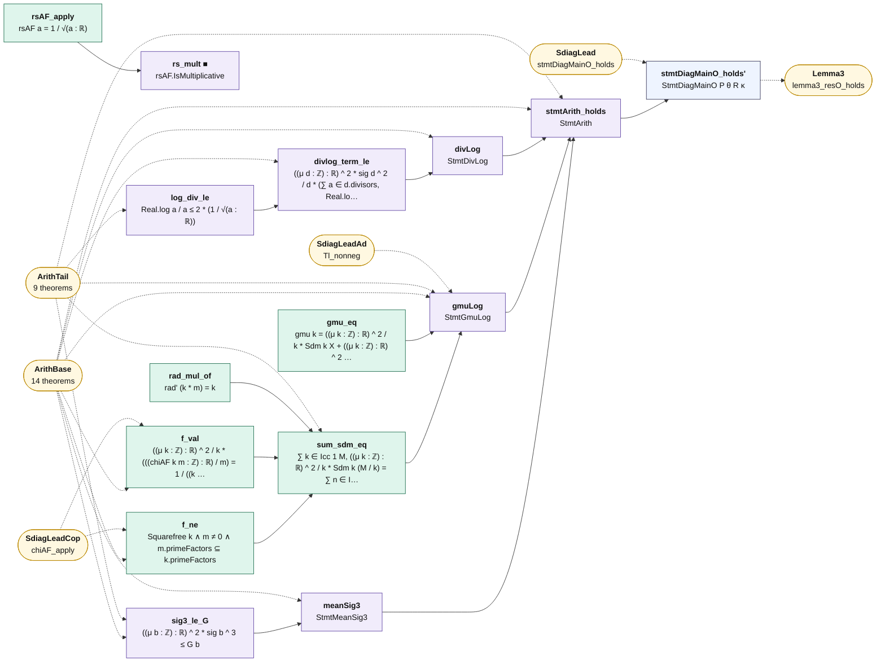

# `lean_stage3/Stage3/Arith.lean`

> **Read from the source text.** This file changed after the last `python3 utilities/lean_map.py --dump`, so the arrows on this page are names occurring in each proof and have not been confirmed by Lean.

# Stage3.Arith — S12 (`design/stencil.md` § S12), `SdiagLead.StmtArith` proved, and `StmtDiagMainO`. 2026-11-25.

15 theorems, 1 definition, 275 lines. 

**Imports:** [`ArithTail`](../lean_stage3/ArithTail.md), [`SdiagLead`](../lean_stage3/SdiagLead.md)  
**Imported by:** [`Stage3`](../lean_stage3/Stage3.md), [`Lemma3`](../lean_stage3/Lemma3.md)

## The picture



An arrow A → B reads "A is used in the proof of B". Green: counting, integers only. Violet: shape, analysis with no ζ. Blue: reads ζ. A name ending in ■ is an end: nothing else uses it. Red: contains `sorry`. Yellow: theorems in another file, counted; a dotted arrow crosses files. Definitions are not drawn; they are listed below the diagram.

## Definitions

<a name="Arith-rsAF"></a>
### `Arith.rsAF`

def · line 66

`a ↦ 1/√a`, multiplicative.

- **Is:** `` rsAF : ArithmeticFunction ℝ := ⟨fun a => 1 / √(a : ℝ), by simp⟩ ``
- **Used by 2:** [`Arith.divlog_term_le`](#Arith-divlog_term_le), [`Arith.rsAF_apply`](#Arith-rsAF_apply)

## Theorems

<a name="Arith-sig3_le_G"></a>
### `Arith.sig3_le_G`

line 50 · arrows read from text

**Shape.** Uses real or complex analysis; nothing in it or beneath it reads ζ.

**Proves**

```lean
((μ b : ℤ) : ℝ) ^ 2 * sig b ^ 3 ≤ G b
```

**Needs** (its hypotheses)

  - `` b : ℕ ``

**Fed by** (7 theorems its proof uses)

  - [`Arith.G_nonneg`](../lean_stage3/ArithBase.md#Arith-G_nonneg) (ArithBase) — `` 0 ≤ G b ``
  - [`Arith.musq_of_not`](../lean_stage3/ArithBase.md#Arith-musq_of_not) (ArithBase) — `` ((μ a : ℤ) : ℝ) ^ 2 = 0 ``
  - [`Arith.musq_of_sq`](../lean_stage3/ArithBase.md#Arith-musq_of_sq) (ArithBase) — `` ((μ a : ℤ) : ℝ) ^ 2 = 1 ``
  - [`Arith.prod_le_G`](../lean_stage3/ArithBase.md#Arith-prod_le_G) (ArithBase) — `` ∏ p ∈ b.primeFactors, y p ≤ G b ``
  - [`Arith.sig_eq_prod`](../lean_stage3/ArithBase.md#Arith-sig_eq_prod) (ArithBase) — `` sig d = ∏ p ∈ d.primeFactors, sp p ``
  - [`Arith.sp_nonneg`](../lean_stage3/ArithTail.md#Arith-sp_nonneg) (ArithTail) — `` 0 ≤ sp p ``
  - [`Arith.spk_le`](../lean_stage3/ArithTail.md#Arith-spk_le) (ArithTail) — `` sp p ^ k ≤ 1 + xg p ``

**Definitions its proof touches:** [`Arith.G`](../lean_stage3/ArithBase.md#Arith-G), [`SdiagLead.sig`](../lean_stage3/SdiagLeadCore.md#SdiagLead-sig)

**Feeds** (1 that use it)

  - [`Arith.meanSig3`](#Arith-meanSig3) — `` StmtMeanSig3 ``

<a name="Arith-meanSig3"></a>
### `Arith.meanSig3`

line 57 · arrows read from text

**Shape.** Uses real or complex analysis; nothing in it or beneath it reads ζ.

**Why.** `StmtMeanSig3`: `Σ_{d ≤ M} μ²σ³/d ≤ 2 CM (1 + log M)`.

**Proves**

```lean
StmtMeanSig3
```

**Fed by** (3 theorems its proof uses)

  - [`Arith.sig3_le_G`](#Arith-sig3_le_G) — `` ((μ b : ℤ) : ℝ) ^ 2 * sig b ^ 3 ≤ G b ``
  - [`Arith.CM_pos`](../lean_stage3/ArithBase.md#Arith-CM_pos) (ArithBase) — `` 0 < CM ``
  - [`Arith.mean_G_all`](../lean_stage3/ArithBase.md#Arith-mean_G_all) (ArithBase) — `` ∑ b ∈ Icc 1 M, G b / b ≤ 2 * CM * (1 + Real.log M) ``

**Definitions its proof touches:** [`Arith.CM`](../lean_stage3/ArithBase.md#Arith-CM), [`Arith.G`](../lean_stage3/ArithBase.md#Arith-G), [`SdiagLead.StmtMeanSig3`](../lean_stage3/SdiagLeadAd.md#SdiagLead-StmtMeanSig3), [`SdiagLead.sig`](../lean_stage3/SdiagLeadCore.md#SdiagLead-sig)

**Feeds** (1 that use it)

  - [`Arith.stmtArith_holds`](#Arith-stmtArith_holds) — `` StmtArith ``

<a name="Arith-rsAF_apply"></a>
### `Arith.rsAF_apply`

line 68 · arrows read from text

**Counting.** Integers only: nothing in its statement or proof, or in anything it rests on, uses analysis or ζ.

**Proves**

```lean
rsAF a = 1 / √(a : ℝ)
```

**Needs** (its hypotheses)

  - `` a : ℕ ``

**Fed by:** no theorem of this repo; it stands on Mathlib and the definitions below.

**Definitions its proof touches:** [`Arith.rsAF`](#Arith-rsAF)

**Feeds** (1 that use it)

  - [`Arith.rs_mult`](#Arith-rs_mult) — `` rsAF.IsMultiplicative ``

<a name="Arith-rs_mult"></a>
### `Arith.rs_mult`

line 70 · arrows read from text

**Shape.** Uses real or complex analysis; nothing in it or beneath it reads ζ.

**Proves**

```lean
rsAF.IsMultiplicative
```

**Fed by** (1 theorem its proof uses)

  - [`Arith.rsAF_apply`](#Arith-rsAF_apply) — `` rsAF a = 1 / √(a : ℝ) ``

**Feeds:** nothing. It is an end.

<a name="Arith-log_div_le"></a>
### `Arith.log_div_le`

line 76 · arrows read from text

**Shape.** Uses real or complex analysis; nothing in it or beneath it reads ζ.

**Proves**

```lean
Real.log a / a ≤ 2 * (1 / √(a : ℝ))
```

**Needs** (its hypotheses)

  - `` a : ℕ ``

**Fed by** (1 theorem its proof uses)

  - [`Arith.one_add_log_le`](../lean_stage3/ArithTail.md#Arith-one_add_log_le) (ArithTail) — `` 1 + Real.log x ≤ 2 * √x ``

**Feeds** (1 that use it)

  - [`Arith.divlog_term_le`](#Arith-divlog_term_le) — `` ((μ d : ℤ) : ℝ) ^ 2 * sig d ^ 2 / d * (∑ a ∈ d.divisors, Real.log a / a) ≤ 2 * (G d / d) ``

<a name="Arith-divlog_term_le"></a>
### `Arith.divlog_term_le`

line 85 · arrows read from text

**Shape.** Uses real or complex analysis; nothing in it or beneath it reads ζ.

**Proves**

```lean
((μ d : ℤ) : ℝ) ^ 2 * sig d ^ 2 / d * (∑ a ∈ d.divisors, Real.log a / a) ≤ 2 * (G d / d)
```

**Needs** (its hypotheses)

  - `` d : ℕ ``

**Fed by** (8 theorems its proof uses)

  - [`Arith.log_div_le`](#Arith-log_div_le) — `` Real.log a / a ≤ 2 * (1 / √(a : ℝ)) ``
  - [`Arith.G_nonneg`](../lean_stage3/ArithBase.md#Arith-G_nonneg) (ArithBase) — `` 0 ≤ G b ``
  - [`Arith.musq_of_not`](../lean_stage3/ArithBase.md#Arith-musq_of_not) (ArithBase) — `` ((μ a : ℤ) : ℝ) ^ 2 = 0 ``
  - [`Arith.musq_of_sq`](../lean_stage3/ArithBase.md#Arith-musq_of_sq) (ArithBase) — `` ((μ a : ℤ) : ℝ) ^ 2 = 1 ``
  - [`Arith.prod_le_G`](../lean_stage3/ArithBase.md#Arith-prod_le_G) (ArithBase) — `` ∏ p ∈ b.primeFactors, y p ≤ G b ``
  - [`Arith.qp_bounds`](../lean_stage3/ArithBase.md#Arith-qp_bounds) (ArithBase) — `` 0 < qp p ∧ qp p ≤ 3 / 4 ∧ 1 / (p : ℝ) ≤ qp p ``
  - [`Arith.sig_eq_prod`](../lean_stage3/ArithBase.md#Arith-sig_eq_prod) (ArithBase) — `` sig d = ∏ p ∈ d.primeFactors, sp p ``
  - [`Arith.sp_bounds`](../lean_stage3/ArithBase.md#Arith-sp_bounds) (ArithBase) — `` 1 ≤ sp p ∧ sp p ≤ 2 ∧ sp p - 1 ≤ 2 / p ``

**Definitions its proof touches:** [`Arith.rsAF`](#Arith-rsAF), [`Arith.G`](../lean_stage3/ArithBase.md#Arith-G), [`Arith.qp`](../lean_stage3/ArithBase.md#Arith-qp), [`Arith.sp`](../lean_stage3/ArithBase.md#Arith-sp), [`Arith.xg`](../lean_stage3/ArithBase.md#Arith-xg), [`SdiagLead.sig`](../lean_stage3/SdiagLeadCore.md#SdiagLead-sig)

**Feeds** (1 that use it)

  - [`Arith.divLog`](#Arith-divLog) — `` StmtDivLog ``

<a name="Arith-divLog"></a>
### `Arith.divLog`

line 114 · arrows read from text

**Shape.** Uses real or complex analysis; nothing in it or beneath it reads ζ.

**Why.** `StmtDivLog`: `Σ_{d ≤ M} μ²σ²/d · Σ_{a|d} log a/a ≤ 4 CM (1 + log M)`.

**Proves**

```lean
StmtDivLog
```

**Fed by** (3 theorems its proof uses)

  - [`Arith.divlog_term_le`](#Arith-divlog_term_le) — `` ((μ d : ℤ) : ℝ) ^ 2 * sig d ^ 2 / d * (∑ a ∈ d.divisors, Real.log a / a) ≤ 2 * (G d / d) ``
  - [`Arith.CM_pos`](../lean_stage3/ArithBase.md#Arith-CM_pos) (ArithBase) — `` 0 < CM ``
  - [`Arith.mean_G_all`](../lean_stage3/ArithBase.md#Arith-mean_G_all) (ArithBase) — `` ∑ b ∈ Icc 1 M, G b / b ≤ 2 * CM * (1 + Real.log M) ``

**Definitions its proof touches:** [`Arith.CM`](../lean_stage3/ArithBase.md#Arith-CM), [`Arith.G`](../lean_stage3/ArithBase.md#Arith-G), [`SdiagLead.StmtDivLog`](../lean_stage3/SdiagLeadDsum.md#SdiagLead-StmtDivLog)

**Feeds** (1 that use it)

  - [`Arith.stmtArith_holds`](#Arith-stmtArith_holds) — `` StmtArith ``

<a name="Arith-f_ne"></a>
### `Arith.f_ne`

line 123 · arrows read from text

**Counting.** Integers only: nothing in its statement or proof, or in anything it rests on, uses analysis or ζ.

**Proves**

```lean
Squarefree k ∧ m ≠ 0 ∧ m.primeFactors ⊆ k.primeFactors
```

**Needs** (its hypotheses)

  - `` h : ((μ k : ℤ) : ℝ) ^ 2 / k * (((chiAF k m : ℤ) : ℝ) / m) ≠ 0 ``

**Fed by** (2 theorems its proof uses)

  - [`Arith.musq_of_not`](../lean_stage3/ArithBase.md#Arith-musq_of_not) (ArithBase) — `` ((μ a : ℤ) : ℝ) ^ 2 = 0 ``
  - [`SdiagLead.chiAF_apply`](../lean_stage3/SdiagLeadCop.md#SdiagLead-chiAF_apply) (SdiagLeadCop) — `` chiAF d m = if m ≠ 0 ∧ m.primeFactors ⊆ d.primeFactors then 1 else 0 ``

**Definitions its proof touches:** [`SdiagLead.chiAF`](../lean_stage3/SdiagLeadCop.md#SdiagLead-chiAF)

**Feeds** (1 that use it)

  - [`Arith.sum_sdm_eq`](#Arith-sum_sdm_eq) — `` ∑ k ∈ Icc 1 M, ((μ k : ℤ) : ℝ) ^ 2 / k * Sdm k (M / k) = ∑ n ∈ Icc 1 M, (1 : ℝ) / n ``

<a name="Arith-f_val"></a>
### `Arith.f_val`

line 132 · arrows read from text

**Counting.** Integers only: nothing in its statement or proof, or in anything it rests on, uses analysis or ζ.

**Proves**

```lean
((μ k : ℤ) : ℝ) ^ 2 / k * (((chiAF k m : ℤ) : ℝ) / m) = 1 / ((k * m : ℕ) : ℝ)
```

**Needs** (its hypotheses)

  - `` hk : Squarefree k ``
  - `` hm : m ≠ 0 ``
  - `` hc : m.primeFactors ⊆ k.primeFactors ``

**Fed by** (2 theorems its proof uses)

  - [`Arith.musq_of_sq`](../lean_stage3/ArithBase.md#Arith-musq_of_sq) (ArithBase) — `` ((μ a : ℤ) : ℝ) ^ 2 = 1 ``
  - [`SdiagLead.chiAF_apply`](../lean_stage3/SdiagLeadCop.md#SdiagLead-chiAF_apply) (SdiagLeadCop) — `` chiAF d m = if m ≠ 0 ∧ m.primeFactors ⊆ d.primeFactors then 1 else 0 ``

**Definitions its proof touches:** [`SdiagLead.chiAF`](../lean_stage3/SdiagLeadCop.md#SdiagLead-chiAF)

**Feeds** (1 that use it)

  - [`Arith.sum_sdm_eq`](#Arith-sum_sdm_eq) — `` ∑ k ∈ Icc 1 M, ((μ k : ℤ) : ℝ) ^ 2 / k * Sdm k (M / k) = ∑ n ∈ Icc 1 M, (1 : ℝ) / n ``

<a name="Arith-rad_mul_of"></a>
### `Arith.rad_mul_of`

line 136 · arrows read from text

**Counting.** Integers only: nothing in its statement or proof, or in anything it rests on, uses analysis or ζ.

**Proves**

```lean
rad' (k * m) = k
```

**Needs** (its hypotheses)

  - `` hk : Squarefree k ``
  - `` hm : m ≠ 0 ``
  - `` hc : m.primeFactors ⊆ k.primeFactors ``

**Fed by:** no theorem of this repo; it stands on Mathlib and the definitions below.

**Definitions its proof touches:** [`Arith.rad'`](../lean_stage3/ArithTail.md#Arith-rad-)

**Feeds** (1 that use it)

  - [`Arith.sum_sdm_eq`](#Arith-sum_sdm_eq) — `` ∑ k ∈ Icc 1 M, ((μ k : ℤ) : ℝ) ^ 2 / k * Sdm k (M / k) = ∑ n ∈ Icc 1 M, (1 : ℝ) / n ``

<a name="Arith-sum_sdm_eq"></a>
### `Arith.sum_sdm_eq`

line 143 · arrows read from text

**Counting.** Integers only: nothing in its statement or proof, or in anything it rests on, uses analysis or ζ.

**Why.** The bijection `n ↦ (rad n, n/rad n)`: `Σ_{k ≤ M} (μ²(k)/k) S_k(M/k) = Σ_{n ≤ M} 1/n`.

**Proves**

```lean
∑ k ∈ Icc 1 M, ((μ k : ℤ) : ℝ) ^ 2 / k * Sdm k (M / k) = ∑ n ∈ Icc 1 M, (1 : ℝ) / n
```

**Needs** (its hypotheses)

  - `` M : ℕ ``

**Fed by** (7 theorems its proof uses)

  - [`Arith.f_ne`](#Arith-f_ne) — `` Squarefree k ∧ m ≠ 0 ∧ m.primeFactors ⊆ k.primeFactors ``
  - [`Arith.f_val`](#Arith-f_val) — `` ((μ k : ℤ) : ℝ) ^ 2 / k * (((chiAF k m : ℤ) : ℝ) / m) = 1 / ((k * m : ℕ) : ℝ) ``
  - [`Arith.rad_mul_of`](#Arith-rad_mul_of) — `` rad' (k * m) = k ``
  - [`Arith.rad_dvd`](../lean_stage3/ArithTail.md#Arith-rad_dvd) (ArithTail) — `` rad' m ∣ m ``
  - [`Arith.rad_pf`](../lean_stage3/ArithTail.md#Arith-rad_pf) (ArithTail) — `` (rad' m).primeFactors = m.primeFactors ``
  - [`Arith.rad_pos`](../lean_stage3/ArithTail.md#Arith-rad_pos) (ArithTail) — `` 0 < rad' m ``
  - [`Arith.rad_squarefree`](../lean_stage3/ArithTail.md#Arith-rad_squarefree) (ArithTail) — `` Squarefree (rad' n) ``

**Definitions its proof touches:** [`Arith.rad'`](../lean_stage3/ArithTail.md#Arith-rad-), [`SdiagLead.Sdm`](../lean_stage3/SdiagLeadAd.md#SdiagLead-Sdm)

**Feeds** (1 that use it)

  - [`Arith.gmuLog`](#Arith-gmuLog) — `` StmtGmuLog ``

<a name="Arith-gmu_eq"></a>
### `Arith.gmu_eq`

line 187 · arrows read from text

**Counting.** Integers only: nothing in its statement or proof, or in anything it rests on, uses analysis or ζ.

**Proves**

```lean
gmu k = ((μ k : ℤ) : ℝ) ^ 2 / k * Sdm k X + ((μ k : ℤ) : ℝ) ^ 2 / k * Tl k X
```

**Needs** (its hypotheses)

  - `` hk : k ≠ 0 ``
  - `` X : ℕ ``

**Fed by:** no theorem of this repo; it stands on Mathlib and the definitions below.

**Definitions its proof touches:** [`SdiagLead.Sdm`](../lean_stage3/SdiagLeadAd.md#SdiagLead-Sdm), [`SdiagLead.Tl`](../lean_stage3/SdiagLeadAd.md#SdiagLead-Tl), [`SdiagLead.sig`](../lean_stage3/SdiagLeadCore.md#SdiagLead-sig), [`SdiagLead.gmu`](../lean_stage3/SdiagLeadDsum.md#SdiagLead-gmu)

**Feeds** (1 that use it)

  - [`Arith.gmuLog`](#Arith-gmuLog) — `` StmtGmuLog ``

<a name="Arith-gmuLog"></a>
### `Arith.gmuLog`

line 196 · arrows read from text

**Shape.** Uses real or complex analysis; nothing in it or beneath it reads ζ.

**Why.** `StmtGmuLog`: `|Σ_{k ≤ t} μ²(k)/φ(k) − log t| ≤ 1 + CM·KV`.

**Proves**

```lean
StmtGmuLog
```

**Fed by** (9 theorems its proof uses)

  - [`Arith.gmu_eq`](#Arith-gmu_eq) — `` gmu k = ((μ k : ℤ) : ℝ) ^ 2 / k * Sdm k X + ((μ k : ℤ) : ℝ) ^ 2 / k * Tl k X ``
  - [`Arith.sum_sdm_eq`](#Arith-sum_sdm_eq) — `` ∑ k ∈ Icc 1 M, ((μ k : ℤ) : ℝ) ^ 2 / k * Sdm k (M / k) = ∑ n ∈ Icc 1 M, (1 : ℝ) / n ``
  - [`Arith.log_le_sum_inv_Icc`](../lean_stage3/ArithBase.md#Arith-log_le_sum_inv_Icc) (ArithBase) — `` Real.log ((n : ℝ) + 1) ≤ ∑ b ∈ Icc 1 n, (1 : ℝ) / b ``
  - [`Arith.musq_nonneg`](../lean_stage3/ArithBase.md#Arith-musq_nonneg) (ArithBase) — `` 0 ≤ ((μ a : ℤ) : ℝ) ^ 2 ``
  - [`Arith.sdmLe`](../lean_stage3/ArithBase.md#Arith-sdmLe) (ArithBase) — `` StmtSdmLe ``
  - [`Arith.sig_ge_one`](../lean_stage3/ArithBase.md#Arith-sig_ge_one) (ArithBase) — `` 1 ≤ sig d ``
  - [`Arith.sum_inv_Icc_le`](../lean_stage3/ArithBase.md#Arith-sum_inv_Icc_le) (ArithBase) — `` ∑ b ∈ Icc 1 n, (1 : ℝ) / b ≤ 1 + Real.log n ``
  - [`Arith.tailAvg`](../lean_stage3/ArithTail.md#Arith-tailAvg) (ArithTail) — `` StmtTailAvg ``
  - [`SdiagLead.Tl_nonneg`](../lean_stage3/SdiagLeadAd.md#SdiagLead-Tl_nonneg) (SdiagLeadAd) — `` 0 ≤ Tl d X ``

**Definitions its proof touches:** [`SdiagLead.Tl`](../lean_stage3/SdiagLeadAd.md#SdiagLead-Tl), [`SdiagLead.sig`](../lean_stage3/SdiagLeadCore.md#SdiagLead-sig), [`SdiagLead.StmtGmuLog`](../lean_stage3/SdiagLeadDsum.md#SdiagLead-StmtGmuLog), [`SdiagLead.gmu`](../lean_stage3/SdiagLeadDsum.md#SdiagLead-gmu)

**Feeds** (1 that use it)

  - [`Arith.stmtArith_holds`](#Arith-stmtArith_holds) — `` StmtArith ``

<a name="Arith-stmtArith_holds"></a>
### `Arith.stmtArith_holds`

line 240 · arrows read from text

**Shape.** Uses real or complex analysis; nothing in it or beneath it reads ζ.

**Why.** `StmtArith`, the six arithmetic facts.

**Proves**

```lean
StmtArith
```

**Fed by** (6 theorems its proof uses)

  - [`Arith.divLog`](#Arith-divLog) — `` StmtDivLog ``
  - [`Arith.gmuLog`](#Arith-gmuLog) — `` StmtGmuLog ``
  - [`Arith.meanSig3`](#Arith-meanSig3) — `` StmtMeanSig3 ``
  - [`Arith.sdmLe`](../lean_stage3/ArithBase.md#Arith-sdmLe) (ArithBase) — `` StmtSdmLe ``
  - [`Arith.tailAvg`](../lean_stage3/ArithTail.md#Arith-tailAvg) (ArithTail) — `` StmtTailAvg ``
  - [`Arith.tailFixed`](../lean_stage3/ArithTail.md#Arith-tailFixed) (ArithTail) — `` StmtTailFixed ``

**Definitions its proof touches:** [`SdiagLead.StmtArith`](../lean_stage3/SdiagLead.md#SdiagLead-StmtArith)

**Feeds** (1 that use it)

  - [`Arith.stmtDiagMainO_holds'`](#Arith-stmtDiagMainO_holds-) — `` StmtDiagMainO P θ R κ ``

<a name="Arith-stmtDiagMainO_holds-"></a>
### `Arith.stmtDiagMainO_holds'`

line 244 · arrows read from text

**Reads ζ.** It, or something it rests on, uses the zeta function, its zeros or the Riemann hypothesis.

**Why.** The main term, little-o, unconditional: `ζ(1+α+β) S(α,β,0) = c₁(α,β) + o(1)`.

**Proves**

```lean
StmtDiagMainO P θ R κ
```

**Needs** (its hypotheses)

  - `` P : Polynomial ℝ ``
  - `` hP0 : P.eval 0 = 0 ``
  - `` hθ0 : 0 < θ ``
  - `` hθ : θ < 1 / 2 ``
  - `` R : ℝ ``
  - `` hκ : 0 < κ ``

**Fed by** (2 theorems its proof uses)

  - [`Arith.stmtArith_holds`](#Arith-stmtArith_holds) — `` StmtArith ``
  - [`SdiagLead.stmtDiagMainO_holds`](../lean_stage3/SdiagLead.md#SdiagLead-stmtDiagMainO_holds) (SdiagLead) — `` StmtDiagMainO P θ R κ ``

**Definitions its proof touches:** [`DiagMainStmt.StmtDiagMainO`](../lean_stage3/DiagMainStmt.md#DiagMainStmt-StmtDiagMainO)

**Feeds** (1 that use it)

  - [`Lemma3.lemma3_resO_holds`](../lean_stage3/Lemma3.md#Lemma3-lemma3_resO_holds) (Lemma3) — `` StmtLemma3resO P θ R κ ``

