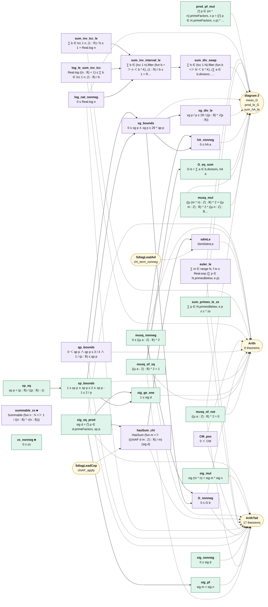
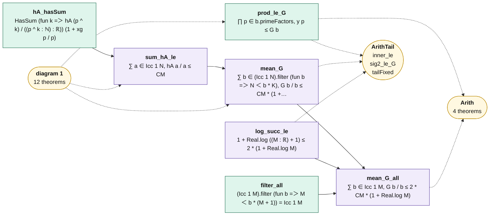

# `lean_stage3/Stage3/ArithBase.lean`

> **Read from the source text.** This file changed after the last `python3 utilities/lean_map.py --dump`, so the arrows on this page are names occurring in each proof and have not been confirmed by Lean.

# Stage3.ArithBase — S12 (`design/stencil.md` § S12), the arithmetic tools for `StmtArith`. 2026-11-25.

37 theorems, 8 definitions, 451 lines. 

**Imports:** [`SdiagLeadDsum`](../lean_stage3/SdiagLeadDsum.md)  
**Imported by:** [`ArithTail`](../lean_stage3/ArithTail.md)

## The picture

### Diagram 1 of 2: `sig_eq_prod` to `G_eq_sum`



### Diagram 2 of 2: `prod_le_G` to `mean_G_all`



An arrow A → B reads "A is used in the proof of B". Green: counting, integers only. Violet: shape, analysis with no ζ. Blue: reads ζ. A name ending in ■ is an end: nothing else uses it. Red: contains `sorry`. Yellow: theorems in another file, counted; a dotted arrow crosses files. Definitions are not drawn; they are listed below the diagram.

## Definitions

<a name="Arith-sp"></a>
### `Arith.sp`

def · line 46

`s(p) = (1 − 1/p)⁻¹`.

- **Is:** `` sp (p : ℕ) : ℝ := (1 - (p : ℝ)⁻¹)⁻¹ ``
- **Used by 13:** [`Arith.divlog_term_le`](../lean_stage3/Arith.md#Arith-divlog_term_le), [`Arith.sig_eq_prod`](#Arith-sig_eq_prod), [`Arith.sp_bounds`](#Arith-sp_bounds), [`Arith.sp_eq`](#Arith-sp_eq), [`Arith.xg`](#Arith-xg), [`Arith.xg_bounds`](#Arith-xg_bounds), [`Arith.fV_e_le`](../lean_stage3/ArithTail.md#Arith-fV_e_le), [`Arith.fV_e_nonneg`](../lean_stage3/ArithTail.md#Arith-fV_e_nonneg), [`Arith.fV_hasSum`](../lean_stage3/ArithTail.md#Arith-fV_hasSum), [`Arith.fV_prime_pow`](../lean_stage3/ArithTail.md#Arith-fV_prime_pow), [`Arith.sig_prime_pow`](../lean_stage3/ArithTail.md#Arith-sig_prime_pow), [`Arith.sp_nonneg`](../lean_stage3/ArithTail.md#Arith-sp_nonneg), [`Arith.spk_le`](../lean_stage3/ArithTail.md#Arith-spk_le)

<a name="Arith-invHom"></a>
### `Arith.invHom`

def · line 107

`m ↦ 1/m` as a monoid hom.

- **Is:** `` invHom : ℕ →* ℝ where toFun m := (m : ℝ)⁻¹ map_one' := by simp map_mul' m n := by push_cast; rw [mul_inv] ``
- **Used by 1:** [`Arith.hasSum_chi`](#Arith-hasSum_chi)

<a name="Arith-zs"></a>
### `Arith.zs`

def · line 170

`zs = Σ_n 1/(n√n)`.

- **Is:** `` zs : ℝ := ∑' n : ℕ, 1 / ((n : ℝ) * √(n : ℝ)) ``
- **Used by 4:** [`Arith.CM`](#Arith-CM), [`Arith.sum_primes_le_zs`](#Arith-sum_primes_le_zs), [`Arith.zs_nonneg`](#Arith-zs_nonneg), [`Arith.CV`](../lean_stage3/ArithTail.md#Arith-CV)

<a name="Arith-qp"></a>
### `Arith.qp`

def · line 280

`q(p) = 1/√p`.

- **Is:** `` qp (p : ℕ) : ℝ := 1 / √(p : ℝ) ``
- **Used by 9:** [`Arith.divlog_term_le`](../lean_stage3/Arith.md#Arith-divlog_term_le), [`Arith.qp_bounds`](#Arith-qp_bounds), [`Arith.xg`](#Arith-xg), [`Arith.xg_bounds`](#Arith-xg_bounds), [`Arith.xg_div_le`](#Arith-xg_div_le), [`Arith.fV_e_le`](../lean_stage3/ArithTail.md#Arith-fV_e_le), [`Arith.fV_e_nonneg`](../lean_stage3/ArithTail.md#Arith-fV_e_nonneg), [`Arith.fV_hasSum`](../lean_stage3/ArithTail.md#Arith-fV_hasSum), [`Arith.fV_prime_pow`](../lean_stage3/ArithTail.md#Arith-fV_prime_pow)

<a name="Arith-xg"></a>
### `Arith.xg`

def · line 283

`x(p) = σ(p)³(1 + 1/√p) − 1`.

- **Is:** `` xg (p : ℕ) : ℝ := sp p ^ 3 * (1 + qp p) - 1 ``
- **Built from:** [`Arith.qp`](#Arith-qp), [`Arith.sp`](#Arith-sp)
- **Used by 10:** [`Arith.divlog_term_le`](../lean_stage3/Arith.md#Arith-divlog_term_le), [`Arith.G`](#Arith-G), [`Arith.G_eq_sum`](#Arith-G_eq_sum), [`Arith.hA`](#Arith-hA), [`Arith.hA_hasSum`](#Arith-hA_hasSum), [`Arith.prod_le_G`](#Arith-prod_le_G), [`Arith.sum_hA_le`](#Arith-sum_hA_le), [`Arith.xg_bounds`](#Arith-xg_bounds), [`Arith.xg_div_le`](#Arith-xg_div_le), [`Arith.spk_le`](../lean_stage3/ArithTail.md#Arith-spk_le)

<a name="Arith-hA"></a>
### `Arith.hA`

def · line 286

`hA(a) = μ²(a) Π_{p|a} x(p)`.

- **Is:** `` hA (a : ℕ) : ℝ := ((μ a : ℤ) : ℝ) ^ 2 * ∏ p ∈ a.primeFactors, xg p ``
- **Built from:** [`Arith.xg`](#Arith-xg)
- **Used by 5:** [`Arith.G_eq_sum`](#Arith-G_eq_sum), [`Arith.hA_hasSum`](#Arith-hA_hasSum), [`Arith.hA_nonneg`](#Arith-hA_nonneg), [`Arith.mean_G`](#Arith-mean_G), [`Arith.sum_hA_le`](#Arith-sum_hA_le)

<a name="Arith-G"></a>
### `Arith.G`

def · line 289

`G(b) = μ²(b) Π_{p|b} (1 + x(p))`.

- **Is:** `` G (b : ℕ) : ℝ := ((μ b : ℤ) : ℝ) ^ 2 * ∏ p ∈ b.primeFactors, (1 + xg p) ``
- **Built from:** [`Arith.xg`](#Arith-xg)
- **Used by 12:** [`Arith.divLog`](../lean_stage3/Arith.md#Arith-divLog), [`Arith.divlog_term_le`](../lean_stage3/Arith.md#Arith-divlog_term_le), [`Arith.meanSig3`](../lean_stage3/Arith.md#Arith-meanSig3), [`Arith.sig3_le_G`](../lean_stage3/Arith.md#Arith-sig3_le_G), [`Arith.G_eq_sum`](#Arith-G_eq_sum), [`Arith.G_nonneg`](#Arith-G_nonneg), [`Arith.mean_G`](#Arith-mean_G), [`Arith.mean_G_all`](#Arith-mean_G_all), [`Arith.prod_le_G`](#Arith-prod_le_G), [`Arith.inner_le`](../lean_stage3/ArithTail.md#Arith-inner_le), [`Arith.phiB`](../lean_stage3/ArithTail.md#Arith-phiB), [`Arith.sig2_le_G`](../lean_stage3/ArithTail.md#Arith-sig2_le_G)

<a name="Arith-CM"></a>
### `Arith.CM`

def · line 292

`CM = exp(29 zs)`.

- **Is:** `` CM : ℝ := Real.exp (29 * zs) ``
- **Built from:** [`Arith.zs`](#Arith-zs)
- **Used by 9:** [`Arith.divLog`](../lean_stage3/Arith.md#Arith-divLog), [`Arith.meanSig3`](../lean_stage3/Arith.md#Arith-meanSig3), [`Arith.CM_pos`](#Arith-CM_pos), [`Arith.mean_G`](#Arith-mean_G), [`Arith.mean_G_all`](#Arith-mean_G_all), [`Arith.sum_hA_le`](#Arith-sum_hA_le), [`Arith.inner_le`](../lean_stage3/ArithTail.md#Arith-inner_le), [`Arith.tailAvg`](../lean_stage3/ArithTail.md#Arith-tailAvg), [`Arith.tailFixed`](../lean_stage3/ArithTail.md#Arith-tailFixed)

## Theorems

<a name="Arith-sig_eq_prod"></a>
### `Arith.sig_eq_prod`

line 48 · arrows read from text

**Counting.** Integers only: nothing in its statement or proof, or in anything it rests on, uses analysis or ζ.

**Proves**

```lean
sig d = ∏ p ∈ d.primeFactors, sp p
```

**Needs** (its hypotheses)

  - `` hd : d ≠ 0 ``

**Fed by:** no theorem of this repo; it stands on Mathlib and the definitions below.

**Definitions its proof touches:** [`Arith.sp`](#Arith-sp), [`SdiagLead.sig`](../lean_stage3/SdiagLeadCore.md#SdiagLead-sig)

**Feeds** (7 that use it)

  - [`Arith.divlog_term_le`](../lean_stage3/Arith.md#Arith-divlog_term_le) (Arith) — `` ((μ d : ℤ) : ℝ) ^ 2 * sig d ^ 2 / d * (∑ a ∈ d.divisors, Real.log a / a) ≤ 2 * (G d / d) ``
  - [`Arith.sig3_le_G`](../lean_stage3/Arith.md#Arith-sig3_le_G) (Arith) — `` ((μ b : ℤ) : ℝ) ^ 2 * sig b ^ 3 ≤ G b ``
  - [`Arith.hasSum_chi`](#Arith-hasSum_chi) — `` HasSum (fun m => ((chiAF d m : ℤ) : ℝ) / m) (sig d) ``
  - [`Arith.sig_ge_one`](#Arith-sig_ge_one) — `` 1 ≤ sig d ``
  - [`Arith.sig_pf`](#Arith-sig_pf) — `` sig m = sig n ``
  - [`Arith.sig2_le_G`](../lean_stage3/ArithTail.md#Arith-sig2_le_G) (ArithTail) — `` ((μ b : ℤ) : ℝ) ^ 2 * sig b ^ 2 ≤ G b ``
  - [`Arith.sig_prime_pow`](../lean_stage3/ArithTail.md#Arith-sig_prime_pow) (ArithTail) — `` sig (p ^ k) = sp p ``

<a name="Arith-sig_mul"></a>
### `Arith.sig_mul`

line 54 · arrows read from text

**Counting.** Integers only: nothing in its statement or proof, or in anything it rests on, uses analysis or ζ.

**Proves**

```lean
sig (m * n) = sig m * sig n
```

**Needs** (its hypotheses)

  - `` h : m.Coprime n ``

**Fed by:** no theorem of this repo; it stands on Mathlib and the definitions below.

**Definitions its proof touches:** [`SdiagLead.sig`](../lean_stage3/SdiagLeadCore.md#SdiagLead-sig)

**Feeds** (2 that use it)

  - [`Arith.fV_mul`](../lean_stage3/ArithTail.md#Arith-fV_mul) (ArithTail) — `` fV (m * n) = fV m * fV n ``
  - [`Arith.inner_le`](../lean_stage3/ArithTail.md#Arith-inner_le) (ArithTail) — `` ∑ d ∈ Icc 1 M, ((μ d : ℤ) : ℝ) ^ 2 * sig d ^ 2 / d * (if M < d * K ∧ m.primeFactors ⊆ d.primeFactors then (1 : ℝ) else 0) ≤ sig m ^ 2 / rad' m * (CM *… ``

<a name="Arith-sp_eq"></a>
### `Arith.sp_eq`

line 58 · arrows read from text

**Counting.** Integers only: nothing in its statement or proof, or in anything it rests on, uses analysis or ζ.

**Proves**

```lean
sp p = (p : ℝ) / ((p : ℝ) - 1)
```

**Needs** (its hypotheses)

  - `` hp : 2 ≤ p ``

**Fed by:** no theorem of this repo; it stands on Mathlib and the definitions below.

**Definitions its proof touches:** [`Arith.sp`](#Arith-sp)

**Feeds** (1 that use it)

  - [`Arith.sp_bounds`](#Arith-sp_bounds) — `` 1 ≤ sp p ∧ sp p ≤ 2 ∧ sp p - 1 ≤ 2 / p ``

<a name="Arith-sp_bounds"></a>
### `Arith.sp_bounds`

line 63 · arrows read from text

**Counting.** Integers only: nothing in its statement or proof, or in anything it rests on, uses analysis or ζ.

**Proves**

```lean
1 ≤ sp p ∧ sp p ≤ 2 ∧ sp p - 1 ≤ 2 / p
```

**Needs** (its hypotheses)

  - `` hp : 2 ≤ p ``

**Fed by** (1 theorem its proof uses)

  - [`Arith.sp_eq`](#Arith-sp_eq) — `` sp p = (p : ℝ) / ((p : ℝ) - 1) ``

**Definitions its proof touches:** [`Arith.sp`](#Arith-sp)

**Feeds** (6 that use it)

  - [`Arith.divlog_term_le`](../lean_stage3/Arith.md#Arith-divlog_term_le) (Arith) — `` ((μ d : ℤ) : ℝ) ^ 2 * sig d ^ 2 / d * (∑ a ∈ d.divisors, Real.log a / a) ≤ 2 * (G d / d) ``
  - [`Arith.sig_ge_one`](#Arith-sig_ge_one) — `` 1 ≤ sig d ``
  - [`Arith.xg_bounds`](#Arith-xg_bounds) — `` 0 ≤ xg p ∧ xg p ≤ 29 * qp p ``
  - [`Arith.fV_e_le`](../lean_stage3/ArithTail.md#Arith-fV_e_le) (ArithTail) — `` sp p ^ 2 / p * (qp p / (1 - qp p)) ≤ 16 / ((p : ℝ) * √(p : ℝ)) ``
  - [`Arith.sp_nonneg`](../lean_stage3/ArithTail.md#Arith-sp_nonneg) (ArithTail) — `` 0 ≤ sp p ``
  - [`Arith.spk_le`](../lean_stage3/ArithTail.md#Arith-spk_le) (ArithTail) — `` sp p ^ k ≤ 1 + xg p ``

<a name="Arith-sig_ge_one"></a>
### `Arith.sig_ge_one`

line 72 · arrows read from text

**Counting.** Integers only: nothing in its statement or proof, or in anything it rests on, uses analysis or ζ.

**Proves**

```lean
1 ≤ sig d
```

**Needs** (its hypotheses)

  - `` hd : d ≠ 0 ``

**Fed by** (2 theorems its proof uses)

  - [`Arith.sig_eq_prod`](#Arith-sig_eq_prod) — `` sig d = ∏ p ∈ d.primeFactors, sp p ``
  - [`Arith.sp_bounds`](#Arith-sp_bounds) — `` 1 ≤ sp p ∧ sp p ≤ 2 ∧ sp p - 1 ≤ 2 / p ``

**Definitions its proof touches:** [`SdiagLead.sig`](../lean_stage3/SdiagLeadCore.md#SdiagLead-sig)

**Feeds** (1 that use it)

  - [`Arith.gmuLog`](../lean_stage3/Arith.md#Arith-gmuLog) (Arith) — `` StmtGmuLog ``

<a name="Arith-sig_nonneg"></a>
### `Arith.sig_nonneg`

line 78 · arrows read from text

**Counting.** Integers only: nothing in its statement or proof, or in anything it rests on, uses analysis or ζ.

**Proves**

```lean
0 ≤ sig d
```

**Needs** (its hypotheses)

  - `` d : ℕ ``

**Fed by:** no theorem of this repo; it stands on Mathlib and the definitions below.

**Definitions its proof touches:** [`SdiagLead.sig`](../lean_stage3/SdiagLeadCore.md#SdiagLead-sig)

**Feeds** (1 that use it)

  - [`Arith.fV_nonneg`](../lean_stage3/ArithTail.md#Arith-fV_nonneg) (ArithTail) — `` 0 ≤ fV m ``

<a name="Arith-sig_pf"></a>
### `Arith.sig_pf`

line 80 · arrows read from text

**Counting.** Integers only: nothing in its statement or proof, or in anything it rests on, uses analysis or ζ.

**Proves**

```lean
sig m = sig n
```

**Needs** (its hypotheses)

  - `` hm : m ≠ 0 ``
  - `` hn : n ≠ 0 ``
  - `` h : m.primeFactors = n.primeFactors ``

**Fed by** (1 theorem its proof uses)

  - [`Arith.sig_eq_prod`](#Arith-sig_eq_prod) — `` sig d = ∏ p ∈ d.primeFactors, sp p ``

**Definitions its proof touches:** [`SdiagLead.sig`](../lean_stage3/SdiagLeadCore.md#SdiagLead-sig)

**Feeds** (1 that use it)

  - [`Arith.inner_le`](../lean_stage3/ArithTail.md#Arith-inner_le) (ArithTail) — `` ∑ d ∈ Icc 1 M, ((μ d : ℤ) : ℝ) ^ 2 * sig d ^ 2 / d * (if M < d * K ∧ m.primeFactors ⊆ d.primeFactors then (1 : ℝ) else 0) ≤ sig m ^ 2 / rad' m * (CM *… ``

<a name="Arith-musq_of_sq"></a>
### `Arith.musq_of_sq`

line 86 · arrows read from text

**Counting.** Integers only: nothing in its statement or proof, or in anything it rests on, uses analysis or ζ.

**Proves**

```lean
((μ a : ℤ) : ℝ) ^ 2 = 1
```

**Needs** (its hypotheses)

  - `` h : Squarefree a ``

**Fed by:** no theorem of this repo; it stands on Mathlib.

**Feeds** (7 that use it)

  - [`Arith.divlog_term_le`](../lean_stage3/Arith.md#Arith-divlog_term_le) (Arith) — `` ((μ d : ℤ) : ℝ) ^ 2 * sig d ^ 2 / d * (∑ a ∈ d.divisors, Real.log a / a) ≤ 2 * (G d / d) ``
  - [`Arith.f_val`](../lean_stage3/Arith.md#Arith-f_val) (Arith) — `` ((μ k : ℤ) : ℝ) ^ 2 / k * (((chiAF k m : ℤ) : ℝ) / m) = 1 / ((k * m : ℕ) : ℝ) ``
  - [`Arith.sig3_le_G`](../lean_stage3/Arith.md#Arith-sig3_le_G) (Arith) — `` ((μ b : ℤ) : ℝ) ^ 2 * sig b ^ 3 ≤ G b ``
  - [`Arith.G_eq_sum`](#Arith-G_eq_sum) — `` G b = ∑ a ∈ b.divisors, hA a ``
  - [`Arith.prod_le_G`](#Arith-prod_le_G) — `` ∏ p ∈ b.primeFactors, y p ≤ G b ``
  - [`Arith.inner_le`](../lean_stage3/ArithTail.md#Arith-inner_le) (ArithTail) — `` ∑ d ∈ Icc 1 M, ((μ d : ℤ) : ℝ) ^ 2 * sig d ^ 2 / d * (if M < d * K ∧ m.primeFactors ⊆ d.primeFactors then (1 : ℝ) else 0) ≤ sig m ^ 2 / rad' m * (CM *… ``
  - [`Arith.sig2_le_G`](../lean_stage3/ArithTail.md#Arith-sig2_le_G) (ArithTail) — `` ((μ b : ℤ) : ℝ) ^ 2 * sig b ^ 2 ≤ G b ``

<a name="Arith-musq_of_not"></a>
### `Arith.musq_of_not`

line 91 · arrows read from text

**Counting.** Integers only: nothing in its statement or proof, or in anything it rests on, uses analysis or ζ.

**Proves**

```lean
((μ a : ℤ) : ℝ) ^ 2 = 0
```

**Needs** (its hypotheses)

  - `` h : ¬ Squarefree a ``

**Fed by:** no theorem of this repo; it stands on Mathlib.

**Feeds** (6 that use it)

  - [`Arith.divlog_term_le`](../lean_stage3/Arith.md#Arith-divlog_term_le) (Arith) — `` ((μ d : ℤ) : ℝ) ^ 2 * sig d ^ 2 / d * (∑ a ∈ d.divisors, Real.log a / a) ≤ 2 * (G d / d) ``
  - [`Arith.f_ne`](../lean_stage3/Arith.md#Arith-f_ne) (Arith) — `` Squarefree k ∧ m ≠ 0 ∧ m.primeFactors ⊆ k.primeFactors ``
  - [`Arith.sig3_le_G`](../lean_stage3/Arith.md#Arith-sig3_le_G) (Arith) — `` ((μ b : ℤ) : ℝ) ^ 2 * sig b ^ 3 ≤ G b ``
  - [`Arith.mean_G`](#Arith-mean_G) — `` ∑ b ∈ (Icc 1 N).filter (fun b => N < b * K), G b / b ≤ CM * (1 + Real.log K) ``
  - [`Arith.inner_le`](../lean_stage3/ArithTail.md#Arith-inner_le) (ArithTail) — `` ∑ d ∈ Icc 1 M, ((μ d : ℤ) : ℝ) ^ 2 * sig d ^ 2 / d * (if M < d * K ∧ m.primeFactors ⊆ d.primeFactors then (1 : ℝ) else 0) ≤ sig m ^ 2 / rad' m * (CM *… ``
  - [`Arith.sig2_le_G`](../lean_stage3/ArithTail.md#Arith-sig2_le_G) (ArithTail) — `` ((μ b : ℤ) : ℝ) ^ 2 * sig b ^ 2 ≤ G b ``

<a name="Arith-musq_mul"></a>
### `Arith.musq_mul`

line 94 · arrows read from text

**Counting.** Integers only: nothing in its statement or proof, or in anything it rests on, uses analysis or ζ.

**Proves**

```lean
((μ (m * n) : ℤ) : ℝ) ^ 2 = ((μ m : ℤ) : ℝ) ^ 2 * ((μ n : ℤ) : ℝ) ^ 2
```

**Needs** (its hypotheses)

  - `` h : m.Coprime n ``

**Fed by:** no theorem of this repo; it stands on Mathlib.

**Feeds** (1 that use it)

  - [`Arith.sum_hA_le`](#Arith-sum_hA_le) — `` ∑ a ∈ Icc 1 N, hA a / a ≤ CM ``

<a name="Arith-musq_nonneg"></a>
### `Arith.musq_nonneg`

line 98 · arrows read from text

**Counting.** Integers only: nothing in its statement or proof, or in anything it rests on, uses analysis or ζ.

**Proves**

```lean
0 ≤ ((μ a : ℤ) : ℝ) ^ 2
```

**Needs** (its hypotheses)

  - `` a : ℕ ``

**Fed by:** no theorem of this repo; it stands on Mathlib.

**Feeds** (4 that use it)

  - [`Arith.gmuLog`](../lean_stage3/Arith.md#Arith-gmuLog) (Arith) — `` StmtGmuLog ``
  - [`Arith.G_nonneg`](#Arith-G_nonneg) — `` 0 ≤ G b ``
  - [`Arith.hA_nonneg`](#Arith-hA_nonneg) — `` 0 ≤ hA a ``
  - [`Arith.w_nonneg`](../lean_stage3/ArithTail.md#Arith-w_nonneg) (ArithTail) — `` 0 ≤ ((μ d : ℤ) : ℝ) ^ 2 * sig d ^ 2 / d ``

<a name="Arith-prod_pf_mul"></a>
### `Arith.prod_pf_mul`

line 100 · arrows read from text

**Counting.** Integers only: nothing in its statement or proof, or in anything it rests on, uses analysis or ζ.

**Proves**

```lean
∏ p ∈ (m * n).primeFactors, x p = (∏ p ∈ m.primeFactors, x p) * ∏ p ∈ n.primeFactors, x p
```

**Needs** (its hypotheses)

  - `` h : m.Coprime n ``

**Fed by:** no theorem of this repo; it stands on Mathlib.

**Feeds** (1 that use it)

  - [`Arith.sum_hA_le`](#Arith-sum_hA_le) — `` ∑ a ∈ Icc 1 N, hA a / a ≤ CM ``

<a name="Arith-hasSum_chi"></a>
### `Arith.hasSum_chi`

line 113 · arrows read from text

**Shape.** Uses real or complex analysis; nothing in it or beneath it reads ζ.

**Why.** `Σ_{m ∈ ⟨d⟩} 1/m = σ(d)`.

**Proves**

```lean
HasSum (fun m => ((chiAF d m : ℤ) : ℝ) / m) (sig d)
```

**Needs** (its hypotheses)

  - `` hd : d ≠ 0 ``

**Fed by** (2 theorems its proof uses)

  - [`Arith.sig_eq_prod`](#Arith-sig_eq_prod) — `` sig d = ∏ p ∈ d.primeFactors, sp p ``
  - [`SdiagLead.chiAF_apply`](../lean_stage3/SdiagLeadCop.md#SdiagLead-chiAF_apply) (SdiagLeadCop) — `` chiAF d m = if m ≠ 0 ∧ m.primeFactors ⊆ d.primeFactors then 1 else 0 ``

**Definitions its proof touches:** [`Arith.invHom`](#Arith-invHom), [`SdiagLead.chiAF`](../lean_stage3/SdiagLeadCop.md#SdiagLead-chiAF), [`SdiagLead.sig`](../lean_stage3/SdiagLeadCore.md#SdiagLead-sig)

**Feeds** (2 that use it)

  - [`Arith.sdmLe`](#Arith-sdmLe) — `` StmtSdmLe ``
  - [`Arith.hasSum_tail`](../lean_stage3/ArithTail.md#Arith-hasSum_tail) (ArithTail) — `` HasSum (tailF d X) (Tl d X) ``

<a name="Arith-sdmLe"></a>
### `Arith.sdmLe`

line 137 · arrows read from text

**Shape.** Uses real or complex analysis; nothing in it or beneath it reads ζ.

**Why.** `StmtSdmLe`: `S_d(X) ≤ σ(d)`.

**Proves**

```lean
StmtSdmLe
```

**Fed by** (2 theorems its proof uses)

  - [`Arith.hasSum_chi`](#Arith-hasSum_chi) — `` HasSum (fun m => ((chiAF d m : ℤ) : ℝ) / m) (sig d) ``
  - [`SdiagLead.chi_term_nonneg`](../lean_stage3/SdiagLeadAd.md#SdiagLead-chi_term_nonneg) (SdiagLeadAd) — `` 0 ≤ ((chiAF d m : ℤ) : ℝ) / m ``

**Definitions its proof touches:** [`SdiagLead.Sdm`](../lean_stage3/SdiagLeadAd.md#SdiagLead-Sdm), [`SdiagLead.StmtSdmLe`](../lean_stage3/SdiagLeadAd.md#SdiagLead-StmtSdmLe)

**Feeds** (2 that use it)

  - [`Arith.gmuLog`](../lean_stage3/Arith.md#Arith-gmuLog) (Arith) — `` StmtGmuLog ``
  - [`Arith.stmtArith_holds`](../lean_stage3/Arith.md#Arith-stmtArith_holds) (Arith) — `` StmtArith ``

<a name="Arith-euler_le"></a>
### `Arith.euler_le`

line 144 · arrows read from text

**Shape.** Uses real or complex analysis; nothing in it or beneath it reads ζ.

**Proves**

```lean
∑ m ∈ range N, f m ≤ Real.exp (∑ p ∈ N.primesBelow, e p)
```

**Needs** (its hypotheses)

  - `` h0 : ∀ n, 0 ≤ f n ``
  - `` hf0 : f 0 = 0 ``
  - `` h1 : f 1 = 1 ``
  - `` hmul : ∀ {m n : ℕ}, m.Coprime n → f (m * n) = f m * f n ``
  - `` he : ∀ p : ℕ, p.Prime → 0 ≤ e p ∧ HasSum (fun k => f (p ^ k)) (1 + e p) ``
  - `` N : ℕ ``

**Fed by:** no theorem of this repo; it stands on Mathlib.

**Feeds** (2 that use it)

  - [`Arith.sum_hA_le`](#Arith-sum_hA_le) — `` ∑ a ∈ Icc 1 N, hA a / a ≤ CM ``
  - [`Arith.sum_fV_le`](../lean_stage3/ArithTail.md#Arith-sum_fV_le) (ArithTail) — `` ∑ m ∈ range N, fV m ≤ CV ``

<a name="Arith-summable_zs"></a>
### `Arith.summable_zs`

line 172 · arrows read from text

**Shape.** Uses real or complex analysis; nothing in it or beneath it reads ζ.

**Proves**

```lean
Summable (fun n : ℕ => 1 / ((n : ℝ) * √(n : ℝ)))
```

**Fed by:** no theorem of this repo; it stands on Mathlib.

**Feeds:** nothing. It connects to nothing.

<a name="Arith-zs_nonneg"></a>
### `Arith.zs_nonneg`

line 181 · arrows read from text

**Counting.** Integers only: nothing in its statement or proof, or in anything it rests on, uses analysis or ζ.

**Proves**

```lean
0 ≤ zs
```

**Fed by:** no theorem of this repo; it stands on Mathlib and the definitions below.

**Definitions its proof touches:** [`Arith.zs`](#Arith-zs)

**Feeds:** nothing. It is an end.

<a name="Arith-sum_primes_le_zs"></a>
### `Arith.sum_primes_le_zs`

line 183 · arrows read from text

**Counting.** Integers only: nothing in its statement or proof, or in anything it rests on, uses analysis or ζ.

**Proves**

```lean
∑ p ∈ N.primesBelow, e p ≤ c * zs
```

**Needs** (its hypotheses)

  - `` hc : 0 ≤ c ``
  - `` he : ∀ p, p.Prime → e p ≤ c / ((p : ℝ) * √(p : ℝ)) ``
  - `` N : ℕ ``

**Fed by:** no theorem of this repo; it stands on Mathlib and the definitions below.

**Definitions its proof touches:** [`Arith.zs`](#Arith-zs)

**Feeds** (2 that use it)

  - [`Arith.sum_hA_le`](#Arith-sum_hA_le) — `` ∑ a ∈ Icc 1 N, hA a / a ≤ CM ``
  - [`Arith.sum_fV_le`](../lean_stage3/ArithTail.md#Arith-sum_fV_le) (ArithTail) — `` ∑ m ∈ range N, fV m ≤ CV ``

<a name="Arith-sum_inv_Icc_le"></a>
### `Arith.sum_inv_Icc_le`

line 194 · arrows read from text

**Shape.** Uses real or complex analysis; nothing in it or beneath it reads ζ.

**Proves**

```lean
∑ b ∈ Icc 1 n, (1 : ℝ) / b ≤ 1 + Real.log n
```

**Needs** (its hypotheses)

  - `` n : ℕ ``

**Fed by:** no theorem of this repo; it stands on Mathlib.

**Feeds** (2 that use it)

  - [`Arith.gmuLog`](../lean_stage3/Arith.md#Arith-gmuLog) (Arith) — `` StmtGmuLog ``
  - [`Arith.sum_inv_interval_le`](#Arith-sum_inv_interval_le) — `` ∑ b ∈ (Icc 1 n).filter (fun b => n < b * K), (1 : ℝ) / b ≤ 1 + Real.log K ``

<a name="Arith-log_le_sum_inv_Icc"></a>
### `Arith.log_le_sum_inv_Icc`

line 198 · arrows read from text

**Shape.** Uses real or complex analysis; nothing in it or beneath it reads ζ.

**Proves**

```lean
Real.log ((n : ℝ) + 1) ≤ ∑ b ∈ Icc 1 n, (1 : ℝ) / b
```

**Needs** (its hypotheses)

  - `` n : ℕ ``

**Fed by:** no theorem of this repo; it stands on Mathlib.

**Feeds** (2 that use it)

  - [`Arith.gmuLog`](../lean_stage3/Arith.md#Arith-gmuLog) (Arith) — `` StmtGmuLog ``
  - [`Arith.sum_inv_interval_le`](#Arith-sum_inv_interval_le) — `` ∑ b ∈ (Icc 1 n).filter (fun b => n < b * K), (1 : ℝ) / b ≤ 1 + Real.log K ``

<a name="Arith-log_nat_nonneg"></a>
### `Arith.log_nat_nonneg`

line 202 · arrows read from text

**Shape.** Uses real or complex analysis; nothing in it or beneath it reads ζ.

**Proves**

```lean
0 ≤ Real.log n
```

**Needs** (its hypotheses)

  - `` n : ℕ ``

**Fed by:** no theorem of this repo; it stands on Mathlib.

**Feeds** (5 that use it)

  - [`Arith.mean_G`](#Arith-mean_G) — `` ∑ b ∈ (Icc 1 N).filter (fun b => N < b * K), G b / b ≤ CM * (1 + Real.log K) ``
  - [`Arith.sum_inv_interval_le`](#Arith-sum_inv_interval_le) — `` ∑ b ∈ (Icc 1 n).filter (fun b => n < b * K), (1 : ℝ) / b ≤ 1 + Real.log K ``
  - [`Arith.V_nonneg`](../lean_stage3/ArithTail.md#Arith-V_nonneg) (ArithTail) — `` 0 ≤ V m ``
  - [`Arith.tailAvg`](../lean_stage3/ArithTail.md#Arith-tailAvg) (ArithTail) — `` StmtTailAvg ``
  - [`Arith.tailFixed`](../lean_stage3/ArithTail.md#Arith-tailFixed) (ArithTail) — `` StmtTailFixed ``

<a name="Arith-sum_inv_interval_le"></a>
### `Arith.sum_inv_interval_le`

line 205 · arrows read from text

**Shape.** Uses real or complex analysis; nothing in it or beneath it reads ζ.

**Why.** `Σ_{n/K < b ≤ n} 1/b ≤ 1 + log K`.

**Proves**

```lean
∑ b ∈ (Icc 1 n).filter (fun b => n < b * K), (1 : ℝ) / b ≤ 1 + Real.log K
```

**Needs** (its hypotheses)

  - `` n K : ℕ ``
  - `` hK : 1 ≤ K ``

**Fed by** (3 theorems its proof uses)

  - [`Arith.log_le_sum_inv_Icc`](#Arith-log_le_sum_inv_Icc) — `` Real.log ((n : ℝ) + 1) ≤ ∑ b ∈ Icc 1 n, (1 : ℝ) / b ``
  - [`Arith.log_nat_nonneg`](#Arith-log_nat_nonneg) — `` 0 ≤ Real.log n ``
  - [`Arith.sum_inv_Icc_le`](#Arith-sum_inv_Icc_le) — `` ∑ b ∈ Icc 1 n, (1 : ℝ) / b ≤ 1 + Real.log n ``

**Feeds** (1 that use it)

  - [`Arith.sum_div_swap`](#Arith-sum_div_swap) — `` ∑ b ∈ (Icc 1 N).filter (fun b => N < b * K), (∑ a ∈ b.divisors, h a) / b ≤ (1 + Real.log K) * ∑ a ∈ Icc 1 N, h a / a ``

<a name="Arith-sum_div_swap"></a>
### `Arith.sum_div_swap`

line 230 · arrows read from text

**Shape.** Uses real or complex analysis; nothing in it or beneath it reads ζ.

**Why.** The divisor swap: `Σ_{N/K < b ≤ N} (Σ_{a|b} h(a))/b ≤ (1 + log K) Σ_{a ≤ N} h(a)/a`.

**Proves**

```lean
∑ b ∈ (Icc 1 N).filter (fun b => N < b * K), (∑ a ∈ b.divisors, h a) / b ≤ (1 + Real.log K) * ∑ a ∈ Icc 1 N, h a / a
```

**Needs** (its hypotheses)

  - `` hh : ∀ a, 0 ≤ h a ``
  - `` N K : ℕ ``
  - `` hK : 1 ≤ K ``

**Fed by** (1 theorem its proof uses)

  - [`Arith.sum_inv_interval_le`](#Arith-sum_inv_interval_le) — `` ∑ b ∈ (Icc 1 n).filter (fun b => n < b * K), (1 : ℝ) / b ≤ 1 + Real.log K ``

**Feeds** (1 that use it)

  - [`Arith.mean_G`](#Arith-mean_G) — `` ∑ b ∈ (Icc 1 N).filter (fun b => N < b * K), G b / b ≤ CM * (1 + Real.log K) ``

<a name="Arith-CM_pos"></a>
### `Arith.CM_pos`

line 294 · arrows read from text

**Shape.** Uses real or complex analysis; nothing in it or beneath it reads ζ.

**Proves**

```lean
0 < CM
```

**Fed by:** no theorem of this repo; it stands on Mathlib and the definitions below.

**Definitions its proof touches:** [`Arith.CM`](#Arith-CM)

**Feeds** (4 that use it)

  - [`Arith.divLog`](../lean_stage3/Arith.md#Arith-divLog) (Arith) — `` StmtDivLog ``
  - [`Arith.meanSig3`](../lean_stage3/Arith.md#Arith-meanSig3) (Arith) — `` StmtMeanSig3 ``
  - [`Arith.tailAvg`](../lean_stage3/ArithTail.md#Arith-tailAvg) (ArithTail) — `` StmtTailAvg ``
  - [`Arith.tailFixed`](../lean_stage3/ArithTail.md#Arith-tailFixed) (ArithTail) — `` StmtTailFixed ``

<a name="Arith-qp_bounds"></a>
### `Arith.qp_bounds`

line 296 · arrows read from text

**Shape.** Uses real or complex analysis; nothing in it or beneath it reads ζ.

**Proves**

```lean
0 < qp p ∧ qp p ≤ 3 / 4 ∧ 1 / (p : ℝ) ≤ qp p
```

**Needs** (its hypotheses)

  - `` hp : 2 ≤ p ``

**Fed by:** no theorem of this repo; it stands on Mathlib and the definitions below.

**Definitions its proof touches:** [`Arith.qp`](#Arith-qp)

**Feeds** (6 that use it)

  - [`Arith.divlog_term_le`](../lean_stage3/Arith.md#Arith-divlog_term_le) (Arith) — `` ((μ d : ℤ) : ℝ) ^ 2 * sig d ^ 2 / d * (∑ a ∈ d.divisors, Real.log a / a) ≤ 2 * (G d / d) ``
  - [`Arith.xg_bounds`](#Arith-xg_bounds) — `` 0 ≤ xg p ∧ xg p ≤ 29 * qp p ``
  - [`Arith.fV_e_le`](../lean_stage3/ArithTail.md#Arith-fV_e_le) (ArithTail) — `` sp p ^ 2 / p * (qp p / (1 - qp p)) ≤ 16 / ((p : ℝ) * √(p : ℝ)) ``
  - [`Arith.fV_e_nonneg`](../lean_stage3/ArithTail.md#Arith-fV_e_nonneg) (ArithTail) — `` 0 ≤ sp p ^ 2 / p * (qp p / (1 - qp p)) ``
  - [`Arith.fV_hasSum`](../lean_stage3/ArithTail.md#Arith-fV_hasSum) (ArithTail) — `` HasSum (fun k => fV (p ^ k)) (1 + sp p ^ 2 / p * (qp p / (1 - qp p))) ``
  - [`Arith.spk_le`](../lean_stage3/ArithTail.md#Arith-spk_le) (ArithTail) — `` sp p ^ k ≤ 1 + xg p ``

<a name="Arith-xg_bounds"></a>
### `Arith.xg_bounds`

line 308 · arrows read from text

**Shape.** Uses real or complex analysis; nothing in it or beneath it reads ζ.

**Proves**

```lean
0 ≤ xg p ∧ xg p ≤ 29 * qp p
```

**Needs** (its hypotheses)

  - `` hp : 2 ≤ p ``

**Fed by** (2 theorems its proof uses)

  - [`Arith.qp_bounds`](#Arith-qp_bounds) — `` 0 < qp p ∧ qp p ≤ 3 / 4 ∧ 1 / (p : ℝ) ≤ qp p ``
  - [`Arith.sp_bounds`](#Arith-sp_bounds) — `` 1 ≤ sp p ∧ sp p ≤ 2 ∧ sp p - 1 ≤ 2 / p ``

**Definitions its proof touches:** [`Arith.qp`](#Arith-qp), [`Arith.sp`](#Arith-sp), [`Arith.xg`](#Arith-xg)

**Feeds** (4 that use it)

  - [`Arith.G_nonneg`](#Arith-G_nonneg) — `` 0 ≤ G b ``
  - [`Arith.hA_nonneg`](#Arith-hA_nonneg) — `` 0 ≤ hA a ``
  - [`Arith.sum_hA_le`](#Arith-sum_hA_le) — `` ∑ a ∈ Icc 1 N, hA a / a ≤ CM ``
  - [`Arith.xg_div_le`](#Arith-xg_div_le) — `` xg p / p ≤ 29 / ((p : ℝ) * √(p : ℝ)) ``

<a name="Arith-xg_div_le"></a>
### `Arith.xg_div_le`

line 328 · arrows read from text

**Shape.** Uses real or complex analysis; nothing in it or beneath it reads ζ.

**Proves**

```lean
xg p / p ≤ 29 / ((p : ℝ) * √(p : ℝ))
```

**Needs** (its hypotheses)

  - `` hp : p.Prime ``

**Fed by** (1 theorem its proof uses)

  - [`Arith.xg_bounds`](#Arith-xg_bounds) — `` 0 ≤ xg p ∧ xg p ≤ 29 * qp p ``

**Definitions its proof touches:** [`Arith.qp`](#Arith-qp), [`Arith.xg`](#Arith-xg)

**Feeds** (1 that use it)

  - [`Arith.sum_hA_le`](#Arith-sum_hA_le) — `` ∑ a ∈ Icc 1 N, hA a / a ≤ CM ``

<a name="Arith-hA_nonneg"></a>
### `Arith.hA_nonneg`

line 337 · arrows read from text

**Shape.** Uses real or complex analysis; nothing in it or beneath it reads ζ.

**Proves**

```lean
0 ≤ hA a
```

**Needs** (its hypotheses)

  - `` a : ℕ ``

**Fed by** (2 theorems its proof uses)

  - [`Arith.musq_nonneg`](#Arith-musq_nonneg) — `` 0 ≤ ((μ a : ℤ) : ℝ) ^ 2 ``
  - [`Arith.xg_bounds`](#Arith-xg_bounds) — `` 0 ≤ xg p ∧ xg p ≤ 29 * qp p ``

**Definitions its proof touches:** [`Arith.hA`](#Arith-hA)

**Feeds** (2 that use it)

  - [`Arith.mean_G`](#Arith-mean_G) — `` ∑ b ∈ (Icc 1 N).filter (fun b => N < b * K), G b / b ≤ CM * (1 + Real.log K) ``
  - [`Arith.sum_hA_le`](#Arith-sum_hA_le) — `` ∑ a ∈ Icc 1 N, hA a / a ≤ CM ``

<a name="Arith-G_nonneg"></a>
### `Arith.G_nonneg`

line 341 · arrows read from text

**Shape.** Uses real or complex analysis; nothing in it or beneath it reads ζ.

**Proves**

```lean
0 ≤ G b
```

**Needs** (its hypotheses)

  - `` b : ℕ ``

**Fed by** (2 theorems its proof uses)

  - [`Arith.musq_nonneg`](#Arith-musq_nonneg) — `` 0 ≤ ((μ a : ℤ) : ℝ) ^ 2 ``
  - [`Arith.xg_bounds`](#Arith-xg_bounds) — `` 0 ≤ xg p ∧ xg p ≤ 29 * qp p ``

**Definitions its proof touches:** [`Arith.G`](#Arith-G)

**Feeds** (4 that use it)

  - [`Arith.divlog_term_le`](../lean_stage3/Arith.md#Arith-divlog_term_le) (Arith) — `` ((μ d : ℤ) : ℝ) ^ 2 * sig d ^ 2 / d * (∑ a ∈ d.divisors, Real.log a / a) ≤ 2 * (G d / d) ``
  - [`Arith.sig3_le_G`](../lean_stage3/Arith.md#Arith-sig3_le_G) (Arith) — `` ((μ b : ℤ) : ℝ) ^ 2 * sig b ^ 3 ≤ G b ``
  - [`Arith.phiB_nonneg`](../lean_stage3/ArithTail.md#Arith-phiB_nonneg) (ArithTail) — `` 0 ≤ phiB m b ``
  - [`Arith.sig2_le_G`](../lean_stage3/ArithTail.md#Arith-sig2_le_G) (ArithTail) — `` ((μ b : ℤ) : ℝ) ^ 2 * sig b ^ 2 ≤ G b ``

<a name="Arith-G_eq_sum"></a>
### `Arith.G_eq_sum`

line 346 · arrows read from text

**Counting.** Integers only: nothing in its statement or proof, or in anything it rests on, uses analysis or ζ.

**Proves**

```lean
G b = ∑ a ∈ b.divisors, hA a
```

**Needs** (its hypotheses)

  - `` hb : Squarefree b ``

**Fed by** (1 theorem its proof uses)

  - [`Arith.musq_of_sq`](#Arith-musq_of_sq) — `` ((μ a : ℤ) : ℝ) ^ 2 = 1 ``

**Definitions its proof touches:** [`Arith.G`](#Arith-G), [`Arith.hA`](#Arith-hA), [`Arith.xg`](#Arith-xg)

**Feeds** (1 that use it)

  - [`Arith.mean_G`](#Arith-mean_G) — `` ∑ b ∈ (Icc 1 N).filter (fun b => N < b * K), G b / b ≤ CM * (1 + Real.log K) ``

<a name="Arith-prod_le_G"></a>
### `Arith.prod_le_G`

line 362 · arrows read from text

**Counting.** Integers only: nothing in its statement or proof, or in anything it rests on, uses analysis or ζ.

**Why.** A product over the primes of a squarefree `b` with factors `≤ 1 + x(p)` is `≤ G(b)`.

**Proves**

```lean
∏ p ∈ b.primeFactors, y p ≤ G b
```

**Needs** (its hypotheses)

  - `` hb : Squarefree b ``
  - `` hy : ∀ p, p.Prime → 0 ≤ y p ∧ y p ≤ 1 + xg p ``

**Fed by** (1 theorem its proof uses)

  - [`Arith.musq_of_sq`](#Arith-musq_of_sq) — `` ((μ a : ℤ) : ℝ) ^ 2 = 1 ``

**Definitions its proof touches:** [`Arith.G`](#Arith-G), [`Arith.xg`](#Arith-xg)

**Feeds** (3 that use it)

  - [`Arith.divlog_term_le`](../lean_stage3/Arith.md#Arith-divlog_term_le) (Arith) — `` ((μ d : ℤ) : ℝ) ^ 2 * sig d ^ 2 / d * (∑ a ∈ d.divisors, Real.log a / a) ≤ 2 * (G d / d) ``
  - [`Arith.sig3_le_G`](../lean_stage3/Arith.md#Arith-sig3_le_G) (Arith) — `` ((μ b : ℤ) : ℝ) ^ 2 * sig b ^ 3 ≤ G b ``
  - [`Arith.sig2_le_G`](../lean_stage3/ArithTail.md#Arith-sig2_le_G) (ArithTail) — `` ((μ b : ℤ) : ℝ) ^ 2 * sig b ^ 2 ≤ G b ``

<a name="Arith-hA_hasSum"></a>
### `Arith.hA_hasSum`

line 369 · arrows read from text

**Counting.** Integers only: nothing in its statement or proof, or in anything it rests on, uses analysis or ζ.

**Proves**

```lean
HasSum (fun k => hA (p ^ k) / ((p ^ k : ℕ) : ℝ)) (1 + xg p / p)
```

**Needs** (its hypotheses)

  - `` hp : p.Prime ``

**Fed by:** no theorem of this repo; it stands on Mathlib and the definitions below.

**Definitions its proof touches:** [`Arith.hA`](#Arith-hA), [`Arith.xg`](#Arith-xg)

**Feeds** (1 that use it)

  - [`Arith.sum_hA_le`](#Arith-sum_hA_le) — `` ∑ a ∈ Icc 1 N, hA a / a ≤ CM ``

<a name="Arith-sum_hA_le"></a>
### `Arith.sum_hA_le`

line 383 · arrows read from text

**Shape.** Uses real or complex analysis; nothing in it or beneath it reads ζ.

**Proves**

```lean
∑ a ∈ Icc 1 N, hA a / a ≤ CM
```

**Needs** (its hypotheses)

  - `` N : ℕ ``

**Fed by** (8 theorems its proof uses)

  - [`Arith.euler_le`](#Arith-euler_le) — `` ∑ m ∈ range N, f m ≤ Real.exp (∑ p ∈ N.primesBelow, e p) ``
  - [`Arith.hA_hasSum`](#Arith-hA_hasSum) — `` HasSum (fun k => hA (p ^ k) / ((p ^ k : ℕ) : ℝ)) (1 + xg p / p) ``
  - [`Arith.hA_nonneg`](#Arith-hA_nonneg) — `` 0 ≤ hA a ``
  - [`Arith.musq_mul`](#Arith-musq_mul) — `` ((μ (m * n) : ℤ) : ℝ) ^ 2 = ((μ m : ℤ) : ℝ) ^ 2 * ((μ n : ℤ) : ℝ) ^ 2 ``
  - [`Arith.prod_pf_mul`](#Arith-prod_pf_mul) — `` ∏ p ∈ (m * n).primeFactors, x p = (∏ p ∈ m.primeFactors, x p) * ∏ p ∈ n.primeFactors, x p ``
  - [`Arith.sum_primes_le_zs`](#Arith-sum_primes_le_zs) — `` ∑ p ∈ N.primesBelow, e p ≤ c * zs ``
  - [`Arith.xg_bounds`](#Arith-xg_bounds) — `` 0 ≤ xg p ∧ xg p ≤ 29 * qp p ``
  - [`Arith.xg_div_le`](#Arith-xg_div_le) — `` xg p / p ≤ 29 / ((p : ℝ) * √(p : ℝ)) ``

**Definitions its proof touches:** [`Arith.CM`](#Arith-CM), [`Arith.hA`](#Arith-hA), [`Arith.xg`](#Arith-xg)

**Feeds** (1 that use it)

  - [`Arith.mean_G`](#Arith-mean_G) — `` ∑ b ∈ (Icc 1 N).filter (fun b => N < b * K), G b / b ≤ CM * (1 + Real.log K) ``

<a name="Arith-mean_G"></a>
### `Arith.mean_G`

line 399 · arrows read from text

**Shape.** Uses real or complex analysis; nothing in it or beneath it reads ζ.

**Why.** The mean of `G`: `Σ_{N/K < b ≤ N} G(b)/b ≤ CM (1 + log K)`.

**Proves**

```lean
∑ b ∈ (Icc 1 N).filter (fun b => N < b * K), G b / b ≤ CM * (1 + Real.log K)
```

**Needs** (its hypotheses)

  - `` N K : ℕ ``
  - `` hK : 1 ≤ K ``

**Fed by** (6 theorems its proof uses)

  - [`Arith.G_eq_sum`](#Arith-G_eq_sum) — `` G b = ∑ a ∈ b.divisors, hA a ``
  - [`Arith.hA_nonneg`](#Arith-hA_nonneg) — `` 0 ≤ hA a ``
  - [`Arith.log_nat_nonneg`](#Arith-log_nat_nonneg) — `` 0 ≤ Real.log n ``
  - [`Arith.musq_of_not`](#Arith-musq_of_not) — `` ((μ a : ℤ) : ℝ) ^ 2 = 0 ``
  - [`Arith.sum_div_swap`](#Arith-sum_div_swap) — `` ∑ b ∈ (Icc 1 N).filter (fun b => N < b * K), (∑ a ∈ b.divisors, h a) / b ≤ (1 + Real.log K) * ∑ a ∈ Icc 1 N, h a / a ``
  - [`Arith.sum_hA_le`](#Arith-sum_hA_le) — `` ∑ a ∈ Icc 1 N, hA a / a ≤ CM ``

**Definitions its proof touches:** [`Arith.CM`](#Arith-CM), [`Arith.G`](#Arith-G), [`Arith.hA`](#Arith-hA)

**Feeds** (2 that use it)

  - [`Arith.mean_G_all`](#Arith-mean_G_all) — `` ∑ b ∈ Icc 1 M, G b / b ≤ 2 * CM * (1 + Real.log M) ``
  - [`Arith.inner_le`](../lean_stage3/ArithTail.md#Arith-inner_le) (ArithTail) — `` ∑ d ∈ Icc 1 M, ((μ d : ℤ) : ℝ) ^ 2 * sig d ^ 2 / d * (if M < d * K ∧ m.primeFactors ⊆ d.primeFactors then (1 : ℝ) else 0) ≤ sig m ^ 2 / rad' m * (CM *… ``

<a name="Arith-log_succ_le"></a>
### `Arith.log_succ_le`

line 414 · arrows read from text

**Shape.** Uses real or complex analysis; nothing in it or beneath it reads ζ.

**Why.** `1 + log(M + 1) ≤ 2(1 + log M)`.

**Proves**

```lean
1 + Real.log ((M : ℝ) + 1) ≤ 2 * (1 + Real.log M)
```

**Needs** (its hypotheses)

  - `` M : ℕ ``

**Fed by:** no theorem of this repo; it stands on Mathlib.

**Feeds** (2 that use it)

  - [`Arith.mean_G_all`](#Arith-mean_G_all) — `` ∑ b ∈ Icc 1 M, G b / b ≤ 2 * CM * (1 + Real.log M) ``
  - [`Arith.tailFixed`](../lean_stage3/ArithTail.md#Arith-tailFixed) (ArithTail) — `` StmtTailFixed ``

<a name="Arith-filter_all"></a>
### `Arith.filter_all`

line 425 · arrows read from text

**Counting.** Integers only: nothing in its statement or proof, or in anything it rests on, uses analysis or ζ.

**Proves**

```lean
(Icc 1 M).filter (fun b => M < b * (M + 1)) = Icc 1 M
```

**Needs** (its hypotheses)

  - `` M : ℕ ``

**Fed by:** no theorem of this repo; it stands on Mathlib.

**Feeds** (1 that use it)

  - [`Arith.mean_G_all`](#Arith-mean_G_all) — `` ∑ b ∈ Icc 1 M, G b / b ≤ 2 * CM * (1 + Real.log M) ``

<a name="Arith-mean_G_all"></a>
### `Arith.mean_G_all`

line 432 · arrows read from text

**Shape.** Uses real or complex analysis; nothing in it or beneath it reads ζ.

**Why.** The plain mean: `Σ_{b ≤ M} G(b)/b ≤ 2 CM (1 + log M)`.

**Proves**

```lean
∑ b ∈ Icc 1 M, G b / b ≤ 2 * CM * (1 + Real.log M)
```

**Needs** (its hypotheses)

  - `` M : ℕ ``

**Fed by** (3 theorems its proof uses)

  - [`Arith.filter_all`](#Arith-filter_all) — `` (Icc 1 M).filter (fun b => M < b * (M + 1)) = Icc 1 M ``
  - [`Arith.log_succ_le`](#Arith-log_succ_le) — `` 1 + Real.log ((M : ℝ) + 1) ≤ 2 * (1 + Real.log M) ``
  - [`Arith.mean_G`](#Arith-mean_G) — `` ∑ b ∈ (Icc 1 N).filter (fun b => N < b * K), G b / b ≤ CM * (1 + Real.log K) ``

**Definitions its proof touches:** [`Arith.CM`](#Arith-CM), [`Arith.G`](#Arith-G)

**Feeds** (2 that use it)

  - [`Arith.divLog`](../lean_stage3/Arith.md#Arith-divLog) (Arith) — `` StmtDivLog ``
  - [`Arith.meanSig3`](../lean_stage3/Arith.md#Arith-meanSig3) (Arith) — `` StmtMeanSig3 ``

