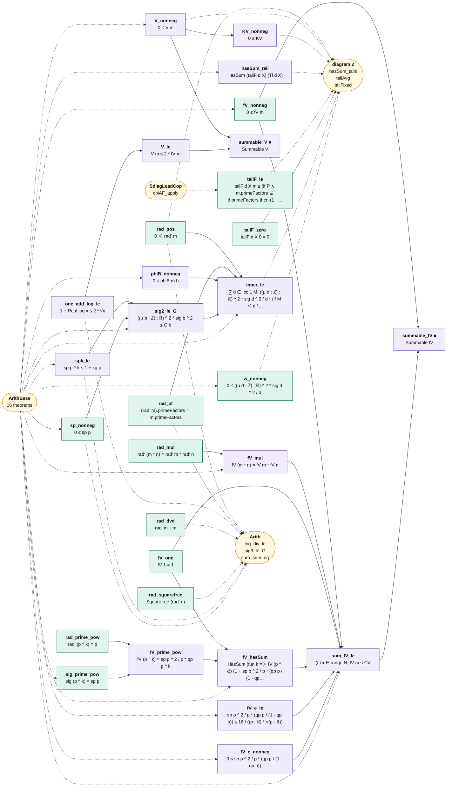
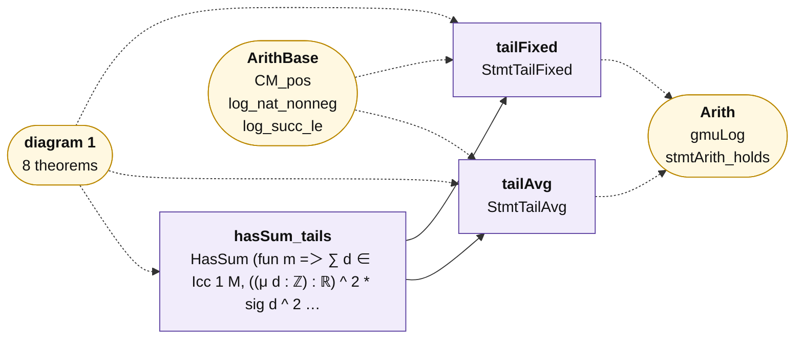

# `lean_stage3/Stage3/ArithTail.lean`

> **Read from the source text.** This file changed after the last `python3 utilities/lean_map.py --dump`, so the arrows on this page are names occurring in each proof and have not been confirmed by Lean.

# Stage3.ArithTail — S12 (`design/stencil.md` § S12), the two tails `StmtTailFixed`, `StmtTailAvg`. 2026-11-25.

33 theorems, 7 definitions, 472 lines. 

**Imports:** [`ArithBase`](../lean_stage3/ArithBase.md)  
**Imported by:** [`Arith`](../lean_stage3/Arith.md)

## The picture

### Diagram 1 of 2: `rad_pos` to `w_nonneg`



### Diagram 2 of 2: `hasSum_tails` to `tailFixed`



An arrow A → B reads "A is used in the proof of B". Green: counting, integers only. Violet: shape, analysis with no ζ. Blue: reads ζ. A name ending in ■ is an end: nothing else uses it. Red: contains `sorry`. Yellow: theorems in another file, counted; a dotted arrow crosses files. Definitions are not drawn; they are listed below the diagram.

## Definitions

<a name="Arith-rad-"></a>
### `Arith.rad'`

def · line 46

`rad m = Π_{p | m} p`.

- **Is:** `` rad' (m : ℕ) : ℕ := ∏ p ∈ m.primeFactors, p ``
- **Used by 16:** [`Arith.rad_mul_of`](../lean_stage3/Arith.md#Arith-rad_mul_of), [`Arith.sum_sdm_eq`](../lean_stage3/Arith.md#Arith-sum_sdm_eq), [`Arith.V`](#Arith-V), [`Arith.V_le`](#Arith-V_le), [`Arith.fV`](#Arith-fV), [`Arith.fV_one`](#Arith-fV_one), [`Arith.inner_le`](#Arith-inner_le), [`Arith.phiB`](#Arith-phiB), [`Arith.rad_dvd`](#Arith-rad_dvd), [`Arith.rad_mul`](#Arith-rad_mul), [`Arith.rad_pf`](#Arith-rad_pf), [`Arith.rad_pos`](#Arith-rad_pos), [`Arith.rad_prime_pow`](#Arith-rad_prime_pow), [`Arith.rad_squarefree`](#Arith-rad_squarefree), [`Arith.tailAvg`](#Arith-tailAvg), [`Arith.tailFixed`](#Arith-tailFixed)

<a name="Arith-fV"></a>
### `Arith.fV`

def · line 94

`fV(m) = σ(m)² √m/(m rad m)`.

- **Is:** `` fV (m : ℕ) : ℝ := sig m ^ 2 * √(m : ℝ) / ((m : ℝ) * rad' m) ``
- **Built from:** [`Arith.rad'`](#Arith-rad-), [`SdiagLead.sig`](../lean_stage3/SdiagLeadCore.md#SdiagLead-sig)
- **Used by 8:** [`Arith.V_le`](#Arith-V_le), [`Arith.fV_hasSum`](#Arith-fV_hasSum), [`Arith.fV_mul`](#Arith-fV_mul), [`Arith.fV_nonneg`](#Arith-fV_nonneg), [`Arith.fV_one`](#Arith-fV_one), [`Arith.fV_prime_pow`](#Arith-fV_prime_pow), [`Arith.sum_fV_le`](#Arith-sum_fV_le), [`Arith.summable_fV`](#Arith-summable_fV)

<a name="Arith-V"></a>
### `Arith.V`

def · line 97

`V(m) = σ(m)² (1 + log m)/(m rad m)`.

- **Is:** `` V (m : ℕ) : ℝ := sig m ^ 2 * (1 + Real.log m) / ((m : ℝ) * rad' m) ``
- **Built from:** [`Arith.rad'`](#Arith-rad-), [`SdiagLead.sig`](../lean_stage3/SdiagLeadCore.md#SdiagLead-sig)
- **Used by 6:** [`Arith.KV`](#Arith-KV), [`Arith.V_le`](#Arith-V_le), [`Arith.V_nonneg`](#Arith-V_nonneg), [`Arith.summable_V`](#Arith-summable_V), [`Arith.tailAvg`](#Arith-tailAvg), [`Arith.tailFixed`](#Arith-tailFixed)

<a name="Arith-KV"></a>
### `Arith.KV`

def · line 100

`KV = Σ_m V(m)`.

- **Is:** `` KV : ℝ := ∑' m : ℕ, V m ``
- **Built from:** [`Arith.V`](#Arith-V)
- **Used by 3:** [`Arith.KV_nonneg`](#Arith-KV_nonneg), [`Arith.tailAvg`](#Arith-tailAvg), [`Arith.tailFixed`](#Arith-tailFixed)

<a name="Arith-CV"></a>
### `Arith.CV`

def · line 103

`CV = exp(16 zs)`.

- **Is:** `` CV : ℝ := Real.exp (16 * zs) ``
- **Built from:** [`Arith.zs`](../lean_stage3/ArithBase.md#Arith-zs)
- **Used by 1:** [`Arith.sum_fV_le`](#Arith-sum_fV_le)

<a name="Arith-tailF"></a>
### `Arith.tailF`

def · line 203

`1_{m > X} 1_{⟨d⟩}(m)/m`.

- **Is:** `` tailF (d X m : ℕ) : ℝ := if m ≤ X then 0 else ((chiAF d m : ℤ) : ℝ) / m ``
- **Built from:** [`SdiagLead.chiAF`](../lean_stage3/SdiagLeadCop.md#SdiagLead-chiAF)
- **Used by 6:** [`Arith.hasSum_tail`](#Arith-hasSum_tail), [`Arith.hasSum_tails`](#Arith-hasSum_tails), [`Arith.tailAvg`](#Arith-tailAvg), [`Arith.tailF_le`](#Arith-tailF_le), [`Arith.tailF_zero`](#Arith-tailF_zero), [`Arith.tailFixed`](#Arith-tailFixed)

<a name="Arith-phiB"></a>
### `Arith.phiB`

def · line 249

The bound at `b`: `(σ(m)²/rad m) G(b)/b`.

- **Is:** `` phiB (m b : ℕ) : ℝ := sig m ^ 2 / rad' m * (G b / b) ``
- **Built from:** [`Arith.G`](../lean_stage3/ArithBase.md#Arith-G), [`Arith.rad'`](#Arith-rad-), [`SdiagLead.sig`](../lean_stage3/SdiagLeadCore.md#SdiagLead-sig)
- **Used by 2:** [`Arith.inner_le`](#Arith-inner_le), [`Arith.phiB_nonneg`](#Arith-phiB_nonneg)

## Theorems

<a name="Arith-rad_pos"></a>
### `Arith.rad_pos`

line 48 · arrows read from text

**Counting.** Integers only: nothing in its statement or proof, or in anything it rests on, uses analysis or ζ.

**Proves**

```lean
0 < rad' m
```

**Needs** (its hypotheses)

  - `` m : ℕ ``

**Fed by:** no theorem of this repo; it stands on Mathlib and the definitions below.

**Definitions its proof touches:** [`Arith.rad'`](#Arith-rad-)

**Feeds** (4 that use it)

  - [`Arith.sum_sdm_eq`](../lean_stage3/Arith.md#Arith-sum_sdm_eq) (Arith) — `` ∑ k ∈ Icc 1 M, ((μ k : ℤ) : ℝ) ^ 2 / k * Sdm k (M / k) = ∑ n ∈ Icc 1 M, (1 : ℝ) / n ``
  - [`Arith.inner_le`](#Arith-inner_le) — `` ∑ d ∈ Icc 1 M, ((μ d : ℤ) : ℝ) ^ 2 * sig d ^ 2 / d * (if M < d * K ∧ m.primeFactors ⊆ d.primeFactors then (1 : ℝ) else 0) ≤ sig m ^ 2 / rad' m * (CM *… ``
  - [`Arith.tailAvg`](#Arith-tailAvg) — `` StmtTailAvg ``
  - [`Arith.tailFixed`](#Arith-tailFixed) — `` StmtTailFixed ``

<a name="Arith-rad_pf"></a>
### `Arith.rad_pf`

line 51 · arrows read from text

**Counting.** Integers only: nothing in its statement or proof, or in anything it rests on, uses analysis or ζ.

**Proves**

```lean
(rad' m).primeFactors = m.primeFactors
```

**Needs** (its hypotheses)

  - `` m : ℕ ``

**Fed by:** no theorem of this repo; it stands on Mathlib and the definitions below.

**Definitions its proof touches:** [`Arith.rad'`](#Arith-rad-)

**Feeds** (2 that use it)

  - [`Arith.sum_sdm_eq`](../lean_stage3/Arith.md#Arith-sum_sdm_eq) (Arith) — `` ∑ k ∈ Icc 1 M, ((μ k : ℤ) : ℝ) ^ 2 / k * Sdm k (M / k) = ∑ n ∈ Icc 1 M, (1 : ℝ) / n ``
  - [`Arith.inner_le`](#Arith-inner_le) — `` ∑ d ∈ Icc 1 M, ((μ d : ℤ) : ℝ) ^ 2 * sig d ^ 2 / d * (if M < d * K ∧ m.primeFactors ⊆ d.primeFactors then (1 : ℝ) else 0) ≤ sig m ^ 2 / rad' m * (CM *… ``

<a name="Arith-rad_mul"></a>
### `Arith.rad_mul`

line 54 · arrows read from text

**Counting.** Integers only: nothing in its statement or proof, or in anything it rests on, uses analysis or ζ.

**Proves**

```lean
rad' (m * n) = rad' m * rad' n
```

**Needs** (its hypotheses)

  - `` h : m.Coprime n ``

**Fed by:** no theorem of this repo; it stands on Mathlib and the definitions below.

**Definitions its proof touches:** [`Arith.rad'`](#Arith-rad-)

**Feeds** (1 that use it)

  - [`Arith.fV_mul`](#Arith-fV_mul) — `` fV (m * n) = fV m * fV n ``

<a name="Arith-rad_prime_pow"></a>
### `Arith.rad_prime_pow`

line 57 · arrows read from text

**Counting.** Integers only: nothing in its statement or proof, or in anything it rests on, uses analysis or ζ.

**Proves**

```lean
rad' (p ^ k) = p
```

**Needs** (its hypotheses)

  - `` hp : p.Prime ``
  - `` hk : k ≠ 0 ``

**Fed by:** no theorem of this repo; it stands on Mathlib and the definitions below.

**Definitions its proof touches:** [`Arith.rad'`](#Arith-rad-)

**Feeds** (1 that use it)

  - [`Arith.fV_prime_pow`](#Arith-fV_prime_pow) — `` fV (p ^ k) = sp p ^ 2 / p * qp p ^ k ``

<a name="Arith-rad_dvd"></a>
### `Arith.rad_dvd`

line 60 · arrows read from text

**Counting.** Integers only: nothing in its statement or proof, or in anything it rests on, uses analysis or ζ.

**Proves**

```lean
rad' m ∣ m
```

**Needs** (its hypotheses)

  - `` m : ℕ ``

**Fed by:** no theorem of this repo; it stands on Mathlib and the definitions below.

**Definitions its proof touches:** [`Arith.rad'`](#Arith-rad-)

**Feeds** (1 that use it)

  - [`Arith.sum_sdm_eq`](../lean_stage3/Arith.md#Arith-sum_sdm_eq) (Arith) — `` ∑ k ∈ Icc 1 M, ((μ k : ℤ) : ℝ) ^ 2 / k * Sdm k (M / k) = ∑ n ∈ Icc 1 M, (1 : ℝ) / n ``

<a name="Arith-rad_squarefree"></a>
### `Arith.rad_squarefree`

line 62 · arrows read from text

**Counting.** Integers only: nothing in its statement or proof, or in anything it rests on, uses analysis or ζ.

**Proves**

```lean
Squarefree (rad' n)
```

**Needs** (its hypotheses)

  - `` n : ℕ ``

**Fed by:** no theorem of this repo; it stands on Mathlib and the definitions below.

**Definitions its proof touches:** [`Arith.rad'`](#Arith-rad-)

**Feeds** (1 that use it)

  - [`Arith.sum_sdm_eq`](../lean_stage3/Arith.md#Arith-sum_sdm_eq) (Arith) — `` ∑ k ∈ Icc 1 M, ((μ k : ℤ) : ℝ) ^ 2 / k * Sdm k (M / k) = ∑ n ∈ Icc 1 M, (1 : ℝ) / n ``

<a name="Arith-sig_prime_pow"></a>
### `Arith.sig_prime_pow`

line 70 · arrows read from text

**Counting.** Integers only: nothing in its statement or proof, or in anything it rests on, uses analysis or ζ.

**Proves**

```lean
sig (p ^ k) = sp p
```

**Needs** (its hypotheses)

  - `` hp : p.Prime ``
  - `` hk : k ≠ 0 ``

**Fed by** (1 theorem its proof uses)

  - [`Arith.sig_eq_prod`](../lean_stage3/ArithBase.md#Arith-sig_eq_prod) (ArithBase) — `` sig d = ∏ p ∈ d.primeFactors, sp p ``

**Definitions its proof touches:** [`Arith.sp`](../lean_stage3/ArithBase.md#Arith-sp), [`SdiagLead.sig`](../lean_stage3/SdiagLeadCore.md#SdiagLead-sig)

**Feeds** (1 that use it)

  - [`Arith.fV_prime_pow`](#Arith-fV_prime_pow) — `` fV (p ^ k) = sp p ^ 2 / p * qp p ^ k ``

<a name="Arith-spk_le"></a>
### `Arith.spk_le`

line 73 · arrows read from text

**Shape.** Uses real or complex analysis; nothing in it or beneath it reads ζ.

**Proves**

```lean
sp p ^ k ≤ 1 + xg p
```

**Needs** (its hypotheses)

  - `` hp : p.Prime ``
  - `` hk : k ≤ 3 ``

**Fed by** (2 theorems its proof uses)

  - [`Arith.qp_bounds`](../lean_stage3/ArithBase.md#Arith-qp_bounds) (ArithBase) — `` 0 < qp p ∧ qp p ≤ 3 / 4 ∧ 1 / (p : ℝ) ≤ qp p ``
  - [`Arith.sp_bounds`](../lean_stage3/ArithBase.md#Arith-sp_bounds) (ArithBase) — `` 1 ≤ sp p ∧ sp p ≤ 2 ∧ sp p - 1 ≤ 2 / p ``

**Definitions its proof touches:** [`Arith.sp`](../lean_stage3/ArithBase.md#Arith-sp), [`Arith.xg`](../lean_stage3/ArithBase.md#Arith-xg)

**Feeds** (2 that use it)

  - [`Arith.sig3_le_G`](../lean_stage3/Arith.md#Arith-sig3_le_G) (Arith) — `` ((μ b : ℤ) : ℝ) ^ 2 * sig b ^ 3 ≤ G b ``
  - [`Arith.sig2_le_G`](#Arith-sig2_le_G) — `` ((μ b : ℤ) : ℝ) ^ 2 * sig b ^ 2 ≤ G b ``

<a name="Arith-sp_nonneg"></a>
### `Arith.sp_nonneg`

line 81 · arrows read from text

**Counting.** Integers only: nothing in its statement or proof, or in anything it rests on, uses analysis or ζ.

**Proves**

```lean
0 ≤ sp p
```

**Needs** (its hypotheses)

  - `` hp : p.Prime ``

**Fed by** (1 theorem its proof uses)

  - [`Arith.sp_bounds`](../lean_stage3/ArithBase.md#Arith-sp_bounds) (ArithBase) — `` 1 ≤ sp p ∧ sp p ≤ 2 ∧ sp p - 1 ≤ 2 / p ``

**Definitions its proof touches:** [`Arith.sp`](../lean_stage3/ArithBase.md#Arith-sp)

**Feeds** (2 that use it)

  - [`Arith.sig3_le_G`](../lean_stage3/Arith.md#Arith-sig3_le_G) (Arith) — `` ((μ b : ℤ) : ℝ) ^ 2 * sig b ^ 3 ≤ G b ``
  - [`Arith.sig2_le_G`](#Arith-sig2_le_G) — `` ((μ b : ℤ) : ℝ) ^ 2 * sig b ^ 2 ≤ G b ``

<a name="Arith-sig2_le_G"></a>
### `Arith.sig2_le_G`

line 85 · arrows read from text

**Shape.** Uses real or complex analysis; nothing in it or beneath it reads ζ.

**Why.** `μ²(b) σ(b)² ≤ G(b)`.

**Proves**

```lean
((μ b : ℤ) : ℝ) ^ 2 * sig b ^ 2 ≤ G b
```

**Needs** (its hypotheses)

  - `` b : ℕ ``

**Fed by** (7 theorems its proof uses)

  - [`Arith.G_nonneg`](../lean_stage3/ArithBase.md#Arith-G_nonneg) (ArithBase) — `` 0 ≤ G b ``
  - [`Arith.musq_of_not`](../lean_stage3/ArithBase.md#Arith-musq_of_not) (ArithBase) — `` ((μ a : ℤ) : ℝ) ^ 2 = 0 ``
  - [`Arith.musq_of_sq`](../lean_stage3/ArithBase.md#Arith-musq_of_sq) (ArithBase) — `` ((μ a : ℤ) : ℝ) ^ 2 = 1 ``
  - [`Arith.prod_le_G`](../lean_stage3/ArithBase.md#Arith-prod_le_G) (ArithBase) — `` ∏ p ∈ b.primeFactors, y p ≤ G b ``
  - [`Arith.sig_eq_prod`](../lean_stage3/ArithBase.md#Arith-sig_eq_prod) (ArithBase) — `` sig d = ∏ p ∈ d.primeFactors, sp p ``
  - [`Arith.sp_nonneg`](#Arith-sp_nonneg) — `` 0 ≤ sp p ``
  - [`Arith.spk_le`](#Arith-spk_le) — `` sp p ^ k ≤ 1 + xg p ``

**Definitions its proof touches:** [`Arith.G`](../lean_stage3/ArithBase.md#Arith-G), [`SdiagLead.sig`](../lean_stage3/SdiagLeadCore.md#SdiagLead-sig)

**Feeds** (1 that use it)

  - [`Arith.inner_le`](#Arith-inner_le) — `` ∑ d ∈ Icc 1 M, ((μ d : ℤ) : ℝ) ^ 2 * sig d ^ 2 / d * (if M < d * K ∧ m.primeFactors ⊆ d.primeFactors then (1 : ℝ) else 0) ≤ sig m ^ 2 / rad' m * (CM *… ``

<a name="Arith-fV_nonneg"></a>
### `Arith.fV_nonneg`

line 105 · arrows read from text

**Counting.** Integers only: nothing in its statement or proof, or in anything it rests on, uses analysis or ζ.

**Proves**

```lean
0 ≤ fV m
```

**Needs** (its hypotheses)

  - `` m : ℕ ``

**Fed by** (1 theorem its proof uses)

  - [`Arith.sig_nonneg`](../lean_stage3/ArithBase.md#Arith-sig_nonneg) (ArithBase) — `` 0 ≤ sig d ``

**Definitions its proof touches:** [`Arith.fV`](#Arith-fV)

**Feeds** (2 that use it)

  - [`Arith.sum_fV_le`](#Arith-sum_fV_le) — `` ∑ m ∈ range N, fV m ≤ CV ``
  - [`Arith.summable_fV`](#Arith-summable_fV) — `` Summable fV ``

<a name="Arith-fV_mul"></a>
### `Arith.fV_mul`

line 108 · arrows read from text

**Shape.** Uses real or complex analysis; nothing in it or beneath it reads ζ.

**Proves**

```lean
fV (m * n) = fV m * fV n
```

**Needs** (its hypotheses)

  - `` h : m.Coprime n ``

**Fed by** (2 theorems its proof uses)

  - [`Arith.sig_mul`](../lean_stage3/ArithBase.md#Arith-sig_mul) (ArithBase) — `` sig (m * n) = sig m * sig n ``
  - [`Arith.rad_mul`](#Arith-rad_mul) — `` rad' (m * n) = rad' m * rad' n ``

**Definitions its proof touches:** [`Arith.fV`](#Arith-fV)

**Feeds** (1 that use it)

  - [`Arith.sum_fV_le`](#Arith-sum_fV_le) — `` ∑ m ∈ range N, fV m ≤ CV ``

<a name="Arith-fV_one"></a>
### `Arith.fV_one`

line 115 · arrows read from text

**Counting.** Integers only: nothing in its statement or proof, or in anything it rests on, uses analysis or ζ.

**Proves**

```lean
fV 1 = 1
```

**Fed by:** no theorem of this repo; it stands on Mathlib and the definitions below.

**Definitions its proof touches:** [`Arith.fV`](#Arith-fV), [`Arith.rad'`](#Arith-rad-), [`SdiagLead.sig`](../lean_stage3/SdiagLeadCore.md#SdiagLead-sig)

**Feeds** (2 that use it)

  - [`Arith.fV_hasSum`](#Arith-fV_hasSum) — `` HasSum (fun k => fV (p ^ k)) (1 + sp p ^ 2 / p * (qp p / (1 - qp p))) ``
  - [`Arith.sum_fV_le`](#Arith-sum_fV_le) — `` ∑ m ∈ range N, fV m ≤ CV ``

<a name="Arith-fV_prime_pow"></a>
### `Arith.fV_prime_pow`

line 117 · arrows read from text

**Shape.** Uses real or complex analysis; nothing in it or beneath it reads ζ.

**Proves**

```lean
fV (p ^ k) = sp p ^ 2 / p * qp p ^ k
```

**Needs** (its hypotheses)

  - `` hp : p.Prime ``
  - `` hk : k ≠ 0 ``

**Fed by** (2 theorems its proof uses)

  - [`Arith.rad_prime_pow`](#Arith-rad_prime_pow) — `` rad' (p ^ k) = p ``
  - [`Arith.sig_prime_pow`](#Arith-sig_prime_pow) — `` sig (p ^ k) = sp p ``

**Definitions its proof touches:** [`Arith.qp`](../lean_stage3/ArithBase.md#Arith-qp), [`Arith.sp`](../lean_stage3/ArithBase.md#Arith-sp), [`Arith.fV`](#Arith-fV)

**Feeds** (1 that use it)

  - [`Arith.fV_hasSum`](#Arith-fV_hasSum) — `` HasSum (fun k => fV (p ^ k)) (1 + sp p ^ 2 / p * (qp p / (1 - qp p))) ``

<a name="Arith-fV_hasSum"></a>
### `Arith.fV_hasSum`

line 133 · arrows read from text

**Shape.** Uses real or complex analysis; nothing in it or beneath it reads ζ.

**Proves**

```lean
HasSum (fun k => fV (p ^ k)) (1 + sp p ^ 2 / p * (qp p / (1 - qp p)))
```

**Needs** (its hypotheses)

  - `` hp : p.Prime ``

**Fed by** (3 theorems its proof uses)

  - [`Arith.qp_bounds`](../lean_stage3/ArithBase.md#Arith-qp_bounds) (ArithBase) — `` 0 < qp p ∧ qp p ≤ 3 / 4 ∧ 1 / (p : ℝ) ≤ qp p ``
  - [`Arith.fV_one`](#Arith-fV_one) — `` fV 1 = 1 ``
  - [`Arith.fV_prime_pow`](#Arith-fV_prime_pow) — `` fV (p ^ k) = sp p ^ 2 / p * qp p ^ k ``

**Definitions its proof touches:** [`Arith.qp`](../lean_stage3/ArithBase.md#Arith-qp), [`Arith.sp`](../lean_stage3/ArithBase.md#Arith-sp), [`Arith.fV`](#Arith-fV)

**Feeds** (1 that use it)

  - [`Arith.sum_fV_le`](#Arith-sum_fV_le) — `` ∑ m ∈ range N, fV m ≤ CV ``

<a name="Arith-fV_e_le"></a>
### `Arith.fV_e_le`

line 151 · arrows read from text

**Shape.** Uses real or complex analysis; nothing in it or beneath it reads ζ.

**Proves**

```lean
sp p ^ 2 / p * (qp p / (1 - qp p)) ≤ 16 / ((p : ℝ) * √(p : ℝ))
```

**Needs** (its hypotheses)

  - `` hp : p.Prime ``

**Fed by** (2 theorems its proof uses)

  - [`Arith.qp_bounds`](../lean_stage3/ArithBase.md#Arith-qp_bounds) (ArithBase) — `` 0 < qp p ∧ qp p ≤ 3 / 4 ∧ 1 / (p : ℝ) ≤ qp p ``
  - [`Arith.sp_bounds`](../lean_stage3/ArithBase.md#Arith-sp_bounds) (ArithBase) — `` 1 ≤ sp p ∧ sp p ≤ 2 ∧ sp p - 1 ≤ 2 / p ``

**Definitions its proof touches:** [`Arith.qp`](../lean_stage3/ArithBase.md#Arith-qp), [`Arith.sp`](../lean_stage3/ArithBase.md#Arith-sp)

**Feeds** (1 that use it)

  - [`Arith.sum_fV_le`](#Arith-sum_fV_le) — `` ∑ m ∈ range N, fV m ≤ CV ``

<a name="Arith-fV_e_nonneg"></a>
### `Arith.fV_e_nonneg`

line 164 · arrows read from text

**Shape.** Uses real or complex analysis; nothing in it or beneath it reads ζ.

**Proves**

```lean
0 ≤ sp p ^ 2 / p * (qp p / (1 - qp p))
```

**Needs** (its hypotheses)

  - `` hp : p.Prime ``

**Fed by** (1 theorem its proof uses)

  - [`Arith.qp_bounds`](../lean_stage3/ArithBase.md#Arith-qp_bounds) (ArithBase) — `` 0 < qp p ∧ qp p ≤ 3 / 4 ∧ 1 / (p : ℝ) ≤ qp p ``

**Definitions its proof touches:** [`Arith.qp`](../lean_stage3/ArithBase.md#Arith-qp), [`Arith.sp`](../lean_stage3/ArithBase.md#Arith-sp)

**Feeds** (1 that use it)

  - [`Arith.sum_fV_le`](#Arith-sum_fV_le) — `` ∑ m ∈ range N, fV m ≤ CV ``

<a name="Arith-sum_fV_le"></a>
### `Arith.sum_fV_le`

line 168 · arrows read from text

**Shape.** Uses real or complex analysis; nothing in it or beneath it reads ζ.

**Proves**

```lean
∑ m ∈ range N, fV m ≤ CV
```

**Needs** (its hypotheses)

  - `` N : ℕ ``

**Fed by** (8 theorems its proof uses)

  - [`Arith.euler_le`](../lean_stage3/ArithBase.md#Arith-euler_le) (ArithBase) — `` ∑ m ∈ range N, f m ≤ Real.exp (∑ p ∈ N.primesBelow, e p) ``
  - [`Arith.sum_primes_le_zs`](../lean_stage3/ArithBase.md#Arith-sum_primes_le_zs) (ArithBase) — `` ∑ p ∈ N.primesBelow, e p ≤ c * zs ``
  - [`Arith.fV_e_le`](#Arith-fV_e_le) — `` sp p ^ 2 / p * (qp p / (1 - qp p)) ≤ 16 / ((p : ℝ) * √(p : ℝ)) ``
  - [`Arith.fV_e_nonneg`](#Arith-fV_e_nonneg) — `` 0 ≤ sp p ^ 2 / p * (qp p / (1 - qp p)) ``
  - [`Arith.fV_hasSum`](#Arith-fV_hasSum) — `` HasSum (fun k => fV (p ^ k)) (1 + sp p ^ 2 / p * (qp p / (1 - qp p))) ``
  - [`Arith.fV_mul`](#Arith-fV_mul) — `` fV (m * n) = fV m * fV n ``
  - [`Arith.fV_nonneg`](#Arith-fV_nonneg) — `` 0 ≤ fV m ``
  - [`Arith.fV_one`](#Arith-fV_one) — `` fV 1 = 1 ``

**Definitions its proof touches:** [`Arith.CV`](#Arith-CV), [`Arith.fV`](#Arith-fV)

**Feeds** (1 that use it)

  - [`Arith.summable_fV`](#Arith-summable_fV) — `` Summable fV ``

<a name="Arith-summable_fV"></a>
### `Arith.summable_fV`

line 173 · arrows read from text

**Shape.** Uses real or complex analysis; nothing in it or beneath it reads ζ.

**Proves**

```lean
Summable fV
```

**Fed by** (2 theorems its proof uses)

  - [`Arith.fV_nonneg`](#Arith-fV_nonneg) — `` 0 ≤ fV m ``
  - [`Arith.sum_fV_le`](#Arith-sum_fV_le) — `` ∑ m ∈ range N, fV m ≤ CV ``

**Definitions its proof touches:** [`Arith.fV`](#Arith-fV)

**Feeds:** nothing. It is an end.

<a name="Arith-one_add_log_le"></a>
### `Arith.one_add_log_le`

line 175 · arrows read from text

**Shape.** Uses real or complex analysis; nothing in it or beneath it reads ζ.

**Proves**

```lean
1 + Real.log x ≤ 2 * √x
```

**Needs** (its hypotheses)

  - `` hx : 0 < x ``

**Fed by:** no theorem of this repo; it stands on Mathlib.

**Feeds** (2 that use it)

  - [`Arith.log_div_le`](../lean_stage3/Arith.md#Arith-log_div_le) (Arith) — `` Real.log a / a ≤ 2 * (1 / √(a : ℝ)) ``
  - [`Arith.V_le`](#Arith-V_le) — `` V m ≤ 2 * fV m ``

<a name="Arith-V_nonneg"></a>
### `Arith.V_nonneg`

line 181 · arrows read from text

**Shape.** Uses real or complex analysis; nothing in it or beneath it reads ζ.

**Proves**

```lean
0 ≤ V m
```

**Needs** (its hypotheses)

  - `` m : ℕ ``

**Fed by** (1 theorem its proof uses)

  - [`Arith.log_nat_nonneg`](../lean_stage3/ArithBase.md#Arith-log_nat_nonneg) (ArithBase) — `` 0 ≤ Real.log n ``

**Definitions its proof touches:** [`Arith.V`](#Arith-V)

**Feeds** (4 that use it)

  - [`Arith.KV_nonneg`](#Arith-KV_nonneg) — `` 0 ≤ KV ``
  - [`Arith.summable_V`](#Arith-summable_V) — `` Summable V ``
  - [`Arith.tailAvg`](#Arith-tailAvg) — `` StmtTailAvg ``
  - [`Arith.tailFixed`](#Arith-tailFixed) — `` StmtTailFixed ``

<a name="Arith-V_le"></a>
### `Arith.V_le`

line 186 · arrows read from text

**Shape.** Uses real or complex analysis; nothing in it or beneath it reads ζ.

**Proves**

```lean
V m ≤ 2 * fV m
```

**Needs** (its hypotheses)

  - `` m : ℕ ``

**Fed by** (1 theorem its proof uses)

  - [`Arith.one_add_log_le`](#Arith-one_add_log_le) — `` 1 + Real.log x ≤ 2 * √x ``

**Definitions its proof touches:** [`Arith.V`](#Arith-V), [`Arith.fV`](#Arith-fV), [`Arith.rad'`](#Arith-rad-), [`SdiagLead.sig`](../lean_stage3/SdiagLeadCore.md#SdiagLead-sig)

**Feeds** (1 that use it)

  - [`Arith.summable_V`](#Arith-summable_V) — `` Summable V ``

<a name="Arith-summable_V"></a>
### `Arith.summable_V`

line 195 · arrows read from text

**Shape.** Uses real or complex analysis; nothing in it or beneath it reads ζ.

**Proves**

```lean
Summable V
```

**Fed by** (2 theorems its proof uses)

  - [`Arith.V_le`](#Arith-V_le) — `` V m ≤ 2 * fV m ``
  - [`Arith.V_nonneg`](#Arith-V_nonneg) — `` 0 ≤ V m ``

**Definitions its proof touches:** [`Arith.V`](#Arith-V)

**Feeds:** nothing. It is an end.

<a name="Arith-KV_nonneg"></a>
### `Arith.KV_nonneg`

line 198 · arrows read from text

**Shape.** Uses real or complex analysis; nothing in it or beneath it reads ζ.

**Proves**

```lean
0 ≤ KV
```

**Fed by** (1 theorem its proof uses)

  - [`Arith.V_nonneg`](#Arith-V_nonneg) — `` 0 ≤ V m ``

**Definitions its proof touches:** [`Arith.KV`](#Arith-KV)

**Feeds** (2 that use it)

  - [`Arith.tailAvg`](#Arith-tailAvg) — `` StmtTailAvg ``
  - [`Arith.tailFixed`](#Arith-tailFixed) — `` StmtTailFixed ``

<a name="Arith-hasSum_tail"></a>
### `Arith.hasSum_tail`

line 205 · arrows read from text

**Shape.** Uses real or complex analysis; nothing in it or beneath it reads ζ.

**Proves**

```lean
HasSum (tailF d X) (Tl d X)
```

**Needs** (its hypotheses)

  - `` hd : d ≠ 0 ``
  - `` X : ℕ ``

**Fed by** (1 theorem its proof uses)

  - [`Arith.hasSum_chi`](../lean_stage3/ArithBase.md#Arith-hasSum_chi) (ArithBase) — `` HasSum (fun m => ((chiAF d m : ℤ) : ℝ) / m) (sig d) ``

**Definitions its proof touches:** [`Arith.tailF`](#Arith-tailF), [`SdiagLead.Sdm`](../lean_stage3/SdiagLeadAd.md#SdiagLead-Sdm), [`SdiagLead.Tl`](../lean_stage3/SdiagLeadAd.md#SdiagLead-Tl), [`SdiagLead.chiAF`](../lean_stage3/SdiagLeadCop.md#SdiagLead-chiAF)

**Feeds** (1 that use it)

  - [`Arith.hasSum_tails`](#Arith-hasSum_tails) — `` HasSum (fun m => ∑ d ∈ Icc 1 M, ((μ d : ℤ) : ℝ) ^ 2 * sig d ^ 2 / d * tailF d (X d) m) (∑ d ∈ Icc 1 M, ((μ d : ℤ) : ℝ) ^ 2 * sig d ^ 2 * Tl d (X d) / … ``

<a name="Arith-tailF_le"></a>
### `Arith.tailF_le`

line 232 · arrows read from text

**Counting.** Integers only: nothing in its statement or proof, or in anything it rests on, uses analysis or ζ.

**Proves**

```lean
tailF d X m ≤ (if P ∧ m.primeFactors ⊆ d.primeFactors then (1 : ℝ) else 0) / m
```

**Needs** (its hypotheses)

  - `` hm : m ≠ 0 ``
  - `` P : Prop ``
  - `` hP : X < m → P ``

**Fed by** (1 theorem its proof uses)

  - [`SdiagLead.chiAF_apply`](../lean_stage3/SdiagLeadCop.md#SdiagLead-chiAF_apply) (SdiagLeadCop) — `` chiAF d m = if m ≠ 0 ∧ m.primeFactors ⊆ d.primeFactors then 1 else 0 ``

**Definitions its proof touches:** [`Arith.tailF`](#Arith-tailF)

**Feeds** (2 that use it)

  - [`Arith.tailAvg`](#Arith-tailAvg) — `` StmtTailAvg ``
  - [`Arith.tailFixed`](#Arith-tailFixed) — `` StmtTailFixed ``

<a name="Arith-tailF_zero"></a>
### `Arith.tailF_zero`

line 244 · arrows read from text

**Counting.** Integers only: nothing in its statement or proof, or in anything it rests on, uses analysis or ζ.

**Proves**

```lean
tailF d X 0 = 0
```

**Needs** (its hypotheses)

  - `` d X : ℕ ``

**Fed by:** no theorem of this repo; it stands on Mathlib and the definitions below.

**Definitions its proof touches:** [`Arith.tailF`](#Arith-tailF)

**Feeds** (2 that use it)

  - [`Arith.tailAvg`](#Arith-tailAvg) — `` StmtTailAvg ``
  - [`Arith.tailFixed`](#Arith-tailFixed) — `` StmtTailFixed ``

<a name="Arith-phiB_nonneg"></a>
### `Arith.phiB_nonneg`

line 251 · arrows read from text

**Shape.** Uses real or complex analysis; nothing in it or beneath it reads ζ.

**Proves**

```lean
0 ≤ phiB m b
```

**Needs** (its hypotheses)

  - `` m b : ℕ ``

**Fed by** (1 theorem its proof uses)

  - [`Arith.G_nonneg`](../lean_stage3/ArithBase.md#Arith-G_nonneg) (ArithBase) — `` 0 ≤ G b ``

**Definitions its proof touches:** [`Arith.phiB`](#Arith-phiB)

**Feeds** (1 that use it)

  - [`Arith.inner_le`](#Arith-inner_le) — `` ∑ d ∈ Icc 1 M, ((μ d : ℤ) : ℝ) ^ 2 * sig d ^ 2 / d * (if M < d * K ∧ m.primeFactors ⊆ d.primeFactors then (1 : ℝ) else 0) ≤ sig m ^ 2 / rad' m * (CM *… ``

<a name="Arith-inner_le"></a>
### `Arith.inner_le`

line 256 · arrows read from text

**Shape.** Uses real or complex analysis; nothing in it or beneath it reads ζ.

**Why.** The inner sum: `Σ_{d ≤ M, M < dK, m ∈ ⟨d⟩} μ²σ²(d)/d ≤ (σ(m)²/rad m) CM (1 + log K)`.

**Proves**

```lean
∑ d ∈ Icc 1 M, ((μ d : ℤ) : ℝ) ^ 2 * sig d ^ 2 / d * (if M < d * K ∧ m.primeFactors ⊆ d.primeFactors then (1 : ℝ) else 0) ≤ sig m ^ 2 / rad' m * (CM * (1 + Real.log K))
```

**Needs** (its hypotheses)

  - `` hm : m ≠ 0 ``
  - `` M K : ℕ ``
  - `` hK : 1 ≤ K ``

**Fed by** (9 theorems its proof uses)

  - [`Arith.mean_G`](../lean_stage3/ArithBase.md#Arith-mean_G) (ArithBase) — `` ∑ b ∈ (Icc 1 N).filter (fun b => N < b * K), G b / b ≤ CM * (1 + Real.log K) ``
  - [`Arith.musq_of_not`](../lean_stage3/ArithBase.md#Arith-musq_of_not) (ArithBase) — `` ((μ a : ℤ) : ℝ) ^ 2 = 0 ``
  - [`Arith.musq_of_sq`](../lean_stage3/ArithBase.md#Arith-musq_of_sq) (ArithBase) — `` ((μ a : ℤ) : ℝ) ^ 2 = 1 ``
  - [`Arith.sig_mul`](../lean_stage3/ArithBase.md#Arith-sig_mul) (ArithBase) — `` sig (m * n) = sig m * sig n ``
  - [`Arith.sig_pf`](../lean_stage3/ArithBase.md#Arith-sig_pf) (ArithBase) — `` sig m = sig n ``
  - [`Arith.phiB_nonneg`](#Arith-phiB_nonneg) — `` 0 ≤ phiB m b ``
  - [`Arith.rad_pf`](#Arith-rad_pf) — `` (rad' m).primeFactors = m.primeFactors ``
  - [`Arith.rad_pos`](#Arith-rad_pos) — `` 0 < rad' m ``
  - [`Arith.sig2_le_G`](#Arith-sig2_le_G) — `` ((μ b : ℤ) : ℝ) ^ 2 * sig b ^ 2 ≤ G b ``

**Definitions its proof touches:** [`Arith.CM`](../lean_stage3/ArithBase.md#Arith-CM), [`Arith.G`](../lean_stage3/ArithBase.md#Arith-G), [`Arith.phiB`](#Arith-phiB), [`Arith.rad'`](#Arith-rad-), [`SdiagLead.sig`](../lean_stage3/SdiagLeadCore.md#SdiagLead-sig)

**Feeds** (2 that use it)

  - [`Arith.tailAvg`](#Arith-tailAvg) — `` StmtTailAvg ``
  - [`Arith.tailFixed`](#Arith-tailFixed) — `` StmtTailFixed ``

<a name="Arith-w_nonneg"></a>
### `Arith.w_nonneg`

line 329 · arrows read from text

**Counting.** Integers only: nothing in its statement or proof, or in anything it rests on, uses analysis or ζ.

**Why.** The weight `μ²σ²/d` is nonnegative.

**Proves**

```lean
0 ≤ ((μ d : ℤ) : ℝ) ^ 2 * sig d ^ 2 / d
```

**Needs** (its hypotheses)

  - `` d : ℕ ``

**Fed by** (1 theorem its proof uses)

  - [`Arith.musq_nonneg`](../lean_stage3/ArithBase.md#Arith-musq_nonneg) (ArithBase) — `` 0 ≤ ((μ a : ℤ) : ℝ) ^ 2 ``

**Definitions its proof touches:** [`SdiagLead.sig`](../lean_stage3/SdiagLeadCore.md#SdiagLead-sig)

**Feeds** (2 that use it)

  - [`Arith.tailAvg`](#Arith-tailAvg) — `` StmtTailAvg ``
  - [`Arith.tailFixed`](#Arith-tailFixed) — `` StmtTailFixed ``

<a name="Arith-hasSum_tails"></a>
### `Arith.hasSum_tails`

line 333 · arrows read from text

**Shape.** Uses real or complex analysis; nothing in it or beneath it reads ζ.

**Why.** The `d`-sum of the tails as a sum over `m`.

**Proves**

```lean
HasSum (fun m => ∑ d ∈ Icc 1 M, ((μ d : ℤ) : ℝ) ^ 2 * sig d ^ 2 / d * tailF d (X d) m) (∑ d ∈ Icc 1 M, ((μ d : ℤ) : ℝ) ^ 2 * sig d ^ 2 * Tl d (X d) / d)
```

**Needs** (its hypotheses)

  - `` M : ℕ ``
  - `` X : ℕ → ℕ ``

**Fed by** (1 theorem its proof uses)

  - [`Arith.hasSum_tail`](#Arith-hasSum_tail) — `` HasSum (tailF d X) (Tl d X) ``

**Definitions its proof touches:** [`Arith.tailF`](#Arith-tailF), [`SdiagLead.Tl`](../lean_stage3/SdiagLeadAd.md#SdiagLead-Tl), [`SdiagLead.sig`](../lean_stage3/SdiagLeadCore.md#SdiagLead-sig)

**Feeds** (2 that use it)

  - [`Arith.tailAvg`](#Arith-tailAvg) — `` StmtTailAvg ``
  - [`Arith.tailFixed`](#Arith-tailFixed) — `` StmtTailFixed ``

<a name="Arith-tailAvg"></a>
### `Arith.tailAvg`

line 346 · arrows read from text

**Shape.** Uses real or complex analysis; nothing in it or beneath it reads ζ.

**Why.** `StmtTailAvg`: `Σ_{d ≤ M} μ²σ² T_d(M/(dY))/d ≤ CM KV (1 + log Y)`.

**Proves**

```lean
StmtTailAvg
```

**Fed by** (10 theorems its proof uses)

  - [`Arith.CM_pos`](../lean_stage3/ArithBase.md#Arith-CM_pos) (ArithBase) — `` 0 < CM ``
  - [`Arith.log_nat_nonneg`](../lean_stage3/ArithBase.md#Arith-log_nat_nonneg) (ArithBase) — `` 0 ≤ Real.log n ``
  - [`Arith.KV_nonneg`](#Arith-KV_nonneg) — `` 0 ≤ KV ``
  - [`Arith.V_nonneg`](#Arith-V_nonneg) — `` 0 ≤ V m ``
  - [`Arith.hasSum_tails`](#Arith-hasSum_tails) — `` HasSum (fun m => ∑ d ∈ Icc 1 M, ((μ d : ℤ) : ℝ) ^ 2 * sig d ^ 2 / d * tailF d (X d) m) (∑ d ∈ Icc 1 M, ((μ d : ℤ) : ℝ) ^ 2 * sig d ^ 2 * Tl d (X d) / … ``
  - [`Arith.inner_le`](#Arith-inner_le) — `` ∑ d ∈ Icc 1 M, ((μ d : ℤ) : ℝ) ^ 2 * sig d ^ 2 / d * (if M < d * K ∧ m.primeFactors ⊆ d.primeFactors then (1 : ℝ) else 0) ≤ sig m ^ 2 / rad' m * (CM *… ``
  - [`Arith.rad_pos`](#Arith-rad_pos) — `` 0 < rad' m ``
  - [`Arith.tailF_le`](#Arith-tailF_le) — `` tailF d X m ≤ (if P ∧ m.primeFactors ⊆ d.primeFactors then (1 : ℝ) else 0) / m ``
  - [`Arith.tailF_zero`](#Arith-tailF_zero) — `` tailF d X 0 = 0 ``
  - [`Arith.w_nonneg`](#Arith-w_nonneg) — `` 0 ≤ ((μ d : ℤ) : ℝ) ^ 2 * sig d ^ 2 / d ``

**Definitions its proof touches:** [`Arith.CM`](../lean_stage3/ArithBase.md#Arith-CM), [`Arith.KV`](#Arith-KV), [`Arith.V`](#Arith-V), [`Arith.rad'`](#Arith-rad-), [`Arith.tailF`](#Arith-tailF), [`SdiagLead.StmtTailAvg`](../lean_stage3/SdiagLeadAd.md#SdiagLead-StmtTailAvg), [`SdiagLead.sig`](../lean_stage3/SdiagLeadCore.md#SdiagLead-sig)

**Feeds** (2 that use it)

  - [`Arith.gmuLog`](../lean_stage3/Arith.md#Arith-gmuLog) (Arith) — `` StmtGmuLog ``
  - [`Arith.stmtArith_holds`](../lean_stage3/Arith.md#Arith-stmtArith_holds) (Arith) — `` StmtArith ``

<a name="Arith-tailFixed"></a>
### `Arith.tailFixed`

line 392 · arrows read from text

**Shape.** Uses real or complex analysis; nothing in it or beneath it reads ζ.

**Why.** `StmtTailFixed`: for `log Z ≥ 2 CM KV/η`, `Σ_{d ≤ M} μ²σ² T_d(Z)/d ≤ η (1 + log M)`.

**Proves**

```lean
StmtTailFixed
```

**Fed by** (11 theorems its proof uses)

  - [`Arith.CM_pos`](../lean_stage3/ArithBase.md#Arith-CM_pos) (ArithBase) — `` 0 < CM ``
  - [`Arith.log_nat_nonneg`](../lean_stage3/ArithBase.md#Arith-log_nat_nonneg) (ArithBase) — `` 0 ≤ Real.log n ``
  - [`Arith.log_succ_le`](../lean_stage3/ArithBase.md#Arith-log_succ_le) (ArithBase) — `` 1 + Real.log ((M : ℝ) + 1) ≤ 2 * (1 + Real.log M) ``
  - [`Arith.KV_nonneg`](#Arith-KV_nonneg) — `` 0 ≤ KV ``
  - [`Arith.V_nonneg`](#Arith-V_nonneg) — `` 0 ≤ V m ``
  - [`Arith.hasSum_tails`](#Arith-hasSum_tails) — `` HasSum (fun m => ∑ d ∈ Icc 1 M, ((μ d : ℤ) : ℝ) ^ 2 * sig d ^ 2 / d * tailF d (X d) m) (∑ d ∈ Icc 1 M, ((μ d : ℤ) : ℝ) ^ 2 * sig d ^ 2 * Tl d (X d) / … ``
  - [`Arith.inner_le`](#Arith-inner_le) — `` ∑ d ∈ Icc 1 M, ((μ d : ℤ) : ℝ) ^ 2 * sig d ^ 2 / d * (if M < d * K ∧ m.primeFactors ⊆ d.primeFactors then (1 : ℝ) else 0) ≤ sig m ^ 2 / rad' m * (CM *… ``
  - [`Arith.rad_pos`](#Arith-rad_pos) — `` 0 < rad' m ``
  - [`Arith.tailF_le`](#Arith-tailF_le) — `` tailF d X m ≤ (if P ∧ m.primeFactors ⊆ d.primeFactors then (1 : ℝ) else 0) / m ``
  - [`Arith.tailF_zero`](#Arith-tailF_zero) — `` tailF d X 0 = 0 ``
  - [`Arith.w_nonneg`](#Arith-w_nonneg) — `` 0 ≤ ((μ d : ℤ) : ℝ) ^ 2 * sig d ^ 2 / d ``

**Definitions its proof touches:** [`Arith.CM`](../lean_stage3/ArithBase.md#Arith-CM), [`Arith.KV`](#Arith-KV), [`Arith.V`](#Arith-V), [`Arith.rad'`](#Arith-rad-), [`Arith.tailF`](#Arith-tailF), [`SdiagLead.StmtTailFixed`](../lean_stage3/SdiagLeadAd.md#SdiagLead-StmtTailFixed), [`SdiagLead.sig`](../lean_stage3/SdiagLeadCore.md#SdiagLead-sig)

**Feeds** (1 that use it)

  - [`Arith.stmtArith_holds`](../lean_stage3/Arith.md#Arith-stmtArith_holds) (Arith) — `` StmtArith ``

