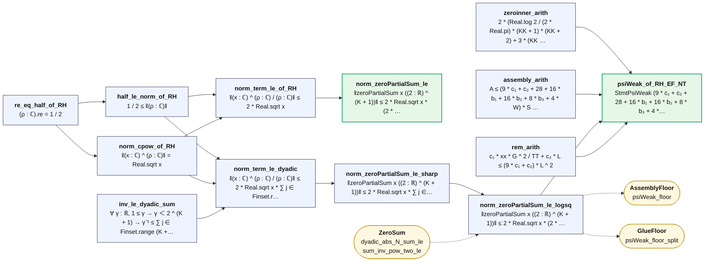

# `lean_stage3/Stage3/Assembly.lean`

Assembly — step 5, slice 1: RH meets the zero sum. The explicit formula's zero side is `Σ_{|γ|<T} m(ρ)·x^ρ/ρ`. This module defines that sum (`zeroPartialSum`), states the hEF leaf (`StmtExplicitFormula` — the truncated explicit formula with explicit remainder, the one genuinely open piece), and proves what RH does to the zero side, kernel-checked:

13 theorems, 3 definitions, 670 lines. Arrows are Lean's own record of what each proof uses.

**Imports:** [`PsiToPi`](../lean_stage3/PsiToPi.md), [`ZeroSum`](../lean_stage3/ZeroSum.md)  
**Imported by:** [`Stage3`](../lean_stage3/Stage3.md), [`ContourShift`](../lean_stage3/ContourShift.md), [`LineBound`](../lean_stage3/LineBound.md), [`RealSegment`](../lean_stage3/RealSegment.md)

## The picture



An arrow A → B reads "A is used in the proof of B". Blue: theorem. Green: a theorem nothing else uses (an end). Dashed: connects to nothing. Red: contains `sorry`. Yellow: theorems in another file, counted; a dotted arrow crosses files. Definitions are not drawn; they are listed below the diagram.

## Definitions

<a name="Stage3-zeroPartialSum"></a>
### `Stage3.zeroPartialSum`

def · line 92

The order-weighted partial zero sum below height `T`: `Σ_{|γ|<T} m(ρ)·x^ρ/ρ`.

- **Is:** `` zeroPartialSum (x T : ℝ) : ℂ := ∑' ρ : {ρ : NontrivialZeros // |(ρ : ℂ).im| < T}, ((riemannZeta.order ((ρ : NontrivialZeros) : ℂ) : ℤ) : ℂ) * ((x : ℂ) ^ ((ρ : NontrivialZeros) : ℂ) / ((ρ : NontrivialZeros) : ℂ)) ``
- **Used by 18:** [`Stage3.StmtExplicitFormula`](#Stage3-StmtExplicitFormula), [`Stage3.StmtExplicitFormulaPoly`](#Stage3-StmtExplicitFormulaPoly), [`Stage3.norm_zeroPartialSum_le`](#Stage3-norm_zeroPartialSum_le), [`Stage3.norm_zeroPartialSum_le_logsq`](#Stage3-norm_zeroPartialSum_le_logsq), [`Stage3.norm_zeroPartialSum_le_sharp`](#Stage3-norm_zeroPartialSum_le_sharp), [`Stage3.psiWeak_of_RH_EF_NT`](#Stage3-psiWeak_of_RH_EF_NT), [`Stage3.psiWeak_floor`](../lean_stage3/AssemblyFloor.md#Stage3-psiWeak_floor), [`CellZeros.cell_eq_zero_sum`](../lean_stage3/CellZeros.md#CellZeros-cell_eq_zero_sum), [`CellZeros.stencil_zeroPartialSum`](../lean_stage3/CellZeros.md#CellZeros-stencil_zeroPartialSum), [`ContourShift.residue_identity`](../lean_stage3/ContourShift.md#ContourShift-residue_identity), [`ContourShift.zeroPartialSum_eq_sum`](../lean_stage3/ContourShift.md#ContourShift-zeroPartialSum_eq_sum), [`Glue.explicit_formula_poly`](../lean_stage3/Glue.md#Glue-explicit_formula_poly), [`Glue.zeroPartialSum_swap`](../lean_stage3/Glue.md#Glue-zeroPartialSum_swap), [`Glue.explicit_formula_split`](../lean_stage3/GlueFloor.md#Glue-explicit_formula_split), [`Stage3.StmtExplicitFormulaSplit`](../lean_stage3/GlueFloor.md#Stage3-StmtExplicitFormulaSplit), [`Stage3.psiWeak_floor_split`](../lean_stage3/GlueFloor.md#Stage3-psiWeak_floor_split), [`Glue.explicit_formula_split_num`](../lean_stage3/GlueNum.md#Glue-explicit_formula_split_num), [`Glue.zeroPartialSum_swap_num`](../lean_stage3/GlueNum.md#Glue-zeroPartialSum_swap_num)

<a name="Stage3-StmtExplicitFormula"></a>
### `Stage3.StmtExplicitFormula`

def · line 101

The hEF leaf — the truncated explicit formula with explicit remainder. The one genuinely open analytic input of stage 3 (entry 119): every proof assistant lacks it; IEANTN targets it. Stated over Mathlib's Chebyshev `ψ` and the order-weighted partial sum.

- **Is:** `` StmtExplicitFormula (c₁ c₂ x₁ : ℝ) : Prop := ∀ x T : ℝ, x₁ ≤ x → 2 ≤ T → ‖((ψ x : ℝ) : ℂ) - (x : ℂ) + zeroPartialSum x T‖ ≤ c₁ * x * Real.log (x * T) ^ 2 / T + c₂ * Real.log x ``
- **Built from:** [`Stage3.zeroPartialSum`](#Stage3-zeroPartialSum)
- **Used by 0:** nothing

<a name="Stage3-StmtExplicitFormulaPoly"></a>
### `Stage3.StmtExplicitFormulaPoly`

def · line 109

The `T ≤ x²`-regime form — the shape the contour proof delivers (`Glue.explicit_formula_poly`) and all the assembly consumes (`T = 2^(K+1) ≤ 2x ≤ x²`). Approved leaf-shape change (entry 271).

- **Is:** `` StmtExplicitFormulaPoly (c₁ c₂ x₁ : ℝ) : Prop := ∀ x T : ℝ, x₁ ≤ x → 2 ≤ T → T ≤ x^2 → ‖((ψ x : ℝ) : ℂ) - (x : ℂ) + zeroPartialSum x T‖ ≤ c₁ * x * Real.log (x * T) ^ 2 / T + c₂ * Real.log x ``
- **Built from:** [`Stage3.zeroPartialSum`](#Stage3-zeroPartialSum)
- **Used by 4:** [`Stage3.psiWeak_of_RH_EF_NT`](#Stage3-psiWeak_of_RH_EF_NT), [`Stage3.psiWeak_floor`](../lean_stage3/AssemblyFloor.md#Stage3-psiWeak_floor), [`Stage3.schoenfeldWeak_floor_of_RH`](../lean_stage3/AssemblyFloor.md#Stage3-schoenfeldWeak_floor_of_RH), [`Glue.stmtEF_poly`](../lean_stage3/Glue.md#Glue-stmtEF_poly)

## Theorems

<a name="Stage3-re_eq_half_of_RH"></a>
### `Stage3.re_eq_half_of_RH`

line 53

**Why.** Under RH every nontrivial zero sits on the critical line. The strip membership rules out the trivial zeros and `s = 1`, so Mathlib's `RiemannHypothesis` applies directly.

**Proves**

```lean
(ρ : ℂ).re = 1 / 2
```

**Needs** (its hypotheses)

  - `` hRH : RiemannHypothesis ``
  - `` ρ : NontrivialZeros ``

**Fed by:** no theorem of this repo; it stands on Mathlib.

**Feeds** (2 that use it)

  - [`Stage3.half_le_norm_of_RH`](#Stage3-half_le_norm_of_RH) — `` 1 / 2 ≤ ‖(ρ : ℂ)‖ ``
  - [`Stage3.norm_cpow_of_RH`](#Stage3-norm_cpow_of_RH) — `` ‖(x : ℂ) ^ (ρ : ℂ)‖ = Real.sqrt x ``

<a name="Stage3-half_le_norm_of_RH"></a>
### `Stage3.half_le_norm_of_RH`

line 65

**Why.** Under RH, `|ρ| ≥ 1/2`.

**Proves**

```lean
1 / 2 ≤ ‖(ρ : ℂ)‖
```

**Needs** (its hypotheses)

  - `` hRH : RiemannHypothesis ``
  - `` ρ : NontrivialZeros ``

**Fed by** (1 theorem its proof uses)

  - [`Stage3.re_eq_half_of_RH`](#Stage3-re_eq_half_of_RH) — `` (ρ : ℂ).re = 1 / 2 ``

**Feeds** (2 that use it)

  - [`Stage3.norm_term_le_dyadic`](#Stage3-norm_term_le_dyadic) — `` ‖(x : ℂ) ^ (ρ : ℂ) / (ρ : ℂ)‖ ≤ 2 * Real.sqrt x * ∑ j ∈ Finset.range (K + 1), ((2 : ℝ) ^ j)⁻¹ * (if |(ρ : ℂ).im| < 2 ^ (j + 1) then 1 else 0) ``
  - [`Stage3.norm_term_le_of_RH`](#Stage3-norm_term_le_of_RH) — `` ‖(x : ℂ) ^ (ρ : ℂ) / (ρ : ℂ)‖ ≤ 2 * Real.sqrt x ``

<a name="Stage3-norm_cpow_of_RH"></a>
### `Stage3.norm_cpow_of_RH`

line 73

**Why.** The RH collapse: `‖x^ρ‖ = √x` for `x > 0`.

**Proves**

```lean
‖(x : ℂ) ^ (ρ : ℂ)‖ = Real.sqrt x
```

**Needs** (its hypotheses)

  - `` hRH : RiemannHypothesis ``
  - `` ρ : NontrivialZeros ``
  - `` hx : 0 < x ``

**Fed by** (1 theorem its proof uses)

  - [`Stage3.re_eq_half_of_RH`](#Stage3-re_eq_half_of_RH) — `` (ρ : ℂ).re = 1 / 2 ``

**Feeds** (2 that use it)

  - [`Stage3.norm_term_le_dyadic`](#Stage3-norm_term_le_dyadic) — `` ‖(x : ℂ) ^ (ρ : ℂ) / (ρ : ℂ)‖ ≤ 2 * Real.sqrt x * ∑ j ∈ Finset.range (K + 1), ((2 : ℝ) ^ j)⁻¹ * (if |(ρ : ℂ).im| < 2 ^ (j + 1) then 1 else 0) ``
  - [`Stage3.norm_term_le_of_RH`](#Stage3-norm_term_le_of_RH) — `` ‖(x : ℂ) ^ (ρ : ℂ) / (ρ : ℂ)‖ ≤ 2 * Real.sqrt x ``

<a name="Stage3-norm_term_le_of_RH"></a>
### `Stage3.norm_term_le_of_RH`

line 80

**Why.** Each zero term is at most `2√x` in norm, from `|ρ| ≥ 1/2`.

**Proves**

```lean
‖(x : ℂ) ^ (ρ : ℂ) / (ρ : ℂ)‖ ≤ 2 * Real.sqrt x
```

**Needs** (its hypotheses)

  - `` hRH : RiemannHypothesis ``
  - `` ρ : NontrivialZeros ``
  - `` hx : 0 < x ``

**Fed by** (2 theorems its proof uses)

  - [`Stage3.half_le_norm_of_RH`](#Stage3-half_le_norm_of_RH) — `` 1 / 2 ≤ ‖(ρ : ℂ)‖ ``
  - [`Stage3.norm_cpow_of_RH`](#Stage3-norm_cpow_of_RH) — `` ‖(x : ℂ) ^ (ρ : ℂ)‖ = Real.sqrt x ``

**Feeds** (1 that use it)

  - [`Stage3.norm_zeroPartialSum_le`](#Stage3-norm_zeroPartialSum_le) — `` ‖zeroPartialSum x ((2 : ℝ) ^ (K + 1))‖ ≤ 2 * Real.sqrt x * (2 * |riemannZeta.N ((2 : ℝ) ^ (K + 1))| + weightedZeroHeightBucket) ``

<a name="Stage3-norm_zeroPartialSum_le"></a>
### `Stage3.norm_zeroPartialSum_le`

line 118

**Why.** The zero side controlled by the count, under RH: `‖zeroPartialSum x 2^(K+1)‖ ≤ 2√x·(2|N(2^(K+1))| + W)`, through IEANTN's sorry-free `weighted_cumulative_count_le`. With ZeroSum's `N_abs_le` this is `√x`·(T·log T)-arithmetic under hNT.

**Proves**

```lean
‖zeroPartialSum x ((2 : ℝ) ^ (K + 1))‖ ≤ 2 * Real.sqrt x * (2 * |riemannZeta.N ((2 : ℝ) ^ (K + 1))| + weightedZeroHeightBucket)
```

**Needs** (its hypotheses)

  - `` hRH : RiemannHypothesis ``
  - `` hx : 0 < x ``
  - `` K : ℕ ``

**Stated with:** [`Stage3.zeroPartialSum`](#Stage3-zeroPartialSum)

**Fed by** (1 theorem its proof uses)

  - [`Stage3.norm_term_le_of_RH`](#Stage3-norm_term_le_of_RH) — `` ‖(x : ℂ) ^ (ρ : ℂ) / (ρ : ℂ)‖ ≤ 2 * Real.sqrt x ``

**Feeds:** nothing. It is an end.

<a name="Stage3-inv_le_dyadic_sum"></a>
### `Stage3.inv_le_dyadic_sum`

line 163

**Why.** Scalar dyadic domination: for `1 ≤ γ < 2^(K+1)`, `γ⁻¹ ≤ Σ_{j≤K} (2^j)⁻¹·[γ < 2^(j+1)]` — the largest surviving indicator sits at the shell containing `γ`, and its weight already dominates.

**Proves**

```lean
∀ γ : ℝ, 1 ≤ γ → γ < 2 ^ (K + 1) → γ⁻¹ ≤ ∑ j ∈ Finset.range (K + 1), ((2 : ℝ) ^ j)⁻¹ * (if γ < 2 ^ (j + 1) then 1 else 0)
```

**Needs** (its hypotheses)

  - `` K : ℕ ``

**Fed by:** no theorem of this repo; it stands on Mathlib.

**Feeds** (1 that use it)

  - [`Stage3.norm_term_le_dyadic`](#Stage3-norm_term_le_dyadic) — `` ‖(x : ℂ) ^ (ρ : ℂ) / (ρ : ℂ)‖ ≤ 2 * Real.sqrt x * ∑ j ∈ Finset.range (K + 1), ((2 : ℝ) ^ j)⁻¹ * (if |(ρ : ℂ).im| < 2 ^ (j + 1) then 1 else 0) ``

<a name="Stage3-norm_term_le_dyadic"></a>
### `Stage3.norm_term_le_dyadic`

line 203

**Why.** Each zero term is dominated by the dyadic indicator weights: `‖x^ρ/ρ‖ ≤ 2√x·Σ_{j≤K} (2^j)⁻¹·[|γ| < 2^(j+1)]` for `|γ| < 2^(K+1)`.

**Proves**

```lean
‖(x : ℂ) ^ (ρ : ℂ) / (ρ : ℂ)‖ ≤ 2 * Real.sqrt x * ∑ j ∈ Finset.range (K + 1), ((2 : ℝ) ^ j)⁻¹ * (if |(ρ : ℂ).im| < 2 ^ (j + 1) then 1 else 0)
```

**Needs** (its hypotheses)

  - `` hRH : RiemannHypothesis ``
  - `` ρ : NontrivialZeros ``
  - `` hx : 0 < x ``
  - `` K : ℕ ``
  - `` him : |(ρ : ℂ).im| < 2 ^ (K + 1) ``

**Fed by** (3 theorems its proof uses)

  - [`Stage3.half_le_norm_of_RH`](#Stage3-half_le_norm_of_RH) — `` 1 / 2 ≤ ‖(ρ : ℂ)‖ ``
  - [`Stage3.inv_le_dyadic_sum`](#Stage3-inv_le_dyadic_sum) — `` ∀ γ : ℝ, 1 ≤ γ → γ < 2 ^ (K + 1) → γ⁻¹ ≤ ∑ j ∈ Finset.range (K + 1), ((2 : ℝ) ^ j)⁻¹ * (if γ < 2 ^ (j + 1) then 1 else 0) ``
  - [`Stage3.norm_cpow_of_RH`](#Stage3-norm_cpow_of_RH) — `` ‖(x : ℂ) ^ (ρ : ℂ)‖ = Real.sqrt x ``

**Feeds** (1 that use it)

  - [`Stage3.norm_zeroPartialSum_le_sharp`](#Stage3-norm_zeroPartialSum_le_sharp) — `` ‖zeroPartialSum x ((2 : ℝ) ^ (K + 1))‖ ≤ 2 * Real.sqrt x * ∑ j ∈ Finset.range (K + 1), ((2 : ℝ) ^ j)⁻¹ * (2 * |riemannZeta.N ((2 : ℝ) ^ (j + 1))| + we… ``

<a name="Stage3-norm_zeroPartialSum_le_sharp"></a>
### `Stage3.norm_zeroPartialSum_le_sharp`

line 265

**Why.** The sharp zero-side bound, dyadic form. Under RH, the zero side is controlled level by level: each level's weighted count enters through IEANTN's sorry-free `weighted_cumulative_count_le`, reached by the scalar domination — no shell partition anywhere.

**Proves**

```lean
‖zeroPartialSum x ((2 : ℝ) ^ (K + 1))‖ ≤ 2 * Real.sqrt x * ∑ j ∈ Finset.range (K + 1), ((2 : ℝ) ^ j)⁻¹ * (2 * |riemannZeta.N ((2 : ℝ) ^ (j + 1))| + weightedZeroHeightBucket)
```

**Needs** (its hypotheses)

  - `` hRH : RiemannHypothesis ``
  - `` hx : 0 < x ``
  - `` K : ℕ ``

**Stated with:** [`Stage3.zeroPartialSum`](#Stage3-zeroPartialSum)

**Fed by** (1 theorem its proof uses)

  - [`Stage3.norm_term_le_dyadic`](#Stage3-norm_term_le_dyadic) — `` ‖(x : ℂ) ^ (ρ : ℂ) / (ρ : ℂ)‖ ≤ 2 * Real.sqrt x * ∑ j ∈ Finset.range (K + 1), ((2 : ℝ) ^ j)⁻¹ * (if |(ρ : ℂ).im| < 2 ^ (j + 1) then 1 else 0) ``

**Feeds** (1 that use it)

  - [`Stage3.norm_zeroPartialSum_le_logsq`](#Stage3-norm_zeroPartialSum_le_logsq) — `` ‖zeroPartialSum x ((2 : ℝ) ^ (K + 1))‖ ≤ 2 * Real.sqrt x * (2 * (Real.log 2 / (2 * Real.pi) * (K + 1) * (K + 2) + 3 * (K + 1) / Real.pi + 2 * (riemann… ``

<a name="Stage3-norm_zeroPartialSum_le_logsq"></a>
### `Stage3.norm_zeroPartialSum_le_logsq`

line 364

**Why.** The zero side at `√x·(log T)²`, under RH + hNT — the sharp form. Combining the dyadic bound with ZeroSum's counting arithmetic: with `T = 2^(K+1)`, the zero side is at most `2√x·(2·[(log 2/2π)(K+1)(K+2) + 3(K+1)/π + 2(RvM(T) + 7/8)] + 2W)`.

**Proves**

```lean
‖zeroPartialSum x ((2 : ℝ) ^ (K + 1))‖ ≤ 2 * Real.sqrt x * (2 * (Real.log 2 / (2 * Real.pi) * (K + 1) * (K + 2) + 3 * (K + 1) / Real.pi + 2 * (riemannZeta.RvM b₁ b₂ b₃ ((2 : ℝ) ^ (K + 1)) + 7 / 8)) + 2 * weightedZeroHeightBucket)
```

**Needs** (its hypotheses)

  - `` hRH : RiemannHypothesis ``
  - `` hb₁ : 0 ≤ b₁ ``
  - `` hb₂ : 0 ≤ b₂ ``
  - `` hRvM2 : 0 ≤ riemannZeta.RvM b₁ b₂ b₃ 2 ``
  - `` hNT : riemannZeta.Riemann_vonMangoldt_bound b₁ b₂ b₃ ``
  - `` hx : 0 < x ``
  - `` K : ℕ ``

**Stated with:** [`Stage3.zeroPartialSum`](#Stage3-zeroPartialSum)

**Fed by** (3 theorems its proof uses)

  - [`Stage3.norm_zeroPartialSum_le_sharp`](#Stage3-norm_zeroPartialSum_le_sharp) — `` ‖zeroPartialSum x ((2 : ℝ) ^ (K + 1))‖ ≤ 2 * Real.sqrt x * ∑ j ∈ Finset.range (K + 1), ((2 : ℝ) ^ j)⁻¹ * (2 * |riemannZeta.N ((2 : ℝ) ^ (j + 1))| + we… ``
  - [`Stage3.dyadic_abs_N_sum_le`](../lean_stage3/ZeroSum.md#Stage3-dyadic_abs_N_sum_le) (ZeroSum) — `` (∑ j ∈ range (K + 1), ((2 : ℝ) ^ j)⁻¹ * |riemannZeta.N ((2 : ℝ) ^ (j + 1))|) ≤ Real.log 2 / (2 * Real.pi) * (K + 1) * (K + 2) + 3 * (K + 1) / Real.pi … ``
  - [`Stage3.sum_inv_pow_two_le`](../lean_stage3/ZeroSum.md#Stage3-sum_inv_pow_two_le) (ZeroSum) — `` (∑ j ∈ range n, ((2 : ℝ) ^ j)⁻¹) ≤ 2 ``

**Feeds** (3 that use it)

  - [`Stage3.psiWeak_of_RH_EF_NT`](#Stage3-psiWeak_of_RH_EF_NT) — `` StmtPsiWeak (9 * c₁ + c₂ + 28 + 16 * b₁ + 16 * b₂ + 8 * b₃ + 4 * W) 2 (max x₁ 16) ``
  - [`Stage3.psiWeak_floor`](../lean_stage3/AssemblyFloor.md#Stage3-psiWeak_floor) (AssemblyFloor) — `` StmtPsiWeak (floorConst c₁ c₂ b₁ b₂ b₃ W x₀) 2 x₀ ``
  - [`Stage3.psiWeak_floor_split`](../lean_stage3/GlueFloor.md#Stage3-psiWeak_floor_split) (GlueFloor) — `` StmtPsiWeak (floorConstSplit c₁ c₃ c₄ b₁ b₂ b₃ W x₀) 2 x₀ ``

<a name="Stage3-rem_arith"></a>
### `Stage3.rem_arith`

line 398

**Why.** Scalar arithmetic of the remainder: `x ≤ T`, `0 ≤ G ≤ 3L`, `1 ≤ L` give `c₁·x·G²/T + c₂·L ≤ (9c₁+c₂)·L²`.

**Proves**

```lean
c₁ * xx * G ^ 2 / TT + c₂ * L ≤ (9 * c₁ + c₂) * L ^ 2
```

**Needs** (its hypotheses)

  - `` hc₁ : 0 ≤ c₁ ``
  - `` hc₂ : 0 ≤ c₂ ``
  - `` hx0 : 0 ≤ xx ``
  - `` hT0 : 0 < TT ``
  - `` hxT : xx ≤ TT ``
  - `` hG0 : 0 ≤ G ``
  - `` hG : G ≤ 3 * L ``
  - `` hL : 1 ≤ L ``

**Fed by:** no theorem of this repo; it stands on Mathlib.

**Feeds** (1 that use it)

  - [`Stage3.psiWeak_of_RH_EF_NT`](#Stage3-psiWeak_of_RH_EF_NT) — `` StmtPsiWeak (9 * c₁ + c₂ + 28 + 16 * b₁ + 16 * b₂ + 8 * b₃ + 4 * W) 2 (max x₁ 16) ``

<a name="Stage3-zeroinner_arith"></a>
### `Stage3.zeroinner_arith`

line 417

**Why.** Scalar arithmetic of the zero side's inner factor: the dyadic level bounds and the RvM bound turn the `(K, RvM)` expression into `2·(7+4b₁+4b₂+2b₃)·L² + 2W`.

**Proves**

```lean
2 * (Real.log 2 / (2 * Real.pi) * (KK + 1) * (KK + 2) + 3 * (KK + 1) / Real.pi + 2 * (R + 7 / 8)) + 2 * W ≤ 2 * (7 + 4 * b₁ + 4 * b₂ + 2 * b₃) * L ^ 2 + 2 * W
```

**Needs** (its hypotheses)

  - `` hb₁ : 0 ≤ b₁ ``
  - `` hb₂ : 0 ≤ b₂ ``
  - `` hb₃ : 0 ≤ b₃ ``
  - `` hL : 1 ≤ L ``
  - `` hKK0 : 0 ≤ KK ``
  - `` hK1 : (KK + 1) * Real.log 2 ≤ 2 * L ``
  - `` hK2 : (KK + 2) * Real.log 2 ≤ 3 * L ``
  - `` hR : R ≤ (2 * b₁ + 2 * b₂ + b₃) * L ^ 2 ``

**Fed by:** no theorem of this repo; it stands on Mathlib.

**Feeds** (1 that use it)

  - [`Stage3.psiWeak_of_RH_EF_NT`](#Stage3-psiWeak_of_RH_EF_NT) — `` StmtPsiWeak (9 * c₁ + c₂ + 28 + 16 * b₁ + 16 * b₂ + 8 * b₃ + 4 * W) 2 (max x₁ 16) ``

<a name="Stage3-assembly_arith"></a>
### `Stage3.assembly_arith`

line 443

**Why.** Scalar arithmetic of the final absorption into `C·S·L²`.

**Proves**

```lean
A ≤ (9 * c₁ + c₂ + 28 + 16 * b₁ + 16 * b₂ + 8 * b₃ + 4 * W) * S * L ^ 2
```

**Needs** (its hypotheses)

  - `` hc₁ : 0 ≤ c₁ ``
  - `` hc₂ : 0 ≤ c₂ ``
  - `` hb₁ : 0 ≤ b₁ ``
  - `` hb₂ : 0 ≤ b₂ ``
  - `` hb₃ : 0 ≤ b₃ ``
  - `` hW : 0 ≤ W ``
  - `` hS : 4 ≤ S ``
  - `` hL : 1 ≤ L ``
  - `` hA : A ≤ (9 * c₁ + c₂) * L ^ 2 + 2 * S * (2 * (7 + 4 * b₁ + 4 * b₂ + 2 * b₃) * L ^ 2 + 2 * W) ``

**Fed by:** no theorem of this repo; it stands on Mathlib.

**Feeds** (1 that use it)

  - [`Stage3.psiWeak_of_RH_EF_NT`](#Stage3-psiWeak_of_RH_EF_NT) — `` StmtPsiWeak (9 * c₁ + c₂ + 28 + 16 * b₁ + 16 * b₂ + 8 * b₃ + 4 * W) 2 (max x₁ 16) ``

<a name="Stage3-psiWeak_of_RH_EF_NT"></a>
### `Stage3.psiWeak_of_RH_EF_NT`

line 468

**Why.** THE ASSEMBLY — the decomposition closed. Under hRH (Mathlib's `RiemannHypothesis`), hEF (`StmtExplicitFormula c₁ c₂ x₁` — the truncated explicit formula, the open leaf), and hNT (`Riemann_vonMangoldt_bound b₁ b₂ b₃` — Rosser Th. 19, the other open leaf), the ψ-side weak bound holds with computed constant: `StmtPsiWeak (9c₁ + c₂ + 28 + 16b₁ + 16b₂ + 8b₃ + 4W) 2 (max x₁ 16)`. The dyadic level is chosen from `x` itself (`K = Nat.log 2 ⌊x⌋`, so `x < 2^(K+1) ≤ 2x`). PsiToPi's `schoenfeldWeak_of_psiWeak` carries the conclusion to `π − Li`, Statement's `weakWindow_of_global` to the window, O68's arit…

**Proves**

```lean
StmtPsiWeak (9 * c₁ + c₂ + 28 + 16 * b₁ + 16 * b₂ + 8 * b₃ + 4 * W) 2 (max x₁ 16)
```

**Needs** (its hypotheses)

  - `` hRH : RiemannHypothesis ``
  - `` hc₁ : 0 ≤ c₁ ``
  - `` hc₂ : 0 ≤ c₂ ``
  - `` hb₁ : 0 ≤ b₁ ``
  - `` hb₂ : 0 ≤ b₂ ``
  - `` hb₃ : 0 ≤ b₃ ``
  - `` hWeq : W = weightedZeroHeightBucket ``
  - `` hRvM2 : 0 ≤ riemannZeta.RvM b₁ b₂ b₃ 2 ``
  - `` hEF : StmtExplicitFormulaPoly c₁ c₂ x₁ ``
  - `` hNT : riemannZeta.Riemann_vonMangoldt_bound b₁ b₂ b₃ ``

**Stated with:** [`Stage3.StmtExplicitFormulaPoly`](#Stage3-StmtExplicitFormulaPoly), [`Stage3.StmtPsiWeak`](../lean_stage3/PsiToPi.md#Stage3-StmtPsiWeak)

**Fed by** (4 theorems its proof uses)

  - [`Stage3.assembly_arith`](#Stage3-assembly_arith) — `` A ≤ (9 * c₁ + c₂ + 28 + 16 * b₁ + 16 * b₂ + 8 * b₃ + 4 * W) * S * L ^ 2 ``
  - [`Stage3.norm_zeroPartialSum_le_logsq`](#Stage3-norm_zeroPartialSum_le_logsq) — `` ‖zeroPartialSum x ((2 : ℝ) ^ (K + 1))‖ ≤ 2 * Real.sqrt x * (2 * (Real.log 2 / (2 * Real.pi) * (K + 1) * (K + 2) + 3 * (K + 1) / Real.pi + 2 * (riemann… ``
  - [`Stage3.rem_arith`](#Stage3-rem_arith) — `` c₁ * xx * G ^ 2 / TT + c₂ * L ≤ (9 * c₁ + c₂) * L ^ 2 ``
  - [`Stage3.zeroinner_arith`](#Stage3-zeroinner_arith) — `` 2 * (Real.log 2 / (2 * Real.pi) * (KK + 1) * (KK + 2) + 3 * (KK + 1) / Real.pi + 2 * (R + 7 / 8)) + 2 * W ≤ 2 * (7 + 4 * b₁ + 4 * b₂ + 2 * b₃) * L ^ 2… ``

**Definitions its proof touches:** [`Stage3.zeroPartialSum`](#Stage3-zeroPartialSum)

**Feeds:** nothing. It is an end.

