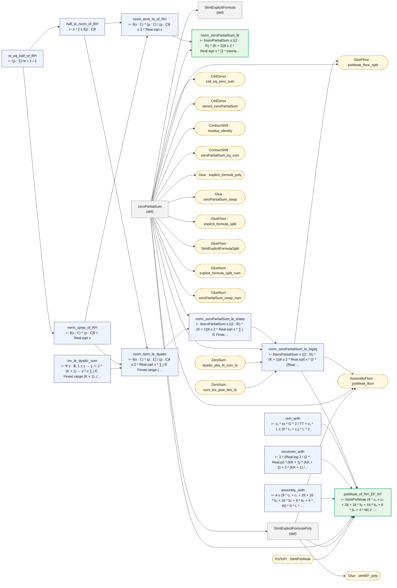

# `lean_stage3/Stage3/Assembly.lean`

**What it does** (its own header): Assembly — step 5, slice 1: RH meets the zero sum. The explicit formula's zero side is `Σ_{|γ|<T} m(ρ)·x^ρ/ρ`. This module defines that sum (`zeroPartialSum`), states the hEF leaf (`StmtExplicitFormula` — the truncated explicit formula with explicit remainder, the one genuinely open piece), and proves what RH does to the zero side, kernel-checked:

**Imports:** [`PsiToPi`](../lean_stage3/PsiToPi.md), [`ZeroSum`](../lean_stage3/ZeroSum.md).
**Imported by:** [`Stage3`](../lean_stage3/Stage3.md), [`ContourShift`](../lean_stage3/ContourShift.md), [`LineBound`](../lean_stage3/LineBound.md), [`RealSegment`](../lean_stage3/RealSegment.md).

Blue: theorem. Green: a theorem nothing else uses (an end). Dashed white: connects to nothing. Grey: definition. Red: contains `sorry`. Yellow: in another file. An arrow A → B reads "A is used by B".

## Every declaration

| declaration | proves (output) | needs (input) | why (its own docstring) | uses | used by |
|---|---|---|---|---|---|
| `Stage3.re_eq_half_of_RH` theorem, line 53 | (ρ : ℂ).re = 1 / 2 | hRH : RiemannHypothesis; ρ : NontrivialZeros | Under RH every nontrivial zero sits on the critical line. The strip membership rules out the trivial zeros and `s = 1`, so Mathlib's `RiemannHypothesis` applies directly. | — | `Stage3.half_le_norm_of_RH`, `Stage3.norm_cpow_of_RH` |
| `Stage3.half_le_norm_of_RH` theorem, line 65 | 1 / 2 ≤ ‖(ρ : ℂ)‖ | hRH : RiemannHypothesis; ρ : NontrivialZeros | Under RH, `\|ρ\| ≥ 1/2`. | `Stage3.re_eq_half_of_RH` | `Stage3.norm_term_le_dyadic`, `Stage3.norm_term_le_of_RH` |
| `Stage3.norm_cpow_of_RH` theorem, line 73 | ‖(x : ℂ) ^ (ρ : ℂ)‖ = Real.sqrt x | hRH : RiemannHypothesis; ρ : NontrivialZeros; hx : 0 &lt; x | The RH collapse: `‖x^ρ‖ = √x` for `x &gt; 0`. | `Stage3.re_eq_half_of_RH` | `Stage3.norm_term_le_dyadic`, `Stage3.norm_term_le_of_RH` |
| `Stage3.norm_term_le_of_RH` theorem, line 80 | ‖(x : ℂ) ^ (ρ : ℂ) / (ρ : ℂ)‖ ≤ 2 * Real.sqrt x | hRH : RiemannHypothesis; ρ : NontrivialZeros; hx : 0 &lt; x | Each zero term is at most `2√x` in norm, from `\|ρ\| ≥ 1/2`. | `Stage3.half_le_norm_of_RH`, `Stage3.norm_cpow_of_RH` | `Stage3.norm_zeroPartialSum_le` |
| `Stage3.zeroPartialSum` def, line 92 | ℂ | x T : ℝ | The order-weighted partial zero sum below height `T`: `Σ_{\|γ\|&lt;T} m(ρ)·x^ρ/ρ`. | — | `Stage3.StmtExplicitFormula`, `Stage3.StmtExplicitFormulaPoly`, `Stage3.norm_zeroPartialSum_le`, `Stage3.norm_zeroPartialSum_le_logsq`, `Stage3.norm_zeroPartialSum_le_sharp`, `Stage3.psiWeak_of_RH_EF_NT`, `Stage3.psiWeak_floor`, `CellZeros.cell_eq_zero_sum`, `CellZeros.stencil_zeroPartialSum`, `ContourShift.residue_identity`, `ContourShift.zeroPartialSum_eq_sum`, `Glue.explicit_formula_poly`, `Glue.zeroPartialSum_swap`, `Glue.explicit_formula_split`, `Stage3.StmtExplicitFormulaSplit`, `Stage3.psiWeak_floor_split`, `Glue.explicit_formula_split_num`, `Glue.zeroPartialSum_swap_num` |
| `Stage3.StmtExplicitFormula` def, line 101 | Prop | c₁ c₂ x₁ : ℝ | The hEF leaf — the truncated explicit formula with explicit remainder. The one genuinely open analytic input of stage 3 (entry 119): every proof assistant lacks it; IEANTN targets it. Stated over Mathlib's Chebyshev `ψ` and the order-weighted partial sum. | `Stage3.zeroPartialSum` | — |
| `Stage3.StmtExplicitFormulaPoly` def, line 109 | Prop | c₁ c₂ x₁ : ℝ | The `T ≤ x²`-regime form — the shape the contour proof delivers (`Glue.explicit_formula_poly`) and all the assembly consumes (`T = 2^(K+1) ≤ 2x ≤ x²`). Approved leaf-shape change (entry 271). | `Stage3.zeroPartialSum` | `Stage3.psiWeak_of_RH_EF_NT`, `Stage3.psiWeak_floor`, `Glue.stmtEF_poly` |
| `Stage3.norm_zeroPartialSum_le` theorem, line 118 | ‖zeroPartialSum x ((2 : ℝ) ^ (K + 1))‖ ≤ 2 * Real.sqrt x * (2 * \|riemannZeta.N ((2 : ℝ) ^ (K + 1))\| + weightedZeroHeightBucket) | hRH : RiemannHypothesis; hx : 0 &lt; x; K : ℕ | The zero side controlled by the count, under RH: `‖zeroPartialSum x 2^(K+1)‖ ≤ 2√x·(2\|N(2^(K+1))\| + W)`, through IEANTN's sorry-free `weighted_cumulative_count_le`. With ZeroSum's `N_abs_le` this is `√x`·(T·log T)-arithmetic under hNT. | `Stage3.norm_term_le_of_RH`, `Stage3.zeroPartialSum` | — |
| `Stage3.inv_le_dyadic_sum` theorem, line 163 | ∀ γ : ℝ, 1 ≤ γ → γ &lt; 2 ^ (K + 1) → γ⁻¹ ≤ ∑ j ∈ Finset.range (K + 1), ((2 : ℝ) ^ j)⁻¹ * (if γ &lt; 2 ^ (j + 1) then 1 else 0) | K : ℕ | Scalar dyadic domination: for `1 ≤ γ &lt; 2^(K+1)`, `γ⁻¹ ≤ Σ_{j≤K} (2^j)⁻¹·[γ &lt; 2^(j+1)]` — the largest surviving indicator sits at the shell containing `γ`, and its weight already dominates. | — | `Stage3.norm_term_le_dyadic` |
| `Stage3.norm_term_le_dyadic` theorem, line 203 | ‖(x : ℂ) ^ (ρ : ℂ) / (ρ : ℂ)‖ ≤ 2 * Real.sqrt x * ∑ j ∈ Finset.range (K + 1), ((2 : ℝ) ^ j)⁻¹ * (if \|(ρ : ℂ).im\| &lt; 2 ^ (j + 1) then 1 else 0) | hRH : RiemannHypothesis; ρ : NontrivialZeros; hx : 0 &lt; x; K : ℕ; him : \|(ρ : ℂ).im\| &lt; 2 ^ (K + 1) | Each zero term is dominated by the dyadic indicator weights: `‖x^ρ/ρ‖ ≤ 2√x·Σ_{j≤K} (2^j)⁻¹·[\|γ\| &lt; 2^(j+1)]` for `\|γ\| &lt; 2^(K+1)`. | `Stage3.half_le_norm_of_RH`, `Stage3.inv_le_dyadic_sum`, `Stage3.norm_cpow_of_RH` | `Stage3.norm_zeroPartialSum_le_sharp` |
| `Stage3.norm_zeroPartialSum_le_sharp` theorem, line 265 | ‖zeroPartialSum x ((2 : ℝ) ^ (K + 1))‖ ≤ 2 * Real.sqrt x * ∑ j ∈ Finset.range (K + 1), ((2 : ℝ) ^ j)⁻¹ * (2 * \|riemannZeta.N ((2 : ℝ) ^ (j + 1))\| + weightedZeroHeightBucket) | hRH : RiemannHypothesis; hx : 0 &lt; x; K : ℕ | The sharp zero-side bound, dyadic form. Under RH, the zero side is controlled level by level: each level's weighted count enters through IEANTN's sorry-free `weighted_cumulative_count_le`, reached by the scalar domination — no shell partition anywhere. | `Stage3.norm_term_le_dyadic`, `Stage3.zeroPartialSum` | `Stage3.norm_zeroPartialSum_le_logsq` |
| `Stage3.norm_zeroPartialSum_le_logsq` theorem, line 364 | ‖zeroPartialSum x ((2 : ℝ) ^ (K + 1))‖ ≤ 2 * Real.sqrt x * (2 * (Real.log 2 / (2 * Real.pi) * (K + 1) * (K + 2) + 3 * (K + 1) / Real.pi + 2 * (riemannZeta.RvM b₁ b₂ b₃ ((2 : ℝ) ^ (K + 1)) + 7 / 8)) + 2 * weightedZeroHeightBucket) | hRH : RiemannHypothesis; hb₁ : 0 ≤ b₁; hb₂ : 0 ≤ b₂; hRvM2 : 0 ≤ riemannZeta.RvM b₁ b₂ b₃ 2; hNT : riemannZeta.Riemann_vonMangoldt_bound b₁ b₂ b₃; hx : 0 &lt; x; K : ℕ | The zero side at `√x·(log T)²`, under RH + hNT — the sharp form. Combining the dyadic bound with ZeroSum's counting arithmetic: with `T = 2^(K+1)`, the zero side is at most `2√x·(2·[(log 2/2π)(K+1)(K+2) + 3(K+1)/π + 2(RvM(T) + 7/8)] + 2W)`. | `Stage3.norm_zeroPartialSum_le_sharp`, `Stage3.zeroPartialSum`, `Stage3.dyadic_abs_N_sum_le`, `Stage3.sum_inv_pow_two_le` | `Stage3.psiWeak_of_RH_EF_NT`, `Stage3.psiWeak_floor`, `Stage3.psiWeak_floor_split` |
| `Stage3.rem_arith` theorem, line 398 | c₁ * xx * G ^ 2 / TT + c₂ * L ≤ (9 * c₁ + c₂) * L ^ 2 | hc₁ : 0 ≤ c₁; hc₂ : 0 ≤ c₂; hx0 : 0 ≤ xx; hT0 : 0 &lt; TT; hxT : xx ≤ TT; hG0 : 0 ≤ G; hG : G ≤ 3 * L; hL : 1 ≤ L | Scalar arithmetic of the remainder: `x ≤ T`, `0 ≤ G ≤ 3L`, `1 ≤ L` give `c₁·x·G²/T + c₂·L ≤ (9c₁+c₂)·L²`. | — | `Stage3.psiWeak_of_RH_EF_NT` |
| `Stage3.zeroinner_arith` theorem, line 417 | 2 * (Real.log 2 / (2 * Real.pi) * (KK + 1) * (KK + 2) + 3 * (KK + 1) / Real.pi + 2 * (R + 7 / 8)) + 2 * W ≤ 2 * (7 + 4 * b₁ + 4 * b₂ + 2 * b₃) * L ^ 2 + 2 * W | hb₁ : 0 ≤ b₁; hb₂ : 0 ≤ b₂; hb₃ : 0 ≤ b₃; hL : 1 ≤ L; hKK0 : 0 ≤ KK; hK1 : (KK + 1) * Real.log 2 ≤ 2 * L; hK2 : (KK + 2) * Real.log 2 ≤ 3 * L; hR : R ≤ (2 * b₁ + 2 * b₂ + b₃) * L ^ 2 | Scalar arithmetic of the zero side's inner factor: the dyadic level bounds and the RvM bound turn the `(K, RvM)` expression into `2·(7+4b₁+4b₂+2b₃)·L² + 2W`. | — | `Stage3.psiWeak_of_RH_EF_NT` |
| `Stage3.assembly_arith` theorem, line 443 | A ≤ (9 * c₁ + c₂ + 28 + 16 * b₁ + 16 * b₂ + 8 * b₃ + 4 * W) * S * L ^ 2 | hc₁ : 0 ≤ c₁; hc₂ : 0 ≤ c₂; hb₁ : 0 ≤ b₁; hb₂ : 0 ≤ b₂; hb₃ : 0 ≤ b₃; hW : 0 ≤ W; hS : 4 ≤ S; hL : 1 ≤ L; hA : A ≤ (9 * c₁ + c₂) * L ^ 2 + 2 * S * (2 * (7 + 4 * b₁ + 4 * b₂ + 2 * b₃) * L ^ 2 + 2 * W) | Scalar arithmetic of the final absorption into `C·S·L²`. | — | `Stage3.psiWeak_of_RH_EF_NT` |
| `Stage3.psiWeak_of_RH_EF_NT` theorem, line 468 | StmtPsiWeak (9 * c₁ + c₂ + 28 + 16 * b₁ + 16 * b₂ + 8 * b₃ + 4 * W) 2 (max x₁ 16) | hRH : RiemannHypothesis; hc₁ : 0 ≤ c₁; hc₂ : 0 ≤ c₂; hb₁ : 0 ≤ b₁; hb₂ : 0 ≤ b₂; hb₃ : 0 ≤ b₃; hWeq : W = weightedZeroHeightBucket; hRvM2 : 0 ≤ riemannZeta.RvM b₁ b₂ b₃ 2; hEF : StmtExplicitFormulaPoly c₁ c₂ x₁; hNT : riemannZeta.Riemann_vonMangoldt_bound b₁ b₂ b₃ | THE ASSEMBLY — the decomposition closed. Under hRH (Mathlib's `RiemannHypothesis`), hEF (`StmtExplicitFormula c₁ c₂ x₁` — the truncated explicit formula, the open leaf), and hNT (`Riemann_vonMangoldt_bound b₁ b₂ b₃` — Rosser Th. 19, the other open leaf), the ψ-side weak bound holds with computed constant: `StmtPsiWeak (9c₁ + c₂ + 28 + 16b₁ + 16b₂ + 8b₃ + 4W)… | `Stage3.StmtExplicitFormulaPoly`, `Stage3.assembly_arith`, `Stage3.norm_zeroPartialSum_le_logsq`, `Stage3.rem_arith`, `Stage3.zeroPartialSum`, `Stage3.zeroinner_arith`, `Stage3.StmtPsiWeak` | — |
