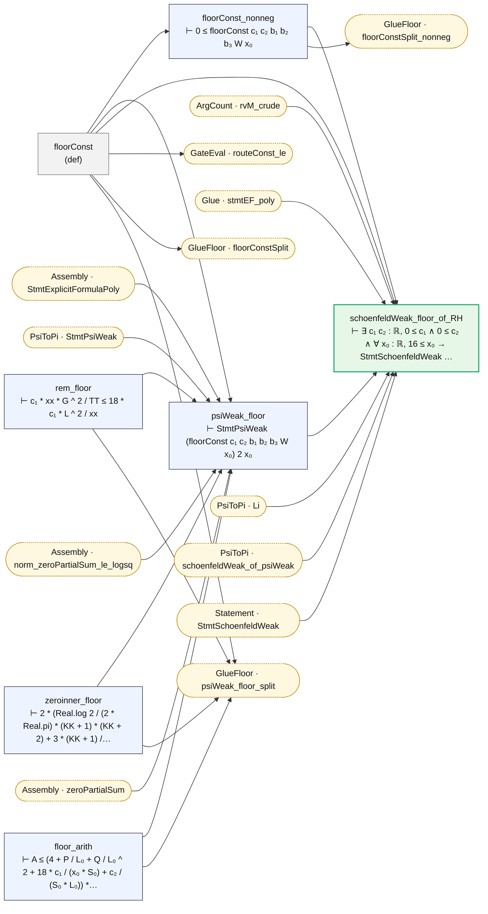

# `lean_stage3/Stage3/AssemblyFloor.lean`

**What it does** (its own header): AssemblyFloor — block E1 of `lean_stage3/design/joints.md`. 2026-11-22. `Assembly.psiWeak_of_RH_EF_NT` with nothing rounded at the end. Inside that proof the contour constants `c₁`, `c₂` multiply `log²x` with no `√x`, and the zero side is a polynomial in `log T`; its closing lemmas round every term up to one multiple of `√x·log²x`, valid from `x ≥ 16` (units 0405, 0406). Here the floor `x₀` is a parameter, the height is the power of two just below `x²` (`StmtExplicitFormulaPoly` allows `T ≤ x²`), and each term keep…

**Imports:** [`ArgCount`](../lean_stage3/ArgCount.md), [`Glue`](../lean_stage3/Glue.md).
**Imported by:** [`Stage3`](../lean_stage3/Stage3.md), [`GlueFloor`](../lean_stage3/GlueFloor.md).

Blue: theorem. Green: a theorem nothing else uses (an end). Dashed white: connects to nothing. Grey: definition. Red: contains `sorry`. Yellow: in another file. An arrow A → B reads "A is used by B".

## Every declaration

| declaration | proves (output) | needs (input) | why (its own docstring) | uses | used by |
|---|---|---|---|---|---|
| `Stage3.floorConst` def, line 40 | ℝ | c₁ c₂ b₁ b₂ b₃ W x₀ : ℝ | The constant of the assembly at floor `x₀`. | — | `Stage3.floorConst_nonneg`, `Stage3.psiWeak_floor`, `Stage3.schoenfeldWeak_floor_of_RH`, `GateEval.routeConst_le`, `Stage3.floorConstSplit`, `Stage3.psiWeak_floor_split` |
| `Stage3.floorConst_nonneg` theorem, line 45 | 0 ≤ floorConst c₁ c₂ b₁ b₂ b₃ W x₀ | hc₁ : 0 ≤ c₁; hc₂ : 0 ≤ c₂; hb₁ : 0 ≤ b₁; hb₂ : 0 ≤ b₂; hb₃ : 0 ≤ b₃; hW : 0 ≤ W; hx₀ : 16 ≤ x₀ | — | `Stage3.floorConst` | `Stage3.schoenfeldWeak_floor_of_RH`, `Stage3.floorConstSplit_nonneg` |
| `Stage3.rem_floor` theorem, line 55 | c₁ * xx * G ^ 2 / TT ≤ 18 * c₁ * L ^ 2 / xx | hc₁ : 0 ≤ c₁; hx0 : 0 &lt; xx; hT0 : 0 &lt; TT; hxT : xx ^ 2 ≤ 2 * TT; hG0 : 0 ≤ G; hG : G ≤ 3 * L | The remainder with `T` near `x²`: `c₁·x·G²/T ≤ 18·c₁·L²/x`. | — | `Stage3.psiWeak_floor`, `Stage3.psiWeak_floor_split` |
| `Stage3.zeroinner_floor` theorem, line 65 | 2 * (Real.log 2 / (2 * Real.pi) * (KK + 1) * (KK + 2) + 3 * (KK + 1) / Real.pi + 2 * (R + 7 / 8)) + 2 * W ≤ 2 * (L ^ 2 + (4 + 4 * b₁ + 4 * b₂) * L + 2 * b₃ + 2) + 2 * W | hL : 1 ≤ L; hKK0 : 0 ≤ KK; hK1 : (KK + 1) * Real.log 2 ≤ 2 * L; hR : R ≤ 2 * (b₁ + b₂) * L + b₃ | The zero side's inner factor, each term at its own power of `L`. | — | `Stage3.psiWeak_floor`, `Stage3.psiWeak_floor_split` |
| `Stage3.floor_arith` theorem, line 93 | A ≤ (4 + P / L₀ + Q / L₀ ^ 2 + 18 * c₁ / (x₀ * S₀) + c₂ / (S₀ * L₀)) * S * L ^ 2 | hc₁ : 0 ≤ c₁; hc₂ : 0 ≤ c₂; hP : 0 ≤ P; hQ : 0 ≤ Q; hL₀ : 0 &lt; L₀; hL : L₀ ≤ L; hS₀ : 0 &lt; S₀; hS : S₀ ≤ S; hx₀ : 0 &lt; x₀; hx : x₀ ≤ xx; hA : A ≤ 18 * c₁ * L ^ 2 / xx + c₂ * L + S * (4 * L ^ 2 + P * L + Q) | The closing arithmetic with every term at its own shape. | — | `Stage3.psiWeak_floor`, `Stage3.psiWeak_floor_split` |
| `Stage3.psiWeak_floor` theorem, line 127 | StmtPsiWeak (floorConst c₁ c₂ b₁ b₂ b₃ W x₀) 2 x₀ | hRH : RiemannHypothesis; hc₁ : 0 ≤ c₁; hc₂ : 0 ≤ c₂; hb₁ : 0 ≤ b₁; hb₂ : 0 ≤ b₂; hb₃ : 0 ≤ b₃; hWeq : W = weightedZeroHeightBucket; hRvM2 : 0 ≤ riemannZeta.RvM b₁ b₂ b₃ 2; hEF : StmtExplicitFormulaPoly c₁ c₂ x₁; hNT : riemannZeta.Riemann_vonMangoldt_bound b₁ b₂ b₃; hx₀ : 16 ≤ x₀; hx₁ : x₁ ≤ x₀ | The assembly at floor `x₀`. Under RH, the truncated explicit formula and the zero-count band, `\|ψ x − x\| ≤ floorConst … x₀ · √x · log²x` for `x ≥ x₀`. The height is the power of two in `(x²/2, x²]`. | `Stage3.StmtExplicitFormulaPoly`, `Stage3.norm_zeroPartialSum_le_logsq`, `Stage3.zeroPartialSum`, `Stage3.floorConst`, `Stage3.floor_arith`, `Stage3.rem_floor`, `Stage3.zeroinner_floor`, `Stage3.StmtPsiWeak` | `Stage3.schoenfeldWeak_floor_of_RH` |
| `Stage3.schoenfeldWeak_floor_of_RH` theorem, line 242 | ∃ c₁ c₂ : ℝ, 0 ≤ c₁ ∧ 0 ≤ c₂ ∧ ∀ x₀ : ℝ, 16 ≤ x₀ → StmtSchoenfeldWeak (3 * floorConst c₁ c₂ 112 0 698 weightedZeroHeightBucket x₀ + 13) 1 (max (x₀ ^ 2) 9) (fun x =&gt; (Nat.primeCounting ⌊x⌋₊ : ℝ)) Li | hRH : RiemannHypothesis | From RH to the `π` side, floor a parameter. The three proved inputs composed: `Glue.stmtEF_poly`, `ArgCount.rvM_crude`, and `schoenfeldWeak_of_psiWeak`. | `ArgCount.rvM_crude`, `Stage3.floorConst`, `Stage3.floorConst_nonneg`, `Stage3.psiWeak_floor`, `Glue.stmtEF_poly`, `Stage3.Li`, `Stage3.schoenfeldWeak_of_psiWeak`, `Stage3.StmtSchoenfeldWeak` | — |
