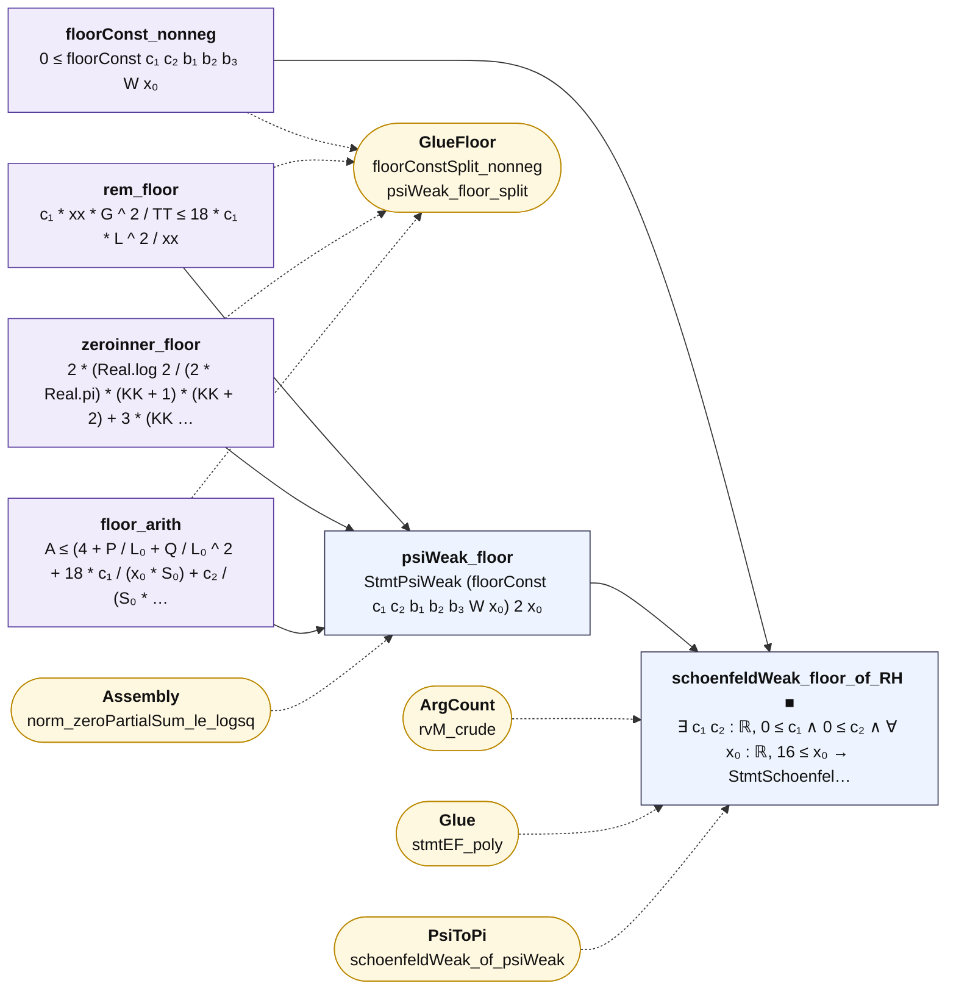

# `lean_stage3/Stage3/AssemblyFloor.lean`

AssemblyFloor — block E1 of `lean_stage3/design/joints.md`. 2026-11-22. `Assembly.psiWeak_of_RH_EF_NT` with nothing rounded at the end. Inside that proof the contour constants `c₁`, `c₂` multiply `log²x` with no `√x`, and the zero side is a polynomial in `log T`; its closing lemmas round every term up to one multiple of `√x·log²x`, valid from `x ≥ 16` (units 0405, 0406). Here the floor `x₀` is a parameter, the height is the power of two just below `x²` (`StmtExplicitFormulaPoly` allows `T ≤ x²`), and each term keep…

6 theorems, 1 definition, 270 lines. Arrows are Lean's own record of what each proof uses.

**Imports:** [`ArgCount`](../lean_stage3/ArgCount.md), [`Glue`](../lean_stage3/Glue.md)  
**Imported by:** [`Stage3`](../lean_stage3/Stage3.md), [`GlueFloor`](../lean_stage3/GlueFloor.md)

## The picture



An arrow A → B reads "A is used in the proof of B". Green: counting, integers only. Violet: shape, analysis with no ζ. Blue: reads ζ. A name ending in ■ is an end: nothing else uses it. Red: contains `sorry`. Yellow: theorems in another file, counted; a dotted arrow crosses files. Definitions are not drawn; they are listed below the diagram.

## Definitions

<a name="Stage3-floorConst"></a>
### `Stage3.floorConst`

def · line 40

The constant of the assembly at floor `x₀`.

- **Is:** `` floorConst (c₁ c₂ b₁ b₂ b₃ W x₀ : ℝ) : ℝ := 4 + (16 + 16 * b₁ + 16 * b₂) / Real.log x₀ + (8 * b₃ + 8 + 4 * W) / Real.log x₀ ^ 2 + 18 * c₁ / (x₀ * Real.sqrt x₀) + c₂ / (Real.sqrt x₀ * Real.log x₀) ``
- **Used by 7:** [`Stage3.floorConst_nonneg`](#Stage3-floorConst_nonneg), [`Stage3.psiWeak_floor`](#Stage3-psiWeak_floor), [`Stage3.schoenfeldWeak_floor_of_RH`](#Stage3-schoenfeldWeak_floor_of_RH), [`GateEval.routeConst_le`](../lean_stage3/GateEval.md#GateEval-routeConst_le), [`Stage3.floorConstSplit`](../lean_stage3/GlueFloor.md#Stage3-floorConstSplit), [`Stage3.floorConstSplit_nonneg`](../lean_stage3/GlueFloor.md#Stage3-floorConstSplit_nonneg), [`Stage3.psiWeak_floor_split`](../lean_stage3/GlueFloor.md#Stage3-psiWeak_floor_split)

## Theorems

<a name="Stage3-floorConst_nonneg"></a>
### `Stage3.floorConst_nonneg`

line 45

**Shape.** Uses real or complex analysis; nothing in it or beneath it reads ζ.

**Proves**

```lean
0 ≤ floorConst c₁ c₂ b₁ b₂ b₃ W x₀
```

**Needs** (its hypotheses)

  - `` hc₁ : 0 ≤ c₁ ``
  - `` hc₂ : 0 ≤ c₂ ``
  - `` hb₁ : 0 ≤ b₁ ``
  - `` hb₂ : 0 ≤ b₂ ``
  - `` hb₃ : 0 ≤ b₃ ``
  - `` hW : 0 ≤ W ``
  - `` hx₀ : 16 ≤ x₀ ``

**Stated with:** [`Stage3.floorConst`](#Stage3-floorConst)

**Fed by:** no theorem of this repo; it stands on Mathlib and the definitions below.

**Feeds** (2 that use it)

  - [`Stage3.schoenfeldWeak_floor_of_RH`](#Stage3-schoenfeldWeak_floor_of_RH) — `` ∃ c₁ c₂ : ℝ, 0 ≤ c₁ ∧ 0 ≤ c₂ ∧ ∀ x₀ : ℝ, 16 ≤ x₀ → StmtSchoenfeldWeak (3 * floorConst c₁ c₂ 112 0 698 weightedZeroHeightBucket x₀ + 13) 1 (max (x₀ ^ 2… ``
  - [`Stage3.floorConstSplit_nonneg`](../lean_stage3/GlueFloor.md#Stage3-floorConstSplit_nonneg) (GlueFloor) — `` 0 ≤ floorConstSplit c₁ c₃ c₄ b₁ b₂ b₃ W x₀ ``

<a name="Stage3-rem_floor"></a>
### `Stage3.rem_floor`

line 55

**Shape.** Uses real or complex analysis; nothing in it or beneath it reads ζ.

**Why.** The remainder with `T` near `x²`: `c₁·x·G²/T ≤ 18·c₁·L²/x`.

**Proves**

```lean
c₁ * xx * G ^ 2 / TT ≤ 18 * c₁ * L ^ 2 / xx
```

**Needs** (its hypotheses)

  - `` hc₁ : 0 ≤ c₁ ``
  - `` hx0 : 0 < xx ``
  - `` hT0 : 0 < TT ``
  - `` hxT : xx ^ 2 ≤ 2 * TT ``
  - `` hG0 : 0 ≤ G ``
  - `` hG : G ≤ 3 * L ``

**Fed by:** no theorem of this repo; it stands on Mathlib.

**Feeds** (2 that use it)

  - [`Stage3.psiWeak_floor`](#Stage3-psiWeak_floor) — `` StmtPsiWeak (floorConst c₁ c₂ b₁ b₂ b₃ W x₀) 2 x₀ ``
  - [`Stage3.psiWeak_floor_split`](../lean_stage3/GlueFloor.md#Stage3-psiWeak_floor_split) (GlueFloor) — `` StmtPsiWeak (floorConstSplit c₁ c₃ c₄ b₁ b₂ b₃ W x₀) 2 x₀ ``

<a name="Stage3-zeroinner_floor"></a>
### `Stage3.zeroinner_floor`

line 65

**Shape.** Uses real or complex analysis; nothing in it or beneath it reads ζ.

**Why.** The zero side's inner factor, each term at its own power of `L`.

**Proves**

```lean
2 * (Real.log 2 / (2 * Real.pi) * (KK + 1) * (KK + 2) + 3 * (KK + 1) / Real.pi + 2 * (R + 7 / 8)) + 2 * W ≤ 2 * (L ^ 2 + (4 + 4 * b₁ + 4 * b₂) * L + 2 * b₃ + 2) + 2 * W
```

**Needs** (its hypotheses)

  - `` hL : 1 ≤ L ``
  - `` hKK0 : 0 ≤ KK ``
  - `` hK1 : (KK + 1) * Real.log 2 ≤ 2 * L ``
  - `` hR : R ≤ 2 * (b₁ + b₂) * L + b₃ ``

**Fed by:** no theorem of this repo; it stands on Mathlib.

**Feeds** (2 that use it)

  - [`Stage3.psiWeak_floor`](#Stage3-psiWeak_floor) — `` StmtPsiWeak (floorConst c₁ c₂ b₁ b₂ b₃ W x₀) 2 x₀ ``
  - [`Stage3.psiWeak_floor_split`](../lean_stage3/GlueFloor.md#Stage3-psiWeak_floor_split) (GlueFloor) — `` StmtPsiWeak (floorConstSplit c₁ c₃ c₄ b₁ b₂ b₃ W x₀) 2 x₀ ``

<a name="Stage3-floor_arith"></a>
### `Stage3.floor_arith`

line 93

**Shape.** Uses real or complex analysis; nothing in it or beneath it reads ζ.

**Why.** The closing arithmetic with every term at its own shape.

**Proves**

```lean
A ≤ (4 + P / L₀ + Q / L₀ ^ 2 + 18 * c₁ / (x₀ * S₀) + c₂ / (S₀ * L₀)) * S * L ^ 2
```

**Needs** (its hypotheses)

  - `` hc₁ : 0 ≤ c₁ ``
  - `` hc₂ : 0 ≤ c₂ ``
  - `` hP : 0 ≤ P ``
  - `` hQ : 0 ≤ Q ``
  - `` hL₀ : 0 < L₀ ``
  - `` hL : L₀ ≤ L ``
  - `` hS₀ : 0 < S₀ ``
  - `` hS : S₀ ≤ S ``
  - `` hx₀ : 0 < x₀ ``
  - `` hx : x₀ ≤ xx ``
  - `` hA : A ≤ 18 * c₁ * L ^ 2 / xx + c₂ * L + S * (4 * L ^ 2 + P * L + Q) ``

**Fed by:** no theorem of this repo; it stands on Mathlib.

**Feeds** (2 that use it)

  - [`Stage3.psiWeak_floor`](#Stage3-psiWeak_floor) — `` StmtPsiWeak (floorConst c₁ c₂ b₁ b₂ b₃ W x₀) 2 x₀ ``
  - [`Stage3.psiWeak_floor_split`](../lean_stage3/GlueFloor.md#Stage3-psiWeak_floor_split) (GlueFloor) — `` StmtPsiWeak (floorConstSplit c₁ c₃ c₄ b₁ b₂ b₃ W x₀) 2 x₀ ``

<a name="Stage3-psiWeak_floor"></a>
### `Stage3.psiWeak_floor`

line 127

**Reads ζ.** It, or something it rests on, uses the zeta function, its zeros or the Riemann hypothesis.

**Why.** The assembly at floor `x₀`. Under RH, the truncated explicit formula and the zero-count band, `|ψ x − x| ≤ floorConst … x₀ · √x · log²x` for `x ≥ x₀`. The height is the power of two in `(x²/2, x²]`.

**Proves**

```lean
StmtPsiWeak (floorConst c₁ c₂ b₁ b₂ b₃ W x₀) 2 x₀
```

**Needs** (its hypotheses)

  - `` hRH : RiemannHypothesis ``
  - `` hc₁ : 0 ≤ c₁ ``
  - `` hc₂ : 0 ≤ c₂ ``
  - `` hb₁ : 0 ≤ b₁ ``
  - `` hb₂ : 0 ≤ b₂ ``
  - `` hb₃ : 0 ≤ b₃ ``
  - `` hWeq : W = weightedZeroHeightBucket ``
  - `` hRvM2 : 0 ≤ riemannZeta.RvM b₁ b₂ b₃ 2 ``
  - `` hEF : StmtExplicitFormulaPoly c₁ c₂ x₁ ``
  - `` hNT : riemannZeta.Riemann_vonMangoldt_bound b₁ b₂ b₃ ``
  - `` hx₀ : 16 ≤ x₀ ``
  - `` hx₁ : x₁ ≤ x₀ ``

**Stated with:** [`Stage3.StmtExplicitFormulaPoly`](../lean_stage3/Assembly.md#Stage3-StmtExplicitFormulaPoly), [`Stage3.floorConst`](#Stage3-floorConst), [`Stage3.StmtPsiWeak`](../lean_stage3/PsiToPi.md#Stage3-StmtPsiWeak)

**Fed by** (4 theorems its proof uses)

  - [`Stage3.norm_zeroPartialSum_le_logsq`](../lean_stage3/Assembly.md#Stage3-norm_zeroPartialSum_le_logsq) (Assembly) — `` ‖zeroPartialSum x ((2 : ℝ) ^ (K + 1))‖ ≤ 2 * Real.sqrt x * (2 * (Real.log 2 / (2 * Real.pi) * (K + 1) * (K + 2) + 3 * (K + 1) / Real.pi + 2 * (riemann… ``
  - [`Stage3.floor_arith`](#Stage3-floor_arith) — `` A ≤ (4 + P / L₀ + Q / L₀ ^ 2 + 18 * c₁ / (x₀ * S₀) + c₂ / (S₀ * L₀)) * S * L ^ 2 ``
  - [`Stage3.rem_floor`](#Stage3-rem_floor) — `` c₁ * xx * G ^ 2 / TT ≤ 18 * c₁ * L ^ 2 / xx ``
  - [`Stage3.zeroinner_floor`](#Stage3-zeroinner_floor) — `` 2 * (Real.log 2 / (2 * Real.pi) * (KK + 1) * (KK + 2) + 3 * (KK + 1) / Real.pi + 2 * (R + 7 / 8)) + 2 * W ≤ 2 * (L ^ 2 + (4 + 4 * b₁ + 4 * b₂) * L + 2… ``

**Definitions its proof touches:** [`Stage3.zeroPartialSum`](../lean_stage3/Assembly.md#Stage3-zeroPartialSum)

**Feeds** (1 that use it)

  - [`Stage3.schoenfeldWeak_floor_of_RH`](#Stage3-schoenfeldWeak_floor_of_RH) — `` ∃ c₁ c₂ : ℝ, 0 ≤ c₁ ∧ 0 ≤ c₂ ∧ ∀ x₀ : ℝ, 16 ≤ x₀ → StmtSchoenfeldWeak (3 * floorConst c₁ c₂ 112 0 698 weightedZeroHeightBucket x₀ + 13) 1 (max (x₀ ^ 2… ``

<a name="Stage3-schoenfeldWeak_floor_of_RH"></a>
### `Stage3.schoenfeldWeak_floor_of_RH`

line 242

**Reads ζ.** It, or something it rests on, uses the zeta function, its zeros or the Riemann hypothesis.

**Why.** From RH to the `π` side, floor a parameter. The three proved inputs composed: `Glue.stmtEF_poly`, `ArgCount.rvM_crude`, and `schoenfeldWeak_of_psiWeak`.

**Proves**

```lean
∃ c₁ c₂ : ℝ, 0 ≤ c₁ ∧ 0 ≤ c₂ ∧ ∀ x₀ : ℝ, 16 ≤ x₀ → StmtSchoenfeldWeak (3 * floorConst c₁ c₂ 112 0 698 weightedZeroHeightBucket x₀ + 13) 1 (max (x₀ ^ 2) 9) (fun x => (Nat.primeCounting ⌊x⌋₊ : ℝ)) Li
```

**Needs** (its hypotheses)

  - `` hRH : RiemannHypothesis ``

**Stated with:** [`Stage3.floorConst`](#Stage3-floorConst), [`Stage3.Li`](../lean_stage3/PsiToPi.md#Stage3-Li), [`Stage3.StmtSchoenfeldWeak`](../lean_stage3/Statement.md#Stage3-StmtSchoenfeldWeak)

**Fed by** (5 theorems its proof uses)

  - [`ArgCount.rvM_crude`](../lean_stage3/ArgCount.md#ArgCount-rvM_crude) (ArgCount) — `` riemannZeta.Riemann_vonMangoldt_bound 112 0 698 ``
  - [`Stage3.floorConst_nonneg`](#Stage3-floorConst_nonneg) — `` 0 ≤ floorConst c₁ c₂ b₁ b₂ b₃ W x₀ ``
  - [`Stage3.psiWeak_floor`](#Stage3-psiWeak_floor) — `` StmtPsiWeak (floorConst c₁ c₂ b₁ b₂ b₃ W x₀) 2 x₀ ``
  - [`Glue.stmtEF_poly`](../lean_stage3/Glue.md#Glue-stmtEF_poly) (Glue) — `` ∃ c₁ c₂ : ℝ, 0 ≤ c₁ ∧ 0 ≤ c₂ ∧ Stage3.StmtExplicitFormulaPoly c₁ c₂ 16 ``
  - [`Stage3.schoenfeldWeak_of_psiWeak`](../lean_stage3/PsiToPi.md#Stage3-schoenfeldWeak_of_psiWeak) (PsiToPi) — `` StmtSchoenfeldWeak (3 * C + 13) (k - 1) (max (x₀ ^ 2) 9) (fun x => (Nat.primeCounting ⌊x⌋₊ : ℝ)) Li ``

**Definitions its proof touches:** [`Stage3.StmtExplicitFormulaPoly`](../lean_stage3/Assembly.md#Stage3-StmtExplicitFormulaPoly), [`Stage3.StmtPsiWeak`](../lean_stage3/PsiToPi.md#Stage3-StmtPsiWeak)

**Feeds:** nothing. It is an end.

