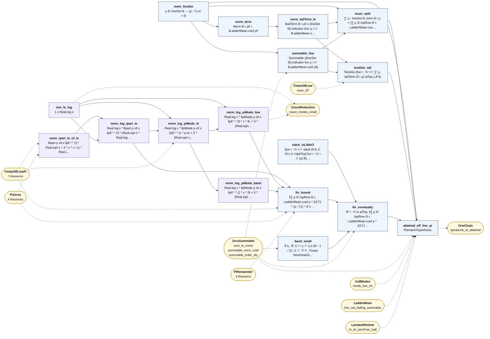

# `lean_stage3/Stage3/AttainedPi.lean`

AttainedPi — block C7 of `lean_stage3/design/carlson.md`. 2026-11-23. The one-ladder converse for the count of primes when the largest real part of the zeros of ζ is attained. Let `ρ₀` have the largest real part `Θ` among the zeros. If the count of primes at the doublings `2^r` stays within `C·r²·√2^r` of `Li`, then the Riemann hypothesis holds. There may be infinitely many zeros off the line.

17 theorems, 5 definitions, 887 lines. Arrows are Lean's own record of what each proof uses.

**Imports:** [`FiniteOffLinePi`](../lean_stage3/FiniteOffLinePi.md), [`LadderMean`](../lean_stage3/LadderMean.md), [`ZeroSummable`](../lean_stage3/ZeroSummable.md)  
**Imported by:** [`Stage3`](../lean_stage3/Stage3.md), [`CountReduction`](../lean_stage3/CountReduction.md), [`OneChain`](../lean_stage3/OneChain.md)

## The picture



An arrow A → B reads "A is used in the proof of B". Green: counting, integers only. Violet: shape, analysis with no ζ. Blue: reads ζ. A name ending in ■ is an end: nothing else uses it. Red: contains `sorry`. Yellow: theorems in another file, counted; a dotted arrow crosses files. Definitions are not drawn; they are listed below the diagram.

## Definitions

<a name="AttainedPi-topRow"></a>
### `AttainedPi.topRow`

def · line 290

The zeros below height `2^r` with real part `Θ`.

- **Is:** `` topRow (Θ : ℝ) (r : ℕ) : Finset NontrivialZeros := (ZF ((2:ℝ) ^ r)).filter fun ρ => (ρ : ℂ).re = Θ ``
- **Built from:** [`FiniteOffLine.ZF`](../lean_stage3/FiniteOffLine.md#FiniteOffLine-ZF)
- **Used by 4:** [`AttainedPi.attained_off_line_pi`](#AttainedPi-attained_off_line_pi), [`AttainedPi.fin_bound`](#AttainedPi-fin_bound), [`AttainedPi.fin_eventually`](#AttainedPi-fin_eventually), [`AttainedPi.tsum_split`](#AttainedPi-tsum_split)

<a name="AttainedPi-slack"></a>
### `AttainedPi.slack`

def · line 294

The part of the row's bound that is small against `(2^Θ)^r` for fixed parameters.

- **Is:** `` slack (Θ θ₁ C M ε : ℝ) (r : ℕ) : ℝ := (C * Real.log 2 + Arem + 8 + 3 * (Mlow * 39000) + 3 * ε + 3 * M) * ((r : ℝ) ^ 3 * Real.sqrt 2 ^ r) + 9 * (Mlow * 39000) * ((r : ℝ) ^ 2 * ((2:ℝ) ^ θ₁) ^ r) + 8 * M / Real.log 2 * ((r : ℝ)⁻¹ * ((2:ℝ) ^ Θ) ^ r) ``
- **Built from:** [`PiRemainder.Arem`](../lean_stage3/PiRemainder.md#PiRemainder-Arem), [`PiRemainder.Mlow`](../lean_stage3/PiRemainder.md#PiRemainder-Mlow)
- **Used by 3:** [`AttainedPi.fin_bound`](#AttainedPi-fin_bound), [`AttainedPi.fin_eventually`](#AttainedPi-fin_eventually), [`AttainedPi.slack_isLittleO`](#AttainedPi-slack_isLittleO)

<a name="AttainedPi-lineSet"></a>
### `AttainedPi.lineSet`

def · line 722

The zeros on the line `Re = Θ`.

- **Is:** `` lineSet (Θ : ℝ) : Set NontrivialZeros := {ρ | (ρ : ℂ).re = Θ} ``
- **Used by 8:** [`AttainedPi.attained_off_line_pi`](#AttainedPi-attained_off_line_pi), [`AttainedPi.mem_lineSet`](#AttainedPi-mem_lineSet), [`AttainedPi.norm_tailTerm_le`](#AttainedPi-norm_tailTerm_le), [`AttainedPi.norm_term`](#AttainedPi-norm_term), [`AttainedPi.summable_line`](#AttainedPi-summable_line), [`AttainedPi.tailTerm`](#AttainedPi-tailTerm), [`AttainedPi.tendsto_tail`](#AttainedPi-tendsto_tail), [`AttainedPi.tsum_split`](#AttainedPi-tsum_split)

<a name="AttainedPi-term"></a>
### `AttainedPi.term`

def · line 729

One zero's term at row `r`, measured against `(2^Θ)^r`.

- **Is:** `` term (Θ : ℝ) (r : ℕ) (ρ : NontrivialZeros) : ℂ := LadderMean.coef ρ * ((2:ℂ) ^ (ρ : ℂ)) ^ r / ((((2:ℝ) ^ Θ : ℝ)) : ℂ) ^ r ``
- **Built from:** [`LadderMean.coef`](../lean_stage3/LadderMean.md#LadderMean-coef)
- **Used by 6:** [`AttainedPi.attained_off_line_pi`](#AttainedPi-attained_off_line_pi), [`AttainedPi.norm_tailTerm_le`](#AttainedPi-norm_tailTerm_le), [`AttainedPi.norm_term`](#AttainedPi-norm_term), [`AttainedPi.tailTerm`](#AttainedPi-tailTerm), [`AttainedPi.tendsto_tail`](#AttainedPi-tendsto_tail), [`AttainedPi.tsum_split`](#AttainedPi-tsum_split)

<a name="AttainedPi-tailTerm"></a>
### `AttainedPi.tailTerm`

def · line 733

One zero's term on the line, kept only above height `2^r`.

- **Is:** `` tailTerm (Θ : ℝ) (r : ℕ) (ρ : NontrivialZeros) : ℂ := if ρ ∈ ZF ((2:ℝ) ^ r) then 0 else (lineSet Θ).indicator (term Θ r) ρ ``
- **Built from:** [`AttainedPi.lineSet`](#AttainedPi-lineSet), [`AttainedPi.term`](#AttainedPi-term), [`FiniteOffLine.ZF`](../lean_stage3/FiniteOffLine.md#FiniteOffLine-ZF)
- **Used by 4:** [`AttainedPi.attained_off_line_pi`](#AttainedPi-attained_off_line_pi), [`AttainedPi.norm_tailTerm_le`](#AttainedPi-norm_tailTerm_le), [`AttainedPi.tendsto_tail`](#AttainedPi-tendsto_tail), [`AttainedPi.tsum_split`](#AttainedPi-tsum_split)

## Theorems

<a name="AttainedPi-norm_ipart_le_of_le"></a>
### `AttainedPi.norm_ipart_le_of_le`

line 58

**Shape.** Uses real or complex analysis; nothing in it or beneath it reads ζ.

**Why.** The integral in one zero's part, against a larger exponent. For a real part `b > 0`, any `c` with `b ≤ c ≤ 1`, and `x ≥ 4`, the integral is at most `(3√x + 4x^c/(c·log²x))/|ρ|`.

**Proves**

```lean
‖ipart ρ x‖ ≤ ‖ρ‖⁻¹ * (3 * Real.sqrt x + 4 * x ^ c / (c * Real.log x ^ 2))
```

**Needs** (its hypotheses)

  - `` hb0 : 0 < ρ.re ``
  - `` hbc : ρ.re ≤ c ``
  - `` hc1 : c ≤ 1 ``
  - `` hx : 4 ≤ x ``

**Stated with:** [`FiniteOffLinePi.ipart`](../lean_stage3/FiniteOffLinePi.md#FiniteOffLinePi-ipart)

**Fed by** (3 theorems its proof uses)

  - [`FiniteOffLinePi.norm_integrand`](../lean_stage3/FiniteOffLinePi.md#FiniteOffLinePi-norm_integrand) (FiniteOffLinePi) — `` ‖(t : ℂ) ^ ρ / ρ * wt t‖ = ‖ρ‖⁻¹ * (t ^ ρ.re * (t * Real.log t ^ 2)⁻¹) ``
  - [`PiZeros.integrable_cpow`](../lean_stage3/PiZeros.md#PiZeros-integrable_cpow) (PiZeros) — `` IntervalIntegrable (fun t : ℝ => (t : ℂ) ^ ρ / ρ) volume 2 x ``
  - [`PiZeros.integrable_mul_wt`](../lean_stage3/PiZeros.md#PiZeros-integrable_mul_wt) (PiZeros) — `` IntervalIntegrable (fun t => f t * wt t) volume 2 x ``

**Definitions its proof touches:** [`PiZeros.wt`](../lean_stage3/PiZeros.md#PiZeros-wt)

**Feeds** (1 that use it)

  - [`AttainedPi.norm_log_ipart_le`](#AttainedPi-norm_log_ipart_le) — `` Real.log x * ‖ipart ρ x‖ ≤ ‖ρ‖⁻¹ * (3 * (Real.sqrt x * Real.log x) + 8 * (x ^ max ρ.re (1 / 2) / Real.log x)) ``

<a name="AttainedPi-one_le_log"></a>
### `AttainedPi.one_le_log`

line 181

**Shape.** Uses real or complex analysis; nothing in it or beneath it reads ζ.

**Why.** `log x ≥ 1` for `x ≥ 4`.

**Proves**

```lean
1 ≤ Real.log x
```

**Needs** (its hypotheses)

  - `` hx : 4 ≤ x ``

**Fed by:** no theorem of this repo; it stands on Mathlib.

**Feeds** (4 that use it)

  - [`AttainedPi.norm_log_ipart_le`](#AttainedPi-norm_log_ipart_le) — `` Real.log x * ‖ipart ρ x‖ ≤ ‖ρ‖⁻¹ * (3 * (Real.sqrt x * Real.log x) + 8 * (x ^ max ρ.re (1 / 2) / Real.log x)) ``
  - [`AttainedPi.norm_log_piMode_le`](#AttainedPi-norm_log_piMode_le) — `` Real.log x * ‖piMode ρ x‖ ≤ ‖ρ‖⁻¹ * (x ^ ρ.re + 3 * (Real.sqrt x * Real.log x) + 8 * (x ^ max ρ.re (1 / 2) / Real.log x)) ``
  - [`AttainedPi.norm_log_piMode_low`](#AttainedPi-norm_log_piMode_low) — `` Real.log x * ‖piMode ρ x‖ ≤ ‖ρ‖⁻¹ * (9 * x ^ θ₁ + 3 * (Real.sqrt x * Real.log x)) ``
  - [`CountReduction.count_modes_small`](../lean_stage3/CountReduction.md#CountReduction-count_modes_small) (CountReduction) — `` ∃ E A : ℝ, σ ≤ E ∧ E < Θ ∧ ∀ k : ℕ, 2 ≤ k → ‖∑' ρ : {ρ : Kadiri.NontrivialZeros // σ ≤ (ρ:ℂ).re}, ((riemannZeta.order ((ρ:Kadiri.NontrivialZeros):ℂ) :… ``

<a name="AttainedPi-norm_log_ipart_le"></a>
### `AttainedPi.norm_log_ipart_le`

line 195

**Shape.** Uses real or complex analysis; nothing in it or beneath it reads ζ.

**Why.** `log x` times the integral in one zero's part. For a real part `b` in `(0, 1]` and `x ≥ 4`, with `c = max b (1/2)`, it is at most `(3√x·log x + 8x^c/log x)/|ρ|`.

**Proves**

```lean
Real.log x * ‖ipart ρ x‖ ≤ ‖ρ‖⁻¹ * (3 * (Real.sqrt x * Real.log x) + 8 * (x ^ max ρ.re (1 / 2) / Real.log x))
```

**Needs** (its hypotheses)

  - `` hb0 : 0 < ρ.re ``
  - `` hb1 : ρ.re ≤ 1 ``
  - `` hx : 4 ≤ x ``

**Stated with:** [`FiniteOffLinePi.ipart`](../lean_stage3/FiniteOffLinePi.md#FiniteOffLinePi-ipart)

**Fed by** (2 theorems its proof uses)

  - [`AttainedPi.norm_ipart_le_of_le`](#AttainedPi-norm_ipart_le_of_le) — `` ‖ipart ρ x‖ ≤ ‖ρ‖⁻¹ * (3 * Real.sqrt x + 4 * x ^ c / (c * Real.log x ^ 2)) ``
  - [`AttainedPi.one_le_log`](#AttainedPi-one_le_log) — `` 1 ≤ Real.log x ``

**Feeds** (2 that use it)

  - [`AttainedPi.fin_bound`](#AttainedPi-fin_bound) — `` ‖∑ ρ ∈ topRow Θ r, LadderMean.coef ρ * ((2:ℂ) ^ (ρ : ℂ)) ^ r‖ ≤ slack Θ θ₁ C M ε r + 2 * ε * ((2:ℝ) ^ Θ) ^ r ``
  - [`AttainedPi.norm_log_piMode_le`](#AttainedPi-norm_log_piMode_le) — `` Real.log x * ‖piMode ρ x‖ ≤ ‖ρ‖⁻¹ * (x ^ ρ.re + 3 * (Real.sqrt x * Real.log x) + 8 * (x ^ max ρ.re (1 / 2) / Real.log x)) ``

<a name="AttainedPi-norm_log_piMode_le"></a>
### `AttainedPi.norm_log_piMode_le`

line 230

**Shape.** Uses real or complex analysis; nothing in it or beneath it reads ζ.

**Why.** `log x` times one zero's part of the count. For a real part `b` in `(0, 1]` and `x ≥ 4`, with `c = max b (1/2)`, it is at most `(x^b + 3√x·log x + 8x^c/log x)/|ρ|`.

**Proves**

```lean
Real.log x * ‖piMode ρ x‖ ≤ ‖ρ‖⁻¹ * (x ^ ρ.re + 3 * (Real.sqrt x * Real.log x) + 8 * (x ^ max ρ.re (1 / 2) / Real.log x))
```

**Needs** (its hypotheses)

  - `` hb0 : 0 < ρ.re ``
  - `` hb1 : ρ.re ≤ 1 ``
  - `` hx : 4 ≤ x ``

**Stated with:** [`PiZeros.piMode`](../lean_stage3/PiZeros.md#PiZeros-piMode)

**Fed by** (3 theorems its proof uses)

  - [`AttainedPi.norm_log_ipart_le`](#AttainedPi-norm_log_ipart_le) — `` Real.log x * ‖ipart ρ x‖ ≤ ‖ρ‖⁻¹ * (3 * (Real.sqrt x * Real.log x) + 8 * (x ^ max ρ.re (1 / 2) / Real.log x)) ``
  - [`AttainedPi.one_le_log`](#AttainedPi-one_le_log) — `` 1 ≤ Real.log x ``
  - [`FiniteOffLinePi.piMode_eq`](../lean_stage3/FiniteOffLinePi.md#FiniteOffLinePi-piMode_eq) (FiniteOffLinePi) — `` piMode ρ x = (x : ℂ) ^ ρ / ρ / (Real.log x : ℂ) + ipart ρ x ``

**Definitions its proof touches:** [`FiniteOffLinePi.ipart`](../lean_stage3/FiniteOffLinePi.md#FiniteOffLinePi-ipart)

**Feeds** (2 that use it)

  - [`AttainedPi.norm_log_piMode_band`](#AttainedPi-norm_log_piMode_band) — `` Real.log x * ‖piMode ρ x‖ ≤ ‖ρ‖⁻¹ * (2 * x ^ Θ + 3 * (Real.sqrt x * Real.log x)) ``
  - [`AttainedPi.norm_log_piMode_low`](#AttainedPi-norm_log_piMode_low) — `` Real.log x * ‖piMode ρ x‖ ≤ ‖ρ‖⁻¹ * (9 * x ^ θ₁ + 3 * (Real.sqrt x * Real.log x)) ``

<a name="AttainedPi-norm_log_piMode_low"></a>
### `AttainedPi.norm_log_piMode_low`

line 257

**Shape.** Uses real or complex analysis; nothing in it or beneath it reads ζ.

**Why.** A zero at or left of `θ₁`. For a real part `b` in `(0, θ₁]` with `θ₁ ≥ 1/2` and `x ≥ 4`, `log x` times the zero's part is at most `(9x^θ₁ + 3√x·log x)/|ρ|`.

**Proves**

```lean
Real.log x * ‖piMode ρ x‖ ≤ ‖ρ‖⁻¹ * (9 * x ^ θ₁ + 3 * (Real.sqrt x * Real.log x))
```

**Needs** (its hypotheses)

  - `` hb0 : 0 < ρ.re ``
  - `` hb1 : ρ.re ≤ 1 ``
  - `` hθ : 1 / 2 ≤ θ₁ ``
  - `` hbθ : ρ.re ≤ θ₁ ``
  - `` hx : 4 ≤ x ``

**Stated with:** [`PiZeros.piMode`](../lean_stage3/PiZeros.md#PiZeros-piMode)

**Fed by** (2 theorems its proof uses)

  - [`AttainedPi.norm_log_piMode_le`](#AttainedPi-norm_log_piMode_le) — `` Real.log x * ‖piMode ρ x‖ ≤ ‖ρ‖⁻¹ * (x ^ ρ.re + 3 * (Real.sqrt x * Real.log x) + 8 * (x ^ max ρ.re (1 / 2) / Real.log x)) ``
  - [`AttainedPi.one_le_log`](#AttainedPi-one_le_log) — `` 1 ≤ Real.log x ``

**Feeds** (2 that use it)

  - [`AttainedPi.fin_bound`](#AttainedPi-fin_bound) — `` ‖∑ ρ ∈ topRow Θ r, LadderMean.coef ρ * ((2:ℂ) ^ (ρ : ℂ)) ^ r‖ ≤ slack Θ θ₁ C M ε r + 2 * ε * ((2:ℝ) ^ Θ) ^ r ``
  - [`CountReduction.count_modes_small`](../lean_stage3/CountReduction.md#CountReduction-count_modes_small) (CountReduction) — `` ∃ E A : ℝ, σ ≤ E ∧ E < Θ ∧ ∀ k : ℕ, 2 ≤ k → ‖∑' ρ : {ρ : Kadiri.NontrivialZeros // σ ≤ (ρ:ℂ).re}, ((riemannZeta.order ((ρ:Kadiri.NontrivialZeros):ℂ) :… ``

<a name="AttainedPi-norm_log_piMode_band"></a>
### `AttainedPi.norm_log_piMode_band`

line 274

**Shape.** Uses real or complex analysis; nothing in it or beneath it reads ζ.

**Why.** A zero in the band below the top line. For a real part `b` in `(1/2, Θ]`, `x ≥ 4` and `log x ≥ 8`, `log x` times the zero's part is at most `(2x^Θ + 3√x·log x)/|ρ|`.

**Proves**

```lean
Real.log x * ‖piMode ρ x‖ ≤ ‖ρ‖⁻¹ * (2 * x ^ Θ + 3 * (Real.sqrt x * Real.log x))
```

**Needs** (its hypotheses)

  - `` hb1 : ρ.re ≤ 1 ``
  - `` hb : 1 / 2 < ρ.re ``
  - `` hbΘ : ρ.re ≤ Θ ``
  - `` hx : 4 ≤ x ``
  - `` hL8 : 8 ≤ Real.log x ``

**Stated with:** [`PiZeros.piMode`](../lean_stage3/PiZeros.md#PiZeros-piMode)

**Fed by** (1 theorem its proof uses)

  - [`AttainedPi.norm_log_piMode_le`](#AttainedPi-norm_log_piMode_le) — `` Real.log x * ‖piMode ρ x‖ ≤ ‖ρ‖⁻¹ * (x ^ ρ.re + 3 * (Real.sqrt x * Real.log x) + 8 * (x ^ max ρ.re (1 / 2) / Real.log x)) ``

**Feeds** (1 that use it)

  - [`AttainedPi.fin_bound`](#AttainedPi-fin_bound) — `` ‖∑ ρ ∈ topRow Θ r, LadderMean.coef ρ * ((2:ℂ) ^ (ρ : ℂ)) ^ r‖ ≤ slack Θ θ₁ C M ε r + 2 * ε * ((2:ℝ) ^ Θ) ^ r ``

<a name="AttainedPi-slack_isLittleO"></a>
### `AttainedPi.slack_isLittleO`

line 302

**Reads ζ.** It, or something it rests on, uses the zeta function, its zeros or the Riemann hypothesis.

**Why.** The slack is small against the top line. If `θ₁ < Θ` and `Θ > 1/2`, the slack is `o((2^Θ)^r)`.

**Proves**

```lean
(fun r : ℕ => slack Θ θ₁ C M ε r) =o[atTop] fun r : ℕ => ((2:ℝ) ^ Θ) ^ r
```

**Needs** (its hypotheses)

  - `` hΘ : 1 / 2 < Θ ``
  - `` hθ : θ₁ < Θ ``
  - `` C M ε : ℝ ``

**Stated with:** [`AttainedPi.slack`](#AttainedPi-slack)

**Fed by:** no theorem of this repo; it stands on Mathlib and the definitions below.

**Definitions its proof touches:** [`PiRemainder.Arem`](../lean_stage3/PiRemainder.md#PiRemainder-Arem), [`PiRemainder.Mlow`](../lean_stage3/PiRemainder.md#PiRemainder-Mlow)

**Feeds** (1 that use it)

  - [`AttainedPi.fin_eventually`](#AttainedPi-fin_eventually) — `` ∀ᶠ r : ℕ in atTop, ‖∑ ρ ∈ topRow Θ r, LadderMean.coef ρ * ((2:ℂ) ^ (ρ : ℂ)) ^ r‖ ≤ ε * ((2:ℝ) ^ Θ) ^ r ``

<a name="AttainedPi-fin_bound"></a>
### `AttainedPi.fin_bound`

line 331

**Reads ζ.** It, or something it rests on, uses the zeta function, its zeros or the Riemann hypothesis.

**Why.** The zeros of the top line below one row. Let every zero have real part at most `Θ > 1/2`, let `M` bound the weights on the line, and `ε` the weights of every finite set in the band `(θ₁, Θ)`, with `θ₁ ≥ 1/2`. If `r ≥ 12` and the count of primes at `2^r` is within `C·r²·√2^r` of `Li`, the sum of `m(ρ)/ρ·(2^ρ)^r` over the zeros of the line below `2^r` is at most `slack + 2ε·(2^Θ)^r`.

**Proves**

```lean
‖∑ ρ ∈ topRow Θ r, LadderMean.coef ρ * ((2:ℂ) ^ (ρ : ℂ)) ^ r‖ ≤ slack Θ θ₁ C M ε r + 2 * ε * ((2:ℝ) ^ Θ) ^ r
```

**Needs** (its hypotheses)

  - `` hΘ : 1 / 2 < Θ ``
  - `` hθ₁ : 1 / 2 ≤ θ₁ ``
  - `` hmax : ∀ ρ : NontrivialZeros, (ρ : ℂ).re ≤ Θ ``
  - `` hM : ∀ v : Finset NontrivialZeros, (∀ ρ ∈ v, Θ ≤ (ρ : ℂ).re) → ∑ ρ ∈ v, ZeroSummable.w ρ ≤ M ``
  - `` hband : ∀ F : Finset NontrivialZeros, (∀ ρ ∈ F, θ₁ < (ρ : ℂ).re ∧ (ρ : ℂ).re < Θ) → ∑ ρ ∈ F, ordR ρ * ‖(ρ : ℂ)‖⁻¹ ≤ ε ``
  - `` hr : 12 ≤ r ``
  - `` hrow : |(Nat.primeCounting ⌊(2:ℝ) ^ r⌋₊ : ℝ) - Stage3.Li ((2:ℝ) ^ r)| ≤ C * (r : ℝ) ^ 2 * Real.sqrt 2 ^ r ``

**Stated with:** [`AttainedPi.slack`](#AttainedPi-slack), [`AttainedPi.topRow`](#AttainedPi-topRow), [`FiniteOffLinePi.ordR`](../lean_stage3/FiniteOffLinePi.md#FiniteOffLinePi-ordR), [`LadderMean.coef`](../lean_stage3/LadderMean.md#LadderMean-coef), [`Stage3.Li`](../lean_stage3/PsiToPi.md#Stage3-Li), [`ZeroSummable.w`](../lean_stage3/ZeroSummable.md#ZeroSummable-w)

**Fed by** (15 theorems its proof uses)

  - [`AttainedPi.norm_log_ipart_le`](#AttainedPi-norm_log_ipart_le) — `` Real.log x * ‖ipart ρ x‖ ≤ ‖ρ‖⁻¹ * (3 * (Real.sqrt x * Real.log x) + 8 * (x ^ max ρ.re (1 / 2) / Real.log x)) ``
  - [`AttainedPi.norm_log_piMode_band`](#AttainedPi-norm_log_piMode_band) — `` Real.log x * ‖piMode ρ x‖ ≤ ‖ρ‖⁻¹ * (2 * x ^ Θ + 3 * (Real.sqrt x * Real.log x)) ``
  - [`AttainedPi.norm_log_piMode_low`](#AttainedPi-norm_log_piMode_low) — `` Real.log x * ‖piMode ρ x‖ ≤ ‖ρ‖⁻¹ * (9 * x ^ θ₁ + 3 * (Real.sqrt x * Real.log x)) ``
  - [`FiniteOffLinePi.cpow_doubling`](../lean_stage3/FiniteOffLinePi.md#FiniteOffLinePi-cpow_doubling) (FiniteOffLinePi) — `` (((2:ℝ) ^ r : ℝ) : ℂ) ^ ρ = ((2:ℂ) ^ ρ) ^ r ``
  - [`FiniteOffLinePi.norm_order_mul`](../lean_stage3/FiniteOffLinePi.md#FiniteOffLinePi-norm_order_mul) (FiniteOffLinePi) — `` ‖((riemannZeta.order (ρ : ℂ) : ℤ) : ℂ) * w‖ = ordR ρ * ‖w‖ ``
  - [`FiniteOffLinePi.ordR_nonneg`](../lean_stage3/FiniteOffLinePi.md#FiniteOffLinePi-ordR_nonneg) (FiniteOffLinePi) — `` 0 ≤ ordR ρ ``
  - [`FiniteOffLinePi.piMode_eq`](../lean_stage3/FiniteOffLinePi.md#FiniteOffLinePi-piMode_eq) (FiniteOffLinePi) — `` piMode ρ x = (x : ℂ) ^ ρ / ρ / (Real.log x : ℂ) + ipart ρ x ``
  - [`FiniteOffLinePi.rpow_doubling`](../lean_stage3/FiniteOffLinePi.md#FiniteOffLinePi-rpow_doubling) (FiniteOffLinePi) — `` ((2:ℝ) ^ r) ^ b = ((2:ℝ) ^ b) ^ r ``
  - [`FiniteOffLinePi.sqrt_doubling`](../lean_stage3/FiniteOffLinePi.md#FiniteOffLinePi-sqrt_doubling) (FiniteOffLinePi) — `` Real.sqrt ((2:ℝ) ^ r) = Real.sqrt 2 ^ r ``
  - [`PiRemainder.Arem_nonneg`](../lean_stage3/PiRemainder.md#PiRemainder-Arem_nonneg) (PiRemainder) — `` 0 ≤ Arem ``
  - [`PiRemainder.norm_tr_efRem_le_of`](../lean_stage3/PiRemainder.md#PiRemainder-norm_tr_efRem_le_of) (PiRemainder) — `` ‖tr (efRem x) x‖ ≤ Arem * Real.sqrt x * Real.log x ^ 2 ``
  - [`PiRemainder.two_le_Mlow`](../lean_stage3/PiRemainder.md#PiRemainder-two_le_Mlow) (PiRemainder) — `` 2 ≤ Mlow ``
  - [`PiRemainder.zinv_le_log`](../lean_stage3/PiRemainder.md#PiRemainder-zinv_le_log) (PiRemainder) — `` zinv x ≤ Mlow * 39000 * Real.log x ^ 2 ``
  - [`PiZeros.norm_tr_psiTheta_le`](../lean_stage3/PiZeros.md#PiZeros-norm_tr_psiTheta_le) (PiZeros) — `` ‖tr psiTheta x‖ ≤ 8 * Real.sqrt x ``
  - [`PiZeros.pi_eq_zero_sum`](../lean_stage3/PiZeros.md#PiZeros-pi_eq_zero_sum) (PiZeros) — `` (((Nat.primeCounting ⌊x⌋₊ : ℝ) - Stage3.Li x : ℝ) : ℂ) = -∑ ρ ∈ ZF T, ((riemannZeta.order (ρ : ℂ) : ℤ) : ℂ) * piMode (ρ : ℂ) x + tr (efRem T) x - tr p… ``

**Definitions its proof touches:** [`FiniteOffLine.ZF`](../lean_stage3/FiniteOffLine.md#FiniteOffLine-ZF), [`FiniteOffLinePi.ipart`](../lean_stage3/FiniteOffLinePi.md#FiniteOffLinePi-ipart), [`PiRemainder.Arem`](../lean_stage3/PiRemainder.md#PiRemainder-Arem), [`PiRemainder.Mlow`](../lean_stage3/PiRemainder.md#PiRemainder-Mlow), [`PiRemainder.zinv`](../lean_stage3/PiRemainder.md#PiRemainder-zinv), [`PiZeros.efRem`](../lean_stage3/PiZeros.md#PiZeros-efRem), [`PiZeros.piMode`](../lean_stage3/PiZeros.md#PiZeros-piMode), [`PiZeros.psiTheta`](../lean_stage3/PiZeros.md#PiZeros-psiTheta), [`PiZeros.tr`](../lean_stage3/PiZeros.md#PiZeros-tr)

**Feeds** (1 that use it)

  - [`AttainedPi.fin_eventually`](#AttainedPi-fin_eventually) — `` ∀ᶠ r : ℕ in atTop, ‖∑ ρ ∈ topRow Θ r, LadderMean.coef ρ * ((2:ℂ) ^ (ρ : ℂ)) ^ r‖ ≤ ε * ((2:ℝ) ^ Θ) ^ r ``

<a name="AttainedPi-band_small"></a>
### `AttainedPi.band_small`

line 643

**Reads ζ.** It, or something it rests on, uses the zeta function, its zeros or the Riemann hypothesis.

**Why.** The band below the top line carries little weight. For `Θ > 1/2` and `ε > 0` there is `η ∈ (0, (Θ − 1/2)/2]` such that every finite set of zeros with real parts in `(Θ − η, Θ)` has `Σ m(ρ)/|ρ| ≤ ε`.

**Proves**

```lean
∃ η : ℝ, 0 < η ∧ η ≤ (Θ - 1 / 2) / 2 ∧ ∀ F : Finset NontrivialZeros, (∀ ρ ∈ F, Θ - η < (ρ : ℂ).re ∧ (ρ : ℂ).re < Θ) → ∑ ρ ∈ F, ordR ρ * ‖(ρ : ℂ)‖⁻¹ ≤ ε
```

**Needs** (its hypotheses)

  - `` hΘ : 1 / 2 < Θ ``
  - `` hε : 0 < ε ``

**Stated with:** [`FiniteOffLinePi.ordR`](../lean_stage3/FiniteOffLinePi.md#FiniteOffLinePi-ordR)

**Fed by** (1 theorem its proof uses)

  - [`ZeroSummable.summable_order_div`](../lean_stage3/ZeroSummable.md#ZeroSummable-summable_order_div) (ZeroSummable) — `` Summable fun ρ : {ρ : Kadiri.NontrivialZeros // σ ≤ ((ρ : Kadiri.NontrivialZeros) : ℂ).re} => ((riemannZeta.order ((ρ : Kadiri.NontrivialZeros) : ℂ) :… ``

**Feeds** (1 that use it)

  - [`AttainedPi.fin_eventually`](#AttainedPi-fin_eventually) — `` ∀ᶠ r : ℕ in atTop, ‖∑ ρ ∈ topRow Θ r, LadderMean.coef ρ * ((2:ℂ) ^ (ρ : ℂ)) ^ r‖ ≤ ε * ((2:ℝ) ^ Θ) ^ r ``

<a name="AttainedPi-fin_eventually"></a>
### `AttainedPi.fin_eventually`

line 700

**Reads ζ.** It, or something it rests on, uses the zeta function, its zeros or the Riemann hypothesis.

**Why.** The top line below the rows is eventually small. Let `Θ ∈ (1/2, 1]` bound the real parts of all zeros, and let the count of primes at the doublings stay within `C·r²·√2^r` of `Li`. Then for every `ε > 0`, from some row on, the sum of `m(ρ)/ρ·(2^ρ)^r` over the zeros of the line `Re = Θ` below `2^r` is at most `ε·(2^Θ)^r`.

**Proves**

```lean
∀ᶠ r : ℕ in atTop, ‖∑ ρ ∈ topRow Θ r, LadderMean.coef ρ * ((2:ℂ) ^ (ρ : ℂ)) ^ r‖ ≤ ε * ((2:ℝ) ^ Θ) ^ r
```

**Needs** (its hypotheses)

  - `` hΘ : 1 / 2 < Θ ``
  - `` hΘ1 : Θ ≤ 1 ``
  - `` hmax : ∀ ρ : NontrivialZeros, (ρ : ℂ).re ≤ Θ ``
  - `` hrows : ∀ᶠ r : ℕ in atTop, |(Nat.primeCounting ⌊(2:ℝ) ^ r⌋₊ : ℝ) - Stage3.Li ((2:ℝ) ^ r)| ≤ C * (r : ℝ) ^ 2 * Real.sqrt 2 ^ r ``
  - `` hε : 0 < ε ``

**Stated with:** [`AttainedPi.topRow`](#AttainedPi-topRow), [`LadderMean.coef`](../lean_stage3/LadderMean.md#LadderMean-coef), [`Stage3.Li`](../lean_stage3/PsiToPi.md#Stage3-Li)

**Fed by** (4 theorems its proof uses)

  - [`AttainedPi.band_small`](#AttainedPi-band_small) — `` ∃ η : ℝ, 0 < η ∧ η ≤ (Θ - 1 / 2) / 2 ∧ ∀ F : Finset NontrivialZeros, (∀ ρ ∈ F, Θ - η < (ρ : ℂ).re ∧ (ρ : ℂ).re < Θ) → ∑ ρ ∈ F, ordR ρ * ‖(ρ : ℂ)‖⁻¹ ≤ … ``
  - [`AttainedPi.fin_bound`](#AttainedPi-fin_bound) — `` ‖∑ ρ ∈ topRow Θ r, LadderMean.coef ρ * ((2:ℂ) ^ (ρ : ℂ)) ^ r‖ ≤ slack Θ θ₁ C M ε r + 2 * ε * ((2:ℝ) ^ Θ) ^ r ``
  - [`AttainedPi.slack_isLittleO`](#AttainedPi-slack_isLittleO) — `` (fun r : ℕ => slack Θ θ₁ C M ε r) =o[atTop] fun r : ℕ => ((2:ℝ) ^ Θ) ^ r ``
  - [`ZeroSummable.sum_le_const`](../lean_stage3/ZeroSummable.md#ZeroSummable-sum_le_const) (ZeroSummable) — `` ∃ M : ℝ, ∀ v : Finset NontrivialZeros, (∀ ρ ∈ v, σ ≤ (ρ : ℂ).re) → ∑ ρ ∈ v, w ρ ≤ M ``

**Definitions its proof touches:** [`AttainedPi.slack`](#AttainedPi-slack), [`FiniteOffLinePi.ordR`](../lean_stage3/FiniteOffLinePi.md#FiniteOffLinePi-ordR), [`ZeroSummable.w`](../lean_stage3/ZeroSummable.md#ZeroSummable-w)

**Feeds** (1 that use it)

  - [`AttainedPi.attained_off_line_pi`](#AttainedPi-attained_off_line_pi) — `` RiemannHypothesis ``

<a name="AttainedPi-mem_lineSet"></a>
### `AttainedPi.mem_lineSet`

line 725

**Reads ζ.** It, or something it rests on, uses the zeta function, its zeros or the Riemann hypothesis.

**Why.** A zero is on the line exactly when its real part is `Θ`.

**Proves**

```lean
ρ ∈ lineSet Θ ↔ (ρ : ℂ).re = Θ
```

**Stated with:** [`AttainedPi.lineSet`](#AttainedPi-lineSet)

**Fed by:** no theorem of this repo; it stands on Mathlib and the definitions below.

**Feeds** (4 that use it)

  - [`AttainedPi.attained_off_line_pi`](#AttainedPi-attained_off_line_pi) — `` RiemannHypothesis ``
  - [`AttainedPi.norm_term`](#AttainedPi-norm_term) — `` ‖term Θ r ρ‖ = ‖LadderMean.coef ρ‖ ``
  - [`AttainedPi.summable_line`](#AttainedPi-summable_line) — `` Summable ((lineSet Θ).indicator fun ρ => ‖LadderMean.coef ρ‖) ``
  - [`AttainedPi.tsum_split`](#AttainedPi-tsum_split) — `` ∑' ρ : lineSet Θ, term Θ r ρ = (∑ ρ ∈ topRow Θ r, LadderMean.coef ρ * ((2:ℂ) ^ (ρ : ℂ)) ^ r) / ((((2:ℝ) ^ Θ : ℝ)) : ℂ) ^ r + ∑' ρ, tailTerm Θ r ρ ``

<a name="AttainedPi-norm_term"></a>
### `AttainedPi.norm_term`

line 737

**Reads ζ.** It, or something it rests on, uses the zeta function, its zeros or the Riemann hypothesis.

**Why.** A zero on the line has a term of size `m(ρ)/|ρ|` at every row.

**Proves**

```lean
‖term Θ r ρ‖ = ‖LadderMean.coef ρ‖
```

**Needs** (its hypotheses)

  - `` r : ℕ ``
  - `` hρ : ρ ∈ lineSet Θ ``

**Stated with:** [`AttainedPi.lineSet`](#AttainedPi-lineSet), [`AttainedPi.term`](#AttainedPi-term), [`LadderMean.coef`](../lean_stage3/LadderMean.md#LadderMean-coef)

**Fed by** (1 theorem its proof uses)

  - [`AttainedPi.mem_lineSet`](#AttainedPi-mem_lineSet) — `` ρ ∈ lineSet Θ ↔ (ρ : ℂ).re = Θ ``

**Feeds** (1 that use it)

  - [`AttainedPi.norm_tailTerm_le`](#AttainedPi-norm_tailTerm_le) — `` ‖tailTerm Θ r ρ‖ ≤ (lineSet Θ).indicator (fun ρ => ‖LadderMean.coef ρ‖) ρ ``

<a name="AttainedPi-norm_tailTerm_le"></a>
### `AttainedPi.norm_tailTerm_le`

line 748

**Reads ζ.** It, or something it rests on, uses the zeta function, its zeros or the Riemann hypothesis.

**Why.** The part above height `2^r` of a zero's term is at most its weight on the line.

**Proves**

```lean
‖tailTerm Θ r ρ‖ ≤ (lineSet Θ).indicator (fun ρ => ‖LadderMean.coef ρ‖) ρ
```

**Needs** (its hypotheses)

  - `` Θ : ℝ ``
  - `` r : ℕ ``
  - `` ρ : NontrivialZeros ``

**Stated with:** [`AttainedPi.lineSet`](#AttainedPi-lineSet), [`AttainedPi.tailTerm`](#AttainedPi-tailTerm), [`LadderMean.coef`](../lean_stage3/LadderMean.md#LadderMean-coef)

**Fed by** (1 theorem its proof uses)

  - [`AttainedPi.norm_term`](#AttainedPi-norm_term) — `` ‖term Θ r ρ‖ = ‖LadderMean.coef ρ‖ ``

**Definitions its proof touches:** [`AttainedPi.term`](#AttainedPi-term), [`FiniteOffLine.ZF`](../lean_stage3/FiniteOffLine.md#FiniteOffLine-ZF)

**Feeds** (2 that use it)

  - [`AttainedPi.tendsto_tail`](#AttainedPi-tendsto_tail) — `` Tendsto (fun r : ℕ => ∑' ρ, tailTerm Θ r ρ) atTop (𝓝 0) ``
  - [`AttainedPi.tsum_split`](#AttainedPi-tsum_split) — `` ∑' ρ : lineSet Θ, term Θ r ρ = (∑ ρ ∈ topRow Θ r, LadderMean.coef ρ * ((2:ℂ) ^ (ρ : ℂ)) ^ r) / ((((2:ℝ) ^ Θ : ℝ)) : ℂ) ^ r + ∑' ρ, tailTerm Θ r ρ ``

<a name="AttainedPi-summable_line"></a>
### `AttainedPi.summable_line`

line 760

**Reads ζ.** It, or something it rests on, uses the zeta function, its zeros or the Riemann hypothesis.

**Why.** For `Θ > 1/2` the weights on the line, as a function on all zeros, are summable.

**Proves**

```lean
Summable ((lineSet Θ).indicator fun ρ => ‖LadderMean.coef ρ‖)
```

**Needs** (its hypotheses)

  - `` hΘ : 1 / 2 < Θ ``

**Stated with:** [`AttainedPi.lineSet`](#AttainedPi-lineSet), [`LadderMean.coef`](../lean_stage3/LadderMean.md#LadderMean-coef)

**Fed by** (2 theorems its proof uses)

  - [`AttainedPi.mem_lineSet`](#AttainedPi-mem_lineSet) — `` ρ ∈ lineSet Θ ↔ (ρ : ℂ).re = Θ ``
  - [`ZeroSummable.summable_norm_coef`](../lean_stage3/ZeroSummable.md#ZeroSummable-summable_norm_coef) (ZeroSummable) — `` Summable fun ρ : S => ‖LadderMean.coef ρ‖ ``

**Feeds** (2 that use it)

  - [`AttainedPi.tendsto_tail`](#AttainedPi-tendsto_tail) — `` Tendsto (fun r : ℕ => ∑' ρ, tailTerm Θ r ρ) atTop (𝓝 0) ``
  - [`AttainedPi.tsum_split`](#AttainedPi-tsum_split) — `` ∑' ρ : lineSet Θ, term Θ r ρ = (∑ ρ ∈ topRow Θ r, LadderMean.coef ρ * ((2:ℂ) ^ (ρ : ℂ)) ^ r) / ((((2:ℝ) ^ Θ : ℝ)) : ℂ) ^ r + ∑' ρ, tailTerm Θ r ρ ``

<a name="AttainedPi-tsum_split"></a>
### `AttainedPi.tsum_split`

line 768

**Reads ζ.** It, or something it rests on, uses the zeta function, its zeros or the Riemann hypothesis.

**Why.** The line's sum splits at height `2^r`. For `Θ > 1/2`, the sum over the line of the terms at row `r` is the sum over the zeros of the line below `2^r`, over `(2^Θ)^r`, plus the sum of the parts above `2^r`.

**Proves**

```lean
∑' ρ : lineSet Θ, term Θ r ρ = (∑ ρ ∈ topRow Θ r, LadderMean.coef ρ * ((2:ℂ) ^ (ρ : ℂ)) ^ r) / ((((2:ℝ) ^ Θ : ℝ)) : ℂ) ^ r + ∑' ρ, tailTerm Θ r ρ
```

**Needs** (its hypotheses)

  - `` hΘ : 1 / 2 < Θ ``
  - `` r : ℕ ``

**Stated with:** [`AttainedPi.lineSet`](#AttainedPi-lineSet), [`AttainedPi.tailTerm`](#AttainedPi-tailTerm), [`AttainedPi.term`](#AttainedPi-term), [`AttainedPi.topRow`](#AttainedPi-topRow), [`LadderMean.coef`](../lean_stage3/LadderMean.md#LadderMean-coef)

**Fed by** (3 theorems its proof uses)

  - [`AttainedPi.mem_lineSet`](#AttainedPi-mem_lineSet) — `` ρ ∈ lineSet Θ ↔ (ρ : ℂ).re = Θ ``
  - [`AttainedPi.norm_tailTerm_le`](#AttainedPi-norm_tailTerm_le) — `` ‖tailTerm Θ r ρ‖ ≤ (lineSet Θ).indicator (fun ρ => ‖LadderMean.coef ρ‖) ρ ``
  - [`AttainedPi.summable_line`](#AttainedPi-summable_line) — `` Summable ((lineSet Θ).indicator fun ρ => ‖LadderMean.coef ρ‖) ``

**Definitions its proof touches:** [`FiniteOffLine.ZF`](../lean_stage3/FiniteOffLine.md#FiniteOffLine-ZF)

**Feeds** (1 that use it)

  - [`AttainedPi.attained_off_line_pi`](#AttainedPi-attained_off_line_pi) — `` RiemannHypothesis ``

<a name="AttainedPi-tendsto_tail"></a>
### `AttainedPi.tendsto_tail`

line 801

**Reads ζ.** It, or something it rests on, uses the zeta function, its zeros or the Riemann hypothesis.

**Why.** The parts above height `2^r` fade. For `Θ > 1/2`, the sum over the line of the terms of the zeros above `2^r` tends to zero as the rows go on.

**Proves**

```lean
Tendsto (fun r : ℕ => ∑' ρ, tailTerm Θ r ρ) atTop (𝓝 0)
```

**Needs** (its hypotheses)

  - `` hΘ : 1 / 2 < Θ ``

**Stated with:** [`AttainedPi.tailTerm`](#AttainedPi-tailTerm)

**Fed by** (3 theorems its proof uses)

  - [`AttainedPi.norm_tailTerm_le`](#AttainedPi-norm_tailTerm_le) — `` ‖tailTerm Θ r ρ‖ ≤ (lineSet Θ).indicator (fun ρ => ‖LadderMean.coef ρ‖) ρ ``
  - [`AttainedPi.summable_line`](#AttainedPi-summable_line) — `` Summable ((lineSet Θ).indicator fun ρ => ‖LadderMean.coef ρ‖) ``
  - [`FiniteOffLine.mem_ZF`](../lean_stage3/FiniteOffLine.md#FiniteOffLine-mem_ZF) (FiniteOffLine) — `` ρ ∈ ZF T ↔ |(ρ : ℂ).im| < T ``

**Definitions its proof touches:** [`AttainedPi.lineSet`](#AttainedPi-lineSet), [`AttainedPi.term`](#AttainedPi-term), [`FiniteOffLine.ZF`](../lean_stage3/FiniteOffLine.md#FiniteOffLine-ZF), [`LadderMean.coef`](../lean_stage3/LadderMean.md#LadderMean-coef)

**Feeds** (1 that use it)

  - [`AttainedPi.attained_off_line_pi`](#AttainedPi-attained_off_line_pi) — `` RiemannHypothesis ``

<a name="AttainedPi-attained_off_line_pi"></a>
### `AttainedPi.attained_off_line_pi`

line 824

**Reads ζ.** It, or something it rests on, uses the zeta function, its zeros or the Riemann hypothesis.

**Why.** The largest real part attained, and the count of primes of square-root size at the doublings: then the Riemann hypothesis holds. Let `ρ₀` have the largest real part among the zeros of ζ. If the count of primes at `2^r` stays within `C·r²·√2^r` of `Li` from some row on, the Riemann hypothesis holds.

**Proves**

```lean
RiemannHypothesis
```

**Needs** (its hypotheses)

  - `` ρ₀ : Kadiri.NontrivialZeros ``
  - `` hmax : ∀ ρ : Kadiri.NontrivialZeros, (ρ : ℂ).re ≤ (ρ₀ : ℂ).re ``
  - `` C : ℝ ``
  - `` hrows : ∀ᶠ r : ℕ in Filter.atTop, |(Nat.primeCounting ⌊(2:ℝ) ^ r⌋₊ : ℝ) - Stage3.Li ((2:ℝ) ^ r)| ≤ C * (r : ℝ) ^ 2 * Real.sqrt 2 ^ r ``

**Stated with:** [`Stage3.Li`](../lean_stage3/PsiToPi.md#Stage3-Li)

**Fed by** (8 theorems its proof uses)

  - [`AttainedPi.fin_eventually`](#AttainedPi-fin_eventually) — `` ∀ᶠ r : ℕ in atTop, ‖∑ ρ ∈ topRow Θ r, LadderMean.coef ρ * ((2:ℂ) ^ (ρ : ℂ)) ^ r‖ ≤ ε * ((2:ℝ) ^ Θ) ^ r ``
  - [`AttainedPi.mem_lineSet`](#AttainedPi-mem_lineSet) — `` ρ ∈ lineSet Θ ↔ (ρ : ℂ).re = Θ ``
  - [`AttainedPi.tendsto_tail`](#AttainedPi-tendsto_tail) — `` Tendsto (fun r : ℕ => ∑' ρ, tailTerm Θ r ρ) atTop (𝓝 0) ``
  - [`AttainedPi.tsum_split`](#AttainedPi-tsum_split) — `` ∑' ρ : lineSet Θ, term Θ r ρ = (∑ ρ ∈ topRow Θ r, LadderMean.coef ρ * ((2:ℂ) ^ (ρ : ℂ)) ^ r) / ((((2:ℝ) ^ Θ : ℝ)) : ℂ) ^ r + ∑' ρ, tailTerm Θ r ρ ``
  - [`CellModes.mode_two_int`](../lean_stage3/CellModes.md#CellModes-mode_two_int) (CellModes) — `` Chain.mode 2 ρ (r : ℂ) = ((2:ℂ) ^ ρ) ^ r ``
  - [`LadderMean.line_not_fading_summable`](../lean_stage3/LadderMean.md#LadderMean-line_not_fading_summable) (LadderMean) — `` ¬ Tendsto (fun r : ℕ => (∑' ρ : S, coef ρ * Chain.Sym 2 ((ρ : Kadiri.NontrivialZeros) : ℂ) ^ d * Chain.mode 2 ((ρ : Kadiri.NontrivialZeros) : ℂ) (((r … ``
  - [`LandauWindow.rh_of_zeroFree_half`](../lean_stage3/LandauWindow.md#LandauWindow-rh_of_zeroFree_half) (LandauWindow) — `` RiemannHypothesis ``
  - [`ZeroSummable.summable_norm_coef`](../lean_stage3/ZeroSummable.md#ZeroSummable-summable_norm_coef) (ZeroSummable) — `` Summable fun ρ : S => ‖LadderMean.coef ρ‖ ``

**Definitions its proof touches:** [`Chain.Sym`](../lean/Chain.md#Chain-Sym), [`Chain.mode`](../lean/Chain.md#Chain-mode), [`AttainedPi.lineSet`](#AttainedPi-lineSet), [`AttainedPi.tailTerm`](#AttainedPi-tailTerm), [`AttainedPi.term`](#AttainedPi-term), [`AttainedPi.topRow`](#AttainedPi-topRow), [`LadderMean.coef`](../lean_stage3/LadderMean.md#LadderMean-coef)

**Feeds** (1 that use it)

  - [`OneChain.spiralLink_of_attained`](../lean_stage3/OneChain.md#OneChain-spiralLink_of_attained) (OneChain) — `` SpiralLink.SpiralLink ``

