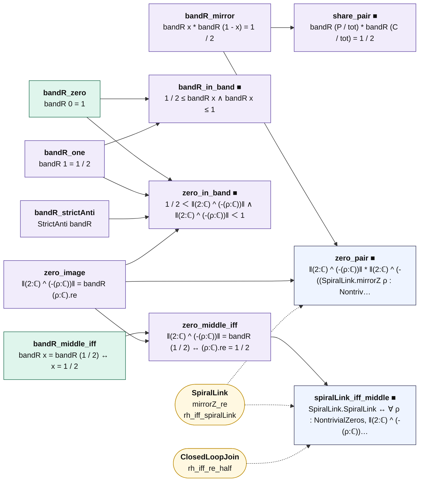

# `lean_stage3/Stage3/BandJoin.lean`

> **Read from the source text.** This file changed after the last `python3 utilities/lean_map.py --dump`, so the arrows on this page are names occurring in each proof and have not been confirmed by Lean.

BandJoin — block J5 of `lean_stage3/design/closedloop.md`. 2026-11-23. The band of the deep zero and the strip of the zeros, under one map.

12 theorems, 1 definition, 134 lines. 

**Imports:** [`HalfSieve`](../lean_stage3/HalfSieve.md), [`StepsRate`](../lean_stage3/StepsRate.md)  
**Imported by:** [`Stage3`](../lean_stage3/Stage3.md)

## The picture



An arrow A → B reads "A is used in the proof of B". Green: counting, integers only. Violet: shape, analysis with no ζ. Blue: reads ζ. A name ending in ■ is an end: nothing else uses it. Red: contains `sorry`. Yellow: theorems in another file, counted; a dotted arrow crosses files. Definitions are not drawn; they are listed below the diagram.

## Definitions

<a name="BandJoin-bandR"></a>
### `BandJoin.bandR`

def · line 36

The band's map at base `2`: a share, or a real part, `x` goes to `2^(−x)`.

- **Is:** `` bandR (x : ℝ) : ℝ := (2:ℝ) ^ (-x) ``
- **Used by 10:** [`BandJoin.bandR_in_band`](#BandJoin-bandR_in_band), [`BandJoin.bandR_middle_iff`](#BandJoin-bandR_middle_iff), [`BandJoin.bandR_mirror`](#BandJoin-bandR_mirror), [`BandJoin.bandR_one`](#BandJoin-bandR_one), [`BandJoin.bandR_strictAnti`](#BandJoin-bandR_strictAnti), [`BandJoin.bandR_zero`](#BandJoin-bandR_zero), [`BandJoin.share_pair`](#BandJoin-share_pair), [`BandJoin.spiralLink_iff_middle`](#BandJoin-spiralLink_iff_middle), [`BandJoin.zero_image`](#BandJoin-zero_image), [`BandJoin.zero_middle_iff`](#BandJoin-zero_middle_iff)

## Theorems

<a name="BandJoin-bandR_zero"></a>
### `BandJoin.bandR_zero`

line 39 · arrows read from text

**Counting.** Integers only: nothing in its statement or proof, or in anything it rests on, uses analysis or ζ.

**Why.** Share `0`, the deep zero, is on the outer circle.

**Proves**

```lean
bandR 0 = 1
```

**Fed by:** no theorem of this repo; it stands on Mathlib and the definitions below.

**Definitions its proof touches:** [`BandJoin.bandR`](#BandJoin-bandR)

**Feeds** (2 that use it)

  - [`BandJoin.bandR_in_band`](#BandJoin-bandR_in_band) — `` 1 / 2 ≤ bandR x ∧ bandR x ≤ 1 ``
  - [`BandJoin.zero_in_band`](#BandJoin-zero_in_band) — `` 1 / 2 < ‖(2:ℂ) ^ (-(ρ:ℂ))‖ ∧ ‖(2:ℂ) ^ (-(ρ:ℂ))‖ < 1 ``

<a name="BandJoin-bandR_one"></a>
### `BandJoin.bandR_one`

line 42 · arrows read from text

**Shape.** Uses real or complex analysis; nothing in it or beneath it reads ζ.

**Why.** Share `1`, the inverse of the deep zero, is on the inner circle.

**Proves**

```lean
bandR 1 = 1 / 2
```

**Fed by:** no theorem of this repo; it stands on Mathlib and the definitions below.

**Definitions its proof touches:** [`BandJoin.bandR`](#BandJoin-bandR)

**Feeds** (2 that use it)

  - [`BandJoin.bandR_in_band`](#BandJoin-bandR_in_band) — `` 1 / 2 ≤ bandR x ∧ bandR x ≤ 1 ``
  - [`BandJoin.zero_in_band`](#BandJoin-zero_in_band) — `` 1 / 2 < ‖(2:ℂ) ^ (-(ρ:ℂ))‖ ∧ ‖(2:ℂ) ^ (-(ρ:ℂ))‖ < 1 ``

<a name="BandJoin-bandR_mirror"></a>
### `BandJoin.bandR_mirror`

line 48 · arrows read from text

**Shape.** Uses real or complex analysis; nothing in it or beneath it reads ζ.

**Why.** The mirror. A share and its mirror multiply to one half.

**Proves**

```lean
bandR x * bandR (1 - x) = 1 / 2
```

**Needs** (its hypotheses)

  - `` x : ℝ ``

**Fed by:** no theorem of this repo; it stands on Mathlib and the definitions below.

**Definitions its proof touches:** [`BandJoin.bandR`](#BandJoin-bandR)

**Feeds** (2 that use it)

  - [`BandJoin.share_pair`](#BandJoin-share_pair) — `` bandR (P / tot) * bandR (C / tot) = 1 / 2 ``
  - [`BandJoin.zero_pair`](#BandJoin-zero_pair) — `` ‖(2:ℂ) ^ (-(ρ:ℂ))‖ * ‖(2:ℂ) ^ (-((SpiralLink.mirrorZ ρ : NontrivialZeros):ℂ))‖ = 1 / 2 ``

<a name="BandJoin-bandR_strictAnti"></a>
### `BandJoin.bandR_strictAnti`

line 56 · arrows read from text

**Shape.** Uses real or complex analysis; nothing in it or beneath it reads ζ.

**Why.** The band's map is strictly decreasing.

**Proves**

```lean
StrictAnti bandR
```

**Fed by:** no theorem of this repo; it stands on Mathlib and the definitions below.

**Definitions its proof touches:** [`BandJoin.bandR`](#BandJoin-bandR)

**Feeds** (1 that use it)

  - [`BandJoin.zero_in_band`](#BandJoin-zero_in_band) — `` 1 / 2 < ‖(2:ℂ) ^ (-(ρ:ℂ))‖ ∧ ‖(2:ℂ) ^ (-(ρ:ℂ))‖ < 1 ``

<a name="BandJoin-bandR_in_band"></a>
### `BandJoin.bandR_in_band`

line 62 · arrows read from text

**Shape.** Uses real or complex analysis; nothing in it or beneath it reads ζ.

**Why.** The band. A share between `0` and `1` lands between the two circles.

**Proves**

```lean
1 / 2 ≤ bandR x ∧ bandR x ≤ 1
```

**Needs** (its hypotheses)

  - `` h0 : 0 ≤ x ``
  - `` h1 : x ≤ 1 ``

**Fed by** (2 theorems its proof uses)

  - [`BandJoin.bandR_one`](#BandJoin-bandR_one) — `` bandR 1 = 1 / 2 ``
  - [`BandJoin.bandR_zero`](#BandJoin-bandR_zero) — `` bandR 0 = 1 ``

**Definitions its proof touches:** [`BandJoin.bandR`](#BandJoin-bandR)

**Feeds:** nothing. It is an end.

<a name="BandJoin-bandR_middle_iff"></a>
### `BandJoin.bandR_middle_iff`

line 70 · arrows read from text

**Counting.** Integers only: nothing in its statement or proof, or in anything it rests on, uses analysis or ζ.

**Why.** The middle circle is reached exactly at one half.

**Proves**

```lean
bandR x = bandR (1 / 2) ↔ x = 1 / 2
```

**Needs** (its hypotheses)

  - `` x : ℝ ``

**Fed by:** no theorem of this repo; it stands on Mathlib and the definitions below.

**Definitions its proof touches:** [`BandJoin.bandR`](#BandJoin-bandR)

**Feeds** (1 that use it)

  - [`BandJoin.zero_middle_iff`](#BandJoin-zero_middle_iff) — `` ‖(2:ℂ) ^ (-(ρ:ℂ))‖ = bandR (1 / 2) ↔ (ρ:ℂ).re = 1 / 2 ``

<a name="BandJoin-share_pair"></a>
### `BandJoin.share_pair`

line 75 · arrows read from text

**Shape.** Uses real or complex analysis; nothing in it or beneath it reads ζ.

**Why.** A cell's two shares. Two parts of a total have shares whose images multiply to one half.

**Proves**

```lean
bandR (P / tot) * bandR (C / tot) = 1 / 2
```

**Needs** (its hypotheses)

  - `` ht : tot ≠ 0 ``
  - `` h : P + C = tot ``

**Fed by** (1 theorem its proof uses)

  - [`BandJoin.bandR_mirror`](#BandJoin-bandR_mirror) — `` bandR x * bandR (1 - x) = 1 / 2 ``

**Definitions its proof touches:** [`BandJoin.bandR`](#BandJoin-bandR)

**Feeds:** nothing. It is an end.

<a name="BandJoin-zero_image"></a>
### `BandJoin.zero_image`

line 84 · arrows read from text

**Shape.** Uses real or complex analysis; nothing in it or beneath it reads ζ.

**Why.** A zero under the band's map. The size of `2^(−ρ)` is the band's map at the real part of `ρ`.

**Proves**

```lean
‖(2:ℂ) ^ (-(ρ:ℂ))‖ = bandR (ρ:ℂ).re
```

**Needs** (its hypotheses)

  - `` ρ : NontrivialZeros ``

**Fed by:** no theorem of this repo; it stands on Mathlib and the definitions below.

**Definitions its proof touches:** [`BandJoin.bandR`](#BandJoin-bandR)

**Feeds** (3 that use it)

  - [`BandJoin.zero_in_band`](#BandJoin-zero_in_band) — `` 1 / 2 < ‖(2:ℂ) ^ (-(ρ:ℂ))‖ ∧ ‖(2:ℂ) ^ (-(ρ:ℂ))‖ < 1 ``
  - [`BandJoin.zero_middle_iff`](#BandJoin-zero_middle_iff) — `` ‖(2:ℂ) ^ (-(ρ:ℂ))‖ = bandR (1 / 2) ↔ (ρ:ℂ).re = 1 / 2 ``
  - [`BandJoin.zero_pair`](#BandJoin-zero_pair) — `` ‖(2:ℂ) ^ (-(ρ:ℂ))‖ * ‖(2:ℂ) ^ (-((SpiralLink.mirrorZ ρ : NontrivialZeros):ℂ))‖ = 1 / 2 ``

<a name="BandJoin-zero_in_band"></a>
### `BandJoin.zero_in_band`

line 90 · arrows read from text

**Shape.** Uses real or complex analysis; nothing in it or beneath it reads ζ.

**Why.** Every zero is strictly inside the band.

**Proves**

```lean
1 / 2 < ‖(2:ℂ) ^ (-(ρ:ℂ))‖ ∧ ‖(2:ℂ) ^ (-(ρ:ℂ))‖ < 1
```

**Needs** (its hypotheses)

  - `` ρ : NontrivialZeros ``

**Fed by** (4 theorems its proof uses)

  - [`BandJoin.bandR_one`](#BandJoin-bandR_one) — `` bandR 1 = 1 / 2 ``
  - [`BandJoin.bandR_strictAnti`](#BandJoin-bandR_strictAnti) — `` StrictAnti bandR ``
  - [`BandJoin.bandR_zero`](#BandJoin-bandR_zero) — `` bandR 0 = 1 ``
  - [`BandJoin.zero_image`](#BandJoin-zero_image) — `` ‖(2:ℂ) ^ (-(ρ:ℂ))‖ = bandR (ρ:ℂ).re ``

**Feeds:** nothing. It is an end.

<a name="BandJoin-zero_pair"></a>
### `BandJoin.zero_pair`

line 101 · arrows read from text

**Reads ζ.** It, or something it rests on, uses the zeta function, its zeros or the Riemann hypothesis.

**Why.** A zero and its mirror multiply to one half, as the prime share and the composite share of a cell do.

**Proves**

```lean
‖(2:ℂ) ^ (-(ρ:ℂ))‖ * ‖(2:ℂ) ^ (-((SpiralLink.mirrorZ ρ : NontrivialZeros):ℂ))‖ = 1 / 2
```

**Needs** (its hypotheses)

  - `` ρ : NontrivialZeros ``

**Fed by** (3 theorems its proof uses)

  - [`BandJoin.bandR_mirror`](#BandJoin-bandR_mirror) — `` bandR x * bandR (1 - x) = 1 / 2 ``
  - [`BandJoin.zero_image`](#BandJoin-zero_image) — `` ‖(2:ℂ) ^ (-(ρ:ℂ))‖ = bandR (ρ:ℂ).re ``
  - [`SpiralLink.mirrorZ_re`](../lean_stage3/SpiralLink.md#SpiralLink-mirrorZ_re) (SpiralLink) — `` ((mirrorZ ρ : NontrivialZeros) : ℂ).re = 1 - (ρ : ℂ).re ``

**Definitions its proof touches:** [`SpiralLink.mirrorZ`](../lean_stage3/SpiralLink.md#SpiralLink-mirrorZ)

**Feeds:** nothing. It is an end.

<a name="BandJoin-zero_middle_iff"></a>
### `BandJoin.zero_middle_iff`

line 106 · arrows read from text

**Shape.** Uses real or complex analysis; nothing in it or beneath it reads ζ.

**Why.** A zero is on the middle circle exactly when its real part is one half.

**Proves**

```lean
‖(2:ℂ) ^ (-(ρ:ℂ))‖ = bandR (1 / 2) ↔ (ρ:ℂ).re = 1 / 2
```

**Needs** (its hypotheses)

  - `` ρ : NontrivialZeros ``

**Fed by** (2 theorems its proof uses)

  - [`BandJoin.bandR_middle_iff`](#BandJoin-bandR_middle_iff) — `` bandR x = bandR (1 / 2) ↔ x = 1 / 2 ``
  - [`BandJoin.zero_image`](#BandJoin-zero_image) — `` ‖(2:ℂ) ^ (-(ρ:ℂ))‖ = bandR (ρ:ℂ).re ``

**Definitions its proof touches:** [`BandJoin.bandR`](#BandJoin-bandR)

**Feeds** (1 that use it)

  - [`BandJoin.spiralLink_iff_middle`](#BandJoin-spiralLink_iff_middle) — `` SpiralLink.SpiralLink ↔ ∀ ρ : NontrivialZeros, ‖(2:ℂ) ^ (-(ρ:ℂ))‖ = bandR (1 / 2) ``

<a name="BandJoin-spiralLink_iff_middle"></a>
### `BandJoin.spiralLink_iff_middle`

line 112 · arrows read from text

**Reads ζ.** It, or something it rests on, uses the zeta function, its zeros or the Riemann hypothesis.

**Why.** The loop on the band. The spiral link holds exactly when every zero is on the middle circle of the band.

**Proves**

```lean
SpiralLink.SpiralLink ↔ ∀ ρ : NontrivialZeros, ‖(2:ℂ) ^ (-(ρ:ℂ))‖ = bandR (1 / 2)
```

**Fed by** (3 theorems its proof uses)

  - [`BandJoin.zero_middle_iff`](#BandJoin-zero_middle_iff) — `` ‖(2:ℂ) ^ (-(ρ:ℂ))‖ = bandR (1 / 2) ↔ (ρ:ℂ).re = 1 / 2 ``
  - [`ClosedLoopJoin.rh_iff_re_half`](../lean_stage3/ClosedLoopJoin.md#ClosedLoopJoin-rh_iff_re_half) (ClosedLoopJoin) — `` RiemannHypothesis ↔ ∀ ρ : NontrivialZeros, (ρ : ℂ).re = 1 / 2 ``
  - [`SpiralLink.rh_iff_spiralLink`](../lean_stage3/SpiralLink.md#SpiralLink-rh_iff_spiralLink) (SpiralLink) — `` RiemannHypothesis ↔ SpiralLink ``

**Definitions its proof touches:** [`BandJoin.bandR`](#BandJoin-bandR), [`SpiralLink.SpiralLink`](../lean_stage3/SpiralLink.md#SpiralLink-SpiralLink)

**Feeds:** nothing. It is an end.

