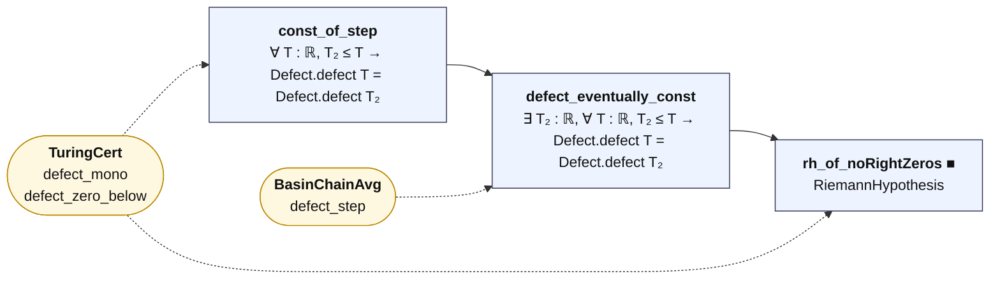

# `lean_stage3/Stage3/BasinChain.lean`

> **Read from the source text.** This file changed after the last `python3 utilities/lean_map.py --dump`, so the arrows on this page are names occurring in each proof and have not been confirmed by Lean.

BasinChain — block S15 of `lean_stage3/design/stencil.md`, the chain from no right zeros. 2026-11-25.

3 theorems, 1 definition, 151 lines. 

**Imports:** [`BasinChainAvg`](../lean_stage3/BasinChainAvg.md)  
**Imported by:** [`Stage3`](../lean_stage3/Stage3.md)

## The picture



An arrow A → B reads "A is used in the proof of B". Green: counting, integers only. Violet: shape, analysis with no ζ. Blue: reads ζ. A name ending in ■ is an end: nothing else uses it. Red: contains `sorry`. Yellow: theorems in another file, counted; a dotted arrow crosses files. Definitions are not drawn; they are listed below the diagram.

## Definitions

<a name="BasinChain-StmtNoFiniteDefect"></a>
### `BasinChain.StmtNoFiniteDefect`

def · line 70

Open: the base. Wherever the defect is constant from a height on, it is `0` there: the off-line zeros are none or infinitely many.

- **Is:** `` StmtNoFiniteDefect : Prop := ∀ T₂ : ℝ, (∀ T : ℝ, T₂ ≤ T → Defect.defect T = Defect.defect T₂) → Defect.defect T₂ = 0 ``
- **Built from:** [`Defect.defect`](../lean_stage3/Defect.md#Defect-defect)
- **Used by 1:** [`BasinChain.rh_of_noRightZeros`](#BasinChain-rh_of_noRightZeros)

## Theorems

<a name="BasinChain-const_of_step"></a>
### `BasinChain.const_of_step`

line 74 · arrows read from text

**Reads ζ.** It, or something it rests on, uses the zeta function, its zeros or the Riemann hypothesis.

**Why.** From `D T = D(3T/4)` for `T ≥ T₂`, `D` is constant on `[T₂, ∞)`.

**Proves**

```lean
∀ T : ℝ, T₂ ≤ T → Defect.defect T = Defect.defect T₂
```

**Needs** (its hypotheses)

  - `` hT₂ : 0 < T₂ ``
  - `` hstep : ∀ T : ℝ, T₂ ≤ T → Defect.defect T = Defect.defect (3 * T / 4) ``

**Fed by** (1 theorem its proof uses)

  - [`Turing.defect_mono`](../lean_stage3/TuringCert.md#Turing-defect_mono) (TuringCert) — `` defect T ≤ defect T' ``

**Definitions its proof touches:** [`Defect.defect`](../lean_stage3/Defect.md#Defect-defect)

**Feeds** (1 that use it)

  - [`BasinChain.defect_eventually_const`](#BasinChain-defect_eventually_const) — `` ∃ T₂ : ℝ, ∀ T : ℝ, T₂ ≤ T → Defect.defect T = Defect.defect T₂ ``

<a name="BasinChain-defect_eventually_const"></a>
### `BasinChain.defect_eventually_const`

line 105 · arrows read from text

**Reads ζ.** It, or something it rests on, uses the zeta function, its zeros or the Riemann hypothesis.

**Why.** The chain: finitely many zeros off the line. For `Q′` symmetric, `Q(1/2) ≠ 0`, `Q(0) = 1`, no right zeros of `V` from `T₀` on and the lower side of `J`: the defect is constant from some height on.

**Proves**

```lean
∃ T₂ : ℝ, ∀ T : ℝ, T₂ ≤ T → Defect.defect T = Defect.defect T₂
```

**Needs** (its hypotheses)

  - `` hQ : ∀ x : ℝ, Q.derivative.eval x = Q.derivative.eval (1 - x) ``
  - `` hQh : Q.eval (1/2) ≠ 0 ``
  - `` hQ0 : Q.eval 0 = 1 ``
  - `` hNR : StmtNoRightZeros Q T₀ ``
  - `` hLow : StmtVHorizLower Q a₂ b₂ T₀' ``
  - `` ha₂ : 0 ≤ a₂ ``

**Fed by** (2 theorems its proof uses)

  - [`BasinChain.const_of_step`](#BasinChain-const_of_step) — `` ∀ T : ℝ, T₂ ≤ T → Defect.defect T = Defect.defect T₂ ``
  - [`BasinChain.defect_step`](../lean_stage3/BasinChainAvg.md#BasinChain-defect_step) (BasinChainAvg) — `` ∃ T₂ : ℝ, 0 < T₂ ∧ ∀ T : ℝ, T₂ ≤ T → Defect.defect T = Defect.defect (3 * T / 4) ``

**Definitions its proof touches:** [`BasinChain.StmtVHorizLower`](../lean_stage3/BasinChainAvg.md#BasinChain-StmtVHorizLower), [`BasinChain.StmtNoRightZeros`](../lean_stage3/BasinChainCount.md#BasinChain-StmtNoRightZeros), [`Defect.defect`](../lean_stage3/Defect.md#Defect-defect)

**Feeds** (1 that use it)

  - [`BasinChain.rh_of_noRightZeros`](#BasinChain-rh_of_noRightZeros) — `` RiemannHypothesis ``

<a name="BasinChain-rh_of_noRightZeros"></a>
### `BasinChain.rh_of_noRightZeros`

line 114 · arrows read from text

**Reads ζ.** It, or something it rests on, uses the zeta function, its zeros or the Riemann hypothesis.

**Why.** RH from no right zeros, with the lower side of `J` and the base as named hypotheses.

**Proves**

```lean
RiemannHypothesis
```

**Needs** (its hypotheses)

  - `` hQ : ∀ x : ℝ, Q.derivative.eval x = Q.derivative.eval (1 - x) ``
  - `` hQh : Q.eval (1/2) ≠ 0 ``
  - `` hQ0 : Q.eval 0 = 1 ``
  - `` hNR : StmtNoRightZeros Q T₀ ``
  - `` hLow : StmtVHorizLower Q a₂ b₂ T₀' ``
  - `` ha₂ : 0 ≤ a₂ ``
  - `` hbase : StmtNoFiniteDefect ``

**Fed by** (2 theorems its proof uses)

  - [`BasinChain.defect_eventually_const`](#BasinChain-defect_eventually_const) — `` ∃ T₂ : ℝ, ∀ T : ℝ, T₂ ≤ T → Defect.defect T = Defect.defect T₂ ``
  - [`Turing.defect_zero_below`](../lean_stage3/TuringCert.md#Turing-defect_zero_below) (TuringCert) — `` ∀ T ≤ T₁, defect T = 0 ``

**Definitions its proof touches:** [`BasinChain.StmtNoFiniteDefect`](#BasinChain-StmtNoFiniteDefect), [`BasinChain.StmtVHorizLower`](../lean_stage3/BasinChainAvg.md#BasinChain-StmtVHorizLower), [`BasinChain.StmtNoRightZeros`](../lean_stage3/BasinChainCount.md#BasinChain-StmtNoRightZeros)

**Feeds:** nothing. It is an end.

