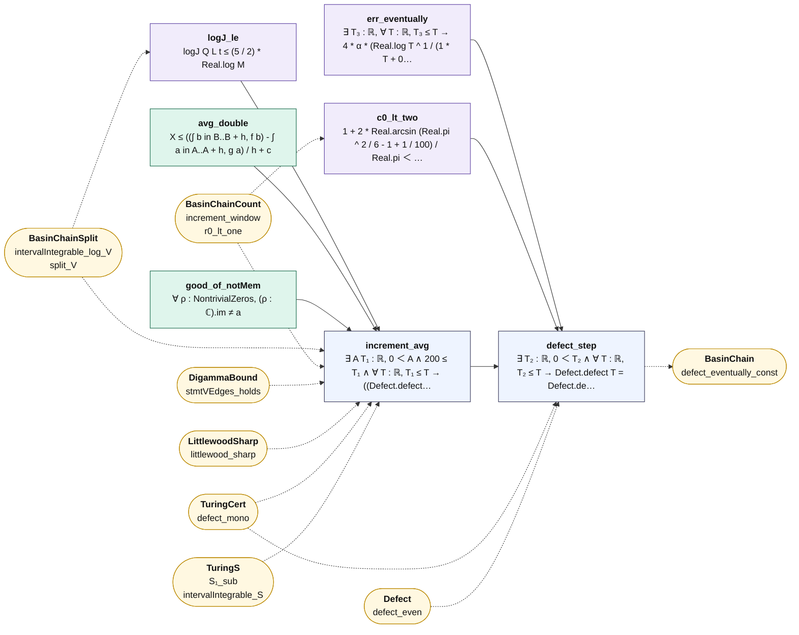

# `lean_stage3/Stage3/BasinChainAvg.lean`

> **Read from the source text.** This file changed after the last `python3 utilities/lean_map.py --dump`, so the arrows on this page are names occurring in each proof and have not been confirmed by Lean.

BasinChainAvg — block S15 of `lean_stage3/design/stencil.md`, the chain from no right zeros, steps 3 and 4: the sizes of `J` and Turing's averaging of the increment. 2026-11-25.

7 theorems, 1 definition, 358 lines. 

**Imports:** [`BasinChainSplit`](../lean_stage3/BasinChainSplit.md), [`LittlewoodSharp`](../lean_stage3/LittlewoodSharp.md)  
**Imported by:** [`BasinChain`](../lean_stage3/BasinChain.md)

## The picture



An arrow A → B reads "A is used in the proof of B". Green: counting, integers only. Violet: shape, analysis with no ζ. Blue: reads ζ. A name ending in ■ is an end: nothing else uses it. Red: contains `sorry`. Yellow: theorems in another file, counted; a dotted arrow crosses files. Definitions are not drawn; they are listed below the diagram.

## Definitions

<a name="BasinChain-StmtVHorizLower"></a>
### `BasinChain.StmtVHorizLower`

def · line 65

Open: the lower side of `J`. For `T ≥ T₀`, `L = log T` and every `t ∈ [T/4, 2T]`: `∫_{1/2}^{3} log‖V(x + it)‖ dx ≥ −(a₂ log t + b₂)`.

- **Is:** `` StmtVHorizLower (Q : ℝ[X]) (a₂ b₂ T₀ : ℝ) : Prop := ∀ T : ℝ, T₀ ≤ T → ∀ t ∈ Icc (T / 4) (2 * T), -(a₂ * Real.log t + b₂) ≤ logJ Q (Real.log T) t ``
- **Built from:** [`BasinChain.logJ`](../lean_stage3/BasinChainSplit.md#BasinChain-logJ)
- **Used by 4:** [`BasinChain.defect_eventually_const`](../lean_stage3/BasinChain.md#BasinChain-defect_eventually_const), [`BasinChain.rh_of_noRightZeros`](../lean_stage3/BasinChain.md#BasinChain-rh_of_noRightZeros), [`BasinChain.defect_step`](#BasinChain-defect_step), [`BasinChain.increment_avg`](#BasinChain-increment_avg)

## Theorems

<a name="BasinChain-logJ_le"></a>
### `BasinChain.logJ_le`

line 69 · arrows read from text

**Shape.** Uses real or complex analysis; nothing in it or beneath it reads ζ.

**Why.** The upper side of `J`.

**Proves**

```lean
logJ Q L t ≤ (5 / 2) * Real.log M
```

**Needs** (its hypotheses)

  - `` Q : ℝ[X] ``
  - `` ht : 1/2 < t ``
  - `` hM : 1 ≤ M ``
  - `` hD : StmtVDisc Q L t M ``

**Fed by** (1 theorem its proof uses)

  - [`BasinChain.intervalIntegrable_log_V`](../lean_stage3/BasinChainSplit.md#BasinChain-intervalIntegrable_log_V) (BasinChainSplit) — `` IntervalIntegrable (fun x : ℝ => Real.log ‖V Q L ((x : ℂ) + (t : ℂ) * I)‖) volume a b ``

**Definitions its proof touches:** [`BasinChain.logJ`](../lean_stage3/BasinChainSplit.md#BasinChain-logJ), [`ConreyCount.StmtVDisc`](../lean_stage3/ConreyCountEdge.md#ConreyCount-StmtVDisc), [`ConreyCount.V`](../lean_stage3/ConreyCountLine.md#ConreyCount-V)

**Feeds** (1 that use it)

  - [`BasinChain.increment_avg`](#BasinChain-increment_avg) — `` ∃ A T₁ : ℝ, 0 < A ∧ 200 ≤ T₁ ∧ ∀ T : ℝ, T₁ ≤ T → ((Defect.defect T : ℝ) - (Defect.defect (3 * T / 4) : ℝ)) ≤ 4 * ((2 * ((3 / 2 + 113 / 4) / Real.pi) +… ``

<a name="BasinChain-avg_double"></a>
### `BasinChain.avg_double`

line 90 · arrows read from text

**Counting.** Integers only: nothing in its statement or proof, or in anything it rests on, uses analysis or ζ.

**Why.** The double average. If `X ≤ f b − g a + c` for `a ∈ [A, A + h]`, `b ∈ [B, B + h]` off a countable set, then `X ≤ (∫ f − ∫ g)/h + c`.

**Proves**

```lean
X ≤ ((∫ b in B..B + h, f b) - ∫ a in A..A + h, g a) / h + c
```

**Needs** (its hypotheses)

  - `` hh : 0 < h ``
  - `` hE : E.Countable ``
  - `` hf : IntervalIntegrable f volume B (B + h) ``
  - `` hg : IntervalIntegrable g volume A (A + h) ``
  - `` hpt : ∀ a ∈ Icc A (A + h), a ∉ E → ∀ b ∈ Icc B (B + h), b ∉ E → X ≤ f b - g a + c ``

**Fed by:** no theorem of this repo; it stands on Mathlib.

**Feeds** (1 that use it)

  - [`BasinChain.increment_avg`](#BasinChain-increment_avg) — `` ∃ A T₁ : ℝ, 0 < A ∧ 200 ≤ T₁ ∧ ∀ T : ℝ, T₁ ≤ T → ((Defect.defect T : ℝ) - (Defect.defect (3 * T / 4) : ℝ)) ≤ 4 * ((2 * ((3 / 2 + 113 / 4) / Real.pi) +… ``

<a name="BasinChain-err_eventually"></a>
### `BasinChain.err_eventually`

line 131 · arrows read from text

**Shape.** Uses real or complex analysis; nothing in it or beneath it reads ζ.

**Why.** The error of the average falls below any `m > 0`.

**Proves**

```lean
∃ T₃ : ℝ, ∀ T : ℝ, T₃ ≤ T → 4 * α * (Real.log T ^ 1 / (1 * T + 0)) + 4 * (α * Real.log 2 + β) / T < m
```

**Needs** (its hypotheses)

  - `` α β : ℝ ``
  - `` hm : 0 < m ``

**Fed by:** no theorem of this repo; it stands on Mathlib.

**Feeds** (1 that use it)

  - [`BasinChain.defect_step`](#BasinChain-defect_step) — `` ∃ T₂ : ℝ, 0 < T₂ ∧ ∀ T : ℝ, T₂ ≤ T → Defect.defect T = Defect.defect (3 * T / 4) ``

<a name="BasinChain-c0_lt_two"></a>
### `BasinChain.c0_lt_two`

line 142 · arrows read from text

**Shape.** Uses real or complex analysis; nothing in it or beneath it reads ζ.

**Why.** `c₀ < 2`.

**Proves**

```lean
1 + 2 * Real.arcsin (Real.pi ^ 2 / 6 - 1 + 1 / 100) / Real.pi < 2
```

**Fed by** (1 theorem its proof uses)

  - [`BasinChain.r0_lt_one`](../lean_stage3/BasinChainCount.md#BasinChain-r0_lt_one) (BasinChainCount) — `` Real.pi ^ 2 / 6 - 1 + 1 / 100 < 1 ``

**Feeds** (1 that use it)

  - [`BasinChain.defect_step`](#BasinChain-defect_step) — `` ∃ T₂ : ℝ, 0 < T₂ ∧ ∀ T : ℝ, T₂ ≤ T → Defect.defect T = Defect.defect (3 * T / 4) ``

<a name="BasinChain-good_of_notMem"></a>
### `BasinChain.good_of_notMem`

line 154 · arrows read from text

**Counting.** Integers only: nothing in its statement or proof, or in anything it rests on, uses analysis or ζ.

**Why.** A good height: off the heights of the zeros up to `2T`, no zero sits at it.

**Proves**

```lean
∀ ρ : NontrivialZeros, (ρ : ℂ).im ≠ a
```

**Needs** (its hypotheses)

  - `` ha0 : 0 < a ``
  - `` haT : a ≤ 2 * T ``
  - `` h : a ∉ (((zerosUpTo (2 * T)).image (fun ρ : NontrivialZeros => (ρ : ℂ).im) : Finset ℝ) : Set ℝ) ``

**Fed by:** no theorem of this repo; it stands on Mathlib and the definitions below.

**Definitions its proof touches:** [`LineCount.zerosUpTo`](../lean_stage3/LineCount.md#LineCount-zerosUpTo)

**Feeds** (1 that use it)

  - [`BasinChain.increment_avg`](#BasinChain-increment_avg) — `` ∃ A T₁ : ℝ, 0 < A ∧ 200 ≤ T₁ ∧ ∀ T : ℝ, T₁ ≤ T → ((Defect.defect T : ℝ) - (Defect.defect (3 * T / 4) : ℝ)) ≤ 4 * ((2 * ((3 / 2 + 113 / 4) / Real.pi) +… ``

<a name="BasinChain-increment_avg"></a>
### `BasinChain.increment_avg`

line 167 · arrows read from text

**Reads ζ.** It, or something it rests on, uses the zeta function, its zeros or the Riemann hypothesis.

**Why.** The averaged increment. For `Q′` symmetric, `Q(1/2) ≠ 0`, `Q(0) = 1`, the hypothesis and the lower side: there are `A > 0` and `T₁` with, for `T ≥ T₁`, `D T − D(3T/4) ≤ 4 (α log(2T) + β)/T + c₀`.

**Proves**

```lean
∃ A T₁ : ℝ, 0 < A ∧ 200 ≤ T₁ ∧ ∀ T : ℝ, T₁ ≤ T → ((Defect.defect T : ℝ) - (Defect.defect (3 * T / 4) : ℝ)) ≤ 4 * ((2 * ((3 / 2 + 113 / 4) / Real.pi) + (5 + 2 * a₂) / Real.pi) * Real.log (2 * T) + (2 * ((2 + (3 / 2) * Real.log 9 + 128) / Real.pi) + (5 * Real.log (A + 1) + 2 * b₂) / Real.pi)) / T + (1 + 2 * Real.arcsin (Real.pi ^ 2 / 6 - 1 + 1 / 100) / Real.pi)
```

**Needs** (its hypotheses)

  - `` hQ : ∀ x : ℝ, Q.derivative.eval x = Q.derivative.eval (1 - x) ``
  - `` hQh : Q.eval (1/2) ≠ 0 ``
  - `` hQ0 : Q.eval 0 = 1 ``
  - `` hNR : StmtNoRightZeros Q T₀ ``
  - `` hLow : StmtVHorizLower Q a₂ b₂ T₀' ``
  - `` ha₂ : 0 ≤ a₂ ``

**Fed by** (10 theorems its proof uses)

  - [`BasinChain.avg_double`](#BasinChain-avg_double) — `` X ≤ ((∫ b in B..B + h, f b) - ∫ a in A..A + h, g a) / h + c ``
  - [`BasinChain.good_of_notMem`](#BasinChain-good_of_notMem) — `` ∀ ρ : NontrivialZeros, (ρ : ℂ).im ≠ a ``
  - [`BasinChain.logJ_le`](#BasinChain-logJ_le) — `` logJ Q L t ≤ (5 / 2) * Real.log M ``
  - [`BasinChain.increment_window`](../lean_stage3/BasinChainCount.md#BasinChain-increment_window) (BasinChainCount) — `` ∃ T₁ : ℝ, 200 ≤ T₁ ∧ ∀ {T a b : ℝ}, T₁ ≤ T → T / 4 ≤ a → a < b → b ≤ 2 * T → (∀ s : ℂ, 1/2 < s.re → s.re ≤ 3 → a ≤ s.im → s.im ≤ b → V Q (Real.log T) … ``
  - [`BasinChain.split_V`](../lean_stage3/BasinChainSplit.md#BasinChain-split_V) (BasinChainSplit) — `` IntervalIntegrable (fun t => hEdge Q L t) volume t₁ t₂ ∧ ∫ t in t₁..t₂, hEdge Q L t = logJ Q L t₁ - logJ Q L t₂ ``
  - [`DigammaBound.stmtVEdges_holds`](../lean_stage3/DigammaBound.md#DigammaBound-stmtVEdges_holds) (DigammaBound) — `` ∃ A T₀ : ℝ, 0 < A ∧ ∀ T ≥ T₀, ConreyCount.StmtVEdges Q T A ``
  - [`LittlewoodSharp.littlewood_sharp`](../lean_stage3/LittlewoodSharp.md#LittlewoodSharp-littlewood_sharp) (LittlewoodSharp) — `` Turing.StmtLittlewood ((3 / 2 + 113 / 4) / Real.pi) ((2 + (3 / 2) * Real.log 9 + 128) / Real.pi) 2 ``
  - [`Turing.defect_mono`](../lean_stage3/TuringCert.md#Turing-defect_mono) (TuringCert) — `` defect T ≤ defect T' ``
  - [`Turing.S₁_sub`](../lean_stage3/TuringS.md#Turing-S-_sub) (TuringS) — `` S₁ t₂ - S₁ t₁ = ∫ t in t₁..t₂, S t ``
  - [`Turing.intervalIntegrable_S`](../lean_stage3/TuringS.md#Turing-intervalIntegrable_S) (TuringS) — `` IntervalIntegrable S volume a b ``

**Definitions its proof touches:** [`BasinChain.StmtVHorizLower`](#BasinChain-StmtVHorizLower), [`BasinChain.StmtNoRightZeros`](../lean_stage3/BasinChainCount.md#BasinChain-StmtNoRightZeros), [`BasinChain.hEdge`](../lean_stage3/BasinChainCount.md#BasinChain-hEdge), [`BasinChain.logJ`](../lean_stage3/BasinChainSplit.md#BasinChain-logJ), [`ConreyCount.StmtVDisc`](../lean_stage3/ConreyCountEdge.md#ConreyCount-StmtVDisc), [`ConreyCount.V`](../lean_stage3/ConreyCountLine.md#ConreyCount-V), [`Defect.defect`](../lean_stage3/Defect.md#Defect-defect), [`LineCount.zerosUpTo`](../lean_stage3/LineCount.md#LineCount-zerosUpTo), [`Turing.S`](../lean_stage3/TuringS.md#Turing-S), [`Turing.S₁`](../lean_stage3/TuringS.md#Turing-S-)

**Feeds** (1 that use it)

  - [`BasinChain.defect_step`](#BasinChain-defect_step) — `` ∃ T₂ : ℝ, 0 < T₂ ∧ ∀ T : ℝ, T₂ ≤ T → Defect.defect T = Defect.defect (3 * T / 4) ``

<a name="BasinChain-defect_step"></a>
### `BasinChain.defect_step`

line 298 · arrows read from text

**Reads ζ.** It, or something it rests on, uses the zeta function, its zeros or the Riemann hypothesis.

**Why.** The step. Under the hypothesis and the lower side, `D T = D(3T/4)` for all large `T`.

**Proves**

```lean
∃ T₂ : ℝ, 0 < T₂ ∧ ∀ T : ℝ, T₂ ≤ T → Defect.defect T = Defect.defect (3 * T / 4)
```

**Needs** (its hypotheses)

  - `` hQ : ∀ x : ℝ, Q.derivative.eval x = Q.derivative.eval (1 - x) ``
  - `` hQh : Q.eval (1/2) ≠ 0 ``
  - `` hQ0 : Q.eval 0 = 1 ``
  - `` hNR : StmtNoRightZeros Q T₀ ``
  - `` hLow : StmtVHorizLower Q a₂ b₂ T₀' ``
  - `` ha₂ : 0 ≤ a₂ ``

**Fed by** (5 theorems its proof uses)

  - [`BasinChain.c0_lt_two`](#BasinChain-c0_lt_two) — `` 1 + 2 * Real.arcsin (Real.pi ^ 2 / 6 - 1 + 1 / 100) / Real.pi < 2 ``
  - [`BasinChain.err_eventually`](#BasinChain-err_eventually) — `` ∃ T₃ : ℝ, ∀ T : ℝ, T₃ ≤ T → 4 * α * (Real.log T ^ 1 / (1 * T + 0)) + 4 * (α * Real.log 2 + β) / T < m ``
  - [`BasinChain.increment_avg`](#BasinChain-increment_avg) — `` ∃ A T₁ : ℝ, 0 < A ∧ 200 ≤ T₁ ∧ ∀ T : ℝ, T₁ ≤ T → ((Defect.defect T : ℝ) - (Defect.defect (3 * T / 4) : ℝ)) ≤ 4 * ((2 * ((3 / 2 + 113 / 4) / Real.pi) +… ``
  - [`Defect.defect_even`](../lean_stage3/Defect.md#Defect-defect_even) (Defect) — `` Even (defect T) ``
  - [`Turing.defect_mono`](../lean_stage3/TuringCert.md#Turing-defect_mono) (TuringCert) — `` defect T ≤ defect T' ``

**Definitions its proof touches:** [`BasinChain.StmtVHorizLower`](#BasinChain-StmtVHorizLower), [`BasinChain.StmtNoRightZeros`](../lean_stage3/BasinChainCount.md#BasinChain-StmtNoRightZeros), [`Defect.defect`](../lean_stage3/Defect.md#Defect-defect)

**Feeds** (1 that use it)

  - [`BasinChain.defect_eventually_const`](../lean_stage3/BasinChain.md#BasinChain-defect_eventually_const) (BasinChain) — `` ∃ T₂ : ℝ, ∀ T : ℝ, T₂ ≤ T → Defect.defect T = Defect.defect T₂ ``

