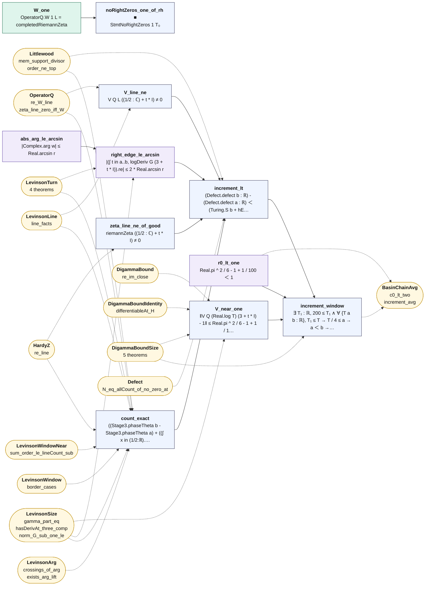

# `lean_stage3/Stage3/BasinChainCount.lean`

> **Read from the source text.** This file changed after the last `python3 utilities/lean_map.py --dump`, so the arrows on this page are names occurring in each proof and have not been confirmed by Lean.

BasinChainCount — block S15 of `lean_stage3/design/stencil.md`, the chain from no right zeros, steps 1 and 2: the hypothesis and the count with no losses. 2026-11-25.

11 theorems, 2 definitions, 770 lines. 

**Imports:** [`ConreyCount`](../lean_stage3/ConreyCount.md), [`DigammaBound`](../lean_stage3/DigammaBound.md), [`TuringCert`](../lean_stage3/TuringCert.md)  
**Imported by:** [`BasinChainSplit`](../lean_stage3/BasinChainSplit.md)

## The picture



An arrow A → B reads "A is used in the proof of B". Green: counting, integers only. Violet: shape, analysis with no ζ. Blue: reads ζ. A name ending in ■ is an end: nothing else uses it. Red: contains `sorry`. Yellow: theorems in another file, counted; a dotted arrow crosses files. Definitions are not drawn; they are listed below the diagram.

## Definitions

<a name="BasinChain-StmtNoRightZeros"></a>
### `BasinChain.StmtNoRightZeros`

def · line 62

The hypothesis. From `T₀` on, `V = ConreyCount.V Q (log T)` has no zero with `1/2 < Re s ≤ 3` and `T/4 ≤ Im s ≤ 2T`.

- **Is:** `` StmtNoRightZeros (Q : ℝ[X]) (T₀ : ℝ) : Prop := ∀ T : ℝ, T₀ ≤ T → ∀ s : ℂ, 1/2 < s.re → s.re ≤ 3 → T / 4 ≤ s.im → s.im ≤ 2 * T → V Q (Real.log T) s ≠ 0 ``
- **Used by 5:** [`BasinChain.defect_eventually_const`](../lean_stage3/BasinChain.md#BasinChain-defect_eventually_const), [`BasinChain.rh_of_noRightZeros`](../lean_stage3/BasinChain.md#BasinChain-rh_of_noRightZeros), [`BasinChain.defect_step`](../lean_stage3/BasinChainAvg.md#BasinChain-defect_step), [`BasinChain.increment_avg`](../lean_stage3/BasinChainAvg.md#BasinChain-increment_avg), [`BasinChain.noRightZeros_one_of_rh`](#BasinChain-noRightZeros_one_of_rh)

<a name="BasinChain-hEdge"></a>
### `BasinChain.hEdge`

def · line 68

The horizontal edge at height `t`: `Im ∫_{1/2}^{3} V′/V (x + it) dx`, the turning of `arg V` from `1/2 + it` to `3 + it`.

- **Is:** `` hEdge (Q : ℝ[X]) (L t : ℝ) : ℝ := (∫ x in (1/2:ℝ)..3, logDeriv (V Q L) (↑x + ↑t * I)).im ``
- **Used by 4:** [`BasinChain.increment_avg`](../lean_stage3/BasinChainAvg.md#BasinChain-increment_avg), [`BasinChain.increment_lt`](#BasinChain-increment_lt), [`BasinChain.increment_window`](#BasinChain-increment_window), [`BasinChain.split_V`](../lean_stage3/BasinChainSplit.md#BasinChain-split_V)

## Theorems

<a name="BasinChain-W_one"></a>
### `BasinChain.W_one`

line 72 · arrows read from text

**Counting.** Integers only: nothing in its statement or proof, or in anything it rests on, uses analysis or ζ.

**Why.** For `Q = 1`, `W = Λ`.

**Proves**

```lean
OperatorQ.W 1 L = completedRiemannZeta
```

**Needs** (its hypotheses)

  - `` L : ℝ ``

**Fed by:** no theorem of this repo; it stands on Mathlib and the definitions below.

**Definitions its proof touches:** [`OperatorQ.W`](../lean_stage3/OperatorQ.md#OperatorQ-W)

**Feeds** (1 that use it)

  - [`BasinChain.noRightZeros_one_of_rh`](#BasinChain-noRightZeros_one_of_rh) — `` StmtNoRightZeros 1 T₀ ``

<a name="BasinChain-noRightZeros_one_of_rh"></a>
### `BasinChain.noRightZeros_one_of_rh`

line 77 · arrows read from text

**Reads ζ.** It, or something it rests on, uses the zeta function, its zeros or the Riemann hypothesis.

**Why.** Non-vacuity. For `Q = 1`, `V = ζ` on `Re s > 0`, and RH gives the hypothesis.

**Proves**

```lean
StmtNoRightZeros 1 T₀
```

**Needs** (its hypotheses)

  - `` hRH : RiemannHypothesis ``
  - `` T₀ : ℝ ``
  - `` hT₀ : 0 < T₀ ``

**Fed by** (1 theorem its proof uses)

  - [`BasinChain.W_one`](#BasinChain-W_one) — `` OperatorQ.W 1 L = completedRiemannZeta ``

**Definitions its proof touches:** [`BasinChain.StmtNoRightZeros`](#BasinChain-StmtNoRightZeros)

**Feeds:** nothing. It is an end.

<a name="BasinChain-count_exact"></a>
### `BasinChain.count_exact`

line 105 · arrows read from text

**Reads ζ.** It, or something it rests on, uses the zeta function, its zeros or the Riemann hypothesis.

**Why.** Levinson's count for `V = W/Gammaℝ`, exact form. The proof of `ConreyCount.conrey_count_sub` with the sizes left out: for `Q′(x) = Q′(1 − x)`, `Q(1/2) ≠ 0`, `4 ≤ a < b`, `V` nonzero on the bottom, top and right edges of `[1/2, 3] × [a, b]` and `ζ(1/2 + a i) ≠ 0`, the zeros of `ζ` on the line with height in `(a, b]` number more than `(θ b − θ a + E)/π − 2·countRight − 1`, `E` the three edges of `V` (bottom − top + right), exactly as the argument principle gives them.

**Proves**

```lean
((Stage3.phaseTheta b - Stage3.phaseTheta a) + ((∫ x in (1/2:ℝ)..3, logDeriv (V Q L) (↑x + ↑a * I)).im - (∫ x in (1/2:ℝ)..3, logDeriv (V Q L) (↑x + ↑b * I)).im + (∫ t in a..b, logDeriv (V Q L) (3 + ↑t * I)).re)) / Real.pi - 2 * Littlewood.countRight (V Q L) ((1/2 : ℂ) + a * I) ((3 : ℂ) + b * I) (1/2) - 1 < (lineCount b : ℝ) - (lineCount a : ℝ)
```

**Needs** (its hypotheses)

  - `` hQ : ∀ x : ℝ, Q.derivative.eval x = Q.derivative.eval (1 - x) ``
  - `` hQh : Q.eval (1/2) ≠ 0 ``
  - `` ha : 4 ≤ a ``
  - `` hab : a < b ``
  - `` hBot : ∀ x ∈ Icc (1/2 : ℝ) 3, V Q L (↑x + ↑a * I) ≠ 0 ``
  - `` hTop : ∀ x ∈ Icc (1/2 : ℝ) 3, V Q L (↑x + ↑b * I) ≠ 0 ``
  - `` hζa : riemannZeta (1/2 + a * I) ≠ 0 ``
  - `` hRne : ∀ t ∈ Icc a b, V Q L (3 + t * I) ≠ 0 ``

**Fed by** (14 theorems its proof uses)

  - [`HardyZ.re_line`](../lean_stage3/HardyZ.md#HardyZ-re_line) (HardyZ) — `` ((1 / 2 : ℂ) + t * I).re = 1 / 2 ``
  - [`LevinsonArg.crossings_of_arg`](../lean_stage3/LevinsonArg.md#LevinsonArg-crossings_of_arg) (LevinsonArg) — `` ∃ t : Fin k → ℝ, StrictMono t ∧ (∀ i, t i ∈ Set.Icc a b) ∧ ∀ i, Real.cos (φ (t i)) = 0 ``
  - [`LevinsonArg.exists_arg_lift`](../lean_stage3/LevinsonArg.md#LevinsonArg-exists_arg_lift) (LevinsonArg) — `` ∃ φ : ℝ → ℝ, ContinuousOn φ (Set.Icc a b) ∧ ∀ t ∈ Set.Icc a b, F t = ‖F t‖ * Complex.exp (φ t * Complex.I) ``
  - [`LevinsonLine.line_facts`](../lean_stage3/LevinsonLine.md#LevinsonLine-line_facts) (LevinsonLine) — `` ((1/2 : ℂ) + t * I) ≠ 0 ∧ ((1/2 : ℂ) + t * I) ≠ 1 ∧ 0 < ((1/2 : ℂ) + t * I).re ``
  - [`LevinsonSize.gamma_part_eq`](../lean_stage3/LevinsonSize.md#LevinsonSize-gamma_part_eq) (LevinsonSize) — `` (∫ t in a..b, logDeriv Gammaℝ (1/2 + t * I)).re = Stage3.phaseTheta b - Stage3.phaseTheta a ``
  - [`LevinsonTurn.G_turn_eq`](../lean_stage3/LevinsonTurn.md#LevinsonTurn-G_turn_eq) (LevinsonTurn) — `` (∫ t in a..b, logDeriv G (1/2 + t * I)).re = -(2 * Real.pi * Littlewood.countRight G ((1/2 : ℂ) + a * I) ((X : ℂ) + b * I) (1/2)) + (∫ x in (1/2 : ℝ).… ``
  - [`LevinsonTurn.line_turn_eq_integral`](../lean_stage3/LevinsonTurn.md#LevinsonTurn-line_turn_eq_integral) (LevinsonTurn) — `` φ b - φ a = (∫ t in a..b, logDeriv f (1/2 + t * I)).re ``
  - [`LevinsonTurn.turn_split`](../lean_stage3/LevinsonTurn.md#LevinsonTurn-turn_split) (LevinsonTurn) — `` (∫ t in a..b, logDeriv (fun s => Gammaℝ s * G s) (1/2 + t * I)).re = (∫ t in a..b, logDeriv Gammaℝ (1/2 + t * I)).re + (∫ t in a..b, logDeriv G (1/2 +… ``
  - [`LevinsonWindow.border_cases`](../lean_stage3/LevinsonWindow.md#LevinsonWindow-border_cases) (LevinsonWindow) — `` (p.im = z.im ∧ p.re ∈ Icc z.re w.re) ∨ (p.re = z.re ∧ p.im ∈ Icc z.im w.im) ∨ (p.im = w.im ∧ p.re ∈ Icc z.re w.re) ∨ (p.re = w.re ∧ p.im ∈ Icc z.im w.… ``
  - [`LevinsonWindowNear.sum_order_le_lineCount_sub`](../lean_stage3/LevinsonWindowNear.md#LevinsonWindowNear-sum_order_le_lineCount_sub) (LevinsonWindowNear) — `` ∑ γ ∈ E, riemannZeta.order (1/2 + γ * I) ≤ lineCount b - lineCount a ``
  - [`Littlewood.mem_support_divisor`](../lean_stage3/Littlewood.md#Littlewood-mem_support_divisor) (Littlewood) — `` p ∈ (MeromorphicOn.divisor f U).support ↔ p ∈ U ∧ f p = 0 ``
  - [`Littlewood.order_ne_top`](../lean_stage3/Littlewood.md#Littlewood-order_ne_top) (Littlewood) — `` ∀ p ∈ Rectangle z w, meromorphicOrderAt f p ≠ ⊤ ``
  - [`OperatorQ.re_W_line`](../lean_stage3/OperatorQ.md#OperatorQ-re_W_line) (OperatorQ) — `` (W Q L ((1/2 : ℂ) + t * I)).re = Q.eval (1/2) * (completedRiemannZeta ((1/2 : ℂ) + t * I)).re ``
  - [`OperatorQ.zeta_line_zero_iff_W`](../lean_stage3/OperatorQ.md#OperatorQ-zeta_line_zero_iff_W) (OperatorQ) — `` riemannZeta ((1/2 : ℂ) + t * I) = 0 ↔ (W Q L ((1/2 : ℂ) + t * I)).re = 0 ``

**Definitions its proof touches:** [`LineCount.lineCount`](../lean_stage3/LineCount.md#LineCount-lineCount), [`Littlewood.countRight`](../lean_stage3/Littlewood.md#Littlewood-countRight), [`Stage3.phaseTheta`](../lean_stage3/Stirling.md#Stage3-phaseTheta)

**Feeds** (1 that use it)

  - [`BasinChain.increment_lt`](#BasinChain-increment_lt) — `` (Defect.defect b : ℝ) - (Defect.defect a : ℝ) < (Turing.S b + hEdge Q L b / Real.pi) - (Turing.S a + hEdge Q L a / Real.pi) + 1 + 2 * Real.arcsin r / … ``

<a name="BasinChain-abs_arg_le_arcsin"></a>
### `BasinChain.abs_arg_le_arcsin`

line 457 · arrows read from text

**Shape.** Uses real or complex analysis; nothing in it or beneath it reads ζ.

**Why.** The argument near one. `‖w − 1‖ ≤ r < 1` ⊢ `|arg w| ≤ arcsin r`.

**Proves**

```lean
|Complex.arg w| ≤ Real.arcsin r
```

**Needs** (its hypotheses)

  - `` hr : r < 1 ``
  - `` hw : ‖w - 1‖ ≤ r ``

**Fed by:** no theorem of this repo; it stands on Mathlib.

**Feeds** (1 that use it)

  - [`BasinChain.right_edge_le_arcsin`](#BasinChain-right_edge_le_arcsin) — `` |(∫ t in a..b, logDeriv G (3 + t * I)).re| ≤ 2 * Real.arcsin r ``

<a name="BasinChain-right_edge_le_arcsin"></a>
### `BasinChain.right_edge_le_arcsin`

line 497 · arrows read from text

**Shape.** Uses real or complex analysis; nothing in it or beneath it reads ζ.

**Why.** The right edge near one. Where `‖G − 1‖ ≤ r < 1` on `3 + [a, b] i`, `|Re ∫_a^b G′/G (3 + it) dt| ≤ 2 arcsin r`. The proof of `ConreyCount.right_edge_le_of_re_pos`, with `abs_arg_le_arcsin` at the two ends.

**Proves**

```lean
|(∫ t in a..b, logDeriv G (3 + t * I)).re| ≤ 2 * Real.arcsin r
```

**Needs** (its hypotheses)

  - `` hab : a ≤ b ``
  - `` hGa : ∀ t ∈ Set.Icc a b, AnalyticAt ℂ G (3 + t * I) ``
  - `` hr : r < 1 ``
  - `` hnear : ∀ t ∈ Set.Icc a b, ‖G (3 + t * I) - 1‖ ≤ r ``

**Fed by** (3 theorems its proof uses)

  - [`BasinChain.abs_arg_le_arcsin`](#BasinChain-abs_arg_le_arcsin) — `` |Complex.arg w| ≤ Real.arcsin r ``
  - [`LevinsonSize.hasDerivAt_three_comp`](../lean_stage3/LevinsonSize.md#LevinsonSize-hasDerivAt_three_comp) (LevinsonSize) — `` HasDerivAt (fun y : ℝ => f (3 + y * I)) (deriv f (3 + t * I) * I) t ``
  - [`LevinsonTurn.lift_turn_eq_integral`](../lean_stage3/LevinsonTurn.md#LevinsonTurn-lift_turn_eq_integral) (LevinsonTurn) — `` φ b - φ a = (∫ t in a..b, F' t / F t).im ``

**Feeds** (1 that use it)

  - [`BasinChain.increment_lt`](#BasinChain-increment_lt) — `` (Defect.defect b : ℝ) - (Defect.defect a : ℝ) < (Turing.S b + hEdge Q L b / Real.pi) - (Turing.S a + hEdge Q L a / Real.pi) + 1 + 2 * Real.arcsin r / … ``

<a name="BasinChain-V_near_one"></a>
### `BasinChain.V_near_one`

line 547 · arrows read from text

**Reads ζ.** It, or something it rests on, uses the zeta function, its zeros or the Riemann hypothesis.

**Why.** `V` near one on the right edge. In the range of `DigammaBound.right_edge_ge`, `‖V(3 + it) − 1‖ ≤ π²/6 − 1 + 1/100`. Its proof, ending at the triangle inequality.

**Proves**

```lean
‖V Q (Real.log T) (3 + t * I) - 1‖ ≤ Real.pi ^ 2 / 6 - 1 + 1 / 100
```

**Needs** (its hypotheses)

  - `` Q : ℝ[X] ``
  - `` hQ0 : Q.eval 0 = 1 ``
  - `` hB : 0 < B ``
  - `` hBr : ∀ T : ℝ, 16 ≤ T → ∀ z w : ℂ, 1 / 4 ≤ z.re → z.re ≤ 7 → 1 / 4 ≤ w.re → w.re ≤ 7 → T / 8 ≤ z.im → z.im ≤ 3 * T → T / 8 ≤ w.im → w.im ≤ 3 * T → |z.im - w.im| ≤ 1 → ‖Gammaℝ z‖ / ‖Gammaℝ w‖ * Real.exp (-(Real.log T / 2) * (z.re - w.re)) ≤ B ``
  - `` hT : 200 ≤ T ``
  - `` hL : 8 + 400 * DigammaBound.KQ Q * B ≤ Real.log T ``
  - `` ht : t ∈ Icc (T / 4) (2 * T) ``

**Fed by** (7 theorems its proof uses)

  - [`DigammaBound.re_im_close`](../lean_stage3/DigammaBound.md#DigammaBound-re_im_close) (DigammaBound) — `` |z.re - w.re| ≤ r ∧ |z.im - w.im| ≤ r ``
  - [`DigammaBound.differentiableAt_H`](../lean_stage3/DigammaBoundIdentity.md#DigammaBound-differentiableAt_H) (DigammaBoundIdentity) — `` DifferentiableAt ℂ (H L w) z ``
  - [`DigammaBound.KQ_nonneg`](../lean_stage3/DigammaBoundSize.md#DigammaBound-KQ_nonneg) (DigammaBoundSize) — `` 0 ≤ KQ Q ``
  - [`DigammaBound.V_sub_le`](../lean_stage3/DigammaBoundSize.md#DigammaBound-V_sub_le) (DigammaBoundSize) — `` ‖ConreyCount.V Q L w - (Q.coeff 0 : ℂ) * riemannZeta w‖ ≤ KQ Q * M / (L * R) ``
  - [`DigammaBound.norm_H`](../lean_stage3/DigammaBoundSize.md#DigammaBound-norm_H) (DigammaBoundSize) — `` ‖H L w z‖ = ‖riemannZeta z‖ * (‖Gammaℝ z‖ / ‖Gammaℝ w‖ * Real.exp (-(L / 2) * (z.re - w.re))) ``
  - [`DigammaBound.zeta_norm_le_two`](../lean_stage3/DigammaBoundSize.md#DigammaBound-zeta_norm_le_two) (DigammaBoundSize) — `` ‖riemannZeta z‖ ≤ Real.pi ^ 2 / 6 ``
  - [`LevinsonSize.norm_G_sub_one_le`](../lean_stage3/LevinsonSize.md#LevinsonSize-norm_G_sub_one_le) (LevinsonSize) — `` ‖riemannZeta s + c * deriv riemannZeta s - 1‖ ≤ Real.pi ^ 2 / 6 - 1 ``

**Definitions its proof touches:** [`DigammaBound.H`](../lean_stage3/DigammaBoundIdentity.md#DigammaBound-H), [`DigammaBound.KQ`](../lean_stage3/DigammaBoundSize.md#DigammaBound-KQ)

**Feeds** (1 that use it)

  - [`BasinChain.increment_window`](#BasinChain-increment_window) — `` ∃ T₁ : ℝ, 200 ≤ T₁ ∧ ∀ {T a b : ℝ}, T₁ ≤ T → T / 4 ≤ a → a < b → b ≤ 2 * T → (∀ s : ℂ, 1/2 < s.re → s.re ≤ 3 → a ≤ s.im → s.im ≤ b → V Q (Real.log T) … ``

<a name="BasinChain-r0_lt_one"></a>
### `BasinChain.r0_lt_one`

line 605 · arrows read from text

**Shape.** Uses real or complex analysis; nothing in it or beneath it reads ζ.

**Why.** `r₀ = π²/6 − 1 + 1/100 < 1`.

**Proves**

```lean
Real.pi ^ 2 / 6 - 1 + 1 / 100 < 1
```

**Fed by:** no theorem of this repo; it stands on Mathlib.

**Feeds** (2 that use it)

  - [`BasinChain.c0_lt_two`](../lean_stage3/BasinChainAvg.md#BasinChain-c0_lt_two) (BasinChainAvg) — `` 1 + 2 * Real.arcsin (Real.pi ^ 2 / 6 - 1 + 1 / 100) / Real.pi < 2 ``
  - [`BasinChain.increment_window`](#BasinChain-increment_window) — `` ∃ T₁ : ℝ, 200 ≤ T₁ ∧ ∀ {T a b : ℝ}, T₁ ≤ T → T / 4 ≤ a → a < b → b ≤ 2 * T → (∀ s : ℂ, 1/2 < s.re → s.re ≤ 3 → a ≤ s.im → s.im ≤ b → V Q (Real.log T) … ``

<a name="BasinChain-V_line_ne"></a>
### `BasinChain.V_line_ne`

line 609 · arrows read from text

**Reads ζ.** It, or something it rests on, uses the zeta function, its zeros or the Riemann hypothesis.

**Why.** A zero of `V` on the line is a zero of `ζ`.

**Proves**

```lean
V Q L ((1/2 : ℂ) + t * I) ≠ 0
```

**Needs** (its hypotheses)

  - `` hQ : ∀ x : ℝ, Q.derivative.eval x = Q.derivative.eval (1 - x) ``
  - `` hQh : Q.eval (1/2) ≠ 0 ``
  - `` L t : ℝ ``
  - `` hζ : riemannZeta ((1/2 : ℂ) + t * I) ≠ 0 ``

**Fed by** (2 theorems its proof uses)

  - [`LevinsonLine.line_facts`](../lean_stage3/LevinsonLine.md#LevinsonLine-line_facts) (LevinsonLine) — `` ((1/2 : ℂ) + t * I) ≠ 0 ∧ ((1/2 : ℂ) + t * I) ≠ 1 ∧ 0 < ((1/2 : ℂ) + t * I).re ``
  - [`OperatorQ.zeta_line_zero_iff_W`](../lean_stage3/OperatorQ.md#OperatorQ-zeta_line_zero_iff_W) (OperatorQ) — `` riemannZeta ((1/2 : ℂ) + t * I) = 0 ↔ (W Q L ((1/2 : ℂ) + t * I)).re = 0 ``

**Feeds** (1 that use it)

  - [`BasinChain.increment_lt`](#BasinChain-increment_lt) — `` (Defect.defect b : ℝ) - (Defect.defect a : ℝ) < (Turing.S b + hEdge Q L b / Real.pi) - (Turing.S a + hEdge Q L a / Real.pi) + 1 + 2 * Real.arcsin r / … ``

<a name="BasinChain-zeta_line_ne_of_good"></a>
### `BasinChain.zeta_line_ne_of_good`

line 620 · arrows read from text

**Reads ζ.** It, or something it rests on, uses the zeta function, its zeros or the Riemann hypothesis.

**Why.** At a height carrying no nontrivial zero, `ζ(1/2 + t i) ≠ 0`.

**Proves**

```lean
riemannZeta ((1/2 : ℂ) + t * I) ≠ 0
```

**Needs** (its hypotheses)

  - `` hg : ∀ ρ : NontrivialZeros, (ρ : ℂ).im ≠ t ``

**Fed by** (1 theorem its proof uses)

  - [`HardyZ.re_line`](../lean_stage3/HardyZ.md#HardyZ-re_line) (HardyZ) — `` ((1 / 2 : ℂ) + t * I).re = 1 / 2 ``

**Feeds** (1 that use it)

  - [`BasinChain.increment_lt`](#BasinChain-increment_lt) — `` (Defect.defect b : ℝ) - (Defect.defect a : ℝ) < (Turing.S b + hEdge Q L b / Real.pi) - (Turing.S a + hEdge Q L a / Real.pi) + 1 + 2 * Real.arcsin r / … ``

<a name="BasinChain-increment_lt"></a>
### `BasinChain.increment_lt`

line 633 · arrows read from text

**Reads ζ.** It, or something it rests on, uses the zeta function, its zeros or the Riemann hypothesis.

**Why.** The increment at good heights. For `Q′` symmetric, `Q(1/2) ≠ 0`, `4 ≤ a < b` carrying no nontrivial zero, `V = V Q L` with no zero right of the line in `[1/2, 3] × [a, b]` and `‖V − 1‖ ≤ r < 1` on the right edge: `D b − D a < (S b + h(b)/π) − (S a + h(a)/π) + 1 + 2 arcsin(r)/π`.

**Proves**

```lean
(Defect.defect b : ℝ) - (Defect.defect a : ℝ) < (Turing.S b + hEdge Q L b / Real.pi) - (Turing.S a + hEdge Q L a / Real.pi) + 1 + 2 * Real.arcsin r / Real.pi
```

**Needs** (its hypotheses)

  - `` hQ : ∀ x : ℝ, Q.derivative.eval x = Q.derivative.eval (1 - x) ``
  - `` hQh : Q.eval (1/2) ≠ 0 ``
  - `` ha : 4 ≤ a ``
  - `` hab : a < b ``
  - `` hr : r < 1 ``
  - `` hnear : ∀ t ∈ Icc a b, ‖V Q L (3 + t * I) - 1‖ ≤ r ``
  - `` hfree : ∀ s : ℂ, 1/2 < s.re → s.re ≤ 3 → a ≤ s.im → s.im ≤ b → V Q L s ≠ 0 ``
  - `` hga : ∀ ρ : NontrivialZeros, (ρ : ℂ).im ≠ a ``
  - `` hgb : ∀ ρ : NontrivialZeros, (ρ : ℂ).im ≠ b ``

**Fed by** (7 theorems its proof uses)

  - [`BasinChain.V_line_ne`](#BasinChain-V_line_ne) — `` V Q L ((1/2 : ℂ) + t * I) ≠ 0 ``
  - [`BasinChain.count_exact`](#BasinChain-count_exact) — `` ((Stage3.phaseTheta b - Stage3.phaseTheta a) + ((∫ x in (1/2:ℝ)..3, logDeriv (V Q L) (↑x + ↑a * I)).im - (∫ x in (1/2:ℝ)..3, logDeriv (V Q L) (↑x + ↑b… ``
  - [`BasinChain.right_edge_le_arcsin`](#BasinChain-right_edge_le_arcsin) — `` |(∫ t in a..b, logDeriv G (3 + t * I)).re| ≤ 2 * Real.arcsin r ``
  - [`BasinChain.zeta_line_ne_of_good`](#BasinChain-zeta_line_ne_of_good) — `` riemannZeta ((1/2 : ℂ) + t * I) ≠ 0 ``
  - [`Defect.N_eq_allCount_of_no_zero_at`](../lean_stage3/Defect.md#Defect-N_eq_allCount_of_no_zero_at) (Defect) — `` riemannZeta.N T = (allCount T : ℝ) ``
  - [`Littlewood.mem_support_divisor`](../lean_stage3/Littlewood.md#Littlewood-mem_support_divisor) (Littlewood) — `` p ∈ (MeromorphicOn.divisor f U).support ↔ p ∈ U ∧ f p = 0 ``
  - [`Littlewood.order_ne_top`](../lean_stage3/Littlewood.md#Littlewood-order_ne_top) (Littlewood) — `` ∀ p ∈ Rectangle z w, meromorphicOrderAt f p ≠ ⊤ ``

**Definitions its proof touches:** [`BasinChain.hEdge`](#BasinChain-hEdge), [`Defect.defect`](../lean_stage3/Defect.md#Defect-defect), [`LineCount.allCount`](../lean_stage3/LineCount.md#LineCount-allCount), [`LineCount.lineCount`](../lean_stage3/LineCount.md#LineCount-lineCount), [`Littlewood.countRight`](../lean_stage3/Littlewood.md#Littlewood-countRight), [`Stage3.phaseTheta`](../lean_stage3/Stirling.md#Stage3-phaseTheta), [`Turing.S`](../lean_stage3/TuringS.md#Turing-S)

**Feeds** (1 that use it)

  - [`BasinChain.increment_window`](#BasinChain-increment_window) — `` ∃ T₁ : ℝ, 200 ≤ T₁ ∧ ∀ {T a b : ℝ}, T₁ ≤ T → T / 4 ≤ a → a < b → b ≤ 2 * T → (∀ s : ℂ, 1/2 < s.re → s.re ≤ 3 → a ≤ s.im → s.im ≤ b → V Q (Real.log T) … ``

<a name="BasinChain-increment_window"></a>
### `BasinChain.increment_window`

line 715 · arrows read from text

**Reads ζ.** It, or something it rests on, uses the zeta function, its zeros or the Riemann hypothesis.

**Why.** The increment on a window. For `Q′` symmetric, `Q(1/2) ≠ 0`, `Q(0) = 1` there is `T₁` such that for `T ≥ T₁`, good heights `T/4 ≤ a < b ≤ 2T` and `V = V Q (log T)` with no zero right of the line in `[1/2, 3] × [a, b]`, with `r₀ = π²/6 − 1 + 1/100`: `D b − D a < (S b + h(b)/π) − (S a + h(a)/π) + 1 + 2 arcsin(r₀)/π`.

**Proves**

```lean
∃ T₁ : ℝ, 200 ≤ T₁ ∧ ∀ {T a b : ℝ}, T₁ ≤ T → T / 4 ≤ a → a < b → b ≤ 2 * T → (∀ s : ℂ, 1/2 < s.re → s.re ≤ 3 → a ≤ s.im → s.im ≤ b → V Q (Real.log T) s ≠ 0) → (∀ ρ : NontrivialZeros, (ρ : ℂ).im ≠ a) → (∀ ρ : NontrivialZeros, (ρ : ℂ).im ≠ b) → (Defect.defect b : ℝ) - (Defect.defect a : ℝ) < (Turing.S b + hEdge Q (Real.log T) b / Real.pi) - (Turing.S a + hEdge Q (Real.log T) a / Real.pi) + 1 + 2 * Real.arcsin (Real.pi ^ 2 / 6 - 1 + 1 / 100) / Real.pi
```

**Needs** (its hypotheses)

  - `` hQ : ∀ x : ℝ, Q.derivative.eval x = Q.derivative.eval (1 - x) ``
  - `` hQh : Q.eval (1/2) ≠ 0 ``
  - `` hQ0 : Q.eval 0 = 1 ``

**Fed by** (5 theorems its proof uses)

  - [`BasinChain.V_near_one`](#BasinChain-V_near_one) — `` ‖V Q (Real.log T) (3 + t * I) - 1‖ ≤ Real.pi ^ 2 / 6 - 1 + 1 / 100 ``
  - [`BasinChain.increment_lt`](#BasinChain-increment_lt) — `` (Defect.defect b : ℝ) - (Defect.defect a : ℝ) < (Turing.S b + hEdge Q L b / Real.pi) - (Turing.S a + hEdge Q L a / Real.pi) + 1 + 2 * Real.arcsin r / … ``
  - [`BasinChain.r0_lt_one`](#BasinChain-r0_lt_one) — `` Real.pi ^ 2 / 6 - 1 + 1 / 100 < 1 ``
  - [`DigammaBound.KQ_nonneg`](../lean_stage3/DigammaBoundSize.md#DigammaBound-KQ_nonneg) (DigammaBoundSize) — `` 0 ≤ KQ Q ``
  - [`DigammaBound.gamma_ratio`](../lean_stage3/DigammaBoundSize.md#DigammaBound-gamma_ratio) (DigammaBoundSize) — `` ∃ B : ℝ, 0 < B ∧ ∀ T : ℝ, 16 ≤ T → ∀ z w : ℂ, 1 / 4 ≤ z.re → z.re ≤ 7 → 1 / 4 ≤ w.re → w.re ≤ 7 → T / 8 ≤ z.im → z.im ≤ 3 * T → T / 8 ≤ w.im → w.im ≤ … ``

**Definitions its proof touches:** [`BasinChain.hEdge`](#BasinChain-hEdge), [`Defect.defect`](../lean_stage3/Defect.md#Defect-defect), [`DigammaBound.KQ`](../lean_stage3/DigammaBoundSize.md#DigammaBound-KQ), [`Turing.S`](../lean_stage3/TuringS.md#Turing-S)

**Feeds** (1 that use it)

  - [`BasinChain.increment_avg`](../lean_stage3/BasinChainAvg.md#BasinChain-increment_avg) (BasinChainAvg) — `` ∃ A T₁ : ℝ, 0 < A ∧ 200 ≤ T₁ ∧ ∀ T : ℝ, T₁ ≤ T → ((Defect.defect T : ℝ) - (Defect.defect (3 * T / 4) : ℝ)) ≤ 4 * ((2 * ((3 / 2 + 113 / 4) / Real.pi) +… ``

