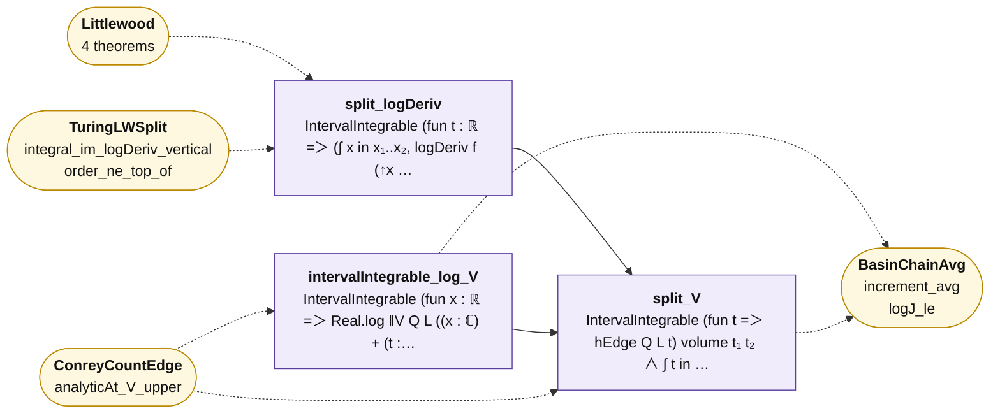

# `lean_stage3/Stage3/BasinChainSplit.lean`

> **Read from the source text.** This file changed after the last `python3 utilities/lean_map.py --dump`, so the arrows on this page are names occurring in each proof and have not been confirmed by Lean.

BasinChainSplit — block S15 of `lean_stage3/design/stencil.md`, the chain from no right zeros, step 3 (the split): the horizontal edge `h(t)` integrated in `t` is a difference of `∫ log|V|`. 2026-11-25.

3 theorems, 1 definition, 196 lines. 

**Imports:** [`BasinChainCount`](../lean_stage3/BasinChainCount.md), [`TuringLWSplit`](../lean_stage3/TuringLWSplit.md)  
**Imported by:** [`BasinChainAvg`](../lean_stage3/BasinChainAvg.md)

## The picture



An arrow A → B reads "A is used in the proof of B". Green: counting, integers only. Violet: shape, analysis with no ζ. Blue: reads ζ. A name ending in ■ is an end: nothing else uses it. Red: contains `sorry`. Yellow: theorems in another file, counted; a dotted arrow crosses files. Definitions are not drawn; they are listed below the diagram.

## Definitions

<a name="BasinChain-logJ"></a>
### `BasinChain.logJ`

def · line 151

`J(t) = ∫_{1/2}^{3} log‖V(x + it)‖ dx`.

- **Is:** `` logJ (Q : ℝ[X]) (L t : ℝ) : ℝ := ∫ x in (1/2 : ℝ)..3, Real.log ‖V Q L ((x : ℂ) + (t : ℂ) * I)‖ ``
- **Built from:** [`ConreyCount.V`](../lean_stage3/ConreyCountLine.md#ConreyCount-V)
- **Used by 4:** [`BasinChain.StmtVHorizLower`](../lean_stage3/BasinChainAvg.md#BasinChain-StmtVHorizLower), [`BasinChain.increment_avg`](../lean_stage3/BasinChainAvg.md#BasinChain-increment_avg), [`BasinChain.logJ_le`](../lean_stage3/BasinChainAvg.md#BasinChain-logJ_le), [`BasinChain.split_V`](#BasinChain-split_V)

## Theorems

<a name="BasinChain-split_logDeriv"></a>
### `BasinChain.split_logDeriv`

line 47 · arrows read from text

**Shape.** Uses real or complex analysis; nothing in it or beneath it reads ζ.

**Why.** The split for `f` analytic on a rectangle.

**Proves**

```lean
IntervalIntegrable (fun t : ℝ => (∫ x in x₁..x₂, logDeriv f (↑x + ↑t * I)).im) volume t₁ t₂ ∧ ∫ t in t₁..t₂, (∫ x in x₁..x₂, logDeriv f (↑x + ↑t * I)).im = (∫ x in x₁..x₂, Real.log ‖f ((x : ℂ) + (t₁ : ℂ) * I)‖) - ∫ x in x₁..x₂, Real.log ‖f ((x : ℂ) + (t₂ : ℂ) * I)‖
```

**Needs** (its hypotheses)

  - `` hx : x₁ ≤ x₂ ``
  - `` h12 : t₁ ≤ t₂ ``
  - `` hfa : AnalyticOnNhd ℂ f (Rectangle ⟨x₁, t₁⟩ ⟨x₂, t₂⟩) ``
  - `` hq : q ∈ Rectangle ⟨x₁, t₁⟩ ⟨x₂, t₂⟩ ``
  - `` hfq : f q ≠ 0 ``
  - `` hl1 : IntervalIntegrable (fun x : ℝ => Real.log ‖f ((x : ℂ) + (t₁ : ℂ) * I)‖) volume x₁ x₂ ``
  - `` hl2 : IntervalIntegrable (fun x : ℝ => Real.log ‖f ((x : ℂ) + (t₂ : ℂ) * I)‖) volume x₁ x₂ ``

**Fed by** (6 theorems its proof uses)

  - [`Littlewood.continuousOn_logDeriv_comp`](../lean_stage3/Littlewood.md#Littlewood-continuousOn_logDeriv_comp) (Littlewood) — `` ContinuousOn (fun x => logDeriv f (γ x)) S ``
  - [`Littlewood.horiz_mem`](../lean_stage3/Littlewood.md#Littlewood-horiz_mem) (Littlewood) — `` (↑x + ↑t * I : ℂ) ∈ Rectangle z w ``
  - [`Littlewood.integrableOn_logDeriv_prod`](../lean_stage3/Littlewood.md#Littlewood-integrableOn_logDeriv_prod) (Littlewood) — `` IntegrableOn (fun q : ℝ × ℝ => logDeriv f (↑q.1 + ↑q.2 * I)) ([[z.re, w.re]] ×ˢ [[z.im, w.im]]) volume ``
  - [`Littlewood.mem_support_divisor`](../lean_stage3/Littlewood.md#Littlewood-mem_support_divisor) (Littlewood) — `` p ∈ (MeromorphicOn.divisor f U).support ↔ p ∈ U ∧ f p = 0 ``
  - [`TuringLW.integral_im_logDeriv_vertical`](../lean_stage3/TuringLWSplit.md#TuringLW-integral_im_logDeriv_vertical) (TuringLWSplit) — `` ∫ t in z.im..w.im, (logDeriv f (↑x + ↑t * I)).im = Real.log ‖f (↑x + ↑z.im * I)‖ - Real.log ‖f (↑x + ↑w.im * I)‖ ``
  - [`TuringLW.order_ne_top_of`](../lean_stage3/TuringLWSplit.md#TuringLW-order_ne_top_of) (TuringLWSplit) — `` ∀ p ∈ Rectangle z w, meromorphicOrderAt f p ≠ ⊤ ``

**Feeds** (1 that use it)

  - [`BasinChain.split_V`](#BasinChain-split_V) — `` IntervalIntegrable (fun t => hEdge Q L t) volume t₁ t₂ ∧ ∫ t in t₁..t₂, hEdge Q L t = logJ Q L t₁ - logJ Q L t₂ ``

<a name="BasinChain-intervalIntegrable_log_V"></a>
### `BasinChain.intervalIntegrable_log_V`

line 139 · arrows read from text

**Shape.** Uses real or complex analysis; nothing in it or beneath it reads ζ.

**Why.** `x ↦ log ‖V(x + it)‖` is interval integrable above `Im = 1/2`.

**Proves**

```lean
IntervalIntegrable (fun x : ℝ => Real.log ‖V Q L ((x : ℂ) + (t : ℂ) * I)‖) volume a b
```

**Needs** (its hypotheses)

  - `` Q : ℝ[X] ``
  - `` L : ℝ ``
  - `` ht : 1/2 < t ``
  - `` a b : ℝ ``

**Fed by** (1 theorem its proof uses)

  - [`ConreyCount.analyticAt_V_upper`](../lean_stage3/ConreyCountEdge.md#ConreyCount-analyticAt_V_upper) (ConreyCountEdge) — `` AnalyticAt ℂ (V Q L) w ``

**Definitions its proof touches:** [`ConreyCount.V`](../lean_stage3/ConreyCountLine.md#ConreyCount-V)

**Feeds** (2 that use it)

  - [`BasinChain.logJ_le`](../lean_stage3/BasinChainAvg.md#BasinChain-logJ_le) (BasinChainAvg) — `` logJ Q L t ≤ (5 / 2) * Real.log M ``
  - [`BasinChain.split_V`](#BasinChain-split_V) — `` IntervalIntegrable (fun t => hEdge Q L t) volume t₁ t₂ ∧ ∫ t in t₁..t₂, hEdge Q L t = logJ Q L t₁ - logJ Q L t₂ ``

<a name="BasinChain-split_V"></a>
### `BasinChain.split_V`

line 156 · arrows read from text

**Shape.** Uses real or complex analysis; nothing in it or beneath it reads ζ.

**Why.** The split for `V`. For `1/2 < t₁ ≤ t₂` and `V(3 + t₁ i) ≠ 0`: `hEdge` is interval integrable on `[t₁, t₂]` and `∫_{t₁}^{t₂} hEdge = J(t₁) − J(t₂)`.

**Proves**

```lean
IntervalIntegrable (fun t => hEdge Q L t) volume t₁ t₂ ∧ ∫ t in t₁..t₂, hEdge Q L t = logJ Q L t₁ - logJ Q L t₂
```

**Needs** (its hypotheses)

  - `` Q : ℝ[X] ``
  - `` L : ℝ ``
  - `` h1 : 1/2 < t₁ ``
  - `` h12 : t₁ ≤ t₂ ``
  - `` hne : V Q L (3 + t₁ * I) ≠ 0 ``

**Fed by** (3 theorems its proof uses)

  - [`BasinChain.intervalIntegrable_log_V`](#BasinChain-intervalIntegrable_log_V) — `` IntervalIntegrable (fun x : ℝ => Real.log ‖V Q L ((x : ℂ) + (t : ℂ) * I)‖) volume a b ``
  - [`BasinChain.split_logDeriv`](#BasinChain-split_logDeriv) — `` IntervalIntegrable (fun t : ℝ => (∫ x in x₁..x₂, logDeriv f (↑x + ↑t * I)).im) volume t₁ t₂ ∧ ∫ t in t₁..t₂, (∫ x in x₁..x₂, logDeriv f (↑x + ↑t * I))… ``
  - [`ConreyCount.analyticAt_V_upper`](../lean_stage3/ConreyCountEdge.md#ConreyCount-analyticAt_V_upper) (ConreyCountEdge) — `` AnalyticAt ℂ (V Q L) w ``

**Definitions its proof touches:** [`BasinChain.hEdge`](../lean_stage3/BasinChainCount.md#BasinChain-hEdge), [`BasinChain.logJ`](#BasinChain-logJ), [`ConreyCount.V`](../lean_stage3/ConreyCountLine.md#ConreyCount-V)

**Feeds** (1 that use it)

  - [`BasinChain.increment_avg`](../lean_stage3/BasinChainAvg.md#BasinChain-increment_avg) (BasinChainAvg) — `` ∃ A T₁ : ℝ, 0 < A ∧ 200 ≤ T₁ ∧ ∀ T : ℝ, T₁ ≤ T → ((Defect.defect T : ℝ) - (Defect.defect (3 * T / 4) : ℝ)) ≤ 4 * ((2 * ((3 / 2 + 113 / 4) / Real.pi) +… ``

