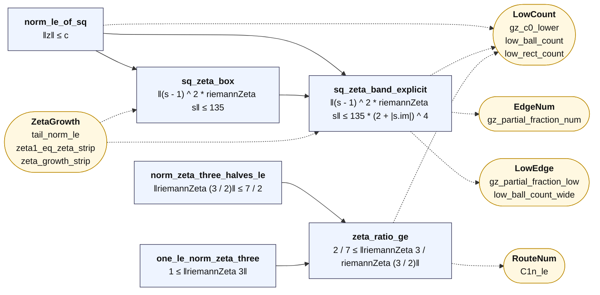

# `lean_stage3/Stage3/BoxBounds.lean`

BoxBounds — blocks E7a and E7b of `lean_stage3/design/joints.md`. 2026-11-22. Two of the quantities the explicit-formula route took from existence statements, as numerals.

6 theorems, 0 definitions, 211 lines. Arrows are Lean's own record of what each proof uses.

**Imports:** [`ZetaGrowth`](../lean_stage3/ZetaGrowth.md)  
**Imported by:** [`Stage3`](../lean_stage3/Stage3.md), [`LowCount`](../lean_stage3/LowCount.md)

## The picture



An arrow A → B reads "A is used in the proof of B". Blue: theorem. Green: a theorem nothing else uses (an end). Dashed: connects to nothing. Red: contains `sorry`. Yellow: theorems in another file, counted; a dotted arrow crosses files. Definitions are not drawn; they are listed below the diagram.

## Theorems

<a name="BoxBounds-norm_le_of_sq"></a>
### `BoxBounds.norm_le_of_sq`

line 30

**Proves**

```lean
‖z‖ ≤ c
```

**Needs** (its hypotheses)

  - `` hc : 0 ≤ c ``
  - `` h : z.re ^ 2 + z.im ^ 2 ≤ c ^ 2 ``

**Fed by:** no theorem of this repo; it stands on Mathlib.

**Feeds** (3 that use it)

  - [`BoxBounds.sq_zeta_band_explicit`](#BoxBounds-sq_zeta_band_explicit) — `` ‖(s - 1) ^ 2 * riemannZeta s‖ ≤ 135 * (2 + |s.im|) ^ 4 ``
  - [`BoxBounds.sq_zeta_box`](#BoxBounds-sq_zeta_box) — `` ‖(s - 1) ^ 2 * riemannZeta s‖ ≤ 135 ``
  - [`EdgeBound.low_rect_count`](../lean_stage3/LowCount.md#EdgeBound-low_rect_count) (LowCount) — `` (∑ ρ ∈ (ContourShift.zeta_zeros_rectangle_finite (0 : ℂ) ((1 : ℝ) + Complex.I * (6 : ℝ))).toFinset, (analyticOrderNatAt riemannZeta ρ : ℝ)) ≤ 714 ``

<a name="BoxBounds-sq_zeta_box"></a>
### `BoxBounds.sq_zeta_box`

line 40

**Why.** The compact patch, with a numeral.

**Proves**

```lean
‖(s - 1) ^ 2 * riemannZeta s‖ ≤ 135
```

**Needs** (its hypotheses)

  - `` h1 : -1 / 2 ≤ s.re ``
  - `` h2 : s.re ≤ 4 ``
  - `` ht : |s.im| ≤ 2 ``

**Fed by** (3 theorems its proof uses)

  - [`BoxBounds.norm_le_of_sq`](#BoxBounds-norm_le_of_sq) — `` ‖z‖ ≤ c ``
  - [`ZetaGrowth.tail_norm_le`](../lean_stage3/ZetaGrowth.md#ZetaGrowth-tail_norm_le) (ZetaGrowth) — `` ‖∫ x in Ioi (N:ℝ), (emA x : ℂ) * (x:ℂ) ^ (-(s+2))‖ ≤ (1/4) * (N:ℝ) ^ (-s.re - 1) ``
  - [`ZetaGrowth.zeta1_eq_zeta_strip`](../lean_stage3/ZetaGrowth.md#ZetaGrowth-zeta1_eq_zeta_strip) (ZetaGrowth) — `` Set.EqOn (zeta1 N) riemannZeta stripRegion ``

**Definitions its proof touches:** [`ZetaGrowth.emA`](../lean_stage3/ZetaGrowth.md#ZetaGrowth-emA), [`ZetaGrowth.stripRegion`](../lean_stage3/ZetaGrowth.md#ZetaGrowth-stripRegion), [`ZetaGrowth.zeta1`](../lean_stage3/ZetaGrowth.md#ZetaGrowth-zeta1)

**Feeds** (1 that use it)

  - [`BoxBounds.sq_zeta_band_explicit`](#BoxBounds-sq_zeta_band_explicit) — `` ‖(s - 1) ^ 2 * riemannZeta s‖ ≤ 135 * (2 + |s.im|) ^ 4 ``

<a name="BoxBounds-sq_zeta_band_explicit"></a>
### `BoxBounds.sq_zeta_band_explicit`

line 90

**Why.** The band bound with its constant named.

**Proves**

```lean
‖(s - 1) ^ 2 * riemannZeta s‖ ≤ 135 * (2 + |s.im|) ^ 4
```

**Needs** (its hypotheses)

  - `` hσ1 : -1 / 2 ≤ s.re ``
  - `` hσ2 : s.re ≤ 4 ``

**Fed by** (3 theorems its proof uses)

  - [`BoxBounds.norm_le_of_sq`](#BoxBounds-norm_le_of_sq) — `` ‖z‖ ≤ c ``
  - [`BoxBounds.sq_zeta_box`](#BoxBounds-sq_zeta_box) — `` ‖(s - 1) ^ 2 * riemannZeta s‖ ≤ 135 ``
  - [`ZetaGrowth.zeta_growth_strip`](../lean_stage3/ZetaGrowth.md#ZetaGrowth-zeta_growth_strip) (ZetaGrowth) — `` ‖riemannZeta s‖ ≤ 15 * |s.im| ^ 2 ``

**Feeds** (4 that use it)

  - [`EdgeBound.gz_partial_fraction_num`](../lean_stage3/EdgeNum.md#EdgeBound-gz_partial_fraction_num) (EdgeNum) — `` ∀ T' : ℝ, 2 ≤ T' → ∀ u : ℂ, u.im = T' → -1/4 ≤ u.re → u.re ≤ 2 → gz u ≠ 0 → ‖deriv gz u / gz u - ∑ w ∈ (gz_zeros_ball_finite T' (by norm_num : (0:ℝ) ≤… ``
  - [`EdgeBound.low_ball_count`](../lean_stage3/LowCount.md#EdgeBound-low_ball_count) (LowCount) — `` (∑ w ∈ (gz_zeros_ball_finite T' (by norm_num : (0 : ℝ) ≤ 8 / 5)).toFinset, (analyticOrderNatAt gz w : ℝ)) ≤ 119 ``
  - [`EdgeBound.gz_partial_fraction_low`](../lean_stage3/LowEdge.md#EdgeBound-gz_partial_fraction_low) (LowEdge) — `` ‖deriv gz u / gz u - ∑ w ∈ (gz_zeros_ball_finite T' (by norm_num : (0:ℝ) ≤ 46/25)).toFinset, (analyticOrderNatAt gz w : ℂ) / (u - w)‖ ≤ 1617537 ``
  - [`EdgeBound.low_ball_count_wide`](../lean_stage3/LowEdge.md#EdgeBound-low_ball_count_wide) (LowEdge) — `` (∑ w ∈ (gz_zeros_ball_finite T' (by norm_num : (0 : ℝ) ≤ 46 / 25)).toFinset, (analyticOrderNatAt gz w : ℝ)) ≤ 250 ``

<a name="BoxBounds-norm_zeta_three_halves_le"></a>
### `BoxBounds.norm_zeta_three_halves_le`

line 122

**Why.** `‖ζ(3/2)‖ ≤ 7/2`, from the strip formula at its first level.

**Proves**

```lean
‖riemannZeta (3 / 2)‖ ≤ 7 / 2
```

**Fed by:** no theorem of this repo; it stands on Mathlib.

**Feeds** (1 that use it)

  - [`BoxBounds.zeta_ratio_ge`](#BoxBounds-zeta_ratio_ge) — `` 2 / 7 ≤ ‖riemannZeta 3 / riemannZeta (3 / 2)‖ ``

<a name="BoxBounds-one_le_norm_zeta_three"></a>
### `BoxBounds.one_le_norm_zeta_three`

line 165

**Why.** `1 ≤ ‖ζ 3‖`, from the Dirichlet series.

**Proves**

```lean
1 ≤ ‖riemannZeta 3‖
```

**Fed by:** no theorem of this repo; it stands on Mathlib.

**Feeds** (1 that use it)

  - [`BoxBounds.zeta_ratio_ge`](#BoxBounds-zeta_ratio_ge) — `` 2 / 7 ≤ ‖riemannZeta 3 / riemannZeta (3 / 2)‖ ``

<a name="BoxBounds-zeta_ratio_ge"></a>
### `BoxBounds.zeta_ratio_ge`

line 184

**Why.** `cζ`, bounded below by a numeral.

**Proves**

```lean
2 / 7 ≤ ‖riemannZeta 3 / riemannZeta (3 / 2)‖
```

**Fed by** (2 theorems its proof uses)

  - [`BoxBounds.norm_zeta_three_halves_le`](#BoxBounds-norm_zeta_three_halves_le) — `` ‖riemannZeta (3 / 2)‖ ≤ 7 / 2 ``
  - [`BoxBounds.one_le_norm_zeta_three`](#BoxBounds-one_le_norm_zeta_three) — `` 1 ≤ ‖riemannZeta 3‖ ``

**Feeds** (2 that use it)

  - [`EdgeBound.gz_c0_lower`](../lean_stage3/LowCount.md#EdgeBound-gz_c0_lower) (LowCount) — `` 1 / 14 ≤ ‖gz (c0 T')‖ ``
  - [`RouteNum.C1n_le`](../lean_stage3/RouteNum.md#RouteNum-C1n_le) (RouteNum) — `` EdgeBound.C1n ≤ 1909224 ``

