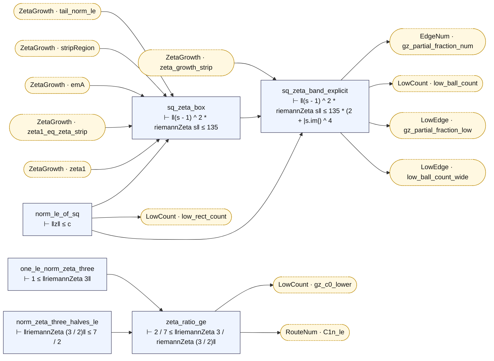

# `lean_stage3/Stage3/BoxBounds.lean`

**What it does** (its own header): BoxBounds — blocks E7a and E7b of `lean_stage3/design/joints.md`. 2026-11-22. Two of the quantities the explicit-formula route took from existence statements, as numerals.

**Imports:** [`ZetaGrowth`](../lean_stage3/ZetaGrowth.md).
**Imported by:** [`Stage3`](../lean_stage3/Stage3.md), [`LowCount`](../lean_stage3/LowCount.md).

Blue: theorem. Green: a theorem nothing else uses (an end). Dashed white: connects to nothing. Grey: definition. Red: contains `sorry`. Yellow: in another file. An arrow A → B reads "A is used by B".

## Every declaration

| declaration | proves (output) | needs (input) | why (its own docstring) | uses | used by |
|---|---|---|---|---|---|
| `BoxBounds.norm_le_of_sq` theorem, line 30 | ‖z‖ ≤ c | hc : 0 ≤ c; h : z.re ^ 2 + z.im ^ 2 ≤ c ^ 2 | — | — | `BoxBounds.sq_zeta_band_explicit`, `BoxBounds.sq_zeta_box`, `EdgeBound.low_rect_count` |
| `BoxBounds.sq_zeta_box` theorem, line 40 | ‖(s - 1) ^ 2 * riemannZeta s‖ ≤ 135 | h1 : -1 / 2 ≤ s.re; h2 : s.re ≤ 4; ht : \|s.im\| ≤ 2 | The compact patch, with a numeral. | `BoxBounds.norm_le_of_sq`, `ZetaGrowth.emA`, `ZetaGrowth.stripRegion`, `ZetaGrowth.tail_norm_le`, `ZetaGrowth.zeta1`, `ZetaGrowth.zeta1_eq_zeta_strip` | `BoxBounds.sq_zeta_band_explicit` |
| `BoxBounds.sq_zeta_band_explicit` theorem, line 90 | ‖(s - 1) ^ 2 * riemannZeta s‖ ≤ 135 * (2 + \|s.im\|) ^ 4 | hσ1 : -1 / 2 ≤ s.re; hσ2 : s.re ≤ 4 | The band bound with its constant named. | `BoxBounds.norm_le_of_sq`, `BoxBounds.sq_zeta_box`, `ZetaGrowth.zeta_growth_strip` | `EdgeBound.gz_partial_fraction_num`, `EdgeBound.low_ball_count`, `EdgeBound.gz_partial_fraction_low`, `EdgeBound.low_ball_count_wide` |
| `BoxBounds.norm_zeta_three_halves_le` theorem, line 122 | ‖riemannZeta (3 / 2)‖ ≤ 7 / 2 | — | `‖ζ(3/2)‖ ≤ 7/2`, from the strip formula at its first level. | — | `BoxBounds.zeta_ratio_ge` |
| `BoxBounds.one_le_norm_zeta_three` theorem, line 165 | 1 ≤ ‖riemannZeta 3‖ | — | `1 ≤ ‖ζ 3‖`, from the Dirichlet series. | — | `BoxBounds.zeta_ratio_ge` |
| `BoxBounds.zeta_ratio_ge` theorem, line 184 | 2 / 7 ≤ ‖riemannZeta 3 / riemannZeta (3 / 2)‖ | — | `cζ`, bounded below by a numeral. | `BoxBounds.norm_zeta_three_halves_le`, `BoxBounds.one_le_norm_zeta_three` | `EdgeBound.gz_c0_lower`, `RouteNum.C1n_le` |
