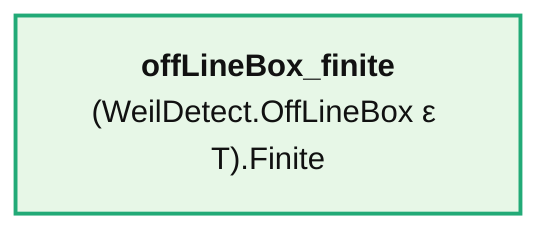

# `lean_stage3/Stage3/BoxFinite.lean`

BoxFinite — the off-line box of `WeilDetect` is a finite set of zeros (block 15 of rung5.md).

1 theorem, 0 definitions, 42 lines. Arrows are Lean's own record of what each proof uses.

**Imports:** [`WeilDetect`](../lean_stage3/WeilDetect.md)  
**Imported by:** [`Stage3`](../lean_stage3/Stage3.md), [`WeilPowerAssembly`](../lean_stage3/WeilPowerAssembly.md)

## The picture



An arrow A → B reads "A is used in the proof of B". Blue: theorem. Green: a theorem nothing else uses (an end). Dashed: connects to nothing. Red: contains `sorry`. Yellow: theorems in another file, counted; a dotted arrow crosses files. Definitions are not drawn; they are listed below the diagram.

## Theorems

<a name="Stage3-offLineBox_finite"></a>
### `Stage3.offLineBox_finite`

line 25

**Why.** The off-line box is finite. `OffLineBox ε T` sits inside a compact rectangle in `ℂ` and the zeros of `riemannZeta` on any compact set are finite.

**Proves**

```lean
(WeilDetect.OffLineBox ε T).Finite
```

**Needs** (its hypotheses)

  - `` ε T : ℝ ``

**Stated with:** [`WeilDetect.OffLineBox`](../lean_stage3/WeilDetect.md#WeilDetect-OffLineBox)

**Fed by:** no theorem of this repo; it stands on Mathlib and the definitions below.

**Feeds:** nothing. It is an end.

