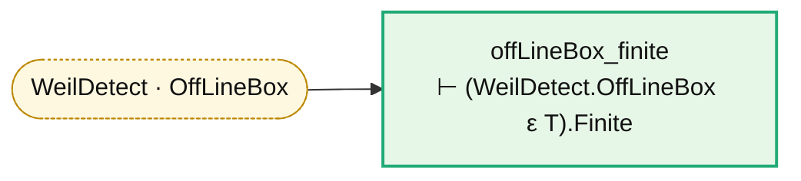

# `lean_stage3/Stage3/BoxFinite.lean`

**What it does** (its own header): BoxFinite — the off-line box of `WeilDetect` is a finite set of zeros (block 15 of rung5.md).

**Imports:** [`WeilDetect`](../lean_stage3/WeilDetect.md).
**Imported by:** [`Stage3`](../lean_stage3/Stage3.md), [`WeilPowerAssembly`](../lean_stage3/WeilPowerAssembly.md).

Blue: theorem. Green: a theorem nothing else uses (an end). Dashed white: connects to nothing. Grey: definition. Red: contains `sorry`. Yellow: in another file. An arrow A → B reads "A is used by B".

## Every declaration

| declaration | proves (output) | needs (input) | why (its own docstring) | uses | used by |
|---|---|---|---|---|---|
| `Stage3.offLineBox_finite` theorem, line 25 | (WeilDetect.OffLineBox ε T).Finite | ε T : ℝ | The off-line box is finite. `OffLineBox ε T` sits inside a compact rectangle in `ℂ` and the zeros of `riemannZeta` on any compact set are finite. | `WeilDetect.OffLineBox` | — |
