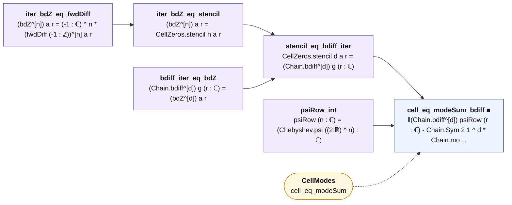

# `lean_stage3/Stage3/CellBdiff.lean`

CellBdiff — block T1b of `lean_stage3/design/joints.md`. 2026-11-22. Joint T1 on the table tree's own operator. `CellZeros.stencil` is a second writing of `d` backward differences. The table tree's writing is `Chain.bdiff` iterated `d` times, the operator `Chain.A4` and `Superposition` are stated on. Here the two are shown equal on any row, and the cell theorem is restated with `bdiff^[d]`, `Sym`, `mode` and `modeSum`, all four from the table tree.

6 theorems, 2 definitions, 125 lines. Arrows are Lean's own record of what each proof uses.

**Imports:** [`CellModes`](../lean_stage3/CellModes.md)  
**Imported by:** [`Stage3`](../lean_stage3/Stage3.md)

## The picture



An arrow A → B reads "A is used in the proof of B". Green: counting, integers only. Violet: shape, analysis with no ζ. Blue: reads ζ. A name ending in ■ is an end: nothing else uses it. Red: contains `sorry`. Yellow: theorems in another file, counted; a dotted arrow crosses files. Definitions are not drawn; they are listed below the diagram.

## Definitions

<a name="CellBdiff-bdZ"></a>
### `CellBdiff.bdZ`

def · line 33

One backward difference on a row indexed by the integers.

- **Is:** `` bdZ (a : ℤ → ℂ) : ℤ → ℂ := fun x => a x - a (x - 1) ``
- **Used by 4:** [`CellBdiff.bdiff_iter_eq_bdZ`](#CellBdiff-bdiff_iter_eq_bdZ), [`CellBdiff.iter_bdZ_eq_fwdDiff`](#CellBdiff-iter_bdZ_eq_fwdDiff), [`CellBdiff.iter_bdZ_eq_stencil`](#CellBdiff-iter_bdZ_eq_stencil), [`CellBdiff.stencil_eq_bdiff_iter`](#CellBdiff-stencil_eq_bdiff_iter)

<a name="CellBdiff-psiRow"></a>
### `CellBdiff.psiRow`

def · line 84

The row of the log-weighted prime count along the doublings, on `ℂ`.

- **Is:** `` psiRow : ℂ → ℂ := fun z => (Chebyshev.psi ((2:ℝ) ^ z.re) : ℂ) ``
- **Used by 2:** [`CellBdiff.cell_eq_modeSum_bdiff`](#CellBdiff-cell_eq_modeSum_bdiff), [`CellBdiff.psiRow_int`](#CellBdiff-psiRow_int)

## Theorems

<a name="CellBdiff-iter_bdZ_eq_fwdDiff"></a>
### `CellBdiff.iter_bdZ_eq_fwdDiff`

line 35

**Shape.** Uses real or complex analysis; nothing in it or beneath it reads ζ.

**Proves**

```lean
(bdZ^[n]) a r = (-1 : ℂ) ^ n * (fwdDiff (-1 : ℤ))^[n] a r
```

**Needs** (its hypotheses)

  - `` a : ℤ → ℂ ``
  - `` r : ℤ ``
  - `` n : ℕ ``

**Stated with:** [`CellBdiff.bdZ`](#CellBdiff-bdZ)

**Fed by:** no theorem of this repo; it stands on Mathlib and the definitions below.

**Feeds** (1 that use it)

  - [`CellBdiff.iter_bdZ_eq_stencil`](#CellBdiff-iter_bdZ_eq_stencil) — `` (bdZ^[n]) a r = CellZeros.stencil n a r ``

<a name="CellBdiff-iter_bdZ_eq_stencil"></a>
### `CellBdiff.iter_bdZ_eq_stencil`

line 49

**Shape.** Uses real or complex analysis; nothing in it or beneath it reads ζ.

**Why.** `n` backward differences are the stencil.

**Proves**

```lean
(bdZ^[n]) a r = CellZeros.stencil n a r
```

**Needs** (its hypotheses)

  - `` a : ℤ → ℂ ``
  - `` r : ℤ ``
  - `` n : ℕ ``

**Stated with:** [`CellBdiff.bdZ`](#CellBdiff-bdZ), [`CellZeros.stencil`](../lean_stage3/CellZeros.md#CellZeros-stencil)

**Fed by** (1 theorem its proof uses)

  - [`CellBdiff.iter_bdZ_eq_fwdDiff`](#CellBdiff-iter_bdZ_eq_fwdDiff) — `` (bdZ^[n]) a r = (-1 : ℂ) ^ n * (fwdDiff (-1 : ℤ))^[n] a r ``

**Feeds** (1 that use it)

  - [`CellBdiff.stencil_eq_bdiff_iter`](#CellBdiff-stencil_eq_bdiff_iter) — `` CellZeros.stencil d a r = (Chain.bdiff^[d]) g (r : ℂ) ``

<a name="CellBdiff-bdiff_iter_eq_bdZ"></a>
### `CellBdiff.bdiff_iter_eq_bdZ`

line 66

**Shape.** Uses real or complex analysis; nothing in it or beneath it reads ζ.

**Why.** The table tree's operator on a function of `ℂ` agrees with the row's on the integers.

**Proves**

```lean
(Chain.bdiff^[d]) g (r : ℂ) = (bdZ^[d]) a r
```

**Needs** (its hypotheses)

  - `` hag : ∀ n : ℤ, g (n : ℂ) = a n ``
  - `` d : ℕ ``
  - `` r : ℤ ``

**Stated with:** [`Chain.bdiff`](../lean/Chain.md#Chain-bdiff), [`CellBdiff.bdZ`](#CellBdiff-bdZ)

**Fed by:** no theorem of this repo; it stands on Mathlib and the definitions below.

**Feeds** (1 that use it)

  - [`CellBdiff.stencil_eq_bdiff_iter`](#CellBdiff-stencil_eq_bdiff_iter) — `` CellZeros.stencil d a r = (Chain.bdiff^[d]) g (r : ℂ) ``

<a name="CellBdiff-stencil_eq_bdiff_iter"></a>
### `CellBdiff.stencil_eq_bdiff_iter`

line 79

**Shape.** Uses real or complex analysis; nothing in it or beneath it reads ζ.

**Why.** The stencil is the table tree's operator, iterated.

**Proves**

```lean
CellZeros.stencil d a r = (Chain.bdiff^[d]) g (r : ℂ)
```

**Needs** (its hypotheses)

  - `` hag : ∀ n : ℤ, g (n : ℂ) = a n ``
  - `` d : ℕ ``
  - `` r : ℤ ``

**Stated with:** [`Chain.bdiff`](../lean/Chain.md#Chain-bdiff), [`CellZeros.stencil`](../lean_stage3/CellZeros.md#CellZeros-stencil)

**Fed by** (2 theorems its proof uses)

  - [`CellBdiff.bdiff_iter_eq_bdZ`](#CellBdiff-bdiff_iter_eq_bdZ) — `` (Chain.bdiff^[d]) g (r : ℂ) = (bdZ^[d]) a r ``
  - [`CellBdiff.iter_bdZ_eq_stencil`](#CellBdiff-iter_bdZ_eq_stencil) — `` (bdZ^[n]) a r = CellZeros.stencil n a r ``

**Definitions its proof touches:** [`CellBdiff.bdZ`](#CellBdiff-bdZ)

**Feeds** (1 that use it)

  - [`CellBdiff.cell_eq_modeSum_bdiff`](#CellBdiff-cell_eq_modeSum_bdiff) — `` ‖(Chain.bdiff^[d]) psiRow (r : ℂ) - Chain.Sym 2 1 ^ d * Chain.mode 2 1 (r : ℂ) + Superposition.modeSum 2 (fun ρ : {ρ : Kadiri.NontrivialZeros // |(ρ :… ``

<a name="CellBdiff-psiRow_int"></a>
### `CellBdiff.psiRow_int`

line 86

**Shape.** Uses real or complex analysis; nothing in it or beneath it reads ζ.

**Proves**

```lean
psiRow (n : ℂ) = (Chebyshev.psi ((2:ℝ) ^ n) : ℂ)
```

**Needs** (its hypotheses)

  - `` n : ℤ ``

**Stated with:** [`CellBdiff.psiRow`](#CellBdiff-psiRow)

**Fed by:** no theorem of this repo; it stands on Mathlib and the definitions below.

**Feeds** (1 that use it)

  - [`CellBdiff.cell_eq_modeSum_bdiff`](#CellBdiff-cell_eq_modeSum_bdiff) — `` ‖(Chain.bdiff^[d]) psiRow (r : ℂ) - Chain.Sym 2 1 ^ d * Chain.mode 2 1 (r : ℂ) + Superposition.modeSum 2 (fun ρ : {ρ : Kadiri.NontrivialZeros // |(ρ :… ``

<a name="CellBdiff-cell_eq_modeSum_bdiff"></a>
### `CellBdiff.cell_eq_modeSum_bdiff`

line 93

**Reads ζ.** It, or something it rests on, uses the zeta function, its zeros or the Riemann hypothesis.

**Why.** The cell on the table tree's operators. `d` backward differences of the row, with `Chain.bdiff`, are the main mode minus the reweighted sum of the zeros' modes, within the stated error.

**Proves**

```lean
‖(Chain.bdiff^[d]) psiRow (r : ℂ) - Chain.Sym 2 1 ^ d * Chain.mode 2 1 (r : ℂ) + Superposition.modeSum 2 (fun ρ : {ρ : Kadiri.NontrivialZeros // |(ρ : ℂ).im| < T} => ((ρ : Kadiri.NontrivialZeros) : ℂ)) (fun ρ => ((riemannZeta.order ((ρ : Kadiri.NontrivialZeros) : ℂ) : ℤ) : ℂ) / ((ρ : Kadiri.NontrivialZeros) : ℂ) * Chain.Sym 2 ((ρ : Kadiri.NontrivialZeros) : ℂ) ^ d) Finset.univ (r : ℂ)‖ ≤ ∑ j ∈ range (d + 1), (d.choose j : ℝ) * (Glue.c1n * (2:ℝ) ^ (r - (j : ℤ)) * Real.log ((2:ℝ) ^ (r - (j : ℤ)) * T) ^ 2 / T + Glue.c3n * Real.log ((2:ℝ) ^ (r - (j : ℤ))) + Glue.c4n * ((Real.log ((2:ℝ) ^ (r - (j : ℤ)))) ^ 2 * ((2:ℝ) ^ (r - (j : ℤ))) ^ (-(1:ℝ) / 4)))
```

**Needs** (its hypotheses)

  - `` d : ℕ ``
  - `` r : ℤ ``
  - `` h16 : 16 ≤ (2:ℝ) ^ (r - (d : ℤ)) ``
  - `` hT : 2 ≤ T ``
  - `` hTx : T ≤ ((2:ℝ) ^ (r - (d : ℤ))) ^ 2 ``

**Stated with:** [`Chain.Sym`](../lean/Chain.md#Chain-Sym), [`Chain.bdiff`](../lean/Chain.md#Chain-bdiff), [`Chain.mode`](../lean/Chain.md#Chain-mode), [`Superposition.modeSum`](../lean/Superposition.md#Superposition-modeSum), [`CellBdiff.psiRow`](#CellBdiff-psiRow), [`Glue.c1n`](../lean_stage3/GlueNum.md#Glue-c1n), [`Glue.c3n`](../lean_stage3/GlueNum.md#Glue-c3n), [`Glue.c4n`](../lean_stage3/GlueNum.md#Glue-c4n)

**Fed by** (3 theorems its proof uses)

  - [`CellBdiff.psiRow_int`](#CellBdiff-psiRow_int) — `` psiRow (n : ℂ) = (Chebyshev.psi ((2:ℝ) ^ n) : ℂ) ``
  - [`CellBdiff.stencil_eq_bdiff_iter`](#CellBdiff-stencil_eq_bdiff_iter) — `` CellZeros.stencil d a r = (Chain.bdiff^[d]) g (r : ℂ) ``
  - [`CellModes.cell_eq_modeSum`](../lean_stage3/CellModes.md#CellModes-cell_eq_modeSum) (CellModes) — `` ‖CellZeros.stencil d (fun n : ℤ => (Chebyshev.psi ((2:ℝ) ^ n) : ℂ)) r - Chain.Sym 2 1 ^ d * Chain.mode 2 1 (r : ℂ) + Superposition.modeSum 2 (fun ρ : … ``

**Definitions its proof touches:** [`CellZeros.stencil`](../lean_stage3/CellZeros.md#CellZeros-stencil)

**Feeds:** nothing. It is an end.

