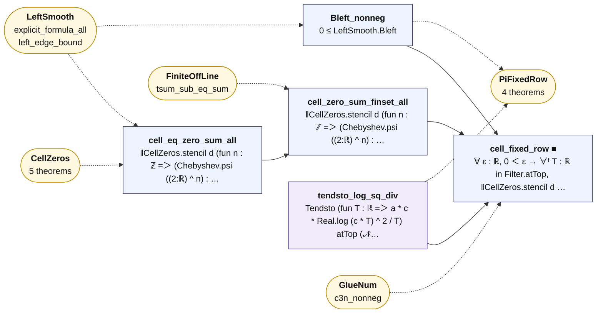

# `lean_stage3/Stage3/CellFixedRow.lean`

> **Read from the source text.** This file changed after the last `python3 utilities/lean_map.py --dump`, so the arrows on this page are names occurring in each proof and have not been confirmed by Lean.

CellFixedRow — block F3 of `lean_stage3/design/leftedge.md`. 2026-11-23. The cell at a fixed row with the height of the zero sum taken to infinity. `LeftSmooth.explicit_formula_all` holds at every height `T ≥ 2`, with no cap `T ≤ x²`. Through the stencil, the cell at row `r`, depth `d`, and its zero sum to any height differ by the stencil of that bound. As `T → ∞` at the fixed row the first term of the bound tends to zero, and what stays is free of the height.

5 theorems, 0 definitions, 207 lines. 

**Imports:** [`CellRows`](../lean_stage3/CellRows.md), [`LeftSmooth`](../lean_stage3/LeftSmooth.md)  
**Imported by:** [`Stage3`](../lean_stage3/Stage3.md), [`PiFixedRow`](../lean_stage3/PiFixedRow.md)

## The picture



An arrow A → B reads "A is used in the proof of B". Green: counting, integers only. Violet: shape, analysis with no ζ. Blue: reads ζ. A name ending in ■ is an end: nothing else uses it. Red: contains `sorry`. Yellow: theorems in another file, counted; a dotted arrow crosses files. Definitions are not drawn; they are listed below the diagram.

## Theorems

<a name="CellFixedRow-cell_eq_zero_sum_all"></a>
### `CellFixedRow.cell_eq_zero_sum_all`

line 33 · arrows read from text

**Reads ζ.** It, or something it rests on, uses the zeta function, its zeros or the Riemann hypothesis.

**Why.** The cell as a sum over the zeros, at every height. For `16 ≤ 2^(r−d)` and any `T ≥ 2`, the cell at row `r`, depth `d`, minus its main term, plus the sum over the zeros below `T`, has norm at most the stencil of the explicit formula's error at every height, read on the `d + 1` rows the stencil touches.

**Proves**

```lean
‖CellZeros.stencil d (fun n : ℤ => (Chebyshev.psi ((2:ℝ) ^ n) : ℂ)) r - (2:ℂ) ^ r * (1 - (2:ℂ)⁻¹) ^ d + ∑' ρ : {ρ : Kadiri.NontrivialZeros // |(ρ : ℂ).im| < T}, ((riemannZeta.order ((ρ : Kadiri.NontrivialZeros) : ℂ) : ℤ) : ℂ) * (((2:ℂ) ^ ((ρ : Kadiri.NontrivialZeros) : ℂ)) ^ r * (1 - ((2:ℂ) ^ ((ρ : Kadiri.NontrivialZeros) : ℂ))⁻¹) ^ d / ((ρ : Kadiri.NontrivialZeros) : ℂ))‖ ≤ ∑ j ∈ range (d + 1), (d.choose j : ℝ) * (Glue.c1n * (2:ℝ) ^ (r - (j : ℤ)) * Real.log ((2:ℝ) ^ (r - (j : ℤ)) * T) ^ 2 / T + Glue.c3n * Real.log ((2:ℝ) ^ (r - (j : ℤ))) + LeftSmooth.Bleft * ((2:ℝ) ^ (r - (j : ℤ))) ^ (-(1:ℝ) / 4))
```

**Needs** (its hypotheses)

  - `` d : ℕ ``
  - `` r : ℤ ``
  - `` h16 : 16 ≤ (2:ℝ) ^ (r - (d : ℤ)) ``
  - `` hT : 2 ≤ T ``

**Fed by** (6 theorems its proof uses)

  - [`CellZeros.norm_stencil_le`](../lean_stage3/CellZeros.md#CellZeros-norm_stencil_le) (CellZeros) — `` ‖stencil d a r‖ ≤ ∑ j ∈ range (d + 1), (d.choose j : ℝ) * B j ``
  - [`CellZeros.stencil_add`](../lean_stage3/CellZeros.md#CellZeros-stencil_add) (CellZeros) — `` stencil d (fun n => a n + b n) r = stencil d a r + stencil d b r ``
  - [`CellZeros.stencil_mode`](../lean_stage3/CellZeros.md#CellZeros-stencil_mode) (CellZeros) — `` stencil d (fun n : ℤ => w ^ n) r = w ^ r * (1 - w⁻¹) ^ d ``
  - [`CellZeros.stencil_sub`](../lean_stage3/CellZeros.md#CellZeros-stencil_sub) (CellZeros) — `` stencil d (fun n => a n - b n) r = stencil d a r - stencil d b r ``
  - [`CellZeros.stencil_zeroPartialSum`](../lean_stage3/CellZeros.md#CellZeros-stencil_zeroPartialSum) (CellZeros) — `` stencil d (fun n : ℤ => Stage3.zeroPartialSum ((2:ℝ) ^ n) T) r = ∑' ρ : {ρ : Kadiri.NontrivialZeros // |(ρ : ℂ).im| < T}, ((riemannZeta.order ((ρ : Ka… ``
  - [`LeftSmooth.explicit_formula_all`](../lean_stage3/LeftSmooth.md#LeftSmooth-explicit_formula_all) (LeftSmooth) — `` ‖(Chebyshev.psi x : ℂ) - (x:ℂ) + Stage3.zeroPartialSum x T‖ ≤ Glue.c1n * x * Real.log (x*T)^2 / T + Glue.c3n * Real.log x + Bleft * x ^ (-(1:ℝ)/4) ``

**Definitions its proof touches:** [`Stage3.zeroPartialSum`](../lean_stage3/Assembly.md#Stage3-zeroPartialSum), [`CellZeros.stencil`](../lean_stage3/CellZeros.md#CellZeros-stencil), [`Glue.c1n`](../lean_stage3/GlueNum.md#Glue-c1n), [`Glue.c3n`](../lean_stage3/GlueNum.md#Glue-c3n), [`LeftSmooth.Bleft`](../lean_stage3/LeftSmooth.md#LeftSmooth-Bleft)

**Feeds** (1 that use it)

  - [`CellFixedRow.cell_zero_sum_finset_all`](#CellFixedRow-cell_zero_sum_finset_all) — `` ‖CellZeros.stencil d (fun n : ℤ => (Chebyshev.psi ((2:ℝ) ^ n) : ℂ)) r - (2:ℂ) ^ r * (1 - (2:ℂ)⁻¹) ^ d + ∑ ρ ∈ ZF T, term d r ρ‖ ≤ ∑ j ∈ range (d + 1),… ``

<a name="CellFixedRow-cell_zero_sum_finset_all"></a>
### `CellFixedRow.cell_zero_sum_finset_all`

line 73 · arrows read from text

**Reads ζ.** It, or something it rests on, uses the zeta function, its zeros or the Riemann hypothesis.

**Why.** The same, over the finite set of zeros below the height.

**Proves**

```lean
‖CellZeros.stencil d (fun n : ℤ => (Chebyshev.psi ((2:ℝ) ^ n) : ℂ)) r - (2:ℂ) ^ r * (1 - (2:ℂ)⁻¹) ^ d + ∑ ρ ∈ ZF T, term d r ρ‖ ≤ ∑ j ∈ range (d + 1), (d.choose j : ℝ) * (Glue.c1n * (2:ℝ) ^ (r - (j : ℤ)) * Real.log ((2:ℝ) ^ (r - (j : ℤ)) * T) ^ 2 / T + Glue.c3n * Real.log ((2:ℝ) ^ (r - (j : ℤ))) + LeftSmooth.Bleft * ((2:ℝ) ^ (r - (j : ℤ))) ^ (-(1:ℝ) / 4))
```

**Needs** (its hypotheses)

  - `` d : ℕ ``
  - `` r : ℤ ``
  - `` h16 : 16 ≤ (2:ℝ) ^ (r - (d : ℤ)) ``
  - `` hT : 2 ≤ T ``

**Fed by** (2 theorems its proof uses)

  - [`CellFixedRow.cell_eq_zero_sum_all`](#CellFixedRow-cell_eq_zero_sum_all) — `` ‖CellZeros.stencil d (fun n : ℤ => (Chebyshev.psi ((2:ℝ) ^ n) : ℂ)) r - (2:ℂ) ^ r * (1 - (2:ℂ)⁻¹) ^ d + ∑' ρ : {ρ : Kadiri.NontrivialZeros // |(ρ : ℂ)… ``
  - [`FiniteOffLine.tsum_sub_eq_sum`](../lean_stage3/FiniteOffLine.md#FiniteOffLine-tsum_sub_eq_sum) (FiniteOffLine) — `` ∑' σ : {ρ : NontrivialZeros // |(ρ : ℂ).im| < T}, f σ.1 = ∑ ρ ∈ ZF T, f ρ ``

**Definitions its proof touches:** [`CellZeros.stencil`](../lean_stage3/CellZeros.md#CellZeros-stencil), [`FiniteOffLine.ZF`](../lean_stage3/FiniteOffLine.md#FiniteOffLine-ZF), [`FiniteOffLine.term`](../lean_stage3/FiniteOffLine.md#FiniteOffLine-term), [`Glue.c1n`](../lean_stage3/GlueNum.md#Glue-c1n), [`Glue.c3n`](../lean_stage3/GlueNum.md#Glue-c3n), [`LeftSmooth.Bleft`](../lean_stage3/LeftSmooth.md#LeftSmooth-Bleft)

**Feeds** (1 that use it)

  - [`CellFixedRow.cell_fixed_row`](#CellFixedRow-cell_fixed_row) — `` ∀ ε : ℝ, 0 < ε → ∀ᶠ T : ℝ in Filter.atTop, ‖CellZeros.stencil d (fun n : ℤ => (Chebyshev.psi ((2:ℝ) ^ n) : ℂ)) (r : ℤ) - (2:ℂ) ^ (r : ℤ) * (1 - (2:ℂ)⁻… ``

<a name="CellFixedRow-Bleft_nonneg"></a>
### `CellFixedRow.Bleft_nonneg`

line 85 · arrows read from text

**Reads ζ.** It, or something it rests on, uses the zeta function, its zeros or the Riemann hypothesis.

**Why.** The left-edge constant is nonnegative: it bounds a norm at `x = 16`, `T = 2`.

**Proves**

```lean
0 ≤ LeftSmooth.Bleft
```

**Fed by** (1 theorem its proof uses)

  - [`LeftSmooth.left_edge_bound`](../lean_stage3/LeftSmooth.md#LeftSmooth-left_edge_bound) (LeftSmooth) — `` ‖VIntegral (Glue.Gf x) (-1/4) (-T) T‖ ≤ Bleft * x ^ (-(1:ℝ)/4) ``

**Definitions its proof touches:** [`LeftSmooth.Bleft`](../lean_stage3/LeftSmooth.md#LeftSmooth-Bleft)

**Feeds** (4 that use it)

  - [`CellFixedRow.cell_fixed_row`](#CellFixedRow-cell_fixed_row) — `` ∀ ε : ℝ, 0 < ε → ∀ᶠ T : ℝ in Filter.atTop, ‖CellZeros.stencil d (fun n : ℤ => (Chebyshev.psi ((2:ℝ) ^ n) : ℂ)) (r : ℤ) - (2:ℂ) ^ (r : ℤ) * (1 - (2:ℂ)⁻… ``
  - [`PiFixedRow.Api_nonneg`](../lean_stage3/PiFixedRow.md#PiFixedRow-Api_nonneg) (PiFixedRow) — `` 0 ≤ Api ``
  - [`PiFixedRow.norm_high_integral_le`](../lean_stage3/PiFixedRow.md#PiFixedRow-norm_high_integral_le) (PiFixedRow) — `` ‖∫ t in (16:ℝ)..x, efRem T t * wt t‖ ≤ (x - 16) * (Glue.c1n * Real.log (x * T) ^ 2 / T) + (Glue.c3n + LeftSmooth.Bleft) * Real.log (x / 16) ``
  - [`PiFixedRow.norm_tr_efRem_le_height`](../lean_stage3/PiFixedRow.md#PiFixedRow-norm_tr_efRem_le_height) (PiFixedRow) — `` ‖tr (efRem T) x‖ ≤ Api * Real.log x + 2 * Glue.c1n * x * Real.log (x * T) ^ 2 / T ``

<a name="CellFixedRow-tendsto_log_sq_div"></a>
### `CellFixedRow.tendsto_log_sq_div`

line 95 · arrows read from text

**Shape.** Uses real or complex analysis; nothing in it or beneath it reads ζ.

**Why.** For a fixed constant `c > 0`, `log²(c·T)/T` times `a` tends to zero as `T → ∞`.

**Proves**

```lean
Tendsto (fun T : ℝ => a * c * Real.log (c * T) ^ 2 / T) atTop (𝓝 0)
```

**Needs** (its hypotheses)

  - `` a c : ℝ ``
  - `` hc : 0 < c ``

**Fed by:** no theorem of this repo; it stands on Mathlib.

**Feeds** (2 that use it)

  - [`CellFixedRow.cell_fixed_row`](#CellFixedRow-cell_fixed_row) — `` ∀ ε : ℝ, 0 < ε → ∀ᶠ T : ℝ in Filter.atTop, ‖CellZeros.stencil d (fun n : ℤ => (Chebyshev.psi ((2:ℝ) ^ n) : ℂ)) (r : ℤ) - (2:ℂ) ^ (r : ℤ) * (1 - (2:ℂ)⁻… ``
  - [`PiFixedRow.tr_efRem_fixed`](../lean_stage3/PiFixedRow.md#PiFixedRow-tr_efRem_fixed) (PiFixedRow) — `` ∀ ε : ℝ, 0 < ε → ∀ᶠ T : ℝ in Filter.atTop, ‖tr (efRem T) x‖ ≤ Api * Real.log x + ε ``

<a name="CellFixedRow-cell_fixed_row"></a>
### `CellFixedRow.cell_fixed_row`

line 111 · arrows read from text

**Reads ζ.** It, or something it rests on, uses the zeta function, its zeros or the Riemann hypothesis.

**Why.** The cell at a fixed row, the height to infinity. For `d + 4 ≤ r` and every `ε > 0`, for all large heights `T` the cell at row `r`, depth `d`, minus its main term, plus its sum over the zeros below `T`, has norm at most `2^d·(c3n·log 2·r + Bleft) + ε`. The bound left is free of the height.

**Proves**

```lean
∀ ε : ℝ, 0 < ε → ∀ᶠ T : ℝ in Filter.atTop, ‖CellZeros.stencil d (fun n : ℤ => (Chebyshev.psi ((2:ℝ) ^ n) : ℂ)) (r : ℤ) - (2:ℂ) ^ (r : ℤ) * (1 - (2:ℂ)⁻¹) ^ d + ∑ ρ ∈ ZF T, term d (r : ℤ) ρ‖ ≤ 2 ^ d * (Glue.c3n * Real.log 2 * r + LeftSmooth.Bleft) + ε
```

**Needs** (its hypotheses)

  - `` d : ℕ ``
  - `` r : ℕ ``
  - `` hr : d + 4 ≤ r ``

**Fed by** (4 theorems its proof uses)

  - [`CellFixedRow.Bleft_nonneg`](#CellFixedRow-Bleft_nonneg) — `` 0 ≤ LeftSmooth.Bleft ``
  - [`CellFixedRow.cell_zero_sum_finset_all`](#CellFixedRow-cell_zero_sum_finset_all) — `` ‖CellZeros.stencil d (fun n : ℤ => (Chebyshev.psi ((2:ℝ) ^ n) : ℂ)) r - (2:ℂ) ^ r * (1 - (2:ℂ)⁻¹) ^ d + ∑ ρ ∈ ZF T, term d r ρ‖ ≤ ∑ j ∈ range (d + 1),… ``
  - [`CellFixedRow.tendsto_log_sq_div`](#CellFixedRow-tendsto_log_sq_div) — `` Tendsto (fun T : ℝ => a * c * Real.log (c * T) ^ 2 / T) atTop (𝓝 0) ``
  - [`Glue.c3n_nonneg`](../lean_stage3/GlueNum.md#Glue-c3n_nonneg) (GlueNum) — `` 0 ≤ c3n ``

**Definitions its proof touches:** [`CellZeros.stencil`](../lean_stage3/CellZeros.md#CellZeros-stencil), [`FiniteOffLine.ZF`](../lean_stage3/FiniteOffLine.md#FiniteOffLine-ZF), [`FiniteOffLine.term`](../lean_stage3/FiniteOffLine.md#FiniteOffLine-term), [`Glue.c1n`](../lean_stage3/GlueNum.md#Glue-c1n), [`Glue.c3n`](../lean_stage3/GlueNum.md#Glue-c3n), [`LeftSmooth.Bleft`](../lean_stage3/LeftSmooth.md#LeftSmooth-Bleft)

**Feeds:** nothing. It is an end.

