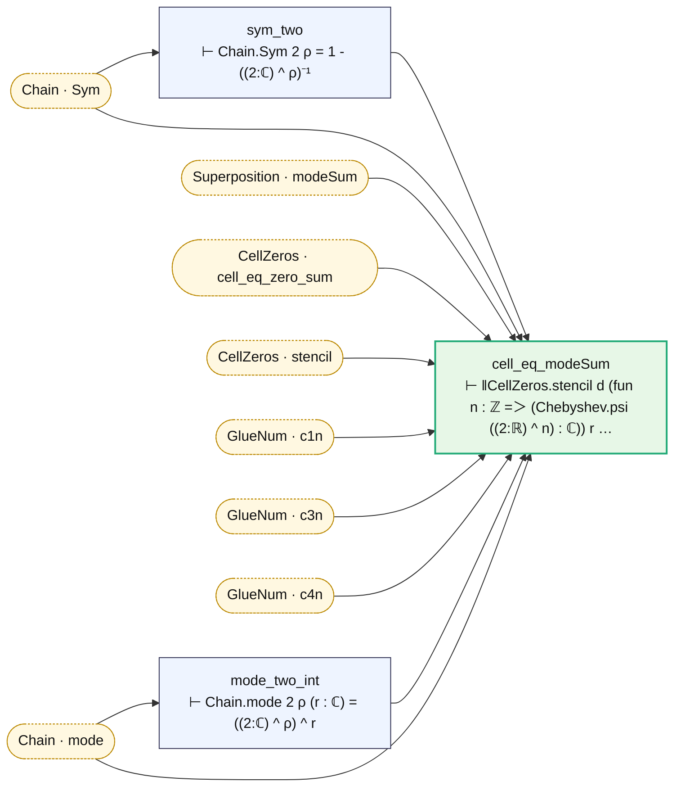

# `lean_stage3/Stage3/CellModes.lean`

**What it does** (its own header): CellModes — block T1 of `lean_stage3/design/joints.md`, second part. 2026-11-22.

**Imports:** [`CellZeros`](../lean_stage3/CellZeros.md), [`Superposition`](../lean_stage3/TablePort_Superposition.md).
**Imported by:** [`Stage3`](../lean_stage3/Stage3.md).

Blue: theorem. Green: a theorem nothing else uses (an end). Dashed white: connects to nothing. Grey: definition. Red: contains `sorry`. Yellow: in another file. An arrow A → B reads "A is used by B".

## Every declaration

| declaration | proves (output) | needs (input) | why (its own docstring) | uses | used by |
|---|---|---|---|---|---|
| `CellModes.mode_two_int` theorem, line 34 | Chain.mode 2 ρ (r : ℂ) = ((2:ℂ) ^ ρ) ^ r | ρ : ℂ; r : ℤ | — | `Chain.mode` | `CellModes.cell_eq_modeSum` |
| `CellModes.sym_two` theorem, line 42 | Chain.Sym 2 ρ = 1 - ((2:ℂ) ^ ρ)⁻¹ | ρ : ℂ | — | `Chain.Sym` | `CellModes.cell_eq_modeSum` |
| `CellModes.cell_eq_modeSum` theorem, line 48 | ‖CellZeros.stencil d (fun n : ℤ =&gt; (Chebyshev.psi ((2:ℝ) ^ n) : ℂ)) r - Chain.Sym 2 1 ^ d * Chain.mode 2 1 (r : ℂ) + Superposition.modeSum 2 (fun ρ : {ρ : Kadiri.NontrivialZeros // \|(ρ : ℂ).im\| &lt; T} =&gt; ((ρ : Kadiri.NontrivialZeros) : ℂ)) (fun ρ =&gt; ((riemannZeta.order ((ρ : Kadiri.NontrivialZeros) : ℂ) : ℤ) : ℂ) / ((ρ : Kadiri.NontrivialZeros) : ℂ) * Chain.Sym 2 ((ρ : Kadiri.NontrivialZeros) : ℂ) ^ d) Finset.univ (r : ℂ)‖ ≤ ∑ j ∈ range (d + 1), (d.choose j : ℝ) * (Glue.c1n * (2:ℝ) ^ (r - (j : ℤ)) * Real.log ((2:ℝ) ^ (r - (j : ℤ)) * T) ^ 2 / T + Glue.c3n * Real.log ((2:ℝ) ^ (r - (j : ℤ))) + Glue.c4n * ((Real.log ((2:ℝ) ^ (r - (j : ℤ)))) ^ 2 * ((2:ℝ) ^ (r - (j : ℤ))) ^ (-(1:ℝ) / 4))) | d : ℕ; r : ℤ; h16 : 16 ≤ (2:ℝ) ^ (r - (d : ℤ)); hT : 2 ≤ T; hTx : T ≤ ((2:ℝ) ^ (r - (d : ℤ))) ^ 2 | The cell as a reweighted sum of modes, one for each zero. | `Chain.Sym`, `Chain.mode`, `Superposition.modeSum`, `CellModes.mode_two_int`, `CellModes.sym_two`, `CellZeros.cell_eq_zero_sum`, `CellZeros.stencil`, `Glue.c1n`, `Glue.c3n`, `Glue.c4n` | — |
