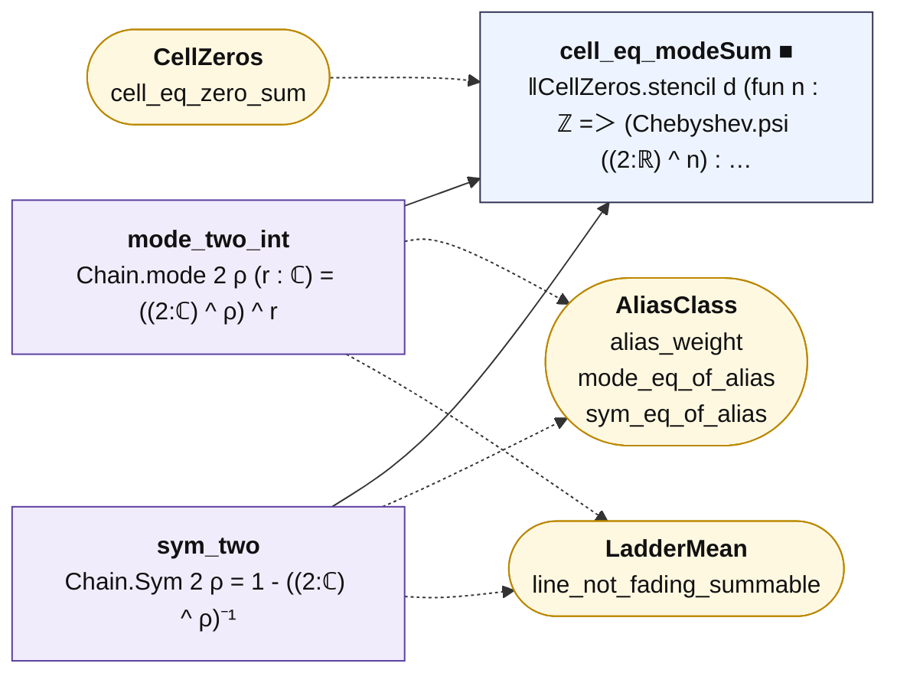

# `lean_stage3/Stage3/CellModes.lean`

CellModes — block T1 of `lean_stage3/design/joints.md`, second part. 2026-11-22.

3 theorems, 0 definitions, 100 lines. Arrows are Lean's own record of what each proof uses.

**Imports:** [`CellZeros`](../lean_stage3/CellZeros.md), [`Superposition`](../lean_stage3/TablePort_Superposition.md)  
**Imported by:** [`Stage3`](../lean_stage3/Stage3.md), [`AliasClass`](../lean_stage3/AliasClass.md)

## The picture



An arrow A → B reads "A is used in the proof of B". Green: counting, integers only. Violet: shape, analysis with no ζ. Blue: reads ζ. A name ending in ■ is an end: nothing else uses it. Red: contains `sorry`. Yellow: theorems in another file, counted; a dotted arrow crosses files. Definitions are not drawn; they are listed below the diagram.

## Theorems

<a name="CellModes-mode_two_int"></a>
### `CellModes.mode_two_int`

line 34

**Shape.** Uses real or complex analysis; nothing in it or beneath it reads ζ.

**Proves**

```lean
Chain.mode 2 ρ (r : ℂ) = ((2:ℂ) ^ ρ) ^ r
```

**Needs** (its hypotheses)

  - `` ρ : ℂ ``
  - `` r : ℤ ``

**Stated with:** [`Chain.mode`](../lean/Chain.md#Chain-mode)

**Fed by:** no theorem of this repo; it stands on Mathlib and the definitions below.

**Feeds** (4 that use it)

  - [`AliasClass.alias_weight`](../lean_stage3/AliasClass.md#AliasClass-alias_weight) (AliasClass) — `` ∑ ρ ∈ S, (((riemannZeta.order (ρ : ℂ) : ℤ) : ℂ)) / (ρ : ℂ) * Chain.Sym 2 (ρ : ℂ) ^ d * Chain.mode 2 (ρ : ℂ) (r : ℂ) = (∑ ρ ∈ S, (((riemannZeta.order (… ``
  - [`AliasClass.mode_eq_of_alias`](../lean_stage3/AliasClass.md#AliasClass-mode_eq_of_alias) (AliasClass) — `` Chain.mode 2 ρ (r : ℂ) = Chain.mode 2 ρ' (r : ℂ) ``
  - [`CellModes.cell_eq_modeSum`](#CellModes-cell_eq_modeSum) — `` ‖CellZeros.stencil d (fun n : ℤ => (Chebyshev.psi ((2:ℝ) ^ n) : ℂ)) r - Chain.Sym 2 1 ^ d * Chain.mode 2 1 (r : ℂ) + Superposition.modeSum 2 (fun ρ : … ``
  - [`LadderMean.line_not_fading_summable`](../lean_stage3/LadderMean.md#LadderMean-line_not_fading_summable) (LadderMean) — `` ¬ Tendsto (fun r : ℕ => (∑' ρ : S, coef ρ * Chain.Sym 2 ((ρ : Kadiri.NontrivialZeros) : ℂ) ^ d * Chain.mode 2 ((ρ : Kadiri.NontrivialZeros) : ℂ) (((r … ``

<a name="CellModes-sym_two"></a>
### `CellModes.sym_two`

line 42

**Shape.** Uses real or complex analysis; nothing in it or beneath it reads ζ.

**Proves**

```lean
Chain.Sym 2 ρ = 1 - ((2:ℂ) ^ ρ)⁻¹
```

**Needs** (its hypotheses)

  - `` ρ : ℂ ``

**Stated with:** [`Chain.Sym`](../lean/Chain.md#Chain-Sym)

**Fed by:** no theorem of this repo; it stands on Mathlib and the definitions below.

**Feeds** (4 that use it)

  - [`AliasClass.alias_weight`](../lean_stage3/AliasClass.md#AliasClass-alias_weight) (AliasClass) — `` ∑ ρ ∈ S, (((riemannZeta.order (ρ : ℂ) : ℤ) : ℂ)) / (ρ : ℂ) * Chain.Sym 2 (ρ : ℂ) ^ d * Chain.mode 2 (ρ : ℂ) (r : ℂ) = (∑ ρ ∈ S, (((riemannZeta.order (… ``
  - [`AliasClass.sym_eq_of_alias`](../lean_stage3/AliasClass.md#AliasClass-sym_eq_of_alias) (AliasClass) — `` Chain.Sym 2 ρ = Chain.Sym 2 ρ' ``
  - [`CellModes.cell_eq_modeSum`](#CellModes-cell_eq_modeSum) — `` ‖CellZeros.stencil d (fun n : ℤ => (Chebyshev.psi ((2:ℝ) ^ n) : ℂ)) r - Chain.Sym 2 1 ^ d * Chain.mode 2 1 (r : ℂ) + Superposition.modeSum 2 (fun ρ : … ``
  - [`LadderMean.line_not_fading_summable`](../lean_stage3/LadderMean.md#LadderMean-line_not_fading_summable) (LadderMean) — `` ¬ Tendsto (fun r : ℕ => (∑' ρ : S, coef ρ * Chain.Sym 2 ((ρ : Kadiri.NontrivialZeros) : ℂ) ^ d * Chain.mode 2 ((ρ : Kadiri.NontrivialZeros) : ℂ) (((r … ``

<a name="CellModes-cell_eq_modeSum"></a>
### `CellModes.cell_eq_modeSum`

line 48

**Reads ζ.** It, or something it rests on, uses the zeta function, its zeros or the Riemann hypothesis.

**Why.** The cell as a reweighted sum of modes, one for each zero.

**Proves**

```lean
‖CellZeros.stencil d (fun n : ℤ => (Chebyshev.psi ((2:ℝ) ^ n) : ℂ)) r - Chain.Sym 2 1 ^ d * Chain.mode 2 1 (r : ℂ) + Superposition.modeSum 2 (fun ρ : {ρ : Kadiri.NontrivialZeros // |(ρ : ℂ).im| < T} => ((ρ : Kadiri.NontrivialZeros) : ℂ)) (fun ρ => ((riemannZeta.order ((ρ : Kadiri.NontrivialZeros) : ℂ) : ℤ) : ℂ) / ((ρ : Kadiri.NontrivialZeros) : ℂ) * Chain.Sym 2 ((ρ : Kadiri.NontrivialZeros) : ℂ) ^ d) Finset.univ (r : ℂ)‖ ≤ ∑ j ∈ range (d + 1), (d.choose j : ℝ) * (Glue.c1n * (2:ℝ) ^ (r - (j : ℤ)) * Real.log ((2:ℝ) ^ (r - (j : ℤ)) * T) ^ 2 / T + Glue.c3n * Real.log ((2:ℝ) ^ (r - (j : ℤ))) + Glue.c4n * ((Real.log ((2:ℝ) ^ (r - (j : ℤ)))) ^ 2 * ((2:ℝ) ^ (r - (j : ℤ))) ^ (-(1:ℝ) / 4)))
```

**Needs** (its hypotheses)

  - `` d : ℕ ``
  - `` r : ℤ ``
  - `` h16 : 16 ≤ (2:ℝ) ^ (r - (d : ℤ)) ``
  - `` hT : 2 ≤ T ``
  - `` hTx : T ≤ ((2:ℝ) ^ (r - (d : ℤ))) ^ 2 ``

**Stated with:** [`Chain.Sym`](../lean/Chain.md#Chain-Sym), [`Chain.mode`](../lean/Chain.md#Chain-mode), [`Superposition.modeSum`](../lean/Superposition.md#Superposition-modeSum), [`CellZeros.stencil`](../lean_stage3/CellZeros.md#CellZeros-stencil), [`Glue.c1n`](../lean_stage3/GlueNum.md#Glue-c1n), [`Glue.c3n`](../lean_stage3/GlueNum.md#Glue-c3n), [`Glue.c4n`](../lean_stage3/GlueNum.md#Glue-c4n)

**Fed by** (3 theorems its proof uses)

  - [`CellModes.mode_two_int`](#CellModes-mode_two_int) — `` Chain.mode 2 ρ (r : ℂ) = ((2:ℂ) ^ ρ) ^ r ``
  - [`CellModes.sym_two`](#CellModes-sym_two) — `` Chain.Sym 2 ρ = 1 - ((2:ℂ) ^ ρ)⁻¹ ``
  - [`CellZeros.cell_eq_zero_sum`](../lean_stage3/CellZeros.md#CellZeros-cell_eq_zero_sum) (CellZeros) — `` ‖stencil d (fun n : ℤ => (Chebyshev.psi ((2:ℝ) ^ n) : ℂ)) r - (2:ℂ) ^ r * (1 - (2:ℂ)⁻¹) ^ d + ∑' ρ : {ρ : Kadiri.NontrivialZeros // |(ρ : ℂ).im| < T},… ``

**Feeds:** nothing. It is an end.

