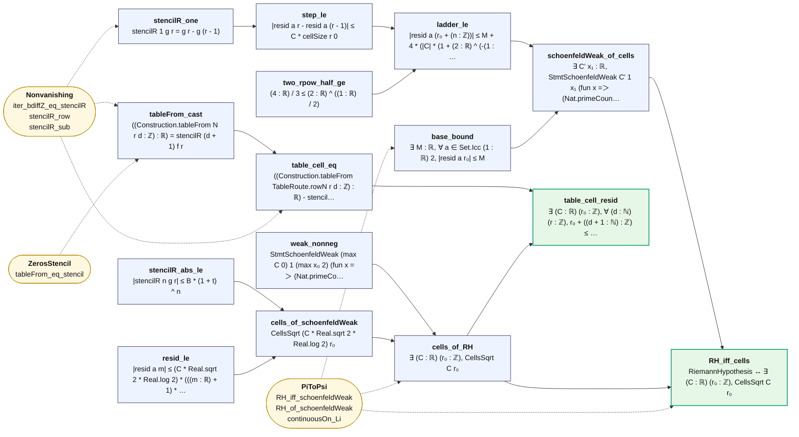

# `lean_stage3/Stage3/CellResidual.lean`

CellResidual — block T5 of `lean_stage3/design/joints.md`, second part. 2026-11-22.

15 theorems, 4 definitions, 500 lines. Arrows are Lean's own record of what each proof uses.

**Imports:** [`PiToPsi`](../lean_stage3/PiToPsi.md), [`TableRoute`](../lean_stage3/TableRoute.md)  
**Imported by:** [`Stage3`](../lean_stage3/Stage3.md)

## The picture



An arrow A → B reads "A is used in the proof of B". Blue: theorem. Green: a theorem nothing else uses (an end). Dashed: connects to nothing. Red: contains `sorry`. Yellow: theorems in another file, counted; a dotted arrow crosses files. Definitions are not drawn; they are listed below the diagram.

## Definitions

<a name="CellResidual-resid"></a>
### `CellResidual.resid`

def · line 53

The residual of the count on the rung `a·2^m`.

- **Is:** `` resid (a : ℝ) (m : ℤ) : ℝ := (Nat.primeCounting ⌊a * (2 : ℝ) ^ (m : ℝ)⌋₊ : ℝ) - Stage3.Li (a * (2 : ℝ) ^ (m : ℝ)) ``
- **Built from:** [`Stage3.Li`](../lean_stage3/PsiToPi.md#Stage3-Li)
- **Used by 8:** [`CellResidual.base_bound`](#CellResidual-base_bound), [`CellResidual.cellResid`](#CellResidual-cellResid), [`CellResidual.cells_of_schoenfeldWeak`](#CellResidual-cells_of_schoenfeldWeak), [`CellResidual.ladder_le`](#CellResidual-ladder_le), [`CellResidual.resid_le`](#CellResidual-resid_le), [`CellResidual.schoenfeldWeak_of_cells`](#CellResidual-schoenfeldWeak_of_cells), [`CellResidual.step_le`](#CellResidual-step_le), [`CellResidual.table_cell_eq`](#CellResidual-table_cell_eq)

<a name="CellResidual-cellResid"></a>
### `CellResidual.cellResid`

def · line 57

The residual of the cell `(r, d)` on the ladder started at `a`.

- **Is:** `` cellResid (a : ℝ) (r : ℤ) (d : ℕ) : ℝ := stencilR (d + 1) (resid a) r ``
- **Built from:** [`Nonvanishing.stencilR`](../lean/Nonvanishing.md#Nonvanishing-stencilR), [`CellResidual.resid`](#CellResidual-resid)
- **Used by 5:** [`CellResidual.CellsSqrt`](#CellResidual-CellsSqrt), [`CellResidual.cells_of_schoenfeldWeak`](#CellResidual-cells_of_schoenfeldWeak), [`CellResidual.step_le`](#CellResidual-step_le), [`CellResidual.table_cell_eq`](#CellResidual-table_cell_eq), [`CellResidual.table_cell_resid`](#CellResidual-table_cell_resid)

<a name="CellResidual-cellSize"></a>
### `CellResidual.cellSize`

def · line 60

Square-root size at the cell `(r, d)`.

- **Is:** `` cellSize (r : ℤ) (d : ℕ) : ℝ := (1 + (2 : ℝ) ^ (-(1 : ℝ) / 2)) ^ (d + 1) * ((r : ℝ) + 1) * (2 : ℝ) ^ ((r : ℝ) / 2) ``
- **Used by 5:** [`CellResidual.CellsSqrt`](#CellResidual-CellsSqrt), [`CellResidual.cells_of_schoenfeldWeak`](#CellResidual-cells_of_schoenfeldWeak), [`CellResidual.ladder_le`](#CellResidual-ladder_le), [`CellResidual.step_le`](#CellResidual-step_le), [`CellResidual.table_cell_resid`](#CellResidual-table_cell_resid)

<a name="CellResidual-CellsSqrt"></a>
### `CellResidual.CellsSqrt`

def · line 64

Every cell of every dyadic ladder has its residual at square-root size.

- **Is:** `` CellsSqrt (C : ℝ) (r₀ : ℤ) : Prop := ∀ a ∈ Set.Icc (1 : ℝ) 2, ∀ (d : ℕ) (r : ℤ), r₀ + ((d + 1 : ℕ) : ℤ) ≤ r → |cellResid a r d| ≤ C * cellSize r d ``
- **Built from:** [`CellResidual.cellResid`](#CellResidual-cellResid), [`CellResidual.cellSize`](#CellResidual-cellSize)
- **Used by 7:** [`CellResidual.RH_iff_cells`](#CellResidual-RH_iff_cells), [`CellResidual.cells_of_RH`](#CellResidual-cells_of_RH), [`CellResidual.cells_of_schoenfeldWeak`](#CellResidual-cells_of_schoenfeldWeak), [`CellResidual.ladder_le`](#CellResidual-ladder_le), [`CellResidual.schoenfeldWeak_of_cells`](#CellResidual-schoenfeldWeak_of_cells), [`CellResidual.step_le`](#CellResidual-step_le), [`CellResidual.table_cell_resid`](#CellResidual-table_cell_resid)

## Theorems

<a name="CellResidual-stencilR_abs_le"></a>
### `CellResidual.stencilR_abs_le`

line 69

**Why.** A cell is no larger than its window allows. If the values the stencil reads shrink by a factor `t` per step down the window, the cell is at most the top bound times `(1 + t)^n`.

**Proves**

```lean
|stencilR n g r| ≤ B * (1 + t) ^ n
```

**Needs** (its hypotheses)

  - `` h : ∀ k ∈ range (n + 1), |g (r - k)| ≤ B * t ^ k ``

**Stated with:** [`Nonvanishing.stencilR`](../lean/Nonvanishing.md#Nonvanishing-stencilR)

**Fed by:** no theorem of this repo; it stands on Mathlib and the definitions below.

**Feeds** (1 that use it)

  - [`CellResidual.cells_of_schoenfeldWeak`](#CellResidual-cells_of_schoenfeldWeak) — `` CellsSqrt (C * Real.sqrt 2 * Real.log 2) r₀ ``

<a name="CellResidual-stencilR_one"></a>
### `CellResidual.stencilR_one`

line 90

**Why.** The stencil of order one is one backward difference.

**Proves**

```lean
stencilR 1 g r = g r - g (r - 1)
```

**Needs** (its hypotheses)

  - `` g : ℤ → ℝ ``
  - `` r : ℤ ``

**Stated with:** [`Nonvanishing.stencilR`](../lean/Nonvanishing.md#Nonvanishing-stencilR)

**Fed by** (1 theorem its proof uses)

  - [`Nonvanishing.iter_bdiffZ_eq_stencilR`](../lean/Nonvanishing.md#Nonvanishing-iter_bdiffZ_eq_stencilR) (Nonvanishing) — `` (bdiffZ^[n]) g r = stencilR n g r ``

**Definitions its proof touches:** [`Nonvanishing.bdiffZ`](../lean/Nonvanishing.md#Nonvanishing-bdiffZ)

**Feeds** (1 that use it)

  - [`CellResidual.step_le`](#CellResidual-step_le) — `` |resid a r - resid a (r - 1)| ≤ C * cellSize r 0 ``

<a name="CellResidual-weak_nonneg"></a>
### `CellResidual.weak_nonneg`

line 95

**Why.** The square-root bound on the count may be taken with a constant that is not negative and a starting point of at least two.

**Proves**

```lean
StmtSchoenfeldWeak (max C 0) 1 (max x₀ 2) (fun x => (Nat.primeCounting ⌊x⌋₊ : ℝ)) Stage3.Li
```

**Needs** (its hypotheses)

  - `` h : StmtSchoenfeldWeak C 1 x₀ (fun x => (Nat.primeCounting ⌊x⌋₊ : ℝ)) Stage3.Li ``

**Stated with:** [`Stage3.Li`](../lean_stage3/PsiToPi.md#Stage3-Li), [`Stage3.StmtSchoenfeldWeak`](../lean_stage3/Statement.md#Stage3-StmtSchoenfeldWeak)

**Fed by:** no theorem of this repo; it stands on Mathlib and the definitions below.

**Feeds** (1 that use it)

  - [`CellResidual.cells_of_RH`](#CellResidual-cells_of_RH) — `` ∃ (C : ℝ) (r₀ : ℤ), CellsSqrt C r₀ ``

<a name="CellResidual-resid_le"></a>
### `CellResidual.resid_le`

line 108

**Why.** One rung. Under the square-root bound on the count, the residual on the rung `a·2^m` is at most a constant times `(m + 1)·2^(m/2)`.

**Proves**

```lean
|resid a m| ≤ (C * Real.sqrt 2 * Real.log 2) * (((m : ℝ) + 1) * (2 : ℝ) ^ ((m : ℝ) / 2))
```

**Needs** (its hypotheses)

  - `` hC : 0 ≤ C ``
  - `` ha : a ∈ Set.Icc (1 : ℝ) 2 ``
  - `` hm : 1 ≤ m ``
  - `` hx₀ : x₀ ≤ (2 : ℝ) ^ (m : ℝ) ``
  - `` h : StmtSchoenfeldWeak C 1 x₀ (fun x => (Nat.primeCounting ⌊x⌋₊ : ℝ)) Stage3.Li ``

**Stated with:** [`CellResidual.resid`](#CellResidual-resid), [`Stage3.Li`](../lean_stage3/PsiToPi.md#Stage3-Li), [`Stage3.StmtSchoenfeldWeak`](../lean_stage3/Statement.md#Stage3-StmtSchoenfeldWeak)

**Fed by:** no theorem of this repo; it stands on Mathlib and the definitions below.

**Feeds** (1 that use it)

  - [`CellResidual.cells_of_schoenfeldWeak`](#CellResidual-cells_of_schoenfeldWeak) — `` CellsSqrt (C * Real.sqrt 2 * Real.log 2) r₀ ``

<a name="CellResidual-cells_of_schoenfeldWeak"></a>
### `CellResidual.cells_of_schoenfeldWeak`

line 144

**Why.** Forward. The `π`-side bound gives every cell of every ladder.

**Proves**

```lean
CellsSqrt (C * Real.sqrt 2 * Real.log 2) r₀
```

**Needs** (its hypotheses)

  - `` hC : 0 ≤ C ``
  - `` hr₀ : 1 ≤ r₀ ``
  - `` hx₀ : x₀ ≤ (2 : ℝ) ^ (r₀ : ℝ) ``
  - `` h : StmtSchoenfeldWeak C 1 x₀ (fun x => (Nat.primeCounting ⌊x⌋₊ : ℝ)) Stage3.Li ``

**Stated with:** [`CellResidual.CellsSqrt`](#CellResidual-CellsSqrt), [`Stage3.Li`](../lean_stage3/PsiToPi.md#Stage3-Li), [`Stage3.StmtSchoenfeldWeak`](../lean_stage3/Statement.md#Stage3-StmtSchoenfeldWeak)

**Fed by** (2 theorems its proof uses)

  - [`CellResidual.resid_le`](#CellResidual-resid_le) — `` |resid a m| ≤ (C * Real.sqrt 2 * Real.log 2) * (((m : ℝ) + 1) * (2 : ℝ) ^ ((m : ℝ) / 2)) ``
  - [`CellResidual.stencilR_abs_le`](#CellResidual-stencilR_abs_le) — `` |stencilR n g r| ≤ B * (1 + t) ^ n ``

**Definitions its proof touches:** [`Nonvanishing.stencilR`](../lean/Nonvanishing.md#Nonvanishing-stencilR), [`CellResidual.cellResid`](#CellResidual-cellResid), [`CellResidual.cellSize`](#CellResidual-cellSize), [`CellResidual.resid`](#CellResidual-resid)

**Feeds** (1 that use it)

  - [`CellResidual.cells_of_RH`](#CellResidual-cells_of_RH) — `` ∃ (C : ℝ) (r₀ : ℤ), CellsSqrt C r₀ ``

<a name="CellResidual-cells_of_RH"></a>
### `CellResidual.cells_of_RH`

line 186

**Why.** Forward, from the Riemann hypothesis. Under it every cell of every dyadic ladder has its residual at square-root size.

**Proves**

```lean
∃ (C : ℝ) (r₀ : ℤ), CellsSqrt C r₀
```

**Needs** (its hypotheses)

  - `` hRH : RiemannHypothesis ``

**Stated with:** [`CellResidual.CellsSqrt`](#CellResidual-CellsSqrt)

**Fed by** (3 theorems its proof uses)

  - [`CellResidual.cells_of_schoenfeldWeak`](#CellResidual-cells_of_schoenfeldWeak) — `` CellsSqrt (C * Real.sqrt 2 * Real.log 2) r₀ ``
  - [`CellResidual.weak_nonneg`](#CellResidual-weak_nonneg) — `` StmtSchoenfeldWeak (max C 0) 1 (max x₀ 2) (fun x => (Nat.primeCounting ⌊x⌋₊ : ℝ)) Stage3.Li ``
  - [`PiToPsi.RH_iff_schoenfeldWeak`](../lean_stage3/PiToPsi.md#PiToPsi-RH_iff_schoenfeldWeak) (PiToPsi) — `` RiemannHypothesis ↔ ∃ C x₀ : ℝ, StmtSchoenfeldWeak C 1 x₀ (fun x => (Nat.primeCounting ⌊x⌋₊ : ℝ)) Stage3.Li ``

**Definitions its proof touches:** [`Stage3.Li`](../lean_stage3/PsiToPi.md#Stage3-Li), [`Stage3.StmtSchoenfeldWeak`](../lean_stage3/Statement.md#Stage3-StmtSchoenfeldWeak)

**Feeds** (2 that use it)

  - [`CellResidual.RH_iff_cells`](#CellResidual-RH_iff_cells) — `` RiemannHypothesis ↔ ∃ (C : ℝ) (r₀ : ℤ), CellsSqrt C r₀ ``
  - [`CellResidual.table_cell_resid`](#CellResidual-table_cell_resid) — `` ∃ (C : ℝ) (r₀ : ℤ), ∀ (d : ℕ) (r : ℤ), r₀ + ((d + 1 : ℕ) : ℤ) ≤ r → |((Construction.tableFrom TableRoute.rowN r d : ℤ) : ℝ) - stencilR (d + 1) (fun m … ``

<a name="CellResidual-step_le"></a>
### `CellResidual.step_le`

line 197

**Why.** A depth-0 cell is the difference of two neighbouring rungs, so `CellsSqrt` bounds that difference.

**Proves**

```lean
|resid a r - resid a (r - 1)| ≤ C * cellSize r 0
```

**Needs** (its hypotheses)

  - `` h : CellsSqrt C r₀ ``
  - `` ha : a ∈ Set.Icc (1 : ℝ) 2 ``
  - `` hr : r₀ + 1 ≤ r ``

**Stated with:** [`CellResidual.CellsSqrt`](#CellResidual-CellsSqrt), [`CellResidual.cellSize`](#CellResidual-cellSize), [`CellResidual.resid`](#CellResidual-resid)

**Fed by** (1 theorem its proof uses)

  - [`CellResidual.stencilR_one`](#CellResidual-stencilR_one) — `` stencilR 1 g r = g r - g (r - 1) ``

**Definitions its proof touches:** [`Nonvanishing.stencilR`](../lean/Nonvanishing.md#Nonvanishing-stencilR), [`CellResidual.cellResid`](#CellResidual-cellResid)

**Feeds** (1 that use it)

  - [`CellResidual.ladder_le`](#CellResidual-ladder_le) — `` |resid a (r₀ + (n : ℤ))| ≤ M + 4 * (|C| * (1 + (2 : ℝ) ^ (-(1 : ℝ) / 2))) * ((r₀ : ℝ) + n + 1) * (2 : ℝ) ^ (((r₀ : ℝ) + n) / 2) ``

<a name="CellResidual-two_rpow_half_ge"></a>
### `CellResidual.two_rpow_half_ge`

line 205

**Why.** The square root of two is at least four thirds; the telescoping sum closes on this.

**Proves**

```lean
(4 : ℝ) / 3 ≤ (2 : ℝ) ^ ((1 : ℝ) / 2)
```

**Fed by:** no theorem of this repo; it stands on Mathlib.

**Feeds** (1 that use it)

  - [`CellResidual.ladder_le`](#CellResidual-ladder_le) — `` |resid a (r₀ + (n : ℤ))| ≤ M + 4 * (|C| * (1 + (2 : ℝ) ^ (-(1 : ℝ) / 2))) * ((r₀ : ℝ) + n + 1) * (2 : ℝ) ^ (((r₀ : ℝ) + n) / 2) ``

<a name="CellResidual-ladder_le"></a>
### `CellResidual.ladder_le`

line 215

**Why.** The depth-0 cells, summed up one ladder.

**Proves**

```lean
|resid a (r₀ + (n : ℤ))| ≤ M + 4 * (|C| * (1 + (2 : ℝ) ^ (-(1 : ℝ) / 2))) * ((r₀ : ℝ) + n + 1) * (2 : ℝ) ^ (((r₀ : ℝ) + n) / 2)
```

**Needs** (its hypotheses)

  - `` hr₀ : 0 ≤ r₀ ``
  - `` h : CellsSqrt C r₀ ``
  - `` ha : a ∈ Set.Icc (1 : ℝ) 2 ``
  - `` hM : |resid a r₀| ≤ M ``
  - `` n : ℕ ``

**Stated with:** [`CellResidual.CellsSqrt`](#CellResidual-CellsSqrt), [`CellResidual.resid`](#CellResidual-resid)

**Fed by** (2 theorems its proof uses)

  - [`CellResidual.step_le`](#CellResidual-step_le) — `` |resid a r - resid a (r - 1)| ≤ C * cellSize r 0 ``
  - [`CellResidual.two_rpow_half_ge`](#CellResidual-two_rpow_half_ge) — `` (4 : ℝ) / 3 ≤ (2 : ℝ) ^ ((1 : ℝ) / 2) ``

**Definitions its proof touches:** [`CellResidual.cellSize`](#CellResidual-cellSize)

**Feeds** (1 that use it)

  - [`CellResidual.schoenfeldWeak_of_cells`](#CellResidual-schoenfeldWeak_of_cells) — `` ∃ C' x₁ : ℝ, StmtSchoenfeldWeak C' 1 x₁ (fun x => (Nat.primeCounting ⌊x⌋₊ : ℝ)) Stage3.Li ``

<a name="CellResidual-base_bound"></a>
### `CellResidual.base_bound`

line 287

**Why.** The first rung, bounded over the whole range of starting points.

**Proves**

```lean
∃ M : ℝ, ∀ a ∈ Set.Icc (1 : ℝ) 2, |resid a r₀| ≤ M
```

**Needs** (its hypotheses)

  - `` r₀ : ℤ ``
  - `` hr₀ : 1 ≤ r₀ ``

**Stated with:** [`CellResidual.resid`](#CellResidual-resid)

**Fed by** (1 theorem its proof uses)

  - [`PiToPsi.continuousOn_Li`](../lean_stage3/PiToPsi.md#PiToPsi-continuousOn_Li) (PiToPsi) — `` ContinuousOn Stage3.Li (Ioi 1) ``

**Definitions its proof touches:** [`Stage3.Li`](../lean_stage3/PsiToPi.md#Stage3-Li)

**Feeds** (1 that use it)

  - [`CellResidual.schoenfeldWeak_of_cells`](#CellResidual-schoenfeldWeak_of_cells) — `` ∃ C' x₁ : ℝ, StmtSchoenfeldWeak C' 1 x₁ (fun x => (Nat.primeCounting ⌊x⌋₊ : ℝ)) Stage3.Li ``

<a name="CellResidual-schoenfeldWeak_of_cells"></a>
### `CellResidual.schoenfeldWeak_of_cells`

line 319

**Why.** Converse. The cells at square-root size give the `π`-side bound.

**Proves**

```lean
∃ C' x₁ : ℝ, StmtSchoenfeldWeak C' 1 x₁ (fun x => (Nat.primeCounting ⌊x⌋₊ : ℝ)) Stage3.Li
```

**Needs** (its hypotheses)

  - `` h : CellsSqrt C r₀ ``

**Stated with:** [`CellResidual.CellsSqrt`](#CellResidual-CellsSqrt), [`Stage3.Li`](../lean_stage3/PsiToPi.md#Stage3-Li), [`Stage3.StmtSchoenfeldWeak`](../lean_stage3/Statement.md#Stage3-StmtSchoenfeldWeak)

**Fed by** (2 theorems its proof uses)

  - [`CellResidual.base_bound`](#CellResidual-base_bound) — `` ∃ M : ℝ, ∀ a ∈ Set.Icc (1 : ℝ) 2, |resid a r₀| ≤ M ``
  - [`CellResidual.ladder_le`](#CellResidual-ladder_le) — `` |resid a (r₀ + (n : ℤ))| ≤ M + 4 * (|C| * (1 + (2 : ℝ) ^ (-(1 : ℝ) / 2))) * ((r₀ : ℝ) + n + 1) * (2 : ℝ) ^ (((r₀ : ℝ) + n) / 2) ``

**Definitions its proof touches:** [`CellResidual.resid`](#CellResidual-resid)

**Feeds** (1 that use it)

  - [`CellResidual.RH_iff_cells`](#CellResidual-RH_iff_cells) — `` RiemannHypothesis ↔ ∃ (C : ℝ) (r₀ : ℤ), CellsSqrt C r₀ ``

<a name="CellResidual-RH_iff_cells"></a>
### `CellResidual.RH_iff_cells`

line 423

**Why.** The Riemann hypothesis is the cells at square-root size, over every dyadic ladder.

**Proves**

```lean
RiemannHypothesis ↔ ∃ (C : ℝ) (r₀ : ℤ), CellsSqrt C r₀
```

**Stated with:** [`CellResidual.CellsSqrt`](#CellResidual-CellsSqrt)

**Fed by** (3 theorems its proof uses)

  - [`CellResidual.cells_of_RH`](#CellResidual-cells_of_RH) — `` ∃ (C : ℝ) (r₀ : ℤ), CellsSqrt C r₀ ``
  - [`CellResidual.schoenfeldWeak_of_cells`](#CellResidual-schoenfeldWeak_of_cells) — `` ∃ C' x₁ : ℝ, StmtSchoenfeldWeak C' 1 x₁ (fun x => (Nat.primeCounting ⌊x⌋₊ : ℝ)) Stage3.Li ``
  - [`PiToPsi.RH_of_schoenfeldWeak`](../lean_stage3/PiToPsi.md#PiToPsi-RH_of_schoenfeldWeak) (PiToPsi) — `` RiemannHypothesis ``

**Definitions its proof touches:** [`Stage3.Li`](../lean_stage3/PsiToPi.md#Stage3-Li), [`Stage3.StmtSchoenfeldWeak`](../lean_stage3/Statement.md#Stage3-StmtSchoenfeldWeak)

**Feeds:** nothing. It is an end.

<a name="CellResidual-tableFrom_cast"></a>
### `CellResidual.tableFrom_cast`

line 431

**Why.** The integer cell, cast, is the stencil of the count one order up.

**Proves**

```lean
((Construction.tableFrom N r d : ℤ) : ℝ) = stencilR (d + 1) f r
```

**Needs** (its hypotheses)

  - `` hrow : ∀ k ∈ range (d + 1), ((N (r - k) : ℤ) : ℝ) = bdiffZ f (r - k) ``

**Stated with:** [`Construction.tableFrom`](../lean/Construction.md#Construction-tableFrom), [`Nonvanishing.bdiffZ`](../lean/Nonvanishing.md#Nonvanishing-bdiffZ), [`Nonvanishing.stencilR`](../lean/Nonvanishing.md#Nonvanishing-stencilR)

**Fed by** (2 theorems its proof uses)

  - [`Nonvanishing.stencilR_row`](../lean/Nonvanishing.md#Nonvanishing-stencilR_row) (Nonvanishing) — `` stencilR d (bdiffZ g) r = stencilR (d + 1) g r ``
  - [`Zeros.tableFrom_eq_stencil`](../lean/ZerosStencil.md#Zeros-tableFrom_eq_stencil) (ZerosStencil) — `` Construction.tableFrom N r d = stencil d (fun k => N (r - k)) ``

**Definitions its proof touches:** [`Zeros.stencil`](../lean/ZerosStencil.md#Zeros-stencil)

**Feeds** (1 that use it)

  - [`CellResidual.table_cell_eq`](#CellResidual-table_cell_eq) — `` ((Construction.tableFrom TableRoute.rowN r d : ℤ) : ℝ) - stencilR (d + 1) (fun m : ℤ => Stage3.Li ((2 : ℝ) ^ (m : ℝ))) r = cellResid 1 r d ``

<a name="CellResidual-table_cell_eq"></a>
### `CellResidual.table_cell_eq`

line 447

**Why.** The table's cell minus the smooth cell is the residual on the ladder `a = 1`.

**Proves**

```lean
((Construction.tableFrom TableRoute.rowN r d : ℤ) : ℝ) - stencilR (d + 1) (fun m : ℤ => Stage3.Li ((2 : ℝ) ^ (m : ℝ))) r = cellResid 1 r d
```

**Needs** (its hypotheses)

  - `` r : ℤ ``
  - `` d : ℕ ``

**Stated with:** [`Construction.tableFrom`](../lean/Construction.md#Construction-tableFrom), [`Nonvanishing.stencilR`](../lean/Nonvanishing.md#Nonvanishing-stencilR), [`CellResidual.cellResid`](#CellResidual-cellResid), [`Stage3.Li`](../lean_stage3/PsiToPi.md#Stage3-Li), [`TableRoute.rowN`](../lean_stage3/TableRoute.md#TableRoute-rowN)

**Fed by** (2 theorems its proof uses)

  - [`Nonvanishing.stencilR_sub`](../lean/Nonvanishing.md#Nonvanishing-stencilR_sub) (Nonvanishing) — `` stencilR n (fun x => f x - L x) r = stencilR n f r - stencilR n L r ``
  - [`CellResidual.tableFrom_cast`](#CellResidual-tableFrom_cast) — `` ((Construction.tableFrom N r d : ℤ) : ℝ) = stencilR (d + 1) f r ``

**Definitions its proof touches:** [`Nonvanishing.bdiffZ`](../lean/Nonvanishing.md#Nonvanishing-bdiffZ), [`CellResidual.resid`](#CellResidual-resid)

**Feeds** (1 that use it)

  - [`CellResidual.table_cell_resid`](#CellResidual-table_cell_resid) — `` ∃ (C : ℝ) (r₀ : ℤ), ∀ (d : ℕ) (r : ℤ), r₀ + ((d + 1 : ℕ) : ℤ) ≤ r → |((Construction.tableFrom TableRoute.rowN r d : ℤ) : ℝ) - stencilR (d + 1) (fun m … ``

<a name="CellResidual-table_cell_resid"></a>
### `CellResidual.table_cell_resid`

line 467

**Why.** On the table itself. Under the Riemann hypothesis every cell of the dyadic table stays within square-root size of the smooth cell.

**Proves**

```lean
∃ (C : ℝ) (r₀ : ℤ), ∀ (d : ℕ) (r : ℤ), r₀ + ((d + 1 : ℕ) : ℤ) ≤ r → |((Construction.tableFrom TableRoute.rowN r d : ℤ) : ℝ) - stencilR (d + 1) (fun m : ℤ => Stage3.Li ((2 : ℝ) ^ (m : ℝ))) r| ≤ C * cellSize r d
```

**Needs** (its hypotheses)

  - `` hRH : RiemannHypothesis ``

**Stated with:** [`Construction.tableFrom`](../lean/Construction.md#Construction-tableFrom), [`Nonvanishing.stencilR`](../lean/Nonvanishing.md#Nonvanishing-stencilR), [`CellResidual.cellSize`](#CellResidual-cellSize), [`Stage3.Li`](../lean_stage3/PsiToPi.md#Stage3-Li), [`TableRoute.rowN`](../lean_stage3/TableRoute.md#TableRoute-rowN)

**Fed by** (2 theorems its proof uses)

  - [`CellResidual.cells_of_RH`](#CellResidual-cells_of_RH) — `` ∃ (C : ℝ) (r₀ : ℤ), CellsSqrt C r₀ ``
  - [`CellResidual.table_cell_eq`](#CellResidual-table_cell_eq) — `` ((Construction.tableFrom TableRoute.rowN r d : ℤ) : ℝ) - stencilR (d + 1) (fun m : ℤ => Stage3.Li ((2 : ℝ) ^ (m : ℝ))) r = cellResid 1 r d ``

**Definitions its proof touches:** [`CellResidual.CellsSqrt`](#CellResidual-CellsSqrt), [`CellResidual.cellResid`](#CellResidual-cellResid)

**Feeds:** nothing. It is an end.

