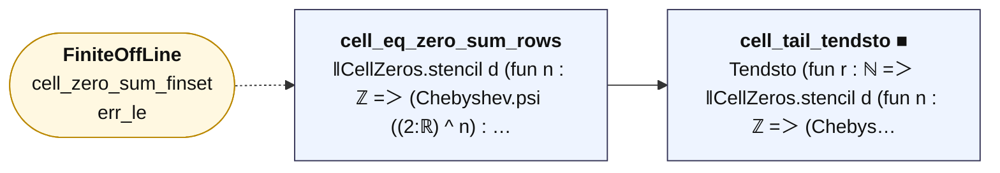

# `lean_stage3/Stage3/CellRows.lean`

CellRows — block T3a of `lean_stage3/design/joints.md`. 2026-11-22. The height of the zero sum taken to infinity along the rows. At row `r` the height is the doubling of the cell's lowest row, `2^(r−d)`. The cell is then its main term minus the sum over the zeros below that height, within a constant times `r²`. Against square-root size that error tends to zero: the tail of the zero sum is inside the error.

2 theorems, 0 definitions, 86 lines. Arrows are Lean's own record of what each proof uses.

**Imports:** [`FiniteOffLine`](../lean_stage3/FiniteOffLine.md)  
**Imported by:** [`Stage3`](../lean_stage3/Stage3.md)

## The picture



An arrow A → B reads "A is used in the proof of B". Green: counting, integers only. Violet: shape, analysis with no ζ. Blue: reads ζ. A name ending in ■ is an end: nothing else uses it. Red: contains `sorry`. Yellow: theorems in another file, counted; a dotted arrow crosses files. Definitions are not drawn; they are listed below the diagram.

## Theorems

<a name="CellRows-cell_eq_zero_sum_rows"></a>
### `CellRows.cell_eq_zero_sum_rows`

line 28

**Reads ζ.** It, or something it rests on, uses the zeta function, its zeros or the Riemann hypothesis.

**Why.** The cell at the row's own height.

**Proves**

```lean
‖CellZeros.stencil d (fun n : ℤ => (Chebyshev.psi ((2:ℝ) ^ n) : ℂ)) (r : ℤ) - (2:ℂ) ^ (r : ℤ) * (1 - (2:ℂ)⁻¹) ^ d + ∑ ρ ∈ ZF ((2:ℝ) ^ (K + 1)), term d (r : ℤ) ρ‖ ≤ 2 ^ d * ((4 * 2 ^ d * Glue.c1n + Glue.c3n + Glue.c4n) * (r : ℝ) ^ 2)
```

**Needs** (its hypotheses)

  - `` d K r : ℕ ``
  - `` hr : r = d + K + 1 ``
  - `` hK : 3 ≤ K ``

**Stated with:** [`CellZeros.stencil`](../lean_stage3/CellZeros.md#CellZeros-stencil), [`FiniteOffLine.ZF`](../lean_stage3/FiniteOffLine.md#FiniteOffLine-ZF), [`FiniteOffLine.term`](../lean_stage3/FiniteOffLine.md#FiniteOffLine-term), [`Glue.c1n`](../lean_stage3/GlueNum.md#Glue-c1n), [`Glue.c3n`](../lean_stage3/GlueNum.md#Glue-c3n), [`Glue.c4n`](../lean_stage3/GlueNum.md#Glue-c4n)

**Fed by** (2 theorems its proof uses)

  - [`FiniteOffLine.cell_zero_sum_finset`](../lean_stage3/FiniteOffLine.md#FiniteOffLine-cell_zero_sum_finset) (FiniteOffLine) — `` ‖CellZeros.stencil d (fun n : ℤ => (Chebyshev.psi ((2:ℝ) ^ n) : ℂ)) r - (2:ℂ) ^ r * (1 - (2:ℂ)⁻¹) ^ d + ∑ ρ ∈ ZF T, term d r ρ‖ ≤ ∑ j ∈ range (d + 1),… ``
  - [`FiniteOffLine.err_le`](../lean_stage3/FiniteOffLine.md#FiniteOffLine-err_le) (FiniteOffLine) — `` ∑ j ∈ range (d + 1), (d.choose j : ℝ) * (Glue.c1n * (2:ℝ) ^ ((r : ℤ) - (j : ℤ)) * Real.log ((2:ℝ) ^ ((r : ℤ) - (j : ℤ)) * (2:ℝ) ^ (K + 1)) ^ 2 / (2:ℝ)… ``

**Feeds** (1 that use it)

  - [`CellRows.cell_tail_tendsto`](#CellRows-cell_tail_tendsto) — `` Tendsto (fun r : ℕ => ‖CellZeros.stencil d (fun n : ℤ => (Chebyshev.psi ((2:ℝ) ^ n) : ℂ)) (r : ℤ) - (2:ℂ) ^ (r : ℤ) * (1 - (2:ℂ)⁻¹) ^ d + ∑ ρ ∈ ZF ((2… ``

<a name="CellRows-cell_tail_tendsto"></a>
### `CellRows.cell_tail_tendsto`

line 44

**Reads ζ.** It, or something it rests on, uses the zeta function, its zeros or the Riemann hypothesis.

**Why.** The tail of the zero sum is inside the error. With the height `2^(r−d)` at row `r`, the distance between the cell and its zero sum, over `√2^r`, tends to zero.

**Proves**

```lean
Tendsto (fun r : ℕ => ‖CellZeros.stencil d (fun n : ℤ => (Chebyshev.psi ((2:ℝ) ^ n) : ℂ)) (r : ℤ) - (2:ℂ) ^ (r : ℤ) * (1 - (2:ℂ)⁻¹) ^ d + ∑ ρ ∈ ZF ((2:ℝ) ^ (r - d)), term d (r : ℤ) ρ‖ / Real.sqrt 2 ^ r) atTop (𝓝 0)
```

**Needs** (its hypotheses)

  - `` d : ℕ ``

**Stated with:** [`CellZeros.stencil`](../lean_stage3/CellZeros.md#CellZeros-stencil), [`FiniteOffLine.ZF`](../lean_stage3/FiniteOffLine.md#FiniteOffLine-ZF), [`FiniteOffLine.term`](../lean_stage3/FiniteOffLine.md#FiniteOffLine-term)

**Fed by** (1 theorem its proof uses)

  - [`CellRows.cell_eq_zero_sum_rows`](#CellRows-cell_eq_zero_sum_rows) — `` ‖CellZeros.stencil d (fun n : ℤ => (Chebyshev.psi ((2:ℝ) ^ n) : ℂ)) (r : ℤ) - (2:ℂ) ^ (r : ℤ) * (1 - (2:ℂ)⁻¹) ^ d + ∑ ρ ∈ ZF ((2:ℝ) ^ (K + 1)), term d… ``

**Definitions its proof touches:** [`Glue.c1n`](../lean_stage3/GlueNum.md#Glue-c1n), [`Glue.c3n`](../lean_stage3/GlueNum.md#Glue-c3n), [`Glue.c4n`](../lean_stage3/GlueNum.md#Glue-c4n)

**Feeds:** nothing. It is an end.

