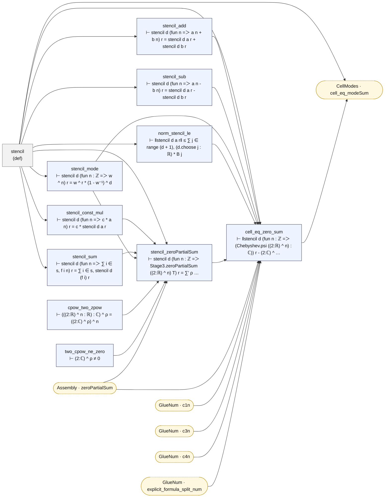

# `lean_stage3/Stage3/CellZeros.lean`

**What it does** (its own header): CellZeros — block T1 of `lean_stage3/design/joints.md`. 2026-11-22. The cell as a sum over the zeros. For the row `ψ(2^n)` of the log-weighted prime count along the doublings, the `d`-fold backward difference at `r` is the main term `2^r·(1 − 1/2)^d` minus a sum over the zeros of ζ below a height, each zero a mode `(2^ρ)^r` multiplied by the symbol `(1 − 2^(−ρ))` once per depth, within a stated error. No RH.

**Imports:** [`GlueNum`](../lean_stage3/GlueNum.md).
**Imported by:** [`Stage3`](../lean_stage3/Stage3.md), [`CellModes`](../lean_stage3/CellModes.md).

Blue: theorem. Green: a theorem nothing else uses (an end). Dashed white: connects to nothing. Grey: definition. Red: contains `sorry`. Yellow: in another file. An arrow A → B reads "A is used by B".

## Every declaration

| declaration | proves (output) | needs (input) | why (its own docstring) | uses | used by |
|---|---|---|---|---|---|
| `CellZeros.stencil` def, line 37 | ℂ | d : ℕ; a : ℤ → ℂ; r : ℤ | The `d`-fold backward difference of a row, read at `r`. | — | `CellModes.cell_eq_modeSum`, `CellZeros.cell_eq_zero_sum`, `CellZeros.norm_stencil_le`, `CellZeros.stencil_add`, `CellZeros.stencil_const_mul`, `CellZeros.stencil_mode`, `CellZeros.stencil_sub`, `CellZeros.stencil_sum`, `CellZeros.stencil_zeroPartialSum` |
| `CellZeros.stencil_add` theorem, line 40 | stencil d (fun n =&gt; a n + b n) r = stencil d a r + stencil d b r | d : ℕ; a b : ℤ → ℂ; r : ℤ | — | `CellZeros.stencil` | `CellZeros.cell_eq_zero_sum` |
| `CellZeros.stencil_sub` theorem, line 46 | stencil d (fun n =&gt; a n - b n) r = stencil d a r - stencil d b r | d : ℕ; a b : ℤ → ℂ; r : ℤ | — | `CellZeros.stencil` | `CellZeros.cell_eq_zero_sum` |
| `CellZeros.stencil_const_mul` theorem, line 52 | stencil d (fun n =&gt; c * a n) r = c * stencil d a r | d : ℕ; c : ℂ; a : ℤ → ℂ; r : ℤ | — | `CellZeros.stencil` | `CellZeros.stencil_zeroPartialSum` |
| `CellZeros.stencil_sum` theorem, line 58 | stencil d (fun n =&gt; ∑ i ∈ s, f i n) r = ∑ i ∈ s, stencil d (f i) r | d : ℕ; s : Finset ι; f : ι → ℤ → ℂ; r : ℤ | — | `CellZeros.stencil` | `CellZeros.stencil_zeroPartialSum` |
| `CellZeros.stencil_mode` theorem, line 65 | stencil d (fun n : ℤ =&gt; w ^ n) r = w ^ r * (1 - w⁻¹) ^ d | hw : w ≠ 0; d : ℕ; r : ℤ | On a mode the stencil is the symbol to the `d`. | `CellZeros.stencil` | `CellZeros.cell_eq_zero_sum`, `CellZeros.stencil_zeroPartialSum` |
| `CellZeros.norm_stencil_le` theorem, line 78 | ‖stencil d a r‖ ≤ ∑ j ∈ range (d + 1), (d.choose j : ℝ) * B j | d : ℕ; a : ℤ → ℂ; r : ℤ; B : ℕ → ℝ; h : ∀ j ∈ range (d + 1), ‖a (r - j)‖ ≤ B j | — | `CellZeros.stencil` | `CellZeros.cell_eq_zero_sum` |
| `CellZeros.cpow_two_zpow` theorem, line 87 | (((2:ℝ) ^ n : ℝ) : ℂ) ^ ρ = ((2:ℂ) ^ ρ) ^ n | n : ℤ; ρ : ℂ | — | — | `CellZeros.stencil_zeroPartialSum` |
| `CellZeros.two_cpow_ne_zero` theorem, line 100 | (2:ℂ) ^ ρ ≠ 0 | ρ : ℂ | — | — | `CellZeros.stencil_zeroPartialSum` |
| `CellZeros.stencil_zeroPartialSum` theorem, line 105 | stencil d (fun n : ℤ =&gt; Stage3.zeroPartialSum ((2:ℝ) ^ n) T) r = ∑' ρ : {ρ : Kadiri.NontrivialZeros // \|(ρ : ℂ).im\| &lt; T}, ((riemannZeta.order ((ρ : Kadiri.NontrivialZeros) : ℂ) : ℤ) : ℂ) * (((2:ℂ) ^ ((ρ : Kadiri.NontrivialZeros) : ℂ)) ^ r * (1 - ((2:ℂ) ^ ((ρ : Kadiri.NontrivialZeros) : ℂ))⁻¹) ^ d / ((ρ : Kadiri.NontrivialZeros) : ℂ)) | d : ℕ; r : ℤ; T : ℝ | The stencil passes through the sum over the zeros. | `Stage3.zeroPartialSum`, `CellZeros.cpow_two_zpow`, `CellZeros.stencil`, `CellZeros.stencil_const_mul`, `CellZeros.stencil_mode`, `CellZeros.stencil_sum`, `CellZeros.two_cpow_ne_zero` | `CellZeros.cell_eq_zero_sum` |
| `CellZeros.cell_eq_zero_sum` theorem, line 129 | ‖stencil d (fun n : ℤ =&gt; (Chebyshev.psi ((2:ℝ) ^ n) : ℂ)) r - (2:ℂ) ^ r * (1 - (2:ℂ)⁻¹) ^ d + ∑' ρ : {ρ : Kadiri.NontrivialZeros // \|(ρ : ℂ).im\| &lt; T}, ((riemannZeta.order ((ρ : Kadiri.NontrivialZeros) : ℂ) : ℤ) : ℂ) * (((2:ℂ) ^ ((ρ : Kadiri.NontrivialZeros) : ℂ)) ^ r * (1 - ((2:ℂ) ^ ((ρ : Kadiri.NontrivialZeros) : ℂ))⁻¹) ^ d / ((ρ : Kadiri.NontrivialZeros) : ℂ))‖ ≤ ∑ j ∈ range (d + 1), (d.choose j : ℝ) * (Glue.c1n * (2:ℝ) ^ (r - (j : ℤ)) * Real.log ((2:ℝ) ^ (r - (j : ℤ)) * T) ^ 2 / T + Glue.c3n * Real.log ((2:ℝ) ^ (r - (j : ℤ))) + Glue.c4n * ((Real.log ((2:ℝ) ^ (r - (j : ℤ)))) ^ 2 * ((2:ℝ) ^ (r - (j : ℤ))) ^ (-(1:ℝ) / 4))) | d : ℕ; r : ℤ; h16 : 16 ≤ (2:ℝ) ^ (r - (d : ℤ)); hT : 2 ≤ T; hTx : T ≤ ((2:ℝ) ^ (r - (d : ℤ))) ^ 2 | The cell as a sum over the zeros. | `Stage3.zeroPartialSum`, `CellZeros.norm_stencil_le`, `CellZeros.stencil`, `CellZeros.stencil_add`, `CellZeros.stencil_mode`, `CellZeros.stencil_sub`, `CellZeros.stencil_zeroPartialSum`, `Glue.c1n`, `Glue.c3n`, `Glue.c4n`, `Glue.explicit_formula_split_num` | `CellModes.cell_eq_modeSum` |
