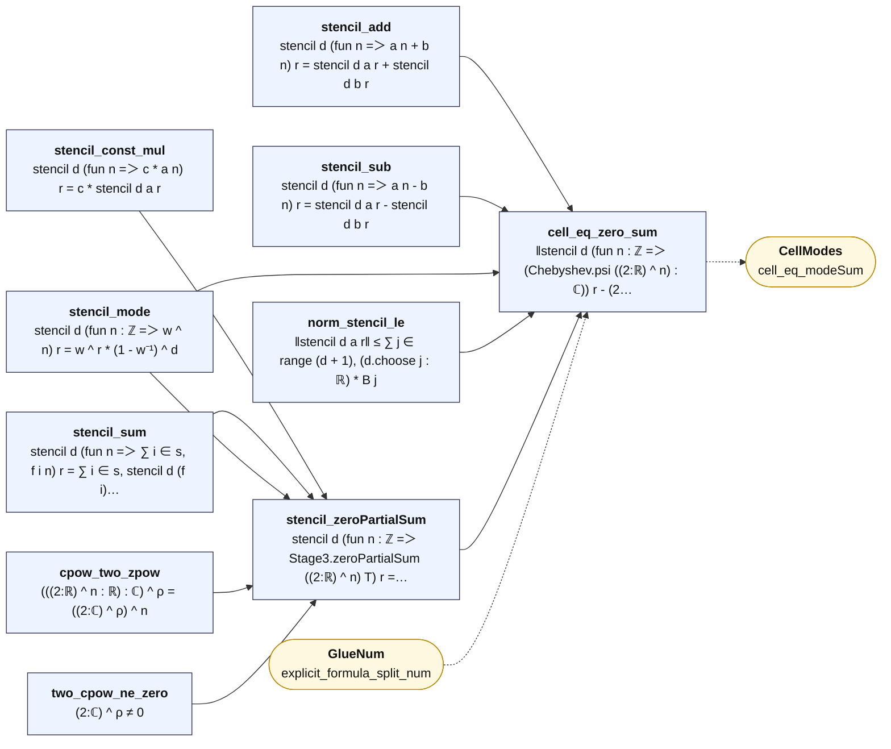

# `lean_stage3/Stage3/CellZeros.lean`

CellZeros — block T1 of `lean_stage3/design/joints.md`. 2026-11-22. The cell as a sum over the zeros. For the row `ψ(2^n)` of the log-weighted prime count along the doublings, the `d`-fold backward difference at `r` is the main term `2^r·(1 − 1/2)^d` minus a sum over the zeros of ζ below a height, each zero a mode `(2^ρ)^r` multiplied by the symbol `(1 − 2^(−ρ))` once per depth, within a stated error. No RH.

10 theorems, 1 definition, 187 lines. Arrows are Lean's own record of what each proof uses.

**Imports:** [`GlueNum`](../lean_stage3/GlueNum.md)  
**Imported by:** [`Stage3`](../lean_stage3/Stage3.md), [`CellModes`](../lean_stage3/CellModes.md)

## The picture



An arrow A → B reads "A is used in the proof of B". Blue: theorem. Green: a theorem nothing else uses (an end). Dashed: connects to nothing. Red: contains `sorry`. Yellow: theorems in another file, counted; a dotted arrow crosses files. Definitions are not drawn; they are listed below the diagram.

## Definitions

<a name="CellZeros-stencil"></a>
### `CellZeros.stencil`

def · line 37

The `d`-fold backward difference of a row, read at `r`.

- **Is:** `` stencil (d : ℕ) (a : ℤ → ℂ) (r : ℤ) : ℂ := ∑ j ∈ range (d + 1), (-1 : ℂ) ^ j * (d.choose j : ℂ) * a (r - j) ``
- **Used by 9:** [`CellModes.cell_eq_modeSum`](../lean_stage3/CellModes.md#CellModes-cell_eq_modeSum), [`CellZeros.cell_eq_zero_sum`](#CellZeros-cell_eq_zero_sum), [`CellZeros.norm_stencil_le`](#CellZeros-norm_stencil_le), [`CellZeros.stencil_add`](#CellZeros-stencil_add), [`CellZeros.stencil_const_mul`](#CellZeros-stencil_const_mul), [`CellZeros.stencil_mode`](#CellZeros-stencil_mode), [`CellZeros.stencil_sub`](#CellZeros-stencil_sub), [`CellZeros.stencil_sum`](#CellZeros-stencil_sum), [`CellZeros.stencil_zeroPartialSum`](#CellZeros-stencil_zeroPartialSum)

## Theorems

<a name="CellZeros-stencil_add"></a>
### `CellZeros.stencil_add`

line 40

**Proves**

```lean
stencil d (fun n => a n + b n) r = stencil d a r + stencil d b r
```

**Needs** (its hypotheses)

  - `` d : ℕ ``
  - `` a b : ℤ → ℂ ``
  - `` r : ℤ ``

**Stated with:** [`CellZeros.stencil`](#CellZeros-stencil)

**Fed by:** no theorem of this repo; it stands on Mathlib and the definitions below.

**Feeds** (1 that use it)

  - [`CellZeros.cell_eq_zero_sum`](#CellZeros-cell_eq_zero_sum) — `` ‖stencil d (fun n : ℤ => (Chebyshev.psi ((2:ℝ) ^ n) : ℂ)) r - (2:ℂ) ^ r * (1 - (2:ℂ)⁻¹) ^ d + ∑' ρ : {ρ : Kadiri.NontrivialZeros // |(ρ : ℂ).im| < T},… ``

<a name="CellZeros-stencil_sub"></a>
### `CellZeros.stencil_sub`

line 46

**Proves**

```lean
stencil d (fun n => a n - b n) r = stencil d a r - stencil d b r
```

**Needs** (its hypotheses)

  - `` d : ℕ ``
  - `` a b : ℤ → ℂ ``
  - `` r : ℤ ``

**Stated with:** [`CellZeros.stencil`](#CellZeros-stencil)

**Fed by:** no theorem of this repo; it stands on Mathlib and the definitions below.

**Feeds** (1 that use it)

  - [`CellZeros.cell_eq_zero_sum`](#CellZeros-cell_eq_zero_sum) — `` ‖stencil d (fun n : ℤ => (Chebyshev.psi ((2:ℝ) ^ n) : ℂ)) r - (2:ℂ) ^ r * (1 - (2:ℂ)⁻¹) ^ d + ∑' ρ : {ρ : Kadiri.NontrivialZeros // |(ρ : ℂ).im| < T},… ``

<a name="CellZeros-stencil_const_mul"></a>
### `CellZeros.stencil_const_mul`

line 52

**Proves**

```lean
stencil d (fun n => c * a n) r = c * stencil d a r
```

**Needs** (its hypotheses)

  - `` d : ℕ ``
  - `` c : ℂ ``
  - `` a : ℤ → ℂ ``
  - `` r : ℤ ``

**Stated with:** [`CellZeros.stencil`](#CellZeros-stencil)

**Fed by:** no theorem of this repo; it stands on Mathlib and the definitions below.

**Feeds** (1 that use it)

  - [`CellZeros.stencil_zeroPartialSum`](#CellZeros-stencil_zeroPartialSum) — `` stencil d (fun n : ℤ => Stage3.zeroPartialSum ((2:ℝ) ^ n) T) r = ∑' ρ : {ρ : Kadiri.NontrivialZeros // |(ρ : ℂ).im| < T}, ((riemannZeta.order ((ρ : Ka… ``

<a name="CellZeros-stencil_sum"></a>
### `CellZeros.stencil_sum`

line 58

**Proves**

```lean
stencil d (fun n => ∑ i ∈ s, f i n) r = ∑ i ∈ s, stencil d (f i) r
```

**Needs** (its hypotheses)

  - `` d : ℕ ``
  - `` s : Finset ι ``
  - `` f : ι → ℤ → ℂ ``
  - `` r : ℤ ``

**Stated with:** [`CellZeros.stencil`](#CellZeros-stencil)

**Fed by:** no theorem of this repo; it stands on Mathlib and the definitions below.

**Feeds** (1 that use it)

  - [`CellZeros.stencil_zeroPartialSum`](#CellZeros-stencil_zeroPartialSum) — `` stencil d (fun n : ℤ => Stage3.zeroPartialSum ((2:ℝ) ^ n) T) r = ∑' ρ : {ρ : Kadiri.NontrivialZeros // |(ρ : ℂ).im| < T}, ((riemannZeta.order ((ρ : Ka… ``

<a name="CellZeros-stencil_mode"></a>
### `CellZeros.stencil_mode`

line 65

**Why.** On a mode the stencil is the symbol to the `d`.

**Proves**

```lean
stencil d (fun n : ℤ => w ^ n) r = w ^ r * (1 - w⁻¹) ^ d
```

**Needs** (its hypotheses)

  - `` hw : w ≠ 0 ``
  - `` d : ℕ ``
  - `` r : ℤ ``

**Stated with:** [`CellZeros.stencil`](#CellZeros-stencil)

**Fed by:** no theorem of this repo; it stands on Mathlib and the definitions below.

**Feeds** (2 that use it)

  - [`CellZeros.cell_eq_zero_sum`](#CellZeros-cell_eq_zero_sum) — `` ‖stencil d (fun n : ℤ => (Chebyshev.psi ((2:ℝ) ^ n) : ℂ)) r - (2:ℂ) ^ r * (1 - (2:ℂ)⁻¹) ^ d + ∑' ρ : {ρ : Kadiri.NontrivialZeros // |(ρ : ℂ).im| < T},… ``
  - [`CellZeros.stencil_zeroPartialSum`](#CellZeros-stencil_zeroPartialSum) — `` stencil d (fun n : ℤ => Stage3.zeroPartialSum ((2:ℝ) ^ n) T) r = ∑' ρ : {ρ : Kadiri.NontrivialZeros // |(ρ : ℂ).im| < T}, ((riemannZeta.order ((ρ : Ka… ``

<a name="CellZeros-norm_stencil_le"></a>
### `CellZeros.norm_stencil_le`

line 78

**Proves**

```lean
‖stencil d a r‖ ≤ ∑ j ∈ range (d + 1), (d.choose j : ℝ) * B j
```

**Needs** (its hypotheses)

  - `` d : ℕ ``
  - `` a : ℤ → ℂ ``
  - `` r : ℤ ``
  - `` B : ℕ → ℝ ``
  - `` h : ∀ j ∈ range (d + 1), ‖a (r - j)‖ ≤ B j ``

**Stated with:** [`CellZeros.stencil`](#CellZeros-stencil)

**Fed by:** no theorem of this repo; it stands on Mathlib and the definitions below.

**Feeds** (1 that use it)

  - [`CellZeros.cell_eq_zero_sum`](#CellZeros-cell_eq_zero_sum) — `` ‖stencil d (fun n : ℤ => (Chebyshev.psi ((2:ℝ) ^ n) : ℂ)) r - (2:ℂ) ^ r * (1 - (2:ℂ)⁻¹) ^ d + ∑' ρ : {ρ : Kadiri.NontrivialZeros // |(ρ : ℂ).im| < T},… ``

<a name="CellZeros-cpow_two_zpow"></a>
### `CellZeros.cpow_two_zpow`

line 87

**Proves**

```lean
(((2:ℝ) ^ n : ℝ) : ℂ) ^ ρ = ((2:ℂ) ^ ρ) ^ n
```

**Needs** (its hypotheses)

  - `` n : ℤ ``
  - `` ρ : ℂ ``

**Fed by:** no theorem of this repo; it stands on Mathlib.

**Feeds** (1 that use it)

  - [`CellZeros.stencil_zeroPartialSum`](#CellZeros-stencil_zeroPartialSum) — `` stencil d (fun n : ℤ => Stage3.zeroPartialSum ((2:ℝ) ^ n) T) r = ∑' ρ : {ρ : Kadiri.NontrivialZeros // |(ρ : ℂ).im| < T}, ((riemannZeta.order ((ρ : Ka… ``

<a name="CellZeros-two_cpow_ne_zero"></a>
### `CellZeros.two_cpow_ne_zero`

line 100

**Proves**

```lean
(2:ℂ) ^ ρ ≠ 0
```

**Needs** (its hypotheses)

  - `` ρ : ℂ ``

**Fed by:** no theorem of this repo; it stands on Mathlib.

**Feeds** (1 that use it)

  - [`CellZeros.stencil_zeroPartialSum`](#CellZeros-stencil_zeroPartialSum) — `` stencil d (fun n : ℤ => Stage3.zeroPartialSum ((2:ℝ) ^ n) T) r = ∑' ρ : {ρ : Kadiri.NontrivialZeros // |(ρ : ℂ).im| < T}, ((riemannZeta.order ((ρ : Ka… ``

<a name="CellZeros-stencil_zeroPartialSum"></a>
### `CellZeros.stencil_zeroPartialSum`

line 105

**Why.** The stencil passes through the sum over the zeros.

**Proves**

```lean
stencil d (fun n : ℤ => Stage3.zeroPartialSum ((2:ℝ) ^ n) T) r = ∑' ρ : {ρ : Kadiri.NontrivialZeros // |(ρ : ℂ).im| < T}, ((riemannZeta.order ((ρ : Kadiri.NontrivialZeros) : ℂ) : ℤ) : ℂ) * (((2:ℂ) ^ ((ρ : Kadiri.NontrivialZeros) : ℂ)) ^ r * (1 - ((2:ℂ) ^ ((ρ : Kadiri.NontrivialZeros) : ℂ))⁻¹) ^ d / ((ρ : Kadiri.NontrivialZeros) : ℂ))
```

**Needs** (its hypotheses)

  - `` d : ℕ ``
  - `` r : ℤ ``
  - `` T : ℝ ``

**Stated with:** [`Stage3.zeroPartialSum`](../lean_stage3/Assembly.md#Stage3-zeroPartialSum), [`CellZeros.stencil`](#CellZeros-stencil)

**Fed by** (5 theorems its proof uses)

  - [`CellZeros.cpow_two_zpow`](#CellZeros-cpow_two_zpow) — `` (((2:ℝ) ^ n : ℝ) : ℂ) ^ ρ = ((2:ℂ) ^ ρ) ^ n ``
  - [`CellZeros.stencil_const_mul`](#CellZeros-stencil_const_mul) — `` stencil d (fun n => c * a n) r = c * stencil d a r ``
  - [`CellZeros.stencil_mode`](#CellZeros-stencil_mode) — `` stencil d (fun n : ℤ => w ^ n) r = w ^ r * (1 - w⁻¹) ^ d ``
  - [`CellZeros.stencil_sum`](#CellZeros-stencil_sum) — `` stencil d (fun n => ∑ i ∈ s, f i n) r = ∑ i ∈ s, stencil d (f i) r ``
  - [`CellZeros.two_cpow_ne_zero`](#CellZeros-two_cpow_ne_zero) — `` (2:ℂ) ^ ρ ≠ 0 ``

**Feeds** (1 that use it)

  - [`CellZeros.cell_eq_zero_sum`](#CellZeros-cell_eq_zero_sum) — `` ‖stencil d (fun n : ℤ => (Chebyshev.psi ((2:ℝ) ^ n) : ℂ)) r - (2:ℂ) ^ r * (1 - (2:ℂ)⁻¹) ^ d + ∑' ρ : {ρ : Kadiri.NontrivialZeros // |(ρ : ℂ).im| < T},… ``

<a name="CellZeros-cell_eq_zero_sum"></a>
### `CellZeros.cell_eq_zero_sum`

line 129

**Why.** The cell as a sum over the zeros.

**Proves**

```lean
‖stencil d (fun n : ℤ => (Chebyshev.psi ((2:ℝ) ^ n) : ℂ)) r - (2:ℂ) ^ r * (1 - (2:ℂ)⁻¹) ^ d + ∑' ρ : {ρ : Kadiri.NontrivialZeros // |(ρ : ℂ).im| < T}, ((riemannZeta.order ((ρ : Kadiri.NontrivialZeros) : ℂ) : ℤ) : ℂ) * (((2:ℂ) ^ ((ρ : Kadiri.NontrivialZeros) : ℂ)) ^ r * (1 - ((2:ℂ) ^ ((ρ : Kadiri.NontrivialZeros) : ℂ))⁻¹) ^ d / ((ρ : Kadiri.NontrivialZeros) : ℂ))‖ ≤ ∑ j ∈ range (d + 1), (d.choose j : ℝ) * (Glue.c1n * (2:ℝ) ^ (r - (j : ℤ)) * Real.log ((2:ℝ) ^ (r - (j : ℤ)) * T) ^ 2 / T + Glue.c3n * Real.log ((2:ℝ) ^ (r - (j : ℤ))) + Glue.c4n * ((Real.log ((2:ℝ) ^ (r - (j : ℤ)))) ^ 2 * ((2:ℝ) ^ (r - (j : ℤ))) ^ (-(1:ℝ) / 4)))
```

**Needs** (its hypotheses)

  - `` d : ℕ ``
  - `` r : ℤ ``
  - `` h16 : 16 ≤ (2:ℝ) ^ (r - (d : ℤ)) ``
  - `` hT : 2 ≤ T ``
  - `` hTx : T ≤ ((2:ℝ) ^ (r - (d : ℤ))) ^ 2 ``

**Stated with:** [`CellZeros.stencil`](#CellZeros-stencil), [`Glue.c1n`](../lean_stage3/GlueNum.md#Glue-c1n), [`Glue.c3n`](../lean_stage3/GlueNum.md#Glue-c3n), [`Glue.c4n`](../lean_stage3/GlueNum.md#Glue-c4n)

**Fed by** (6 theorems its proof uses)

  - [`CellZeros.norm_stencil_le`](#CellZeros-norm_stencil_le) — `` ‖stencil d a r‖ ≤ ∑ j ∈ range (d + 1), (d.choose j : ℝ) * B j ``
  - [`CellZeros.stencil_add`](#CellZeros-stencil_add) — `` stencil d (fun n => a n + b n) r = stencil d a r + stencil d b r ``
  - [`CellZeros.stencil_mode`](#CellZeros-stencil_mode) — `` stencil d (fun n : ℤ => w ^ n) r = w ^ r * (1 - w⁻¹) ^ d ``
  - [`CellZeros.stencil_sub`](#CellZeros-stencil_sub) — `` stencil d (fun n => a n - b n) r = stencil d a r - stencil d b r ``
  - [`CellZeros.stencil_zeroPartialSum`](#CellZeros-stencil_zeroPartialSum) — `` stencil d (fun n : ℤ => Stage3.zeroPartialSum ((2:ℝ) ^ n) T) r = ∑' ρ : {ρ : Kadiri.NontrivialZeros // |(ρ : ℂ).im| < T}, ((riemannZeta.order ((ρ : Ka… ``
  - [`Glue.explicit_formula_split_num`](../lean_stage3/GlueNum.md#Glue-explicit_formula_split_num) (GlueNum) — `` ∀ x T : ℝ, 16 ≤ x → 2 ≤ T → T ≤ x^2 → ‖(Chebyshev.psi x : ℂ) - (x:ℂ) + Stage3.zeroPartialSum x T‖ ≤ c1n * x * Real.log (x*T)^2 / T + c3n * Real.log x … ``

**Definitions its proof touches:** [`Stage3.zeroPartialSum`](../lean_stage3/Assembly.md#Stage3-zeroPartialSum)

**Feeds** (1 that use it)

  - [`CellModes.cell_eq_modeSum`](../lean_stage3/CellModes.md#CellModes-cell_eq_modeSum) (CellModes) — `` ‖CellZeros.stencil d (fun n : ℤ => (Chebyshev.psi ((2:ℝ) ^ n) : ℂ)) r - Chain.Sym 2 1 ^ d * Chain.mode 2 1 (r : ℂ) + Superposition.modeSum 2 (fun ρ : … ``

