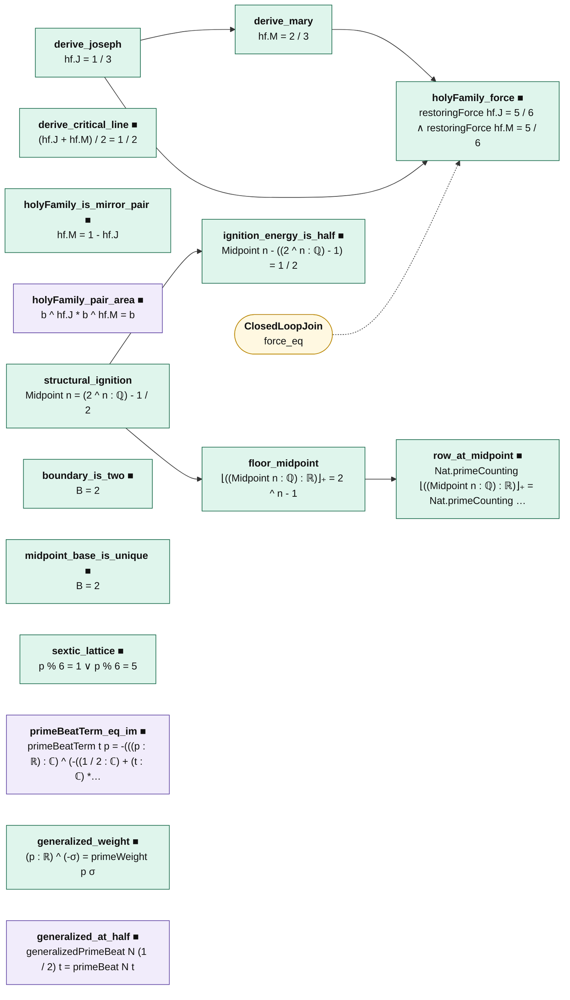

# `lean_stage3/Stage3/ClosedLoopChain.lean`

> **Read from the source text.** This file changed after the last `python3 utilities/lean_map.py --dump`, so the arrows on this page are names occurring in each proof and have not been confirmed by Lean.

ClosedLoopChain — block J3 of `lean_stage3/design/closedloop.md`. 2026-11-23. The rest of Julian's closed loop (`lean_primebeat/PrimeBeat/primebeat_closed_loop.lean`, Parts I, III, IV, V, VI) restated word for word in Stage 3 and joined, link by link, to the table and its mirror. Unit 0476 joined Parts VII, VIII, XI.

16 theorems, 5 definitions, 213 lines. 

**Imports:** [`SpiralLink`](../lean_stage3/SpiralLink.md)  
**Imported by:** [`Stage3`](../lean_stage3/Stage3.md), [`OneChain`](../lean_stage3/OneChain.md)

## The picture



An arrow A → B reads "A is used in the proof of B". Green: counting, integers only. Violet: shape, analysis with no ζ. Blue: reads ζ. A name ending in ■ is an end: nothing else uses it. Red: contains `sorry`. Yellow: theorems in another file, counted; a dotted arrow crosses files. Definitions are not drawn; they are listed below the diagram.

## Definitions

<a name="ClosedLoopChain-HolyFamily"></a>
### `ClosedLoopChain.HolyFamily`

structure · line 38

Support and condition: two parts of one whole, the second twice the first. Restated from the closed loop, Part I.

- **Is:** `` HolyFamily where J : ℝ M : ℝ unity : J + M = 1 womb_ratio : M = 2 * J ``
- **Used by 6:** [`ClosedLoopChain.derive_critical_line`](#ClosedLoopChain-derive_critical_line), [`ClosedLoopChain.derive_joseph`](#ClosedLoopChain-derive_joseph), [`ClosedLoopChain.derive_mary`](#ClosedLoopChain-derive_mary), [`ClosedLoopChain.holyFamily_force`](#ClosedLoopChain-holyFamily_force), [`ClosedLoopChain.holyFamily_is_mirror_pair`](#ClosedLoopChain-holyFamily_is_mirror_pair), [`ClosedLoopChain.holyFamily_pair_area`](#ClosedLoopChain-holyFamily_pair_area)

<a name="ClosedLoopChain-Midpoint"></a>
### `ClosedLoopChain.Midpoint`

def · line 80

The midpoint of each doubling. Restated from the closed loop, Part III.

- **Is:** `` Midpoint : ℕ → ℚ | 0 => 1 / 2 | (n + 1) => 2 * Midpoint n + 1 / 2 ``
- **Used by 4:** [`ClosedLoopChain.floor_midpoint`](#ClosedLoopChain-floor_midpoint), [`ClosedLoopChain.ignition_energy_is_half`](#ClosedLoopChain-ignition_energy_is_half), [`ClosedLoopChain.row_at_midpoint`](#ClosedLoopChain-row_at_midpoint), [`ClosedLoopChain.structural_ignition`](#ClosedLoopChain-structural_ignition)

<a name="ClosedLoopChain-primeBeatTerm"></a>
### `ClosedLoopChain.primeBeatTerm`

def · line 155

One prime's term of the Prime Beat. Restated from Part VI.

- **Is:** `` primeBeatTerm (t : ℝ) (p : ℕ) : ℝ := (p : ℝ) ^ (-(1 / 2 : ℝ)) * Real.sin (t * Real.log (p : ℝ)) ``
- **Used by 2:** [`ClosedLoopChain.primeBeat`](#ClosedLoopChain-primeBeat), [`ClosedLoopChain.primeBeatTerm_eq_im`](#ClosedLoopChain-primeBeatTerm_eq_im)

<a name="ClosedLoopChain-primeBeat"></a>
### `ClosedLoopChain.primeBeat`

def · line 159

The Prime Beat over the lattice primes up to `N`. Restated from Part VI.

- **Is:** `` primeBeat (N : ℕ) (t : ℝ) : ℝ := |∑ p ∈ (Finset.range (N + 1)).filter (fun p => Nat.Prime p ∧ p > 3), primeBeatTerm t p| ``
- **Built from:** [`ClosedLoopChain.primeBeatTerm`](#ClosedLoopChain-primeBeatTerm)
- **Used by 1:** [`ClosedLoopChain.generalized_at_half`](#ClosedLoopChain-generalized_at_half)

<a name="ClosedLoopChain-generalizedPrimeBeat"></a>
### `ClosedLoopChain.generalizedPrimeBeat`

def · line 163

The Prime Beat at a general weight. Restated from Part VI.

- **Is:** `` generalizedPrimeBeat (N : ℕ) (σ : ℝ) (t : ℝ) : ℝ := let latticePrimes := (Finset.range (N + 1)).filter (fun p => Nat.Prime p ∧ p > 3) |∑ p ∈ latticePrimes, (p : ℝ) ^ (-σ) * Real.sin (t * Real.log (p : ℝ))| ``
- **Used by 1:** [`ClosedLoopChain.generalized_at_half`](#ClosedLoopChain-generalized_at_half)

## Theorems

<a name="ClosedLoopChain-derive_joseph"></a>
### `ClosedLoopChain.derive_joseph`

line 45 · arrows read from text

**Counting.** Integers only: nothing in its statement or proof, or in anything it rests on, uses analysis or ζ.

**Why.** The support is one third.

**Proves**

```lean
hf.J = 1 / 3
```

**Needs** (its hypotheses)

  - `` hf : HolyFamily ``

**Fed by:** no theorem of this repo; it stands on Mathlib and the definitions below.

**Definitions its proof touches:** [`ClosedLoopChain.HolyFamily`](#ClosedLoopChain-HolyFamily)

**Feeds** (2 that use it)

  - [`ClosedLoopChain.derive_mary`](#ClosedLoopChain-derive_mary) — `` hf.M = 2 / 3 ``
  - [`ClosedLoopChain.holyFamily_force`](#ClosedLoopChain-holyFamily_force) — `` restoringForce hf.J = 5 / 6 ∧ restoringForce hf.M = 5 / 6 ``

<a name="ClosedLoopChain-derive_mary"></a>
### `ClosedLoopChain.derive_mary`

line 51 · arrows read from text

**Counting.** Integers only: nothing in its statement or proof, or in anything it rests on, uses analysis or ζ.

**Why.** The condition is two thirds.

**Proves**

```lean
hf.M = 2 / 3
```

**Needs** (its hypotheses)

  - `` hf : HolyFamily ``

**Fed by** (1 theorem its proof uses)

  - [`ClosedLoopChain.derive_joseph`](#ClosedLoopChain-derive_joseph) — `` hf.J = 1 / 3 ``

**Definitions its proof touches:** [`ClosedLoopChain.HolyFamily`](#ClosedLoopChain-HolyFamily)

**Feeds** (1 that use it)

  - [`ClosedLoopChain.holyFamily_force`](#ClosedLoopChain-holyFamily_force) — `` restoringForce hf.J = 5 / 6 ∧ restoringForce hf.M = 5 / 6 ``

<a name="ClosedLoopChain-derive_critical_line"></a>
### `ClosedLoopChain.derive_critical_line`

line 56 · arrows read from text

**Counting.** Integers only: nothing in its statement or proof, or in anything it rests on, uses analysis or ζ.

**Why.** The critical line is the midpoint of the two.

**Proves**

```lean
(hf.J + hf.M) / 2 = 1 / 2
```

**Needs** (its hypotheses)

  - `` hf : HolyFamily ``

**Fed by:** no theorem of this repo; it stands on Mathlib and the definitions below.

**Definitions its proof touches:** [`ClosedLoopChain.HolyFamily`](#ClosedLoopChain-HolyFamily)

**Feeds:** nothing. It is an end.

<a name="ClosedLoopChain-holyFamily_is_mirror_pair"></a>
### `ClosedLoopChain.holyFamily_is_mirror_pair`

line 61 · arrows read from text

**Counting.** Integers only: nothing in its statement or proof, or in anything it rests on, uses analysis or ζ.

**Why.** JOIN. The two members of the Holy Family are a point and its mirror: the condition is one less the support.

**Proves**

```lean
hf.M = 1 - hf.J
```

**Needs** (its hypotheses)

  - `` hf : HolyFamily ``

**Fed by:** no theorem of this repo; it stands on Mathlib and the definitions below.

**Definitions its proof touches:** [`ClosedLoopChain.HolyFamily`](#ClosedLoopChain-HolyFamily)

**Feeds:** nothing. It is an end.

<a name="ClosedLoopChain-holyFamily_pair_area"></a>
### `ClosedLoopChain.holyFamily_pair_area`

line 66 · arrows read from text

**Shape.** Uses real or complex analysis; nothing in it or beneath it reads ζ.

**Why.** JOIN. At any base the sizes at the support and at the condition multiply to the base: the area of the tree's mirror (`MirrorArea.mirror_area`).

**Proves**

```lean
b ^ hf.J * b ^ hf.M = b
```

**Needs** (its hypotheses)

  - `` hf : HolyFamily ``
  - `` hb : 0 < b ``

**Fed by:** no theorem of this repo; it stands on Mathlib and the definitions below.

**Definitions its proof touches:** [`ClosedLoopChain.HolyFamily`](#ClosedLoopChain-HolyFamily)

**Feeds:** nothing. It is an end.

<a name="ClosedLoopChain-holyFamily_force"></a>
### `ClosedLoopChain.holyFamily_force`

line 72 · arrows read from text

**Counting.** Integers only: nothing in its statement or proof, or in anything it rests on, uses analysis or ζ.

**Why.** JOIN. The restoring force is the same at the support and at the condition: both are one sixth from one half.

**Proves**

```lean
restoringForce hf.J = 5 / 6 ∧ restoringForce hf.M = 5 / 6
```

**Needs** (its hypotheses)

  - `` hf : HolyFamily ``

**Fed by** (3 theorems its proof uses)

  - [`ClosedLoopChain.derive_joseph`](#ClosedLoopChain-derive_joseph) — `` hf.J = 1 / 3 ``
  - [`ClosedLoopChain.derive_mary`](#ClosedLoopChain-derive_mary) — `` hf.M = 2 / 3 ``
  - [`ClosedLoopJoin.force_eq`](../lean_stage3/ClosedLoopJoin.md#ClosedLoopJoin-force_eq) (ClosedLoopJoin) — `` restoringForce σ = 5 * |σ - 1 / 2| ``

**Definitions its proof touches:** [`ClosedLoopChain.HolyFamily`](#ClosedLoopChain-HolyFamily), [`ClosedLoopJoin.restoringForce`](../lean_stage3/ClosedLoopJoin.md#ClosedLoopJoin-restoringForce)

**Feeds:** nothing. It is an end.

<a name="ClosedLoopChain-structural_ignition"></a>
### `ClosedLoopChain.structural_ignition`

line 85 · arrows read from text

**Counting.** Integers only: nothing in its statement or proof, or in anything it rests on, uses analysis or ζ.

**Why.** The midpoint of the `n`-th doubling is `2^n − 1/2`.

**Proves**

```lean
Midpoint n = (2 ^ n : ℚ) - 1 / 2
```

**Needs** (its hypotheses)

  - `` n : ℕ ``

**Fed by:** no theorem of this repo; it stands on Mathlib and the definitions below.

**Definitions its proof touches:** [`ClosedLoopChain.Midpoint`](#ClosedLoopChain-Midpoint)

**Feeds** (2 that use it)

  - [`ClosedLoopChain.floor_midpoint`](#ClosedLoopChain-floor_midpoint) — `` ⌊((Midpoint n : ℚ) : ℝ)⌋₊ = 2 ^ n - 1 ``
  - [`ClosedLoopChain.ignition_energy_is_half`](#ClosedLoopChain-ignition_energy_is_half) — `` Midpoint n - ((2 ^ n : ℚ) - 1) = 1 / 2 ``

<a name="ClosedLoopChain-ignition_energy_is_half"></a>
### `ClosedLoopChain.ignition_energy_is_half`

line 93 · arrows read from text

**Counting.** Integers only: nothing in its statement or proof, or in anything it rests on, uses analysis or ζ.

**Why.** The offset from the integer below is one half at every doubling.

**Proves**

```lean
Midpoint n - ((2 ^ n : ℚ) - 1) = 1 / 2
```

**Needs** (its hypotheses)

  - `` n : ℕ ``

**Fed by** (1 theorem its proof uses)

  - [`ClosedLoopChain.structural_ignition`](#ClosedLoopChain-structural_ignition) — `` Midpoint n = (2 ^ n : ℚ) - 1 / 2 ``

**Definitions its proof touches:** [`ClosedLoopChain.Midpoint`](#ClosedLoopChain-Midpoint)

**Feeds:** nothing. It is an end.

<a name="ClosedLoopChain-floor_midpoint"></a>
### `ClosedLoopChain.floor_midpoint`

line 98 · arrows read from text

**Counting.** Integers only: nothing in its statement or proof, or in anything it rests on, uses analysis or ζ.

**Why.** The integer part of the midpoint of the `n`-th doubling is `2^n − 1`.

**Proves**

```lean
⌊((Midpoint n : ℚ) : ℝ)⌋₊ = 2 ^ n - 1
```

**Needs** (its hypotheses)

  - `` n : ℕ ``

**Fed by** (1 theorem its proof uses)

  - [`ClosedLoopChain.structural_ignition`](#ClosedLoopChain-structural_ignition) — `` Midpoint n = (2 ^ n : ℚ) - 1 / 2 ``

**Definitions its proof touches:** [`ClosedLoopChain.Midpoint`](#ClosedLoopChain-Midpoint)

**Feeds** (1 that use it)

  - [`ClosedLoopChain.row_at_midpoint`](#ClosedLoopChain-row_at_midpoint) — `` Nat.primeCounting ⌊((Midpoint n : ℚ) : ℝ)⌋₊ = Nat.primeCounting (2 ^ n) ``

<a name="ClosedLoopChain-row_at_midpoint"></a>
### `ClosedLoopChain.row_at_midpoint`

line 110 · arrows read from text

**Counting.** Integers only: nothing in its statement or proof, or in anything it rests on, uses analysis or ζ.

**Why.** JOIN. From the second doubling on, the count of primes up to the midpoint is the table's row: the count of primes up to `2^n`.

**Proves**

```lean
Nat.primeCounting ⌊((Midpoint n : ℚ) : ℝ)⌋₊ = Nat.primeCounting (2 ^ n)
```

**Needs** (its hypotheses)

  - `` hn : 2 ≤ n ``

**Fed by** (1 theorem its proof uses)

  - [`ClosedLoopChain.floor_midpoint`](#ClosedLoopChain-floor_midpoint) — `` ⌊((Midpoint n : ℚ) : ℝ)⌋₊ = 2 ^ n - 1 ``

**Definitions its proof touches:** [`ClosedLoopChain.Midpoint`](#ClosedLoopChain-Midpoint)

**Feeds:** nothing. It is an end.

<a name="ClosedLoopChain-boundary_is_two"></a>
### `ClosedLoopChain.boundary_is_two`

line 124 · arrows read from text

**Counting.** Integers only: nothing in its statement or proof, or in anything it rests on, uses analysis or ζ.

**Why.** The boundary constant is two.

**Proves**

```lean
B = 2
```

**Needs** (its hypotheses)

  - `` A B C : ℝ ``
  - `` hA : A ≠ 0 ``
  - `` h_base : A = B - C ``
  - `` h_extended : A = (B - C) * (B - 1) ``

**Fed by:** no theorem of this repo; it stands on Mathlib.

**Feeds:** nothing. It connects to nothing.

<a name="ClosedLoopChain-midpoint_base_is_unique"></a>
### `ClosedLoopChain.midpoint_base_is_unique`

line 132 · arrows read from text

**Counting.** Integers only: nothing in its statement or proof, or in anything it rests on, uses analysis or ζ.

**Why.** The base of the midpoint recurrence is two.

**Proves**

```lean
B = 2
```

**Needs** (its hypotheses)

  - `` B : ℚ ``
  - `` h : B * (1 / 2 : ℚ) + 1 / 2 = B - 1 / 2 ``

**Fed by:** no theorem of this repo; it stands on Mathlib.

**Feeds:** nothing. It connects to nothing.

<a name="ClosedLoopChain-sextic_lattice"></a>
### `ClosedLoopChain.sextic_lattice`

line 138 · arrows read from text

**Counting.** Integers only: nothing in its statement or proof, or in anything it rests on, uses analysis or ζ.

**Why.** A prime above three is one or five modulo six.

**Proves**

```lean
p % 6 = 1 ∨ p % 6 = 5
```

**Needs** (its hypotheses)

  - `` p : ℕ ``
  - `` hp : Nat.Prime p ``
  - `` hp_gt_3 : p > 3 ``

**Fed by:** no theorem of this repo; it stands on Mathlib.

**Feeds:** nothing. It connects to nothing.

<a name="ClosedLoopChain-primeBeatTerm_eq_im"></a>
### `ClosedLoopChain.primeBeatTerm_eq_im`

line 169 · arrows read from text

**Shape.** Uses real or complex analysis; nothing in it or beneath it reads ζ.

**Why.** JOIN. A prime's term of the Prime Beat is minus the imaginary part of the prime's step `p^(−(1/2 + it))`: the Beat is the imaginary part of the walk.

**Proves**

```lean
primeBeatTerm t p = -(((p : ℝ) : ℂ) ^ (-((1 / 2 : ℂ) + (t : ℂ) * Complex.I))).im
```

**Needs** (its hypotheses)

  - `` t : ℝ ``
  - `` hp : 0 < p ``

**Fed by:** no theorem of this repo; it stands on Mathlib and the definitions below.

**Definitions its proof touches:** [`ClosedLoopChain.primeBeatTerm`](#ClosedLoopChain-primeBeatTerm)

**Feeds:** nothing. It is an end.

<a name="ClosedLoopChain-generalized_weight"></a>
### `ClosedLoopChain.generalized_weight`

line 187 · arrows read from text

**Counting.** Integers only: nothing in its statement or proof, or in anything it rests on, uses analysis or ζ.

**Why.** JOIN. The weight of a prime in the general Beat is the handshake's weight.

**Proves**

```lean
(p : ℝ) ^ (-σ) = primeWeight p σ
```

**Needs** (its hypotheses)

  - `` p : ℕ ``
  - `` σ : ℝ ``

**Fed by:** no theorem of this repo; it stands on Mathlib and the definitions below.

**Definitions its proof touches:** [`ClosedLoopJoin.primeWeight`](../lean_stage3/ClosedLoopJoin.md#ClosedLoopJoin-primeWeight)

**Feeds:** nothing. It is an end.

<a name="ClosedLoopChain-generalized_at_half"></a>
### `ClosedLoopChain.generalized_at_half`

line 190 · arrows read from text

**Shape.** Uses real or complex analysis; nothing in it or beneath it reads ζ.

**Why.** The general Beat at one half is the Prime Beat.

**Proves**

```lean
generalizedPrimeBeat N (1 / 2) t = primeBeat N t
```

**Needs** (its hypotheses)

  - `` N : ℕ ``
  - `` t : ℝ ``

**Fed by:** no theorem of this repo; it stands on Mathlib and the definitions below.

**Definitions its proof touches:** [`ClosedLoopChain.generalizedPrimeBeat`](#ClosedLoopChain-generalizedPrimeBeat), [`ClosedLoopChain.primeBeat`](#ClosedLoopChain-primeBeat)

**Feeds:** nothing. It is an end.

