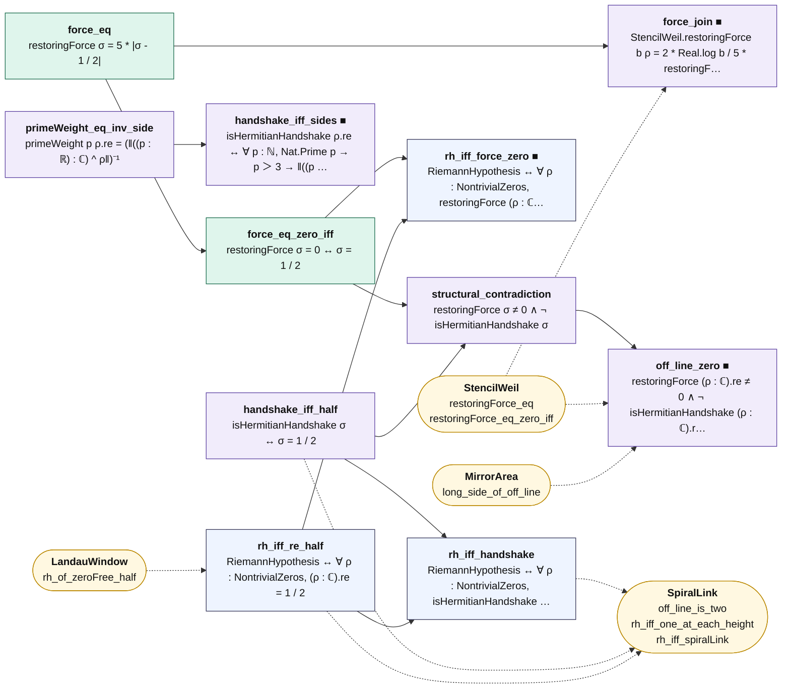

# `lean_stage3/Stage3/ClosedLoopJoin.lean`

> **Read from the source text.** This file changed after the last `python3 utilities/lean_map.py --dump`, so the arrows on this page are names occurring in each proof and have not been confirmed by Lean.

ClosedLoopJoin — block J1 of `lean_stage3/design/closedloop.md`: the join between `lean_primebeat` and Stage 3. 2026-11-23.

11 theorems, 4 definitions, 220 lines. 

**Imports:** [`FiniteOffLine`](../lean_stage3/FiniteOffLine.md), [`LandauWindow`](../lean_stage3/LandauWindow.md), [`MirrorArea`](../lean_stage3/MirrorArea.md)  
**Imported by:** [`Stage3`](../lean_stage3/Stage3.md), [`SpiralLink`](../lean_stage3/SpiralLink.md)

## The picture



An arrow A → B reads "A is used in the proof of B". Green: counting, integers only. Violet: shape, analysis with no ζ. Blue: reads ζ. A name ending in ■ is an end: nothing else uses it. Red: contains `sorry`. Yellow: theorems in another file, counted; a dotted arrow crosses files. Definitions are not drawn; they are listed below the diagram.

## Definitions

<a name="ClosedLoopJoin-epsilon"></a>
### `ClosedLoopJoin.epsilon`

def · line 47

The displacement from one half. Restated from the closed loop, Part VII.

- **Is:** `` epsilon (σ : ℝ) : ℝ := σ - (1 / 2 : ℝ) ``
- **Used by 2:** [`ClosedLoopJoin.force_eq`](#ClosedLoopJoin-force_eq), [`ClosedLoopJoin.restoringForce`](#ClosedLoopJoin-restoringForce)

<a name="ClosedLoopJoin-restoringForce"></a>
### `ClosedLoopJoin.restoringForce`

def · line 50

The closed loop's restoring force. Restated from Part VII.

- **Is:** `` restoringForce (σ : ℝ) : ℝ := |(2.5 : ℝ) - 5 * ((1 / 2 : ℝ) + epsilon σ)| ``
- **Built from:** [`ClosedLoopJoin.epsilon`](#ClosedLoopJoin-epsilon)
- **Used by 6:** [`ClosedLoopJoin.force_eq`](#ClosedLoopJoin-force_eq), [`ClosedLoopJoin.force_eq_zero_iff`](#ClosedLoopJoin-force_eq_zero_iff), [`ClosedLoopJoin.force_join`](#ClosedLoopJoin-force_join), [`ClosedLoopJoin.off_line_zero`](#ClosedLoopJoin-off_line_zero), [`ClosedLoopJoin.rh_iff_force_zero`](#ClosedLoopJoin-rh_iff_force_zero), [`ClosedLoopJoin.structural_contradiction`](#ClosedLoopJoin-structural_contradiction)

<a name="ClosedLoopJoin-primeWeight"></a>
### `ClosedLoopJoin.primeWeight`

def · line 54

The scaling weight of a prime. Restated from Part VIII.

- **Is:** `` primeWeight (p : ℕ) (σ : ℝ) : ℝ := (p : ℝ) ^ (-σ) ``
- **Used by 4:** [`ClosedLoopJoin.handshake_iff_half`](#ClosedLoopJoin-handshake_iff_half), [`ClosedLoopJoin.handshake_iff_sides`](#ClosedLoopJoin-handshake_iff_sides), [`ClosedLoopJoin.isHermitianHandshake`](#ClosedLoopJoin-isHermitianHandshake), [`ClosedLoopJoin.primeWeight_eq_inv_side`](#ClosedLoopJoin-primeWeight_eq_inv_side)

<a name="ClosedLoopJoin-isHermitianHandshake"></a>
### `ClosedLoopJoin.isHermitianHandshake`

def · line 58

The Hermitian handshake. Restated from Part VIII.

- **Is:** `` isHermitianHandshake (σ : ℝ) : Prop := ∀ p : ℕ, Nat.Prime p → p > 3 → primeWeight p σ = primeWeight p (1 - σ) ``
- **Built from:** [`ClosedLoopJoin.primeWeight`](#ClosedLoopJoin-primeWeight)
- **Used by 7:** [`ClosedLoopJoin.handshake_iff_half`](#ClosedLoopJoin-handshake_iff_half), [`ClosedLoopJoin.handshake_iff_sides`](#ClosedLoopJoin-handshake_iff_sides), [`ClosedLoopJoin.off_line_zero`](#ClosedLoopJoin-off_line_zero), [`ClosedLoopJoin.rh_iff_handshake`](#ClosedLoopJoin-rh_iff_handshake), [`ClosedLoopJoin.structural_contradiction`](#ClosedLoopJoin-structural_contradiction), [`SpiralLink.SpiralLink`](../lean_stage3/SpiralLink.md#SpiralLink-SpiralLink), [`SpiralLink.off_line_is_two`](../lean_stage3/SpiralLink.md#SpiralLink-off_line_is_two)

## Theorems

<a name="ClosedLoopJoin-force_eq"></a>
### `ClosedLoopJoin.force_eq`

line 62 · arrows read from text

**Counting.** Integers only: nothing in its statement or proof, or in anything it rests on, uses analysis or ζ.

**Why.** The closed loop's force is five times the distance from one half.

**Proves**

```lean
restoringForce σ = 5 * |σ - 1 / 2|
```

**Needs** (its hypotheses)

  - `` σ : ℝ ``

**Fed by:** no theorem of this repo; it stands on Mathlib and the definitions below.

**Definitions its proof touches:** [`ClosedLoopJoin.epsilon`](#ClosedLoopJoin-epsilon), [`ClosedLoopJoin.restoringForce`](#ClosedLoopJoin-restoringForce)

**Feeds** (2 that use it)

  - [`ClosedLoopJoin.force_eq_zero_iff`](#ClosedLoopJoin-force_eq_zero_iff) — `` restoringForce σ = 0 ↔ σ = 1 / 2 ``
  - [`ClosedLoopJoin.force_join`](#ClosedLoopJoin-force_join) — `` StencilWeil.restoringForce b ρ = 2 * Real.log b / 5 * restoringForce ρ.re ``

<a name="ClosedLoopJoin-force_join"></a>
### `ClosedLoopJoin.force_join`

line 73 · arrows read from text

**Shape.** Uses real or complex analysis; nothing in it or beneath it reads ζ.

**Why.** The two forces are one. For a base above one, the mirror imbalance of a mode of the table is the closed loop's restoring force at the mode's real part, times a constant that depends on the base alone.

**Proves**

```lean
StencilWeil.restoringForce b ρ = 2 * Real.log b / 5 * restoringForce ρ.re
```

**Needs** (its hypotheses)

  - `` hb : 1 < b ``
  - `` ρ : ℂ ``

**Fed by** (2 theorems its proof uses)

  - [`ClosedLoopJoin.force_eq`](#ClosedLoopJoin-force_eq) — `` restoringForce σ = 5 * |σ - 1 / 2| ``
  - [`StencilWeil.restoringForce_eq`](../lean_stage3/StencilWeil.md#StencilWeil-restoringForce_eq) (StencilWeil) — `` restoringForce b ρ = 2 * |ρ.re - 1 / 2| * Real.log b ``

**Definitions its proof touches:** [`ClosedLoopJoin.restoringForce`](#ClosedLoopJoin-restoringForce), [`StencilWeil.restoringForce`](../lean_stage3/StencilWeil.md#StencilWeil-restoringForce)

**Feeds:** nothing. It is an end.

<a name="ClosedLoopJoin-force_eq_zero_iff"></a>
### `ClosedLoopJoin.force_eq_zero_iff`

line 79 · arrows read from text

**Counting.** Integers only: nothing in its statement or proof, or in anything it rests on, uses analysis or ζ.

**Why.** The closed loop's force is zero exactly at one half.

**Proves**

```lean
restoringForce σ = 0 ↔ σ = 1 / 2
```

**Needs** (its hypotheses)

  - `` σ : ℝ ``

**Fed by** (1 theorem its proof uses)

  - [`ClosedLoopJoin.force_eq`](#ClosedLoopJoin-force_eq) — `` restoringForce σ = 5 * |σ - 1 / 2| ``

**Definitions its proof touches:** [`ClosedLoopJoin.restoringForce`](#ClosedLoopJoin-restoringForce)

**Feeds** (2 that use it)

  - [`ClosedLoopJoin.rh_iff_force_zero`](#ClosedLoopJoin-rh_iff_force_zero) — `` RiemannHypothesis ↔ ∀ ρ : NontrivialZeros, restoringForce (ρ : ℂ).re = 0 ``
  - [`ClosedLoopJoin.structural_contradiction`](#ClosedLoopJoin-structural_contradiction) — `` restoringForce σ ≠ 0 ∧ ¬ isHermitianHandshake σ ``

<a name="ClosedLoopJoin-primeWeight_eq_inv_side"></a>
### `ClosedLoopJoin.primeWeight_eq_inv_side`

line 92 · arrows read from text

**Shape.** Uses real or complex analysis; nothing in it or beneath it reads ζ.

**Why.** A prime's weight at the real part of a point is the reciprocal of the size of the prime's mode there.

**Proves**

```lean
primeWeight p ρ.re = (‖((p : ℝ) : ℂ) ^ ρ‖)⁻¹
```

**Needs** (its hypotheses)

  - `` hp : 0 < p ``
  - `` ρ : ℂ ``

**Fed by:** no theorem of this repo; it stands on Mathlib and the definitions below.

**Definitions its proof touches:** [`ClosedLoopJoin.primeWeight`](#ClosedLoopJoin-primeWeight)

**Feeds** (1 that use it)

  - [`ClosedLoopJoin.handshake_iff_sides`](#ClosedLoopJoin-handshake_iff_sides) — `` isHermitianHandshake ρ.re ↔ ∀ p : ℕ, Nat.Prime p → p > 3 → ‖((p : ℝ) : ℂ) ^ ρ‖ = ‖((p : ℝ) : ℂ) ^ (1 - ρ)‖ ``

<a name="ClosedLoopJoin-handshake_iff_sides"></a>
### `ClosedLoopJoin.handshake_iff_sides`

line 101 · arrows read from text

**Shape.** Uses real or complex analysis; nothing in it or beneath it reads ζ.

**Why.** The handshake is the two sides agreeing. The Hermitian handshake at the real part of a point holds exactly when, at every prime above three, the mode and its mirror have the same size.

**Proves**

```lean
isHermitianHandshake ρ.re ↔ ∀ p : ℕ, Nat.Prime p → p > 3 → ‖((p : ℝ) : ℂ) ^ ρ‖ = ‖((p : ℝ) : ℂ) ^ (1 - ρ)‖
```

**Needs** (its hypotheses)

  - `` ρ : ℂ ``

**Fed by** (1 theorem its proof uses)

  - [`ClosedLoopJoin.primeWeight_eq_inv_side`](#ClosedLoopJoin-primeWeight_eq_inv_side) — `` primeWeight p ρ.re = (‖((p : ℝ) : ℂ) ^ ρ‖)⁻¹ ``

**Definitions its proof touches:** [`ClosedLoopJoin.isHermitianHandshake`](#ClosedLoopJoin-isHermitianHandshake), [`ClosedLoopJoin.primeWeight`](#ClosedLoopJoin-primeWeight)

**Feeds:** nothing. It is an end.

<a name="ClosedLoopJoin-handshake_iff_half"></a>
### `ClosedLoopJoin.handshake_iff_half`

line 118 · arrows read from text

**Shape.** Uses real or complex analysis; nothing in it or beneath it reads ζ.

**Why.** The handshake holds exactly at one half.

**Proves**

```lean
isHermitianHandshake σ ↔ σ = 1 / 2
```

**Needs** (its hypotheses)

  - `` σ : ℝ ``

**Fed by:** no theorem of this repo; it stands on Mathlib and the definitions below.

**Definitions its proof touches:** [`ClosedLoopJoin.isHermitianHandshake`](#ClosedLoopJoin-isHermitianHandshake), [`ClosedLoopJoin.primeWeight`](#ClosedLoopJoin-primeWeight)

**Feeds** (3 that use it)

  - [`ClosedLoopJoin.rh_iff_handshake`](#ClosedLoopJoin-rh_iff_handshake) — `` RiemannHypothesis ↔ ∀ ρ : NontrivialZeros, isHermitianHandshake (ρ : ℂ).re ``
  - [`ClosedLoopJoin.structural_contradiction`](#ClosedLoopJoin-structural_contradiction) — `` restoringForce σ ≠ 0 ∧ ¬ isHermitianHandshake σ ``
  - [`SpiralLink.off_line_is_two`](../lean_stage3/SpiralLink.md#SpiralLink-off_line_is_two) (SpiralLink) — `` mirrorZ ρ ≠ ρ ∧ ((mirrorZ ρ : NontrivialZeros) : ℂ).im = (ρ : ℂ).im ∧ ¬ isHermitianHandshake (ρ : ℂ).re ∧ ¬ isHermitianHandshake ((mirrorZ ρ : Nontriv… ``

<a name="ClosedLoopJoin-structural_contradiction"></a>
### `ClosedLoopJoin.structural_contradiction`

line 135 · arrows read from text

**Shape.** Uses real or complex analysis; nothing in it or beneath it reads ζ.

**Why.** The structural contradiction, the closed loop's main theorem (Part XI): away from one half the restoring force is nonzero and the handshake fails.

**Proves**

```lean
restoringForce σ ≠ 0 ∧ ¬ isHermitianHandshake σ
```

**Needs** (its hypotheses)

  - `` σ : ℝ ``
  - `` hσ : σ ≠ 1 / 2 ``

**Fed by** (2 theorems its proof uses)

  - [`ClosedLoopJoin.force_eq_zero_iff`](#ClosedLoopJoin-force_eq_zero_iff) — `` restoringForce σ = 0 ↔ σ = 1 / 2 ``
  - [`ClosedLoopJoin.handshake_iff_half`](#ClosedLoopJoin-handshake_iff_half) — `` isHermitianHandshake σ ↔ σ = 1 / 2 ``

**Definitions its proof touches:** [`ClosedLoopJoin.isHermitianHandshake`](#ClosedLoopJoin-isHermitianHandshake), [`ClosedLoopJoin.restoringForce`](#ClosedLoopJoin-restoringForce)

**Feeds** (1 that use it)

  - [`ClosedLoopJoin.off_line_zero`](#ClosedLoopJoin-off_line_zero) — `` restoringForce (ρ : ℂ).re ≠ 0 ∧ ¬ isHermitianHandshake (ρ : ℂ).re ∧ ∀ b : ℝ, 1 < b → StencilWeil.restoringForce b (ρ : ℂ) ≠ 0 ∧ Real.sqrt b < max ‖(b … ``

<a name="ClosedLoopJoin-off_line_zero"></a>
### `ClosedLoopJoin.off_line_zero`

line 143 · arrows read from text

**Shape.** Uses real or complex analysis; nothing in it or beneath it reads ζ.

**Why.** The structural contradiction at a zero of zeta. If a nontrivial zero is off the line, then the closed loop's force there is nonzero, the handshake fails, the mirror imbalance of its mode is nonzero at every base above one, and one of the mode's two sides is longer than the square root of the base.

**Proves**

```lean
restoringForce (ρ : ℂ).re ≠ 0 ∧ ¬ isHermitianHandshake (ρ : ℂ).re ∧ ∀ b : ℝ, 1 < b → StencilWeil.restoringForce b (ρ : ℂ) ≠ 0 ∧ Real.sqrt b < max ‖(b : ℂ) ^ (ρ : ℂ)‖ ‖(b : ℂ) ^ (1 - (ρ : ℂ))‖
```

**Needs** (its hypotheses)

  - `` ρ : NontrivialZeros ``
  - `` h : (ρ : ℂ).re ≠ 1 / 2 ``

**Fed by** (3 theorems its proof uses)

  - [`ClosedLoopJoin.structural_contradiction`](#ClosedLoopJoin-structural_contradiction) — `` restoringForce σ ≠ 0 ∧ ¬ isHermitianHandshake σ ``
  - [`MirrorArea.long_side_of_off_line`](../lean_stage3/MirrorArea.md#MirrorArea-long_side_of_off_line) (MirrorArea) — `` Real.sqrt b < max ‖(b : ℂ) ^ ρ‖ ‖(b : ℂ) ^ (1 - ρ)‖ ``
  - [`StencilWeil.restoringForce_eq_zero_iff`](../lean_stage3/StencilWeil.md#StencilWeil-restoringForce_eq_zero_iff) (StencilWeil) — `` restoringForce b ρ = 0 ↔ ρ.re = 1 / 2 ``

**Definitions its proof touches:** [`ClosedLoopJoin.isHermitianHandshake`](#ClosedLoopJoin-isHermitianHandshake), [`ClosedLoopJoin.restoringForce`](#ClosedLoopJoin-restoringForce), [`StencilWeil.restoringForce`](../lean_stage3/StencilWeil.md#StencilWeil-restoringForce)

**Feeds:** nothing. It is an end.

<a name="ClosedLoopJoin-rh_iff_re_half"></a>
### `ClosedLoopJoin.rh_iff_re_half`

line 153 · arrows read from text

**Reads ζ.** It, or something it rests on, uses the zeta function, its zeros or the Riemann hypothesis.

**Why.** The Riemann hypothesis is every nontrivial zero having real part one half.

**Proves**

```lean
RiemannHypothesis ↔ ∀ ρ : NontrivialZeros, (ρ : ℂ).re = 1 / 2
```

**Fed by** (1 theorem its proof uses)

  - [`LandauWindow.rh_of_zeroFree_half`](../lean_stage3/LandauWindow.md#LandauWindow-rh_of_zeroFree_half) (LandauWindow) — `` RiemannHypothesis ``

**Feeds** (3 that use it)

  - [`ClosedLoopJoin.rh_iff_force_zero`](#ClosedLoopJoin-rh_iff_force_zero) — `` RiemannHypothesis ↔ ∀ ρ : NontrivialZeros, restoringForce (ρ : ℂ).re = 0 ``
  - [`ClosedLoopJoin.rh_iff_handshake`](#ClosedLoopJoin-rh_iff_handshake) — `` RiemannHypothesis ↔ ∀ ρ : NontrivialZeros, isHermitianHandshake (ρ : ℂ).re ``
  - [`SpiralLink.rh_iff_one_at_each_height`](../lean_stage3/SpiralLink.md#SpiralLink-rh_iff_one_at_each_height) (SpiralLink) — `` RiemannHypothesis ↔ OneAtEachHeight ``

<a name="ClosedLoopJoin-rh_iff_force_zero"></a>
### `ClosedLoopJoin.rh_iff_force_zero`

line 183 · arrows read from text

**Reads ζ.** It, or something it rests on, uses the zeta function, its zeros or the Riemann hypothesis.

**Why.** The Riemann hypothesis is the force at rest. RH holds exactly when the closed loop's restoring force is zero at every nontrivial zero of zeta.

**Proves**

```lean
RiemannHypothesis ↔ ∀ ρ : NontrivialZeros, restoringForce (ρ : ℂ).re = 0
```

**Fed by** (2 theorems its proof uses)

  - [`ClosedLoopJoin.force_eq_zero_iff`](#ClosedLoopJoin-force_eq_zero_iff) — `` restoringForce σ = 0 ↔ σ = 1 / 2 ``
  - [`ClosedLoopJoin.rh_iff_re_half`](#ClosedLoopJoin-rh_iff_re_half) — `` RiemannHypothesis ↔ ∀ ρ : NontrivialZeros, (ρ : ℂ).re = 1 / 2 ``

**Definitions its proof touches:** [`ClosedLoopJoin.restoringForce`](#ClosedLoopJoin-restoringForce)

**Feeds:** nothing. It is an end.

<a name="ClosedLoopJoin-rh_iff_handshake"></a>
### `ClosedLoopJoin.rh_iff_handshake`

line 190 · arrows read from text

**Reads ζ.** It, or something it rests on, uses the zeta function, its zeros or the Riemann hypothesis.

**Why.** The Riemann hypothesis is the handshake. RH holds exactly when the Hermitian handshake holds at every nontrivial zero of zeta.

**Proves**

```lean
RiemannHypothesis ↔ ∀ ρ : NontrivialZeros, isHermitianHandshake (ρ : ℂ).re
```

**Fed by** (2 theorems its proof uses)

  - [`ClosedLoopJoin.handshake_iff_half`](#ClosedLoopJoin-handshake_iff_half) — `` isHermitianHandshake σ ↔ σ = 1 / 2 ``
  - [`ClosedLoopJoin.rh_iff_re_half`](#ClosedLoopJoin-rh_iff_re_half) — `` RiemannHypothesis ↔ ∀ ρ : NontrivialZeros, (ρ : ℂ).re = 1 / 2 ``

**Definitions its proof touches:** [`ClosedLoopJoin.isHermitianHandshake`](#ClosedLoopJoin-isHermitianHandshake)

**Feeds** (1 that use it)

  - [`SpiralLink.rh_iff_spiralLink`](../lean_stage3/SpiralLink.md#SpiralLink-rh_iff_spiralLink) (SpiralLink) — `` RiemannHypothesis ↔ SpiralLink ``

