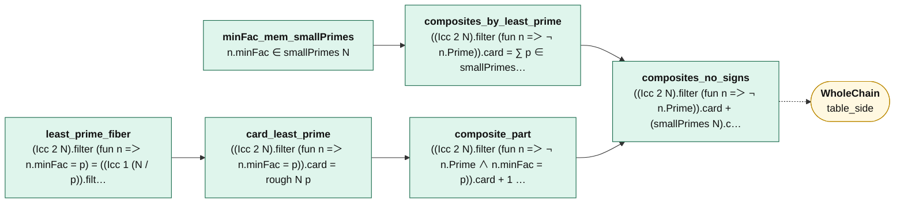

# `lean_stage3/Stage3/CompositeSplit.lean`

> **Read from the source text.** This file changed after the last `python3 utilities/lean_map.py --dump`, so the arrows on this page are names occurring in each proof and have not been confirmed by Lean.

CompositeSplit — block R10 of `lean_stage3/design/runs.md`. 2026-11-23. The composite table has no signs. The sieve's sum counts a composite once for every set of small primes dividing it and corrects with the Pascal signs. Each composite has exactly one least prime. Counted under its least prime, every composite is counted once, and every part is a positive count. The part of a prime `p` is the same table at the scale `N/p`: the numbers up to `N/p` that no prime below `p` divides.

6 theorems, 1 definition, 152 lines. 

**Imports:** [`SieveExact`](../lean_stage3/SieveExact.md), [`StepsRate`](../lean_stage3/StepsRate.md)  
**Imported by:** [`Stage3`](../lean_stage3/Stage3.md), [`Compression`](../lean_stage3/Compression.md)

## The picture



An arrow A → B reads "A is used in the proof of B". Green: counting, integers only. Violet: shape, analysis with no ζ. Blue: reads ζ. A name ending in ■ is an end: nothing else uses it. Red: contains `sorry`. Yellow: theorems in another file, counted; a dotted arrow crosses files. Definitions are not drawn; they are listed below the diagram.

## Definitions

<a name="CompositeSplit-rough"></a>
### `CompositeSplit.rough`

def · line 32

The numbers from `1` to `N/p` that no prime below `p` divides: the table at the scale `N/p`, sieved by the primes below `p`.

- **Is:** `` rough (N p : ℕ) : ℕ := ((Icc 1 (N / p)).filter (fun m => ∀ q : ℕ, q.Prime → q < p → ¬ q ∣ m)).card ``
- **Used by 4:** [`CompositeSplit.card_least_prime`](#CompositeSplit-card_least_prime), [`CompositeSplit.composite_part`](#CompositeSplit-composite_part), [`CompositeSplit.composites_no_signs`](#CompositeSplit-composites_no_signs), [`WholeChain.table_side`](../lean_stage3/WholeChain.md#WholeChain-table_side)

## Theorems

<a name="CompositeSplit-least_prime_fiber"></a>
### `CompositeSplit.least_prime_fiber`

line 37 · arrows read from text

**Counting.** Integers only: nothing in its statement or proof, or in anything it rests on, uses analysis or ζ.

**Why.** The numbers from `2` to `N` whose least prime is `p` are `p` times the numbers up to `N/p` that no prime below `p` divides.

**Proves**

```lean
(Icc 2 N).filter (fun n => n.minFac = p) = ((Icc 1 (N / p)).filter (fun m => ∀ q : ℕ, q.Prime → q < p → ¬ q ∣ m)).image (fun m => p * m)
```

**Needs** (its hypotheses)

  - `` N : ℕ ``
  - `` hp : p.Prime ``

**Fed by:** no theorem of this repo; it stands on Mathlib.

**Feeds** (1 that use it)

  - [`CompositeSplit.card_least_prime`](#CompositeSplit-card_least_prime) — `` ((Icc 2 N).filter (fun n => n.minFac = p)).card = rough N p ``

<a name="CompositeSplit-card_least_prime"></a>
### `CompositeSplit.card_least_prime`

line 71 · arrows read from text

**Counting.** Integers only: nothing in its statement or proof, or in anything it rests on, uses analysis or ζ.

**Why.** The part of a prime. The count of the numbers from `2` to `N` with least prime `p` is the table's count at the scale `N/p`.

**Proves**

```lean
((Icc 2 N).filter (fun n => n.minFac = p)).card = rough N p
```

**Needs** (its hypotheses)

  - `` N : ℕ ``
  - `` hp : p.Prime ``

**Fed by** (1 theorem its proof uses)

  - [`CompositeSplit.least_prime_fiber`](#CompositeSplit-least_prime_fiber) — `` (Icc 2 N).filter (fun n => n.minFac = p) = ((Icc 1 (N / p)).filter (fun m => ∀ q : ℕ, q.Prime → q < p → ¬ q ∣ m)).image (fun m => p * m) ``

**Definitions its proof touches:** [`CompositeSplit.rough`](#CompositeSplit-rough)

**Feeds** (1 that use it)

  - [`CompositeSplit.composite_part`](#CompositeSplit-composite_part) — `` ((Icc 2 N).filter (fun n => ¬ n.Prime ∧ n.minFac = p)).card + 1 = rough N p ``

<a name="CompositeSplit-minFac_mem_smallPrimes"></a>
### `CompositeSplit.minFac_mem_smallPrimes`

line 77 · arrows read from text

**Counting.** Integers only: nothing in its statement or proof, or in anything it rests on, uses analysis or ζ.

**Why.** A composite up to `N` has its least prime among the primes up to `√N`.

**Proves**

```lean
n.minFac ∈ smallPrimes N
```

**Needs** (its hypotheses)

  - `` h2 : 2 ≤ n ``
  - `` hN : n ≤ N ``
  - `` hc : ¬ n.Prime ``

**Fed by:** no theorem of this repo; it stands on Mathlib and the definitions below.

**Definitions its proof touches:** [`SieveExact.smallPrimes`](../lean_stage3/SieveExact.md#SieveExact-smallPrimes)

**Feeds** (1 that use it)

  - [`CompositeSplit.composites_by_least_prime`](#CompositeSplit-composites_by_least_prime) — `` ((Icc 2 N).filter (fun n => ¬ n.Prime)).card = ∑ p ∈ smallPrimes N, ((Icc 2 N).filter (fun n => ¬ n.Prime ∧ n.minFac = p)).card ``

<a name="CompositeSplit-composites_by_least_prime"></a>
### `CompositeSplit.composites_by_least_prime`

line 87 · arrows read from text

**Counting.** Integers only: nothing in its statement or proof, or in anything it rests on, uses analysis or ζ.

**Why.** Every composite once, under its least prime. No signs.

**Proves**

```lean
((Icc 2 N).filter (fun n => ¬ n.Prime)).card = ∑ p ∈ smallPrimes N, ((Icc 2 N).filter (fun n => ¬ n.Prime ∧ n.minFac = p)).card
```

**Needs** (its hypotheses)

  - `` N : ℕ ``

**Fed by** (1 theorem its proof uses)

  - [`CompositeSplit.minFac_mem_smallPrimes`](#CompositeSplit-minFac_mem_smallPrimes) — `` n.minFac ∈ smallPrimes N ``

**Definitions its proof touches:** [`SieveExact.smallPrimes`](../lean_stage3/SieveExact.md#SieveExact-smallPrimes)

**Feeds** (1 that use it)

  - [`CompositeSplit.composites_no_signs`](#CompositeSplit-composites_no_signs) — `` ((Icc 2 N).filter (fun n => ¬ n.Prime)).card + (smallPrimes N).card = ∑ p ∈ smallPrimes N, rough N p ``

<a name="CompositeSplit-composite_part"></a>
### `CompositeSplit.composite_part`

line 100 · arrows read from text

**Counting.** Integers only: nothing in its statement or proof, or in anything it rests on, uses analysis or ζ.

**Why.** A prime's part of the composites, with the prime itself put back, is the table's count at the scale `N/p`.

**Proves**

```lean
((Icc 2 N).filter (fun n => ¬ n.Prime ∧ n.minFac = p)).card + 1 = rough N p
```

**Needs** (its hypotheses)

  - `` N : ℕ ``
  - `` hp : p.Prime ``
  - `` hpN : p ≤ N ``

**Fed by** (1 theorem its proof uses)

  - [`CompositeSplit.card_least_prime`](#CompositeSplit-card_least_prime) — `` ((Icc 2 N).filter (fun n => n.minFac = p)).card = rough N p ``

**Definitions its proof touches:** [`CompositeSplit.rough`](#CompositeSplit-rough)

**Feeds** (1 that use it)

  - [`CompositeSplit.composites_no_signs`](#CompositeSplit-composites_no_signs) — `` ((Icc 2 N).filter (fun n => ¬ n.Prime)).card + (smallPrimes N).card = ∑ p ∈ smallPrimes N, rough N p ``

<a name="CompositeSplit-composites_no_signs"></a>
### `CompositeSplit.composites_no_signs`

line 126 · arrows read from text

**Counting.** Integers only: nothing in its statement or proof, or in anything it rests on, uses analysis or ζ.

**Why.** The composite table, no signs. The composites up to `N`, with one for each prime up to `√N`, are the sum over those primes of the table's count at the scale `N/p`. Every term is a count.

**Proves**

```lean
((Icc 2 N).filter (fun n => ¬ n.Prime)).card + (smallPrimes N).card = ∑ p ∈ smallPrimes N, rough N p
```

**Needs** (its hypotheses)

  - `` N : ℕ ``

**Fed by** (2 theorems its proof uses)

  - [`CompositeSplit.composite_part`](#CompositeSplit-composite_part) — `` ((Icc 2 N).filter (fun n => ¬ n.Prime ∧ n.minFac = p)).card + 1 = rough N p ``
  - [`CompositeSplit.composites_by_least_prime`](#CompositeSplit-composites_by_least_prime) — `` ((Icc 2 N).filter (fun n => ¬ n.Prime)).card = ∑ p ∈ smallPrimes N, ((Icc 2 N).filter (fun n => ¬ n.Prime ∧ n.minFac = p)).card ``

**Definitions its proof touches:** [`CompositeSplit.rough`](#CompositeSplit-rough), [`SieveExact.smallPrimes`](../lean_stage3/SieveExact.md#SieveExact-smallPrimes)

**Feeds** (1 that use it)

  - [`WholeChain.table_side`](../lean_stage3/WholeChain.md#WholeChain-table_side) (WholeChain) — `` (∀ N : ℕ, 2 ≤ N → (Nat.primeCounting N : ℤ) = (Nat.primeCounting (Nat.sqrt N) : ℤ) - 1 + ∑ T ∈ (SieveExact.smallPrimes N).powerset, (-1 : ℤ) ^ T.card … ``

