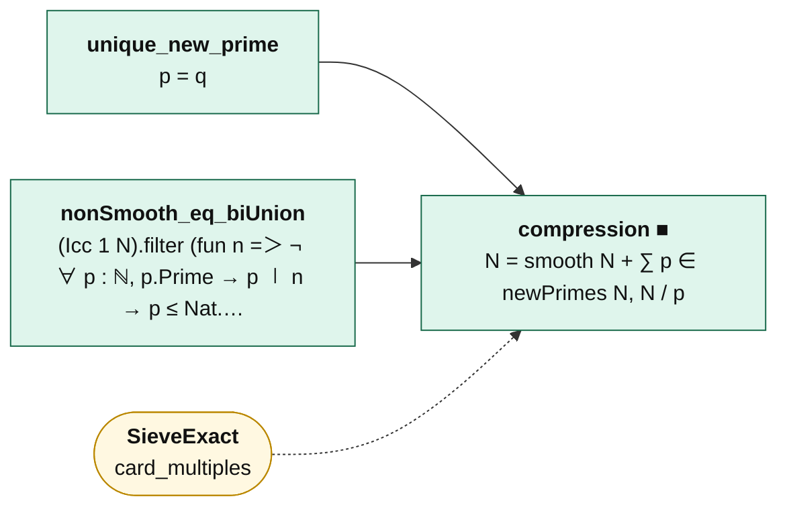

# `lean_stage3/Stage3/Compression.lean`

> **Read from the source text.** This file changed after the last `python3 utilities/lean_map.py --dump`, so the arrows on this page are names occurring in each proof and have not been confirmed by Lean.

Compression — block R11 of `lean_stage3/design/runs.md`. 2026-11-23. The primes as the compression of the composites. The combinations of the primes up to `√N` never repeat and do not fill the numbers up to `N`. What they leave is exactly the new primes, each with its multiples, and no number is counted twice: a number up to `N` has at most one prime factor above `√N`.

3 theorems, 2 definitions, 85 lines. 

**Imports:** [`CompositeSplit`](../lean_stage3/CompositeSplit.md)  
**Imported by:** [`Stage3`](../lean_stage3/Stage3.md)

## The picture



An arrow A → B reads "A is used in the proof of B". Green: counting, integers only. Violet: shape, analysis with no ζ. Blue: reads ζ. A name ending in ■ is an end: nothing else uses it. Red: contains `sorry`. Yellow: theorems in another file, counted; a dotted arrow crosses files. Definitions are not drawn; they are listed below the diagram.

## Definitions

<a name="Compression-smooth"></a>
### `Compression.smooth`

def · line 25

The numbers from `1` to `N` that are combinations of the primes up to `√N`: every prime dividing them is at most `√N`.

- **Is:** `` smooth (N : ℕ) : ℕ := ((Icc 1 N).filter (fun n => ∀ p : ℕ, p.Prime → p ∣ n → p ≤ Nat.sqrt N)).card ``
- **Used by 1:** [`Compression.compression`](#Compression-compression)

<a name="Compression-newPrimes"></a>
### `Compression.newPrimes`

def · line 29

The new primes: those above `√N`, up to `N`.

- **Is:** `` newPrimes (N : ℕ) : Finset ℕ := (Icc 1 N).filter (fun p => p.Prime ∧ Nat.sqrt N < p) ``
- **Used by 2:** [`Compression.compression`](#Compression-compression), [`Compression.nonSmooth_eq_biUnion`](#Compression-nonSmooth_eq_biUnion)

## Theorems

<a name="Compression-unique_new_prime"></a>
### `Compression.unique_new_prime`

line 33 · arrows read from text

**Counting.** Integers only: nothing in its statement or proof, or in anything it rests on, uses analysis or ζ.

**Why.** No number is claimed twice. A number up to `N` has at most one prime factor above `√N`.

**Proves**

```lean
p = q
```

**Needs** (its hypotheses)

  - `` hn1 : 1 ≤ n ``
  - `` hn : n ≤ N ``
  - `` hp : p.Prime ``
  - `` hq : q.Prime ``
  - `` hpN : Nat.sqrt N < p ``
  - `` hqN : Nat.sqrt N < q ``
  - `` hpn : p ∣ n ``
  - `` hqn : q ∣ n ``

**Fed by:** no theorem of this repo; it stands on Mathlib.

**Feeds** (1 that use it)

  - [`Compression.compression`](#Compression-compression) — `` N = smooth N + ∑ p ∈ newPrimes N, N / p ``

<a name="Compression-nonSmooth_eq_biUnion"></a>
### `Compression.nonSmooth_eq_biUnion`

line 45 · arrows read from text

**Counting.** Integers only: nothing in its statement or proof, or in anything it rests on, uses analysis or ζ.

**Why.** The numbers that are not combinations of the primes so far are the multiples of the new primes.

**Proves**

```lean
(Icc 1 N).filter (fun n => ¬ ∀ p : ℕ, p.Prime → p ∣ n → p ≤ Nat.sqrt N) = (newPrimes N).biUnion (fun p => (Icc 1 N).filter (fun n => p ∣ n))
```

**Needs** (its hypotheses)

  - `` N : ℕ ``

**Fed by:** no theorem of this repo; it stands on Mathlib and the definitions below.

**Definitions its proof touches:** [`Compression.newPrimes`](#Compression-newPrimes)

**Feeds** (1 that use it)

  - [`Compression.compression`](#Compression-compression) — `` N = smooth N + ∑ p ∈ newPrimes N, N / p ``

<a name="Compression-compression"></a>
### `Compression.compression`

line 59 · arrows read from text

**Counting.** Integers only: nothing in its statement or proof, or in anything it rests on, uses analysis or ζ.

**Why.** The compression. The numbers up to `N` are the combinations of the primes up to `√N`, and for each new prime its multiples up to `N`, with nothing counted twice.

**Proves**

```lean
N = smooth N + ∑ p ∈ newPrimes N, N / p
```

**Needs** (its hypotheses)

  - `` N : ℕ ``

**Fed by** (3 theorems its proof uses)

  - [`Compression.nonSmooth_eq_biUnion`](#Compression-nonSmooth_eq_biUnion) — `` (Icc 1 N).filter (fun n => ¬ ∀ p : ℕ, p.Prime → p ∣ n → p ≤ Nat.sqrt N) = (newPrimes N).biUnion (fun p => (Icc 1 N).filter (fun n => p ∣ n)) ``
  - [`Compression.unique_new_prime`](#Compression-unique_new_prime) — `` p = q ``
  - [`SieveExact.card_multiples`](../lean_stage3/SieveExact.md#SieveExact-card_multiples) (SieveExact) — `` ((Finset.Icc 1 N).filter (fun n => d ∣ n)).card = N / d ``

**Definitions its proof touches:** [`Compression.newPrimes`](#Compression-newPrimes), [`Compression.smooth`](#Compression-smooth)

**Feeds:** nothing. It is an end.

