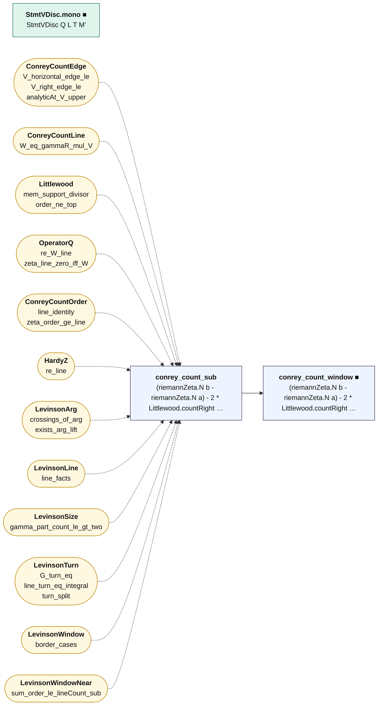

# `lean_stage3/Stage3/ConreyCount.lean`

> **Read from the source text.** This file changed after the last `python3 utilities/lean_map.py --dump`, so the arrows on this page are names occurring in each proof and have not been confirmed by Lean.

ConreyCount — block S13 of `lean_stage3/design/stencil.md`, B4 step 1: Conrey's identity and Levinson's count for a general `Q`. 2026-11-25.

3 theorems, 0 definitions, 470 lines. 

**Imports:** [`ConreyCountEdge`](../lean_stage3/ConreyCountEdge.md), [`ConreyCountOrder`](../lean_stage3/ConreyCountOrder.md)  
**Imported by:** [`Stage3`](../lean_stage3/Stage3.md)

## The picture



An arrow A → B reads "A is used in the proof of B". Green: counting, integers only. Violet: shape, analysis with no ζ. Blue: reads ζ. A name ending in ■ is an end: nothing else uses it. Red: contains `sorry`. Yellow: theorems in another file, counted; a dotted arrow crosses files. Definitions are not drawn; they are listed below the diagram.

## Theorems

<a name="ConreyCount-conrey_count_sub"></a>
### `ConreyCount.conrey_count_sub`

line 67 · arrows read from text

**Reads ζ.** It, or something it rests on, uses the zeta function, its zeros or the Riemann hypothesis.

**Why.** Levinson's count for `V = W/Gammaℝ`, difference form. For `Q′(x) = Q′(1 − x)`, `Q(1/2) ≠ 0`, `4 ≤ a < b`, `V` nonzero on the bottom and top edges of `[1/2, 3] × [a, b]`, `ζ(1/2 + a i) ≠ 0`, `Re V ≥ 1/3` on the right edge and `‖V‖ ≤ M` on the discs about `3 + a i` and `3 + b i`: the zeros of `ζ` on the line with height in `(a, b]`, with order, number at least `(N b − N a) − 2·(zeros of V in the rectangle right of the line) − (30 log b + 42 log(3M) + 154)`.

**Proves**

```lean
(riemannZeta.N b - riemannZeta.N a) - 2 * Littlewood.countRight (V Q L) ((1/2 : ℂ) + a * I) ((3 : ℂ) + b * I) (1/2) - (30 * Real.log b + 42 * Real.log (3 * M) + 154) ≤ (lineCount b : ℝ) - (lineCount a : ℝ)
```

**Needs** (its hypotheses)

  - `` hQ : ∀ x : ℝ, Q.derivative.eval x = Q.derivative.eval (1 - x) ``
  - `` hQh : Q.eval (1/2) ≠ 0 ``
  - `` ha : 4 ≤ a ``
  - `` hab : a < b ``
  - `` hBot : ∀ x ∈ Icc (1/2 : ℝ) 3, V Q L (↑x + ↑a * I) ≠ 0 ``
  - `` hTop : ∀ x ∈ Icc (1/2 : ℝ) 3, V Q L (↑x + ↑b * I) ≠ 0 ``
  - `` hζa : riemannZeta (1/2 + a * I) ≠ 0 ``
  - `` hR : StmtVRight Q L a b ``
  - `` hMa : StmtVDisc Q L a M ``
  - `` hMb : StmtVDisc Q L b M ``

**Fed by** (20 theorems its proof uses)

  - [`ConreyCount.V_horizontal_edge_le`](../lean_stage3/ConreyCountEdge.md#ConreyCount-V_horizontal_edge_le) (ConreyCountEdge) — `` |(∫ x in (1/2:ℝ)..3, logDeriv (V Q L) (↑x + ↑T * I)).im| ≤ Real.pi * (21 * Real.log (3 * M) + 1) ``
  - [`ConreyCount.V_right_edge_le`](../lean_stage3/ConreyCountEdge.md#ConreyCount-V_right_edge_le) (ConreyCountEdge) — `` |(∫ t in a..b, logDeriv (V Q L) (3 + t * I)).re| ≤ Real.pi ``
  - [`ConreyCount.analyticAt_V_upper`](../lean_stage3/ConreyCountEdge.md#ConreyCount-analyticAt_V_upper) (ConreyCountEdge) — `` AnalyticAt ℂ (V Q L) w ``
  - [`ConreyCount.W_eq_gammaR_mul_V`](../lean_stage3/ConreyCountLine.md#ConreyCount-W_eq_gammaR_mul_V) (ConreyCountLine) — `` OperatorQ.W Q L s = Gammaℝ s * V Q L s ``
  - [`ConreyCount.line_identity`](../lean_stage3/ConreyCountOrder.md#ConreyCount-line_identity) (ConreyCountOrder) — `` ((Q.eval (1/2 : ℝ) : ℝ) : ℂ) * completedRiemannZeta (1/2 + t * I) = (((∏ ρ ∈ D, (t - ρ.im) ^ n ρ) * (I ^ (∑ ρ ∈ D, n ρ) * (Gammaℝ (1/2 + t * I) * H (1… ``
  - [`ConreyCount.zeta_order_ge_line`](../lean_stage3/ConreyCountOrder.md#ConreyCount-zeta_order_ge_line) (ConreyCountOrder) — `` (n ρ : ℤ) ≤ riemannZeta.order ρ ∧ ((I ^ (∑ ρ' ∈ D, n ρ') * (Gammaℝ ρ * H ρ)).re = 0 → (n ρ : ℤ) + 1 ≤ riemannZeta.order ρ) ``
  - [`HardyZ.re_line`](../lean_stage3/HardyZ.md#HardyZ-re_line) (HardyZ) — `` ((1 / 2 : ℂ) + t * I).re = 1 / 2 ``
  - [`LevinsonArg.crossings_of_arg`](../lean_stage3/LevinsonArg.md#LevinsonArg-crossings_of_arg) (LevinsonArg) — `` ∃ t : Fin k → ℝ, StrictMono t ∧ (∀ i, t i ∈ Set.Icc a b) ∧ ∀ i, Real.cos (φ (t i)) = 0 ``
  - [`LevinsonArg.exists_arg_lift`](../lean_stage3/LevinsonArg.md#LevinsonArg-exists_arg_lift) (LevinsonArg) — `` ∃ φ : ℝ → ℝ, ContinuousOn φ (Set.Icc a b) ∧ ∀ t ∈ Set.Icc a b, F t = ‖F t‖ * Complex.exp (φ t * Complex.I) ``
  - [`LevinsonLine.line_facts`](../lean_stage3/LevinsonLine.md#LevinsonLine-line_facts) (LevinsonLine) — `` ((1/2 : ℂ) + t * I) ≠ 0 ∧ ((1/2 : ℂ) + t * I) ≠ 1 ∧ 0 < ((1/2 : ℂ) + t * I).re ``
  - [`LevinsonSize.gamma_part_count_le_gt_two`](../lean_stage3/LevinsonSize.md#LevinsonSize-gamma_part_count_le_gt_two) (LevinsonSize) — `` |(∫ t in a..b, logDeriv Gammaℝ (1/2 + t * I)).re - Real.pi * (riemannZeta.N b - riemannZeta.N a)| ≤ Real.pi * (30 * Real.log b + 150) ``
  - [`LevinsonTurn.G_turn_eq`](../lean_stage3/LevinsonTurn.md#LevinsonTurn-G_turn_eq) (LevinsonTurn) — `` (∫ t in a..b, logDeriv G (1/2 + t * I)).re = -(2 * Real.pi * Littlewood.countRight G ((1/2 : ℂ) + a * I) ((X : ℂ) + b * I) (1/2)) + (∫ x in (1/2 : ℝ).… ``
  - [`LevinsonTurn.line_turn_eq_integral`](../lean_stage3/LevinsonTurn.md#LevinsonTurn-line_turn_eq_integral) (LevinsonTurn) — `` φ b - φ a = (∫ t in a..b, logDeriv f (1/2 + t * I)).re ``
  - [`LevinsonTurn.turn_split`](../lean_stage3/LevinsonTurn.md#LevinsonTurn-turn_split) (LevinsonTurn) — `` (∫ t in a..b, logDeriv (fun s => Gammaℝ s * G s) (1/2 + t * I)).re = (∫ t in a..b, logDeriv Gammaℝ (1/2 + t * I)).re + (∫ t in a..b, logDeriv G (1/2 +… ``
  - [`LevinsonWindow.border_cases`](../lean_stage3/LevinsonWindow.md#LevinsonWindow-border_cases) (LevinsonWindow) — `` (p.im = z.im ∧ p.re ∈ Icc z.re w.re) ∨ (p.re = z.re ∧ p.im ∈ Icc z.im w.im) ∨ (p.im = w.im ∧ p.re ∈ Icc z.re w.re) ∨ (p.re = w.re ∧ p.im ∈ Icc z.im w.… ``
  - [`LevinsonWindowNear.sum_order_le_lineCount_sub`](../lean_stage3/LevinsonWindowNear.md#LevinsonWindowNear-sum_order_le_lineCount_sub) (LevinsonWindowNear) — `` ∑ γ ∈ E, riemannZeta.order (1/2 + γ * I) ≤ lineCount b - lineCount a ``
  - [`Littlewood.mem_support_divisor`](../lean_stage3/Littlewood.md#Littlewood-mem_support_divisor) (Littlewood) — `` p ∈ (MeromorphicOn.divisor f U).support ↔ p ∈ U ∧ f p = 0 ``
  - [`Littlewood.order_ne_top`](../lean_stage3/Littlewood.md#Littlewood-order_ne_top) (Littlewood) — `` ∀ p ∈ Rectangle z w, meromorphicOrderAt f p ≠ ⊤ ``
  - [`OperatorQ.re_W_line`](../lean_stage3/OperatorQ.md#OperatorQ-re_W_line) (OperatorQ) — `` (W Q L ((1/2 : ℂ) + t * I)).re = Q.eval (1/2) * (completedRiemannZeta ((1/2 : ℂ) + t * I)).re ``
  - [`OperatorQ.zeta_line_zero_iff_W`](../lean_stage3/OperatorQ.md#OperatorQ-zeta_line_zero_iff_W) (OperatorQ) — `` riemannZeta ((1/2 : ℂ) + t * I) = 0 ↔ (W Q L ((1/2 : ℂ) + t * I)).re = 0 ``

**Definitions its proof touches:** [`ConreyCount.StmtVDisc`](../lean_stage3/ConreyCountEdge.md#ConreyCount-StmtVDisc), [`ConreyCount.StmtVRight`](../lean_stage3/ConreyCountEdge.md#ConreyCount-StmtVRight), [`ConreyCount.V`](../lean_stage3/ConreyCountLine.md#ConreyCount-V), [`LineCount.lineCount`](../lean_stage3/LineCount.md#LineCount-lineCount), [`Littlewood.countRight`](../lean_stage3/Littlewood.md#Littlewood-countRight)

**Feeds** (1 that use it)

  - [`ConreyCount.conrey_count_window`](#ConreyCount-conrey_count_window) — `` (riemannZeta.N b - riemannZeta.N a) - 2 * Littlewood.countRight (V Q (Real.log T)) ((1/2 : ℂ) + a * I) ((3 : ℂ) + b * I) (1/2) - (72 * Real.log b + 42… ``

<a name="ConreyCount-StmtVDisc-mono"></a>
### `ConreyCount.StmtVDisc.mono`

line 428 · arrows read from text

**Counting.** Integers only: nothing in its statement or proof, or in anything it rests on, uses analysis or ζ.

**Why.** A disc bound with a larger constant.

**Proves**

```lean
StmtVDisc Q L T M'
```

**Needs** (its hypotheses)

  - `` h : StmtVDisc Q L T M ``
  - `` hM : M ≤ M' ``

**Fed by:** no theorem of this repo; it stands on Mathlib and the definitions below.

**Definitions its proof touches:** [`ConreyCount.StmtVDisc`](../lean_stage3/ConreyCountEdge.md#ConreyCount-StmtVDisc)

**Feeds:** nothing. It is an end.

<a name="ConreyCount-conrey_count_window"></a>
### `ConreyCount.conrey_count_window`

line 434 · arrows read from text

**Reads ζ.** It, or something it rests on, uses the zeta function, its zeros or the Riemann hypothesis.

**Why.** The count on a window inside `[T/4, 2T]`. With `L = log T`, `T/4 ≤ a`, `4 ≤ a < b ≤ 2T`, `0 < A`, the open size statement `StmtVEdges Q T A`, and the avoidance hypotheses: `lineCount b − lineCount a ≥ (N b − N a) − 2·countRight V − (72 log b + 42 log(3A) + 154)`.

**Proves**

```lean
(riemannZeta.N b - riemannZeta.N a) - 2 * Littlewood.countRight (V Q (Real.log T)) ((1/2 : ℂ) + a * I) ((3 : ℂ) + b * I) (1/2) - (72 * Real.log b + 42 * Real.log (3 * A) + 154) ≤ (lineCount b : ℝ) - (lineCount a : ℝ)
```

**Needs** (its hypotheses)

  - `` hQ : ∀ x : ℝ, Q.derivative.eval x = Q.derivative.eval (1 - x) ``
  - `` hQh : Q.eval (1/2) ≠ 0 ``
  - `` hA : 0 < A ``
  - `` hTa : T / 4 ≤ a ``
  - `` ha : 4 ≤ a ``
  - `` hab : a < b ``
  - `` hbT : b ≤ 2 * T ``
  - `` hE : StmtVEdges Q T A ``
  - `` hBot : ∀ x ∈ Icc (1/2 : ℝ) 3, V Q (Real.log T) (↑x + ↑a * I) ≠ 0 ``
  - `` hTop : ∀ x ∈ Icc (1/2 : ℝ) 3, V Q (Real.log T) (↑x + ↑b * I) ≠ 0 ``
  - `` hζa : riemannZeta (1/2 + a * I) ≠ 0 ``

**Fed by** (1 theorem its proof uses)

  - [`ConreyCount.conrey_count_sub`](#ConreyCount-conrey_count_sub) — `` (riemannZeta.N b - riemannZeta.N a) - 2 * Littlewood.countRight (V Q L) ((1/2 : ℂ) + a * I) ((3 : ℂ) + b * I) (1/2) - (30 * Real.log b + 42 * Real.log… ``

**Definitions its proof touches:** [`ConreyCount.StmtVDisc`](../lean_stage3/ConreyCountEdge.md#ConreyCount-StmtVDisc), [`ConreyCount.StmtVEdges`](../lean_stage3/ConreyCountEdge.md#ConreyCount-StmtVEdges), [`ConreyCount.StmtVRight`](../lean_stage3/ConreyCountEdge.md#ConreyCount-StmtVRight), [`ConreyCount.V`](../lean_stage3/ConreyCountLine.md#ConreyCount-V), [`LineCount.lineCount`](../lean_stage3/LineCount.md#LineCount-lineCount), [`Littlewood.countRight`](../lean_stage3/Littlewood.md#Littlewood-countRight)

**Feeds:** nothing. It is an end.

