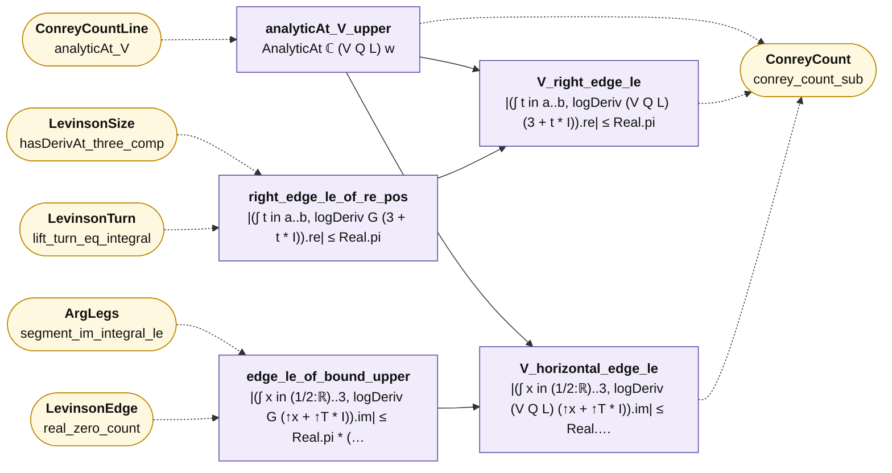

# `lean_stage3/Stage3/ConreyCountEdge.lean`

> **Read from the source text.** This file changed after the last `python3 utilities/lean_map.py --dump`, so the arrows on this page are names occurring in each proof and have not been confirmed by Lean.

ConreyCountEdge — block S13 of `lean_stage3/design/stencil.md`, B4 step 1, the edges for `V`. 2026-11-25.

5 theorems, 3 definitions, 255 lines. 

**Imports:** [`ConreyCountLine`](../lean_stage3/ConreyCountLine.md), [`LevinsonEdge`](../lean_stage3/LevinsonEdge.md)  
**Imported by:** [`ConreyCount`](../lean_stage3/ConreyCount.md)

## The picture



An arrow A → B reads "A is used in the proof of B". Green: counting, integers only. Violet: shape, analysis with no ζ. Blue: reads ζ. A name ending in ■ is an end: nothing else uses it. Red: contains `sorry`. Yellow: theorems in another file, counted; a dotted arrow crosses files. Definitions are not drawn; they are listed below the diagram.

## Definitions

<a name="ConreyCount-StmtVRight"></a>
### `ConreyCount.StmtVRight`

def · line 65

Open: the right edge. `Re V ≥ 1/3` on `3 + [a, b] i`.

- **Is:** `` StmtVRight (Q : ℝ[X]) (L a b : ℝ) : Prop := ∀ t ∈ Set.Icc a b, 1/3 ≤ (V Q L (3 + t * I)).re ``
- **Built from:** [`ConreyCount.V`](../lean_stage3/ConreyCountLine.md#ConreyCount-V)
- **Used by 3:** [`ConreyCount.conrey_count_sub`](../lean_stage3/ConreyCount.md#ConreyCount-conrey_count_sub), [`ConreyCount.conrey_count_window`](../lean_stage3/ConreyCount.md#ConreyCount-conrey_count_window), [`ConreyCount.V_right_edge_le`](#ConreyCount-V_right_edge_le)

<a name="ConreyCount-StmtVDisc"></a>
### `ConreyCount.StmtVDisc`

def · line 69

Open: the growth on a disc. `‖V‖ ≤ M` on `‖w − (3 + T i)‖ ≤ 21/8`.

- **Is:** `` StmtVDisc (Q : ℝ[X]) (L T M : ℝ) : Prop := ∀ w : ℂ, ‖w - (3 + T * I)‖ ≤ 21/8 → ‖V Q L w‖ ≤ M ``
- **Built from:** [`ConreyCount.V`](../lean_stage3/ConreyCountLine.md#ConreyCount-V)
- **Used by 5:** [`ConreyCount.StmtVDisc.mono`](../lean_stage3/ConreyCount.md#ConreyCount-StmtVDisc-mono), [`ConreyCount.conrey_count_sub`](../lean_stage3/ConreyCount.md#ConreyCount-conrey_count_sub), [`ConreyCount.conrey_count_window`](../lean_stage3/ConreyCount.md#ConreyCount-conrey_count_window), [`ConreyCount.StmtVEdges`](#ConreyCount-StmtVEdges), [`ConreyCount.V_horizontal_edge_le`](#ConreyCount-V_horizontal_edge_le)

<a name="ConreyCount-StmtVEdges"></a>
### `ConreyCount.StmtVEdges`

def · line 74

Open: the size of `V` near height `T`. With `L = log T`, for every height `t ∈ [T/4, 2T]`: `Re V(3 + t i) ≥ 1/3`, and `‖V‖ ≤ A·t` on the disc of radius `21/8` about `3 + t i`.

- **Is:** `` StmtVEdges (Q : ℝ[X]) (T A : ℝ) : Prop := ∀ t ∈ Set.Icc (T/4) (2 * T), 1/3 ≤ (V Q (Real.log T) (3 + t * I)).re ∧ StmtVDisc Q (Real.log T) t (A * t) ``
- **Built from:** [`ConreyCount.StmtVDisc`](#ConreyCount-StmtVDisc), [`ConreyCount.V`](../lean_stage3/ConreyCountLine.md#ConreyCount-V)
- **Used by 1:** [`ConreyCount.conrey_count_window`](../lean_stage3/ConreyCount.md#ConreyCount-conrey_count_window)

## Theorems

<a name="ConreyCount-analyticAt_V_upper"></a>
### `ConreyCount.analyticAt_V_upper`

line 79 · arrows read from text

**Shape.** Uses real or complex analysis; nothing in it or beneath it reads ζ.

**Why.** `V` is analytic above `Im = 1/2`.

**Proves**

```lean
AnalyticAt ℂ (V Q L) w
```

**Needs** (its hypotheses)

  - `` Q : ℝ[X] ``
  - `` L : ℝ ``
  - `` hw : 1/2 < w.im ``

**Fed by** (1 theorem its proof uses)

  - [`ConreyCount.analyticAt_V`](../lean_stage3/ConreyCountLine.md#ConreyCount-analyticAt_V) (ConreyCountLine) — `` AnalyticAt ℂ (V Q L) s ``

**Definitions its proof touches:** [`ConreyCount.V`](../lean_stage3/ConreyCountLine.md#ConreyCount-V)

**Feeds** (3 that use it)

  - [`ConreyCount.conrey_count_sub`](../lean_stage3/ConreyCount.md#ConreyCount-conrey_count_sub) (ConreyCount) — `` (riemannZeta.N b - riemannZeta.N a) - 2 * Littlewood.countRight (V Q L) ((1/2 : ℂ) + a * I) ((3 : ℂ) + b * I) (1/2) - (30 * Real.log b + 42 * Real.log… ``
  - [`ConreyCount.V_horizontal_edge_le`](#ConreyCount-V_horizontal_edge_le) — `` |(∫ x in (1/2:ℝ)..3, logDeriv (V Q L) (↑x + ↑T * I)).im| ≤ Real.pi * (21 * Real.log (3 * M) + 1) ``
  - [`ConreyCount.V_right_edge_le`](#ConreyCount-V_right_edge_le) — `` |(∫ t in a..b, logDeriv (V Q L) (3 + t * I)).re| ≤ Real.pi ``

<a name="ConreyCount-right_edge_le_of_re_pos"></a>
### `ConreyCount.right_edge_le_of_re_pos`

line 88 · arrows read from text

**Shape.** Uses real or complex analysis; nothing in it or beneath it reads ζ.

**Why.** The right edge, for any `G` in the right half-plane there.

**Proves**

```lean
|(∫ t in a..b, logDeriv G (3 + t * I)).re| ≤ Real.pi
```

**Needs** (its hypotheses)

  - `` hab : a ≤ b ``
  - `` hGa : ∀ t ∈ Set.Icc a b, AnalyticAt ℂ G (3 + t * I) ``
  - `` hpos : ∀ t ∈ Set.Icc a b, 0 < (G (3 + t * I)).re ``

**Fed by** (2 theorems its proof uses)

  - [`LevinsonSize.hasDerivAt_three_comp`](../lean_stage3/LevinsonSize.md#LevinsonSize-hasDerivAt_three_comp) (LevinsonSize) — `` HasDerivAt (fun y : ℝ => f (3 + y * I)) (deriv f (3 + t * I) * I) t ``
  - [`LevinsonTurn.lift_turn_eq_integral`](../lean_stage3/LevinsonTurn.md#LevinsonTurn-lift_turn_eq_integral) (LevinsonTurn) — `` φ b - φ a = (∫ t in a..b, F' t / F t).im ``

**Feeds** (1 that use it)

  - [`ConreyCount.V_right_edge_le`](#ConreyCount-V_right_edge_le) — `` |(∫ t in a..b, logDeriv (V Q L) (3 + t * I)).re| ≤ Real.pi ``

<a name="ConreyCount-edge_le_of_bound_upper"></a>
### `ConreyCount.edge_le_of_bound_upper`

line 135 · arrows read from text

**Shape.** Uses real or complex analysis; nothing in it or beneath it reads ζ.

**Why.** A horizontal edge, with analyticity above `Im = 1/2` only. The proof of `LevinsonEdge.edge_le_of_bound` (which asks `G` analytic off `1`); it uses `G` only at points with `Im > 1/2`.

**Proves**

```lean
|(∫ x in (1/2:ℝ)..3, logDeriv G (↑x + ↑T * I)).im| ≤ Real.pi * (21 * Real.log (3 * M) + 1)
```

**Needs** (its hypotheses)

  - `` hT : 4 ≤ T ``
  - `` hGa : ∀ w : ℂ, 1/2 < w.im → AnalyticAt ℂ G w ``
  - `` h0 : 1 / 3 ≤ (G (3 + (T : ℂ) * I)).re ``
  - `` hM : ∀ w : ℂ, ‖w - (3 + (T : ℂ) * I)‖ ≤ 21 / 8 → ‖G w‖ ≤ M ``
  - `` hne : ∀ x ∈ Set.Icc (1/2:ℝ) 3, G (↑x + ↑T * I) ≠ 0 ``

**Fed by** (2 theorems its proof uses)

  - [`ArgLegs.segment_im_integral_le`](../lean_stage3/ArgLegs.md#ArgLegs-segment_im_integral_le) (ArgLegs) — `` |(∫ x in a..b, g' x / g x).im| ≤ Real.pi * ((Z.card : ℝ) + 1) ``
  - [`LevinsonEdge.real_zero_count`](../lean_stage3/LevinsonEdge.md#LevinsonEdge-real_zero_count) (LevinsonEdge) — `` ∃ Z : Finset ℝ, (∀ x : ℝ, |x| ≤ 5 / 6 → (g x).re = 0 → x ∈ Z) ∧ (Z.card : ℝ) ≤ 21 * Real.log (M / m) ``

**Feeds** (1 that use it)

  - [`ConreyCount.V_horizontal_edge_le`](#ConreyCount-V_horizontal_edge_le) — `` |(∫ x in (1/2:ℝ)..3, logDeriv (V Q L) (↑x + ↑T * I)).im| ≤ Real.pi * (21 * Real.log (3 * M) + 1) ``

<a name="ConreyCount-V_right_edge_le"></a>
### `ConreyCount.V_right_edge_le`

line 217 · arrows read from text

**Shape.** Uses real or complex analysis; nothing in it or beneath it reads ζ.

**Why.** The right edge for `V`.

**Proves**

```lean
|(∫ t in a..b, logDeriv (V Q L) (3 + t * I)).re| ≤ Real.pi
```

**Needs** (its hypotheses)

  - `` ha : 4 ≤ a ``
  - `` hab : a ≤ b ``
  - `` hR : StmtVRight Q L a b ``

**Fed by** (2 theorems its proof uses)

  - [`ConreyCount.analyticAt_V_upper`](#ConreyCount-analyticAt_V_upper) — `` AnalyticAt ℂ (V Q L) w ``
  - [`ConreyCount.right_edge_le_of_re_pos`](#ConreyCount-right_edge_le_of_re_pos) — `` |(∫ t in a..b, logDeriv G (3 + t * I)).re| ≤ Real.pi ``

**Definitions its proof touches:** [`ConreyCount.StmtVRight`](#ConreyCount-StmtVRight), [`ConreyCount.V`](../lean_stage3/ConreyCountLine.md#ConreyCount-V)

**Feeds** (1 that use it)

  - [`ConreyCount.conrey_count_sub`](../lean_stage3/ConreyCount.md#ConreyCount-conrey_count_sub) (ConreyCount) — `` (riemannZeta.N b - riemannZeta.N a) - 2 * Littlewood.countRight (V Q L) ((1/2 : ℂ) + a * I) ((3 : ℂ) + b * I) (1/2) - (30 * Real.log b + 42 * Real.log… ``

<a name="ConreyCount-V_horizontal_edge_le"></a>
### `ConreyCount.V_horizontal_edge_le`

line 225 · arrows read from text

**Shape.** Uses real or complex analysis; nothing in it or beneath it reads ζ.

**Why.** A horizontal edge for `V`.

**Proves**

```lean
|(∫ x in (1/2:ℝ)..3, logDeriv (V Q L) (↑x + ↑T * I)).im| ≤ Real.pi * (21 * Real.log (3 * M) + 1)
```

**Needs** (its hypotheses)

  - `` hT : 4 ≤ T ``
  - `` h0 : 1/3 ≤ (V Q L (3 + T * I)).re ``
  - `` hM : StmtVDisc Q L T M ``
  - `` hne : ∀ x ∈ Set.Icc (1/2:ℝ) 3, V Q L (↑x + ↑T * I) ≠ 0 ``

**Fed by** (2 theorems its proof uses)

  - [`ConreyCount.analyticAt_V_upper`](#ConreyCount-analyticAt_V_upper) — `` AnalyticAt ℂ (V Q L) w ``
  - [`ConreyCount.edge_le_of_bound_upper`](#ConreyCount-edge_le_of_bound_upper) — `` |(∫ x in (1/2:ℝ)..3, logDeriv G (↑x + ↑T * I)).im| ≤ Real.pi * (21 * Real.log (3 * M) + 1) ``

**Definitions its proof touches:** [`ConreyCount.StmtVDisc`](#ConreyCount-StmtVDisc), [`ConreyCount.V`](../lean_stage3/ConreyCountLine.md#ConreyCount-V)

**Feeds** (1 that use it)

  - [`ConreyCount.conrey_count_sub`](../lean_stage3/ConreyCount.md#ConreyCount-conrey_count_sub) (ConreyCount) — `` (riemannZeta.N b - riemannZeta.N a) - 2 * Littlewood.countRight (V Q L) ((1/2 : ℂ) + a * I) ((3 : ℂ) + b * I) (1/2) - (30 * Real.log b + 42 * Real.log… ``

