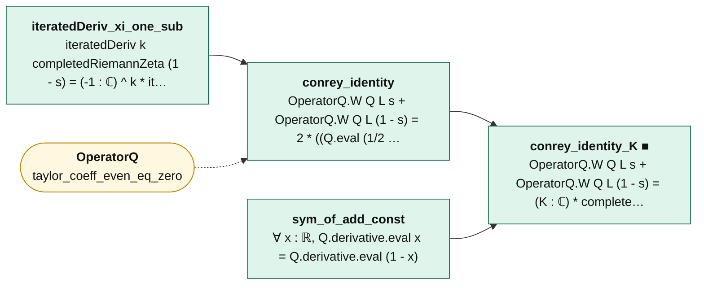

# `lean_stage3/Stage3/ConreyCountIdentity.lean`

> **Read from the source text.** This file changed after the last `python3 utilities/lean_map.py --dump`, so the arrows on this page are names occurring in each proof and have not been confirmed by Lean.

ConreyCountIdentity — block S13 of `lean_stage3/design/stencil.md`, B4 step 1, Conrey's identity. 2026-11-25.

4 theorems, 0 definitions, 115 lines. 

**Imports:** [`OperatorQ`](../lean_stage3/OperatorQ.md)  
**Imported by:** [`ConreyCountLine`](../lean_stage3/ConreyCountLine.md)

## The picture



An arrow A → B reads "A is used in the proof of B". Green: counting, integers only. Violet: shape, analysis with no ζ. Blue: reads ζ. A name ending in ■ is an end: nothing else uses it. Red: contains `sorry`. Yellow: theorems in another file, counted; a dotted arrow crosses files. Definitions are not drawn; they are listed below the diagram.

## Theorems

<a name="ConreyCount-iteratedDeriv_xi_one_sub"></a>
### `ConreyCount.iteratedDeriv_xi_one_sub`

line 35 · arrows read from text

**Counting.** Integers only: nothing in its statement or proof, or in anything it rests on, uses analysis or ζ.

**Why.** The parity of the derivatives of `Λ`. `Λ^{(k)}(1 − s) = (−1)^k Λ^{(k)}(s)` for every `s ∈ ℂ`.

**Proves**

```lean
iteratedDeriv k completedRiemannZeta (1 - s) = (-1 : ℂ) ^ k * iteratedDeriv k completedRiemannZeta s
```

**Needs** (its hypotheses)

  - `` k : ℕ ``
  - `` s : ℂ ``

**Fed by:** no theorem of this repo; it stands on Mathlib.

**Feeds** (1 that use it)

  - [`ConreyCount.conrey_identity`](#ConreyCount-conrey_identity) — `` OperatorQ.W Q L s + OperatorQ.W Q L (1 - s) = 2 * ((Q.eval (1/2 : ℝ) : ℝ) : ℂ) * completedRiemannZeta s ``

<a name="ConreyCount-conrey_identity"></a>
### `ConreyCount.conrey_identity`

line 46 · arrows read from text

**Counting.** Integers only: nothing in its statement or proof, or in anything it rests on, uses analysis or ζ.

**Why.** Conrey's identity at `m = 0`. For `Q′(x) = Q′(1 − x)`: `W(s) + W(1 − s) = 2·Q(1/2)·Λ(s)` for every `s`.

**Proves**

```lean
OperatorQ.W Q L s + OperatorQ.W Q L (1 - s) = 2 * ((Q.eval (1/2 : ℝ) : ℝ) : ℂ) * completedRiemannZeta s
```

**Needs** (its hypotheses)

  - `` Q : ℝ[X] ``
  - `` hQ : ∀ x : ℝ, Q.derivative.eval x = Q.derivative.eval (1 - x) ``
  - `` L : ℝ ``
  - `` s : ℂ ``

**Fed by** (2 theorems its proof uses)

  - [`ConreyCount.iteratedDeriv_xi_one_sub`](#ConreyCount-iteratedDeriv_xi_one_sub) — `` iteratedDeriv k completedRiemannZeta (1 - s) = (-1 : ℂ) ^ k * iteratedDeriv k completedRiemannZeta s ``
  - [`OperatorQ.taylor_coeff_even_eq_zero`](../lean_stage3/OperatorQ.md#OperatorQ-taylor_coeff_even_eq_zero) (OperatorQ) — `` (taylor (1/2 : ℝ) Q).coeff k = 0 ``

**Definitions its proof touches:** [`OperatorQ.W`](../lean_stage3/OperatorQ.md#OperatorQ-W)

**Feeds** (1 that use it)

  - [`ConreyCount.conrey_identity_K`](#ConreyCount-conrey_identity_K) — `` OperatorQ.W Q L s + OperatorQ.W Q L (1 - s) = (K : ℂ) * completedRiemannZeta s ``

<a name="ConreyCount-sym_of_add_const"></a>
### `ConreyCount.sym_of_add_const`

line 67 · arrows read from text

**Counting.** Integers only: nothing in its statement or proof, or in anything it rests on, uses analysis or ζ.

**Why.** Conrey's hypothesis `Q(x) + Q(1 − x) = K` gives the symmetry of `Q′`.

**Proves**

```lean
∀ x : ℝ, Q.derivative.eval x = Q.derivative.eval (1 - x)
```

**Needs** (its hypotheses)

  - `` Q : ℝ[X] ``
  - `` K : ℝ ``
  - `` hK : ∀ x : ℝ, Q.eval x + Q.eval (1 - x) = K ``

**Fed by:** no theorem of this repo; it stands on Mathlib.

**Feeds** (1 that use it)

  - [`ConreyCount.conrey_identity_K`](#ConreyCount-conrey_identity_K) — `` OperatorQ.W Q L s + OperatorQ.W Q L (1 - s) = (K : ℂ) * completedRiemannZeta s ``

<a name="ConreyCount-conrey_identity_K"></a>
### `ConreyCount.conrey_identity_K`

line 84 · arrows read from text

**Counting.** Integers only: nothing in its statement or proof, or in anything it rests on, uses analysis or ζ.

**Why.** Conrey's identity in his form. For `Q(x) + Q(1 − x) = K`: `W(s) + W(1 − s) = K·Λ(s)` for every `s` (and `K = 2·Q(1/2)`).

**Proves**

```lean
OperatorQ.W Q L s + OperatorQ.W Q L (1 - s) = (K : ℂ) * completedRiemannZeta s
```

**Needs** (its hypotheses)

  - `` Q : ℝ[X] ``
  - `` K : ℝ ``
  - `` hK : ∀ x : ℝ, Q.eval x + Q.eval (1 - x) = K ``
  - `` L : ℝ ``
  - `` s : ℂ ``

**Fed by** (2 theorems its proof uses)

  - [`ConreyCount.conrey_identity`](#ConreyCount-conrey_identity) — `` OperatorQ.W Q L s + OperatorQ.W Q L (1 - s) = 2 * ((Q.eval (1/2 : ℝ) : ℝ) : ℂ) * completedRiemannZeta s ``
  - [`ConreyCount.sym_of_add_const`](#ConreyCount-sym_of_add_const) — `` ∀ x : ℝ, Q.derivative.eval x = Q.derivative.eval (1 - x) ``

**Definitions its proof touches:** [`OperatorQ.W`](../lean_stage3/OperatorQ.md#OperatorQ-W)

**Feeds:** nothing. It is an end.

