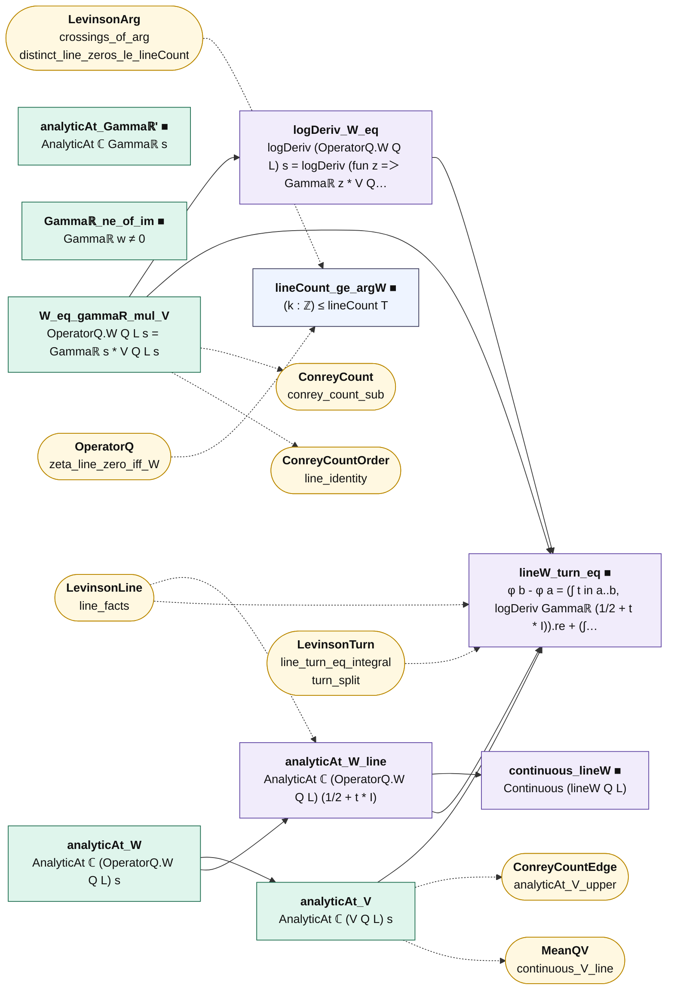

# `lean_stage3/Stage3/ConreyCountLine.lean`

> **Read from the source text.** This file changed after the last `python3 utilities/lean_map.py --dump`, so the arrows on this page are names occurring in each proof and have not been confirmed by Lean.

ConreyCountLine — block S13 of `lean_stage3/design/stencil.md`, B4 step 1, the line function. 2026-11-25.

10 theorems, 2 definitions, 191 lines. 

**Imports:** [`ConreyCountIdentity`](../lean_stage3/ConreyCountIdentity.md), [`LevinsonTurn`](../lean_stage3/LevinsonTurn.md)  
**Imported by:** [`ConreyCountEdge`](../lean_stage3/ConreyCountEdge.md), [`ConreyCountOrder`](../lean_stage3/ConreyCountOrder.md), [`MeanQRed`](../lean_stage3/MeanQRed.md)

## The picture



An arrow A → B reads "A is used in the proof of B". Green: counting, integers only. Violet: shape, analysis with no ζ. Blue: reads ζ. A name ending in ■ is an end: nothing else uses it. Red: contains `sorry`. Yellow: theorems in another file, counted; a dotted arrow crosses files. Definitions are not drawn; they are listed below the diagram.

## Definitions

<a name="ConreyCount-V"></a>
### `ConreyCount.V`

def · line 45

Conrey's `V = W/Gammaℝ`, the analogue of `G = ζ + cζ′`: `V = Q(1/2 − (D + g)/L) ζ` with `g = Gammaℝ′/Gammaℝ`.

- **Is:** `` V (Q : ℝ[X]) (L : ℝ) (s : ℂ) : ℂ := OperatorQ.W Q L s / Gammaℝ s ``
- **Built from:** [`OperatorQ.W`](../lean_stage3/OperatorQ.md#OperatorQ-W)
- **Used by 31:** [`ConreyCount.conrey_count_sub`](../lean_stage3/ConreyCount.md#ConreyCount-conrey_count_sub), [`ConreyCount.conrey_count_window`](../lean_stage3/ConreyCount.md#ConreyCount-conrey_count_window), [`ConreyCount.StmtVDisc`](../lean_stage3/ConreyCountEdge.md#ConreyCount-StmtVDisc), [`ConreyCount.StmtVEdges`](../lean_stage3/ConreyCountEdge.md#ConreyCount-StmtVEdges), [`ConreyCount.StmtVRight`](../lean_stage3/ConreyCountEdge.md#ConreyCount-StmtVRight), [`ConreyCount.V_horizontal_edge_le`](../lean_stage3/ConreyCountEdge.md#ConreyCount-V_horizontal_edge_le), [`ConreyCount.V_right_edge_le`](../lean_stage3/ConreyCountEdge.md#ConreyCount-V_right_edge_le), [`ConreyCount.analyticAt_V_upper`](../lean_stage3/ConreyCountEdge.md#ConreyCount-analyticAt_V_upper), [`ConreyCount.W_eq_gammaR_mul_V`](#ConreyCount-W_eq_gammaR_mul_V), [`ConreyCount.analyticAt_V`](#ConreyCount-analyticAt_V), [`ConreyCount.lineW_turn_eq`](#ConreyCount-lineW_turn_eq), [`ConreyCount.logDeriv_W_eq`](#ConreyCount-logDeriv_W_eq), [`ConreyCount.line_identity`](../lean_stage3/ConreyCountOrder.md#ConreyCount-line_identity), [`ConreyCount.zeta_order_ge_line`](../lean_stage3/ConreyCountOrder.md#ConreyCount-zeta_order_ge_line), [`DigammaBound.conrey_count_window'`](../lean_stage3/DigammaBound.md#DigammaBound-conrey_count_window-), [`DigammaBound.disc_le`](../lean_stage3/DigammaBound.md#DigammaBound-disc_le), [`DigammaBound.right_edge_ge`](../lean_stage3/DigammaBound.md#DigammaBound-right_edge_ge), [`DigammaBound.V_eq_sum_H`](../lean_stage3/DigammaBoundIdentity.md#DigammaBound-V_eq_sum_H), [`DigammaBound.V_norm_le`](../lean_stage3/DigammaBoundSize.md#DigammaBound-V_norm_le), [`DigammaBound.V_sub_le`](../lean_stage3/DigammaBoundSize.md#DigammaBound-V_sub_le), [`GrRatio.window_V_lt_half'`](../lean_stage3/GrRatio.md#GrRatio-window_V_lt_half-), [`MeanQ.norm_Vpsi_sq`](../lean_stage3/MeanQ.md#MeanQ-norm_Vpsi_sq), [`MeanQ.unsmooth_V`](../lean_stage3/MeanQ.md#MeanQ-unsmooth_V), [`MeanQ.window_V_long`](../lean_stage3/MeanQ.md#MeanQ-window_V_long), [`MeanQ.window_V_lt_half`](../lean_stage3/MeanQ.md#MeanQ-window_V_lt_half), [`MeanQ.E_bound`](../lean_stage3/MeanQRed.md#MeanQ-E_bound), [`MeanQ.V_eq_sum`](../lean_stage3/MeanQRed.md#MeanQ-V_eq_sum), [`MeanQ.V_sub_VQ`](../lean_stage3/MeanQRed.md#MeanQ-V_sub_VQ), [`MeanQ.continuous_V_line`](../lean_stage3/MeanQV.md#MeanQ-continuous_V_line), [`MeanQ.mollMeanV`](../lean_stage3/MeanQV.md#MeanQ-mollMeanV), [`MeanQ.mollMeanV_long`](../lean_stage3/MeanQV.md#MeanQ-mollMeanV_long)

<a name="ConreyCount-lineW"></a>
### `ConreyCount.lineW`

def · line 90

The line function `t ↦ W(1/2 + t i)`.

- **Is:** `` lineW (Q : ℝ[X]) (L t : ℝ) : ℂ := OperatorQ.W Q L (1/2 + t * I) ``
- **Built from:** [`OperatorQ.W`](../lean_stage3/OperatorQ.md#OperatorQ-W)
- **Used by 3:** [`ConreyCount.continuous_lineW`](#ConreyCount-continuous_lineW), [`ConreyCount.lineCount_ge_argW`](#ConreyCount-lineCount_ge_argW), [`ConreyCount.lineW_turn_eq`](#ConreyCount-lineW_turn_eq)

## Theorems

<a name="ConreyCount-analyticAt_W"></a>
### `ConreyCount.analyticAt_W`

line 48 · arrows read from text

**Counting.** Integers only: nothing in its statement or proof, or in anything it rests on, uses analysis or ζ.

**Why.** `W` is analytic off `{0, 1}`.

**Proves**

```lean
AnalyticAt ℂ (OperatorQ.W Q L) s
```

**Needs** (its hypotheses)

  - `` Q : ℝ[X] ``
  - `` L : ℝ ``
  - `` h0 : s ≠ 0 ``
  - `` h1 : s ≠ 1 ``

**Fed by:** no theorem of this repo; it stands on Mathlib and the definitions below.

**Definitions its proof touches:** [`OperatorQ.W`](../lean_stage3/OperatorQ.md#OperatorQ-W)

**Feeds** (2 that use it)

  - [`ConreyCount.analyticAt_V`](#ConreyCount-analyticAt_V) — `` AnalyticAt ℂ (V Q L) s ``
  - [`ConreyCount.analyticAt_W_line`](#ConreyCount-analyticAt_W_line) — `` AnalyticAt ℂ (OperatorQ.W Q L) (1/2 + t * I) ``

<a name="ConreyCount-analyticAt_Gamma--"></a>
### `ConreyCount.analyticAt_Gammaℝ'`

line 61 · arrows read from text

**Counting.** Integers only: nothing in its statement or proof, or in anything it rests on, uses analysis or ζ.

**Why.** `Gammaℝ` is analytic where it does not vanish.

**Proves**

```lean
AnalyticAt ℂ Gammaℝ s
```

**Needs** (its hypotheses)

  - `` hs : Gammaℝ s ≠ 0 ``

**Fed by:** no theorem of this repo; it stands on Mathlib.

**Feeds:** nothing. It connects to nothing.

<a name="ConreyCount-analyticAt_V"></a>
### `ConreyCount.analyticAt_V`

line 71 · arrows read from text

**Counting.** Integers only: nothing in its statement or proof, or in anything it rests on, uses analysis or ζ.

**Why.** `V` is analytic where `W` is and `Gammaℝ ≠ 0`.

**Proves**

```lean
AnalyticAt ℂ (V Q L) s
```

**Needs** (its hypotheses)

  - `` Q : ℝ[X] ``
  - `` L : ℝ ``
  - `` h0 : s ≠ 0 ``
  - `` h1 : s ≠ 1 ``
  - `` hG : Gammaℝ s ≠ 0 ``

**Fed by** (1 theorem its proof uses)

  - [`ConreyCount.analyticAt_W`](#ConreyCount-analyticAt_W) — `` AnalyticAt ℂ (OperatorQ.W Q L) s ``

**Definitions its proof touches:** [`ConreyCount.V`](#ConreyCount-V)

**Feeds** (3 that use it)

  - [`ConreyCount.analyticAt_V_upper`](../lean_stage3/ConreyCountEdge.md#ConreyCount-analyticAt_V_upper) (ConreyCountEdge) — `` AnalyticAt ℂ (V Q L) w ``
  - [`ConreyCount.lineW_turn_eq`](#ConreyCount-lineW_turn_eq) — `` φ b - φ a = (∫ t in a..b, logDeriv Gammaℝ (1/2 + t * I)).re + (∫ t in a..b, logDeriv (V Q L) (1/2 + t * I)).re ``
  - [`MeanQ.continuous_V_line`](../lean_stage3/MeanQV.md#MeanQ-continuous_V_line) (MeanQV) — `` Continuous fun t : ℝ => ConreyCount.V Q L ((σ₀ : ℂ) + t * I) ``

<a name="ConreyCount-Gamma-_ne_of_im"></a>
### `ConreyCount.Gammaℝ_ne_of_im`

line 76 · arrows read from text

**Counting.** Integers only: nothing in its statement or proof, or in anything it rests on, uses analysis or ζ.

**Why.** `Gammaℝ` has no zero off the real axis.

**Proves**

```lean
Gammaℝ w ≠ 0
```

**Needs** (its hypotheses)

  - `` h : w.im ≠ 0 ``

**Fed by:** no theorem of this repo; it stands on Mathlib.

**Feeds:** nothing. It connects to nothing.

<a name="ConreyCount-W_eq_gammaR_mul_V"></a>
### `ConreyCount.W_eq_gammaR_mul_V`

line 84 · arrows read from text

**Counting.** Integers only: nothing in its statement or proof, or in anything it rests on, uses analysis or ζ.

**Why.** `W = Gammaℝ · V` where `Gammaℝ ≠ 0`.

**Proves**

```lean
OperatorQ.W Q L s = Gammaℝ s * V Q L s
```

**Needs** (its hypotheses)

  - `` Q : ℝ[X] ``
  - `` L : ℝ ``
  - `` hG : Gammaℝ s ≠ 0 ``

**Fed by:** no theorem of this repo; it stands on Mathlib and the definitions below.

**Definitions its proof touches:** [`ConreyCount.V`](#ConreyCount-V), [`OperatorQ.W`](../lean_stage3/OperatorQ.md#OperatorQ-W)

**Feeds** (4 that use it)

  - [`ConreyCount.conrey_count_sub`](../lean_stage3/ConreyCount.md#ConreyCount-conrey_count_sub) (ConreyCount) — `` (riemannZeta.N b - riemannZeta.N a) - 2 * Littlewood.countRight (V Q L) ((1/2 : ℂ) + a * I) ((3 : ℂ) + b * I) (1/2) - (30 * Real.log b + 42 * Real.log… ``
  - [`ConreyCount.lineW_turn_eq`](#ConreyCount-lineW_turn_eq) — `` φ b - φ a = (∫ t in a..b, logDeriv Gammaℝ (1/2 + t * I)).re + (∫ t in a..b, logDeriv (V Q L) (1/2 + t * I)).re ``
  - [`ConreyCount.logDeriv_W_eq`](#ConreyCount-logDeriv_W_eq) — `` logDeriv (OperatorQ.W Q L) s = logDeriv (fun z => Gammaℝ z * V Q L z) s ``
  - [`ConreyCount.line_identity`](../lean_stage3/ConreyCountOrder.md#ConreyCount-line_identity) (ConreyCountOrder) — `` ((Q.eval (1/2 : ℝ) : ℝ) : ℂ) * completedRiemannZeta (1/2 + t * I) = (((∏ ρ ∈ D, (t - ρ.im) ^ n ρ) * (I ^ (∑ ρ ∈ D, n ρ) * (Gammaℝ (1/2 + t * I) * H (1… ``

<a name="ConreyCount-analyticAt_W_line"></a>
### `ConreyCount.analyticAt_W_line`

line 93 · arrows read from text

**Shape.** Uses real or complex analysis; nothing in it or beneath it reads ζ.

**Why.** `W` is analytic at every point of the line.

**Proves**

```lean
AnalyticAt ℂ (OperatorQ.W Q L) (1/2 + t * I)
```

**Needs** (its hypotheses)

  - `` Q : ℝ[X] ``
  - `` L t : ℝ ``

**Fed by** (2 theorems its proof uses)

  - [`ConreyCount.analyticAt_W`](#ConreyCount-analyticAt_W) — `` AnalyticAt ℂ (OperatorQ.W Q L) s ``
  - [`LevinsonLine.line_facts`](../lean_stage3/LevinsonLine.md#LevinsonLine-line_facts) (LevinsonLine) — `` ((1/2 : ℂ) + t * I) ≠ 0 ∧ ((1/2 : ℂ) + t * I) ≠ 1 ∧ 0 < ((1/2 : ℂ) + t * I).re ``

**Definitions its proof touches:** [`OperatorQ.W`](../lean_stage3/OperatorQ.md#OperatorQ-W)

**Feeds** (2 that use it)

  - [`ConreyCount.continuous_lineW`](#ConreyCount-continuous_lineW) — `` Continuous (lineW Q L) ``
  - [`ConreyCount.lineW_turn_eq`](#ConreyCount-lineW_turn_eq) — `` φ b - φ a = (∫ t in a..b, logDeriv Gammaℝ (1/2 + t * I)).re + (∫ t in a..b, logDeriv (V Q L) (1/2 + t * I)).re ``

<a name="ConreyCount-continuous_lineW"></a>
### `ConreyCount.continuous_lineW`

line 99 · arrows read from text

**Shape.** Uses real or complex analysis; nothing in it or beneath it reads ζ.

**Why.** The line function is continuous.

**Proves**

```lean
Continuous (lineW Q L)
```

**Needs** (its hypotheses)

  - `` Q : ℝ[X] ``
  - `` L : ℝ ``

**Fed by** (1 theorem its proof uses)

  - [`ConreyCount.analyticAt_W_line`](#ConreyCount-analyticAt_W_line) — `` AnalyticAt ℂ (OperatorQ.W Q L) (1/2 + t * I) ``

**Definitions its proof touches:** [`ConreyCount.lineW`](#ConreyCount-lineW), [`OperatorQ.W`](../lean_stage3/OperatorQ.md#OperatorQ-W)

**Feeds:** nothing. It is an end.

<a name="ConreyCount-lineCount_ge_argW"></a>
### `ConreyCount.lineCount_ge_argW`

line 108 · arrows read from text

**Reads ζ.** It, or something it rests on, uses the zeta function, its zeros or the Riemann hypothesis.

**Why.** The crossings of `W`. If a continuous argument `φ` of `W` along `[1/2 + a i, 1/2 + b i]` moves by at least `kπ`, and `Q(1/2) ≠ 0`, then at least `k` zeros of `ζ` lie on the line up to height `T ≥ b`, with multiplicity.

**Proves**

```lean
(k : ℤ) ≤ lineCount T
```

**Needs** (its hypotheses)

  - `` hQ : ∀ x : ℝ, Q.derivative.eval x = Q.derivative.eval (1 - x) ``
  - `` hQh : Q.eval (1/2) ≠ 0 ``
  - `` ha : 0 < a ``
  - `` hab : a ≤ b ``
  - `` hbT : b ≤ T ``
  - `` hφc : ContinuousOn φ (Set.Icc a b) ``
  - `` hφ : ∀ t ∈ Set.Icc a b, lineW Q L t = ‖lineW Q L t‖ * Complex.exp (φ t * Complex.I) ``
  - `` hk : (k : ℝ) * Real.pi ≤ |φ b - φ a| ``

**Fed by** (3 theorems its proof uses)

  - [`LevinsonArg.crossings_of_arg`](../lean_stage3/LevinsonArg.md#LevinsonArg-crossings_of_arg) (LevinsonArg) — `` ∃ t : Fin k → ℝ, StrictMono t ∧ (∀ i, t i ∈ Set.Icc a b) ∧ ∀ i, Real.cos (φ (t i)) = 0 ``
  - [`LevinsonArg.distinct_line_zeros_le_lineCount`](../lean_stage3/LevinsonArg.md#LevinsonArg-distinct_line_zeros_le_lineCount) (LevinsonArg) — `` (k : ℤ) ≤ lineCount T ``
  - [`OperatorQ.zeta_line_zero_iff_W`](../lean_stage3/OperatorQ.md#OperatorQ-zeta_line_zero_iff_W) (OperatorQ) — `` riemannZeta ((1/2 : ℂ) + t * I) = 0 ↔ (W Q L ((1/2 : ℂ) + t * I)).re = 0 ``

**Definitions its proof touches:** [`ConreyCount.lineW`](#ConreyCount-lineW), [`LineCount.lineCount`](../lean_stage3/LineCount.md#LineCount-lineCount)

**Feeds:** nothing. It is an end.

<a name="ConreyCount-logDeriv_W_eq"></a>
### `ConreyCount.logDeriv_W_eq`

line 127 · arrows read from text

**Shape.** Uses real or complex analysis; nothing in it or beneath it reads ζ.

**Why.** On `Re s > 0`, `logDeriv W = logDeriv (Gammaℝ · V)`.

**Proves**

```lean
logDeriv (OperatorQ.W Q L) s = logDeriv (fun z => Gammaℝ z * V Q L z) s
```

**Needs** (its hypotheses)

  - `` Q : ℝ[X] ``
  - `` L : ℝ ``
  - `` hs : 0 < s.re ``

**Fed by** (1 theorem its proof uses)

  - [`ConreyCount.W_eq_gammaR_mul_V`](#ConreyCount-W_eq_gammaR_mul_V) — `` OperatorQ.W Q L s = Gammaℝ s * V Q L s ``

**Definitions its proof touches:** [`ConreyCount.V`](#ConreyCount-V), [`OperatorQ.W`](../lean_stage3/OperatorQ.md#OperatorQ-W)

**Feeds** (1 that use it)

  - [`ConreyCount.lineW_turn_eq`](#ConreyCount-lineW_turn_eq) — `` φ b - φ a = (∫ t in a..b, logDeriv Gammaℝ (1/2 + t * I)).re + (∫ t in a..b, logDeriv (V Q L) (1/2 + t * I)).re ``

<a name="ConreyCount-lineW_turn_eq"></a>
### `ConreyCount.lineW_turn_eq`

line 138 · arrows read from text

**Shape.** Uses real or complex analysis; nothing in it or beneath it reads ζ.

**Why.** The turning of `W`. Where `V ≠ 0` along `[1/2 + a i, 1/2 + b i]`, a continuous argument of `W` there turns by the `Gammaℝ` part plus the turning of `V`.

**Proves**

```lean
φ b - φ a = (∫ t in a..b, logDeriv Gammaℝ (1/2 + t * I)).re + (∫ t in a..b, logDeriv (V Q L) (1/2 + t * I)).re
```

**Needs** (its hypotheses)

  - `` hab : a ≤ b ``
  - `` hne : ∀ t ∈ Set.Icc a b, V Q L (1/2 + t * I) ≠ 0 ``
  - `` hφc : ContinuousOn φ (Set.Icc a b) ``
  - `` hφ : ∀ t ∈ Set.Icc a b, lineW Q L t = ‖lineW Q L t‖ * Complex.exp (φ t * Complex.I) ``

**Fed by** (7 theorems its proof uses)

  - [`ConreyCount.W_eq_gammaR_mul_V`](#ConreyCount-W_eq_gammaR_mul_V) — `` OperatorQ.W Q L s = Gammaℝ s * V Q L s ``
  - [`ConreyCount.analyticAt_V`](#ConreyCount-analyticAt_V) — `` AnalyticAt ℂ (V Q L) s ``
  - [`ConreyCount.analyticAt_W_line`](#ConreyCount-analyticAt_W_line) — `` AnalyticAt ℂ (OperatorQ.W Q L) (1/2 + t * I) ``
  - [`ConreyCount.logDeriv_W_eq`](#ConreyCount-logDeriv_W_eq) — `` logDeriv (OperatorQ.W Q L) s = logDeriv (fun z => Gammaℝ z * V Q L z) s ``
  - [`LevinsonLine.line_facts`](../lean_stage3/LevinsonLine.md#LevinsonLine-line_facts) (LevinsonLine) — `` ((1/2 : ℂ) + t * I) ≠ 0 ∧ ((1/2 : ℂ) + t * I) ≠ 1 ∧ 0 < ((1/2 : ℂ) + t * I).re ``
  - [`LevinsonTurn.line_turn_eq_integral`](../lean_stage3/LevinsonTurn.md#LevinsonTurn-line_turn_eq_integral) (LevinsonTurn) — `` φ b - φ a = (∫ t in a..b, logDeriv f (1/2 + t * I)).re ``
  - [`LevinsonTurn.turn_split`](../lean_stage3/LevinsonTurn.md#LevinsonTurn-turn_split) (LevinsonTurn) — `` (∫ t in a..b, logDeriv (fun s => Gammaℝ s * G s) (1/2 + t * I)).re = (∫ t in a..b, logDeriv Gammaℝ (1/2 + t * I)).re + (∫ t in a..b, logDeriv G (1/2 +… ``

**Definitions its proof touches:** [`ConreyCount.V`](#ConreyCount-V), [`ConreyCount.lineW`](#ConreyCount-lineW), [`OperatorQ.W`](../lean_stage3/OperatorQ.md#OperatorQ-W)

**Feeds:** nothing. It is an end.

