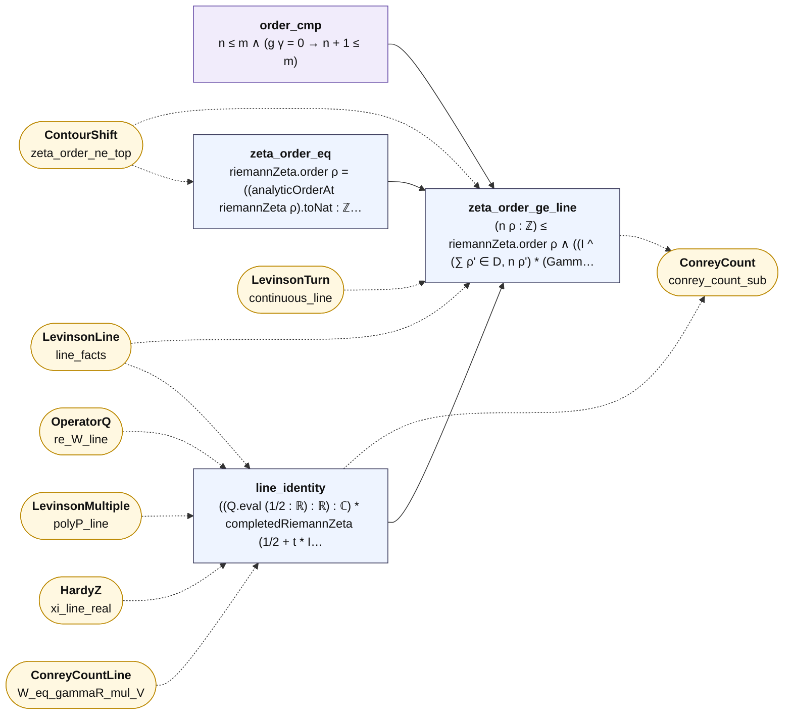

# `lean_stage3/Stage3/ConreyCountOrder.lean`

> **Read from the source text.** This file changed after the last `python3 utilities/lean_map.py --dump`, so the arrows on this page are names occurring in each proof and have not been confirmed by Lean.

ConreyCountOrder — block S13 of `lean_stage3/design/stencil.md`, B4 step 1, the zeros of `V` on the line. 2026-11-25.

4 theorems, 0 definitions, 244 lines. 

**Imports:** [`ConreyCountLine`](../lean_stage3/ConreyCountLine.md), [`ContourShift`](../lean_stage3/ContourShift.md), [`LevinsonWindowNear`](../lean_stage3/LevinsonWindowNear.md)  
**Imported by:** [`ConreyCount`](../lean_stage3/ConreyCount.md)

## The picture



An arrow A → B reads "A is used in the proof of B". Green: counting, integers only. Violet: shape, analysis with no ζ. Blue: reads ζ. A name ending in ■ is an end: nothing else uses it. Red: contains `sorry`. Yellow: theorems in another file, counted; a dotted arrow crosses files. Definitions are not drawn; they are listed below the diagram.

## Theorems

<a name="ConreyCount-order_cmp"></a>
### `ConreyCount.order_cmp`

line 47 · arrows read from text

**Shape.** Uses real or complex analysis; nothing in it or beneath it reads ζ.

**Why.** Comparing orders along a real variable. If `(t − γ)^m f t = (t − γ)^n g t` near `γ`, with `f`, `g` continuous at `γ` and `f γ ≠ 0`, then `n ≤ m`, and `n + 1 ≤ m` if `g γ = 0`.

**Proves**

```lean
n ≤ m ∧ (g γ = 0 → n + 1 ≤ m)
```

**Needs** (its hypotheses)

  - `` hf : ContinuousAt f γ ``
  - `` hg : ContinuousAt g γ ``
  - `` hf0 : f γ ≠ 0 ``
  - `` heq : ∀ᶠ t in 𝓝 γ, (((t - γ : ℝ) : ℂ)) ^ m * f t = (((t - γ : ℝ) : ℂ)) ^ n * g t ``

**Fed by:** no theorem of this repo; it stands on Mathlib.

**Feeds** (1 that use it)

  - [`ConreyCount.zeta_order_ge_line`](#ConreyCount-zeta_order_ge_line) — `` (n ρ : ℤ) ≤ riemannZeta.order ρ ∧ ((I ^ (∑ ρ' ∈ D, n ρ') * (Gammaℝ ρ * H ρ)).re = 0 → (n ρ : ℤ) + 1 ≤ riemannZeta.order ρ) ``

<a name="ConreyCount-zeta_order_eq"></a>
### `ConreyCount.zeta_order_eq`

line 88 · arrows read from text

**Reads ζ.** It, or something it rests on, uses the zeta function, its zeros or the Riemann hypothesis.

**Why.** The tree's order of `ζ` is its analytic order off the pole.

**Proves**

```lean
riemannZeta.order ρ = ((analyticOrderAt riemannZeta ρ).toNat : ℤ)
```

**Needs** (its hypotheses)

  - `` hρ1 : ρ ≠ 1 ``

**Fed by** (1 theorem its proof uses)

  - [`ContourShift.zeta_order_ne_top`](../lean_stage3/ContourShift.md#ContourShift-zeta_order_ne_top) (ContourShift) — `` analyticOrderAt riemannZeta ρ ≠ ⊤ ``

**Feeds** (1 that use it)

  - [`ConreyCount.zeta_order_ge_line`](#ConreyCount-zeta_order_ge_line) — `` (n ρ : ℤ) ≤ riemannZeta.order ρ ∧ ((I ^ (∑ ρ' ∈ D, n ρ') * (Gammaℝ ρ * H ρ)).re = 0 → (n ρ : ℤ) + 1 ≤ riemannZeta.order ρ) ``

<a name="ConreyCount-line_identity"></a>
### `ConreyCount.line_identity`

line 100 · arrows read from text

**Reads ζ.** It, or something it rests on, uses the zeta function, its zeros or the Riemann hypothesis.

**Why.** The real identity on the line. For `V = P·H` with `D` on the line and `F = i^K·Gammaℝ·H`: `Q(1/2)·Λ(1/2 + t i) = p(t)·Re F(t)`, `p(t) = Π_{ρ∈D}(t − Im ρ)^{n ρ}`.

**Proves**

```lean
((Q.eval (1/2 : ℝ) : ℝ) : ℂ) * completedRiemannZeta (1/2 + t * I) = (((∏ ρ ∈ D, (t - ρ.im) ^ n ρ) * (I ^ (∑ ρ ∈ D, n ρ) * (Gammaℝ (1/2 + t * I) * H (1/2 + t * I))).re : ℝ) : ℂ)
```

**Needs** (its hypotheses)

  - `` hQ : ∀ x : ℝ, Q.derivative.eval x = Q.derivative.eval (1 - x) ``
  - `` hD : ∀ ρ ∈ D, ρ.re = 1/2 ``
  - `` hVPH : ∀ s, V Q L s = polyP D n s * H s ``
  - `` t : ℝ ``

**Fed by** (5 theorems its proof uses)

  - [`ConreyCount.W_eq_gammaR_mul_V`](../lean_stage3/ConreyCountLine.md#ConreyCount-W_eq_gammaR_mul_V) (ConreyCountLine) — `` OperatorQ.W Q L s = Gammaℝ s * V Q L s ``
  - [`HardyZ.xi_line_real`](../lean_stage3/HardyZ.md#HardyZ-xi_line_real) (HardyZ) — `` (completedRiemannZeta (1/2 + t * Complex.I)).im = 0 ``
  - [`LevinsonLine.line_facts`](../lean_stage3/LevinsonLine.md#LevinsonLine-line_facts) (LevinsonLine) — `` ((1/2 : ℂ) + t * I) ≠ 0 ∧ ((1/2 : ℂ) + t * I) ≠ 1 ∧ 0 < ((1/2 : ℂ) + t * I).re ``
  - [`LevinsonMultiple.polyP_line`](../lean_stage3/LevinsonMultiple.md#LevinsonMultiple-polyP_line) (LevinsonMultiple) — `` polyP D n (1/2 + t * I) = I ^ (∑ ρ ∈ D, n ρ) * ((∏ ρ ∈ D, (t - ρ.im) ^ n ρ : ℝ) : ℂ) ``
  - [`OperatorQ.re_W_line`](../lean_stage3/OperatorQ.md#OperatorQ-re_W_line) (OperatorQ) — `` (W Q L ((1/2 : ℂ) + t * I)).re = Q.eval (1/2) * (completedRiemannZeta ((1/2 : ℂ) + t * I)).re ``

**Definitions its proof touches:** [`ConreyCount.V`](../lean_stage3/ConreyCountLine.md#ConreyCount-V), [`LevinsonMultiple.polyP`](../lean_stage3/LevinsonMultiple.md#LevinsonMultiple-polyP), [`OperatorQ.W`](../lean_stage3/OperatorQ.md#OperatorQ-W)

**Feeds** (2 that use it)

  - [`ConreyCount.conrey_count_sub`](../lean_stage3/ConreyCount.md#ConreyCount-conrey_count_sub) (ConreyCount) — `` (riemannZeta.N b - riemannZeta.N a) - 2 * Littlewood.countRight (V Q L) ((1/2 : ℂ) + a * I) ((3 : ℂ) + b * I) (1/2) - (30 * Real.log b + 42 * Real.log… ``
  - [`ConreyCount.zeta_order_ge_line`](#ConreyCount-zeta_order_ge_line) — `` (n ρ : ℤ) ≤ riemannZeta.order ρ ∧ ((I ^ (∑ ρ' ∈ D, n ρ') * (Gammaℝ ρ * H ρ)).re = 0 → (n ρ : ℤ) + 1 ≤ riemannZeta.order ρ) ``

<a name="ConreyCount-zeta_order_ge_line"></a>
### `ConreyCount.zeta_order_ge_line`

line 124 · arrows read from text

**Reads ζ.** It, or something it rests on, uses the zeta function, its zeros or the Riemann hypothesis.

**Why.** The order of `ζ` at a zero of `V` on the line. For `V = P·H` with `D` on the line, `H` analytic at `ρ ∈ D` and `Q(1/2) ≠ 0`: `n ρ ≤ ord ζ ρ`, and `n ρ + 1 ≤ ord ζ ρ` where `Re F(Im ρ) = 0`.

**Proves**

```lean
(n ρ : ℤ) ≤ riemannZeta.order ρ ∧ ((I ^ (∑ ρ' ∈ D, n ρ') * (Gammaℝ ρ * H ρ)).re = 0 → (n ρ : ℤ) + 1 ≤ riemannZeta.order ρ)
```

**Needs** (its hypotheses)

  - `` hQ : ∀ x : ℝ, Q.derivative.eval x = Q.derivative.eval (1 - x) ``
  - `` hQh : Q.eval (1/2) ≠ 0 ``
  - `` hD : ∀ ρ ∈ D, ρ.re = 1/2 ``
  - `` hVPH : ∀ s, V Q L s = polyP D n s * H s ``
  - `` hρ : ρ ∈ D ``
  - `` hHa : AnalyticAt ℂ H ρ ``

**Fed by** (6 theorems its proof uses)

  - [`ConreyCount.line_identity`](#ConreyCount-line_identity) — `` ((Q.eval (1/2 : ℝ) : ℝ) : ℂ) * completedRiemannZeta (1/2 + t * I) = (((∏ ρ ∈ D, (t - ρ.im) ^ n ρ) * (I ^ (∑ ρ ∈ D, n ρ) * (Gammaℝ (1/2 + t * I) * H (1… ``
  - [`ConreyCount.order_cmp`](#ConreyCount-order_cmp) — `` n ≤ m ∧ (g γ = 0 → n + 1 ≤ m) ``
  - [`ConreyCount.zeta_order_eq`](#ConreyCount-zeta_order_eq) — `` riemannZeta.order ρ = ((analyticOrderAt riemannZeta ρ).toNat : ℤ) ``
  - [`ContourShift.zeta_order_ne_top`](../lean_stage3/ContourShift.md#ContourShift-zeta_order_ne_top) (ContourShift) — `` analyticOrderAt riemannZeta ρ ≠ ⊤ ``
  - [`LevinsonLine.line_facts`](../lean_stage3/LevinsonLine.md#LevinsonLine-line_facts) (LevinsonLine) — `` ((1/2 : ℂ) + t * I) ≠ 0 ∧ ((1/2 : ℂ) + t * I) ≠ 1 ∧ 0 < ((1/2 : ℂ) + t * I).re ``
  - [`LevinsonTurn.continuous_line`](../lean_stage3/LevinsonTurn.md#LevinsonTurn-continuous_line) (LevinsonTurn) — `` Continuous (fun t : ℝ => (1/2 + t * I : ℂ)) ``

**Definitions its proof touches:** [`ConreyCount.V`](../lean_stage3/ConreyCountLine.md#ConreyCount-V), [`LevinsonMultiple.polyP`](../lean_stage3/LevinsonMultiple.md#LevinsonMultiple-polyP)

**Feeds** (1 that use it)

  - [`ConreyCount.conrey_count_sub`](../lean_stage3/ConreyCount.md#ConreyCount-conrey_count_sub) (ConreyCount) — `` (riemannZeta.N b - riemannZeta.N a) - 2 * Littlewood.countRight (V Q L) ((1/2 : ℂ) + a * I) ((3 : ℂ) + b * I) (1/2) - (30 * Real.log b + 42 * Real.log… ``

