# `lean_stage3/Stage3/ContourShift.lean`

**What it does** (its own header): # The contour shift — slices 2, 3, 4 (hEF's build order, entry 257) Written as the slice map for the contour shift, with named `sorry`s so the obligations were real Lean statements before proof. S2 and S4 are proved here; S3 is proved downstream (`EdgeBound`, `Glue`) and its placeholder is gone. Sorry-free since 2026-09-01.

**Imports:** [`Assembly`](../lean_stage3/Assembly.md), [`JensenCount`](../lean_stage3/JensenCount.md), [`PerronKernel`](../lean_stage3/PerronKernel.md).
**Imported by:** [`Stage3`](../lean_stage3/Stage3.md), [`LandauPoleLocal`](../lean_stage3/LandauPoleLocal.md), [`ZetaGrowth`](../lean_stage3/ZetaGrowth.md).

```mermaid
flowchart LR
  n0["zeroGap<br/>(def)"]:::dfn
  n1["zeroGap_pos<br/>⊢ 0 ＜ zeroGap T"]:::thm
  n2["zeroGap_le<br/>⊢ zeroGap T ≤ 9/10"]:::thm
  n3["zeta_analyticAt<br/>⊢ AnalyticAt ℂ riemannZeta ρ"]:::thm
  n4["one_le_zeta_order<br/>⊢ 1 ≤ analyticOrderNatAt riemannZeta ρ"]:::thm
  n5["partner_zero<br/>⊢ ∃ ρ' : ℂ, riemannZeta ρ' = 0 ∧ ρ'.im = ρ.im ∧ 1/2 ≤ ρ'.re ∧ ρ'.re ＜ 1"]:::thm
  n6["mem_zetaWindow<br/>⊢ ρ ∈ Stage3.zetaWindow T₀"]:::thm
  n7["goodT_exists<br/>⊢ ∃ T' ∈ Set.Icc T (T+1), ∀ ρ : ℂ, riemannZeta ρ = 0 → 0 ＜ ρ.re → zeroGa…"]:::thm
  n8["borderIntegrable_sum_poles<br/>⊢ RectangleBorderIntegrable (fun s ↦ ∑ p ∈ P, A p / (s - p)) z w"]:::thm
  n9["rectangleIntegral_sum_poles<br/>⊢ RectangleIntegral' (fun s ↦ ∑ p ∈ P, A p / (s - p)) z w = ∑ p ∈ P, A p"]:::thm
  n10["residue_rectangle_multi<br/>⊢ RectangleIntegral' f z w = ∑ p ∈ P, A p"]:::thm
  n11["residue_rectangle_of_local<br/>⊢ RectangleIntegral' f z w = ∑ p ∈ P, A p"]:::thm
  n12["analyticAt_dslope<br/>⊢ AnalyticAt ℂ (dslope f p) p"]:::thm
  n13["div_sub_eq_dslope<br/>⊢ f s / (s - p) = f p / (s - p) + dslope f p s"]:::thm
  n14["zeta_local_data<br/>⊢ ∃ h : ℂ → ℂ, AnalyticAt ℂ h p ∧ ∀ᶠ s in nhdsWithin p {p}ᶜ, - deriv rie…"]:::thm
  n15["on<br/>⊢ "]:::end_
  n16["zeta_order_ne_top<br/>⊢ analyticOrderAt riemannZeta ρ ≠ ⊤"]:::thm
  n17["zeta_local_data_zero<br/>⊢ ∃ h : ℂ → ℂ, AnalyticAt ℂ h ρ ∧ ∀ᶠ s in nhdsWithin ρ {ρ}ᶜ, - deriv rie…"]:::thm
  n18["zeta_local_data_one<br/>⊢ ∃ h : ℂ → ℂ, AnalyticAt ℂ h 1 ∧ ∀ᶠ s in nhdsWithin 1 {1}ᶜ, - deriv rie…"]:::thm
  n19["zeta_local_data_origin<br/>⊢ ∃ h : ℂ → ℂ, AnalyticAt ℂ h 0 ∧ ∀ᶠ s in nhdsWithin 0 {0}ᶜ, - deriv rie…"]:::thm
  n20["zeta_ne_zero_of_re_mem<br/>⊢ riemannZeta w ≠ 0"]:::thm
  n21["sq_mul_zeta_analyticAt_one<br/>⊢ AnalyticAt ℂ (fun s ↦ (s - 1)^2 * riemannZeta s) 1"]:::thm
  n22["zeta_meromorphicOn<br/>⊢ MeromorphicOn riemannZeta U"]:::thm
  n23["zeta_zeros_rectangle_finite<br/>⊢ {ρ : ℂ | riemannZeta ρ = 0 ∧ ρ ∈ Rectangle z w}.Finite"]:::thm
  n24["order_bridge<br/>⊢ ((riemannZeta.order ρ : ℤ) : ℂ) = ((analyticOrderNatAt riemannZeta ρ :…"]:::thm
  n25["zeroPartialSum_eq_sum<br/>⊢ Stage3.zeroPartialSum x T' = ∑ p ∈ ZF, ((analyticOrderNatAt riemannZet…"]:::thm
  n26["analyticAt_conj_conj<br/>⊢ AnalyticAt ℂ (fun w ↦ (starRingEnd ℂ) (g ((starRingEnd ℂ) w))) ((starR…"]:::thm
  n27["zeta_order_conj<br/>⊢ analyticOrderNatAt riemannZeta ((starRingEnd ℂ) ρ) = analyticOrderNatA…"]:::thm
  n28["zeta_order_reflect<br/>⊢ analyticOrderNatAt riemannZeta (1 - (starRingEnd ℂ) ρ) = analyticOrder…"]:::thm
  n29["residue_identity<br/>⊢ RectangleIntegral' (fun s : ℂ ↦ (- deriv riemannZeta s / riemannZeta s…"]:::thm
  x0(["Assembly · zeroPartialSum"]):::ext
  x1(["EdgeBound · ball_order_sum_le"]):::ext
  x2(["EdgeBound · ball_zero_shape"]):::ext
  x3(["EdgeBound · gz_order_eq"]):::ext
  x4(["EdgeBound · gz_zeros_ball_finite"]):::ext
  x5(["EdgeNum · C2n"]):::ext
  x6(["EdgeNum · C2n_pos"]):::ext
  x7(["EdgeNum · ball_order_sum_le_num"]):::ext
  x8(["Glue · band_order_sum_le"]):::ext
  x9(["Glue · edge_horizontal_bound"]):::ext
  x10(["Glue · edge_left_bound"]):::ext
  x11(["Glue · explicit_formula_poly"]):::ext
  x12(["Glue · zeroPartialSum_swap"]):::ext
  x13(["Glue · zeta_logderiv_good_bound"]):::ext
  x14(["GlueFloor · edge_left_sharp"]):::ext
  x15(["GlueFloor · explicit_formula_split"]):::ext
  x16(["GlueNum · band_order_sum_le_num"]):::ext
  x17(["GlueNum · edge_horizontal_bound_num"]):::ext
  x18(["GlueNum · edge_left_sharp_num"]):::ext
  x19(["GlueNum · explicit_formula_split_num"]):::ext
  x20(["GlueNum · zeroPartialSum_swap_num"]):::ext
  x21(["GlueNum · zeta_logderiv_good_bound_num"]):::ext
  x22(["JensenCount · zetaWindow"]):::ext
  x23(["JensenCount · zetaWindow_finite"]):::ext
  x24(["JensenCount · zeta_local_zero_count"]):::ext
  x25(["LandauPoleLocal · Phi_principal_part"]):::ext
  x26(["LandauPoleLocal · differentiableAt_Phi"]):::ext
  x27(["LandauZeroSide · zero_side"]):::ext
  x28(["LowCount · low_rect_count"]):::ext
  x29(["LowEdge · logDerivZeta_low_edge"]):::ext
  x30(["RouteNum · C2n_le"]):::ext
  x31(["ZetaGrowth · sq_mul_zeta_analytic"]):::ext
  n0 --> n1
  n0 --> n2
  n0 --> n29
  n0 --> n7
  n0 --> x13
  n0 --> x17
  n0 --> x21
  n0 --> x9
  n1 --> n29
  n1 --> x13
  n1 --> x21
  n10 --> n11
  n11 --> n29
  n12 --> n14
  n12 --> n19
  n13 --> n14
  n13 --> n19
  n14 --> n17
  n14 --> n18
  n16 --> n17
  n16 --> n23
  n16 --> n24
  n16 --> n27
  n16 --> n28
  n16 --> x25
  n17 --> n29
  n18 --> n29
  n19 --> n29
  n2 --> n7
  n2 --> x13
  n2 --> x21
  n20 --> n29
  n20 --> x10
  n20 --> x12
  n20 --> x13
  n20 --> x14
  n20 --> x18
  n20 --> x2
  n20 --> x20
  n20 --> x21
  n20 --> x29
  n21 --> n22
  n21 --> x31
  n22 --> n23
  n23 --> n29
  n23 --> x1
  n23 --> x12
  n23 --> x20
  n23 --> x28
  n23 --> x30
  n23 --> x4
  n23 --> x5
  n23 --> x6
  n23 --> x7
  n24 --> n25
  n25 --> n29
  n25 --> x12
  n25 --> x20
  n26 --> n27
  n27 --> n28
  n27 --> x16
  n27 --> x27
  n27 --> x8
  n28 --> x1
  n28 --> x16
  n28 --> x7
  n28 --> x8
  n29 --> x11
  n29 --> x15
  n29 --> x19
  n3 --> n16
  n3 --> n17
  n3 --> n19
  n3 --> n22
  n3 --> n23
  n3 --> n24
  n3 --> n27
  n3 --> n28
  n3 --> n29
  n3 --> n4
  n3 --> x10
  n3 --> x14
  n3 --> x18
  n3 --> x25
  n3 --> x26
  n3 --> x3
  n3 --> x31
  n4 --> n15
  n4 --> n7
  n4 --> x25
  n4 --> x27
  n5 --> n7
  n6 --> n7
  n6 --> x1
  n6 --> x16
  n6 --> x7
  n6 --> x8
  n7 --> x11
  n7 --> x15
  n7 --> x19
  n8 --> n10
  n8 --> n9
  n9 --> n10
  x0 --> n25
  x0 --> n29
  x22 --> n6
  x23 --> n7
  x24 --> n7
  classDef thm fill:#eef4ff,stroke:#335,color:#111
  classDef dfn fill:#f2f2f2,stroke:#777,color:#111
  classDef end_ fill:#e7f7e7,stroke:#2a7,color:#111,stroke-width:2px
  classDef lone fill:#fff,stroke:#999,color:#111,stroke-dasharray:4 3
  classDef bad fill:#ffe5e5,stroke:#c22,color:#111,stroke-width:2px
  classDef ext fill:#fff8e1,stroke:#b80,color:#111,stroke-dasharray:2 2
```

Blue: theorem. Green: a theorem nothing else uses (an end). Dashed white: connects to nothing. Grey: definition. Red: contains `sorry`. Yellow: in another file. An arrow A → B reads "A is used by B".

## Every declaration

| declaration | proves (output) | needs (input) | why (its own docstring) | uses | used by |
|---|---|---|---|---|---|
| `ContourShift.zeroGap` def, line 43 | ℝ | T : ℝ | The ordinate gap the pigeonhole delivers: crude-explicit, `1/(180·log T + 1060)`. | — | `ContourShift.goodT_exists`, `ContourShift.residue_identity`, `ContourShift.zeroGap_le`, `ContourShift.zeroGap_pos`, `Glue.edge_horizontal_bound`, `Glue.zeta_logderiv_good_bound`, `Glue.edge_horizontal_bound_num`, `Glue.zeta_logderiv_good_bound_num` |
| `ContourShift.zeroGap_pos` theorem, line 45 | 0 &lt; zeroGap T | hT : 2 ≤ T | — | `ContourShift.zeroGap` | `ContourShift.residue_identity`, `Glue.zeta_logderiv_good_bound`, `Glue.zeta_logderiv_good_bound_num` |
| `ContourShift.zeroGap_le` theorem, line 50 | zeroGap T ≤ 9/10 | hT : 2 ≤ T | — | `ContourShift.zeroGap` | `ContourShift.goodT_exists`, `Glue.zeta_logderiv_good_bound`, `Glue.zeta_logderiv_good_bound_num` |
| `ContourShift.zeta_analyticAt` theorem, line 57 | AnalyticAt ℂ riemannZeta ρ | hρ : ρ ≠ 1 | `ζ` is analytic away from the pole. | — | `ContourShift.one_le_zeta_order`, `ContourShift.order_bridge`, `ContourShift.residue_identity`, `ContourShift.zeta_local_data_origin`, `ContourShift.zeta_local_data_zero`, `ContourShift.zeta_meromorphicOn`, `ContourShift.zeta_order_conj`, `ContourShift.zeta_order_ne_top`, `ContourShift.zeta_order_reflect`, `ContourShift.zeta_zeros_rectangle_finite`, `EdgeBound.gz_order_eq`, `Glue.edge_left_bound`, `Glue.edge_left_sharp`, `Glue.edge_left_sharp_num`, `LandauPoleLocal.Phi_principal_part`, `LandauPoleLocal.differentiableAt_Phi`, `ZetaGrowth.sq_mul_zeta_analytic` |
| `ContourShift.one_le_zeta_order` theorem, line 64 | 1 ≤ analyticOrderNatAt riemannZeta ρ | hρ1 : ρ ≠ 1; hz : riemannZeta ρ = 0 | At a zero away from the pole, the order is at least one. | `ContourShift.zeta_analyticAt` | `ContourShift.goodT_exists`, `ContourShift.on`, `LandauPoleLocal.Phi_principal_part`, `LandauZeroSide.zero_side` |
| `ContourShift.partner_zero` theorem, line 103 | ∃ ρ' : ℂ, riemannZeta ρ' = 0 ∧ ρ'.im = ρ.im ∧ 1/2 ≤ ρ'.re ∧ ρ'.re &lt; 1 | hz : riemannZeta ρ = 0; hre : 0 &lt; ρ.re; hre1 : ρ.re &lt; 1 | The reflection partner: every ordinate of a nontrivial zero carries a zero with `re ∈ [1/2, 1)` at the same ordinate. | — | `ContourShift.goodT_exists` |
| `ContourShift.mem_zetaWindow` theorem, line 133 | ρ ∈ Stage3.zetaWindow T₀ | hz : riemannZeta ρ = 0; hre : 1/2 ≤ ρ.re; hre1 : ρ.re &lt; 1; him : \|ρ.im - T₀\| ≤ 9/10 | Membership in a `zetaWindow` from coordinate bounds. | `Stage3.zetaWindow` | `ContourShift.goodT_exists`, `EdgeBound.ball_order_sum_le`, `EdgeBound.ball_order_sum_le_num`, `Glue.band_order_sum_le`, `Glue.band_order_sum_le_num` |
| `ContourShift.goodT_exists` theorem, line 151 | ∃ T' ∈ Set.Icc T (T+1), ∀ ρ : ℂ, riemannZeta ρ = 0 → 0 &lt; ρ.re → zeroGap T ≤ \|ρ.im - T'\| | hT : 2 ≤ T | Slice 2 — good heights exist. | `ContourShift.mem_zetaWindow`, `ContourShift.one_le_zeta_order`, `ContourShift.partner_zero`, `ContourShift.zeroGap`, `ContourShift.zeroGap_le`, `Stage3.zetaWindow_finite`, `Stage3.zeta_local_zero_count` | `Glue.explicit_formula_poly`, `Glue.explicit_formula_split`, `Glue.explicit_formula_split_num` |
| `ContourShift.borderIntegrable_sum_poles` theorem, line 339 | RectangleBorderIntegrable (fun s ↦ ∑ p ∈ P, A p / (s - p)) z w | pIn : ∀ p ∈ P, Rectangle z w ∈ nhds p | A finite sum of simple-pole principal parts is border-integrable when every pole is interior. | — | `ContourShift.rectangleIntegral_sum_poles`, `ContourShift.residue_rectangle_multi` |
| `ContourShift.rectangleIntegral_sum_poles` theorem, line 354 | RectangleIntegral' (fun s ↦ ∑ p ∈ P, A p / (s - p)) z w = ∑ p ∈ P, A p | zRe_le_wRe : z.re ≤ w.re; zIm_le_wIm : z.im ≤ w.im; pIn : ∀ p ∈ P, Rectangle z w ∈ nhds p | The rectangle integral of a finite sum of simple-pole principal parts, all poles interior, is the sum of the residues. | `ContourShift.borderIntegrable_sum_poles` | `ContourShift.residue_rectangle_multi` |
| `ContourShift.residue_rectangle_multi` theorem, line 387 | RectangleIntegral' f z w = ∑ p ∈ P, A p | zRe_le_wRe : z.re ≤ w.re; zIm_le_wIm : z.im ≤ w.im; pIn : ∀ p ∈ P, Rectangle z w ∈ nhds p; gHolo : HolomorphicOn g (Rectangle z w); principal : Set.EqOn (f - fun s ↦ ∑ p ∈ P, A p / (s - p)) g (Rectangle z w \ (P : Set ℂ)) | The multi-pole residue theorem on a rectangle. If `f` agrees off the pole set with `g + Σ_p A p/(s − p)` for `g` holomorphic on the whole rectangle and every pole interior, then the rectangle integral of `f` collects every residue. | `ContourShift.borderIntegrable_sum_poles`, `ContourShift.rectangleIntegral_sum_poles` | `ContourShift.residue_rectangle_of_local` |
| `ContourShift.residue_rectangle_of_local` theorem, line 416 | RectangleIntegral' f z w = ∑ p ∈ P, A p | zRe_le_wRe : z.re ≤ w.re; zIm_le_wIm : z.im ≤ w.im; pIn : ∀ p ∈ P, Rectangle z w ∈ nhds p; fHolo : HolomorphicOn f (Rectangle z w \ (P : Set ℂ)); hloc : ∀ p ∈ P, ∃ h : ℂ → ℂ, AnalyticAt ℂ h p ∧ ∀ᶠ s in nhdsWithin p {p}ᶜ, f s = h s + A p / (s - p) | The residue theorem from local data. `f` holomorphic on the rectangle off a finite interior pole set, and at each pole `p` equal to `(analytic at p) + A p/(s − p)` on a punctured neighborhood: the rectangle integral collects every residue. The global extension is glued from the local analytic parts. | `ContourShift.residue_rectangle_multi` | `ContourShift.residue_identity` |
| `ContourShift.analyticAt_dslope` theorem, line 498 | AnalyticAt ℂ (dslope f p) p | hf : AnalyticAt ℂ f p | `dslope` of an analytic function is analytic at the point. | — | `ContourShift.zeta_local_data`, `ContourShift.zeta_local_data_origin` |
| `ContourShift.div_sub_eq_dslope` theorem, line 504 | f s / (s - p) = f p / (s - p) + dslope f p s | hsp : s ≠ p | Off the point, `f s/(s−p)` splits as `f p/(s−p) + dslope f p s`. | — | `ContourShift.zeta_local_data`, `ContourShift.zeta_local_data_origin` |
| `ContourShift.zeta_local_data` theorem, line 517 | ∃ h : ℂ → ℂ, AnalyticAt ℂ h p ∧ ∀ᶠ s in nhdsWithin p {p}ᶜ, - deriv riemannZeta s / riemannZeta s * ((x:ℝ):ℂ) ^ s / s = h s + (-(n:ℂ) * ((x:ℝ):ℂ) ^ p / p) / (s - p) | hx : 0 &lt; x; hp0 : p ≠ 0; hg : AnalyticAt ℂ g p; hgp : g p ≠ 0; hfac : ∀ᶠ s in nhdsWithin p {p}ᶜ, riemannZeta s = (s - p) ^ n * g s | The local pole data of `G = (−ζ′/ζ)·x^s/s` at a factorization point. Where `ζ` factors as `(s−p)^n·g` with `g` analytic and nonvanishing at `p ≠ 0`, `G` splits as `analytic + (−n·x^p/p)/(s−p)` on a punctured neighborhood: the pole is simple with residue `−n·x^p/p`. Covers every nontrivial zero (`n = order ≥ 1`) and the pole of `ζ` at `1` (`n = −1`, residue `… | `ContourShift.analyticAt_dslope`, `ContourShift.div_sub_eq_dslope` | `ContourShift.zeta_local_data_one`, `ContourShift.zeta_local_data_zero` |
| `ContourShift.on` theorem, line 590 | — | — | — | `ContourShift.one_le_zeta_order` | — |
| `ContourShift.zeta_order_ne_top` theorem, line 591 | analyticOrderAt riemannZeta ρ ≠ ⊤ | hρ1 : ρ ≠ 1 | The order of `ζ` at any point off the pole is finite (identity theorem on `ℂ∖{1}`, as in `one_le_zeta_order`). | `ContourShift.zeta_analyticAt` | `ContourShift.order_bridge`, `ContourShift.zeta_local_data_zero`, `ContourShift.zeta_order_conj`, `ContourShift.zeta_order_reflect`, `ContourShift.zeta_zeros_rectangle_finite`, `LandauPoleLocal.Phi_principal_part` |
| `ContourShift.zeta_local_data_zero` theorem, line 614 | ∃ h : ℂ → ℂ, AnalyticAt ℂ h ρ ∧ ∀ᶠ s in nhdsWithin ρ {ρ}ᶜ, - deriv riemannZeta s / riemannZeta s * ((x:ℝ):ℂ) ^ s / s = h s + (-(analyticOrderNatAt riemannZeta ρ : ℂ) * ((x:ℝ):ℂ) ^ ρ / ρ) / (s - ρ) | hx : 0 &lt; x; hρ0 : ρ ≠ 0; hρ1 : ρ ≠ 1; hz : riemannZeta ρ = 0 | Local pole data of `G` at a nontrivial zero: residue `−(order)·x^ρ/ρ`. | `ContourShift.zeta_analyticAt`, `ContourShift.zeta_local_data`, `ContourShift.zeta_order_ne_top` | `ContourShift.residue_identity` |
| `ContourShift.zeta_local_data_one` theorem, line 639 | ∃ h : ℂ → ℂ, AnalyticAt ℂ h 1 ∧ ∀ᶠ s in nhdsWithin 1 {1}ᶜ, - deriv riemannZeta s / riemannZeta s * ((x:ℝ):ℂ) ^ s / s = h s + ((x:ℝ):ℂ) / (s - 1) | hx : 0 &lt; x | Local pole data of `G` at `1`: residue `+x`. The factorization `ζ = (s−1)^{−1}·g` is built from the completed zeta function. | `ContourShift.zeta_local_data` | `ContourShift.residue_identity` |
| `ContourShift.zeta_local_data_origin` theorem, line 712 | ∃ h : ℂ → ℂ, AnalyticAt ℂ h 0 ∧ ∀ᶠ s in nhdsWithin 0 {0}ᶜ, - deriv riemannZeta s / riemannZeta s * ((x:ℝ):ℂ) ^ s / s = h s + (- deriv riemannZeta 0 / riemannZeta 0) / (s - 0) | hx : 0 &lt; x | Local pole data of `G` at `0`: residue `−ζ′(0)/ζ(0)`. | `ContourShift.analyticAt_dslope`, `ContourShift.div_sub_eq_dslope`, `ContourShift.zeta_analyticAt` | `ContourShift.residue_identity` |
| `ContourShift.zeta_ne_zero_of_re_mem` theorem, line 741 | riemannZeta w ≠ 0 | h1 : -1 ≤ w.re; h2 : w.re ≤ 0 | No zeros on the strip `re ∈ [−1, 0]`: the functional equation carries nonvanishing over from `re ∈ [1, 2]`. The cosine factor can only vanish at `s = 1`, where `ζ` has its pole instead. | — | `ContourShift.residue_identity`, `EdgeBound.ball_zero_shape`, `Glue.edge_left_bound`, `Glue.zeroPartialSum_swap`, `Glue.zeta_logderiv_good_bound`, `Glue.edge_left_sharp`, `Glue.edge_left_sharp_num`, `Glue.zeroPartialSum_swap_num`, `Glue.zeta_logderiv_good_bound_num`, `EdgeBound.logDerivZeta_low_edge` |
| `ContourShift.sq_mul_zeta_analyticAt_one` theorem, line 801 | AnalyticAt ℂ (fun s ↦ (s - 1)^2 * riemannZeta s) 1 | — | `(s−1)²·ζ` is analytic at `1`, from the unconditional completed-zeta formula (junk values at `s = 1` agree on both sides). | — | `ContourShift.zeta_meromorphicOn`, `ZetaGrowth.sq_mul_zeta_analytic` |
| `ContourShift.zeta_meromorphicOn` theorem, line 856 | MeromorphicOn riemannZeta U | U : Set ℂ | `ζ` is meromorphic on any set. | `ContourShift.sq_mul_zeta_analyticAt_one`, `ContourShift.zeta_analyticAt` | `ContourShift.zeta_zeros_rectangle_finite` |
| `ContourShift.zeta_zeros_rectangle_finite` theorem, line 864 | {ρ : ℂ \| riemannZeta ρ = 0 ∧ ρ ∈ Rectangle z w}.Finite | z w : ℂ | The zeros of `ζ` in a closed rectangle form a finite set. | `ContourShift.zeta_analyticAt`, `ContourShift.zeta_meromorphicOn`, `ContourShift.zeta_order_ne_top` | `ContourShift.residue_identity`, `EdgeBound.ball_order_sum_le`, `EdgeBound.gz_zeros_ball_finite`, `EdgeBound.C2n`, `EdgeBound.C2n_pos`, `EdgeBound.ball_order_sum_le_num`, `Glue.zeroPartialSum_swap`, `Glue.zeroPartialSum_swap_num`, `EdgeBound.low_rect_count`, `RouteNum.C2n_le` |
| `ContourShift.order_bridge` theorem, line 887 | ((riemannZeta.order ρ : ℤ) : ℂ) = ((analyticOrderNatAt riemannZeta ρ : ℕ) : ℂ) | hρ1 : ρ ≠ 1 | The ledger's `riemannZeta.order` agrees with `analyticOrderNatAt` away from the pole (mirrors PNT+ KadiriZeroCounting's own bridge). | `ContourShift.zeta_analyticAt`, `ContourShift.zeta_order_ne_top` | `ContourShift.zeroPartialSum_eq_sum` |
| `ContourShift.zeroPartialSum_eq_sum` theorem, line 905 | Stage3.zeroPartialSum x T' = ∑ p ∈ ZF, ((analyticOrderNatAt riemannZeta p : ℂ) * ((x : ℂ) ^ p / p)) | hiff : ∀ ρ : ℂ, ρ ∈ ZF ↔ (ρ ∈ Kadiri.NontrivialZeros ∧ \|ρ.im\| &lt; T') | `zeroPartialSum` as a concrete finite sum, over any `Finset` enumerating exactly the nontrivial zeros below the height. | `Stage3.zeroPartialSum`, `ContourShift.order_bridge` | `ContourShift.residue_identity`, `Glue.zeroPartialSum_swap`, `Glue.zeroPartialSum_swap_num` |
| `ContourShift.analyticAt_conj_conj` theorem, line 939 | AnalyticAt ℂ (fun w ↦ (starRingEnd ℂ) (g ((starRingEnd ℂ) w))) ((starRingEnd ℂ) p) | hg : AnalyticAt ℂ g p | Analyticity transports through conjugation: `conj ∘ g ∘ conj` is analytic at `conj p`. | — | `ContourShift.zeta_order_conj` |
| `ContourShift.zeta_order_conj` theorem, line 968 | analyticOrderNatAt riemannZeta ((starRingEnd ℂ) ρ) = analyticOrderNatAt riemannZeta ρ | hρ1 : ρ ≠ 1 | The order of `ζ` at the conjugate of a point equals the order at the point (`ζ(conj s) = conj ζ(s)`). | `ContourShift.analyticAt_conj_conj`, `ContourShift.zeta_analyticAt`, `ContourShift.zeta_order_ne_top` | `ContourShift.zeta_order_reflect`, `Glue.band_order_sum_le`, `Glue.band_order_sum_le_num`, `LandauZeroSide.zero_side` |
| `ContourShift.zeta_order_reflect` theorem, line 1026 | analyticOrderNatAt riemannZeta (1 - (starRingEnd ℂ) ρ) = analyticOrderNatAt riemannZeta ρ | h0 : 0 &lt; ρ.re; h1 : ρ.re &lt; 1 | The reflection-order lemma: the order of `ζ` at `1 − conj ρ` equals the order at `ρ`, on the open strip — the functional equation's factor is analytic and nonvanishing there. | `ContourShift.zeta_analyticAt`, `ContourShift.zeta_order_conj`, `ContourShift.zeta_order_ne_top` | `EdgeBound.ball_order_sum_le`, `EdgeBound.ball_order_sum_le_num`, `Glue.band_order_sum_le`, `Glue.band_order_sum_le_num` |
| `ContourShift.residue_identity` theorem, line 1217 | RectangleIntegral' (fun s : ℂ ↦ (- deriv riemannZeta s / riemannZeta s) * ((x:ℝ):ℂ) ^ s / s) (((-1/4 : ℝ):ℂ) - Complex.I * T') (((1 + 1/Real.log x : ℝ):ℂ) + Complex.I * T') = (x : ℂ) - deriv riemannZeta 0 / riemannZeta 0 - Stage3.zeroPartialSum x T' | hx : 16 ≤ x; hT : 2 ≤ T; hT' : T' ∈ Set.Icc T (T+1); hgood : ∀ ρ : ℂ, riemannZeta ρ = 0 → 0 &lt; ρ.re → zeroGap T ≤ \|ρ.im - T'\| | Slice 4 — the residue identity on the good rectangle. The zeros enter here: pulling the line integral to `σ = −1` collects the pole at `1` (residue `x`), the pole at `0` (residue `−ζ′/ζ(0)`), and every nontrivial zero below height `T'` (residue `−m_ρ·x^ρ/ρ`). | `Stage3.zeroPartialSum`, `ContourShift.residue_rectangle_of_local`, `ContourShift.zeroGap`, `ContourShift.zeroGap_pos`, `ContourShift.zeroPartialSum_eq_sum`, `ContourShift.zeta_analyticAt`, `ContourShift.zeta_local_data_one`, `ContourShift.zeta_local_data_origin`, `ContourShift.zeta_local_data_zero`, `ContourShift.zeta_ne_zero_of_re_mem`, `ContourShift.zeta_zeros_rectangle_finite` | `Glue.explicit_formula_poly`, `Glue.explicit_formula_split`, `Glue.explicit_formula_split_num` |
