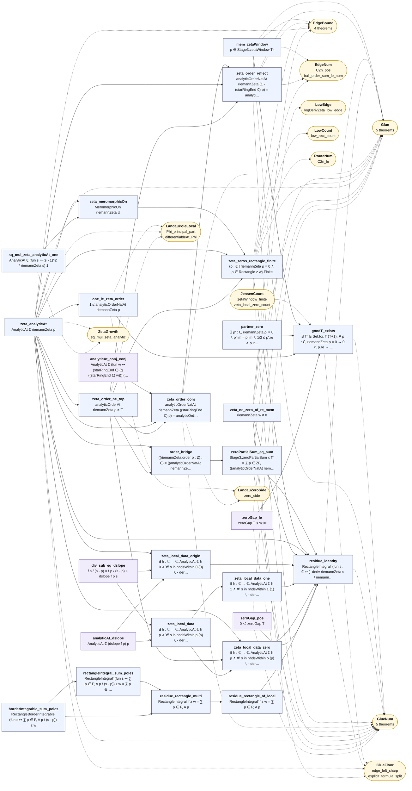

# `lean_stage3/Stage3/ContourShift.lean`

# The contour shift — slices 2, 3, 4 (hEF's build order, entry 257) Written as the slice map for the contour shift, with named `sorry`s so the obligations were real Lean statements before proof. S2 and S4 are proved here; S3 is proved downstream (`EdgeBound`, `Glue`) and its placeholder is gone. Sorry-free since 2026-09-01.

28 theorems, 1 definition, 1430 lines. Arrows are Lean's own record of what each proof uses.

**Imports:** [`Assembly`](../lean_stage3/Assembly.md), [`JensenCount`](../lean_stage3/JensenCount.md), [`PerronKernel`](../lean_stage3/PerronKernel.md)  
**Imported by:** [`Stage3`](../lean_stage3/Stage3.md), [`LandauPoleLocal`](../lean_stage3/LandauPoleLocal.md), [`ZetaGrowth`](../lean_stage3/ZetaGrowth.md)

## The picture



An arrow A → B reads "A is used in the proof of B". Green: counting, integers only. Violet: shape, analysis with no ζ. Blue: reads ζ. A name ending in ■ is an end: nothing else uses it. Red: contains `sorry`. Yellow: theorems in another file, counted; a dotted arrow crosses files. Definitions are not drawn; they are listed below the diagram.

## Definitions

<a name="ContourShift-zeroGap"></a>
### `ContourShift.zeroGap`

def · line 43

The ordinate gap the pigeonhole delivers: crude-explicit, `1/(180·log T + 1060)`.

- **Is:** `` zeroGap (T : ℝ) : ℝ := 1 / (180 * Real.log T + 1060) ``
- **Used by 11:** [`ContourShift.goodT_exists`](#ContourShift-goodT_exists), [`ContourShift.residue_identity`](#ContourShift-residue_identity), [`ContourShift.zeroGap_le`](#ContourShift-zeroGap_le), [`ContourShift.zeroGap_pos`](#ContourShift-zeroGap_pos), [`Glue.edge_horizontal_bound`](../lean_stage3/Glue.md#Glue-edge_horizontal_bound), [`Glue.explicit_formula_poly`](../lean_stage3/Glue.md#Glue-explicit_formula_poly), [`Glue.zeta_logderiv_good_bound`](../lean_stage3/Glue.md#Glue-zeta_logderiv_good_bound), [`Glue.explicit_formula_split`](../lean_stage3/GlueFloor.md#Glue-explicit_formula_split), [`Glue.edge_horizontal_bound_num`](../lean_stage3/GlueNum.md#Glue-edge_horizontal_bound_num), [`Glue.explicit_formula_split_num`](../lean_stage3/GlueNum.md#Glue-explicit_formula_split_num), [`Glue.zeta_logderiv_good_bound_num`](../lean_stage3/GlueNum.md#Glue-zeta_logderiv_good_bound_num)

## Theorems

<a name="ContourShift-zeroGap_pos"></a>
### `ContourShift.zeroGap_pos`

line 45

**Shape.** Uses real or complex analysis; nothing in it or beneath it reads ζ.

**Proves**

```lean
0 < zeroGap T
```

**Needs** (its hypotheses)

  - `` hT : 2 ≤ T ``

**Stated with:** [`ContourShift.zeroGap`](#ContourShift-zeroGap)

**Fed by:** no theorem of this repo; it stands on Mathlib and the definitions below.

**Feeds** (3 that use it)

  - [`ContourShift.residue_identity`](#ContourShift-residue_identity) — `` RectangleIntegral' (fun s : ℂ ↦ (- deriv riemannZeta s / riemannZeta s) * ((x:ℝ):ℂ) ^ s / s) (((-1/4 : ℝ):ℂ) - Complex.I * T') (((1 + 1/Real.log x : ℝ… ``
  - [`Glue.zeta_logderiv_good_bound`](../lean_stage3/Glue.md#Glue-zeta_logderiv_good_bound) (Glue) — `` ∃ C : ℝ, 0 < C ∧ ∀ T T' : ℝ, 2 ≤ T → T' ∈ Set.Icc T (T+1) → (∀ ρ : ℂ, riemannZeta ρ = 0 → 0 < ρ.re → ContourShift.zeroGap T ≤ |ρ.im - T'|) → ∀ u : ℂ, … ``
  - [`Glue.zeta_logderiv_good_bound_num`](../lean_stage3/GlueNum.md#Glue-zeta_logderiv_good_bound_num) (GlueNum) — `` ∀ T T' : ℝ, 2 ≤ T → T' ∈ Set.Icc T (T+1) → (∀ ρ : ℂ, riemannZeta ρ = 0 → 0 < ρ.re → ContourShift.zeroGap T ≤ |ρ.im - T'|) → ∀ u : ℂ, |u.im| = T' → -1/… ``

<a name="ContourShift-zeroGap_le"></a>
### `ContourShift.zeroGap_le`

line 50

**Shape.** Uses real or complex analysis; nothing in it or beneath it reads ζ.

**Proves**

```lean
zeroGap T ≤ 9/10
```

**Needs** (its hypotheses)

  - `` hT : 2 ≤ T ``

**Stated with:** [`ContourShift.zeroGap`](#ContourShift-zeroGap)

**Fed by:** no theorem of this repo; it stands on Mathlib and the definitions below.

**Feeds** (3 that use it)

  - [`ContourShift.goodT_exists`](#ContourShift-goodT_exists) — `` ∃ T' ∈ Set.Icc T (T+1), ∀ ρ : ℂ, riemannZeta ρ = 0 → 0 < ρ.re → zeroGap T ≤ |ρ.im - T'| ``
  - [`Glue.zeta_logderiv_good_bound`](../lean_stage3/Glue.md#Glue-zeta_logderiv_good_bound) (Glue) — `` ∃ C : ℝ, 0 < C ∧ ∀ T T' : ℝ, 2 ≤ T → T' ∈ Set.Icc T (T+1) → (∀ ρ : ℂ, riemannZeta ρ = 0 → 0 < ρ.re → ContourShift.zeroGap T ≤ |ρ.im - T'|) → ∀ u : ℂ, … ``
  - [`Glue.zeta_logderiv_good_bound_num`](../lean_stage3/GlueNum.md#Glue-zeta_logderiv_good_bound_num) (GlueNum) — `` ∀ T T' : ℝ, 2 ≤ T → T' ∈ Set.Icc T (T+1) → (∀ ρ : ℂ, riemannZeta ρ = 0 → 0 < ρ.re → ContourShift.zeroGap T ≤ |ρ.im - T'|) → ∀ u : ℂ, |u.im| = T' → -1/… ``

<a name="ContourShift-zeta_analyticAt"></a>
### `ContourShift.zeta_analyticAt`

line 57

**Reads ζ.** It, or something it rests on, uses the zeta function, its zeros or the Riemann hypothesis.

**Why.** `ζ` is analytic away from the pole.

**Proves**

```lean
AnalyticAt ℂ riemannZeta ρ
```

**Needs** (its hypotheses)

  - `` hρ : ρ ≠ 1 ``

**Fed by:** no theorem of this repo; it stands on Mathlib.

**Feeds** (17 that use it)

  - [`ContourShift.one_le_zeta_order`](#ContourShift-one_le_zeta_order) — `` 1 ≤ analyticOrderNatAt riemannZeta ρ ``
  - [`ContourShift.order_bridge`](#ContourShift-order_bridge) — `` ((riemannZeta.order ρ : ℤ) : ℂ) = ((analyticOrderNatAt riemannZeta ρ : ℕ) : ℂ) ``
  - [`ContourShift.residue_identity`](#ContourShift-residue_identity) — `` RectangleIntegral' (fun s : ℂ ↦ (- deriv riemannZeta s / riemannZeta s) * ((x:ℝ):ℂ) ^ s / s) (((-1/4 : ℝ):ℂ) - Complex.I * T') (((1 + 1/Real.log x : ℝ… ``
  - [`ContourShift.zeta_local_data_origin`](#ContourShift-zeta_local_data_origin) — `` ∃ h : ℂ → ℂ, AnalyticAt ℂ h 0 ∧ ∀ᶠ s in nhdsWithin 0 {0}ᶜ, - deriv riemannZeta s / riemannZeta s * ((x:ℝ):ℂ) ^ s / s = h s + (- deriv riemannZeta 0 / … ``
  - [`ContourShift.zeta_local_data_zero`](#ContourShift-zeta_local_data_zero) — `` ∃ h : ℂ → ℂ, AnalyticAt ℂ h ρ ∧ ∀ᶠ s in nhdsWithin ρ {ρ}ᶜ, - deriv riemannZeta s / riemannZeta s * ((x:ℝ):ℂ) ^ s / s = h s + (-(analyticOrderNatAt rie… ``
  - [`ContourShift.zeta_meromorphicOn`](#ContourShift-zeta_meromorphicOn) — `` MeromorphicOn riemannZeta U ``
  - [`ContourShift.zeta_order_conj`](#ContourShift-zeta_order_conj) — `` analyticOrderNatAt riemannZeta ((starRingEnd ℂ) ρ) = analyticOrderNatAt riemannZeta ρ ``
  - [`ContourShift.zeta_order_ne_top`](#ContourShift-zeta_order_ne_top) — `` analyticOrderAt riemannZeta ρ ≠ ⊤ ``
  - [`ContourShift.zeta_order_reflect`](#ContourShift-zeta_order_reflect) — `` analyticOrderNatAt riemannZeta (1 - (starRingEnd ℂ) ρ) = analyticOrderNatAt riemannZeta ρ ``
  - [`ContourShift.zeta_zeros_rectangle_finite`](#ContourShift-zeta_zeros_rectangle_finite) — `` {ρ : ℂ | riemannZeta ρ = 0 ∧ ρ ∈ Rectangle z w}.Finite ``
  - [`EdgeBound.gz_order_eq`](../lean_stage3/EdgeBound.md#EdgeBound-gz_order_eq) (EdgeBound) — `` analyticOrderNatAt gz w = analyticOrderNatAt riemannZeta w ``
  - [`Glue.edge_left_bound`](../lean_stage3/Glue.md#Glue-edge_left_bound) (Glue) — `` ∃ C : ℝ, 0 < C ∧ ∀ x T' : ℝ, 16 ≤ x → 2 ≤ T' → T' ≤ 2*x^2 → ‖VIntegral (Gf x) (-1/4) (-T') T'‖ ≤ C * Real.log x ``
  - [`Glue.edge_left_sharp`](../lean_stage3/GlueFloor.md#Glue-edge_left_sharp) (GlueFloor) — `` ∃ D : ℝ, 0 < D ∧ ∀ x T' : ℝ, 16 ≤ x → 2 ≤ T' → T' ≤ 2*x^2 → ‖VIntegral (Gf x) (-1/4) (-T') T'‖ ≤ 72 * D * ((Real.log x)^2 * x ^ (-(1:ℝ)/4)) ``
  - [`Glue.edge_left_sharp_num`](../lean_stage3/GlueNum.md#Glue-edge_left_sharp_num) (GlueNum) — `` ∀ x T' : ℝ, 16 ≤ x → 2 ≤ T' → T' ≤ 2*x^2 → ‖VIntegral (Gf x) (-1/4) (-T') T'‖ ≤ 72 * Dln * ((Real.log x)^2 * x ^ (-(1:ℝ)/4)) ``
  - [`LandauPoleLocal.Phi_principal_part`](../lean_stage3/LandauPoleLocal.md#LandauPoleLocal-Phi_principal_part) (LandauPoleLocal) — `` ∃ h : ℂ → ℂ, AnalyticAt ℂ h ρ ∧ ∀ᶠ s in 𝓝[≠] ρ, LandauMellinG.Phi s = h s + (analyticOrderNatAt riemannZeta ρ : ℂ) / (ρ * (1 - ρ)) / (s - ρ) ``
  - [`LandauPoleLocal.differentiableAt_Phi`](../lean_stage3/LandauPoleLocal.md#LandauPoleLocal-differentiableAt_Phi) (LandauPoleLocal) — `` DifferentiableAt ℂ LandauMellinG.Phi s ``
  - [`ZetaGrowth.sq_mul_zeta_analytic`](../lean_stage3/ZetaGrowth.md#ZetaGrowth-sq_mul_zeta_analytic) (ZetaGrowth) — `` AnalyticAt ℂ (fun z : ℂ ↦ (z - 1)^2 * riemannZeta z) s ``

<a name="ContourShift-one_le_zeta_order"></a>
### `ContourShift.one_le_zeta_order`

line 64

**Reads ζ.** It, or something it rests on, uses the zeta function, its zeros or the Riemann hypothesis.

**Why.** At a zero away from the pole, the order is at least one.

**Proves**

```lean
1 ≤ analyticOrderNatAt riemannZeta ρ
```

**Needs** (its hypotheses)

  - `` hρ1 : ρ ≠ 1 ``
  - `` hz : riemannZeta ρ = 0 ``

**Fed by** (1 theorem its proof uses)

  - [`ContourShift.zeta_analyticAt`](#ContourShift-zeta_analyticAt) — `` AnalyticAt ℂ riemannZeta ρ ``

**Feeds** (3 that use it)

  - [`ContourShift.goodT_exists`](#ContourShift-goodT_exists) — `` ∃ T' ∈ Set.Icc T (T+1), ∀ ρ : ℂ, riemannZeta ρ = 0 → 0 < ρ.re → zeroGap T ≤ |ρ.im - T'| ``
  - [`LandauPoleLocal.Phi_principal_part`](../lean_stage3/LandauPoleLocal.md#LandauPoleLocal-Phi_principal_part) (LandauPoleLocal) — `` ∃ h : ℂ → ℂ, AnalyticAt ℂ h ρ ∧ ∀ᶠ s in 𝓝[≠] ρ, LandauMellinG.Phi s = h s + (analyticOrderNatAt riemannZeta ρ : ℂ) / (ρ * (1 - ρ)) / (s - ρ) ``
  - [`LandauZeroSide.zero_side`](../lean_stage3/LandauZeroSide.md#LandauZeroSide-zero_side) (LandauZeroSide) — `` ∃ r R τ C₁ : ℝ, ∃ N₀ : ℕ, σ₀ - 1 < r ∧ r ≤ ‖(σ₀ : ℂ) - ρ₀‖ ∧ r < R ∧ 0 < τ ∧ 0 ≤ C₁ ∧ ∀ a N : ℕ, N₀ ≤ N → ∃ k ∈ Finset.Ico a (a + N), τ / r ^ (k + 1) … ``

<a name="ContourShift-partner_zero"></a>
### `ContourShift.partner_zero`

line 103

**Reads ζ.** It, or something it rests on, uses the zeta function, its zeros or the Riemann hypothesis.

**Why.** The reflection partner: every ordinate of a nontrivial zero carries a zero with `re ∈ [1/2, 1)` at the same ordinate.

**Proves**

```lean
∃ ρ' : ℂ, riemannZeta ρ' = 0 ∧ ρ'.im = ρ.im ∧ 1/2 ≤ ρ'.re ∧ ρ'.re < 1
```

**Needs** (its hypotheses)

  - `` hz : riemannZeta ρ = 0 ``
  - `` hre : 0 < ρ.re ``
  - `` hre1 : ρ.re < 1 ``

**Fed by:** no theorem of this repo; it stands on Mathlib.

**Feeds** (1 that use it)

  - [`ContourShift.goodT_exists`](#ContourShift-goodT_exists) — `` ∃ T' ∈ Set.Icc T (T+1), ∀ ρ : ℂ, riemannZeta ρ = 0 → 0 < ρ.re → zeroGap T ≤ |ρ.im - T'| ``

<a name="ContourShift-mem_zetaWindow"></a>
### `ContourShift.mem_zetaWindow`

line 133

**Reads ζ.** It, or something it rests on, uses the zeta function, its zeros or the Riemann hypothesis.

**Why.** Membership in a `zetaWindow` from coordinate bounds.

**Proves**

```lean
ρ ∈ Stage3.zetaWindow T₀
```

**Needs** (its hypotheses)

  - `` hz : riemannZeta ρ = 0 ``
  - `` hre : 1/2 ≤ ρ.re ``
  - `` hre1 : ρ.re < 1 ``
  - `` him : |ρ.im - T₀| ≤ 9/10 ``

**Stated with:** [`Stage3.zetaWindow`](../lean_stage3/JensenCount.md#Stage3-zetaWindow)

**Fed by:** no theorem of this repo; it stands on Mathlib and the definitions below.

**Feeds** (5 that use it)

  - [`ContourShift.goodT_exists`](#ContourShift-goodT_exists) — `` ∃ T' ∈ Set.Icc T (T+1), ∀ ρ : ℂ, riemannZeta ρ = 0 → 0 < ρ.re → zeroGap T ≤ |ρ.im - T'| ``
  - [`EdgeBound.ball_order_sum_le`](../lean_stage3/EdgeBound.md#EdgeBound-ball_order_sum_le) (EdgeBound) — `` ∃ C : ℝ, 0 < C ∧ ∀ T' : ℝ, 2 ≤ T' → (∑ w ∈ (gz_zeros_ball_finite T' (by norm_num : (0:ℝ) ≤ 46/25)).toFinset, (analyticOrderNatAt gz w : ℝ)) ≤ C * Real… ``
  - [`EdgeBound.ball_order_sum_le_num`](../lean_stage3/EdgeNum.md#EdgeBound-ball_order_sum_le_num) (EdgeNum) — `` ∀ T' : ℝ, 2 ≤ T' → (∑ w ∈ (gz_zeros_ball_finite T' (by norm_num : (0:ℝ) ≤ 46/25)).toFinset, (analyticOrderNatAt gz w : ℝ)) ≤ C2n * Real.log T' ``
  - [`Glue.band_order_sum_le`](../lean_stage3/Glue.md#Glue-band_order_sum_le) (Glue) — `` ∃ C : ℝ, 0 < C ∧ ∀ T : ℝ, 2 ≤ T → ∀ F : Finset ℂ, (∀ ρ ∈ F, riemannZeta ρ = 0 ∧ (0 < ρ.re ∧ ρ.re < 1) ∧ T ≤ |ρ.im| ∧ |ρ.im| ≤ T + 1) → (∑ ρ ∈ F, (anal… ``
  - [`Glue.band_order_sum_le_num`](../lean_stage3/GlueNum.md#Glue-band_order_sum_le_num) (GlueNum) — `` ∀ T : ℝ, 2 ≤ T → ∀ F : Finset ℂ, (∀ ρ ∈ F, riemannZeta ρ = 0 ∧ (0 < ρ.re ∧ ρ.re < 1) ∧ T ≤ |ρ.im| ∧ |ρ.im| ≤ T + 1) → (∑ ρ ∈ F, (analyticOrderNatAt ri… ``

<a name="ContourShift-goodT_exists"></a>
### `ContourShift.goodT_exists`

line 151

**Reads ζ.** It, or something it rests on, uses the zeta function, its zeros or the Riemann hypothesis.

**Why.** Slice 2 — good heights exist.

**Proves**

```lean
∃ T' ∈ Set.Icc T (T+1), ∀ ρ : ℂ, riemannZeta ρ = 0 → 0 < ρ.re → zeroGap T ≤ |ρ.im - T'|
```

**Needs** (its hypotheses)

  - `` hT : 2 ≤ T ``

**Stated with:** [`ContourShift.zeroGap`](#ContourShift-zeroGap)

**Fed by** (6 theorems its proof uses)

  - [`ContourShift.mem_zetaWindow`](#ContourShift-mem_zetaWindow) — `` ρ ∈ Stage3.zetaWindow T₀ ``
  - [`ContourShift.one_le_zeta_order`](#ContourShift-one_le_zeta_order) — `` 1 ≤ analyticOrderNatAt riemannZeta ρ ``
  - [`ContourShift.partner_zero`](#ContourShift-partner_zero) — `` ∃ ρ' : ℂ, riemannZeta ρ' = 0 ∧ ρ'.im = ρ.im ∧ 1/2 ≤ ρ'.re ∧ ρ'.re < 1 ``
  - [`ContourShift.zeroGap_le`](#ContourShift-zeroGap_le) — `` zeroGap T ≤ 9/10 ``
  - [`Stage3.zetaWindow_finite`](../lean_stage3/JensenCount.md#Stage3-zetaWindow_finite) (JensenCount) — `` (zetaWindow T).Finite ``
  - [`Stage3.zeta_local_zero_count`](../lean_stage3/JensenCount.md#Stage3-zeta_local_zero_count) (JensenCount) — `` ∑ ρ ∈ (zetaWindow_finite hT).toFinset, (analyticOrderNatAt ζ ρ : ℝ) ≤ 15 * Real.log T + 73 ``

**Definitions its proof touches:** [`Stage3.zetaWindow`](../lean_stage3/JensenCount.md#Stage3-zetaWindow)

**Feeds** (3 that use it)

  - [`Glue.explicit_formula_poly`](../lean_stage3/Glue.md#Glue-explicit_formula_poly) (Glue) — `` ∃ c₁ c₂ : ℝ, 0 ≤ c₁ ∧ 0 ≤ c₂ ∧ ∀ x T : ℝ, 16 ≤ x → 2 ≤ T → T ≤ x^2 → ‖(Chebyshev.psi x : ℂ) - (x:ℂ) + Stage3.zeroPartialSum x T‖ ≤ c₁ * x * Real.log (… ``
  - [`Glue.explicit_formula_split`](../lean_stage3/GlueFloor.md#Glue-explicit_formula_split) (GlueFloor) — `` ∃ c₁ c₃ c₄ : ℝ, 0 ≤ c₁ ∧ 0 ≤ c₃ ∧ 0 ≤ c₄ ∧ ∀ x T : ℝ, 16 ≤ x → 2 ≤ T → T ≤ x^2 → ‖(Chebyshev.psi x : ℂ) - (x:ℂ) + Stage3.zeroPartialSum x T‖ ≤ c₁ * x … ``
  - [`Glue.explicit_formula_split_num`](../lean_stage3/GlueNum.md#Glue-explicit_formula_split_num) (GlueNum) — `` ∀ x T : ℝ, 16 ≤ x → 2 ≤ T → T ≤ x^2 → ‖(Chebyshev.psi x : ℂ) - (x:ℂ) + Stage3.zeroPartialSum x T‖ ≤ c1n * x * Real.log (x*T)^2 / T + c3n * Real.log x … ``

<a name="ContourShift-borderIntegrable_sum_poles"></a>
### `ContourShift.borderIntegrable_sum_poles`

line 339

**Reads ζ.** It, or something it rests on, uses the zeta function, its zeros or the Riemann hypothesis.

**Why.** A finite sum of simple-pole principal parts is border-integrable when every pole is interior.

**Proves**

```lean
RectangleBorderIntegrable (fun s ↦ ∑ p ∈ P, A p / (s - p)) z w
```

**Needs** (its hypotheses)

  - `` pIn : ∀ p ∈ P, Rectangle z w ∈ nhds p ``

**Fed by:** no theorem of this repo; it stands on Mathlib.

**Feeds** (2 that use it)

  - [`ContourShift.rectangleIntegral_sum_poles`](#ContourShift-rectangleIntegral_sum_poles) — `` RectangleIntegral' (fun s ↦ ∑ p ∈ P, A p / (s - p)) z w = ∑ p ∈ P, A p ``
  - [`ContourShift.residue_rectangle_multi`](#ContourShift-residue_rectangle_multi) — `` RectangleIntegral' f z w = ∑ p ∈ P, A p ``

<a name="ContourShift-rectangleIntegral_sum_poles"></a>
### `ContourShift.rectangleIntegral_sum_poles`

line 354

**Reads ζ.** It, or something it rests on, uses the zeta function, its zeros or the Riemann hypothesis.

**Why.** The rectangle integral of a finite sum of simple-pole principal parts, all poles interior, is the sum of the residues.

**Proves**

```lean
RectangleIntegral' (fun s ↦ ∑ p ∈ P, A p / (s - p)) z w = ∑ p ∈ P, A p
```

**Needs** (its hypotheses)

  - `` zRe_le_wRe : z.re ≤ w.re ``
  - `` zIm_le_wIm : z.im ≤ w.im ``
  - `` pIn : ∀ p ∈ P, Rectangle z w ∈ nhds p ``

**Fed by** (1 theorem its proof uses)

  - [`ContourShift.borderIntegrable_sum_poles`](#ContourShift-borderIntegrable_sum_poles) — `` RectangleBorderIntegrable (fun s ↦ ∑ p ∈ P, A p / (s - p)) z w ``

**Feeds** (1 that use it)

  - [`ContourShift.residue_rectangle_multi`](#ContourShift-residue_rectangle_multi) — `` RectangleIntegral' f z w = ∑ p ∈ P, A p ``

<a name="ContourShift-residue_rectangle_multi"></a>
### `ContourShift.residue_rectangle_multi`

line 387

**Reads ζ.** It, or something it rests on, uses the zeta function, its zeros or the Riemann hypothesis.

**Why.** The multi-pole residue theorem on a rectangle. If `f` agrees off the pole set with `g + Σ_p A p/(s − p)` for `g` holomorphic on the whole rectangle and every pole interior, then the rectangle integral of `f` collects every residue.

**Proves**

```lean
RectangleIntegral' f z w = ∑ p ∈ P, A p
```

**Needs** (its hypotheses)

  - `` zRe_le_wRe : z.re ≤ w.re ``
  - `` zIm_le_wIm : z.im ≤ w.im ``
  - `` pIn : ∀ p ∈ P, Rectangle z w ∈ nhds p ``
  - `` gHolo : HolomorphicOn g (Rectangle z w) ``
  - `` principal : Set.EqOn (f - fun s ↦ ∑ p ∈ P, A p / (s - p)) g (Rectangle z w \ (P : Set ℂ)) ``

**Fed by** (2 theorems its proof uses)

  - [`ContourShift.borderIntegrable_sum_poles`](#ContourShift-borderIntegrable_sum_poles) — `` RectangleBorderIntegrable (fun s ↦ ∑ p ∈ P, A p / (s - p)) z w ``
  - [`ContourShift.rectangleIntegral_sum_poles`](#ContourShift-rectangleIntegral_sum_poles) — `` RectangleIntegral' (fun s ↦ ∑ p ∈ P, A p / (s - p)) z w = ∑ p ∈ P, A p ``

**Feeds** (1 that use it)

  - [`ContourShift.residue_rectangle_of_local`](#ContourShift-residue_rectangle_of_local) — `` RectangleIntegral' f z w = ∑ p ∈ P, A p ``

<a name="ContourShift-residue_rectangle_of_local"></a>
### `ContourShift.residue_rectangle_of_local`

line 416

**Reads ζ.** It, or something it rests on, uses the zeta function, its zeros or the Riemann hypothesis.

**Why.** The residue theorem from local data. `f` holomorphic on the rectangle off a finite interior pole set, and at each pole `p` equal to `(analytic at p) + A p/(s − p)` on a punctured neighborhood: the rectangle integral collects every residue. The global extension is glued from the local analytic parts.

**Proves**

```lean
RectangleIntegral' f z w = ∑ p ∈ P, A p
```

**Needs** (its hypotheses)

  - `` zRe_le_wRe : z.re ≤ w.re ``
  - `` zIm_le_wIm : z.im ≤ w.im ``
  - `` pIn : ∀ p ∈ P, Rectangle z w ∈ nhds p ``
  - `` fHolo : HolomorphicOn f (Rectangle z w \ (P : Set ℂ)) ``
  - `` hloc : ∀ p ∈ P, ∃ h : ℂ → ℂ, AnalyticAt ℂ h p ∧ ∀ᶠ s in nhdsWithin p {p}ᶜ, f s = h s + A p / (s - p) ``

**Fed by** (1 theorem its proof uses)

  - [`ContourShift.residue_rectangle_multi`](#ContourShift-residue_rectangle_multi) — `` RectangleIntegral' f z w = ∑ p ∈ P, A p ``

**Feeds** (1 that use it)

  - [`ContourShift.residue_identity`](#ContourShift-residue_identity) — `` RectangleIntegral' (fun s : ℂ ↦ (- deriv riemannZeta s / riemannZeta s) * ((x:ℝ):ℂ) ^ s / s) (((-1/4 : ℝ):ℂ) - Complex.I * T') (((1 + 1/Real.log x : ℝ… ``

<a name="ContourShift-analyticAt_dslope"></a>
### `ContourShift.analyticAt_dslope`

line 498

**Shape.** Uses real or complex analysis; nothing in it or beneath it reads ζ.

**Why.** `dslope` of an analytic function is analytic at the point.

**Proves**

```lean
AnalyticAt ℂ (dslope f p) p
```

**Needs** (its hypotheses)

  - `` hf : AnalyticAt ℂ f p ``

**Fed by:** no theorem of this repo; it stands on Mathlib.

**Feeds** (2 that use it)

  - [`ContourShift.zeta_local_data`](#ContourShift-zeta_local_data) — `` ∃ h : ℂ → ℂ, AnalyticAt ℂ h p ∧ ∀ᶠ s in nhdsWithin p {p}ᶜ, - deriv riemannZeta s / riemannZeta s * ((x:ℝ):ℂ) ^ s / s = h s + (-(n:ℂ) * ((x:ℝ):ℂ) ^ p /… ``
  - [`ContourShift.zeta_local_data_origin`](#ContourShift-zeta_local_data_origin) — `` ∃ h : ℂ → ℂ, AnalyticAt ℂ h 0 ∧ ∀ᶠ s in nhdsWithin 0 {0}ᶜ, - deriv riemannZeta s / riemannZeta s * ((x:ℝ):ℂ) ^ s / s = h s + (- deriv riemannZeta 0 / … ``

<a name="ContourShift-div_sub_eq_dslope"></a>
### `ContourShift.div_sub_eq_dslope`

line 504

**Shape.** Uses real or complex analysis; nothing in it or beneath it reads ζ.

**Why.** Off the point, `f s/(s−p)` splits as `f p/(s−p) + dslope f p s`.

**Proves**

```lean
f s / (s - p) = f p / (s - p) + dslope f p s
```

**Needs** (its hypotheses)

  - `` hsp : s ≠ p ``

**Fed by:** no theorem of this repo; it stands on Mathlib.

**Feeds** (2 that use it)

  - [`ContourShift.zeta_local_data`](#ContourShift-zeta_local_data) — `` ∃ h : ℂ → ℂ, AnalyticAt ℂ h p ∧ ∀ᶠ s in nhdsWithin p {p}ᶜ, - deriv riemannZeta s / riemannZeta s * ((x:ℝ):ℂ) ^ s / s = h s + (-(n:ℂ) * ((x:ℝ):ℂ) ^ p /… ``
  - [`ContourShift.zeta_local_data_origin`](#ContourShift-zeta_local_data_origin) — `` ∃ h : ℂ → ℂ, AnalyticAt ℂ h 0 ∧ ∀ᶠ s in nhdsWithin 0 {0}ᶜ, - deriv riemannZeta s / riemannZeta s * ((x:ℝ):ℂ) ^ s / s = h s + (- deriv riemannZeta 0 / … ``

<a name="ContourShift-zeta_local_data"></a>
### `ContourShift.zeta_local_data`

line 517

**Reads ζ.** It, or something it rests on, uses the zeta function, its zeros or the Riemann hypothesis.

**Why.** The local pole data of `G = (−ζ′/ζ)·x^s/s` at a factorization point. Where `ζ` factors as `(s−p)^n·g` with `g` analytic and nonvanishing at `p ≠ 0`, `G` splits as `analytic + (−n·x^p/p)/(s−p)` on a punctured neighborhood: the pole is simple with residue `−n·x^p/p`. Covers every nontrivial zero (`n = order ≥ 1`) and the pole of `ζ` at `1` (`n = −1`, residue `+x`) in one statement.

**Proves**

```lean
∃ h : ℂ → ℂ, AnalyticAt ℂ h p ∧ ∀ᶠ s in nhdsWithin p {p}ᶜ, - deriv riemannZeta s / riemannZeta s * ((x:ℝ):ℂ) ^ s / s = h s + (-(n:ℂ) * ((x:ℝ):ℂ) ^ p / p) / (s - p)
```

**Needs** (its hypotheses)

  - `` hx : 0 < x ``
  - `` hp0 : p ≠ 0 ``
  - `` hg : AnalyticAt ℂ g p ``
  - `` hgp : g p ≠ 0 ``
  - `` hfac : ∀ᶠ s in nhdsWithin p {p}ᶜ, riemannZeta s = (s - p) ^ n * g s ``

**Fed by** (2 theorems its proof uses)

  - [`ContourShift.analyticAt_dslope`](#ContourShift-analyticAt_dslope) — `` AnalyticAt ℂ (dslope f p) p ``
  - [`ContourShift.div_sub_eq_dslope`](#ContourShift-div_sub_eq_dslope) — `` f s / (s - p) = f p / (s - p) + dslope f p s ``

**Feeds** (2 that use it)

  - [`ContourShift.zeta_local_data_one`](#ContourShift-zeta_local_data_one) — `` ∃ h : ℂ → ℂ, AnalyticAt ℂ h 1 ∧ ∀ᶠ s in nhdsWithin 1 {1}ᶜ, - deriv riemannZeta s / riemannZeta s * ((x:ℝ):ℂ) ^ s / s = h s + ((x:ℝ):ℂ) / (s - 1) ``
  - [`ContourShift.zeta_local_data_zero`](#ContourShift-zeta_local_data_zero) — `` ∃ h : ℂ → ℂ, AnalyticAt ℂ h ρ ∧ ∀ᶠ s in nhdsWithin ρ {ρ}ᶜ, - deriv riemannZeta s / riemannZeta s * ((x:ℝ):ℂ) ^ s / s = h s + (-(analyticOrderNatAt rie… ``

<a name="ContourShift-zeta_order_ne_top"></a>
### `ContourShift.zeta_order_ne_top`

line 591

**Reads ζ.** It, or something it rests on, uses the zeta function, its zeros or the Riemann hypothesis.

**Why.** The order of `ζ` at any point off the pole is finite (identity theorem on `ℂ∖{1}`, as in `one_le_zeta_order`).

**Proves**

```lean
analyticOrderAt riemannZeta ρ ≠ ⊤
```

**Needs** (its hypotheses)

  - `` hρ1 : ρ ≠ 1 ``

**Fed by** (1 theorem its proof uses)

  - [`ContourShift.zeta_analyticAt`](#ContourShift-zeta_analyticAt) — `` AnalyticAt ℂ riemannZeta ρ ``

**Feeds** (6 that use it)

  - [`ContourShift.order_bridge`](#ContourShift-order_bridge) — `` ((riemannZeta.order ρ : ℤ) : ℂ) = ((analyticOrderNatAt riemannZeta ρ : ℕ) : ℂ) ``
  - [`ContourShift.zeta_local_data_zero`](#ContourShift-zeta_local_data_zero) — `` ∃ h : ℂ → ℂ, AnalyticAt ℂ h ρ ∧ ∀ᶠ s in nhdsWithin ρ {ρ}ᶜ, - deriv riemannZeta s / riemannZeta s * ((x:ℝ):ℂ) ^ s / s = h s + (-(analyticOrderNatAt rie… ``
  - [`ContourShift.zeta_order_conj`](#ContourShift-zeta_order_conj) — `` analyticOrderNatAt riemannZeta ((starRingEnd ℂ) ρ) = analyticOrderNatAt riemannZeta ρ ``
  - [`ContourShift.zeta_order_reflect`](#ContourShift-zeta_order_reflect) — `` analyticOrderNatAt riemannZeta (1 - (starRingEnd ℂ) ρ) = analyticOrderNatAt riemannZeta ρ ``
  - [`ContourShift.zeta_zeros_rectangle_finite`](#ContourShift-zeta_zeros_rectangle_finite) — `` {ρ : ℂ | riemannZeta ρ = 0 ∧ ρ ∈ Rectangle z w}.Finite ``
  - [`LandauPoleLocal.Phi_principal_part`](../lean_stage3/LandauPoleLocal.md#LandauPoleLocal-Phi_principal_part) (LandauPoleLocal) — `` ∃ h : ℂ → ℂ, AnalyticAt ℂ h ρ ∧ ∀ᶠ s in 𝓝[≠] ρ, LandauMellinG.Phi s = h s + (analyticOrderNatAt riemannZeta ρ : ℂ) / (ρ * (1 - ρ)) / (s - ρ) ``

<a name="ContourShift-zeta_local_data_zero"></a>
### `ContourShift.zeta_local_data_zero`

line 614

**Reads ζ.** It, or something it rests on, uses the zeta function, its zeros or the Riemann hypothesis.

**Why.** Local pole data of `G` at a nontrivial zero: residue `−(order)·x^ρ/ρ`.

**Proves**

```lean
∃ h : ℂ → ℂ, AnalyticAt ℂ h ρ ∧ ∀ᶠ s in nhdsWithin ρ {ρ}ᶜ, - deriv riemannZeta s / riemannZeta s * ((x:ℝ):ℂ) ^ s / s = h s + (-(analyticOrderNatAt riemannZeta ρ : ℂ) * ((x:ℝ):ℂ) ^ ρ / ρ) / (s - ρ)
```

**Needs** (its hypotheses)

  - `` hx : 0 < x ``
  - `` hρ0 : ρ ≠ 0 ``
  - `` hρ1 : ρ ≠ 1 ``
  - `` hz : riemannZeta ρ = 0 ``

**Fed by** (3 theorems its proof uses)

  - [`ContourShift.zeta_analyticAt`](#ContourShift-zeta_analyticAt) — `` AnalyticAt ℂ riemannZeta ρ ``
  - [`ContourShift.zeta_local_data`](#ContourShift-zeta_local_data) — `` ∃ h : ℂ → ℂ, AnalyticAt ℂ h p ∧ ∀ᶠ s in nhdsWithin p {p}ᶜ, - deriv riemannZeta s / riemannZeta s * ((x:ℝ):ℂ) ^ s / s = h s + (-(n:ℂ) * ((x:ℝ):ℂ) ^ p /… ``
  - [`ContourShift.zeta_order_ne_top`](#ContourShift-zeta_order_ne_top) — `` analyticOrderAt riemannZeta ρ ≠ ⊤ ``

**Feeds** (1 that use it)

  - [`ContourShift.residue_identity`](#ContourShift-residue_identity) — `` RectangleIntegral' (fun s : ℂ ↦ (- deriv riemannZeta s / riemannZeta s) * ((x:ℝ):ℂ) ^ s / s) (((-1/4 : ℝ):ℂ) - Complex.I * T') (((1 + 1/Real.log x : ℝ… ``

<a name="ContourShift-zeta_local_data_one"></a>
### `ContourShift.zeta_local_data_one`

line 639

**Reads ζ.** It, or something it rests on, uses the zeta function, its zeros or the Riemann hypothesis.

**Why.** Local pole data of `G` at `1`: residue `+x`. The factorization `ζ = (s−1)^{−1}·g` is built from the completed zeta function.

**Proves**

```lean
∃ h : ℂ → ℂ, AnalyticAt ℂ h 1 ∧ ∀ᶠ s in nhdsWithin 1 {1}ᶜ, - deriv riemannZeta s / riemannZeta s * ((x:ℝ):ℂ) ^ s / s = h s + ((x:ℝ):ℂ) / (s - 1)
```

**Needs** (its hypotheses)

  - `` hx : 0 < x ``

**Fed by** (1 theorem its proof uses)

  - [`ContourShift.zeta_local_data`](#ContourShift-zeta_local_data) — `` ∃ h : ℂ → ℂ, AnalyticAt ℂ h p ∧ ∀ᶠ s in nhdsWithin p {p}ᶜ, - deriv riemannZeta s / riemannZeta s * ((x:ℝ):ℂ) ^ s / s = h s + (-(n:ℂ) * ((x:ℝ):ℂ) ^ p /… ``

**Feeds** (1 that use it)

  - [`ContourShift.residue_identity`](#ContourShift-residue_identity) — `` RectangleIntegral' (fun s : ℂ ↦ (- deriv riemannZeta s / riemannZeta s) * ((x:ℝ):ℂ) ^ s / s) (((-1/4 : ℝ):ℂ) - Complex.I * T') (((1 + 1/Real.log x : ℝ… ``

<a name="ContourShift-zeta_local_data_origin"></a>
### `ContourShift.zeta_local_data_origin`

line 712

**Reads ζ.** It, or something it rests on, uses the zeta function, its zeros or the Riemann hypothesis.

**Why.** Local pole data of `G` at `0`: residue `−ζ′(0)/ζ(0)`.

**Proves**

```lean
∃ h : ℂ → ℂ, AnalyticAt ℂ h 0 ∧ ∀ᶠ s in nhdsWithin 0 {0}ᶜ, - deriv riemannZeta s / riemannZeta s * ((x:ℝ):ℂ) ^ s / s = h s + (- deriv riemannZeta 0 / riemannZeta 0) / (s - 0)
```

**Needs** (its hypotheses)

  - `` hx : 0 < x ``

**Fed by** (3 theorems its proof uses)

  - [`ContourShift.analyticAt_dslope`](#ContourShift-analyticAt_dslope) — `` AnalyticAt ℂ (dslope f p) p ``
  - [`ContourShift.div_sub_eq_dslope`](#ContourShift-div_sub_eq_dslope) — `` f s / (s - p) = f p / (s - p) + dslope f p s ``
  - [`ContourShift.zeta_analyticAt`](#ContourShift-zeta_analyticAt) — `` AnalyticAt ℂ riemannZeta ρ ``

**Feeds** (1 that use it)

  - [`ContourShift.residue_identity`](#ContourShift-residue_identity) — `` RectangleIntegral' (fun s : ℂ ↦ (- deriv riemannZeta s / riemannZeta s) * ((x:ℝ):ℂ) ^ s / s) (((-1/4 : ℝ):ℂ) - Complex.I * T') (((1 + 1/Real.log x : ℝ… ``

<a name="ContourShift-zeta_ne_zero_of_re_mem"></a>
### `ContourShift.zeta_ne_zero_of_re_mem`

line 741

**Reads ζ.** It, or something it rests on, uses the zeta function, its zeros or the Riemann hypothesis.

**Why.** No zeros on the strip `re ∈ [−1, 0]`: the functional equation carries nonvanishing over from `re ∈ [1, 2]`. The cosine factor can only vanish at `s = 1`, where `ζ` has its pole instead.

**Proves**

```lean
riemannZeta w ≠ 0
```

**Needs** (its hypotheses)

  - `` h1 : -1 ≤ w.re ``
  - `` h2 : w.re ≤ 0 ``

**Fed by:** no theorem of this repo; it stands on Mathlib.

**Feeds** (10 that use it)

  - [`ContourShift.residue_identity`](#ContourShift-residue_identity) — `` RectangleIntegral' (fun s : ℂ ↦ (- deriv riemannZeta s / riemannZeta s) * ((x:ℝ):ℂ) ^ s / s) (((-1/4 : ℝ):ℂ) - Complex.I * T') (((1 + 1/Real.log x : ℝ… ``
  - [`EdgeBound.ball_zero_shape`](../lean_stage3/EdgeBound.md#EdgeBound-ball_zero_shape) (EdgeBound) — `` riemannZeta w = 0 ∧ (0 < w.re ∧ w.re < 1) ∧ |w.im - T'| ≤ 46/25 ``
  - [`Glue.edge_left_bound`](../lean_stage3/Glue.md#Glue-edge_left_bound) (Glue) — `` ∃ C : ℝ, 0 < C ∧ ∀ x T' : ℝ, 16 ≤ x → 2 ≤ T' → T' ≤ 2*x^2 → ‖VIntegral (Gf x) (-1/4) (-T') T'‖ ≤ C * Real.log x ``
  - [`Glue.zeroPartialSum_swap`](../lean_stage3/Glue.md#Glue-zeroPartialSum_swap) (Glue) — `` ∃ C : ℝ, 0 < C ∧ ∀ x T T' : ℝ, 16 ≤ x → 2 ≤ T → T ≤ T' → T' ≤ T + 1 → ‖Stage3.zeroPartialSum x T' - Stage3.zeroPartialSum x T‖ ≤ C * x * Real.log T / … ``
  - [`Glue.zeta_logderiv_good_bound`](../lean_stage3/Glue.md#Glue-zeta_logderiv_good_bound) (Glue) — `` ∃ C : ℝ, 0 < C ∧ ∀ T T' : ℝ, 2 ≤ T → T' ∈ Set.Icc T (T+1) → (∀ ρ : ℂ, riemannZeta ρ = 0 → 0 < ρ.re → ContourShift.zeroGap T ≤ |ρ.im - T'|) → ∀ u : ℂ, … ``
  - [`Glue.edge_left_sharp`](../lean_stage3/GlueFloor.md#Glue-edge_left_sharp) (GlueFloor) — `` ∃ D : ℝ, 0 < D ∧ ∀ x T' : ℝ, 16 ≤ x → 2 ≤ T' → T' ≤ 2*x^2 → ‖VIntegral (Gf x) (-1/4) (-T') T'‖ ≤ 72 * D * ((Real.log x)^2 * x ^ (-(1:ℝ)/4)) ``
  - [`Glue.edge_left_sharp_num`](../lean_stage3/GlueNum.md#Glue-edge_left_sharp_num) (GlueNum) — `` ∀ x T' : ℝ, 16 ≤ x → 2 ≤ T' → T' ≤ 2*x^2 → ‖VIntegral (Gf x) (-1/4) (-T') T'‖ ≤ 72 * Dln * ((Real.log x)^2 * x ^ (-(1:ℝ)/4)) ``
  - [`Glue.zeroPartialSum_swap_num`](../lean_stage3/GlueNum.md#Glue-zeroPartialSum_swap_num) (GlueNum) — `` ∀ x T T' : ℝ, 16 ≤ x → 2 ≤ T → T ≤ T' → T' ≤ T + 1 → ‖Stage3.zeroPartialSum x T' - Stage3.zeroPartialSum x T‖ ≤ Csn * x * Real.log T / T ``
  - [`Glue.zeta_logderiv_good_bound_num`](../lean_stage3/GlueNum.md#Glue-zeta_logderiv_good_bound_num) (GlueNum) — `` ∀ T T' : ℝ, 2 ≤ T → T' ∈ Set.Icc T (T+1) → (∀ ρ : ℂ, riemannZeta ρ = 0 → 0 < ρ.re → ContourShift.zeroGap T ≤ |ρ.im - T'|) → ∀ u : ℂ, |u.im| = T' → -1/… ``
  - [`EdgeBound.logDerivZeta_low_edge`](../lean_stage3/LowEdge.md#EdgeBound-logDerivZeta_low_edge) (LowEdge) — `` ‖deriv riemannZeta u / riemannZeta u‖ ≤ 1620000 ``

<a name="ContourShift-sq_mul_zeta_analyticAt_one"></a>
### `ContourShift.sq_mul_zeta_analyticAt_one`

line 801

**Reads ζ.** It, or something it rests on, uses the zeta function, its zeros or the Riemann hypothesis.

**Why.** `(s−1)²·ζ` is analytic at `1`, from the unconditional completed-zeta formula (junk values at `s = 1` agree on both sides).

**Proves**

```lean
AnalyticAt ℂ (fun s ↦ (s - 1)^2 * riemannZeta s) 1
```

**Fed by:** no theorem of this repo; it stands on Mathlib.

**Feeds** (2 that use it)

  - [`ContourShift.zeta_meromorphicOn`](#ContourShift-zeta_meromorphicOn) — `` MeromorphicOn riemannZeta U ``
  - [`ZetaGrowth.sq_mul_zeta_analytic`](../lean_stage3/ZetaGrowth.md#ZetaGrowth-sq_mul_zeta_analytic) (ZetaGrowth) — `` AnalyticAt ℂ (fun z : ℂ ↦ (z - 1)^2 * riemannZeta z) s ``

<a name="ContourShift-zeta_meromorphicOn"></a>
### `ContourShift.zeta_meromorphicOn`

line 856

**Reads ζ.** It, or something it rests on, uses the zeta function, its zeros or the Riemann hypothesis.

**Why.** `ζ` is meromorphic on any set.

**Proves**

```lean
MeromorphicOn riemannZeta U
```

**Needs** (its hypotheses)

  - `` U : Set ℂ ``

**Fed by** (2 theorems its proof uses)

  - [`ContourShift.sq_mul_zeta_analyticAt_one`](#ContourShift-sq_mul_zeta_analyticAt_one) — `` AnalyticAt ℂ (fun s ↦ (s - 1)^2 * riemannZeta s) 1 ``
  - [`ContourShift.zeta_analyticAt`](#ContourShift-zeta_analyticAt) — `` AnalyticAt ℂ riemannZeta ρ ``

**Feeds** (1 that use it)

  - [`ContourShift.zeta_zeros_rectangle_finite`](#ContourShift-zeta_zeros_rectangle_finite) — `` {ρ : ℂ | riemannZeta ρ = 0 ∧ ρ ∈ Rectangle z w}.Finite ``

<a name="ContourShift-zeta_zeros_rectangle_finite"></a>
### `ContourShift.zeta_zeros_rectangle_finite`

line 864

**Reads ζ.** It, or something it rests on, uses the zeta function, its zeros or the Riemann hypothesis.

**Why.** The zeros of `ζ` in a closed rectangle form a finite set.

**Proves**

```lean
{ρ : ℂ | riemannZeta ρ = 0 ∧ ρ ∈ Rectangle z w}.Finite
```

**Needs** (its hypotheses)

  - `` z w : ℂ ``

**Fed by** (3 theorems its proof uses)

  - [`ContourShift.zeta_analyticAt`](#ContourShift-zeta_analyticAt) — `` AnalyticAt ℂ riemannZeta ρ ``
  - [`ContourShift.zeta_meromorphicOn`](#ContourShift-zeta_meromorphicOn) — `` MeromorphicOn riemannZeta U ``
  - [`ContourShift.zeta_order_ne_top`](#ContourShift-zeta_order_ne_top) — `` analyticOrderAt riemannZeta ρ ≠ ⊤ ``

**Feeds** (10 that use it)

  - [`ContourShift.residue_identity`](#ContourShift-residue_identity) — `` RectangleIntegral' (fun s : ℂ ↦ (- deriv riemannZeta s / riemannZeta s) * ((x:ℝ):ℂ) ^ s / s) (((-1/4 : ℝ):ℂ) - Complex.I * T') (((1 + 1/Real.log x : ℝ… ``
  - [`EdgeBound.ball_order_sum_le`](../lean_stage3/EdgeBound.md#EdgeBound-ball_order_sum_le) (EdgeBound) — `` ∃ C : ℝ, 0 < C ∧ ∀ T' : ℝ, 2 ≤ T' → (∑ w ∈ (gz_zeros_ball_finite T' (by norm_num : (0:ℝ) ≤ 46/25)).toFinset, (analyticOrderNatAt gz w : ℝ)) ≤ C * Real… ``
  - [`EdgeBound.gz_zeros_ball_finite`](../lean_stage3/EdgeBound.md#EdgeBound-gz_zeros_ball_finite) (EdgeBound) — `` {w : ℂ | gz w = 0 ∧ ‖w - c0 T'‖ ≤ ρ}.Finite ``
  - [`EdgeBound.C2n`](../lean_stage3/EdgeNum.md#EdgeBound-C2n) (EdgeNum) — def
  - [`EdgeBound.C2n_pos`](../lean_stage3/EdgeNum.md#EdgeBound-C2n_pos) (EdgeNum) — `` 0 < C2n ``
  - [`EdgeBound.ball_order_sum_le_num`](../lean_stage3/EdgeNum.md#EdgeBound-ball_order_sum_le_num) (EdgeNum) — `` ∀ T' : ℝ, 2 ≤ T' → (∑ w ∈ (gz_zeros_ball_finite T' (by norm_num : (0:ℝ) ≤ 46/25)).toFinset, (analyticOrderNatAt gz w : ℝ)) ≤ C2n * Real.log T' ``
  - [`Glue.zeroPartialSum_swap`](../lean_stage3/Glue.md#Glue-zeroPartialSum_swap) (Glue) — `` ∃ C : ℝ, 0 < C ∧ ∀ x T T' : ℝ, 16 ≤ x → 2 ≤ T → T ≤ T' → T' ≤ T + 1 → ‖Stage3.zeroPartialSum x T' - Stage3.zeroPartialSum x T‖ ≤ C * x * Real.log T / … ``
  - [`Glue.zeroPartialSum_swap_num`](../lean_stage3/GlueNum.md#Glue-zeroPartialSum_swap_num) (GlueNum) — `` ∀ x T T' : ℝ, 16 ≤ x → 2 ≤ T → T ≤ T' → T' ≤ T + 1 → ‖Stage3.zeroPartialSum x T' - Stage3.zeroPartialSum x T‖ ≤ Csn * x * Real.log T / T ``
  - [`EdgeBound.low_rect_count`](../lean_stage3/LowCount.md#EdgeBound-low_rect_count) (LowCount) — `` (∑ ρ ∈ (ContourShift.zeta_zeros_rectangle_finite (0 : ℂ) ((1 : ℝ) + Complex.I * (6 : ℝ))).toFinset, (analyticOrderNatAt riemannZeta ρ : ℝ)) ≤ 714 ``
  - [`RouteNum.C2n_le`](../lean_stage3/RouteNum.md#RouteNum-C2n_le) (RouteNum) — `` EdgeBound.C2n ≤ 2167 ``

<a name="ContourShift-order_bridge"></a>
### `ContourShift.order_bridge`

line 887

**Reads ζ.** It, or something it rests on, uses the zeta function, its zeros or the Riemann hypothesis.

**Why.** The ledger's `riemannZeta.order` agrees with `analyticOrderNatAt` away from the pole (mirrors PNT+ KadiriZeroCounting's own bridge).

**Proves**

```lean
((riemannZeta.order ρ : ℤ) : ℂ) = ((analyticOrderNatAt riemannZeta ρ : ℕ) : ℂ)
```

**Needs** (its hypotheses)

  - `` hρ1 : ρ ≠ 1 ``

**Fed by** (2 theorems its proof uses)

  - [`ContourShift.zeta_analyticAt`](#ContourShift-zeta_analyticAt) — `` AnalyticAt ℂ riemannZeta ρ ``
  - [`ContourShift.zeta_order_ne_top`](#ContourShift-zeta_order_ne_top) — `` analyticOrderAt riemannZeta ρ ≠ ⊤ ``

**Feeds** (1 that use it)

  - [`ContourShift.zeroPartialSum_eq_sum`](#ContourShift-zeroPartialSum_eq_sum) — `` Stage3.zeroPartialSum x T' = ∑ p ∈ ZF, ((analyticOrderNatAt riemannZeta p : ℂ) * ((x : ℂ) ^ p / p)) ``

<a name="ContourShift-zeroPartialSum_eq_sum"></a>
### `ContourShift.zeroPartialSum_eq_sum`

line 905

**Reads ζ.** It, or something it rests on, uses the zeta function, its zeros or the Riemann hypothesis.

**Why.** `zeroPartialSum` as a concrete finite sum, over any `Finset` enumerating exactly the nontrivial zeros below the height.

**Proves**

```lean
Stage3.zeroPartialSum x T' = ∑ p ∈ ZF, ((analyticOrderNatAt riemannZeta p : ℂ) * ((x : ℂ) ^ p / p))
```

**Needs** (its hypotheses)

  - `` hiff : ∀ ρ : ℂ, ρ ∈ ZF ↔ (ρ ∈ Kadiri.NontrivialZeros ∧ |ρ.im| < T') ``

**Stated with:** [`Stage3.zeroPartialSum`](../lean_stage3/Assembly.md#Stage3-zeroPartialSum)

**Fed by** (1 theorem its proof uses)

  - [`ContourShift.order_bridge`](#ContourShift-order_bridge) — `` ((riemannZeta.order ρ : ℤ) : ℂ) = ((analyticOrderNatAt riemannZeta ρ : ℕ) : ℂ) ``

**Feeds** (3 that use it)

  - [`ContourShift.residue_identity`](#ContourShift-residue_identity) — `` RectangleIntegral' (fun s : ℂ ↦ (- deriv riemannZeta s / riemannZeta s) * ((x:ℝ):ℂ) ^ s / s) (((-1/4 : ℝ):ℂ) - Complex.I * T') (((1 + 1/Real.log x : ℝ… ``
  - [`Glue.zeroPartialSum_swap`](../lean_stage3/Glue.md#Glue-zeroPartialSum_swap) (Glue) — `` ∃ C : ℝ, 0 < C ∧ ∀ x T T' : ℝ, 16 ≤ x → 2 ≤ T → T ≤ T' → T' ≤ T + 1 → ‖Stage3.zeroPartialSum x T' - Stage3.zeroPartialSum x T‖ ≤ C * x * Real.log T / … ``
  - [`Glue.zeroPartialSum_swap_num`](../lean_stage3/GlueNum.md#Glue-zeroPartialSum_swap_num) (GlueNum) — `` ∀ x T T' : ℝ, 16 ≤ x → 2 ≤ T → T ≤ T' → T' ≤ T + 1 → ‖Stage3.zeroPartialSum x T' - Stage3.zeroPartialSum x T‖ ≤ Csn * x * Real.log T / T ``

<a name="ContourShift-analyticAt_conj_conj"></a>
### `ContourShift.analyticAt_conj_conj`

line 939

**Shape.** Uses real or complex analysis; nothing in it or beneath it reads ζ.

**Why.** Analyticity transports through conjugation: `conj ∘ g ∘ conj` is analytic at `conj p`.

**Proves**

```lean
AnalyticAt ℂ (fun w ↦ (starRingEnd ℂ) (g ((starRingEnd ℂ) w))) ((starRingEnd ℂ) p)
```

**Needs** (its hypotheses)

  - `` hg : AnalyticAt ℂ g p ``

**Fed by:** no theorem of this repo; it stands on Mathlib.

**Feeds** (1 that use it)

  - [`ContourShift.zeta_order_conj`](#ContourShift-zeta_order_conj) — `` analyticOrderNatAt riemannZeta ((starRingEnd ℂ) ρ) = analyticOrderNatAt riemannZeta ρ ``

<a name="ContourShift-zeta_order_conj"></a>
### `ContourShift.zeta_order_conj`

line 968

**Reads ζ.** It, or something it rests on, uses the zeta function, its zeros or the Riemann hypothesis.

**Why.** The order of `ζ` at the conjugate of a point equals the order at the point (`ζ(conj s) = conj ζ(s)`).

**Proves**

```lean
analyticOrderNatAt riemannZeta ((starRingEnd ℂ) ρ) = analyticOrderNatAt riemannZeta ρ
```

**Needs** (its hypotheses)

  - `` hρ1 : ρ ≠ 1 ``

**Fed by** (3 theorems its proof uses)

  - [`ContourShift.analyticAt_conj_conj`](#ContourShift-analyticAt_conj_conj) — `` AnalyticAt ℂ (fun w ↦ (starRingEnd ℂ) (g ((starRingEnd ℂ) w))) ((starRingEnd ℂ) p) ``
  - [`ContourShift.zeta_analyticAt`](#ContourShift-zeta_analyticAt) — `` AnalyticAt ℂ riemannZeta ρ ``
  - [`ContourShift.zeta_order_ne_top`](#ContourShift-zeta_order_ne_top) — `` analyticOrderAt riemannZeta ρ ≠ ⊤ ``

**Feeds** (4 that use it)

  - [`ContourShift.zeta_order_reflect`](#ContourShift-zeta_order_reflect) — `` analyticOrderNatAt riemannZeta (1 - (starRingEnd ℂ) ρ) = analyticOrderNatAt riemannZeta ρ ``
  - [`Glue.band_order_sum_le`](../lean_stage3/Glue.md#Glue-band_order_sum_le) (Glue) — `` ∃ C : ℝ, 0 < C ∧ ∀ T : ℝ, 2 ≤ T → ∀ F : Finset ℂ, (∀ ρ ∈ F, riemannZeta ρ = 0 ∧ (0 < ρ.re ∧ ρ.re < 1) ∧ T ≤ |ρ.im| ∧ |ρ.im| ≤ T + 1) → (∑ ρ ∈ F, (anal… ``
  - [`Glue.band_order_sum_le_num`](../lean_stage3/GlueNum.md#Glue-band_order_sum_le_num) (GlueNum) — `` ∀ T : ℝ, 2 ≤ T → ∀ F : Finset ℂ, (∀ ρ ∈ F, riemannZeta ρ = 0 ∧ (0 < ρ.re ∧ ρ.re < 1) ∧ T ≤ |ρ.im| ∧ |ρ.im| ≤ T + 1) → (∑ ρ ∈ F, (analyticOrderNatAt ri… ``
  - [`LandauZeroSide.zero_side`](../lean_stage3/LandauZeroSide.md#LandauZeroSide-zero_side) (LandauZeroSide) — `` ∃ r R τ C₁ : ℝ, ∃ N₀ : ℕ, σ₀ - 1 < r ∧ r ≤ ‖(σ₀ : ℂ) - ρ₀‖ ∧ r < R ∧ 0 < τ ∧ 0 ≤ C₁ ∧ ∀ a N : ℕ, N₀ ≤ N → ∃ k ∈ Finset.Ico a (a + N), τ / r ^ (k + 1) … ``

<a name="ContourShift-zeta_order_reflect"></a>
### `ContourShift.zeta_order_reflect`

line 1026

**Reads ζ.** It, or something it rests on, uses the zeta function, its zeros or the Riemann hypothesis.

**Why.** The reflection-order lemma: the order of `ζ` at `1 − conj ρ` equals the order at `ρ`, on the open strip — the functional equation's factor is analytic and nonvanishing there.

**Proves**

```lean
analyticOrderNatAt riemannZeta (1 - (starRingEnd ℂ) ρ) = analyticOrderNatAt riemannZeta ρ
```

**Needs** (its hypotheses)

  - `` h0 : 0 < ρ.re ``
  - `` h1 : ρ.re < 1 ``

**Fed by** (3 theorems its proof uses)

  - [`ContourShift.zeta_analyticAt`](#ContourShift-zeta_analyticAt) — `` AnalyticAt ℂ riemannZeta ρ ``
  - [`ContourShift.zeta_order_conj`](#ContourShift-zeta_order_conj) — `` analyticOrderNatAt riemannZeta ((starRingEnd ℂ) ρ) = analyticOrderNatAt riemannZeta ρ ``
  - [`ContourShift.zeta_order_ne_top`](#ContourShift-zeta_order_ne_top) — `` analyticOrderAt riemannZeta ρ ≠ ⊤ ``

**Feeds** (4 that use it)

  - [`EdgeBound.ball_order_sum_le`](../lean_stage3/EdgeBound.md#EdgeBound-ball_order_sum_le) (EdgeBound) — `` ∃ C : ℝ, 0 < C ∧ ∀ T' : ℝ, 2 ≤ T' → (∑ w ∈ (gz_zeros_ball_finite T' (by norm_num : (0:ℝ) ≤ 46/25)).toFinset, (analyticOrderNatAt gz w : ℝ)) ≤ C * Real… ``
  - [`EdgeBound.ball_order_sum_le_num`](../lean_stage3/EdgeNum.md#EdgeBound-ball_order_sum_le_num) (EdgeNum) — `` ∀ T' : ℝ, 2 ≤ T' → (∑ w ∈ (gz_zeros_ball_finite T' (by norm_num : (0:ℝ) ≤ 46/25)).toFinset, (analyticOrderNatAt gz w : ℝ)) ≤ C2n * Real.log T' ``
  - [`Glue.band_order_sum_le`](../lean_stage3/Glue.md#Glue-band_order_sum_le) (Glue) — `` ∃ C : ℝ, 0 < C ∧ ∀ T : ℝ, 2 ≤ T → ∀ F : Finset ℂ, (∀ ρ ∈ F, riemannZeta ρ = 0 ∧ (0 < ρ.re ∧ ρ.re < 1) ∧ T ≤ |ρ.im| ∧ |ρ.im| ≤ T + 1) → (∑ ρ ∈ F, (anal… ``
  - [`Glue.band_order_sum_le_num`](../lean_stage3/GlueNum.md#Glue-band_order_sum_le_num) (GlueNum) — `` ∀ T : ℝ, 2 ≤ T → ∀ F : Finset ℂ, (∀ ρ ∈ F, riemannZeta ρ = 0 ∧ (0 < ρ.re ∧ ρ.re < 1) ∧ T ≤ |ρ.im| ∧ |ρ.im| ≤ T + 1) → (∑ ρ ∈ F, (analyticOrderNatAt ri… ``

<a name="ContourShift-residue_identity"></a>
### `ContourShift.residue_identity`

line 1217

**Reads ζ.** It, or something it rests on, uses the zeta function, its zeros or the Riemann hypothesis.

**Why.** Slice 4 — the residue identity on the good rectangle. The zeros enter here: pulling the line integral to `σ = −1` collects the pole at `1` (residue `x`), the pole at `0` (residue `−ζ′/ζ(0)`), and every nontrivial zero below height `T'` (residue `−m_ρ·x^ρ/ρ`).

**Proves**

```lean
RectangleIntegral' (fun s : ℂ ↦ (- deriv riemannZeta s / riemannZeta s) * ((x:ℝ):ℂ) ^ s / s) (((-1/4 : ℝ):ℂ) - Complex.I * T') (((1 + 1/Real.log x : ℝ):ℂ) + Complex.I * T') = (x : ℂ) - deriv riemannZeta 0 / riemannZeta 0 - Stage3.zeroPartialSum x T'
```

**Needs** (its hypotheses)

  - `` hx : 16 ≤ x ``
  - `` hT : 2 ≤ T ``
  - `` hT' : T' ∈ Set.Icc T (T+1) ``
  - `` hgood : ∀ ρ : ℂ, riemannZeta ρ = 0 → 0 < ρ.re → zeroGap T ≤ |ρ.im - T'| ``

**Stated with:** [`Stage3.zeroPartialSum`](../lean_stage3/Assembly.md#Stage3-zeroPartialSum), [`ContourShift.zeroGap`](#ContourShift-zeroGap)

**Fed by** (9 theorems its proof uses)

  - [`ContourShift.residue_rectangle_of_local`](#ContourShift-residue_rectangle_of_local) — `` RectangleIntegral' f z w = ∑ p ∈ P, A p ``
  - [`ContourShift.zeroGap_pos`](#ContourShift-zeroGap_pos) — `` 0 < zeroGap T ``
  - [`ContourShift.zeroPartialSum_eq_sum`](#ContourShift-zeroPartialSum_eq_sum) — `` Stage3.zeroPartialSum x T' = ∑ p ∈ ZF, ((analyticOrderNatAt riemannZeta p : ℂ) * ((x : ℂ) ^ p / p)) ``
  - [`ContourShift.zeta_analyticAt`](#ContourShift-zeta_analyticAt) — `` AnalyticAt ℂ riemannZeta ρ ``
  - [`ContourShift.zeta_local_data_one`](#ContourShift-zeta_local_data_one) — `` ∃ h : ℂ → ℂ, AnalyticAt ℂ h 1 ∧ ∀ᶠ s in nhdsWithin 1 {1}ᶜ, - deriv riemannZeta s / riemannZeta s * ((x:ℝ):ℂ) ^ s / s = h s + ((x:ℝ):ℂ) / (s - 1) ``
  - [`ContourShift.zeta_local_data_origin`](#ContourShift-zeta_local_data_origin) — `` ∃ h : ℂ → ℂ, AnalyticAt ℂ h 0 ∧ ∀ᶠ s in nhdsWithin 0 {0}ᶜ, - deriv riemannZeta s / riemannZeta s * ((x:ℝ):ℂ) ^ s / s = h s + (- deriv riemannZeta 0 / … ``
  - [`ContourShift.zeta_local_data_zero`](#ContourShift-zeta_local_data_zero) — `` ∃ h : ℂ → ℂ, AnalyticAt ℂ h ρ ∧ ∀ᶠ s in nhdsWithin ρ {ρ}ᶜ, - deriv riemannZeta s / riemannZeta s * ((x:ℝ):ℂ) ^ s / s = h s + (-(analyticOrderNatAt rie… ``
  - [`ContourShift.zeta_ne_zero_of_re_mem`](#ContourShift-zeta_ne_zero_of_re_mem) — `` riemannZeta w ≠ 0 ``
  - [`ContourShift.zeta_zeros_rectangle_finite`](#ContourShift-zeta_zeros_rectangle_finite) — `` {ρ : ℂ | riemannZeta ρ = 0 ∧ ρ ∈ Rectangle z w}.Finite ``

**Feeds** (3 that use it)

  - [`Glue.explicit_formula_poly`](../lean_stage3/Glue.md#Glue-explicit_formula_poly) (Glue) — `` ∃ c₁ c₂ : ℝ, 0 ≤ c₁ ∧ 0 ≤ c₂ ∧ ∀ x T : ℝ, 16 ≤ x → 2 ≤ T → T ≤ x^2 → ‖(Chebyshev.psi x : ℂ) - (x:ℂ) + Stage3.zeroPartialSum x T‖ ≤ c₁ * x * Real.log (… ``
  - [`Glue.explicit_formula_split`](../lean_stage3/GlueFloor.md#Glue-explicit_formula_split) (GlueFloor) — `` ∃ c₁ c₃ c₄ : ℝ, 0 ≤ c₁ ∧ 0 ≤ c₃ ∧ 0 ≤ c₄ ∧ ∀ x T : ℝ, 16 ≤ x → 2 ≤ T → T ≤ x^2 → ‖(Chebyshev.psi x : ℂ) - (x:ℂ) + Stage3.zeroPartialSum x T‖ ≤ c₁ * x … ``
  - [`Glue.explicit_formula_split_num`](../lean_stage3/GlueNum.md#Glue-explicit_formula_split_num) (GlueNum) — `` ∀ x T : ℝ, 16 ≤ x → 2 ≤ T → T ≤ x^2 → ‖(Chebyshev.psi x : ℂ) - (x:ℂ) + Stage3.zeroPartialSum x T‖ ≤ c1n * x * Real.log (x*T)^2 / T + c3n * Real.log x … ``

