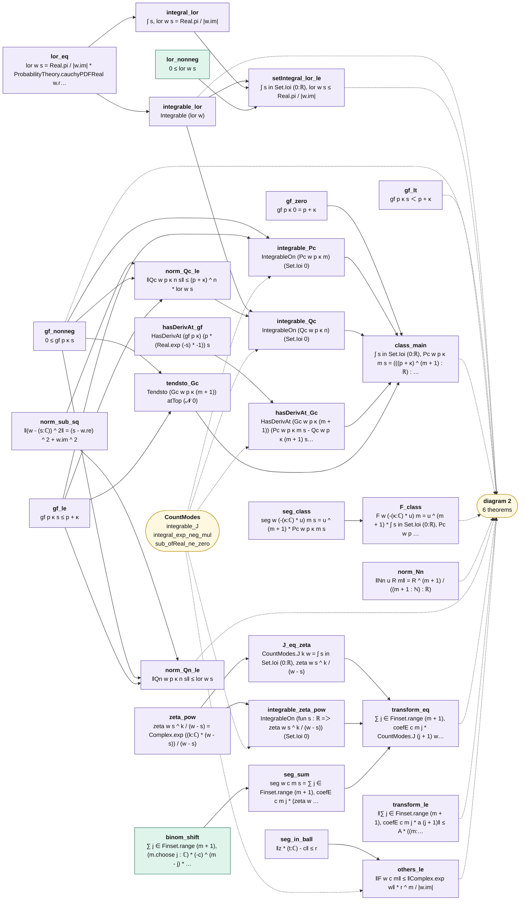
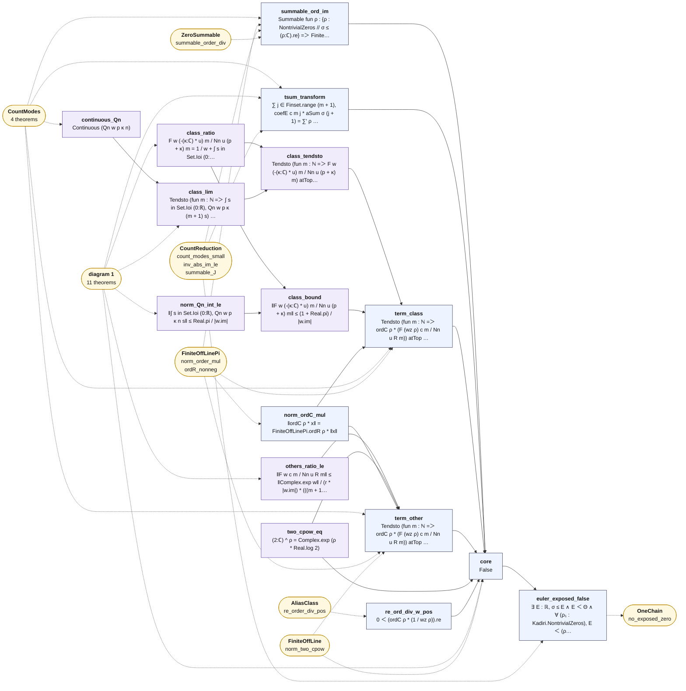

# `lean_stage3/Stage3/CountEuler.lean`

> **Read from the source text.** This file changed after the last `python3 utilities/lean_map.py --dump`, so the arrows on this page are names occurring in each proof and have not been confirmed by Lean.

CountEuler — block N3-E of `lean_stage3/design/countmodes.md`, from its section "After the independent check". 2026-11-23.

46 theorems, 14 definitions, 913 lines. 

**Imports:** [`AliasClass`](../lean_stage3/AliasClass.md), [`CountReduction`](../lean_stage3/CountReduction.md)  
**Imported by:** [`Stage3`](../lean_stage3/Stage3.md), [`OneChain`](../lean_stage3/OneChain.md)

## The picture

### Diagram 1 of 2: `binom_shift` to `norm_Qn_le`



### Diagram 2 of 2: `continuous_Qn` to `euler_exposed_false`



An arrow A → B reads "A is used in the proof of B". Green: counting, integers only. Violet: shape, analysis with no ζ. Blue: reads ζ. A name ending in ■ is an end: nothing else uses it. Red: contains `sorry`. Yellow: theorems in another file, counted; a dotted arrow crosses files. Definitions are not drawn; they are listed below the diagram.

## Definitions

<a name="CountEuler-zeta"></a>
### `CountEuler.zeta`

def · line 70

The point of the segment of a mode at depth `s`: `ζ_s = e^w·e^(−s)`.

- **Is:** `` zeta (w : ℂ) (s : ℝ) : ℂ := Complex.exp w * ((Real.exp (-s) : ℝ) : ℂ) ``
- **Used by 7:** [`CountEuler.J_eq_zeta`](#CountEuler-J_eq_zeta), [`CountEuler.integrable_zeta_pow`](#CountEuler-integrable_zeta_pow), [`CountEuler.others_le`](#CountEuler-others_le), [`CountEuler.seg`](#CountEuler-seg), [`CountEuler.seg_class`](#CountEuler-seg_class), [`CountEuler.seg_sum`](#CountEuler-seg_sum), [`CountEuler.zeta_pow`](#CountEuler-zeta_pow)

<a name="CountEuler-coefE"></a>
### `CountEuler.coefE`

def · line 73

The coefficient of the Euler transform: `C(m,j)·(−c)^(m−j)`.

- **Is:** `` coefE (c : ℂ) (m j : ℕ) : ℂ := (m.choose j : ℂ) * (-c) ^ (m - j) ``
- **Used by 5:** [`CountEuler.core`](#CountEuler-core), [`CountEuler.seg_sum`](#CountEuler-seg_sum), [`CountEuler.transform_eq`](#CountEuler-transform_eq), [`CountEuler.transform_le`](#CountEuler-transform_le), [`CountEuler.tsum_transform`](#CountEuler-tsum_transform)

<a name="CountEuler-seg"></a>
### `CountEuler.seg`

def · line 76

The transformed integrand: `ζ_s·(ζ_s − c)^m/(w − s)`.

- **Is:** `` seg (w c : ℂ) (m : ℕ) (s : ℝ) : ℂ := zeta w s * (zeta w s - c) ^ m / (w - s) ``
- **Built from:** [`CountEuler.zeta`](#CountEuler-zeta)
- **Used by 4:** [`CountEuler.F`](#CountEuler-F), [`CountEuler.others_le`](#CountEuler-others_le), [`CountEuler.seg_class`](#CountEuler-seg_class), [`CountEuler.seg_sum`](#CountEuler-seg_sum)

<a name="CountEuler-F"></a>
### `CountEuler.F`

def · line 79

The transformed segment integral: `∫₀^∞ ζ_s·(ζ_s − c)^m/(w − s) ds`.

- **Is:** `` F (w c : ℂ) (m : ℕ) : ℂ := ∫ s in Set.Ioi (0:ℝ), seg w c m s ``
- **Built from:** [`CountEuler.seg`](#CountEuler-seg)
- **Used by 12:** [`CountEuler.F_class`](#CountEuler-F_class), [`CountEuler.class_bound`](#CountEuler-class_bound), [`CountEuler.class_lim`](#CountEuler-class_lim), [`CountEuler.class_ratio`](#CountEuler-class_ratio), [`CountEuler.class_tendsto`](#CountEuler-class_tendsto), [`CountEuler.core`](#CountEuler-core), [`CountEuler.others_le`](#CountEuler-others_le), [`CountEuler.others_ratio_le`](#CountEuler-others_ratio_le), [`CountEuler.term_class`](#CountEuler-term_class), [`CountEuler.term_other`](#CountEuler-term_other), [`CountEuler.transform_eq`](#CountEuler-transform_eq), [`CountEuler.tsum_transform`](#CountEuler-tsum_transform)

<a name="CountEuler-lor"></a>
### `CountEuler.lor`

def · line 207

The Cauchy weight of `w`: `((s − Re w)² + (Im w)²)⁻¹ = 1/|w − s|²`.

- **Is:** `` lor (w : ℂ) (s : ℝ) : ℝ := ((s - w.re) ^ 2 + w.im ^ 2)⁻¹ ``
- **Used by 8:** [`CountEuler.class_lim`](#CountEuler-class_lim), [`CountEuler.integrable_lor`](#CountEuler-integrable_lor), [`CountEuler.integral_lor`](#CountEuler-integral_lor), [`CountEuler.lor_eq`](#CountEuler-lor_eq), [`CountEuler.lor_nonneg`](#CountEuler-lor_nonneg), [`CountEuler.norm_Qc_le`](#CountEuler-norm_Qc_le), [`CountEuler.norm_Qn_le`](#CountEuler-norm_Qn_le), [`CountEuler.setIntegral_lor_le`](#CountEuler-setIntegral_lor_le)

<a name="CountEuler-gf"></a>
### `CountEuler.gf`

def · line 251

The real profile of the class: `g(s) = p·e^(−s) + κ`.

- **Is:** `` gf (p κ s : ℝ) : ℝ := p * Real.exp (-s) + κ ``
- **Used by 15:** [`CountEuler.Gc`](#CountEuler-Gc), [`CountEuler.Pc`](#CountEuler-Pc), [`CountEuler.Qc`](#CountEuler-Qc), [`CountEuler.Qn`](#CountEuler-Qn), [`CountEuler.class_lim`](#CountEuler-class_lim), [`CountEuler.continuous_Qn`](#CountEuler-continuous_Qn), [`CountEuler.gf_le`](#CountEuler-gf_le), [`CountEuler.gf_lt`](#CountEuler-gf_lt), [`CountEuler.gf_nonneg`](#CountEuler-gf_nonneg), [`CountEuler.gf_zero`](#CountEuler-gf_zero), [`CountEuler.hasDerivAt_gf`](#CountEuler-hasDerivAt_gf), [`CountEuler.integrable_Pc`](#CountEuler-integrable_Pc), [`CountEuler.integrable_Qc`](#CountEuler-integrable_Qc), [`CountEuler.norm_Qn_le`](#CountEuler-norm_Qn_le), [`CountEuler.seg_class`](#CountEuler-seg_class)

<a name="CountEuler-Pc"></a>
### `CountEuler.Pc`

def · line 282

The class integrand: `p·e^(−s)·g(s)^m/(w − s)`.

- **Is:** `` Pc (w : ℂ) (p κ : ℝ) (m : ℕ) (s : ℝ) : ℂ := ((p * Real.exp (-s) * gf p κ s ^ m : ℝ) : ℂ) / (w - s) ``
- **Built from:** [`CountEuler.gf`](#CountEuler-gf)
- **Used by 5:** [`CountEuler.F_class`](#CountEuler-F_class), [`CountEuler.class_main`](#CountEuler-class_main), [`CountEuler.hasDerivAt_Gc`](#CountEuler-hasDerivAt_Gc), [`CountEuler.integrable_Pc`](#CountEuler-integrable_Pc), [`CountEuler.seg_class`](#CountEuler-seg_class)

<a name="CountEuler-Qc"></a>
### `CountEuler.Qc`

def · line 286

The correction integrand: `g(s)^n/(w − s)²`.

- **Is:** `` Qc (w : ℂ) (p κ : ℝ) (n : ℕ) (s : ℝ) : ℂ := ((gf p κ s ^ n : ℝ) : ℂ) / (w - s) ^ 2 ``
- **Built from:** [`CountEuler.gf`](#CountEuler-gf)
- **Used by 5:** [`CountEuler.class_main`](#CountEuler-class_main), [`CountEuler.class_ratio`](#CountEuler-class_ratio), [`CountEuler.hasDerivAt_Gc`](#CountEuler-hasDerivAt_Gc), [`CountEuler.integrable_Qc`](#CountEuler-integrable_Qc), [`CountEuler.norm_Qc_le`](#CountEuler-norm_Qc_le)

<a name="CountEuler-Gc"></a>
### `CountEuler.Gc`

def · line 289

The antiderivative: `−g(s)^n/(n·(w − s))`.

- **Is:** `` Gc (w : ℂ) (p κ : ℝ) (n : ℕ) (s : ℝ) : ℂ := -(((gf p κ s ^ n : ℝ) : ℂ) / ((n:ℂ) * (w - s))) ``
- **Built from:** [`CountEuler.gf`](#CountEuler-gf)
- **Used by 3:** [`CountEuler.class_main`](#CountEuler-class_main), [`CountEuler.hasDerivAt_Gc`](#CountEuler-hasDerivAt_Gc), [`CountEuler.tendsto_Gc`](#CountEuler-tendsto_Gc)

<a name="CountEuler-Nn"></a>
### `CountEuler.Nn`

def · line 438

The normaliser: `N_m = u^(m+1)·R^(m+1)/(m+1)`.

- **Is:** `` Nn (u : ℂ) (R : ℝ) (m : ℕ) : ℂ := u ^ (m + 1) * ((R ^ (m + 1) : ℝ) : ℂ) / ((m + 1 : ℕ) : ℂ) ``
- **Used by 8:** [`CountEuler.class_bound`](#CountEuler-class_bound), [`CountEuler.class_ratio`](#CountEuler-class_ratio), [`CountEuler.class_tendsto`](#CountEuler-class_tendsto), [`CountEuler.core`](#CountEuler-core), [`CountEuler.norm_Nn`](#CountEuler-norm_Nn), [`CountEuler.others_ratio_le`](#CountEuler-others_ratio_le), [`CountEuler.term_class`](#CountEuler-term_class), [`CountEuler.term_other`](#CountEuler-term_other)

<a name="CountEuler-Qn"></a>
### `CountEuler.Qn`

def · line 448

The normalised correction integrand: `(g(s)/(p + κ))^n/(w − s)²`.

- **Is:** `` Qn (w : ℂ) (p κ : ℝ) (n : ℕ) (s : ℝ) : ℂ := (((gf p κ s / (p + κ)) ^ n : ℝ) : ℂ) / (w - s) ^ 2 ``
- **Built from:** [`CountEuler.gf`](#CountEuler-gf)
- **Used by 6:** [`CountEuler.class_bound`](#CountEuler-class_bound), [`CountEuler.class_lim`](#CountEuler-class_lim), [`CountEuler.class_ratio`](#CountEuler-class_ratio), [`CountEuler.continuous_Qn`](#CountEuler-continuous_Qn), [`CountEuler.norm_Qn_int_le`](#CountEuler-norm_Qn_int_le), [`CountEuler.norm_Qn_le`](#CountEuler-norm_Qn_le)

<a name="CountEuler-ordC"></a>
### `CountEuler.ordC`

def · line 569

The order of a zero, as a complex number.

- **Is:** `` ordC (ρ : NontrivialZeros) : ℂ := ((riemannZeta.order (ρ:ℂ) : ℤ) : ℂ) ``
- **Used by 7:** [`CountEuler.aSum`](#CountEuler-aSum), [`CountEuler.core`](#CountEuler-core), [`CountEuler.norm_ordC_mul`](#CountEuler-norm_ordC_mul), [`CountEuler.re_ord_div_w_pos`](#CountEuler-re_ord_div_w_pos), [`CountEuler.term_class`](#CountEuler-term_class), [`CountEuler.term_other`](#CountEuler-term_other), [`CountEuler.tsum_transform`](#CountEuler-tsum_transform)

<a name="CountEuler-wz"></a>
### `CountEuler.wz`

def · line 572

The exponent of a zero's mode: `w = ρ·log 2`.

- **Is:** `` wz (ρ : NontrivialZeros) : ℂ := (ρ:ℂ) * Real.log 2 ``
- **Used by 7:** [`CountEuler.aSum`](#CountEuler-aSum), [`CountEuler.core`](#CountEuler-core), [`CountEuler.re_ord_div_w_pos`](#CountEuler-re_ord_div_w_pos), [`CountEuler.summable_ord_im`](#CountEuler-summable_ord_im), [`CountEuler.term_class`](#CountEuler-term_class), [`CountEuler.term_other`](#CountEuler-term_other), [`CountEuler.tsum_transform`](#CountEuler-tsum_transform)

<a name="CountEuler-aSum"></a>
### `CountEuler.aSum`

def · line 575

The segment sum of block N2: `a_k = Σ'_{β≥σ} m(ρ)·J_k(ρ·log 2)`.

- **Is:** `` aSum (σ : ℝ) (k : ℕ) : ℂ := ∑' ρ : {ρ : NontrivialZeros // σ ≤ (ρ:ℂ).re}, ordC ρ.1 * CountModes.J k (wz ρ.1) ``
- **Built from:** [`CountEuler.ordC`](#CountEuler-ordC), [`CountEuler.wz`](#CountEuler-wz), [`CountModes.J`](../lean_stage3/CountModes.md#CountModes-J)
- **Used by 2:** [`CountEuler.core`](#CountEuler-core), [`CountEuler.tsum_transform`](#CountEuler-tsum_transform)

## Theorems

<a name="CountEuler-binom_shift"></a>
### `CountEuler.binom_shift`

line 60 · arrows read from text

**Counting.** Integers only: nothing in its statement or proof, or in anything it rests on, uses analysis or ζ.

**Why.** The binomial identity of the transform. For any `ζ`, `c` and `m`, `Σ_{j≤m} C(m,j)·(−c)^(m−j)·ζ^(j+1) = ζ·(ζ − c)^m`.

**Proves**

```lean
∑ j ∈ Finset.range (m + 1), (m.choose j : ℂ) * (-c) ^ (m - j) * ζ ^ (j + 1) = ζ * (ζ - c) ^ m
```

**Needs** (its hypotheses)

  - `` ζ c : ℂ ``
  - `` m : ℕ ``

**Fed by:** no theorem of this repo; it stands on Mathlib.

**Feeds** (1 that use it)

  - [`CountEuler.seg_sum`](#CountEuler-seg_sum) — `` seg w c m s = ∑ j ∈ Finset.range (m + 1), coefE c m j * (zeta w s ^ (j + 1) / (w - s)) ``

<a name="CountEuler-zeta_pow"></a>
### `CountEuler.zeta_pow`

line 83 · arrows read from text

**Shape.** Uses real or complex analysis; nothing in it or beneath it reads ζ.

**Why.** The power of the point of the segment is the integrand of `J`: `ζ_s^k/(w − s) = e^(k(w−s))/(w − s)`.

**Proves**

```lean
zeta w s ^ k / (w - s) = Complex.exp ((k:ℂ) * (w - s)) / (w - s)
```

**Needs** (its hypotheses)

  - `` k : ℕ ``
  - `` w : ℂ ``
  - `` s : ℝ ``

**Fed by:** no theorem of this repo; it stands on Mathlib and the definitions below.

**Definitions its proof touches:** [`CountEuler.zeta`](#CountEuler-zeta)

**Feeds** (2 that use it)

  - [`CountEuler.J_eq_zeta`](#CountEuler-J_eq_zeta) — `` CountModes.J k w = ∫ s in Set.Ioi (0:ℝ), zeta w s ^ k / (w - s) ``
  - [`CountEuler.integrable_zeta_pow`](#CountEuler-integrable_zeta_pow) — `` IntegrableOn (fun s : ℝ => zeta w s ^ k / (w - s)) (Set.Ioi 0) ``

<a name="CountEuler-J_eq_zeta"></a>
### `CountEuler.J_eq_zeta`

line 92 · arrows read from text

**Shape.** Uses real or complex analysis; nothing in it or beneath it reads ζ.

**Why.** `J k w` written with the point of the segment.

**Proves**

```lean
CountModes.J k w = ∫ s in Set.Ioi (0:ℝ), zeta w s ^ k / (w - s)
```

**Needs** (its hypotheses)

  - `` k : ℕ ``
  - `` w : ℂ ``

**Fed by** (1 theorem its proof uses)

  - [`CountEuler.zeta_pow`](#CountEuler-zeta_pow) — `` zeta w s ^ k / (w - s) = Complex.exp ((k:ℂ) * (w - s)) / (w - s) ``

**Definitions its proof touches:** [`CountEuler.zeta`](#CountEuler-zeta), [`CountModes.J`](../lean_stage3/CountModes.md#CountModes-J)

**Feeds** (1 that use it)

  - [`CountEuler.transform_eq`](#CountEuler-transform_eq) — `` ∑ j ∈ Finset.range (m + 1), coefE c m j * CountModes.J (j + 1) w = F w c m ``

<a name="CountEuler-integrable_zeta_pow"></a>
### `CountEuler.integrable_zeta_pow`

line 100 · arrows read from text

**Shape.** Uses real or complex analysis; nothing in it or beneath it reads ζ.

**Why.** For `1 ≤ k` and `Im w ≠ 0`, `ζ_s^k/(w − s)` is integrable on `s > 0`.

**Proves**

```lean
IntegrableOn (fun s : ℝ => zeta w s ^ k / (w - s)) (Set.Ioi 0)
```

**Needs** (its hypotheses)

  - `` hk : 1 ≤ k ``
  - `` hw : w.im ≠ 0 ``

**Fed by** (2 theorems its proof uses)

  - [`CountEuler.zeta_pow`](#CountEuler-zeta_pow) — `` zeta w s ^ k / (w - s) = Complex.exp ((k:ℂ) * (w - s)) / (w - s) ``
  - [`CountModes.integrable_J`](../lean_stage3/CountModes.md#CountModes-integrable_J) (CountModes) — `` IntegrableOn (fun s : ℝ => Complex.exp ((k:ℂ) * (w - s)) / (w - s)) (Set.Ioi 0) ``

**Definitions its proof touches:** [`CountEuler.zeta`](#CountEuler-zeta)

**Feeds** (1 that use it)

  - [`CountEuler.transform_eq`](#CountEuler-transform_eq) — `` ∑ j ∈ Finset.range (m + 1), coefE c m j * CountModes.J (j + 1) w = F w c m ``

<a name="CountEuler-seg_sum"></a>
### `CountEuler.seg_sum`

line 106 · arrows read from text

**Shape.** Uses real or complex analysis; nothing in it or beneath it reads ζ.

**Why.** The transformed integrand is the transform of the powers.

**Proves**

```lean
seg w c m s = ∑ j ∈ Finset.range (m + 1), coefE c m j * (zeta w s ^ (j + 1) / (w - s))
```

**Needs** (its hypotheses)

  - `` w c : ℂ ``
  - `` m : ℕ ``
  - `` s : ℝ ``

**Fed by** (1 theorem its proof uses)

  - [`CountEuler.binom_shift`](#CountEuler-binom_shift) — `` ∑ j ∈ Finset.range (m + 1), (m.choose j : ℂ) * (-c) ^ (m - j) * ζ ^ (j + 1) = ζ * (ζ - c) ^ m ``

**Definitions its proof touches:** [`CountEuler.coefE`](#CountEuler-coefE), [`CountEuler.seg`](#CountEuler-seg), [`CountEuler.zeta`](#CountEuler-zeta)

**Feeds** (1 that use it)

  - [`CountEuler.transform_eq`](#CountEuler-transform_eq) — `` ∑ j ∈ Finset.range (m + 1), coefE c m j * CountModes.J (j + 1) w = F w c m ``

<a name="CountEuler-transform_eq"></a>
### `CountEuler.transform_eq`

line 115 · arrows read from text

**Shape.** Uses real or complex analysis; nothing in it or beneath it reads ζ.

**Why.** The transform of the segment integrals. For `Im w ≠ 0`, `Σ_{j≤m} C(m,j)·(−c)^(m−j)·J_{j+1}(w) = ∫₀^∞ ζ_s·(ζ_s − c)^m/(w − s) ds`.

**Proves**

```lean
∑ j ∈ Finset.range (m + 1), coefE c m j * CountModes.J (j + 1) w = F w c m
```

**Needs** (its hypotheses)

  - `` hw : w.im ≠ 0 ``
  - `` c : ℂ ``
  - `` m : ℕ ``

**Fed by** (3 theorems its proof uses)

  - [`CountEuler.J_eq_zeta`](#CountEuler-J_eq_zeta) — `` CountModes.J k w = ∫ s in Set.Ioi (0:ℝ), zeta w s ^ k / (w - s) ``
  - [`CountEuler.integrable_zeta_pow`](#CountEuler-integrable_zeta_pow) — `` IntegrableOn (fun s : ℝ => zeta w s ^ k / (w - s)) (Set.Ioi 0) ``
  - [`CountEuler.seg_sum`](#CountEuler-seg_sum) — `` seg w c m s = ∑ j ∈ Finset.range (m + 1), coefE c m j * (zeta w s ^ (j + 1) / (w - s)) ``

**Definitions its proof touches:** [`CountEuler.F`](#CountEuler-F), [`CountEuler.coefE`](#CountEuler-coefE), [`CountModes.J`](../lean_stage3/CountModes.md#CountModes-J)

**Feeds** (1 that use it)

  - [`CountEuler.tsum_transform`](#CountEuler-tsum_transform) — `` ∑ j ∈ Finset.range (m + 1), coefE c m j * aSum σ (j + 1) = ∑' ρ : {ρ : NontrivialZeros // σ ≤ (ρ:ℂ).re}, ordC ρ.1 * F (wz ρ.1) c m ``

<a name="CountEuler-transform_le"></a>
### `CountEuler.transform_le`

line 131 · arrows read from text

**Shape.** Uses real or complex analysis; nothing in it or beneath it reads ζ.

**Why.** The size of the transform. If `‖a_k‖ ≤ A·k²·X^k` for every `k ≥ 1`, with `A, X ≥ 0`, then `‖Σ_{j≤m} C(m,j)·(−c)^(m−j)·a_{j+1}‖ ≤ A·(m+1)²·X·(X + ‖c‖)^m`.

**Proves**

```lean
‖∑ j ∈ Finset.range (m + 1), coefE c m j * a (j + 1)‖ ≤ A * ((m:ℝ) + 1) ^ 2 * X * (X + ‖c‖) ^ m
```

**Needs** (its hypotheses)

  - `` a : ℕ → ℂ ``
  - `` hA : 0 ≤ A ``
  - `` hX : 0 ≤ X ``
  - `` ha : ∀ k : ℕ, 1 ≤ k → ‖a k‖ ≤ A * (k:ℝ) ^ 2 * X ^ k ``
  - `` c : ℂ ``
  - `` m : ℕ ``

**Fed by:** no theorem of this repo; it stands on Mathlib and the definitions below.

**Definitions its proof touches:** [`CountEuler.coefE`](#CountEuler-coefE)

**Feeds** (1 that use it)

  - [`CountEuler.core`](#CountEuler-core) — `` False ``

<a name="CountEuler-seg_in_ball"></a>
### `CountEuler.seg_in_ball`

line 157 · arrows read from text

**Shape.** Uses real or complex analysis; nothing in it or beneath it reads ζ.

**Why.** The segment stays in the ball. If `‖c‖ ≤ r` and `‖z − c‖ ≤ r`, then `‖z·t − c‖ ≤ r` for `0 ≤ t ≤ 1`: `z·t − c = t·(z − c) + (1 − t)·(−c)`.

**Proves**

```lean
‖z * (t:ℂ) - c‖ ≤ r
```

**Needs** (its hypotheses)

  - `` ht0 : 0 ≤ t ``
  - `` ht1 : t ≤ 1 ``
  - `` hc : ‖c‖ ≤ r ``
  - `` hz : ‖z - c‖ ≤ r ``

**Fed by:** no theorem of this repo; it stands on Mathlib.

**Feeds** (1 that use it)

  - [`CountEuler.others_le`](#CountEuler-others_le) — `` ‖F w c m‖ ≤ ‖Complex.exp w‖ * r ^ m / |w.im| ``

<a name="CountEuler-others_le"></a>
### `CountEuler.others_le`

line 173 · arrows read from text

**Shape.** Uses real or complex analysis; nothing in it or beneath it reads ζ.

**Why.** One other mode. For `Im w ≠ 0`, `‖c‖ ≤ r` and `‖e^w − c‖ ≤ r`, the transformed segment integral is at most `‖e^w‖·r^m/|Im w|`.

**Proves**

```lean
‖F w c m‖ ≤ ‖Complex.exp w‖ * r ^ m / |w.im|
```

**Needs** (its hypotheses)

  - `` hw : w.im ≠ 0 ``
  - `` hc : ‖c‖ ≤ r ``
  - `` hz : ‖Complex.exp w - c‖ ≤ r ``
  - `` m : ℕ ``

**Fed by** (2 theorems its proof uses)

  - [`CountEuler.seg_in_ball`](#CountEuler-seg_in_ball) — `` ‖z * (t:ℂ) - c‖ ≤ r ``
  - [`CountModes.integral_exp_neg_mul`](../lean_stage3/CountModes.md#CountModes-integral_exp_neg_mul) (CountModes) — `` ∫ s in Set.Ioi (0:ℝ), Real.exp (-k * s) = 1 / k ``

**Definitions its proof touches:** [`CountEuler.F`](#CountEuler-F), [`CountEuler.seg`](#CountEuler-seg), [`CountEuler.zeta`](#CountEuler-zeta)

**Feeds** (1 that use it)

  - [`CountEuler.others_ratio_le`](#CountEuler-others_ratio_le) — `` ‖F w c m / Nn u R m‖ ≤ ‖Complex.exp w‖ / (r * |w.im|) * (((m + 1 : ℕ) : ℝ) * (r / R) ^ (m + 1)) ``

<a name="CountEuler-lor_nonneg"></a>
### `CountEuler.lor_nonneg`

line 210 · arrows read from text

**Counting.** Integers only: nothing in its statement or proof, or in anything it rests on, uses analysis or ζ.

**Why.** The Cauchy weight is nonnegative.

**Proves**

```lean
0 ≤ lor w s
```

**Needs** (its hypotheses)

  - `` w : ℂ ``
  - `` s : ℝ ``

**Fed by:** no theorem of this repo; it stands on Mathlib and the definitions below.

**Definitions its proof touches:** [`CountEuler.lor`](#CountEuler-lor)

**Feeds** (1 that use it)

  - [`CountEuler.setIntegral_lor_le`](#CountEuler-setIntegral_lor_le) — `` ∫ s in Set.Ioi (0:ℝ), lor w s ≤ Real.pi / |w.im| ``

<a name="CountEuler-lor_eq"></a>
### `CountEuler.lor_eq`

line 215 · arrows read from text

**Shape.** Uses real or complex analysis; nothing in it or beneath it reads ζ.

**Why.** The Cauchy weight is `π/|Im w|` times the Cauchy density at `Re w` of scale `|Im w|`.

**Proves**

```lean
lor w s = Real.pi / |w.im| * ProbabilityTheory.cauchyPDFReal w.re ‖w.im‖₊ s
```

**Needs** (its hypotheses)

  - `` hw : w.im ≠ 0 ``
  - `` s : ℝ ``

**Fed by:** no theorem of this repo; it stands on Mathlib and the definitions below.

**Definitions its proof touches:** [`CountEuler.lor`](#CountEuler-lor)

**Feeds** (2 that use it)

  - [`CountEuler.integrable_lor`](#CountEuler-integrable_lor) — `` Integrable (lor w) ``
  - [`CountEuler.integral_lor`](#CountEuler-integral_lor) — `` ∫ s, lor w s = Real.pi / |w.im| ``

<a name="CountEuler-integrable_lor"></a>
### `CountEuler.integrable_lor`

line 226 · arrows read from text

**Shape.** Uses real or complex analysis; nothing in it or beneath it reads ζ.

**Why.** For `Im w ≠ 0` the Cauchy weight is integrable on the line.

**Proves**

```lean
Integrable (lor w)
```

**Needs** (its hypotheses)

  - `` hw : w.im ≠ 0 ``

**Fed by** (1 theorem its proof uses)

  - [`CountEuler.lor_eq`](#CountEuler-lor_eq) — `` lor w s = Real.pi / |w.im| * ProbabilityTheory.cauchyPDFReal w.re ‖w.im‖₊ s ``

**Definitions its proof touches:** [`CountEuler.lor`](#CountEuler-lor)

**Feeds** (4 that use it)

  - [`CountEuler.class_lim`](#CountEuler-class_lim) — `` Tendsto (fun m : ℕ => ∫ s in Set.Ioi (0:ℝ), Qn w p κ (m + 1) s) atTop (𝓝 0) ``
  - [`CountEuler.integrable_Qc`](#CountEuler-integrable_Qc) — `` IntegrableOn (Qc w p κ n) (Set.Ioi 0) ``
  - [`CountEuler.norm_Qn_int_le`](#CountEuler-norm_Qn_int_le) — `` ‖∫ s in Set.Ioi (0:ℝ), Qn w p κ n s‖ ≤ Real.pi / |w.im| ``
  - [`CountEuler.setIntegral_lor_le`](#CountEuler-setIntegral_lor_le) — `` ∫ s in Set.Ioi (0:ℝ), lor w s ≤ Real.pi / |w.im| ``

<a name="CountEuler-integral_lor"></a>
### `CountEuler.integral_lor`

line 231 · arrows read from text

**Shape.** Uses real or complex analysis; nothing in it or beneath it reads ζ.

**Why.** For `Im w ≠ 0` the Cauchy weight integrates to `π/|Im w|` over the line.

**Proves**

```lean
∫ s, lor w s = Real.pi / |w.im|
```

**Needs** (its hypotheses)

  - `` hw : w.im ≠ 0 ``

**Fed by** (1 theorem its proof uses)

  - [`CountEuler.lor_eq`](#CountEuler-lor_eq) — `` lor w s = Real.pi / |w.im| * ProbabilityTheory.cauchyPDFReal w.re ‖w.im‖₊ s ``

**Definitions its proof touches:** [`CountEuler.lor`](#CountEuler-lor)

**Feeds** (1 that use it)

  - [`CountEuler.setIntegral_lor_le`](#CountEuler-setIntegral_lor_le) — `` ∫ s in Set.Ioi (0:ℝ), lor w s ≤ Real.pi / |w.im| ``

<a name="CountEuler-setIntegral_lor_le"></a>
### `CountEuler.setIntegral_lor_le`

line 237 · arrows read from text

**Shape.** Uses real or complex analysis; nothing in it or beneath it reads ζ.

**Why.** For `Im w ≠ 0` the Cauchy weight integrates to at most `π/|Im w|` over `s > 0`.

**Proves**

```lean
∫ s in Set.Ioi (0:ℝ), lor w s ≤ Real.pi / |w.im|
```

**Needs** (its hypotheses)

  - `` hw : w.im ≠ 0 ``

**Fed by** (3 theorems its proof uses)

  - [`CountEuler.integrable_lor`](#CountEuler-integrable_lor) — `` Integrable (lor w) ``
  - [`CountEuler.integral_lor`](#CountEuler-integral_lor) — `` ∫ s, lor w s = Real.pi / |w.im| ``
  - [`CountEuler.lor_nonneg`](#CountEuler-lor_nonneg) — `` 0 ≤ lor w s ``

**Definitions its proof touches:** [`CountEuler.lor`](#CountEuler-lor)

**Feeds** (1 that use it)

  - [`CountEuler.norm_Qn_int_le`](#CountEuler-norm_Qn_int_le) — `` ‖∫ s in Set.Ioi (0:ℝ), Qn w p κ n s‖ ≤ Real.pi / |w.im| ``

<a name="CountEuler-norm_sub_sq"></a>
### `CountEuler.norm_sub_sq`

line 243 · arrows read from text

**Shape.** Uses real or complex analysis; nothing in it or beneath it reads ζ.

**Why.** `‖(w − s)²‖ = (s − Re w)² + (Im w)²`.

**Proves**

```lean
‖(w - (s:ℂ)) ^ 2‖ = (s - w.re) ^ 2 + w.im ^ 2
```

**Needs** (its hypotheses)

  - `` w : ℂ ``
  - `` s : ℝ ``

**Fed by:** no theorem of this repo; it stands on Mathlib.

**Feeds** (2 that use it)

  - [`CountEuler.norm_Qc_le`](#CountEuler-norm_Qc_le) — `` ‖Qc w p κ n s‖ ≤ (p + κ) ^ n * lor w s ``
  - [`CountEuler.norm_Qn_le`](#CountEuler-norm_Qn_le) — `` ‖Qn w p κ n s‖ ≤ lor w s ``

<a name="CountEuler-gf_nonneg"></a>
### `CountEuler.gf_nonneg`

line 254 · arrows read from text

**Shape.** Uses real or complex analysis; nothing in it or beneath it reads ζ.

**Why.** The profile is nonnegative for `p, κ ≥ 0`.

**Proves**

```lean
0 ≤ gf p κ s
```

**Needs** (its hypotheses)

  - `` hp : 0 ≤ p ``
  - `` hκ : 0 ≤ κ ``
  - `` s : ℝ ``

**Fed by:** no theorem of this repo; it stands on Mathlib and the definitions below.

**Definitions its proof touches:** [`CountEuler.gf`](#CountEuler-gf)

**Feeds** (5 that use it)

  - [`CountEuler.class_lim`](#CountEuler-class_lim) — `` Tendsto (fun m : ℕ => ∫ s in Set.Ioi (0:ℝ), Qn w p κ (m + 1) s) atTop (𝓝 0) ``
  - [`CountEuler.integrable_Pc`](#CountEuler-integrable_Pc) — `` IntegrableOn (Pc w p κ m) (Set.Ioi 0) ``
  - [`CountEuler.norm_Qc_le`](#CountEuler-norm_Qc_le) — `` ‖Qc w p κ n s‖ ≤ (p + κ) ^ n * lor w s ``
  - [`CountEuler.norm_Qn_le`](#CountEuler-norm_Qn_le) — `` ‖Qn w p κ n s‖ ≤ lor w s ``
  - [`CountEuler.tendsto_Gc`](#CountEuler-tendsto_Gc) — `` Tendsto (Gc w p κ (m + 1)) atTop (𝓝 0) ``

<a name="CountEuler-gf_le"></a>
### `CountEuler.gf_le`

line 259 · arrows read from text

**Shape.** Uses real or complex analysis; nothing in it or beneath it reads ζ.

**Why.** For `s ≥ 0` the profile is at most `p + κ`.

**Proves**

```lean
gf p κ s ≤ p + κ
```

**Needs** (its hypotheses)

  - `` hp : 0 ≤ p ``
  - `` hs : 0 ≤ s ``

**Fed by:** no theorem of this repo; it stands on Mathlib and the definitions below.

**Definitions its proof touches:** [`CountEuler.gf`](#CountEuler-gf)

**Feeds** (4 that use it)

  - [`CountEuler.integrable_Pc`](#CountEuler-integrable_Pc) — `` IntegrableOn (Pc w p κ m) (Set.Ioi 0) ``
  - [`CountEuler.norm_Qc_le`](#CountEuler-norm_Qc_le) — `` ‖Qc w p κ n s‖ ≤ (p + κ) ^ n * lor w s ``
  - [`CountEuler.norm_Qn_le`](#CountEuler-norm_Qn_le) — `` ‖Qn w p κ n s‖ ≤ lor w s ``
  - [`CountEuler.tendsto_Gc`](#CountEuler-tendsto_Gc) — `` Tendsto (Gc w p κ (m + 1)) atTop (𝓝 0) ``

<a name="CountEuler-gf_lt"></a>
### `CountEuler.gf_lt`

line 266 · arrows read from text

**Shape.** Uses real or complex analysis; nothing in it or beneath it reads ζ.

**Why.** For `s > 0` and `p > 0` the profile is below `p + κ`.

**Proves**

```lean
gf p κ s < p + κ
```

**Needs** (its hypotheses)

  - `` hp : 0 < p ``
  - `` hs : 0 < s ``

**Fed by:** no theorem of this repo; it stands on Mathlib and the definitions below.

**Definitions its proof touches:** [`CountEuler.gf`](#CountEuler-gf)

**Feeds** (1 that use it)

  - [`CountEuler.class_lim`](#CountEuler-class_lim) — `` Tendsto (fun m : ℕ => ∫ s in Set.Ioi (0:ℝ), Qn w p κ (m + 1) s) atTop (𝓝 0) ``

<a name="CountEuler-gf_zero"></a>
### `CountEuler.gf_zero`

line 273 · arrows read from text

**Shape.** Uses real or complex analysis; nothing in it or beneath it reads ζ.

**Why.** At `s = 0` the profile is `p + κ`.

**Proves**

```lean
gf p κ 0 = p + κ
```

**Needs** (its hypotheses)

  - `` p κ : ℝ ``

**Fed by:** no theorem of this repo; it stands on Mathlib and the definitions below.

**Definitions its proof touches:** [`CountEuler.gf`](#CountEuler-gf)

**Feeds** (1 that use it)

  - [`CountEuler.class_main`](#CountEuler-class_main) — `` ∫ s in Set.Ioi (0:ℝ), Pc w p κ m s = (((p + κ) ^ (m + 1) : ℝ) : ℂ) / (((m + 1 : ℕ) : ℂ) * w) + (∫ s in Set.Ioi (0:ℝ), Qc w p κ (m + 1) s) / ((m + 1 : … ``

<a name="CountEuler-hasDerivAt_gf"></a>
### `CountEuler.hasDerivAt_gf`

line 278 · arrows read from text

**Shape.** Uses real or complex analysis; nothing in it or beneath it reads ζ.

**Why.** The derivative of the profile: `−p·e^(−s)`.

**Proves**

```lean
HasDerivAt (gf p κ) (p * (Real.exp (-s) * -1)) s
```

**Needs** (its hypotheses)

  - `` p κ s : ℝ ``

**Fed by:** no theorem of this repo; it stands on Mathlib and the definitions below.

**Definitions its proof touches:** [`CountEuler.gf`](#CountEuler-gf)

**Feeds** (1 that use it)

  - [`CountEuler.hasDerivAt_Gc`](#CountEuler-hasDerivAt_Gc) — `` HasDerivAt (Gc w p κ (m + 1)) (Pc w p κ m s - Qc w p κ (m + 1) s / ((m + 1 : ℕ) : ℂ)) s ``

<a name="CountEuler-integrable_Pc"></a>
### `CountEuler.integrable_Pc`

line 293 · arrows read from text

**Shape.** Uses real or complex analysis; nothing in it or beneath it reads ζ.

**Why.** For `Im w ≠ 0`, `p, κ ≥ 0` the class integrand is integrable on `s > 0`.

**Proves**

```lean
IntegrableOn (Pc w p κ m) (Set.Ioi 0)
```

**Needs** (its hypotheses)

  - `` hw : w.im ≠ 0 ``
  - `` hp : 0 ≤ p ``
  - `` hκ : 0 ≤ κ ``
  - `` m : ℕ ``

**Fed by** (3 theorems its proof uses)

  - [`CountEuler.gf_le`](#CountEuler-gf_le) — `` gf p κ s ≤ p + κ ``
  - [`CountEuler.gf_nonneg`](#CountEuler-gf_nonneg) — `` 0 ≤ gf p κ s ``
  - [`CountModes.sub_ofReal_ne_zero`](../lean_stage3/CountModes.md#CountModes-sub_ofReal_ne_zero) (CountModes) — `` w - (s : ℂ) ≠ 0 ``

**Definitions its proof touches:** [`CountEuler.Pc`](#CountEuler-Pc), [`CountEuler.gf`](#CountEuler-gf)

**Feeds** (1 that use it)

  - [`CountEuler.class_main`](#CountEuler-class_main) — `` ∫ s in Set.Ioi (0:ℝ), Pc w p κ m s = (((p + κ) ^ (m + 1) : ℝ) : ℂ) / (((m + 1 : ℕ) : ℂ) * w) + (∫ s in Set.Ioi (0:ℝ), Qc w p κ (m + 1) s) / ((m + 1 : … ``

<a name="CountEuler-norm_Qc_le"></a>
### `CountEuler.norm_Qc_le`

line 322 · arrows read from text

**Shape.** Uses real or complex analysis; nothing in it or beneath it reads ζ.

**Why.** For `s ≥ 0` the correction integrand is at most `(p + κ)^n` times the Cauchy weight.

**Proves**

```lean
‖Qc w p κ n s‖ ≤ (p + κ) ^ n * lor w s
```

**Needs** (its hypotheses)

  - `` hp : 0 ≤ p ``
  - `` hκ : 0 ≤ κ ``
  - `` hs : 0 ≤ s ``
  - `` n : ℕ ``

**Fed by** (3 theorems its proof uses)

  - [`CountEuler.gf_le`](#CountEuler-gf_le) — `` gf p κ s ≤ p + κ ``
  - [`CountEuler.gf_nonneg`](#CountEuler-gf_nonneg) — `` 0 ≤ gf p κ s ``
  - [`CountEuler.norm_sub_sq`](#CountEuler-norm_sub_sq) — `` ‖(w - (s:ℂ)) ^ 2‖ = (s - w.re) ^ 2 + w.im ^ 2 ``

**Definitions its proof touches:** [`CountEuler.Qc`](#CountEuler-Qc), [`CountEuler.lor`](#CountEuler-lor)

**Feeds** (1 that use it)

  - [`CountEuler.integrable_Qc`](#CountEuler-integrable_Qc) — `` IntegrableOn (Qc w p κ n) (Set.Ioi 0) ``

<a name="CountEuler-integrable_Qc"></a>
### `CountEuler.integrable_Qc`

line 333 · arrows read from text

**Shape.** Uses real or complex analysis; nothing in it or beneath it reads ζ.

**Why.** For `Im w ≠ 0`, `p, κ ≥ 0` the correction integrand is integrable on `s > 0`.

**Proves**

```lean
IntegrableOn (Qc w p κ n) (Set.Ioi 0)
```

**Needs** (its hypotheses)

  - `` hw : w.im ≠ 0 ``
  - `` hp : 0 ≤ p ``
  - `` hκ : 0 ≤ κ ``
  - `` n : ℕ ``

**Fed by** (3 theorems its proof uses)

  - [`CountEuler.integrable_lor`](#CountEuler-integrable_lor) — `` Integrable (lor w) ``
  - [`CountEuler.norm_Qc_le`](#CountEuler-norm_Qc_le) — `` ‖Qc w p κ n s‖ ≤ (p + κ) ^ n * lor w s ``
  - [`CountModes.sub_ofReal_ne_zero`](../lean_stage3/CountModes.md#CountModes-sub_ofReal_ne_zero) (CountModes) — `` w - (s : ℂ) ≠ 0 ``

**Definitions its proof touches:** [`CountEuler.Qc`](#CountEuler-Qc), [`CountEuler.gf`](#CountEuler-gf)

**Feeds** (1 that use it)

  - [`CountEuler.class_main`](#CountEuler-class_main) — `` ∫ s in Set.Ioi (0:ℝ), Pc w p κ m s = (((p + κ) ^ (m + 1) : ℝ) : ℂ) / (((m + 1 : ℕ) : ℂ) * w) + (∫ s in Set.Ioi (0:ℝ), Qc w p κ (m + 1) s) / ((m + 1 : … ``

<a name="CountEuler-hasDerivAt_Gc"></a>
### `CountEuler.hasDerivAt_Gc`

line 345 · arrows read from text

**Shape.** Uses real or complex analysis; nothing in it or beneath it reads ζ.

**Why.** The derivative of the antiderivative: `G' = P − Q/(m + 1)`.

**Proves**

```lean
HasDerivAt (Gc w p κ (m + 1)) (Pc w p κ m s - Qc w p κ (m + 1) s / ((m + 1 : ℕ) : ℂ)) s
```

**Needs** (its hypotheses)

  - `` hw : w.im ≠ 0 ``
  - `` p κ : ℝ ``
  - `` m : ℕ ``
  - `` s : ℝ ``

**Fed by** (2 theorems its proof uses)

  - [`CountEuler.hasDerivAt_gf`](#CountEuler-hasDerivAt_gf) — `` HasDerivAt (gf p κ) (p * (Real.exp (-s) * -1)) s ``
  - [`CountModes.sub_ofReal_ne_zero`](../lean_stage3/CountModes.md#CountModes-sub_ofReal_ne_zero) (CountModes) — `` w - (s : ℂ) ≠ 0 ``

**Definitions its proof touches:** [`CountEuler.Gc`](#CountEuler-Gc), [`CountEuler.Pc`](#CountEuler-Pc), [`CountEuler.Qc`](#CountEuler-Qc)

**Feeds** (1 that use it)

  - [`CountEuler.class_main`](#CountEuler-class_main) — `` ∫ s in Set.Ioi (0:ℝ), Pc w p κ m s = (((p + κ) ^ (m + 1) : ℝ) : ℂ) / (((m + 1 : ℕ) : ℂ) * w) + (∫ s in Set.Ioi (0:ℝ), Qc w p κ (m + 1) s) / ((m + 1 : … ``

<a name="CountEuler-tendsto_Gc"></a>
### `CountEuler.tendsto_Gc`

line 366 · arrows read from text

**Shape.** Uses real or complex analysis; nothing in it or beneath it reads ζ.

**Why.** The antiderivative tends to zero at infinity.

**Proves**

```lean
Tendsto (Gc w p κ (m + 1)) atTop (𝓝 0)
```

**Needs** (its hypotheses)

  - `` w : ℂ ``
  - `` hp : 0 ≤ p ``
  - `` hκ : 0 ≤ κ ``
  - `` m : ℕ ``

**Fed by** (2 theorems its proof uses)

  - [`CountEuler.gf_le`](#CountEuler-gf_le) — `` gf p κ s ≤ p + κ ``
  - [`CountEuler.gf_nonneg`](#CountEuler-gf_nonneg) — `` 0 ≤ gf p κ s ``

**Definitions its proof touches:** [`CountEuler.Gc`](#CountEuler-Gc)

**Feeds** (1 that use it)

  - [`CountEuler.class_main`](#CountEuler-class_main) — `` ∫ s in Set.Ioi (0:ℝ), Pc w p κ m s = (((p + κ) ^ (m + 1) : ℝ) : ℂ) / (((m + 1 : ℕ) : ℂ) * w) + (∫ s in Set.Ioi (0:ℝ), Qc w p κ (m + 1) s) / ((m + 1 : … ``

<a name="CountEuler-class_main"></a>
### `CountEuler.class_main`

line 395 · arrows read from text

**Shape.** Uses real or complex analysis; nothing in it or beneath it reads ζ.

**Why.** The class integral, exactly. For `Im w ≠ 0`, `p, κ ≥ 0`, `R = p + κ`: `∫₀^∞ p·e^(−s)·g(s)^m/(w − s) ds = R^(m+1)/((m+1)·w) + (∫₀^∞ g(s)^(m+1)/(w − s)² ds)/(m+1)`. The antiderivative is `−g^(m+1)/((m+1)(w − s))`.

**Proves**

```lean
∫ s in Set.Ioi (0:ℝ), Pc w p κ m s = (((p + κ) ^ (m + 1) : ℝ) : ℂ) / (((m + 1 : ℕ) : ℂ) * w) + (∫ s in Set.Ioi (0:ℝ), Qc w p κ (m + 1) s) / ((m + 1 : ℕ) : ℂ)
```

**Needs** (its hypotheses)

  - `` hw : w.im ≠ 0 ``
  - `` hp : 0 ≤ p ``
  - `` hκ : 0 ≤ κ ``
  - `` m : ℕ ``

**Fed by** (5 theorems its proof uses)

  - [`CountEuler.gf_zero`](#CountEuler-gf_zero) — `` gf p κ 0 = p + κ ``
  - [`CountEuler.hasDerivAt_Gc`](#CountEuler-hasDerivAt_Gc) — `` HasDerivAt (Gc w p κ (m + 1)) (Pc w p κ m s - Qc w p κ (m + 1) s / ((m + 1 : ℕ) : ℂ)) s ``
  - [`CountEuler.integrable_Pc`](#CountEuler-integrable_Pc) — `` IntegrableOn (Pc w p κ m) (Set.Ioi 0) ``
  - [`CountEuler.integrable_Qc`](#CountEuler-integrable_Qc) — `` IntegrableOn (Qc w p κ n) (Set.Ioi 0) ``
  - [`CountEuler.tendsto_Gc`](#CountEuler-tendsto_Gc) — `` Tendsto (Gc w p κ (m + 1)) atTop (𝓝 0) ``

**Definitions its proof touches:** [`CountEuler.Gc`](#CountEuler-Gc), [`CountEuler.Pc`](#CountEuler-Pc), [`CountEuler.Qc`](#CountEuler-Qc)

**Feeds** (1 that use it)

  - [`CountEuler.class_ratio`](#CountEuler-class_ratio) — `` F w (-(κ:ℂ) * u) m / Nn u (p + κ) m = 1 / w + ∫ s in Set.Ioi (0:ℝ), Qn w p κ (m + 1) s ``

<a name="CountEuler-seg_class"></a>
### `CountEuler.seg_class`

line 418 · arrows read from text

**Shape.** Uses real or complex analysis; nothing in it or beneath it reads ζ.

**Why.** On the class, `ζ_s·(ζ_s − c)^m/(w − s) = u^(m+1)·p·e^(−s)·g(s)^m/(w − s)`, for `e^w = p·u` and `c = −κ·u`.

**Proves**

```lean
seg w (-(κ:ℂ) * u) m s = u ^ (m + 1) * Pc w p κ m s
```

**Needs** (its hypotheses)

  - `` hz : Complex.exp w = (p:ℂ) * u ``
  - `` κ : ℝ ``
  - `` m : ℕ ``
  - `` s : ℝ ``

**Fed by:** no theorem of this repo; it stands on Mathlib and the definitions below.

**Definitions its proof touches:** [`CountEuler.Pc`](#CountEuler-Pc), [`CountEuler.gf`](#CountEuler-gf), [`CountEuler.seg`](#CountEuler-seg), [`CountEuler.zeta`](#CountEuler-zeta)

**Feeds** (1 that use it)

  - [`CountEuler.F_class`](#CountEuler-F_class) — `` F w (-(κ:ℂ) * u) m = u ^ (m + 1) * ∫ s in Set.Ioi (0:ℝ), Pc w p κ m s ``

<a name="CountEuler-F_class"></a>
### `CountEuler.F_class`

line 431 · arrows read from text

**Shape.** Uses real or complex analysis; nothing in it or beneath it reads ζ.

**Why.** On the class, the transformed segment integral is `u^(m+1)·∫₀^∞ P`.

**Proves**

```lean
F w (-(κ:ℂ) * u) m = u ^ (m + 1) * ∫ s in Set.Ioi (0:ℝ), Pc w p κ m s
```

**Needs** (its hypotheses)

  - `` hz : Complex.exp w = (p:ℂ) * u ``
  - `` κ : ℝ ``
  - `` m : ℕ ``

**Fed by** (1 theorem its proof uses)

  - [`CountEuler.seg_class`](#CountEuler-seg_class) — `` seg w (-(κ:ℂ) * u) m s = u ^ (m + 1) * Pc w p κ m s ``

**Definitions its proof touches:** [`CountEuler.F`](#CountEuler-F), [`CountEuler.Pc`](#CountEuler-Pc)

**Feeds** (1 that use it)

  - [`CountEuler.class_ratio`](#CountEuler-class_ratio) — `` F w (-(κ:ℂ) * u) m / Nn u (p + κ) m = 1 / w + ∫ s in Set.Ioi (0:ℝ), Qn w p κ (m + 1) s ``

<a name="CountEuler-norm_Nn"></a>
### `CountEuler.norm_Nn`

line 441 · arrows read from text

**Shape.** Uses real or complex analysis; nothing in it or beneath it reads ζ.

**Why.** For `‖u‖ = 1` and `R ≥ 0`, `‖N_m‖ = R^(m+1)/(m+1)`.

**Proves**

```lean
‖Nn u R m‖ = R ^ (m + 1) / ((m + 1 : ℕ) : ℝ)
```

**Needs** (its hypotheses)

  - `` hu : ‖u‖ = 1 ``
  - `` hR : 0 ≤ R ``
  - `` m : ℕ ``

**Fed by:** no theorem of this repo; it stands on Mathlib and the definitions below.

**Definitions its proof touches:** [`CountEuler.Nn`](#CountEuler-Nn)

**Feeds** (2 that use it)

  - [`CountEuler.core`](#CountEuler-core) — `` False ``
  - [`CountEuler.others_ratio_le`](#CountEuler-others_ratio_le) — `` ‖F w c m / Nn u R m‖ ≤ ‖Complex.exp w‖ / (r * |w.im|) * (((m + 1 : ℕ) : ℝ) * (r / R) ^ (m + 1)) ``

<a name="CountEuler-norm_Qn_le"></a>
### `CountEuler.norm_Qn_le`

line 453 · arrows read from text

**Shape.** Uses real or complex analysis; nothing in it or beneath it reads ζ.

**Why.** For `s ≥ 0`, `p > 0`, `κ ≥ 0`, the normalised correction integrand is at most the Cauchy weight.

**Proves**

```lean
‖Qn w p κ n s‖ ≤ lor w s
```

**Needs** (its hypotheses)

  - `` hp : 0 < p ``
  - `` hκ : 0 ≤ κ ``
  - `` hs : 0 ≤ s ``
  - `` n : ℕ ``

**Fed by** (3 theorems its proof uses)

  - [`CountEuler.gf_le`](#CountEuler-gf_le) — `` gf p κ s ≤ p + κ ``
  - [`CountEuler.gf_nonneg`](#CountEuler-gf_nonneg) — `` 0 ≤ gf p κ s ``
  - [`CountEuler.norm_sub_sq`](#CountEuler-norm_sub_sq) — `` ‖(w - (s:ℂ)) ^ 2‖ = (s - w.re) ^ 2 + w.im ^ 2 ``

**Definitions its proof touches:** [`CountEuler.Qn`](#CountEuler-Qn), [`CountEuler.gf`](#CountEuler-gf), [`CountEuler.lor`](#CountEuler-lor)

**Feeds** (2 that use it)

  - [`CountEuler.class_lim`](#CountEuler-class_lim) — `` Tendsto (fun m : ℕ => ∫ s in Set.Ioi (0:ℝ), Qn w p κ (m + 1) s) atTop (𝓝 0) ``
  - [`CountEuler.norm_Qn_int_le`](#CountEuler-norm_Qn_int_le) — `` ‖∫ s in Set.Ioi (0:ℝ), Qn w p κ n s‖ ≤ Real.pi / |w.im| ``

<a name="CountEuler-continuous_Qn"></a>
### `CountEuler.continuous_Qn`

line 465 · arrows read from text

**Shape.** Uses real or complex analysis; nothing in it or beneath it reads ζ.

**Why.** For `Im w ≠ 0` the normalised correction integrand is continuous.

**Proves**

```lean
Continuous (Qn w p κ n)
```

**Needs** (its hypotheses)

  - `` hw : w.im ≠ 0 ``
  - `` p κ : ℝ ``
  - `` n : ℕ ``

**Fed by** (1 theorem its proof uses)

  - [`CountModes.sub_ofReal_ne_zero`](../lean_stage3/CountModes.md#CountModes-sub_ofReal_ne_zero) (CountModes) — `` w - (s : ℂ) ≠ 0 ``

**Definitions its proof touches:** [`CountEuler.Qn`](#CountEuler-Qn), [`CountEuler.gf`](#CountEuler-gf)

**Feeds** (1 that use it)

  - [`CountEuler.class_lim`](#CountEuler-class_lim) — `` Tendsto (fun m : ℕ => ∫ s in Set.Ioi (0:ℝ), Qn w p κ (m + 1) s) atTop (𝓝 0) ``

<a name="CountEuler-class_ratio"></a>
### `CountEuler.class_ratio`

line 472 · arrows read from text

**Shape.** Uses real or complex analysis; nothing in it or beneath it reads ζ.

**Why.** The class over the normaliser. For `Im w ≠ 0`, `p > 0`, `κ ≥ 0`, `‖u‖ = 1` and `e^w = p·u`: `F w (−κu) m / N_m = 1/w + ∫₀^∞ (g/R)^(m+1)/(w − s)² ds`, `R = p + κ`.

**Proves**

```lean
F w (-(κ:ℂ) * u) m / Nn u (p + κ) m = 1 / w + ∫ s in Set.Ioi (0:ℝ), Qn w p κ (m + 1) s
```

**Needs** (its hypotheses)

  - `` hw : w.im ≠ 0 ``
  - `` hp : 0 < p ``
  - `` hκ : 0 ≤ κ ``
  - `` hu : ‖u‖ = 1 ``
  - `` hz : Complex.exp w = (p:ℂ) * u ``
  - `` m : ℕ ``

**Fed by** (2 theorems its proof uses)

  - [`CountEuler.F_class`](#CountEuler-F_class) — `` F w (-(κ:ℂ) * u) m = u ^ (m + 1) * ∫ s in Set.Ioi (0:ℝ), Pc w p κ m s ``
  - [`CountEuler.class_main`](#CountEuler-class_main) — `` ∫ s in Set.Ioi (0:ℝ), Pc w p κ m s = (((p + κ) ^ (m + 1) : ℝ) : ℂ) / (((m + 1 : ℕ) : ℂ) * w) + (∫ s in Set.Ioi (0:ℝ), Qc w p κ (m + 1) s) / ((m + 1 : … ``

**Definitions its proof touches:** [`CountEuler.F`](#CountEuler-F), [`CountEuler.Nn`](#CountEuler-Nn), [`CountEuler.Qc`](#CountEuler-Qc), [`CountEuler.Qn`](#CountEuler-Qn)

**Feeds** (2 that use it)

  - [`CountEuler.class_bound`](#CountEuler-class_bound) — `` ‖F w (-(κ:ℂ) * u) m / Nn u (p + κ) m‖ ≤ (1 + Real.pi) / |w.im| ``
  - [`CountEuler.class_tendsto`](#CountEuler-class_tendsto) — `` Tendsto (fun m : ℕ => F w (-(κ:ℂ) * u) m / Nn u (p + κ) m) atTop (𝓝 (1 / w)) ``

<a name="CountEuler-class_lim"></a>
### `CountEuler.class_lim`

line 499 · arrows read from text

**Shape.** Uses real or complex analysis; nothing in it or beneath it reads ζ.

**Why.** The class correction fades. For `Im w ≠ 0`, `p > 0`, `κ ≥ 0`: `∫₀^∞ (g/R)^(m+1)/(w − s)² ds → 0`, by dominated convergence under the Cauchy weight; `g(s) < R` for `s > 0`.

**Proves**

```lean
Tendsto (fun m : ℕ => ∫ s in Set.Ioi (0:ℝ), Qn w p κ (m + 1) s) atTop (𝓝 0)
```

**Needs** (its hypotheses)

  - `` hw : w.im ≠ 0 ``
  - `` hp : 0 < p ``
  - `` hκ : 0 ≤ κ ``

**Fed by** (5 theorems its proof uses)

  - [`CountEuler.continuous_Qn`](#CountEuler-continuous_Qn) — `` Continuous (Qn w p κ n) ``
  - [`CountEuler.gf_lt`](#CountEuler-gf_lt) — `` gf p κ s < p + κ ``
  - [`CountEuler.gf_nonneg`](#CountEuler-gf_nonneg) — `` 0 ≤ gf p κ s ``
  - [`CountEuler.integrable_lor`](#CountEuler-integrable_lor) — `` Integrable (lor w) ``
  - [`CountEuler.norm_Qn_le`](#CountEuler-norm_Qn_le) — `` ‖Qn w p κ n s‖ ≤ lor w s ``

**Definitions its proof touches:** [`CountEuler.F`](#CountEuler-F), [`CountEuler.Qn`](#CountEuler-Qn), [`CountEuler.gf`](#CountEuler-gf), [`CountEuler.lor`](#CountEuler-lor)

**Feeds** (1 that use it)

  - [`CountEuler.class_tendsto`](#CountEuler-class_tendsto) — `` Tendsto (fun m : ℕ => F w (-(κ:ℂ) * u) m / Nn u (p + κ) m) atTop (𝓝 (1 / w)) ``

<a name="CountEuler-norm_Qn_int_le"></a>
### `CountEuler.norm_Qn_int_le`

line 519 · arrows read from text

**Shape.** Uses real or complex analysis; nothing in it or beneath it reads ζ.

**Why.** For `Im w ≠ 0`, `p > 0`, `κ ≥ 0`, the class correction is at most `π/|Im w|`.

**Proves**

```lean
‖∫ s in Set.Ioi (0:ℝ), Qn w p κ n s‖ ≤ Real.pi / |w.im|
```

**Needs** (its hypotheses)

  - `` hw : w.im ≠ 0 ``
  - `` hp : 0 < p ``
  - `` hκ : 0 ≤ κ ``
  - `` n : ℕ ``

**Fed by** (3 theorems its proof uses)

  - [`CountEuler.integrable_lor`](#CountEuler-integrable_lor) — `` Integrable (lor w) ``
  - [`CountEuler.norm_Qn_le`](#CountEuler-norm_Qn_le) — `` ‖Qn w p κ n s‖ ≤ lor w s ``
  - [`CountEuler.setIntegral_lor_le`](#CountEuler-setIntegral_lor_le) — `` ∫ s in Set.Ioi (0:ℝ), lor w s ≤ Real.pi / |w.im| ``

**Definitions its proof touches:** [`CountEuler.Qn`](#CountEuler-Qn)

**Feeds** (1 that use it)

  - [`CountEuler.class_bound`](#CountEuler-class_bound) — `` ‖F w (-(κ:ℂ) * u) m / Nn u (p + κ) m‖ ≤ (1 + Real.pi) / |w.im| ``

<a name="CountEuler-class_tendsto"></a>
### `CountEuler.class_tendsto`

line 528 · arrows read from text

**Shape.** Uses real or complex analysis; nothing in it or beneath it reads ζ.

**Why.** The class tends to its weight. Under the hypotheses of `class_ratio`, `F w (−κu) m / N_m → 1/w`.

**Proves**

```lean
Tendsto (fun m : ℕ => F w (-(κ:ℂ) * u) m / Nn u (p + κ) m) atTop (𝓝 (1 / w))
```

**Needs** (its hypotheses)

  - `` hw : w.im ≠ 0 ``
  - `` hp : 0 < p ``
  - `` hκ : 0 ≤ κ ``
  - `` hu : ‖u‖ = 1 ``
  - `` hz : Complex.exp w = (p:ℂ) * u ``

**Fed by** (2 theorems its proof uses)

  - [`CountEuler.class_lim`](#CountEuler-class_lim) — `` Tendsto (fun m : ℕ => ∫ s in Set.Ioi (0:ℝ), Qn w p κ (m + 1) s) atTop (𝓝 0) ``
  - [`CountEuler.class_ratio`](#CountEuler-class_ratio) — `` F w (-(κ:ℂ) * u) m / Nn u (p + κ) m = 1 / w + ∫ s in Set.Ioi (0:ℝ), Qn w p κ (m + 1) s ``

**Definitions its proof touches:** [`CountEuler.F`](#CountEuler-F), [`CountEuler.Nn`](#CountEuler-Nn)

**Feeds** (1 that use it)

  - [`CountEuler.term_class`](#CountEuler-term_class) — `` Tendsto (fun m : ℕ => ordC ρ * (F (wz ρ) c m / Nn u R m)) atTop (𝓝 (ordC ρ * (1 / wz ρ))) ∧ ∀ m : ℕ, ‖ordC ρ * (F (wz ρ) c m / Nn u R m)‖ ≤ K₃ * (Fini… ``

<a name="CountEuler-class_bound"></a>
### `CountEuler.class_bound`

line 537 · arrows read from text

**Shape.** Uses real or complex analysis; nothing in it or beneath it reads ζ.

**Why.** The class stays bounded. Under the hypotheses of `class_ratio`, `‖F w (−κu) m / N_m‖ ≤ (1 + π)/|Im w|`.

**Proves**

```lean
‖F w (-(κ:ℂ) * u) m / Nn u (p + κ) m‖ ≤ (1 + Real.pi) / |w.im|
```

**Needs** (its hypotheses)

  - `` hw : w.im ≠ 0 ``
  - `` hp : 0 < p ``
  - `` hκ : 0 ≤ κ ``
  - `` hu : ‖u‖ = 1 ``
  - `` hz : Complex.exp w = (p:ℂ) * u ``
  - `` m : ℕ ``

**Fed by** (2 theorems its proof uses)

  - [`CountEuler.class_ratio`](#CountEuler-class_ratio) — `` F w (-(κ:ℂ) * u) m / Nn u (p + κ) m = 1 / w + ∫ s in Set.Ioi (0:ℝ), Qn w p κ (m + 1) s ``
  - [`CountEuler.norm_Qn_int_le`](#CountEuler-norm_Qn_int_le) — `` ‖∫ s in Set.Ioi (0:ℝ), Qn w p κ n s‖ ≤ Real.pi / |w.im| ``

**Definitions its proof touches:** [`CountEuler.F`](#CountEuler-F), [`CountEuler.Nn`](#CountEuler-Nn), [`CountEuler.Qn`](#CountEuler-Qn)

**Feeds** (1 that use it)

  - [`CountEuler.term_class`](#CountEuler-term_class) — `` Tendsto (fun m : ℕ => ordC ρ * (F (wz ρ) c m / Nn u R m)) atTop (𝓝 (ordC ρ * (1 / wz ρ))) ∧ ∀ m : ℕ, ‖ordC ρ * (F (wz ρ) c m / Nn u R m)‖ ≤ K₃ * (Fini… ``

<a name="CountEuler-others_ratio_le"></a>
### `CountEuler.others_ratio_le`

line 554 · arrows read from text

**Shape.** Uses real or complex analysis; nothing in it or beneath it reads ζ.

**Why.** One other mode over the normaliser. For `Im w ≠ 0`, `‖c‖ ≤ r`, `‖e^w − c‖ ≤ r`, `0 < r`, `0 < R` and `‖u‖ = 1`: `‖F w c m / N_m‖ ≤ ‖e^w‖/(r·|Im w|)·((m+1)·(r/R)^(m+1))`.

**Proves**

```lean
‖F w c m / Nn u R m‖ ≤ ‖Complex.exp w‖ / (r * |w.im|) * (((m + 1 : ℕ) : ℝ) * (r / R) ^ (m + 1))
```

**Needs** (its hypotheses)

  - `` hw : w.im ≠ 0 ``
  - `` hc : ‖c‖ ≤ r ``
  - `` hz : ‖Complex.exp w - c‖ ≤ r ``
  - `` hr : 0 < r ``
  - `` hR : 0 < R ``
  - `` hu : ‖u‖ = 1 ``
  - `` m : ℕ ``

**Fed by** (2 theorems its proof uses)

  - [`CountEuler.norm_Nn`](#CountEuler-norm_Nn) — `` ‖Nn u R m‖ = R ^ (m + 1) / ((m + 1 : ℕ) : ℝ) ``
  - [`CountEuler.others_le`](#CountEuler-others_le) — `` ‖F w c m‖ ≤ ‖Complex.exp w‖ * r ^ m / |w.im| ``

**Definitions its proof touches:** [`CountEuler.F`](#CountEuler-F), [`CountEuler.Nn`](#CountEuler-Nn)

**Feeds** (1 that use it)

  - [`CountEuler.term_other`](#CountEuler-term_other) — `` Tendsto (fun m : ℕ => ordC ρ * (F (wz ρ) c m / Nn u R m)) atTop (𝓝 0) ∧ ∀ m : ℕ, ‖ordC ρ * (F (wz ρ) c m / Nn u R m)‖ ≤ K₃ * (FiniteOffLinePi.ordR ρ /… ``

<a name="CountEuler-two_cpow_eq"></a>
### `CountEuler.two_cpow_eq`

line 579 · arrows read from text

**Shape.** Uses real or complex analysis; nothing in it or beneath it reads ζ.

**Why.** `2^ρ = e^(ρ·log 2)`.

**Proves**

```lean
(2:ℂ) ^ ρ = Complex.exp (ρ * Real.log 2)
```

**Needs** (its hypotheses)

  - `` ρ : ℂ ``

**Fed by:** no theorem of this repo; it stands on Mathlib.

**Feeds** (2 that use it)

  - [`CountEuler.core`](#CountEuler-core) — `` False ``
  - [`CountEuler.term_other`](#CountEuler-term_other) — `` Tendsto (fun m : ℕ => ordC ρ * (F (wz ρ) c m / Nn u R m)) atTop (𝓝 0) ∧ ∀ m : ℕ, ‖ordC ρ * (F (wz ρ) c m / Nn u R m)‖ ≤ K₃ * (FiniteOffLinePi.ordR ρ /… ``

<a name="CountEuler-norm_ordC_mul"></a>
### `CountEuler.norm_ordC_mul`

line 584 · arrows read from text

**Reads ζ.** It, or something it rests on, uses the zeta function, its zeros or the Riemann hypothesis.

**Why.** The order of a zero, as a factor, multiplies the size by the order.

**Proves**

```lean
‖ordC ρ * x‖ = FiniteOffLinePi.ordR ρ * ‖x‖
```

**Needs** (its hypotheses)

  - `` ρ : NontrivialZeros ``
  - `` x : ℂ ``

**Fed by** (1 theorem its proof uses)

  - [`FiniteOffLinePi.norm_order_mul`](../lean_stage3/FiniteOffLinePi.md#FiniteOffLinePi-norm_order_mul) (FiniteOffLinePi) — `` ‖((riemannZeta.order (ρ : ℂ) : ℤ) : ℂ) * w‖ = ordR ρ * ‖w‖ ``

**Definitions its proof touches:** [`CountEuler.ordC`](#CountEuler-ordC), [`FiniteOffLinePi.ordR`](../lean_stage3/FiniteOffLinePi.md#FiniteOffLinePi-ordR)

**Feeds** (2 that use it)

  - [`CountEuler.term_class`](#CountEuler-term_class) — `` Tendsto (fun m : ℕ => ordC ρ * (F (wz ρ) c m / Nn u R m)) atTop (𝓝 (ordC ρ * (1 / wz ρ))) ∧ ∀ m : ℕ, ‖ordC ρ * (F (wz ρ) c m / Nn u R m)‖ ≤ K₃ * (Fini… ``
  - [`CountEuler.term_other`](#CountEuler-term_other) — `` Tendsto (fun m : ℕ => ordC ρ * (F (wz ρ) c m / Nn u R m)) atTop (𝓝 0) ∧ ∀ m : ℕ, ‖ordC ρ * (F (wz ρ) c m / Nn u R m)‖ ≤ K₃ * (FiniteOffLinePi.ordR ρ /… ``

<a name="CountEuler-re_ord_div_w_pos"></a>
### `CountEuler.re_ord_div_w_pos`

line 589 · arrows read from text

**Reads ζ.** It, or something it rests on, uses the zeta function, its zeros or the Riemann hypothesis.

**Why.** The weight of a zero's class has positive real part: `Re(m(ρ)/(ρ·log 2)) > 0`.

**Proves**

```lean
0 < (ordC ρ * (1 / wz ρ)).re
```

**Needs** (its hypotheses)

  - `` ρ : NontrivialZeros ``

**Fed by** (1 theorem its proof uses)

  - [`AliasClass.re_order_div_pos`](../lean_stage3/AliasClass.md#AliasClass-re_order_div_pos) (AliasClass) — `` 0 < ((((riemannZeta.order (ρ : ℂ) : ℤ) : ℂ)) / (ρ : ℂ)).re ``

**Definitions its proof touches:** [`CountEuler.ordC`](#CountEuler-ordC), [`CountEuler.wz`](#CountEuler-wz)

**Feeds** (1 that use it)

  - [`CountEuler.core`](#CountEuler-core) — `` False ``

<a name="CountEuler-summable_ord_im"></a>
### `CountEuler.summable_ord_im`

line 606 · arrows read from text

**Reads ζ.** It, or something it rests on, uses the zeta function, its zeros or the Riemann hypothesis.

**Why.** For `σ > 1/2` the weights `m(ρ)/|Im w_ρ|` of the zeros right of `σ` are summable: `1/|γ| ≤ cim/|ρ|` (`CountReduction.inv_abs_im_le`) and `ZeroSummable.summable_order_div`.

**Proves**

```lean
Summable fun ρ : {ρ : NontrivialZeros // σ ≤ (ρ:ℂ).re} => FiniteOffLinePi.ordR ρ.1 / |(wz ρ.1).im|
```

**Needs** (its hypotheses)

  - `` hσ : 1/2 < σ ``

**Fed by** (5 theorems its proof uses)

  - [`CountModes.im_ne_zero`](../lean_stage3/CountModes.md#CountModes-im_ne_zero) (CountModes) — `` (ρ : ℂ).im ≠ 0 ``
  - [`CountModes.im_w`](../lean_stage3/CountModes.md#CountModes-im_w) (CountModes) — `` (ρ * (Real.log 2 : ℂ)).im = ρ.im * Real.log 2 ``
  - [`CountReduction.inv_abs_im_le`](../lean_stage3/CountReduction.md#CountReduction-inv_abs_im_le) (CountReduction) — `` |(ρ : ℂ).im|⁻¹ ≤ cim * ‖(ρ : ℂ)‖⁻¹ ``
  - [`FiniteOffLinePi.ordR_nonneg`](../lean_stage3/FiniteOffLinePi.md#FiniteOffLinePi-ordR_nonneg) (FiniteOffLinePi) — `` 0 ≤ ordR ρ ``
  - [`ZeroSummable.summable_order_div`](../lean_stage3/ZeroSummable.md#ZeroSummable-summable_order_div) (ZeroSummable) — `` Summable fun ρ : {ρ : Kadiri.NontrivialZeros // σ ≤ ((ρ : Kadiri.NontrivialZeros) : ℂ).re} => ((riemannZeta.order ((ρ : Kadiri.NontrivialZeros) : ℂ) :… ``

**Definitions its proof touches:** [`CountEuler.wz`](#CountEuler-wz), [`CountReduction.cim`](../lean_stage3/CountReduction.md#CountReduction-cim), [`FiniteOffLinePi.ordR`](../lean_stage3/FiniteOffLinePi.md#FiniteOffLinePi-ordR)

**Feeds** (1 that use it)

  - [`CountEuler.core`](#CountEuler-core) — `` False ``

<a name="CountEuler-tsum_transform"></a>
### `CountEuler.tsum_transform`

line 634 · arrows read from text

**Reads ζ.** It, or something it rests on, uses the zeta function, its zeros or the Riemann hypothesis.

**Why.** The transform as a sum over the zeros. For `σ > 1/2`: `Σ_{j≤m} C(m,j)·(−c)^(m−j)·a_{j+1} = Σ'_{β≥σ} m(ρ)·F(w_ρ, c, m)`. The finite sum over `j` passes through the sum over the zeros, each `j` summable by `summable_J`.

**Proves**

```lean
∑ j ∈ Finset.range (m + 1), coefE c m j * aSum σ (j + 1) = ∑' ρ : {ρ : NontrivialZeros // σ ≤ (ρ:ℂ).re}, ordC ρ.1 * F (wz ρ.1) c m
```

**Needs** (its hypotheses)

  - `` hσ : 1/2 < σ ``
  - `` c : ℂ ``
  - `` m : ℕ ``

**Fed by** (3 theorems its proof uses)

  - [`CountEuler.transform_eq`](#CountEuler-transform_eq) — `` ∑ j ∈ Finset.range (m + 1), coefE c m j * CountModes.J (j + 1) w = F w c m ``
  - [`CountModes.w_im_ne_zero`](../lean_stage3/CountModes.md#CountModes-w_im_ne_zero) (CountModes) — `` ((ρ:ℂ) * (Real.log 2 : ℂ)).im ≠ 0 ``
  - [`CountReduction.summable_J`](../lean_stage3/CountReduction.md#CountReduction-summable_J) (CountReduction) — `` Summable fun ρ : {ρ : Kadiri.NontrivialZeros // σ ≤ (ρ:ℂ).re} => ‖((riemannZeta.order ((ρ:Kadiri.NontrivialZeros):ℂ) : ℤ) : ℂ) * CountModes.J k (((ρ:K… ``

**Definitions its proof touches:** [`CountEuler.F`](#CountEuler-F), [`CountEuler.aSum`](#CountEuler-aSum), [`CountEuler.coefE`](#CountEuler-coefE), [`CountEuler.ordC`](#CountEuler-ordC), [`CountEuler.wz`](#CountEuler-wz), [`CountModes.J`](../lean_stage3/CountModes.md#CountModes-J)

**Feeds** (1 that use it)

  - [`CountEuler.core`](#CountEuler-core) — `` False ``

<a name="CountEuler-term_class"></a>
### `CountEuler.term_class`

line 652 · arrows read from text

**Reads ζ.** It, or something it rests on, uses the zeta function, its zeros or the Riemann hypothesis.

**Why.** A zero of the class. If `e^(w_ρ) = p·u`, `p > 0`, `‖u‖ = 1`, `c = −κu`, `R = p + κ`, then `m(ρ)·F/N_m → m(ρ)/w_ρ`, and every term is at most `K₃·m(ρ)/|Im w_ρ|` for `K₃ ≥ 1 + π`.

**Proves**

```lean
Tendsto (fun m : ℕ => ordC ρ * (F (wz ρ) c m / Nn u R m)) atTop (𝓝 (ordC ρ * (1 / wz ρ))) ∧ ∀ m : ℕ, ‖ordC ρ * (F (wz ρ) c m / Nn u R m)‖ ≤ K₃ * (FiniteOffLinePi.ordR ρ / |(wz ρ).im|)
```

**Needs** (its hypotheses)

  - `` hp : 0 < p ``
  - `` hκ : 0 ≤ κ ``
  - `` hu : ‖u‖ = 1 ``
  - `` hz : Complex.exp (wz ρ) = (p:ℂ) * u ``
  - `` hc : c = -(κ:ℂ) * u ``
  - `` hR : R = p + κ ``
  - `` hK₃ : 1 + Real.pi ≤ K₃ ``

**Fed by** (5 theorems its proof uses)

  - [`CountEuler.class_bound`](#CountEuler-class_bound) — `` ‖F w (-(κ:ℂ) * u) m / Nn u (p + κ) m‖ ≤ (1 + Real.pi) / |w.im| ``
  - [`CountEuler.class_tendsto`](#CountEuler-class_tendsto) — `` Tendsto (fun m : ℕ => F w (-(κ:ℂ) * u) m / Nn u (p + κ) m) atTop (𝓝 (1 / w)) ``
  - [`CountEuler.norm_ordC_mul`](#CountEuler-norm_ordC_mul) — `` ‖ordC ρ * x‖ = FiniteOffLinePi.ordR ρ * ‖x‖ ``
  - [`CountModes.w_im_ne_zero`](../lean_stage3/CountModes.md#CountModes-w_im_ne_zero) (CountModes) — `` ((ρ:ℂ) * (Real.log 2 : ℂ)).im ≠ 0 ``
  - [`FiniteOffLinePi.ordR_nonneg`](../lean_stage3/FiniteOffLinePi.md#FiniteOffLinePi-ordR_nonneg) (FiniteOffLinePi) — `` 0 ≤ ordR ρ ``

**Definitions its proof touches:** [`CountEuler.F`](#CountEuler-F), [`CountEuler.Nn`](#CountEuler-Nn), [`CountEuler.ordC`](#CountEuler-ordC), [`CountEuler.wz`](#CountEuler-wz), [`FiniteOffLinePi.ordR`](../lean_stage3/FiniteOffLinePi.md#FiniteOffLinePi-ordR)

**Feeds** (1 that use it)

  - [`CountEuler.core`](#CountEuler-core) — `` False ``

<a name="CountEuler-term_other"></a>
### `CountEuler.term_other`

line 674 · arrows read from text

**Reads ζ.** It, or something it rests on, uses the zeta function, its zeros or the Riemann hypothesis.

**Why.** A zero off the class. If `‖c‖ ≤ r`, `‖e^(w_ρ) − c‖ ≤ r`, `0 < r < R`, `‖u‖ = 1` and `(m+1)·(r/R)^(m+1) ≤ K` for every `m`, then `m(ρ)·F/N_m → 0`, and every term is at most `K₃·m(ρ)/|Im w_ρ|` for `K₃ ≥ 2K/r`.

**Proves**

```lean
Tendsto (fun m : ℕ => ordC ρ * (F (wz ρ) c m / Nn u R m)) atTop (𝓝 0) ∧ ∀ m : ℕ, ‖ordC ρ * (F (wz ρ) c m / Nn u R m)‖ ≤ K₃ * (FiniteOffLinePi.ordR ρ / |(wz ρ).im|)
```

**Needs** (its hypotheses)

  - `` hc : ‖c‖ ≤ r ``
  - `` hz : ‖Complex.exp (wz ρ) - c‖ ≤ r ``
  - `` hr : 0 < r ``
  - `` hR : 0 < R ``
  - `` hrR : r < R ``
  - `` hu : ‖u‖ = 1 ``
  - `` hK : ∀ m : ℕ, ((m + 1 : ℕ) : ℝ) * (r / R) ^ (m + 1) ≤ K ``
  - `` hK₃ : 2 * K / r ≤ K₃ ``

**Fed by** (6 theorems its proof uses)

  - [`CountEuler.norm_ordC_mul`](#CountEuler-norm_ordC_mul) — `` ‖ordC ρ * x‖ = FiniteOffLinePi.ordR ρ * ‖x‖ ``
  - [`CountEuler.others_ratio_le`](#CountEuler-others_ratio_le) — `` ‖F w c m / Nn u R m‖ ≤ ‖Complex.exp w‖ / (r * |w.im|) * (((m + 1 : ℕ) : ℝ) * (r / R) ^ (m + 1)) ``
  - [`CountEuler.two_cpow_eq`](#CountEuler-two_cpow_eq) — `` (2:ℂ) ^ ρ = Complex.exp (ρ * Real.log 2) ``
  - [`CountModes.w_im_ne_zero`](../lean_stage3/CountModes.md#CountModes-w_im_ne_zero) (CountModes) — `` ((ρ:ℂ) * (Real.log 2 : ℂ)).im ≠ 0 ``
  - [`FiniteOffLine.norm_two_cpow`](../lean_stage3/FiniteOffLine.md#FiniteOffLine-norm_two_cpow) (FiniteOffLine) — `` ‖(2:ℂ) ^ ρ‖ = (2:ℝ) ^ ρ.re ``
  - [`FiniteOffLinePi.ordR_nonneg`](../lean_stage3/FiniteOffLinePi.md#FiniteOffLinePi-ordR_nonneg) (FiniteOffLinePi) — `` 0 ≤ ordR ρ ``

**Definitions its proof touches:** [`CountEuler.F`](#CountEuler-F), [`CountEuler.Nn`](#CountEuler-Nn), [`CountEuler.ordC`](#CountEuler-ordC), [`CountEuler.wz`](#CountEuler-wz), [`FiniteOffLinePi.ordR`](../lean_stage3/FiniteOffLinePi.md#FiniteOffLinePi-ordR)

**Feeds** (1 that use it)

  - [`CountEuler.core`](#CountEuler-core) — `` False ``

<a name="CountEuler-core"></a>
### `CountEuler.core`

line 722 · arrows read from text

**Reads ζ.** It, or something it rests on, uses the zeta function, its zeros or the Riemann hypothesis.

**Why.** The core of block N3-E. Let `σ > 1/2`, `σ ≤ E`, and let the segment sums satisfy `‖a_k‖ ≤ A·k²·2^(kE)` for `k ≥ 2`. Let `ρ₁` have `β₁ > E`, `z₁ = 2^ρ₁`, `u = z₁/|z₁|`, `κ ≥ 0`, and let every other mode of a zero right of `σ` lie within `r₀ < |z₁| + κ` of `−κu`. Then contradiction.

**Proves**

```lean
False
```

**Needs** (its hypotheses)

  - `` hσ : 1/2 < σ ``
  - `` hσE : σ ≤ E ``
  - `` hA : ∀ k : ℕ, 2 ≤ k → ‖aSum σ k‖ ≤ A * (k:ℝ)^2 * (2:ℝ)^((k:ℝ) * E) ``
  - `` ρ₁ : NontrivialZeros ``
  - `` hρ₁ : E < (ρ₁:ℂ).re ``
  - `` hκ : 0 ≤ κ ``
  - `` hr₀ : r₀ < ‖(2:ℂ)^(ρ₁:ℂ)‖ + κ ``
  - `` hball : ∀ ρ : NontrivialZeros, σ ≤ (ρ:ℂ).re → (2:ℂ)^(ρ:ℂ) ≠ (2:ℂ)^(ρ₁:ℂ) → ‖(2:ℂ)^(ρ:ℂ) + (κ:ℂ) * ((2:ℂ)^(ρ₁:ℂ) / ‖(2:ℂ)^(ρ₁:ℂ)‖)‖ ≤ r₀ ``

**Fed by** (9 theorems its proof uses)

  - [`CountEuler.norm_Nn`](#CountEuler-norm_Nn) — `` ‖Nn u R m‖ = R ^ (m + 1) / ((m + 1 : ℕ) : ℝ) ``
  - [`CountEuler.re_ord_div_w_pos`](#CountEuler-re_ord_div_w_pos) — `` 0 < (ordC ρ * (1 / wz ρ)).re ``
  - [`CountEuler.summable_ord_im`](#CountEuler-summable_ord_im) — `` Summable fun ρ : {ρ : NontrivialZeros // σ ≤ (ρ:ℂ).re} => FiniteOffLinePi.ordR ρ.1 / |(wz ρ.1).im| ``
  - [`CountEuler.term_class`](#CountEuler-term_class) — `` Tendsto (fun m : ℕ => ordC ρ * (F (wz ρ) c m / Nn u R m)) atTop (𝓝 (ordC ρ * (1 / wz ρ))) ∧ ∀ m : ℕ, ‖ordC ρ * (F (wz ρ) c m / Nn u R m)‖ ≤ K₃ * (Fini… ``
  - [`CountEuler.term_other`](#CountEuler-term_other) — `` Tendsto (fun m : ℕ => ordC ρ * (F (wz ρ) c m / Nn u R m)) atTop (𝓝 0) ∧ ∀ m : ℕ, ‖ordC ρ * (F (wz ρ) c m / Nn u R m)‖ ≤ K₃ * (FiniteOffLinePi.ordR ρ /… ``
  - [`CountEuler.transform_le`](#CountEuler-transform_le) — `` ‖∑ j ∈ Finset.range (m + 1), coefE c m j * a (j + 1)‖ ≤ A * ((m:ℝ) + 1) ^ 2 * X * (X + ‖c‖) ^ m ``
  - [`CountEuler.tsum_transform`](#CountEuler-tsum_transform) — `` ∑ j ∈ Finset.range (m + 1), coefE c m j * aSum σ (j + 1) = ∑' ρ : {ρ : NontrivialZeros // σ ≤ (ρ:ℂ).re}, ordC ρ.1 * F (wz ρ.1) c m ``
  - [`CountEuler.two_cpow_eq`](#CountEuler-two_cpow_eq) — `` (2:ℂ) ^ ρ = Complex.exp (ρ * Real.log 2) ``
  - [`FiniteOffLine.norm_two_cpow`](../lean_stage3/FiniteOffLine.md#FiniteOffLine-norm_two_cpow) (FiniteOffLine) — `` ‖(2:ℂ) ^ ρ‖ = (2:ℝ) ^ ρ.re ``

**Definitions its proof touches:** [`CountEuler.F`](#CountEuler-F), [`CountEuler.Nn`](#CountEuler-Nn), [`CountEuler.aSum`](#CountEuler-aSum), [`CountEuler.coefE`](#CountEuler-coefE), [`CountEuler.ordC`](#CountEuler-ordC), [`CountEuler.wz`](#CountEuler-wz), [`FiniteOffLinePi.ordR`](../lean_stage3/FiniteOffLinePi.md#FiniteOffLinePi-ordR)

**Feeds** (1 that use it)

  - [`CountEuler.euler_exposed_false`](#CountEuler-euler_exposed_false) — `` ∃ E : ℝ, σ ≤ E ∧ E < Θ ∧ ∀ (ρ₁ : Kadiri.NontrivialZeros), E < (ρ₁:ℂ).re → ∀ κ r₀ : ℝ, 0 ≤ κ → r₀ < ‖(2:ℂ)^(ρ₁:ℂ)‖ + κ → (∀ ρ : Kadiri.NontrivialZeros,… ``

<a name="CountEuler-euler_exposed_false"></a>
### `CountEuler.euler_exposed_false`

line 893 · arrows read from text

**Reads ζ.** It, or something it rests on, uses the zeta function, its zeros or the Riemann hypothesis.

**Why.** No mode outside a disc holding the others (block N3-E). Let the count of primes at the doublings stay within `C·k²·√2^k` of `Li`, let `1/2 < σ < Θ ≤ 1`, and let every zero have real part at most `Θ`. Then there is `E` with `σ ≤ E < Θ` such that no zero `ρ₁` with real part above `E` has its mode `z₁ = 2^ρ₁` strictly outside a disc, centred at `−κ·z₁/|z₁|` (`κ ≥ 0`) on the ray opposite to it, of radius `r₀ < |z₁| + κ`, which holds every other mode of the zeros right of `σ`.

**Proves**

```lean
∃ E : ℝ, σ ≤ E ∧ E < Θ ∧ ∀ (ρ₁ : Kadiri.NontrivialZeros), E < (ρ₁:ℂ).re → ∀ κ r₀ : ℝ, 0 ≤ κ → r₀ < ‖(2:ℂ)^(ρ₁:ℂ)‖ + κ → (∀ ρ : Kadiri.NontrivialZeros, σ ≤ (ρ:ℂ).re → (2:ℂ)^(ρ:ℂ) ≠ (2:ℂ)^(ρ₁:ℂ) → ‖(2:ℂ)^(ρ:ℂ) + (κ:ℂ) * ((2:ℂ)^(ρ₁:ℂ) / ‖(2:ℂ)^(ρ₁:ℂ)‖)‖ ≤ r₀) → False
```

**Needs** (its hypotheses)

  - `` hH : ∀ k : ℕ, 1 ≤ k → |(Nat.primeCounting ⌊(2:ℝ)^k⌋₊ : ℝ) - Stage3.Li ((2:ℝ)^k)| ≤ C * (k:ℝ)^2 * Real.sqrt 2 ^ k ``
  - `` hσ : 1/2 < σ ``
  - `` hσΘ : σ < Θ ``
  - `` hΘ1 : Θ ≤ 1 ``
  - `` hΘ : ∀ ρ : Kadiri.NontrivialZeros, (ρ:ℂ).re ≤ Θ ``

**Fed by** (2 theorems its proof uses)

  - [`CountEuler.core`](#CountEuler-core) — `` False ``
  - [`CountReduction.count_modes_small`](../lean_stage3/CountReduction.md#CountReduction-count_modes_small) (CountReduction) — `` ∃ E A : ℝ, σ ≤ E ∧ E < Θ ∧ ∀ k : ℕ, 2 ≤ k → ‖∑' ρ : {ρ : Kadiri.NontrivialZeros // σ ≤ (ρ:ℂ).re}, ((riemannZeta.order ((ρ:Kadiri.NontrivialZeros):ℂ) :… ``

**Definitions its proof touches:** [`Stage3.Li`](../lean_stage3/PsiToPi.md#Stage3-Li)

**Feeds** (1 that use it)

  - [`OneChain.no_exposed_zero`](../lean_stage3/OneChain.md#OneChain-no_exposed_zero) (OneChain) — `` ∃ E : ℝ, σ ≤ E ∧ E < Θ ∧ ∀ (ρ₁ : NontrivialZeros), E < (ρ₁:ℂ).re → ∀ κ r₀ : ℝ, 0 ≤ κ → r₀ < ‖(2:ℂ)^(ρ₁:ℂ)‖ + κ → (∀ ρ : NontrivialZeros, σ ≤ (ρ:ℂ).re … ``

