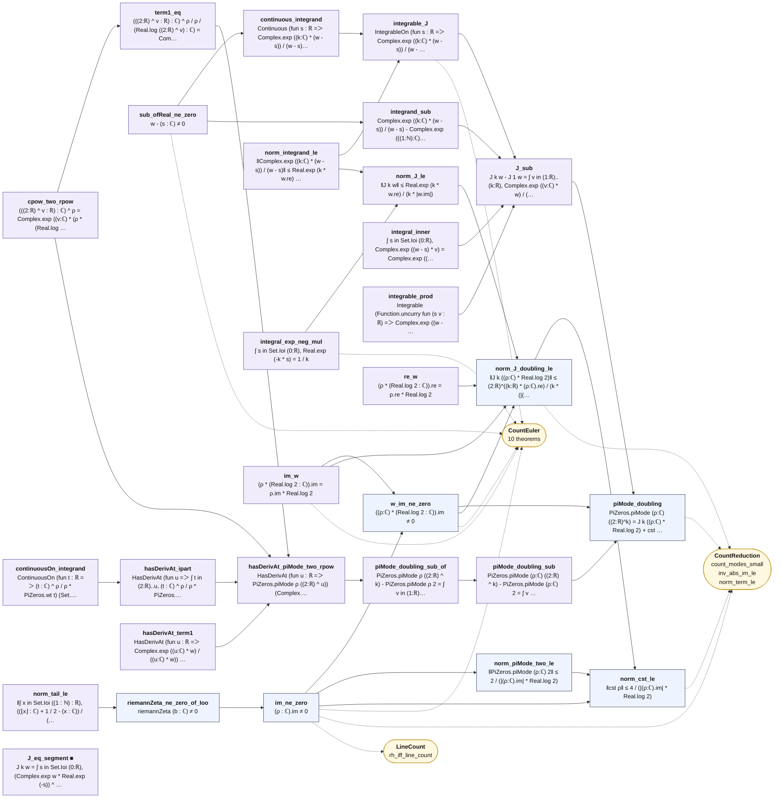

# `lean_stage3/Stage3/CountModes.lean`

> **Read from the source text.** This file changed after the last `python3 utilities/lean_map.py --dump`, so the arrows on this page are names occurring in each proof and have not been confirmed by Lean.

CountModes — block N1 of `lean_stage3/design/countmodes.md`, as corrected in its section "After the independent check". 2026-11-23.

29 theorems, 2 definitions, 513 lines. 

**Imports:** [`FiniteOffLinePi`](../lean_stage3/FiniteOffLinePi.md)  
**Imported by:** [`Stage3`](../lean_stage3/Stage3.md), [`CountReduction`](../lean_stage3/CountReduction.md), [`LineCount`](../lean_stage3/LineCount.md)

## The picture



An arrow A → B reads "A is used in the proof of B". Green: counting, integers only. Violet: shape, analysis with no ζ. Blue: reads ζ. A name ending in ■ is an end: nothing else uses it. Red: contains `sorry`. Yellow: theorems in another file, counted; a dotted arrow crosses files. Definitions are not drawn; they are listed below the diagram.

## Definitions

<a name="CountModes-J"></a>
### `CountModes.J`

def · line 140

The segment integral of one zero on the count's ladder: `J_k(w) = ∫₀^∞ e^(k(w−s))/(w − s) ds`.

- **Is:** `` J (k : ℕ) (w : ℂ) : ℂ := ∫ s in Set.Ioi (0:ℝ), Complex.exp ((k:ℂ) * (w - s)) / (w - s) ``
- **Used by 14:** [`CountEuler.J_eq_zeta`](../lean_stage3/CountEuler.md#CountEuler-J_eq_zeta), [`CountEuler.aSum`](../lean_stage3/CountEuler.md#CountEuler-aSum), [`CountEuler.transform_eq`](../lean_stage3/CountEuler.md#CountEuler-transform_eq), [`CountEuler.tsum_transform`](../lean_stage3/CountEuler.md#CountEuler-tsum_transform), [`CountModes.J_eq_segment`](#CountModes-J_eq_segment), [`CountModes.J_sub`](#CountModes-J_sub), [`CountModes.cst`](#CountModes-cst), [`CountModes.norm_J_doubling_le`](#CountModes-norm_J_doubling_le), [`CountModes.norm_J_le`](#CountModes-norm_J_le), [`CountModes.norm_cst_le`](#CountModes-norm_cst_le), [`CountModes.piMode_doubling`](#CountModes-piMode_doubling), [`CountReduction.count_modes_small`](../lean_stage3/CountReduction.md#CountReduction-count_modes_small), [`CountReduction.norm_term_le`](../lean_stage3/CountReduction.md#CountReduction-norm_term_le), [`CountReduction.summable_J`](../lean_stage3/CountReduction.md#CountReduction-summable_J)

<a name="CountModes-cst"></a>
### `CountModes.cst`

def · line 429

The constant of one zero's part on the count's ladder: `piMode ρ 2 − J_1(w)`.

- **Is:** `` cst (ρ : NontrivialZeros) : ℂ := PiZeros.piMode (ρ:ℂ) 2 - J 1 ((ρ:ℂ) * Real.log 2) ``
- **Built from:** [`CountModes.J`](#CountModes-J), [`PiZeros.piMode`](../lean_stage3/PiZeros.md#PiZeros-piMode)
- **Used by 3:** [`CountModes.norm_cst_le`](#CountModes-norm_cst_le), [`CountModes.piMode_doubling`](#CountModes-piMode_doubling), [`CountReduction.count_modes_small`](../lean_stage3/CountReduction.md#CountReduction-count_modes_small)

## Theorems

<a name="CountModes-norm_tail_le"></a>
### `CountModes.norm_tail_le`

line 39 · arrows read from text

**Shape.** Uses real or complex analysis; nothing in it or beneath it reads ζ.

**Why.** On the real interval `(0, 1)` the Euler–Maclaurin tail of `ζ` at `N = 1` is at most `1/(2b)` in size.

**Proves**

```lean
‖∫ x in Set.Ioi ((1 : ℕ) : ℝ), ((⌊x⌋ : ℂ) + 1 / 2 - (x : ℂ)) / (x : ℂ) ^ ((b : ℂ) + 1)‖ ≤ 1 / (2 * b)
```

**Needs** (its hypotheses)

  - `` hb : 0 < b ``

**Fed by:** no theorem of this repo; it stands on Mathlib.

**Feeds** (1 that use it)

  - [`CountModes.riemannZeta_ne_zero_of_Ioo`](#CountModes-riemannZeta_ne_zero_of_Ioo) — `` riemannZeta (b : ℂ) ≠ 0 ``

<a name="CountModes-riemannZeta_ne_zero_of_Ioo"></a>
### `CountModes.riemannZeta_ne_zero_of_Ioo`

line 85 · arrows read from text

**Reads ζ.** It, or something it rests on, uses the zeta function, its zeros or the Riemann hypothesis.

**Why.** `ζ` has no zero on the real interval `(0, 1)`. By the Euler–Maclaurin form at `N = 1`, `ζ(b) = 1/2 − 1/(1 − b) + b·I` with `|b·I| ≤ 1/2`, while `|1/2 − 1/(1 − b)| > 1/2`.

**Proves**

```lean
riemannZeta (b : ℂ) ≠ 0
```

**Needs** (its hypotheses)

  - `` hb0 : 0 < b ``
  - `` hb1 : b < 1 ``

**Fed by** (1 theorem its proof uses)

  - [`CountModes.norm_tail_le`](#CountModes-norm_tail_le) — `` ‖∫ x in Set.Ioi ((1 : ℕ) : ℝ), ((⌊x⌋ : ℂ) + 1 / 2 - (x : ℂ)) / (x : ℂ) ^ ((b : ℂ) + 1)‖ ≤ 1 / (2 * b) ``

**Feeds** (1 that use it)

  - [`CountModes.im_ne_zero`](#CountModes-im_ne_zero) — `` (ρ : ℂ).im ≠ 0 ``

<a name="CountModes-im_ne_zero"></a>
### `CountModes.im_ne_zero`

line 125 · arrows read from text

**Reads ζ.** It, or something it rests on, uses the zeta function, its zeros or the Riemann hypothesis.

**Why.** No nontrivial zero of ζ is real. A zero with imaginary part `0` would be a zero of `ζ` on the real interval `(0, 1)`.

**Proves**

```lean
(ρ : ℂ).im ≠ 0
```

**Needs** (its hypotheses)

  - `` ρ : NontrivialZeros ``

**Fed by** (1 theorem its proof uses)

  - [`CountModes.riemannZeta_ne_zero_of_Ioo`](#CountModes-riemannZeta_ne_zero_of_Ioo) — `` riemannZeta (b : ℂ) ≠ 0 ``

**Feeds** (8 that use it)

  - [`CountEuler.summable_ord_im`](../lean_stage3/CountEuler.md#CountEuler-summable_ord_im) (CountEuler) — `` Summable fun ρ : {ρ : NontrivialZeros // σ ≤ (ρ:ℂ).re} => FiniteOffLinePi.ordR ρ.1 / |(wz ρ.1).im| ``
  - [`CountModes.norm_cst_le`](#CountModes-norm_cst_le) — `` ‖cst ρ‖ ≤ 4 / (|(ρ:ℂ).im| * Real.log 2) ``
  - [`CountModes.norm_piMode_two_le`](#CountModes-norm_piMode_two_le) — `` ‖PiZeros.piMode (ρ:ℂ) 2‖ ≤ 2 / (|(ρ:ℂ).im| * Real.log 2) ``
  - [`CountModes.w_im_ne_zero`](#CountModes-w_im_ne_zero) — `` ((ρ:ℂ) * (Real.log 2 : ℂ)).im ≠ 0 ``
  - [`CountReduction.count_modes_small`](../lean_stage3/CountReduction.md#CountReduction-count_modes_small) (CountReduction) — `` ∃ E A : ℝ, σ ≤ E ∧ E < Θ ∧ ∀ k : ℕ, 2 ≤ k → ‖∑' ρ : {ρ : Kadiri.NontrivialZeros // σ ≤ (ρ:ℂ).re}, ((riemannZeta.order ((ρ:Kadiri.NontrivialZeros):ℂ) :… ``
  - [`CountReduction.inv_abs_im_le`](../lean_stage3/CountReduction.md#CountReduction-inv_abs_im_le) (CountReduction) — `` |(ρ : ℂ).im|⁻¹ ≤ cim * ‖(ρ : ℂ)‖⁻¹ ``
  - [`CountReduction.norm_term_le`](../lean_stage3/CountReduction.md#CountReduction-norm_term_le) (CountReduction) — `` ‖((riemannZeta.order (ρ:ℂ) : ℤ) : ℂ) * CountModes.J k ((ρ:ℂ) * Real.log 2)‖ ≤ cim * (2:ℝ) ^ ((k:ℝ) * b) / (k * Real.log 2) * (((riemannZeta.order (ρ:ℂ… ``
  - [`LineCount.rh_iff_line_count`](../lean_stage3/LineCount.md#LineCount-rh_iff_line_count) (LineCount) — `` RiemannHypothesis ↔ ∀ T : ℝ, lineCount T = allCount T ``

<a name="CountModes-sub_ofReal_ne_zero"></a>
### `CountModes.sub_ofReal_ne_zero`

line 144 · arrows read from text

**Shape.** Uses real or complex analysis; nothing in it or beneath it reads ζ.

**Why.** For `Im w ≠ 0`, the point `w − s` is never zero for real `s`.

**Proves**

```lean
w - (s : ℂ) ≠ 0
```

**Needs** (its hypotheses)

  - `` hw : w.im ≠ 0 ``
  - `` s : ℝ ``

**Fed by:** no theorem of this repo; it stands on Mathlib.

**Feeds** (6 that use it)

  - [`CountEuler.continuous_Qn`](../lean_stage3/CountEuler.md#CountEuler-continuous_Qn) (CountEuler) — `` Continuous (Qn w p κ n) ``
  - [`CountEuler.hasDerivAt_Gc`](../lean_stage3/CountEuler.md#CountEuler-hasDerivAt_Gc) (CountEuler) — `` HasDerivAt (Gc w p κ (m + 1)) (Pc w p κ m s - Qc w p κ (m + 1) s / ((m + 1 : ℕ) : ℂ)) s ``
  - [`CountEuler.integrable_Pc`](../lean_stage3/CountEuler.md#CountEuler-integrable_Pc) (CountEuler) — `` IntegrableOn (Pc w p κ m) (Set.Ioi 0) ``
  - [`CountEuler.integrable_Qc`](../lean_stage3/CountEuler.md#CountEuler-integrable_Qc) (CountEuler) — `` IntegrableOn (Qc w p κ n) (Set.Ioi 0) ``
  - [`CountModes.continuous_integrand`](#CountModes-continuous_integrand) — `` Continuous (fun s : ℝ => Complex.exp ((k:ℂ) * (w - s)) / (w - s)) ``
  - [`CountModes.integrand_sub`](#CountModes-integrand_sub) — `` Complex.exp ((k:ℂ) * (w - s)) / (w - s) - Complex.exp (((1:ℕ):ℂ) * (w - s)) / (w - s) = ∫ v in (1:ℝ)..(k:ℝ), Complex.exp ((w - s) * v) ``

<a name="CountModes-continuous_integrand"></a>
### `CountModes.continuous_integrand`

line 151 · arrows read from text

**Shape.** Uses real or complex analysis; nothing in it or beneath it reads ζ.

**Why.** For `Im w ≠ 0`, the integrand of `J k w` is continuous in `s`.

**Proves**

```lean
Continuous (fun s : ℝ => Complex.exp ((k:ℂ) * (w - s)) / (w - s))
```

**Needs** (its hypotheses)

  - `` k : ℕ ``
  - `` hw : w.im ≠ 0 ``

**Fed by** (1 theorem its proof uses)

  - [`CountModes.sub_ofReal_ne_zero`](#CountModes-sub_ofReal_ne_zero) — `` w - (s : ℂ) ≠ 0 ``

**Feeds** (1 that use it)

  - [`CountModes.integrable_J`](#CountModes-integrable_J) — `` IntegrableOn (fun s : ℝ => Complex.exp ((k:ℂ) * (w - s)) / (w - s)) (Set.Ioi 0) ``

<a name="CountModes-norm_integrand_le"></a>
### `CountModes.norm_integrand_le`

line 156 · arrows read from text

**Shape.** Uses real or complex analysis; nothing in it or beneath it reads ζ.

**Why.** The size of the integrand of `J k w`: at most `e^(k·Re w)/|Im w|·e^(−ks)`.

**Proves**

```lean
‖Complex.exp ((k:ℂ) * (w - s)) / (w - s)‖ ≤ Real.exp (k * w.re) / |w.im| * Real.exp (-k * s)
```

**Needs** (its hypotheses)

  - `` k : ℕ ``
  - `` hw : w.im ≠ 0 ``
  - `` s : ℝ ``

**Fed by:** no theorem of this repo; it stands on Mathlib.

**Feeds** (2 that use it)

  - [`CountModes.integrable_J`](#CountModes-integrable_J) — `` IntegrableOn (fun s : ℝ => Complex.exp ((k:ℂ) * (w - s)) / (w - s)) (Set.Ioi 0) ``
  - [`CountModes.norm_J_le`](#CountModes-norm_J_le) — `` ‖J k w‖ ≤ Real.exp (k * w.re) / (k * |w.im|) ``

<a name="CountModes-integral_exp_neg_mul"></a>
### `CountModes.integral_exp_neg_mul`

line 173 · arrows read from text

**Shape.** Uses real or complex analysis; nothing in it or beneath it reads ζ.

**Why.** The real exponential `e^(−ks)` integrates to `1/k` over `s > 0`.

**Proves**

```lean
∫ s in Set.Ioi (0:ℝ), Real.exp (-k * s) = 1 / k
```

**Needs** (its hypotheses)

  - `` hk : 0 < k ``

**Fed by:** no theorem of this repo; it stands on Mathlib.

**Feeds** (2 that use it)

  - [`CountEuler.others_le`](../lean_stage3/CountEuler.md#CountEuler-others_le) (CountEuler) — `` ‖F w c m‖ ≤ ‖Complex.exp w‖ * r ^ m / |w.im| ``
  - [`CountModes.norm_J_le`](#CountModes-norm_J_le) — `` ‖J k w‖ ≤ Real.exp (k * w.re) / (k * |w.im|) ``

<a name="CountModes-integrable_J"></a>
### `CountModes.integrable_J`

line 179 · arrows read from text

**Shape.** Uses real or complex analysis; nothing in it or beneath it reads ζ.

**Why.** For `1 ≤ k` and `Im w ≠ 0` the integrand of `J k w` is integrable on `s > 0`.

**Proves**

```lean
IntegrableOn (fun s : ℝ => Complex.exp ((k:ℂ) * (w - s)) / (w - s)) (Set.Ioi 0)
```

**Needs** (its hypotheses)

  - `` hk : 1 ≤ k ``
  - `` hw : w.im ≠ 0 ``

**Fed by** (2 theorems its proof uses)

  - [`CountModes.continuous_integrand`](#CountModes-continuous_integrand) — `` Continuous (fun s : ℝ => Complex.exp ((k:ℂ) * (w - s)) / (w - s)) ``
  - [`CountModes.norm_integrand_le`](#CountModes-norm_integrand_le) — `` ‖Complex.exp ((k:ℂ) * (w - s)) / (w - s)‖ ≤ Real.exp (k * w.re) / |w.im| * Real.exp (-k * s) ``

**Feeds** (2 that use it)

  - [`CountEuler.integrable_zeta_pow`](../lean_stage3/CountEuler.md#CountEuler-integrable_zeta_pow) (CountEuler) — `` IntegrableOn (fun s : ℝ => zeta w s ^ k / (w - s)) (Set.Ioi 0) ``
  - [`CountModes.J_sub`](#CountModes-J_sub) — `` J k w - J 1 w = ∫ v in (1:ℝ)..(k:ℝ), Complex.exp ((v:ℂ) * w) / (v:ℂ) ``

<a name="CountModes-norm_J_le"></a>
### `CountModes.norm_J_le`

line 189 · arrows read from text

**Shape.** Uses real or complex analysis; nothing in it or beneath it reads ζ.

**Why.** The size of the segment integral. For `1 ≤ k` and `Im w ≠ 0`, `‖J k w‖ ≤ e^(k·Re w)/(k·|Im w|)`.

**Proves**

```lean
‖J k w‖ ≤ Real.exp (k * w.re) / (k * |w.im|)
```

**Needs** (its hypotheses)

  - `` hk : 1 ≤ k ``
  - `` hw : w.im ≠ 0 ``

**Fed by** (2 theorems its proof uses)

  - [`CountModes.integral_exp_neg_mul`](#CountModes-integral_exp_neg_mul) — `` ∫ s in Set.Ioi (0:ℝ), Real.exp (-k * s) = 1 / k ``
  - [`CountModes.norm_integrand_le`](#CountModes-norm_integrand_le) — `` ‖Complex.exp ((k:ℂ) * (w - s)) / (w - s)‖ ≤ Real.exp (k * w.re) / |w.im| * Real.exp (-k * s) ``

**Definitions its proof touches:** [`CountModes.J`](#CountModes-J)

**Feeds** (1 that use it)

  - [`CountModes.norm_J_doubling_le`](#CountModes-norm_J_doubling_le) — `` ‖J k ((ρ:ℂ) * Real.log 2)‖ ≤ (2:ℝ)^((k:ℝ) * (ρ:ℂ).re) / (k * (|(ρ:ℂ).im| * Real.log 2)) ``

<a name="CountModes-integrand_sub"></a>
### `CountModes.integrand_sub`

line 204 · arrows read from text

**Shape.** Uses real or complex analysis; nothing in it or beneath it reads ζ.

**Why.** For `s` real and `Im w ≠ 0`, the difference of the integrands of `J k w` and `J 1 w` at `s` is `∫₁ᵏ e^((w−s)v) dv`.

**Proves**

```lean
Complex.exp ((k:ℂ) * (w - s)) / (w - s) - Complex.exp (((1:ℕ):ℂ) * (w - s)) / (w - s) = ∫ v in (1:ℝ)..(k:ℝ), Complex.exp ((w - s) * v)
```

**Needs** (its hypotheses)

  - `` k : ℕ ``
  - `` hw : w.im ≠ 0 ``
  - `` s : ℝ ``

**Fed by** (1 theorem its proof uses)

  - [`CountModes.sub_ofReal_ne_zero`](#CountModes-sub_ofReal_ne_zero) — `` w - (s : ℂ) ≠ 0 ``

**Feeds** (1 that use it)

  - [`CountModes.J_sub`](#CountModes-J_sub) — `` J k w - J 1 w = ∫ v in (1:ℝ)..(k:ℝ), Complex.exp ((v:ℂ) * w) / (v:ℂ) ``

<a name="CountModes-integral_inner"></a>
### `CountModes.integral_inner`

line 211 · arrows read from text

**Shape.** Uses real or complex analysis; nothing in it or beneath it reads ζ.

**Why.** For `v > 0`, `∫₀^∞ e^((w−s)v) ds = e^(vw)/v`.

**Proves**

```lean
∫ s in Set.Ioi (0:ℝ), Complex.exp ((w - s) * v) = Complex.exp ((v:ℂ) * w) / (v:ℂ)
```

**Needs** (its hypotheses)

  - `` hv : 0 < v ``

**Fed by:** no theorem of this repo; it stands on Mathlib.

**Feeds** (1 that use it)

  - [`CountModes.J_sub`](#CountModes-J_sub) — `` J k w - J 1 w = ∫ v in (1:ℝ)..(k:ℝ), Complex.exp ((v:ℂ) * w) / (v:ℂ) ``

<a name="CountModes-integrable_prod"></a>
### `CountModes.integrable_prod`

line 227 · arrows read from text

**Shape.** Uses real or complex analysis; nothing in it or beneath it reads ζ.

**Why.** For `1 ≤ k`, the function `(s, v) ↦ e^((w−s)v)` is integrable on `(0, ∞) × (1, k]`.

**Proves**

```lean
Integrable (Function.uncurry fun (s v : ℝ) => Complex.exp ((w - s) * v)) ((volume.restrict (Set.Ioi (0:ℝ))).prod (volume.restrict (Set.Ioc (1:ℝ) k)))
```

**Needs** (its hypotheses)

  - `` k : ℕ ``
  - `` w : ℂ ``

**Fed by:** no theorem of this repo; it stands on Mathlib.

**Feeds** (1 that use it)

  - [`CountModes.J_sub`](#CountModes-J_sub) — `` J k w - J 1 w = ∫ v in (1:ℝ)..(k:ℝ), Complex.exp ((v:ℂ) * w) / (v:ℂ) ``

<a name="CountModes-J_sub"></a>
### `CountModes.J_sub`

line 261 · arrows read from text

**Shape.** Uses real or complex analysis; nothing in it or beneath it reads ζ.

**Why.** The difference of two segment integrals. For `1 ≤ k` and `Im w ≠ 0`, `J k w − J 1 w = ∫₁ᵏ e^(vw)/v dv`. By Fubini: the difference of the integrands is `∫₁ᵏ e^((w−s)v) dv`, and `∫₀^∞ e^((w−s)v) ds = e^(vw)/v`.

**Proves**

```lean
J k w - J 1 w = ∫ v in (1:ℝ)..(k:ℝ), Complex.exp ((v:ℂ) * w) / (v:ℂ)
```

**Needs** (its hypotheses)

  - `` hk : 1 ≤ k ``
  - `` hw : w.im ≠ 0 ``

**Fed by** (4 theorems its proof uses)

  - [`CountModes.integrable_J`](#CountModes-integrable_J) — `` IntegrableOn (fun s : ℝ => Complex.exp ((k:ℂ) * (w - s)) / (w - s)) (Set.Ioi 0) ``
  - [`CountModes.integrable_prod`](#CountModes-integrable_prod) — `` Integrable (Function.uncurry fun (s v : ℝ) => Complex.exp ((w - s) * v)) ((volume.restrict (Set.Ioi (0:ℝ))).prod (volume.restrict (Set.Ioc (1:ℝ) k))) ``
  - [`CountModes.integral_inner`](#CountModes-integral_inner) — `` ∫ s in Set.Ioi (0:ℝ), Complex.exp ((w - s) * v) = Complex.exp ((v:ℂ) * w) / (v:ℂ) ``
  - [`CountModes.integrand_sub`](#CountModes-integrand_sub) — `` Complex.exp ((k:ℂ) * (w - s)) / (w - s) - Complex.exp (((1:ℕ):ℂ) * (w - s)) / (w - s) = ∫ v in (1:ℝ)..(k:ℝ), Complex.exp ((w - s) * v) ``

**Definitions its proof touches:** [`CountModes.J`](#CountModes-J)

**Feeds** (1 that use it)

  - [`CountModes.piMode_doubling`](#CountModes-piMode_doubling) — `` PiZeros.piMode (ρ:ℂ) ((2:ℝ)^k) = J k ((ρ:ℂ) * Real.log 2) + cst ρ ``

<a name="CountModes-cpow_two_rpow"></a>
### `CountModes.cpow_two_rpow`

line 279 · arrows read from text

**Shape.** Uses real or complex analysis; nothing in it or beneath it reads ζ.

**Why.** The complex power `ρ` of the real `2^v` is `e^(v·ρ·log 2)`.

**Proves**

```lean
(((2:ℝ) ^ v : ℝ) : ℂ) ^ ρ = Complex.exp ((v:ℂ) * (ρ * (Real.log 2 : ℂ)))
```

**Needs** (its hypotheses)

  - `` v : ℝ ``
  - `` ρ : ℂ ``

**Fed by:** no theorem of this repo; it stands on Mathlib.

**Feeds** (2 that use it)

  - [`CountModes.hasDerivAt_piMode_two_rpow`](#CountModes-hasDerivAt_piMode_two_rpow) — `` HasDerivAt (fun u : ℝ => PiZeros.piMode ρ ((2:ℝ) ^ u)) (Complex.exp ((v:ℂ) * (ρ * (Real.log 2 : ℂ))) / (v:ℂ)) v ``
  - [`CountModes.term1_eq`](#CountModes-term1_eq) — `` (((2:ℝ) ^ v : ℝ) : ℂ) ^ ρ / ρ / (Real.log ((2:ℝ) ^ v) : ℂ) = Complex.exp ((v:ℂ) * (ρ * (Real.log 2 : ℂ))) / ((v:ℂ) * (ρ * (Real.log 2 : ℂ))) ``

<a name="CountModes-term1_eq"></a>
### `CountModes.term1_eq`

line 290 · arrows read from text

**Shape.** Uses real or complex analysis; nothing in it or beneath it reads ζ.

**Why.** The first term of `piMode ρ (2^v)` is `e^(vw)/(vw)`, with `w = ρ·log 2`.

**Proves**

```lean
(((2:ℝ) ^ v : ℝ) : ℂ) ^ ρ / ρ / (Real.log ((2:ℝ) ^ v) : ℂ) = Complex.exp ((v:ℂ) * (ρ * (Real.log 2 : ℂ))) / ((v:ℂ) * (ρ * (Real.log 2 : ℂ)))
```

**Needs** (its hypotheses)

  - `` v : ℝ ``
  - `` ρ : ℂ ``

**Fed by** (1 theorem its proof uses)

  - [`CountModes.cpow_two_rpow`](#CountModes-cpow_two_rpow) — `` (((2:ℝ) ^ v : ℝ) : ℂ) ^ ρ = Complex.exp ((v:ℂ) * (ρ * (Real.log 2 : ℂ))) ``

**Feeds** (1 that use it)

  - [`CountModes.hasDerivAt_piMode_two_rpow`](#CountModes-hasDerivAt_piMode_two_rpow) — `` HasDerivAt (fun u : ℝ => PiZeros.piMode ρ ((2:ℝ) ^ u)) (Complex.exp ((v:ℂ) * (ρ * (Real.log 2 : ℂ))) / (v:ℂ)) v ``

<a name="CountModes-continuousOn_integrand"></a>
### `CountModes.continuousOn_integrand`

line 299 · arrows read from text

**Shape.** Uses real or complex analysis; nothing in it or beneath it reads ζ.

**Why.** The integrand of `piMode` is continuous on `t > 1`.

**Proves**

```lean
ContinuousOn (fun t : ℝ => (t : ℂ) ^ ρ / ρ * PiZeros.wt t) (Set.Ioi 1)
```

**Needs** (its hypotheses)

  - `` ρ : ℂ ``

**Fed by:** no theorem of this repo; it stands on Mathlib and the definitions below.

**Definitions its proof touches:** [`PiZeros.wt`](../lean_stage3/PiZeros.md#PiZeros-wt)

**Feeds** (1 that use it)

  - [`CountModes.hasDerivAt_ipart`](#CountModes-hasDerivAt_ipart) — `` HasDerivAt (fun u => ∫ t in (2:ℝ)..u, (t : ℂ) ^ ρ / ρ * PiZeros.wt t) ((y : ℂ) ^ ρ / ρ * PiZeros.wt y) y ``

<a name="CountModes-hasDerivAt_ipart"></a>
### `CountModes.hasDerivAt_ipart`

line 313 · arrows read from text

**Shape.** Uses real or complex analysis; nothing in it or beneath it reads ζ.

**Why.** The derivative of the integral part of `piMode ρ` at `y > 1` is the integrand.

**Proves**

```lean
HasDerivAt (fun u => ∫ t in (2:ℝ)..u, (t : ℂ) ^ ρ / ρ * PiZeros.wt t) ((y : ℂ) ^ ρ / ρ * PiZeros.wt y) y
```

**Needs** (its hypotheses)

  - `` ρ : ℂ ``
  - `` hy : 1 < y ``

**Fed by** (1 theorem its proof uses)

  - [`CountModes.continuousOn_integrand`](#CountModes-continuousOn_integrand) — `` ContinuousOn (fun t : ℝ => (t : ℂ) ^ ρ / ρ * PiZeros.wt t) (Set.Ioi 1) ``

**Definitions its proof touches:** [`PiZeros.wt`](../lean_stage3/PiZeros.md#PiZeros-wt)

**Feeds** (1 that use it)

  - [`CountModes.hasDerivAt_piMode_two_rpow`](#CountModes-hasDerivAt_piMode_two_rpow) — `` HasDerivAt (fun u : ℝ => PiZeros.piMode ρ ((2:ℝ) ^ u)) (Complex.exp ((v:ℂ) * (ρ * (Real.log 2 : ℂ))) / (v:ℂ)) v ``

<a name="CountModes-hasDerivAt_term1"></a>
### `CountModes.hasDerivAt_term1`

line 328 · arrows read from text

**Shape.** Uses real or complex analysis; nothing in it or beneath it reads ζ.

**Why.** The derivative of `e^(uw)/(uw)` at `u ≠ 0`, for `w ≠ 0`.

**Proves**

```lean
HasDerivAt (fun u : ℝ => Complex.exp ((u:ℂ) * w) / ((u:ℂ) * w)) ((Complex.exp ((v:ℂ) * w) * w * ((v:ℂ) * w) - Complex.exp ((v:ℂ) * w) * w) / ((v:ℂ) * w) ^ 2) v
```

**Needs** (its hypotheses)

  - `` hw : w ≠ 0 ``
  - `` hv : v ≠ 0 ``

**Fed by:** no theorem of this repo; it stands on Mathlib.

**Feeds** (1 that use it)

  - [`CountModes.hasDerivAt_piMode_two_rpow`](#CountModes-hasDerivAt_piMode_two_rpow) — `` HasDerivAt (fun u : ℝ => PiZeros.piMode ρ ((2:ℝ) ^ u)) (Complex.exp ((v:ℂ) * (ρ * (Real.log 2 : ℂ))) / (v:ℂ)) v ``

<a name="CountModes-hasDerivAt_piMode_two_rpow"></a>
### `CountModes.hasDerivAt_piMode_two_rpow`

line 342 · arrows read from text

**Shape.** Uses real or complex analysis; nothing in it or beneath it reads ζ.

**Why.** The derivative of one zero's part along the doublings. For `v > 0` and `ρ ≠ 0`, `v ↦ piMode ρ (2^v)` has derivative `e^(vw)/v`, `w = ρ·log 2`.

**Proves**

```lean
HasDerivAt (fun u : ℝ => PiZeros.piMode ρ ((2:ℝ) ^ u)) (Complex.exp ((v:ℂ) * (ρ * (Real.log 2 : ℂ))) / (v:ℂ)) v
```

**Needs** (its hypotheses)

  - `` hρ : ρ ≠ 0 ``
  - `` hv : 0 < v ``

**Fed by** (4 theorems its proof uses)

  - [`CountModes.cpow_two_rpow`](#CountModes-cpow_two_rpow) — `` (((2:ℝ) ^ v : ℝ) : ℂ) ^ ρ = Complex.exp ((v:ℂ) * (ρ * (Real.log 2 : ℂ))) ``
  - [`CountModes.hasDerivAt_ipart`](#CountModes-hasDerivAt_ipart) — `` HasDerivAt (fun u => ∫ t in (2:ℝ)..u, (t : ℂ) ^ ρ / ρ * PiZeros.wt t) ((y : ℂ) ^ ρ / ρ * PiZeros.wt y) y ``
  - [`CountModes.hasDerivAt_term1`](#CountModes-hasDerivAt_term1) — `` HasDerivAt (fun u : ℝ => Complex.exp ((u:ℂ) * w) / ((u:ℂ) * w)) ((Complex.exp ((v:ℂ) * w) * w * ((v:ℂ) * w) - Complex.exp ((v:ℂ) * w) * w) / ((v:ℂ) * … ``
  - [`CountModes.term1_eq`](#CountModes-term1_eq) — `` (((2:ℝ) ^ v : ℝ) : ℂ) ^ ρ / ρ / (Real.log ((2:ℝ) ^ v) : ℂ) = Complex.exp ((v:ℂ) * (ρ * (Real.log 2 : ℂ))) / ((v:ℂ) * (ρ * (Real.log 2 : ℂ))) ``

**Definitions its proof touches:** [`PiZeros.piMode`](../lean_stage3/PiZeros.md#PiZeros-piMode), [`PiZeros.tr`](../lean_stage3/PiZeros.md#PiZeros-tr), [`PiZeros.wt`](../lean_stage3/PiZeros.md#PiZeros-wt)

**Feeds** (1 that use it)

  - [`CountModes.piMode_doubling_sub_of`](#CountModes-piMode_doubling_sub_of) — `` PiZeros.piMode ρ ((2:ℝ) ^ k) - PiZeros.piMode ρ 2 = ∫ v in (1:ℝ)..(k:ℝ), Complex.exp ((v:ℂ) * (ρ * Real.log 2)) / (v:ℂ) ``

<a name="CountModes-piMode_doubling_sub_of"></a>
### `CountModes.piMode_doubling_sub_of`

line 378 · arrows read from text

**Shape.** Uses real or complex analysis; nothing in it or beneath it reads ζ.

**Why.** One zero's part of the count between two doublings. For `ρ ≠ 0` and `1 ≤ k`, `piMode ρ (2^k) − piMode ρ 2 = ∫₁ᵏ e^(vw)/v dv`, `w = ρ·log 2`.

**Proves**

```lean
PiZeros.piMode ρ ((2:ℝ) ^ k) - PiZeros.piMode ρ 2 = ∫ v in (1:ℝ)..(k:ℝ), Complex.exp ((v:ℂ) * (ρ * Real.log 2)) / (v:ℂ)
```

**Needs** (its hypotheses)

  - `` hρ : ρ ≠ 0 ``
  - `` hk : 1 ≤ k ``

**Fed by** (1 theorem its proof uses)

  - [`CountModes.hasDerivAt_piMode_two_rpow`](#CountModes-hasDerivAt_piMode_two_rpow) — `` HasDerivAt (fun u : ℝ => PiZeros.piMode ρ ((2:ℝ) ^ u)) (Complex.exp ((v:ℂ) * (ρ * (Real.log 2 : ℂ))) / (v:ℂ)) v ``

**Definitions its proof touches:** [`PiZeros.piMode`](../lean_stage3/PiZeros.md#PiZeros-piMode)

**Feeds** (1 that use it)

  - [`CountModes.piMode_doubling_sub`](#CountModes-piMode_doubling_sub) — `` PiZeros.piMode (ρ:ℂ) ((2:ℝ) ^ k) - PiZeros.piMode (ρ:ℂ) 2 = ∫ v in (1:ℝ)..(k:ℝ), Complex.exp ((v:ℂ) * ((ρ:ℂ) * Real.log 2)) / (v:ℂ) ``

<a name="CountModes-piMode_doubling_sub"></a>
### `CountModes.piMode_doubling_sub`

line 401 · arrows read from text

**Shape.** Uses real or complex analysis; nothing in it or beneath it reads ζ.

**Why.** One zero's part of the count between two doublings, for a nontrivial zero: `piMode ρ (2^k) − piMode ρ 2 = ∫₁ᵏ e^(vw)/v dv`, `w = ρ·log 2`.

**Proves**

```lean
PiZeros.piMode (ρ:ℂ) ((2:ℝ) ^ k) - PiZeros.piMode (ρ:ℂ) 2 = ∫ v in (1:ℝ)..(k:ℝ), Complex.exp ((v:ℂ) * ((ρ:ℂ) * Real.log 2)) / (v:ℂ)
```

**Needs** (its hypotheses)

  - `` ρ : NontrivialZeros ``
  - `` k : ℕ ``
  - `` hk : 1 ≤ k ``

**Fed by** (1 theorem its proof uses)

  - [`CountModes.piMode_doubling_sub_of`](#CountModes-piMode_doubling_sub_of) — `` PiZeros.piMode ρ ((2:ℝ) ^ k) - PiZeros.piMode ρ 2 = ∫ v in (1:ℝ)..(k:ℝ), Complex.exp ((v:ℂ) * (ρ * Real.log 2)) / (v:ℂ) ``

**Definitions its proof touches:** [`PiZeros.piMode`](../lean_stage3/PiZeros.md#PiZeros-piMode)

**Feeds** (1 that use it)

  - [`CountModes.piMode_doubling`](#CountModes-piMode_doubling) — `` PiZeros.piMode (ρ:ℂ) ((2:ℝ)^k) = J k ((ρ:ℂ) * Real.log 2) + cst ρ ``

<a name="CountModes-im_w"></a>
### `CountModes.im_w`

line 414 · arrows read from text

**Shape.** Uses real or complex analysis; nothing in it or beneath it reads ζ.

**Why.** The imaginary part of `w = ρ·log 2` is `γ·log 2`.

**Proves**

```lean
(ρ * (Real.log 2 : ℂ)).im = ρ.im * Real.log 2
```

**Needs** (its hypotheses)

  - `` ρ : ℂ ``

**Fed by:** no theorem of this repo; it stands on Mathlib.

**Feeds** (3 that use it)

  - [`CountEuler.summable_ord_im`](../lean_stage3/CountEuler.md#CountEuler-summable_ord_im) (CountEuler) — `` Summable fun ρ : {ρ : NontrivialZeros // σ ≤ (ρ:ℂ).re} => FiniteOffLinePi.ordR ρ.1 / |(wz ρ.1).im| ``
  - [`CountModes.norm_J_doubling_le`](#CountModes-norm_J_doubling_le) — `` ‖J k ((ρ:ℂ) * Real.log 2)‖ ≤ (2:ℝ)^((k:ℝ) * (ρ:ℂ).re) / (k * (|(ρ:ℂ).im| * Real.log 2)) ``
  - [`CountModes.w_im_ne_zero`](#CountModes-w_im_ne_zero) — `` ((ρ:ℂ) * (Real.log 2 : ℂ)).im ≠ 0 ``

<a name="CountModes-re_w"></a>
### `CountModes.re_w`

line 419 · arrows read from text

**Shape.** Uses real or complex analysis; nothing in it or beneath it reads ζ.

**Why.** The real part of `w = ρ·log 2` is `β·log 2`.

**Proves**

```lean
(ρ * (Real.log 2 : ℂ)).re = ρ.re * Real.log 2
```

**Needs** (its hypotheses)

  - `` ρ : ℂ ``

**Fed by:** no theorem of this repo; it stands on Mathlib.

**Feeds** (1 that use it)

  - [`CountModes.norm_J_doubling_le`](#CountModes-norm_J_doubling_le) — `` ‖J k ((ρ:ℂ) * Real.log 2)‖ ≤ (2:ℝ)^((k:ℝ) * (ρ:ℂ).re) / (k * (|(ρ:ℂ).im| * Real.log 2)) ``

<a name="CountModes-w_im_ne_zero"></a>
### `CountModes.w_im_ne_zero`

line 424 · arrows read from text

**Reads ζ.** It, or something it rests on, uses the zeta function, its zeros or the Riemann hypothesis.

**Why.** For a nontrivial zero, `w = ρ·log 2` is not real.

**Proves**

```lean
((ρ:ℂ) * (Real.log 2 : ℂ)).im ≠ 0
```

**Needs** (its hypotheses)

  - `` ρ : NontrivialZeros ``

**Fed by** (2 theorems its proof uses)

  - [`CountModes.im_ne_zero`](#CountModes-im_ne_zero) — `` (ρ : ℂ).im ≠ 0 ``
  - [`CountModes.im_w`](#CountModes-im_w) — `` (ρ * (Real.log 2 : ℂ)).im = ρ.im * Real.log 2 ``

**Feeds** (5 that use it)

  - [`CountEuler.term_class`](../lean_stage3/CountEuler.md#CountEuler-term_class) (CountEuler) — `` Tendsto (fun m : ℕ => ordC ρ * (F (wz ρ) c m / Nn u R m)) atTop (𝓝 (ordC ρ * (1 / wz ρ))) ∧ ∀ m : ℕ, ‖ordC ρ * (F (wz ρ) c m / Nn u R m)‖ ≤ K₃ * (Fini… ``
  - [`CountEuler.term_other`](../lean_stage3/CountEuler.md#CountEuler-term_other) (CountEuler) — `` Tendsto (fun m : ℕ => ordC ρ * (F (wz ρ) c m / Nn u R m)) atTop (𝓝 0) ∧ ∀ m : ℕ, ‖ordC ρ * (F (wz ρ) c m / Nn u R m)‖ ≤ K₃ * (FiniteOffLinePi.ordR ρ /… ``
  - [`CountEuler.tsum_transform`](../lean_stage3/CountEuler.md#CountEuler-tsum_transform) (CountEuler) — `` ∑ j ∈ Finset.range (m + 1), coefE c m j * aSum σ (j + 1) = ∑' ρ : {ρ : NontrivialZeros // σ ≤ (ρ:ℂ).re}, ordC ρ.1 * F (wz ρ.1) c m ``
  - [`CountModes.norm_J_doubling_le`](#CountModes-norm_J_doubling_le) — `` ‖J k ((ρ:ℂ) * Real.log 2)‖ ≤ (2:ℝ)^((k:ℝ) * (ρ:ℂ).re) / (k * (|(ρ:ℂ).im| * Real.log 2)) ``
  - [`CountModes.piMode_doubling`](#CountModes-piMode_doubling) — `` PiZeros.piMode (ρ:ℂ) ((2:ℝ)^k) = J k ((ρ:ℂ) * Real.log 2) + cst ρ ``

<a name="CountModes-piMode_doubling"></a>
### `CountModes.piMode_doubling`

line 433 · arrows read from text

**Reads ζ.** It, or something it rests on, uses the zeta function, its zeros or the Riemann hypothesis.

**Why.** One zero's part on the count's ladder is a segment plus a constant. For a nontrivial zero and `1 ≤ k`, `piMode ρ (2^k) = J_k(ρ·log 2) + cst ρ`.

**Proves**

```lean
PiZeros.piMode (ρ:ℂ) ((2:ℝ)^k) = J k ((ρ:ℂ) * Real.log 2) + cst ρ
```

**Needs** (its hypotheses)

  - `` ρ : NontrivialZeros ``
  - `` hk : 1 ≤ k ``

**Fed by** (3 theorems its proof uses)

  - [`CountModes.J_sub`](#CountModes-J_sub) — `` J k w - J 1 w = ∫ v in (1:ℝ)..(k:ℝ), Complex.exp ((v:ℂ) * w) / (v:ℂ) ``
  - [`CountModes.piMode_doubling_sub`](#CountModes-piMode_doubling_sub) — `` PiZeros.piMode (ρ:ℂ) ((2:ℝ) ^ k) - PiZeros.piMode (ρ:ℂ) 2 = ∫ v in (1:ℝ)..(k:ℝ), Complex.exp ((v:ℂ) * ((ρ:ℂ) * Real.log 2)) / (v:ℂ) ``
  - [`CountModes.w_im_ne_zero`](#CountModes-w_im_ne_zero) — `` ((ρ:ℂ) * (Real.log 2 : ℂ)).im ≠ 0 ``

**Definitions its proof touches:** [`CountModes.J`](#CountModes-J), [`CountModes.cst`](#CountModes-cst), [`PiZeros.piMode`](../lean_stage3/PiZeros.md#PiZeros-piMode)

**Feeds** (1 that use it)

  - [`CountReduction.count_modes_small`](../lean_stage3/CountReduction.md#CountReduction-count_modes_small) (CountReduction) — `` ∃ E A : ℝ, σ ≤ E ∧ E < Θ ∧ ∀ k : ℕ, 2 ≤ k → ‖∑' ρ : {ρ : Kadiri.NontrivialZeros // σ ≤ (ρ:ℂ).re}, ((riemannZeta.order ((ρ:Kadiri.NontrivialZeros):ℂ) :… ``

<a name="CountModes-norm_J_doubling_le"></a>
### `CountModes.norm_J_doubling_le`

line 446 · arrows read from text

**Reads ζ.** It, or something it rests on, uses the zeta function, its zeros or the Riemann hypothesis.

**Why.** The size of a zero's segment on the count's ladder. For `1 ≤ k`, `‖J_k(ρ·log 2)‖ ≤ 2^(kβ)/(k·|γ|·log 2)`.

**Proves**

```lean
‖J k ((ρ:ℂ) * Real.log 2)‖ ≤ (2:ℝ)^((k:ℝ) * (ρ:ℂ).re) / (k * (|(ρ:ℂ).im| * Real.log 2))
```

**Needs** (its hypotheses)

  - `` ρ : NontrivialZeros ``
  - `` hk : 1 ≤ k ``

**Fed by** (4 theorems its proof uses)

  - [`CountModes.im_w`](#CountModes-im_w) — `` (ρ * (Real.log 2 : ℂ)).im = ρ.im * Real.log 2 ``
  - [`CountModes.norm_J_le`](#CountModes-norm_J_le) — `` ‖J k w‖ ≤ Real.exp (k * w.re) / (k * |w.im|) ``
  - [`CountModes.re_w`](#CountModes-re_w) — `` (ρ * (Real.log 2 : ℂ)).re = ρ.re * Real.log 2 ``
  - [`CountModes.w_im_ne_zero`](#CountModes-w_im_ne_zero) — `` ((ρ:ℂ) * (Real.log 2 : ℂ)).im ≠ 0 ``

**Definitions its proof touches:** [`CountModes.J`](#CountModes-J)

**Feeds** (2 that use it)

  - [`CountModes.norm_cst_le`](#CountModes-norm_cst_le) — `` ‖cst ρ‖ ≤ 4 / (|(ρ:ℂ).im| * Real.log 2) ``
  - [`CountReduction.norm_term_le`](../lean_stage3/CountReduction.md#CountReduction-norm_term_le) (CountReduction) — `` ‖((riemannZeta.order (ρ:ℂ) : ℤ) : ℂ) * CountModes.J k ((ρ:ℂ) * Real.log 2)‖ ≤ cim * (2:ℝ) ^ ((k:ℝ) * b) / (k * Real.log 2) * (((riemannZeta.order (ρ:ℂ… ``

<a name="CountModes-norm_piMode_two_le"></a>
### `CountModes.norm_piMode_two_le`

line 457 · arrows read from text

**Reads ζ.** It, or something it rests on, uses the zeta function, its zeros or the Riemann hypothesis.

**Why.** The value of one zero's part at `2`: `‖piMode ρ 2‖ ≤ 2/(|γ|·log 2)`.

**Proves**

```lean
‖PiZeros.piMode (ρ:ℂ) 2‖ ≤ 2 / (|(ρ:ℂ).im| * Real.log 2)
```

**Needs** (its hypotheses)

  - `` ρ : NontrivialZeros ``

**Fed by** (1 theorem its proof uses)

  - [`CountModes.im_ne_zero`](#CountModes-im_ne_zero) — `` (ρ : ℂ).im ≠ 0 ``

**Definitions its proof touches:** [`PiZeros.piMode`](../lean_stage3/PiZeros.md#PiZeros-piMode), [`PiZeros.tr`](../lean_stage3/PiZeros.md#PiZeros-tr)

**Feeds** (1 that use it)

  - [`CountModes.norm_cst_le`](#CountModes-norm_cst_le) — `` ‖cst ρ‖ ≤ 4 / (|(ρ:ℂ).im| * Real.log 2) ``

<a name="CountModes-norm_cst_le"></a>
### `CountModes.norm_cst_le`

line 473 · arrows read from text

**Reads ζ.** It, or something it rests on, uses the zeta function, its zeros or the Riemann hypothesis.

**Why.** The size of the constant. `‖cst ρ‖ ≤ 4/(|γ|·log 2)`: each of `piMode ρ 2` and `J_1(ρ·log 2)` is at most `2^β/(|γ|·log 2) ≤ 2/(|γ|·log 2)`.

**Proves**

```lean
‖cst ρ‖ ≤ 4 / (|(ρ:ℂ).im| * Real.log 2)
```

**Needs** (its hypotheses)

  - `` ρ : NontrivialZeros ``

**Fed by** (3 theorems its proof uses)

  - [`CountModes.im_ne_zero`](#CountModes-im_ne_zero) — `` (ρ : ℂ).im ≠ 0 ``
  - [`CountModes.norm_J_doubling_le`](#CountModes-norm_J_doubling_le) — `` ‖J k ((ρ:ℂ) * Real.log 2)‖ ≤ (2:ℝ)^((k:ℝ) * (ρ:ℂ).re) / (k * (|(ρ:ℂ).im| * Real.log 2)) ``
  - [`CountModes.norm_piMode_two_le`](#CountModes-norm_piMode_two_le) — `` ‖PiZeros.piMode (ρ:ℂ) 2‖ ≤ 2 / (|(ρ:ℂ).im| * Real.log 2) ``

**Definitions its proof touches:** [`CountModes.J`](#CountModes-J), [`CountModes.cst`](#CountModes-cst), [`PiZeros.piMode`](../lean_stage3/PiZeros.md#PiZeros-piMode)

**Feeds** (1 that use it)

  - [`CountReduction.count_modes_small`](../lean_stage3/CountReduction.md#CountReduction-count_modes_small) (CountReduction) — `` ∃ E A : ℝ, σ ≤ E ∧ E < Θ ∧ ∀ k : ℕ, 2 ≤ k → ‖∑' ρ : {ρ : Kadiri.NontrivialZeros // σ ≤ (ρ:ℂ).re}, ((riemannZeta.order ((ρ:Kadiri.NontrivialZeros):ℂ) :… ``

<a name="CountModes-J_eq_segment"></a>
### `CountModes.J_eq_segment`

line 500 · arrows read from text

**Shape.** Uses real or complex analysis; nothing in it or beneath it reads ζ.

**Why.** The segment form. `J_k(w) = ∫₀^∞ (e^w·e^(−s))^k/(w − s) ds`: the integrand is the pure mode `z·e^(−s)`, `z = e^w`, raised to the `k`-th power, with density `1/(w − s)`. It holds for every `k` and `w`.

**Proves**

```lean
J k w = ∫ s in Set.Ioi (0:ℝ), (Complex.exp w * Real.exp (-s)) ^ k / (w - s)
```

**Needs** (its hypotheses)

  - `` k : ℕ ``
  - `` w : ℂ ``

**Fed by:** no theorem of this repo; it stands on Mathlib and the definitions below.

**Definitions its proof touches:** [`CountModes.J`](#CountModes-J)

**Feeds:** nothing. It is an end.

