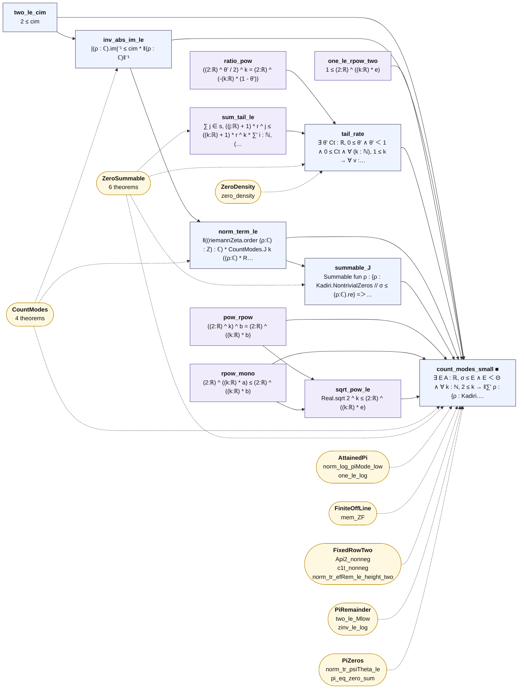

# `lean_stage3/Stage3/CountReduction.lean`

> **Read from the source text.** This file changed after the last `python3 utilities/lean_map.py --dump`, so the arrows on this page are names occurring in each proof and have not been confirmed by Lean.

CountReduction — block N2 of `lean_stage3/design/countmodes.md`, as corrected in its section "After the independent check". 2026-11-23.

12 theorems, 1 definition, 601 lines. 

**Imports:** [`AttainedPi`](../lean_stage3/AttainedPi.md), [`CountModes`](../lean_stage3/CountModes.md), [`FixedRowTwo`](../lean_stage3/FixedRowTwo.md), [`ZeroSummable`](../lean_stage3/ZeroSummable.md)  
**Imported by:** [`Stage3`](../lean_stage3/Stage3.md)

## The picture



An arrow A → B reads "A is used in the proof of B". Green: counting, integers only. Violet: shape, analysis with no ζ. Blue: reads ζ. A name ending in ■ is an end: nothing else uses it. Red: contains `sorry`. Yellow: theorems in another file, counted; a dotted arrow crosses files. Definitions are not drawn; they are listed below the diagram.

## Definitions

<a name="CountReduction-cim"></a>
### `CountReduction.cim`

def · line 40

A constant bounding `|ρ|/|γ|` over every nontrivial zero: `2` plus the sum of `|ρ|/|γ|` over the finitely many zeros of height below one.

- **Is:** `` cim : ℝ := 2 + ∑ ρ ∈ ZF (1 : ℝ), ‖(ρ : ℂ)‖ / |(ρ : ℂ).im| ``
- **Built from:** [`FiniteOffLine.ZF`](../lean_stage3/FiniteOffLine.md#FiniteOffLine-ZF)
- **Used by 4:** [`CountReduction.count_modes_small`](#CountReduction-count_modes_small), [`CountReduction.inv_abs_im_le`](#CountReduction-inv_abs_im_le), [`CountReduction.norm_term_le`](#CountReduction-norm_term_le), [`CountReduction.two_le_cim`](#CountReduction-two_le_cim)

## Theorems

<a name="CountReduction-two_le_cim"></a>
### `CountReduction.two_le_cim`

line 43 · arrows read from text

**Reads ζ.** It, or something it rests on, uses the zeta function, its zeros or the Riemann hypothesis.

**Why.** The constant `cim` is at least `2`.

**Proves**

```lean
2 ≤ cim
```

**Fed by:** no theorem of this repo; it stands on Mathlib and the definitions below.

**Definitions its proof touches:** [`CountReduction.cim`](#CountReduction-cim), [`FiniteOffLine.ZF`](../lean_stage3/FiniteOffLine.md#FiniteOffLine-ZF)

**Feeds** (2 that use it)

  - [`CountReduction.count_modes_small`](#CountReduction-count_modes_small) — `` ∃ E A : ℝ, σ ≤ E ∧ E < Θ ∧ ∀ k : ℕ, 2 ≤ k → ‖∑' ρ : {ρ : Kadiri.NontrivialZeros // σ ≤ (ρ:ℂ).re}, ((riemannZeta.order ((ρ:Kadiri.NontrivialZeros):ℂ) :… ``
  - [`CountReduction.inv_abs_im_le`](#CountReduction-inv_abs_im_le) — `` |(ρ : ℂ).im|⁻¹ ≤ cim * ‖(ρ : ℂ)‖⁻¹ ``

<a name="CountReduction-inv_abs_im_le"></a>
### `CountReduction.inv_abs_im_le`

line 52 · arrows read from text

**Reads ζ.** It, or something it rests on, uses the zeta function, its zeros or the Riemann hypothesis.

**Why.** The height of a zero against its size. For every nontrivial zero, `1/|γ| ≤ cim/|ρ|`. Above height one `|ρ| ≤ 1 + |γ| ≤ 2|γ|`; below it there are finitely many zeros.

**Proves**

```lean
|(ρ : ℂ).im|⁻¹ ≤ cim * ‖(ρ : ℂ)‖⁻¹
```

**Needs** (its hypotheses)

  - `` ρ : NontrivialZeros ``

**Fed by** (2 theorems its proof uses)

  - [`CountModes.im_ne_zero`](../lean_stage3/CountModes.md#CountModes-im_ne_zero) (CountModes) — `` (ρ : ℂ).im ≠ 0 ``
  - [`CountReduction.two_le_cim`](#CountReduction-two_le_cim) — `` 2 ≤ cim ``

**Definitions its proof touches:** [`CountReduction.cim`](#CountReduction-cim), [`FiniteOffLine.ZF`](../lean_stage3/FiniteOffLine.md#FiniteOffLine-ZF)

**Feeds** (2 that use it)

  - [`CountReduction.count_modes_small`](#CountReduction-count_modes_small) — `` ∃ E A : ℝ, σ ≤ E ∧ E < Θ ∧ ∀ k : ℕ, 2 ≤ k → ‖∑' ρ : {ρ : Kadiri.NontrivialZeros // σ ≤ (ρ:ℂ).re}, ((riemannZeta.order ((ρ:Kadiri.NontrivialZeros):ℂ) :… ``
  - [`CountReduction.norm_term_le`](#CountReduction-norm_term_le) — `` ‖((riemannZeta.order (ρ:ℂ) : ℤ) : ℂ) * CountModes.J k ((ρ:ℂ) * Real.log 2)‖ ≤ cim * (2:ℝ) ^ ((k:ℝ) * b) / (k * Real.log 2) * (((riemannZeta.order (ρ:ℂ… ``

<a name="CountReduction-ratio_pow"></a>
### `CountReduction.ratio_pow`

line 79 · arrows read from text

**Shape.** Uses real or complex analysis; nothing in it or beneath it reads ζ.

**Why.** The shell ratio as a power: `(2^θ'/2)^k = 2^(−k(1−θ'))`.

**Proves**

```lean
((2:ℝ) ^ θ' / 2) ^ k = (2:ℝ) ^ (-(k:ℝ) * (1 - θ'))
```

**Needs** (its hypotheses)

  - `` θ' : ℝ ``
  - `` k : ℕ ``

**Fed by:** no theorem of this repo; it stands on Mathlib.

**Feeds** (1 that use it)

  - [`CountReduction.tail_rate`](#CountReduction-tail_rate) — `` ∃ θ' Ct : ℝ, 0 ≤ θ' ∧ θ' < 1 ∧ 0 ≤ Ct ∧ ∀ (k : ℕ), 1 ≤ k → ∀ v : Finset Kadiri.NontrivialZeros, (∀ ρ ∈ v, σ ≤ (ρ:ℂ).re ∧ (2:ℝ)^k ≤ |(ρ:ℂ).im|) → ∑ ρ ∈… ``

<a name="CountReduction-sum_tail_le"></a>
### `CountReduction.sum_tail_le`

line 89 · arrows read from text

**Shape.** Uses real or complex analysis; nothing in it or beneath it reads ζ.

**Why.** For `0 ≤ r < 1`, a finite sum of `(j + 1)·r^j` over indices `j ≥ k` is at most `(k + 1)·r^k·S`, with `S = Σ' (i + 1)·r^i`: shift every index down by `k`.

**Proves**

```lean
∑ j ∈ s, ((j:ℝ) + 1) * r ^ j ≤ ((k:ℝ) + 1) * r ^ k * ∑' i : ℕ, ((i:ℝ) + 1) * r ^ i
```

**Needs** (its hypotheses)

  - `` h0 : 0 ≤ r ``
  - `` h1 : r < 1 ``
  - `` k : ℕ ``
  - `` s : Finset ℕ ``
  - `` hs : ∀ j ∈ s, k ≤ j ``

**Fed by** (1 theorem its proof uses)

  - [`ZeroSummable.summable_shell`](../lean_stage3/ZeroSummable.md#ZeroSummable-summable_shell) (ZeroSummable) — `` Summable fun j : ℕ => K * (((j : ℝ) + 1) * r ^ j) ``

**Feeds** (1 that use it)

  - [`CountReduction.tail_rate`](#CountReduction-tail_rate) — `` ∃ θ' Ct : ℝ, 0 ≤ θ' ∧ θ' < 1 ∧ 0 ≤ Ct ∧ ∀ (k : ℕ), 1 ≤ k → ∀ v : Finset Kadiri.NontrivialZeros, (∀ ρ ∈ v, σ ≤ (ρ:ℂ).re ∧ (2:ℝ)^k ≤ |(ρ:ℂ).im|) → ∑ ρ ∈… ``

<a name="CountReduction-tail_rate"></a>
### `CountReduction.tail_rate`

line 125 · arrows read from text

**Reads ζ.** It, or something it rests on, uses the zeta function, its zeros or the Riemann hypothesis.

**Why.** The rate of the tail. For `1/2 < σ ≤ 1` there are `0 ≤ θ' < 1` and `Ct ≥ 0` such that, for every `k ≥ 1`, the weights `m(ρ)/|ρ|` over any finite set of zeros with `Re ρ ≥ σ` and `|Im ρ| ≥ 2^k` sum to at most `Ct·k·2^(−k(1−θ'))`. The shells `j ≥ k` weigh `K·(j+1)·2^(−j(1−θ'))` each (`ZeroSummable.shell_sum_le`), a geometric tail; below the first shell the density bound reads, one constant does.

**Proves**

```lean
∃ θ' Ct : ℝ, 0 ≤ θ' ∧ θ' < 1 ∧ 0 ≤ Ct ∧ ∀ (k : ℕ), 1 ≤ k → ∀ v : Finset Kadiri.NontrivialZeros, (∀ ρ ∈ v, σ ≤ (ρ:ℂ).re ∧ (2:ℝ)^k ≤ |(ρ:ℂ).im|) → ∑ ρ ∈ v, ((riemannZeta.order (ρ:ℂ) : ℤ) : ℝ) / ‖(ρ:ℂ)‖ ≤ Ct * k * (2:ℝ)^(-(k:ℝ) * (1 - θ'))
```

**Needs** (its hypotheses)

  - `` hσ : 1/2 < σ ``
  - `` hσ1 : σ ≤ 1 ``

**Fed by** (7 theorems its proof uses)

  - [`CountReduction.ratio_pow`](#CountReduction-ratio_pow) — `` ((2:ℝ) ^ θ' / 2) ^ k = (2:ℝ) ^ (-(k:ℝ) * (1 - θ')) ``
  - [`CountReduction.sum_tail_le`](#CountReduction-sum_tail_le) — `` ∑ j ∈ s, ((j:ℝ) + 1) * r ^ j ≤ ((k:ℝ) + 1) * r ^ k * ∑' i : ℕ, ((i:ℝ) + 1) * r ^ i ``
  - [`ZeroDensity.zero_density`](../lean_stage3/ZeroDensity.md#ZeroDensity-zero_density) (ZeroDensity) — `` ∃ θ C T₀ : ℝ, θ < 1 ∧ 0 ≤ C ∧ ∀ T : ℝ, T₀ ≤ T → ∀ Z : Finset ℂ, (∀ ρ ∈ Z, riemannZeta ρ = 0 ∧ σ ≤ ρ.re ∧ ρ.re < 1 ∧ 2 ≤ ρ.im ∧ ρ.im ≤ T - 2) → (Z.card… ``
  - [`ZeroSummable.dyadic_index`](../lean_stage3/ZeroSummable.md#ZeroSummable-dyadic_index) (ZeroSummable) — `` (2 : ℝ) ^ (Nat.log 2 ⌊x⌋₊) ≤ x ∧ x < 2 ^ (Nat.log 2 ⌊x⌋₊ + 1) ``
  - [`ZeroSummable.shell_bound_le`](../lean_stage3/ZeroSummable.md#ZeroSummable-shell_bound_le) (ZeroSummable) — `` 2 * (C * ((2 : ℝ) ^ (j + 1) + 2) ^ θ) * (103 * ((j : ℝ) + 1) / 2 ^ j) ≤ 206 * C * (4 : ℝ) ^ (max θ 0) * (((j : ℝ) + 1) * ((2 : ℝ) ^ (max θ 0) / 2) ^ j… ``
  - [`ZeroSummable.shell_sum_le`](../lean_stage3/ZeroSummable.md#ZeroSummable-shell_sum_le) (ZeroSummable) — `` ∑ ρ ∈ F, w ρ ≤ 2 * (C * ((2 : ℝ) ^ (j + 1) + 2) ^ θ) * (103 * ((j : ℝ) + 1) / 2 ^ j) ``
  - [`ZeroSummable.sum_le_const`](../lean_stage3/ZeroSummable.md#ZeroSummable-sum_le_const) (ZeroSummable) — `` ∃ M : ℝ, ∀ v : Finset NontrivialZeros, (∀ ρ ∈ v, σ ≤ (ρ : ℂ).re) → ∑ ρ ∈ v, w ρ ≤ M ``

**Definitions its proof touches:** [`ZeroSummable.w`](../lean_stage3/ZeroSummable.md#ZeroSummable-w)

**Feeds** (1 that use it)

  - [`CountReduction.count_modes_small`](#CountReduction-count_modes_small) — `` ∃ E A : ℝ, σ ≤ E ∧ E < Θ ∧ ∀ k : ℕ, 2 ≤ k → ‖∑' ρ : {ρ : Kadiri.NontrivialZeros // σ ≤ (ρ:ℂ).re}, ((riemannZeta.order ((ρ:Kadiri.NontrivialZeros):ℂ) :… ``

<a name="CountReduction-norm_term_le"></a>
### `CountReduction.norm_term_le`

line 238 · arrows read from text

**Reads ζ.** It, or something it rests on, uses the zeta function, its zeros or the Riemann hypothesis.

**Why.** One segment term against its weight. For `1 ≤ k` and a real part `β ≤ b`, `‖m(ρ)·J_k(ρ·log 2)‖ ≤ cim·2^(kb)/(k·log 2)·m(ρ)/|ρ|`.

**Proves**

```lean
‖((riemannZeta.order (ρ:ℂ) : ℤ) : ℂ) * CountModes.J k ((ρ:ℂ) * Real.log 2)‖ ≤ cim * (2:ℝ) ^ ((k:ℝ) * b) / (k * Real.log 2) * (((riemannZeta.order (ρ:ℂ) : ℤ) : ℝ) / ‖(ρ:ℂ)‖)
```

**Needs** (its hypotheses)

  - `` ρ : NontrivialZeros ``
  - `` hk : 1 ≤ k ``
  - `` hb : (ρ : ℂ).re ≤ b ``

**Fed by** (3 theorems its proof uses)

  - [`CountModes.im_ne_zero`](../lean_stage3/CountModes.md#CountModes-im_ne_zero) (CountModes) — `` (ρ : ℂ).im ≠ 0 ``
  - [`CountModes.norm_J_doubling_le`](../lean_stage3/CountModes.md#CountModes-norm_J_doubling_le) (CountModes) — `` ‖J k ((ρ:ℂ) * Real.log 2)‖ ≤ (2:ℝ)^((k:ℝ) * (ρ:ℂ).re) / (k * (|(ρ:ℂ).im| * Real.log 2)) ``
  - [`CountReduction.inv_abs_im_le`](#CountReduction-inv_abs_im_le) — `` |(ρ : ℂ).im|⁻¹ ≤ cim * ‖(ρ : ℂ)‖⁻¹ ``

**Definitions its proof touches:** [`CountModes.J`](../lean_stage3/CountModes.md#CountModes-J), [`CountReduction.cim`](#CountReduction-cim)

**Feeds** (2 that use it)

  - [`CountReduction.count_modes_small`](#CountReduction-count_modes_small) — `` ∃ E A : ℝ, σ ≤ E ∧ E < Θ ∧ ∀ k : ℕ, 2 ≤ k → ‖∑' ρ : {ρ : Kadiri.NontrivialZeros // σ ≤ (ρ:ℂ).re}, ((riemannZeta.order ((ρ:Kadiri.NontrivialZeros):ℂ) :… ``
  - [`CountReduction.summable_J`](#CountReduction-summable_J) — `` Summable fun ρ : {ρ : Kadiri.NontrivialZeros // σ ≤ (ρ:ℂ).re} => ‖((riemannZeta.order ((ρ:Kadiri.NontrivialZeros):ℂ) : ℤ) : ℂ) * CountModes.J k (((ρ:K… ``

<a name="CountReduction-summable_J"></a>
### `CountReduction.summable_J`

line 271 · arrows read from text

**Reads ζ.** It, or something it rests on, uses the zeta function, its zeros or the Riemann hypothesis.

**Why.** The segment terms right of a line are absolutely summable. For `σ > 1/2` and `k ≥ 1`, `‖m(ρ)·J_k(ρ·log 2)‖ ≤ cim·2^k/(k·log 2)·m(ρ)/|ρ|`, and these weights are summable (`ZeroSummable.summable_order_div`).

**Proves**

```lean
Summable fun ρ : {ρ : Kadiri.NontrivialZeros // σ ≤ (ρ:ℂ).re} => ‖((riemannZeta.order ((ρ:Kadiri.NontrivialZeros):ℂ) : ℤ) : ℂ) * CountModes.J k (((ρ:Kadiri.NontrivialZeros):ℂ) * Real.log 2)‖
```

**Needs** (its hypotheses)

  - `` hσ : 1/2 < σ ``
  - `` hk : 1 ≤ k ``

**Fed by** (2 theorems its proof uses)

  - [`CountReduction.norm_term_le`](#CountReduction-norm_term_le) — `` ‖((riemannZeta.order (ρ:ℂ) : ℤ) : ℂ) * CountModes.J k ((ρ:ℂ) * Real.log 2)‖ ≤ cim * (2:ℝ) ^ ((k:ℝ) * b) / (k * Real.log 2) * (((riemannZeta.order (ρ:ℂ… ``
  - [`ZeroSummable.summable_order_div`](../lean_stage3/ZeroSummable.md#ZeroSummable-summable_order_div) (ZeroSummable) — `` Summable fun ρ : {ρ : Kadiri.NontrivialZeros // σ ≤ ((ρ : Kadiri.NontrivialZeros) : ℂ).re} => ((riemannZeta.order ((ρ : Kadiri.NontrivialZeros) : ℂ) :… ``

**Definitions its proof touches:** [`CountModes.J`](../lean_stage3/CountModes.md#CountModes-J)

**Feeds** (1 that use it)

  - [`CountReduction.count_modes_small`](#CountReduction-count_modes_small) — `` ∃ E A : ℝ, σ ≤ E ∧ E < Θ ∧ ∀ k : ℕ, 2 ≤ k → ‖∑' ρ : {ρ : Kadiri.NontrivialZeros // σ ≤ (ρ:ℂ).re}, ((riemannZeta.order ((ρ:Kadiri.NontrivialZeros):ℂ) :… ``

<a name="CountReduction-pow_rpow"></a>
### `CountReduction.pow_rpow`

line 286 · arrows read from text

**Shape.** Uses real or complex analysis; nothing in it or beneath it reads ζ.

**Why.** `(2^k)^b = 2^(k·b)`.

**Proves**

```lean
((2:ℝ) ^ k) ^ b = (2:ℝ) ^ ((k:ℝ) * b)
```

**Needs** (its hypotheses)

  - `` k : ℕ ``
  - `` b : ℝ ``

**Fed by:** no theorem of this repo; it stands on Mathlib.

**Feeds** (2 that use it)

  - [`CountReduction.count_modes_small`](#CountReduction-count_modes_small) — `` ∃ E A : ℝ, σ ≤ E ∧ E < Θ ∧ ∀ k : ℕ, 2 ≤ k → ‖∑' ρ : {ρ : Kadiri.NontrivialZeros // σ ≤ (ρ:ℂ).re}, ((riemannZeta.order ((ρ:Kadiri.NontrivialZeros):ℂ) :… ``
  - [`CountReduction.sqrt_pow_le`](#CountReduction-sqrt_pow_le) — `` Real.sqrt 2 ^ k ≤ (2:ℝ) ^ ((k:ℝ) * e) ``

<a name="CountReduction-rpow_mono"></a>
### `CountReduction.rpow_mono`

line 290 · arrows read from text

**Shape.** Uses real or complex analysis; nothing in it or beneath it reads ζ.

**Why.** `2^(k·a) ≤ 2^(k·b)` for `a ≤ b`.

**Proves**

```lean
(2:ℝ) ^ ((k:ℝ) * a) ≤ (2:ℝ) ^ ((k:ℝ) * b)
```

**Needs** (its hypotheses)

  - `` k : ℕ ``
  - `` h : a ≤ b ``

**Fed by:** no theorem of this repo; it stands on Mathlib.

**Feeds** (2 that use it)

  - [`CountReduction.count_modes_small`](#CountReduction-count_modes_small) — `` ∃ E A : ℝ, σ ≤ E ∧ E < Θ ∧ ∀ k : ℕ, 2 ≤ k → ‖∑' ρ : {ρ : Kadiri.NontrivialZeros // σ ≤ (ρ:ℂ).re}, ((riemannZeta.order ((ρ:Kadiri.NontrivialZeros):ℂ) :… ``
  - [`CountReduction.sqrt_pow_le`](#CountReduction-sqrt_pow_le) — `` Real.sqrt 2 ^ k ≤ (2:ℝ) ^ ((k:ℝ) * e) ``

<a name="CountReduction-sqrt_pow_le"></a>
### `CountReduction.sqrt_pow_le`

line 294 · arrows read from text

**Shape.** Uses real or complex analysis; nothing in it or beneath it reads ζ.

**Why.** `√2^k ≤ 2^(k·e)` for `e ≥ 1/2`.

**Proves**

```lean
Real.sqrt 2 ^ k ≤ (2:ℝ) ^ ((k:ℝ) * e)
```

**Needs** (its hypotheses)

  - `` k : ℕ ``
  - `` he : 1/2 ≤ e ``

**Fed by** (2 theorems its proof uses)

  - [`CountReduction.pow_rpow`](#CountReduction-pow_rpow) — `` ((2:ℝ) ^ k) ^ b = (2:ℝ) ^ ((k:ℝ) * b) ``
  - [`CountReduction.rpow_mono`](#CountReduction-rpow_mono) — `` (2:ℝ) ^ ((k:ℝ) * a) ≤ (2:ℝ) ^ ((k:ℝ) * b) ``

**Feeds** (1 that use it)

  - [`CountReduction.count_modes_small`](#CountReduction-count_modes_small) — `` ∃ E A : ℝ, σ ≤ E ∧ E < Θ ∧ ∀ k : ℕ, 2 ≤ k → ‖∑' ρ : {ρ : Kadiri.NontrivialZeros // σ ≤ (ρ:ℂ).re}, ((riemannZeta.order ((ρ:Kadiri.NontrivialZeros):ℂ) :… ``

<a name="CountReduction-one_le_rpow_two"></a>
### `CountReduction.one_le_rpow_two`

line 299 · arrows read from text

**Shape.** Uses real or complex analysis; nothing in it or beneath it reads ζ.

**Why.** `1 ≤ 2^(k·e)` for `e ≥ 0`.

**Proves**

```lean
1 ≤ (2:ℝ) ^ ((k:ℝ) * e)
```

**Needs** (its hypotheses)

  - `` k : ℕ ``
  - `` he : 0 ≤ e ``

**Fed by:** no theorem of this repo; it stands on Mathlib.

**Feeds** (1 that use it)

  - [`CountReduction.count_modes_small`](#CountReduction-count_modes_small) — `` ∃ E A : ℝ, σ ≤ E ∧ E < Θ ∧ ∀ k : ℕ, 2 ≤ k → ‖∑' ρ : {ρ : Kadiri.NontrivialZeros // σ ≤ (ρ:ℂ).re}, ((riemannZeta.order ((ρ:Kadiri.NontrivialZeros):ℂ) :… ``

<a name="CountReduction-count_modes_small"></a>
### `CountReduction.count_modes_small`

line 312 · arrows read from text

**Reads ζ.** It, or something it rests on, uses the zeta function, its zeros or the Riemann hypothesis.

**Why.** The reduction with a power saving (block N2). Let the count of primes at the doublings stay within `C·k²·√2^k` of `Li`, let `1/2 < σ < Θ ≤ 1`, and let every zero have real part at most `Θ`. Then there are `E` with `σ ≤ E < Θ` and `A` such that, for every `k ≥ 2`, the segment sum `Σ'_{β≥σ} m(ρ)·J_k(ρ·log 2)` is at most `A·k²·2^(kE)`. At `x = T = 2^k` the identity of `PiZeros.pi_eq_zero_sum` writes the zeros right of `σ` below `2^k` as the count, the zeros left of `σ` (`zinv`), the remainders and the constants `cst ρ`; the zeros right of `σ` above `2^k` are the tail of `tail_rate`. `E = max σ (Θ…

**Proves**

```lean
∃ E A : ℝ, σ ≤ E ∧ E < Θ ∧ ∀ k : ℕ, 2 ≤ k → ‖∑' ρ : {ρ : Kadiri.NontrivialZeros // σ ≤ (ρ:ℂ).re}, ((riemannZeta.order ((ρ:Kadiri.NontrivialZeros):ℂ) : ℤ) : ℂ) * CountModes.J k (((ρ:Kadiri.NontrivialZeros):ℂ) * Real.log 2)‖ ≤ A * (k:ℝ)^2 * (2:ℝ)^((k:ℝ) * E)
```

**Needs** (its hypotheses)

  - `` hH : ∀ k : ℕ, 1 ≤ k → |(Nat.primeCounting ⌊(2:ℝ)^k⌋₊ : ℝ) - Stage3.Li ((2:ℝ)^k)| ≤ C * (k:ℝ)^2 * Real.sqrt 2 ^ k ``
  - `` hσ : 1/2 < σ ``
  - `` hσΘ : σ < Θ ``
  - `` hΘ1 : Θ ≤ 1 ``
  - `` hΘ : ∀ ρ : Kadiri.NontrivialZeros, (ρ:ℂ).re ≤ Θ ``

**Fed by** (23 theorems its proof uses)

  - [`AttainedPi.norm_log_piMode_low`](../lean_stage3/AttainedPi.md#AttainedPi-norm_log_piMode_low) (AttainedPi) — `` Real.log x * ‖piMode ρ x‖ ≤ ‖ρ‖⁻¹ * (9 * x ^ θ₁ + 3 * (Real.sqrt x * Real.log x)) ``
  - [`AttainedPi.one_le_log`](../lean_stage3/AttainedPi.md#AttainedPi-one_le_log) (AttainedPi) — `` 1 ≤ Real.log x ``
  - [`CountModes.im_ne_zero`](../lean_stage3/CountModes.md#CountModes-im_ne_zero) (CountModes) — `` (ρ : ℂ).im ≠ 0 ``
  - [`CountModes.norm_cst_le`](../lean_stage3/CountModes.md#CountModes-norm_cst_le) (CountModes) — `` ‖cst ρ‖ ≤ 4 / (|(ρ:ℂ).im| * Real.log 2) ``
  - [`CountModes.piMode_doubling`](../lean_stage3/CountModes.md#CountModes-piMode_doubling) (CountModes) — `` PiZeros.piMode (ρ:ℂ) ((2:ℝ)^k) = J k ((ρ:ℂ) * Real.log 2) + cst ρ ``
  - [`CountReduction.inv_abs_im_le`](#CountReduction-inv_abs_im_le) — `` |(ρ : ℂ).im|⁻¹ ≤ cim * ‖(ρ : ℂ)‖⁻¹ ``
  - [`CountReduction.norm_term_le`](#CountReduction-norm_term_le) — `` ‖((riemannZeta.order (ρ:ℂ) : ℤ) : ℂ) * CountModes.J k ((ρ:ℂ) * Real.log 2)‖ ≤ cim * (2:ℝ) ^ ((k:ℝ) * b) / (k * Real.log 2) * (((riemannZeta.order (ρ:ℂ… ``
  - [`CountReduction.one_le_rpow_two`](#CountReduction-one_le_rpow_two) — `` 1 ≤ (2:ℝ) ^ ((k:ℝ) * e) ``
  - [`CountReduction.pow_rpow`](#CountReduction-pow_rpow) — `` ((2:ℝ) ^ k) ^ b = (2:ℝ) ^ ((k:ℝ) * b) ``
  - [`CountReduction.rpow_mono`](#CountReduction-rpow_mono) — `` (2:ℝ) ^ ((k:ℝ) * a) ≤ (2:ℝ) ^ ((k:ℝ) * b) ``
  - [`CountReduction.sqrt_pow_le`](#CountReduction-sqrt_pow_le) — `` Real.sqrt 2 ^ k ≤ (2:ℝ) ^ ((k:ℝ) * e) ``
  - [`CountReduction.summable_J`](#CountReduction-summable_J) — `` Summable fun ρ : {ρ : Kadiri.NontrivialZeros // σ ≤ (ρ:ℂ).re} => ‖((riemannZeta.order ((ρ:Kadiri.NontrivialZeros):ℂ) : ℤ) : ℂ) * CountModes.J k (((ρ:K… ``
  - [`CountReduction.tail_rate`](#CountReduction-tail_rate) — `` ∃ θ' Ct : ℝ, 0 ≤ θ' ∧ θ' < 1 ∧ 0 ≤ Ct ∧ ∀ (k : ℕ), 1 ≤ k → ∀ v : Finset Kadiri.NontrivialZeros, (∀ ρ ∈ v, σ ≤ (ρ:ℂ).re ∧ (2:ℝ)^k ≤ |(ρ:ℂ).im|) → ∑ ρ ∈… ``
  - [`CountReduction.two_le_cim`](#CountReduction-two_le_cim) — `` 2 ≤ cim ``
  - [`FiniteOffLine.mem_ZF`](../lean_stage3/FiniteOffLine.md#FiniteOffLine-mem_ZF) (FiniteOffLine) — `` ρ ∈ ZF T ↔ |(ρ : ℂ).im| < T ``
  - [`FixedRowTwo.Api2_nonneg`](../lean_stage3/FixedRowTwo.md#FixedRowTwo-Api2_nonneg) (FixedRowTwo) — `` 0 ≤ Api2 ``
  - [`FixedRowTwo.c1t_nonneg`](../lean_stage3/FixedRowTwo.md#FixedRowTwo-c1t_nonneg) (FixedRowTwo) — `` 0 ≤ ExplicitTwo.c1t ``
  - [`FixedRowTwo.norm_tr_efRem_le_height_two`](../lean_stage3/FixedRowTwo.md#FixedRowTwo-norm_tr_efRem_le_height_two) (FixedRowTwo) — `` ‖tr (efRem T) x‖ ≤ Api2 * (1 + Real.log x) + 4 * ExplicitTwo.c1t * x * Real.log (x * T) ^ 2 / T ``
  - [`PiRemainder.two_le_Mlow`](../lean_stage3/PiRemainder.md#PiRemainder-two_le_Mlow) (PiRemainder) — `` 2 ≤ Mlow ``
  - [`PiRemainder.zinv_le_log`](../lean_stage3/PiRemainder.md#PiRemainder-zinv_le_log) (PiRemainder) — `` zinv x ≤ Mlow * 39000 * Real.log x ^ 2 ``
  - [`PiZeros.norm_tr_psiTheta_le`](../lean_stage3/PiZeros.md#PiZeros-norm_tr_psiTheta_le) (PiZeros) — `` ‖tr psiTheta x‖ ≤ 8 * Real.sqrt x ``
  - [`PiZeros.pi_eq_zero_sum`](../lean_stage3/PiZeros.md#PiZeros-pi_eq_zero_sum) (PiZeros) — `` (((Nat.primeCounting ⌊x⌋₊ : ℝ) - Stage3.Li x : ℝ) : ℂ) = -∑ ρ ∈ ZF T, ((riemannZeta.order (ρ : ℂ) : ℤ) : ℂ) * piMode (ρ : ℂ) x + tr (efRem T) x - tr p… ``
  - [`ZeroSummable.sum_le_const`](../lean_stage3/ZeroSummable.md#ZeroSummable-sum_le_const) (ZeroSummable) — `` ∃ M : ℝ, ∀ v : Finset NontrivialZeros, (∀ ρ ∈ v, σ ≤ (ρ : ℂ).re) → ∑ ρ ∈ v, w ρ ≤ M ``

**Definitions its proof touches:** [`CountModes.J`](../lean_stage3/CountModes.md#CountModes-J), [`CountModes.cst`](../lean_stage3/CountModes.md#CountModes-cst), [`CountReduction.cim`](#CountReduction-cim), [`ExplicitTwo.c1t`](../lean_stage3/ExplicitTwo.md#ExplicitTwo-c1t), [`FiniteOffLine.ZF`](../lean_stage3/FiniteOffLine.md#FiniteOffLine-ZF), [`FixedRowTwo.Api2`](../lean_stage3/FixedRowTwo.md#FixedRowTwo-Api2), [`PiRemainder.Mlow`](../lean_stage3/PiRemainder.md#PiRemainder-Mlow), [`PiRemainder.zinv`](../lean_stage3/PiRemainder.md#PiRemainder-zinv), [`PiZeros.efRem`](../lean_stage3/PiZeros.md#PiZeros-efRem), [`PiZeros.piMode`](../lean_stage3/PiZeros.md#PiZeros-piMode), [`PiZeros.psiTheta`](../lean_stage3/PiZeros.md#PiZeros-psiTheta), [`PiZeros.tr`](../lean_stage3/PiZeros.md#PiZeros-tr), [`Stage3.Li`](../lean_stage3/PsiToPi.md#Stage3-Li), [`ZeroSummable.w`](../lean_stage3/ZeroSummable.md#ZeroSummable-w)

**Feeds:** nothing. It is an end.

