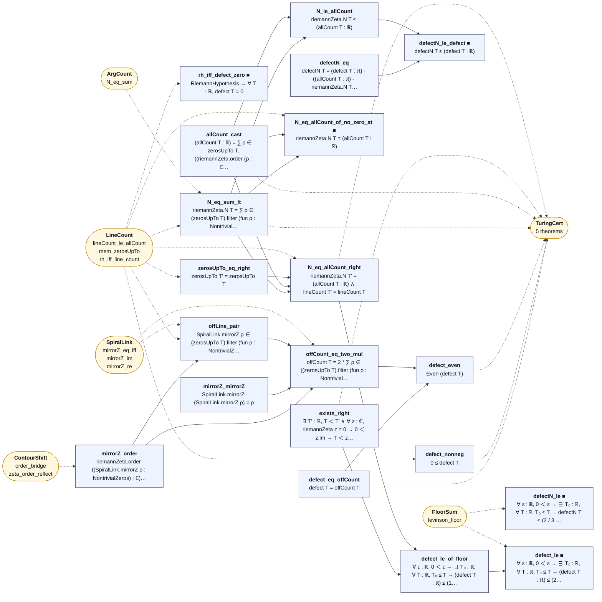

# `lean_stage3/Stage3/Defect.lean`

> **Read from the source text.** This file changed after the last `python3 utilities/lean_map.py --dump`, so the arrows on this page are names occurring in each proof and have not been confirmed by Lean.

Defect — block S14 of `lean_stage3/design/stencil.md`, C1, the defect: the zeros off the line. 2026-11-25.

20 theorems, 3 definitions, 370 lines. 

**Imports:** [`ArgCount`](../lean_stage3/ArgCount.md), [`ContourShift`](../lean_stage3/ContourShift.md), [`FloorSum`](../lean_stage3/FloorSum.md), [`LineCount`](../lean_stage3/LineCount.md), [`SpiralLink`](../lean_stage3/SpiralLink.md)  
**Imported by:** [`Stage3`](../lean_stage3/Stage3.md), [`TuringS`](../lean_stage3/TuringS.md)

## The picture



An arrow A → B reads "A is used in the proof of B". Green: counting, integers only. Violet: shape, analysis with no ζ. Blue: reads ζ. A name ending in ■ is an end: nothing else uses it. Red: contains `sorry`. Yellow: theorems in another file, counted; a dotted arrow crosses files. Definitions are not drawn; they are listed below the diagram.

## Definitions

<a name="Defect-defect"></a>
### `Defect.defect`

def · line 76

The defect: the nontrivial zeros up to height `T` (closed) off the line, with multiplicity.

- **Is:** `` defect (T : ℝ) : ℤ := allCount T - lineCount T ``
- **Built from:** [`LineCount.allCount`](../lean_stage3/LineCount.md#LineCount-allCount), [`LineCount.lineCount`](../lean_stage3/LineCount.md#LineCount-lineCount)
- **Used by 12:** [`Defect.defectN_eq`](#Defect-defectN_eq), [`Defect.defectN_le_defect`](#Defect-defectN_le_defect), [`Defect.defect_eq_offCount`](#Defect-defect_eq_offCount), [`Defect.defect_even`](#Defect-defect_even), [`Defect.defect_le`](#Defect-defect_le), [`Defect.defect_le_of_floor`](#Defect-defect_le_of_floor), [`Defect.defect_nonneg`](#Defect-defect_nonneg), [`Defect.rh_iff_defect_zero`](#Defect-rh_iff_defect_zero), [`Turing.defect_eq_zero_of_lt_two`](../lean_stage3/TuringCert.md#Turing-defect_eq_zero_of_lt_two), [`Turing.defect_mono`](../lean_stage3/TuringCert.md#Turing-defect_mono), [`Turing.defect_zero_below`](../lean_stage3/TuringCert.md#Turing-defect_zero_below), [`Turing.defect_zero_of_signs`](../lean_stage3/TuringCert.md#Turing-defect_zero_of_signs)

<a name="Defect-defectN"></a>
### `Defect.defectN`

def · line 79

The defect against upstream's `N` (open at `T`).

- **Is:** `` defectN (T : ℝ) : ℝ := riemannZeta.N T - (lineCount T : ℝ) ``
- **Built from:** [`LineCount.lineCount`](../lean_stage3/LineCount.md#LineCount-lineCount)
- **Used by 3:** [`Defect.defectN_eq`](#Defect-defectN_eq), [`Defect.defectN_le`](#Defect-defectN_le), [`Defect.defectN_le_defect`](#Defect-defectN_le_defect)

<a name="Defect-offCount"></a>
### `Defect.offCount`

def · line 82

The off-line count up to height `T`, with multiplicity.

- **Is:** `` offCount (T : ℝ) : ℤ := ∑ ρ ∈ (zerosUpTo T).filter (fun ρ : NontrivialZeros => ¬ (ρ : ℂ).re = 1 / 2), riemannZeta.order (ρ : ℂ) ``
- **Built from:** [`LineCount.zerosUpTo`](../lean_stage3/LineCount.md#LineCount-zerosUpTo)
- **Used by 3:** [`Defect.defect_eq_offCount`](#Defect-defect_eq_offCount), [`Defect.offCount_eq_two_mul`](#Defect-offCount_eq_two_mul), [`Turing.defect_mono`](../lean_stage3/TuringCert.md#Turing-defect_mono)

## Theorems

<a name="Defect-defect_eq_offCount"></a>
### `Defect.defect_eq_offCount`

line 88 · arrows read from text

**Reads ζ.** It, or something it rests on, uses the zeta function, its zeros or the Riemann hypothesis.

**Proves**

```lean
defect T = offCount T
```

**Needs** (its hypotheses)

  - `` T : ℝ ``

**Fed by:** no theorem of this repo; it stands on Mathlib and the definitions below.

**Definitions its proof touches:** [`Defect.defect`](#Defect-defect), [`Defect.offCount`](#Defect-offCount), [`LineCount.allCount`](../lean_stage3/LineCount.md#LineCount-allCount), [`LineCount.lineCount`](../lean_stage3/LineCount.md#LineCount-lineCount), [`LineCount.zerosUpTo`](../lean_stage3/LineCount.md#LineCount-zerosUpTo)

**Feeds** (2 that use it)

  - [`Defect.defect_even`](#Defect-defect_even) — `` Even (defect T) ``
  - [`Turing.defect_mono`](../lean_stage3/TuringCert.md#Turing-defect_mono) (TuringCert) — `` defect T ≤ defect T' ``

<a name="Defect-defect_nonneg"></a>
### `Defect.defect_nonneg`

line 95 · arrows read from text

**Reads ζ.** It, or something it rests on, uses the zeta function, its zeros or the Riemann hypothesis.

**Why.** The defect is nonnegative.

**Proves**

```lean
0 ≤ defect T
```

**Needs** (its hypotheses)

  - `` T : ℝ ``

**Fed by** (1 theorem its proof uses)

  - [`LineCount.lineCount_le_allCount`](../lean_stage3/LineCount.md#LineCount-lineCount_le_allCount) (LineCount) — `` lineCount T ≤ allCount T ``

**Definitions its proof touches:** [`Defect.defect`](#Defect-defect)

**Feeds** (2 that use it)

  - [`Turing.defect_eq_zero_of_lt_two`](../lean_stage3/TuringCert.md#Turing-defect_eq_zero_of_lt_two) (TuringCert) — `` defect T = 0 ``
  - [`Turing.defect_zero_below`](../lean_stage3/TuringCert.md#Turing-defect_zero_below) (TuringCert) — `` ∀ T ≤ T₁, defect T = 0 ``

<a name="Defect-rh_iff_defect_zero"></a>
### `Defect.rh_iff_defect_zero`

line 100 · arrows read from text

**Reads ζ.** It, or something it rests on, uses the zeta function, its zeros or the Riemann hypothesis.

**Why.** RH is the vanishing of the defect.

**Proves**

```lean
RiemannHypothesis ↔ ∀ T : ℝ, defect T = 0
```

**Fed by** (1 theorem its proof uses)

  - [`LineCount.rh_iff_line_count`](../lean_stage3/LineCount.md#LineCount-rh_iff_line_count) (LineCount) — `` RiemannHypothesis ↔ ∀ T : ℝ, lineCount T = allCount T ``

**Definitions its proof touches:** [`Defect.defect`](#Defect-defect)

**Feeds:** nothing. It is an end.

<a name="Defect-N_eq_sum_lt"></a>
### `Defect.N_eq_sum_lt`

line 112 · arrows read from text

**Reads ζ.** It, or something it rests on, uses the zeta function, its zeros or the Riemann hypothesis.

**Why.** `N T` as the sum over the zeros up to `T` strictly below `T`.

**Proves**

```lean
riemannZeta.N T = ∑ ρ ∈ (zerosUpTo T).filter (fun ρ : NontrivialZeros => (ρ : ℂ).im < T), ((riemannZeta.order (ρ : ℂ) : ℤ) : ℝ)
```

**Needs** (its hypotheses)

  - `` T : ℝ ``

**Fed by** (2 theorems its proof uses)

  - [`ArgCount.N_eq_sum`](../lean_stage3/ArgCount.md#ArgCount-N_eq_sum) (ArgCount) — `` riemannZeta.N T = ∑ z ∈ (Kadiri.zeroes_rect_univ_positive_height_finite T).toFinset, (1 : ℝ) * (riemannZeta.order z : ℝ) ``
  - [`LineCount.mem_zerosUpTo`](../lean_stage3/LineCount.md#LineCount-mem_zerosUpTo) (LineCount) — `` ρ ∈ zerosUpTo T ↔ 0 < (ρ : ℂ).im ∧ (ρ : ℂ).im ≤ T ``

**Definitions its proof touches:** [`LineCount.zerosUpTo`](../lean_stage3/LineCount.md#LineCount-zerosUpTo)

**Feeds** (4 that use it)

  - [`Defect.N_eq_allCount_of_no_zero_at`](#Defect-N_eq_allCount_of_no_zero_at) — `` riemannZeta.N T = (allCount T : ℝ) ``
  - [`Defect.N_eq_allCount_right`](#Defect-N_eq_allCount_right) — `` riemannZeta.N T' = (allCount T : ℝ) ∧ lineCount T' = lineCount T ``
  - [`Defect.N_le_allCount`](#Defect-N_le_allCount) — `` riemannZeta.N T ≤ (allCount T : ℝ) ``
  - [`Turing.allCount_add_card_le_N`](../lean_stage3/TuringCert.md#Turing-allCount_add_card_le_N) (TuringCert) — `` (allCount T₁ : ℝ) + Z.card ≤ riemannZeta.N u ``

<a name="Defect-allCount_cast"></a>
### `Defect.allCount_cast`

line 134 · arrows read from text

**Reads ζ.** It, or something it rests on, uses the zeta function, its zeros or the Riemann hypothesis.

**Proves**

```lean
(allCount T : ℝ) = ∑ ρ ∈ zerosUpTo T, ((riemannZeta.order (ρ : ℂ) : ℤ) : ℝ)
```

**Needs** (its hypotheses)

  - `` T : ℝ ``

**Fed by:** no theorem of this repo; it stands on Mathlib and the definitions below.

**Definitions its proof touches:** [`LineCount.allCount`](../lean_stage3/LineCount.md#LineCount-allCount), [`LineCount.zerosUpTo`](../lean_stage3/LineCount.md#LineCount-zerosUpTo)

**Feeds** (4 that use it)

  - [`Defect.N_eq_allCount_of_no_zero_at`](#Defect-N_eq_allCount_of_no_zero_at) — `` riemannZeta.N T = (allCount T : ℝ) ``
  - [`Defect.N_eq_allCount_right`](#Defect-N_eq_allCount_right) — `` riemannZeta.N T' = (allCount T : ℝ) ∧ lineCount T' = lineCount T ``
  - [`Defect.N_le_allCount`](#Defect-N_le_allCount) — `` riemannZeta.N T ≤ (allCount T : ℝ) ``
  - [`Turing.allCount_add_card_le_N`](../lean_stage3/TuringCert.md#Turing-allCount_add_card_le_N) (TuringCert) — `` (allCount T₁ : ℝ) + Z.card ≤ riemannZeta.N u ``

<a name="Defect-N_le_allCount"></a>
### `Defect.N_le_allCount`

line 141 · arrows read from text

**Reads ζ.** It, or something it rests on, uses the zeta function, its zeros or the Riemann hypothesis.

**Why.** `N` below the closed count.

**Proves**

```lean
riemannZeta.N T ≤ (allCount T : ℝ)
```

**Needs** (its hypotheses)

  - `` T : ℝ ``

**Fed by** (2 theorems its proof uses)

  - [`Defect.N_eq_sum_lt`](#Defect-N_eq_sum_lt) — `` riemannZeta.N T = ∑ ρ ∈ (zerosUpTo T).filter (fun ρ : NontrivialZeros => (ρ : ℂ).im < T), ((riemannZeta.order (ρ : ℂ) : ℤ) : ℝ) ``
  - [`Defect.allCount_cast`](#Defect-allCount_cast) — `` (allCount T : ℝ) = ∑ ρ ∈ zerosUpTo T, ((riemannZeta.order (ρ : ℂ) : ℤ) : ℝ) ``

**Definitions its proof touches:** [`LineCount.allCount`](../lean_stage3/LineCount.md#LineCount-allCount)

**Feeds** (1 that use it)

  - [`Defect.defectN_le_defect`](#Defect-defectN_le_defect) — `` defectN T ≤ (defect T : ℝ) ``

<a name="Defect-N_eq_allCount_of_no_zero_at"></a>
### `Defect.N_eq_allCount_of_no_zero_at`

line 148 · arrows read from text

**Reads ζ.** It, or something it rests on, uses the zeta function, its zeros or the Riemann hypothesis.

**Why.** `N` is the closed count at a height carrying no zero.

**Proves**

```lean
riemannZeta.N T = (allCount T : ℝ)
```

**Needs** (its hypotheses)

  - `` h : ∀ ρ : NontrivialZeros, (ρ : ℂ).im ≠ T ``

**Fed by** (3 theorems its proof uses)

  - [`Defect.N_eq_sum_lt`](#Defect-N_eq_sum_lt) — `` riemannZeta.N T = ∑ ρ ∈ (zerosUpTo T).filter (fun ρ : NontrivialZeros => (ρ : ℂ).im < T), ((riemannZeta.order (ρ : ℂ) : ℤ) : ℝ) ``
  - [`Defect.allCount_cast`](#Defect-allCount_cast) — `` (allCount T : ℝ) = ∑ ρ ∈ zerosUpTo T, ((riemannZeta.order (ρ : ℂ) : ℤ) : ℝ) ``
  - [`LineCount.mem_zerosUpTo`](../lean_stage3/LineCount.md#LineCount-mem_zerosUpTo) (LineCount) — `` ρ ∈ zerosUpTo T ↔ 0 < (ρ : ℂ).im ∧ (ρ : ℂ).im ≤ T ``

**Definitions its proof touches:** [`LineCount.allCount`](../lean_stage3/LineCount.md#LineCount-allCount)

**Feeds:** nothing. It is an end.

<a name="Defect-exists_right"></a>
### `Defect.exists_right`

line 156 · arrows read from text

**Reads ζ.** It, or something it rests on, uses the zeta function, its zeros or the Riemann hypothesis.

**Why.** A height just above with no zero between.

**Proves**

```lean
∃ T' : ℝ, T < T' ∧ ∀ z : ℂ, riemannZeta z = 0 → 0 < z.im → T < z.im → T' < z.im
```

**Needs** (its hypotheses)

  - `` T : ℝ ``

**Fed by:** no theorem of this repo; it stands on Mathlib.

**Feeds** (2 that use it)

  - [`Defect.defect_le_of_floor`](#Defect-defect_le_of_floor) — `` ∀ ε : ℝ, 0 < ε → ∃ T₀ : ℝ, ∀ T : ℝ, T₀ ≤ T → (defect T : ℝ) ≤ (1 - c + ε) * (allCount T : ℝ) ``
  - [`Turing.defect_zero_of_signs`](../lean_stage3/TuringCert.md#Turing-defect_zero_of_signs) (TuringCert) — `` ∀ T ≤ T₁, defect T = 0 ``

<a name="Defect-zerosUpTo_eq_right"></a>
### `Defect.zerosUpTo_eq_right`

line 176 · arrows read from text

**Reads ζ.** It, or something it rests on, uses the zeta function, its zeros or the Riemann hypothesis.

**Proves**

```lean
zerosUpTo T' = zerosUpTo T
```

**Needs** (its hypotheses)

  - `` hTT' : T ≤ T' ``
  - `` hno : ∀ z : ℂ, riemannZeta z = 0 → 0 < z.im → T < z.im → T' < z.im ``

**Fed by** (1 theorem its proof uses)

  - [`LineCount.mem_zerosUpTo`](../lean_stage3/LineCount.md#LineCount-mem_zerosUpTo) (LineCount) — `` ρ ∈ zerosUpTo T ↔ 0 < (ρ : ℂ).im ∧ (ρ : ℂ).im ≤ T ``

**Definitions its proof touches:** [`LineCount.zerosUpTo`](../lean_stage3/LineCount.md#LineCount-zerosUpTo)

**Feeds** (1 that use it)

  - [`Defect.N_eq_allCount_right`](#Defect-N_eq_allCount_right) — `` riemannZeta.N T' = (allCount T : ℝ) ∧ lineCount T' = lineCount T ``

<a name="Defect-N_eq_allCount_right"></a>
### `Defect.N_eq_allCount_right`

line 191 · arrows read from text

**Reads ζ.** It, or something it rests on, uses the zeta function, its zeros or the Riemann hypothesis.

**Why.** At a height just above, `N` is the closed count and the line count is unchanged.

**Proves**

```lean
riemannZeta.N T' = (allCount T : ℝ) ∧ lineCount T' = lineCount T
```

**Needs** (its hypotheses)

  - `` hTT' : T < T' ``
  - `` hno : ∀ z : ℂ, riemannZeta z = 0 → 0 < z.im → T < z.im → T' < z.im ``

**Fed by** (4 theorems its proof uses)

  - [`Defect.N_eq_sum_lt`](#Defect-N_eq_sum_lt) — `` riemannZeta.N T = ∑ ρ ∈ (zerosUpTo T).filter (fun ρ : NontrivialZeros => (ρ : ℂ).im < T), ((riemannZeta.order (ρ : ℂ) : ℤ) : ℝ) ``
  - [`Defect.allCount_cast`](#Defect-allCount_cast) — `` (allCount T : ℝ) = ∑ ρ ∈ zerosUpTo T, ((riemannZeta.order (ρ : ℂ) : ℤ) : ℝ) ``
  - [`Defect.zerosUpTo_eq_right`](#Defect-zerosUpTo_eq_right) — `` zerosUpTo T' = zerosUpTo T ``
  - [`LineCount.mem_zerosUpTo`](../lean_stage3/LineCount.md#LineCount-mem_zerosUpTo) (LineCount) — `` ρ ∈ zerosUpTo T ↔ 0 < (ρ : ℂ).im ∧ (ρ : ℂ).im ≤ T ``

**Definitions its proof touches:** [`LineCount.allCount`](../lean_stage3/LineCount.md#LineCount-allCount), [`LineCount.lineCount`](../lean_stage3/LineCount.md#LineCount-lineCount)

**Feeds** (2 that use it)

  - [`Defect.defect_le_of_floor`](#Defect-defect_le_of_floor) — `` ∀ ε : ℝ, 0 < ε → ∃ T₀ : ℝ, ∀ T : ℝ, T₀ ≤ T → (defect T : ℝ) ≤ (1 - c + ε) * (allCount T : ℝ) ``
  - [`Turing.defect_zero_of_signs`](../lean_stage3/TuringCert.md#Turing-defect_zero_of_signs) (TuringCert) — `` ∀ T ≤ T₁, defect T = 0 ``

<a name="Defect-defectN_eq"></a>
### `Defect.defectN_eq`

line 203 · arrows read from text

**Reads ζ.** It, or something it rests on, uses the zeta function, its zeros or the Riemann hypothesis.

**Proves**

```lean
defectN T = (defect T : ℝ) - ((allCount T : ℝ) - riemannZeta.N T)
```

**Needs** (its hypotheses)

  - `` T : ℝ ``

**Fed by:** no theorem of this repo; it stands on Mathlib and the definitions below.

**Definitions its proof touches:** [`Defect.defect`](#Defect-defect), [`Defect.defectN`](#Defect-defectN), [`LineCount.allCount`](../lean_stage3/LineCount.md#LineCount-allCount)

**Feeds** (1 that use it)

  - [`Defect.defectN_le_defect`](#Defect-defectN_le_defect) — `` defectN T ≤ (defect T : ℝ) ``

<a name="Defect-defectN_le_defect"></a>
### `Defect.defectN_le_defect`

line 209 · arrows read from text

**Reads ζ.** It, or something it rests on, uses the zeta function, its zeros or the Riemann hypothesis.

**Proves**

```lean
defectN T ≤ (defect T : ℝ)
```

**Needs** (its hypotheses)

  - `` T : ℝ ``

**Fed by** (2 theorems its proof uses)

  - [`Defect.N_le_allCount`](#Defect-N_le_allCount) — `` riemannZeta.N T ≤ (allCount T : ℝ) ``
  - [`Defect.defectN_eq`](#Defect-defectN_eq) — `` defectN T = (defect T : ℝ) - ((allCount T : ℝ) - riemannZeta.N T) ``

**Definitions its proof touches:** [`Defect.defect`](#Defect-defect), [`Defect.defectN`](#Defect-defectN)

**Feeds:** nothing. It is an end.

<a name="Defect-mirrorZ_order"></a>
### `Defect.mirrorZ_order`

line 214 · arrows read from text

**Reads ζ.** It, or something it rests on, uses the zeta function, its zeros or the Riemann hypothesis.

**Why.** The mirror has the same order (functional equation and conjugation).

**Proves**

```lean
riemannZeta.order ((SpiralLink.mirrorZ ρ : NontrivialZeros) : ℂ) = riemannZeta.order (ρ : ℂ)
```

**Needs** (its hypotheses)

  - `` ρ : NontrivialZeros ``

**Fed by** (2 theorems its proof uses)

  - [`ContourShift.order_bridge`](../lean_stage3/ContourShift.md#ContourShift-order_bridge) (ContourShift) — `` ((riemannZeta.order ρ : ℤ) : ℂ) = ((analyticOrderNatAt riemannZeta ρ : ℕ) : ℂ) ``
  - [`ContourShift.zeta_order_reflect`](../lean_stage3/ContourShift.md#ContourShift-zeta_order_reflect) (ContourShift) — `` analyticOrderNatAt riemannZeta (1 - (starRingEnd ℂ) ρ) = analyticOrderNatAt riemannZeta ρ ``

**Definitions its proof touches:** [`SpiralLink.mirrorZ`](../lean_stage3/SpiralLink.md#SpiralLink-mirrorZ)

**Feeds** (2 that use it)

  - [`Defect.offCount_eq_two_mul`](#Defect-offCount_eq_two_mul) — `` offCount T = 2 * ∑ ρ ∈ ((zerosUpTo T).filter (fun ρ : NontrivialZeros => ¬ (ρ : ℂ).re = 1 / 2)).filter (fun ρ : NontrivialZeros => (ρ : ℂ).re < 1 / 2)… ``
  - [`Defect.offLine_pair`](#Defect-offLine_pair) — `` SpiralLink.mirrorZ ρ ∈ (zerosUpTo T).filter (fun ρ : NontrivialZeros => ¬ (ρ : ℂ).re = 1 / 2) ∧ SpiralLink.mirrorZ ρ ≠ ρ ∧ ((SpiralLink.mirrorZ ρ : No… ``

<a name="Defect-mirrorZ_mirrorZ"></a>
### `Defect.mirrorZ_mirrorZ`

line 227 · arrows read from text

**Reads ζ.** It, or something it rests on, uses the zeta function, its zeros or the Riemann hypothesis.

**Proves**

```lean
SpiralLink.mirrorZ (SpiralLink.mirrorZ ρ) = ρ
```

**Needs** (its hypotheses)

  - `` ρ : NontrivialZeros ``

**Fed by:** no theorem of this repo; it stands on Mathlib and the definitions below.

**Definitions its proof touches:** [`SpiralLink.mirrorZ`](../lean_stage3/SpiralLink.md#SpiralLink-mirrorZ)

**Feeds** (1 that use it)

  - [`Defect.offCount_eq_two_mul`](#Defect-offCount_eq_two_mul) — `` offCount T = 2 * ∑ ρ ∈ ((zerosUpTo T).filter (fun ρ : NontrivialZeros => ¬ (ρ : ℂ).re = 1 / 2)).filter (fun ρ : NontrivialZeros => (ρ : ℂ).re < 1 / 2)… ``

<a name="Defect-offLine_pair"></a>
### `Defect.offLine_pair`

line 235 · arrows read from text

**Reads ζ.** It, or something it rests on, uses the zeta function, its zeros or the Riemann hypothesis.

**Why.** The pairing. An off-line zero up to height `T` has its mirror off the line, up to height `T`, distinct from it, at the same height and with the same order.

**Proves**

```lean
SpiralLink.mirrorZ ρ ∈ (zerosUpTo T).filter (fun ρ : NontrivialZeros => ¬ (ρ : ℂ).re = 1 / 2) ∧ SpiralLink.mirrorZ ρ ≠ ρ ∧ ((SpiralLink.mirrorZ ρ : NontrivialZeros) : ℂ).im = (ρ : ℂ).im ∧ riemannZeta.order ((SpiralLink.mirrorZ ρ : NontrivialZeros) : ℂ) = riemannZeta.order (ρ : ℂ)
```

**Needs** (its hypotheses)

  - `` hρ : ρ ∈ (zerosUpTo T).filter (fun ρ : NontrivialZeros => ¬ (ρ : ℂ).re = 1 / 2) ``

**Fed by** (5 theorems its proof uses)

  - [`Defect.mirrorZ_order`](#Defect-mirrorZ_order) — `` riemannZeta.order ((SpiralLink.mirrorZ ρ : NontrivialZeros) : ℂ) = riemannZeta.order (ρ : ℂ) ``
  - [`LineCount.mem_zerosUpTo`](../lean_stage3/LineCount.md#LineCount-mem_zerosUpTo) (LineCount) — `` ρ ∈ zerosUpTo T ↔ 0 < (ρ : ℂ).im ∧ (ρ : ℂ).im ≤ T ``
  - [`SpiralLink.mirrorZ_eq_iff`](../lean_stage3/SpiralLink.md#SpiralLink-mirrorZ_eq_iff) (SpiralLink) — `` mirrorZ ρ = ρ ↔ (ρ : ℂ).re = 1 / 2 ``
  - [`SpiralLink.mirrorZ_im`](../lean_stage3/SpiralLink.md#SpiralLink-mirrorZ_im) (SpiralLink) — `` ((mirrorZ ρ : NontrivialZeros) : ℂ).im = (ρ : ℂ).im ``
  - [`SpiralLink.mirrorZ_re`](../lean_stage3/SpiralLink.md#SpiralLink-mirrorZ_re) (SpiralLink) — `` ((mirrorZ ρ : NontrivialZeros) : ℂ).re = 1 - (ρ : ℂ).re ``

**Definitions its proof touches:** [`LineCount.zerosUpTo`](../lean_stage3/LineCount.md#LineCount-zerosUpTo), [`SpiralLink.mirrorZ`](../lean_stage3/SpiralLink.md#SpiralLink-mirrorZ)

**Feeds** (1 that use it)

  - [`Defect.offCount_eq_two_mul`](#Defect-offCount_eq_two_mul) — `` offCount T = 2 * ∑ ρ ∈ ((zerosUpTo T).filter (fun ρ : NontrivialZeros => ¬ (ρ : ℂ).re = 1 / 2)).filter (fun ρ : NontrivialZeros => (ρ : ℂ).re < 1 / 2)… ``

<a name="Defect-offCount_eq_two_mul"></a>
### `Defect.offCount_eq_two_mul`

line 253 · arrows read from text

**Reads ζ.** It, or something it rests on, uses the zeta function, its zeros or the Riemann hypothesis.

**Why.** The off-line count is twice the count left of the line.

**Proves**

```lean
offCount T = 2 * ∑ ρ ∈ ((zerosUpTo T).filter (fun ρ : NontrivialZeros => ¬ (ρ : ℂ).re = 1 / 2)).filter (fun ρ : NontrivialZeros => (ρ : ℂ).re < 1 / 2), riemannZeta.order (ρ : ℂ)
```

**Needs** (its hypotheses)

  - `` T : ℝ ``

**Fed by** (4 theorems its proof uses)

  - [`Defect.mirrorZ_mirrorZ`](#Defect-mirrorZ_mirrorZ) — `` SpiralLink.mirrorZ (SpiralLink.mirrorZ ρ) = ρ ``
  - [`Defect.mirrorZ_order`](#Defect-mirrorZ_order) — `` riemannZeta.order ((SpiralLink.mirrorZ ρ : NontrivialZeros) : ℂ) = riemannZeta.order (ρ : ℂ) ``
  - [`Defect.offLine_pair`](#Defect-offLine_pair) — `` SpiralLink.mirrorZ ρ ∈ (zerosUpTo T).filter (fun ρ : NontrivialZeros => ¬ (ρ : ℂ).re = 1 / 2) ∧ SpiralLink.mirrorZ ρ ≠ ρ ∧ ((SpiralLink.mirrorZ ρ : No… ``
  - [`SpiralLink.mirrorZ_re`](../lean_stage3/SpiralLink.md#SpiralLink-mirrorZ_re) (SpiralLink) — `` ((mirrorZ ρ : NontrivialZeros) : ℂ).re = 1 - (ρ : ℂ).re ``

**Definitions its proof touches:** [`Defect.offCount`](#Defect-offCount), [`LineCount.zerosUpTo`](../lean_stage3/LineCount.md#LineCount-zerosUpTo), [`SpiralLink.mirrorZ`](../lean_stage3/SpiralLink.md#SpiralLink-mirrorZ)

**Feeds** (1 that use it)

  - [`Defect.defect_even`](#Defect-defect_even) — `` Even (defect T) ``

<a name="Defect-defect_even"></a>
### `Defect.defect_even`

line 291 · arrows read from text

**Reads ζ.** It, or something it rests on, uses the zeta function, its zeros or the Riemann hypothesis.

**Why.** The defect is even.

**Proves**

```lean
Even (defect T)
```

**Needs** (its hypotheses)

  - `` T : ℝ ``

**Fed by** (2 theorems its proof uses)

  - [`Defect.defect_eq_offCount`](#Defect-defect_eq_offCount) — `` defect T = offCount T ``
  - [`Defect.offCount_eq_two_mul`](#Defect-offCount_eq_two_mul) — `` offCount T = 2 * ∑ ρ ∈ ((zerosUpTo T).filter (fun ρ : NontrivialZeros => ¬ (ρ : ℂ).re = 1 / 2)).filter (fun ρ : NontrivialZeros => (ρ : ℂ).re < 1 / 2)… ``

**Definitions its proof touches:** [`Defect.defect`](#Defect-defect)

**Feeds** (1 that use it)

  - [`Turing.defect_eq_zero_of_lt_two`](../lean_stage3/TuringCert.md#Turing-defect_eq_zero_of_lt_two) (TuringCert) — `` defect T = 0 ``

<a name="Defect-defect_le_of_floor"></a>
### `Defect.defect_le_of_floor`

line 297 · arrows read from text

**Reads ζ.** It, or something it rests on, uses the zeta function, its zeros or the Riemann hypothesis.

**Why.** A line floor bounds the defect. A floor `(c − ε) N T ≤ lineCount T` from some height on, for every `ε > 0`, gives `defect T ≤ (1 − c + ε) allCount T` from some height on.

**Proves**

```lean
∀ ε : ℝ, 0 < ε → ∃ T₀ : ℝ, ∀ T : ℝ, T₀ ≤ T → (defect T : ℝ) ≤ (1 - c + ε) * (allCount T : ℝ)
```

**Needs** (its hypotheses)

  - `` h : ∀ ε : ℝ, 0 < ε → ∃ T₀ : ℝ, ∀ T : ℝ, T₀ ≤ T → (c - ε) * riemannZeta.N T ≤ (lineCount T : ℝ) ``

**Fed by** (2 theorems its proof uses)

  - [`Defect.N_eq_allCount_right`](#Defect-N_eq_allCount_right) — `` riemannZeta.N T' = (allCount T : ℝ) ∧ lineCount T' = lineCount T ``
  - [`Defect.exists_right`](#Defect-exists_right) — `` ∃ T' : ℝ, T < T' ∧ ∀ z : ℂ, riemannZeta z = 0 → 0 < z.im → T < z.im → T' < z.im ``

**Definitions its proof touches:** [`Defect.defect`](#Defect-defect), [`LineCount.allCount`](../lean_stage3/LineCount.md#LineCount-allCount), [`LineCount.lineCount`](../lean_stage3/LineCount.md#LineCount-lineCount)

**Feeds** (1 that use it)

  - [`Defect.defect_le`](#Defect-defect_le) — `` ∀ ε : ℝ, 0 < ε → ∃ T₀ : ℝ, ∀ T : ℝ, T₀ ≤ T → (defect T : ℝ) ≤ (2 / 3 + ε) * (allCount T : ℝ) ``

<a name="Defect-defect_le"></a>
### `Defect.defect_le`

line 314 · arrows read from text

**Reads ζ.** It, or something it rests on, uses the zeta function, its zeros or the Riemann hypothesis.

**Why.** The defect at most `(2/3 + ε)` of the count, from Levinson's floor.

**Proves**

```lean
∀ ε : ℝ, 0 < ε → ∃ T₀ : ℝ, ∀ T : ℝ, T₀ ≤ T → (defect T : ℝ) ≤ (2 / 3 + ε) * (allCount T : ℝ)
```

**Fed by** (2 theorems its proof uses)

  - [`Defect.defect_le_of_floor`](#Defect-defect_le_of_floor) — `` ∀ ε : ℝ, 0 < ε → ∃ T₀ : ℝ, ∀ T : ℝ, T₀ ≤ T → (defect T : ℝ) ≤ (1 - c + ε) * (allCount T : ℝ) ``
  - [`FloorSum.levinson_floor`](../lean_stage3/FloorSum.md#FloorSum-levinson_floor) (FloorSum) — `` ∀ ε : ℝ, 0 < ε → ∃ T₀ : ℝ, ∀ T : ℝ, T₀ ≤ T → (1 / 3 - ε) * riemannZeta.N T ≤ (LineCount.lineCount T : ℝ) ``

**Definitions its proof touches:** [`Defect.defect`](#Defect-defect), [`LineCount.allCount`](../lean_stage3/LineCount.md#LineCount-allCount)

**Feeds:** nothing. It is an end.

<a name="Defect-defectN_le"></a>
### `Defect.defectN_le`

line 324 · arrows read from text

**Reads ζ.** It, or something it rests on, uses the zeta function, its zeros or the Riemann hypothesis.

**Why.** The N-defect at most `(2/3 + ε) N T`, from Levinson's floor.

**Proves**

```lean
∀ ε : ℝ, 0 < ε → ∃ T₀ : ℝ, ∀ T : ℝ, T₀ ≤ T → defectN T ≤ (2 / 3 + ε) * riemannZeta.N T
```

**Fed by** (1 theorem its proof uses)

  - [`FloorSum.levinson_floor`](../lean_stage3/FloorSum.md#FloorSum-levinson_floor) (FloorSum) — `` ∀ ε : ℝ, 0 < ε → ∃ T₀ : ℝ, ∀ T : ℝ, T₀ ≤ T → (1 / 3 - ε) * riemannZeta.N T ≤ (LineCount.lineCount T : ℝ) ``

**Definitions its proof touches:** [`Defect.defectN`](#Defect-defectN)

**Feeds:** nothing. It is an end.

