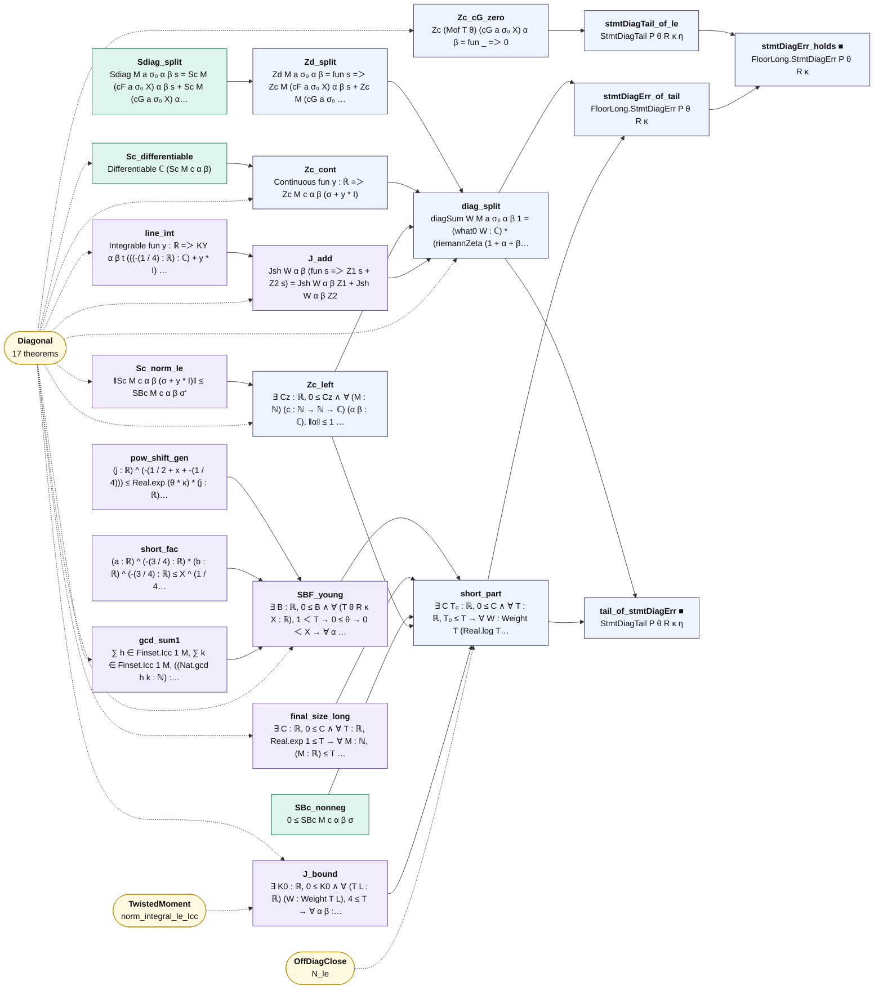

# `lean_stage3/Stage3/DiagLong.lean`

> **Read from the source text.** This file changed after the last `python3 utilities/lean_map.py --dump`, so the arrows on this page are names occurring in each proof and have not been confirmed by Lean.

# DiagLong — block S13 of `lean_stage3/design/stencil.md`, B3 step 1, the diagonal at any length. 2026-11-25.

22 theorems, 8 definitions, 757 lines. 

**Imports:** [`FloorLongErr`](../lean_stage3/FloorLongErr.md)  
**Imported by:** [`Stage3`](../lean_stage3/Stage3.md)

## The picture



An arrow A → B reads "A is used in the proof of B". Green: counting, integers only. Violet: shape, analysis with no ζ. Blue: reads ζ. A name ending in ■ is an end: nothing else uses it. Red: contains `sorry`. Yellow: theorems in another file, counted; a dotted arrow crosses files. Definitions are not drawn; they are listed below the diagram.

## Definitions

<a name="DiagLong-hkr"></a>
### `DiagLong.hkr`

def · line 78

`h'k'`, with `h' = h/(h,k)`, `k' = k/(h,k)`.

- **Is:** `` hkr (h k : ℕ) : ℕ := (h / Nat.gcd h k) * (k / Nat.gcd h k) ``
- **Used by 4:** [`DiagLong.SBF_young`](#DiagLong-SBF_young), [`DiagLong.Zc_cG_zero`](#DiagLong-Zc_cG_zero), [`DiagLong.cF`](#DiagLong-cF), [`DiagLong.cG`](#DiagLong-cG)

<a name="DiagLong-Sc"></a>
### `DiagLong.Sc`

def · line 82

The diagonal's `h,k`-sum with any coefficients: `Σ_{h,k ≤ M} c_{hk} k'^(−(1/2+α+s)) h'^(−(1/2+β+s))`; `Sdiag` is `c = Chk`.

- **Is:** `` Sc (M : ℕ) (c : ℕ → ℕ → ℂ) (α β s : ℂ) : ℂ := ∑ h ∈ Finset.Icc 1 M, ∑ k ∈ Finset.Icc 1 M, c h k * Rhk α β h k s ``
- **Built from:** [`Diagonal.Rhk`](../lean_stage3/Diagonal.md#Diagonal-Rhk)
- **Used by 6:** [`DiagLong.Sc_differentiable`](#DiagLong-Sc_differentiable), [`DiagLong.Sc_norm_le`](#DiagLong-Sc_norm_le), [`DiagLong.Sdiag_split`](#DiagLong-Sdiag_split), [`DiagLong.Zc`](#DiagLong-Zc), [`DiagLong.Zc_cG_zero`](#DiagLong-Zc_cG_zero), [`DiagLong.Zc_left`](#DiagLong-Zc_left)

<a name="DiagLong-SBc"></a>
### `DiagLong.SBc`

def · line 86

The bound for `‖Sc(σ+iy)‖`.

- **Is:** `` SBc (M : ℕ) (c : ℕ → ℕ → ℂ) (α β : ℂ) (σ : ℝ) : ℝ := ∑ h ∈ Finset.Icc 1 M, ∑ k ∈ Finset.Icc 1 M, ‖c h k‖ * (((k / Nat.gcd h k : ℕ) : ℝ) ^ (-(1 / 2 + α.re + σ)) * ((h / Nat.gcd h k : ℕ) : ℝ) ^ (-(1 / 2 + β.re + σ))) ``
- **Used by 5:** [`DiagLong.SBF_young`](#DiagLong-SBF_young), [`DiagLong.SBc_nonneg`](#DiagLong-SBc_nonneg), [`DiagLong.Sc_norm_le`](#DiagLong-Sc_norm_le), [`DiagLong.Zc_left`](#DiagLong-Zc_left), [`DiagLong.short_part`](#DiagLong-short_part)

<a name="DiagLong-cF"></a>
### `DiagLong.cF`

def · line 92

The short pairs, `h'k' ≤ X`.

- **Is:** `` cF (a : ℕ → ℂ) (σ₀ X : ℝ) (h k : ℕ) : ℂ := if ((hkr h k : ℕ) : ℝ) ≤ X then Chk a σ₀ h k else 0 ``
- **Built from:** [`DiagLong.hkr`](#DiagLong-hkr), [`Diagonal.Chk`](../lean_stage3/Diagonal.md#Diagonal-Chk)
- **Used by 6:** [`DiagLong.SBF_young`](#DiagLong-SBF_young), [`DiagLong.Sdiag_split`](#DiagLong-Sdiag_split), [`DiagLong.Zd_split`](#DiagLong-Zd_split), [`DiagLong.diag_split`](#DiagLong-diag_split), [`DiagLong.short_part`](#DiagLong-short_part), [`DiagLong.tail_of_stmtDiagErr`](#DiagLong-tail_of_stmtDiagErr)

<a name="DiagLong-cG"></a>
### `DiagLong.cG`

def · line 96

The long pairs, `h'k' > X`.

- **Is:** `` cG (a : ℕ → ℂ) (σ₀ X : ℝ) (h k : ℕ) : ℂ := if ((hkr h k : ℕ) : ℝ) ≤ X then 0 else Chk a σ₀ h k ``
- **Built from:** [`DiagLong.hkr`](#DiagLong-hkr), [`Diagonal.Chk`](../lean_stage3/Diagonal.md#Diagonal-Chk)
- **Used by 6:** [`DiagLong.Sdiag_split`](#DiagLong-Sdiag_split), [`DiagLong.StmtDiagTail`](#DiagLong-StmtDiagTail), [`DiagLong.Zc_cG_zero`](#DiagLong-Zc_cG_zero), [`DiagLong.Zd_split`](#DiagLong-Zd_split), [`DiagLong.diag_split`](#DiagLong-diag_split), [`DiagLong.tail_of_stmtDiagErr`](#DiagLong-tail_of_stmtDiagErr)

<a name="DiagLong-Zc"></a>
### `DiagLong.Zc`

def · line 100

`ζ(1+α+β+2s)·Sc(s)`.

- **Is:** `` Zc (M : ℕ) (c : ℕ → ℕ → ℂ) (α β s : ℂ) : ℂ := riemannZeta (1 + α + β + 2 * s) * Sc M c α β s ``
- **Built from:** [`DiagLong.Sc`](#DiagLong-Sc)
- **Used by 8:** [`DiagLong.StmtDiagTail`](#DiagLong-StmtDiagTail), [`DiagLong.Zc_cG_zero`](#DiagLong-Zc_cG_zero), [`DiagLong.Zc_cont`](#DiagLong-Zc_cont), [`DiagLong.Zc_left`](#DiagLong-Zc_left), [`DiagLong.Zd_split`](#DiagLong-Zd_split), [`DiagLong.diag_split`](#DiagLong-diag_split), [`DiagLong.short_part`](#DiagLong-short_part), [`DiagLong.tail_of_stmtDiagErr`](#DiagLong-tail_of_stmtDiagErr)

<a name="DiagLong-Jsh"></a>
### `DiagLong.Jsh`

def · line 104

The shifted integral, `∫ w(t) (1/2πi)∫_(−1/4) K(s,t) Z(s) ds dt`.

- **Is:** `` Jsh {T L : ℝ} (W : Weight T L) (α β : ℂ) (Z : ℂ → ℂ) : ℂ := ∫ t, (W.w t : ℂ) * VerticalIntegral' (fun s => KY α β t s * Z s) (-(1 / 4)) ``
- **Built from:** [`ApproxFE.KY`](../lean_stage3/ApproxFE.md#ApproxFE-KY), [`TwistedMoment.Weight`](../lean_stage3/TwistedMoment.md#TwistedMoment-Weight)
- **Used by 7:** [`DiagLong.J_add`](#DiagLong-J_add), [`DiagLong.J_bound`](#DiagLong-J_bound), [`DiagLong.StmtDiagTail`](#DiagLong-StmtDiagTail), [`DiagLong.diag_split`](#DiagLong-diag_split), [`DiagLong.short_part`](#DiagLong-short_part), [`DiagLong.stmtDiagTail_of_le`](#DiagLong-stmtDiagTail_of_le), [`DiagLong.tail_of_stmtDiagErr`](#DiagLong-tail_of_stmtDiagErr)

<a name="DiagLong-StmtDiagTail"></a>
### `DiagLong.StmtDiagTail`

def · line 635

OPEN for `θ > (1 − η)/2`, the long pairs (S13 B3 step 1): the shifted integral of the pairs with `h'k' > T^(1−η)` is `O(T/L)` on Lemma 6's range. Empty, hence proved, for `2θ ≤ 1 − η` (`stmtDiagTail_of_le`). Equivalent to `FloorLong.StmtDiagErr` for every `θ ≥ 0` (`stmtDiagErr_of_tail`, `tail_of_stmtDiagErr`). Budget: any constants. Route (the module header): no shift of `s`, `u`, `v` saves a power of `T` here; the cancellation is that of `μ` in the tails `Σ_{n > Y, (n,q) = 1} μ(n) n^(−1−β) F(log n)` with `Y ≥ T^((1−η)/2)`, the prime number theorem with a `(log Y)^(−A)` error, `A ≥ 6`, uniform…

- **Is:** `` StmtDiagTail (P : Polynomial ℝ) (θ R κ η : ℝ) : Prop := ∃ C T₀ : ℝ, 0 ≤ C ∧ ∀ T : ℝ, T₀ ≤ T → ∀ W : Weight T (Real.log T), ∀ α β : ℂ, Regime κ T α β → ‖Jsh W α β (Zc (Mof T θ) (cG (aY P T θ R) (sig0 T R) (T ^ (1 - η))) α β)‖ ≤ C * (T / Real.log T) ``
- **Built from:** [`DiagLong.Jsh`](#DiagLong-Jsh), [`DiagLong.Zc`](#DiagLong-Zc), [`DiagLong.cG`](#DiagLong-cG), [`TwistedMoment.Mof`](../lean_stage3/TwistedMoment.md#TwistedMoment-Mof), [`TwistedMoment.Regime`](../lean_stage3/TwistedMoment.md#TwistedMoment-Regime), [`TwistedMoment.Weight`](../lean_stage3/TwistedMoment.md#TwistedMoment-Weight), [`TwistedMoment.aY`](../lean_stage3/TwistedMoment.md#TwistedMoment-aY), [`TwistedMoment.sig0`](../lean_stage3/TwistedMoment.md#TwistedMoment-sig0)
- **Used by 3:** [`DiagLong.stmtDiagErr_of_tail`](#DiagLong-stmtDiagErr_of_tail), [`DiagLong.stmtDiagTail_of_le`](#DiagLong-stmtDiagTail_of_le), [`DiagLong.tail_of_stmtDiagErr`](#DiagLong-tail_of_stmtDiagErr)

## Theorems

<a name="DiagLong-Sdiag_split"></a>
### `DiagLong.Sdiag_split`

line 109 · arrows read from text

**Counting.** Integers only: nothing in its statement or proof, or in anything it rests on, uses analysis or ζ.

**Proves**

```lean
Sdiag M a σ₀ α β s = Sc M (cF a σ₀ X) α β s + Sc M (cG a σ₀ X) α β s
```

**Needs** (its hypotheses)

  - `` M : ℕ ``
  - `` a : ℕ → ℂ ``
  - `` σ₀ X : ℝ ``
  - `` α β s : ℂ ``

**Fed by:** no theorem of this repo; it stands on Mathlib and the definitions below.

**Definitions its proof touches:** [`DiagLong.Sc`](#DiagLong-Sc), [`DiagLong.cF`](#DiagLong-cF), [`DiagLong.cG`](#DiagLong-cG), [`Diagonal.Sdiag`](../lean_stage3/Diagonal.md#Diagonal-Sdiag)

**Feeds** (1 that use it)

  - [`DiagLong.Zd_split`](#DiagLong-Zd_split) — `` Zd M a σ₀ α β = fun s => Zc M (cF a σ₀ X) α β s + Zc M (cG a σ₀ X) α β s ``

<a name="DiagLong-Zd_split"></a>
### `DiagLong.Zd_split`

line 118 · arrows read from text

**Reads ζ.** It, or something it rests on, uses the zeta function, its zeros or the Riemann hypothesis.

**Proves**

```lean
Zd M a σ₀ α β = fun s => Zc M (cF a σ₀ X) α β s + Zc M (cG a σ₀ X) α β s
```

**Needs** (its hypotheses)

  - `` M : ℕ ``
  - `` a : ℕ → ℂ ``
  - `` σ₀ X : ℝ ``
  - `` α β : ℂ ``

**Fed by** (1 theorem its proof uses)

  - [`DiagLong.Sdiag_split`](#DiagLong-Sdiag_split) — `` Sdiag M a σ₀ α β s = Sc M (cF a σ₀ X) α β s + Sc M (cG a σ₀ X) α β s ``

**Definitions its proof touches:** [`DiagLong.Zc`](#DiagLong-Zc), [`DiagLong.cF`](#DiagLong-cF), [`DiagLong.cG`](#DiagLong-cG), [`Diagonal.Zd`](../lean_stage3/Diagonal.md#Diagonal-Zd)

**Feeds** (1 that use it)

  - [`DiagLong.diag_split`](#DiagLong-diag_split) — `` diagSum W M a σ₀ α β 1 = (what0 W : ℂ) * (riemannZeta (1 + α + β) * Sdiag M a σ₀ α β 0) + (Jsh W α β (Zc M (cF a σ₀ X) α β) + Jsh W α β (Zc M (cG a σ₀… ``

<a name="DiagLong-Sc_differentiable"></a>
### `DiagLong.Sc_differentiable`

line 125 · arrows read from text

**Counting.** Integers only: nothing in its statement or proof, or in anything it rests on, uses analysis or ζ.

**Proves**

```lean
Differentiable ℂ (Sc M c α β)
```

**Needs** (its hypotheses)

  - `` M : ℕ ``
  - `` c : ℕ → ℕ → ℂ ``
  - `` α β : ℂ ``

**Fed by** (1 theorem its proof uses)

  - [`Diagonal.Rhk_differentiable`](../lean_stage3/Diagonal.md#Diagonal-Rhk_differentiable) (Diagonal) — `` Differentiable ℂ (Rhk α β h k) ``

**Definitions its proof touches:** [`DiagLong.Sc`](#DiagLong-Sc), [`Diagonal.Rhk`](../lean_stage3/Diagonal.md#Diagonal-Rhk)

**Feeds** (1 that use it)

  - [`DiagLong.Zc_cont`](#DiagLong-Zc_cont) — `` Continuous fun y : ℝ => Zc M c α β (σ + y * I) ``

<a name="DiagLong-Sc_norm_le"></a>
### `DiagLong.Sc_norm_le`

line 134 · arrows read from text

**Shape.** Uses real or complex analysis; nothing in it or beneath it reads ζ.

**Proves**

```lean
‖Sc M c α β (σ + y * I)‖ ≤ SBc M c α β σ'
```

**Needs** (its hypotheses)

  - `` M : ℕ ``
  - `` c : ℕ → ℕ → ℂ ``
  - `` α β : ℂ ``
  - `` hσ : σ' ≤ σ ``
  - `` y : ℝ ``

**Fed by** (1 theorem its proof uses)

  - [`Diagonal.Rhk_norm_le`](../lean_stage3/Diagonal.md#Diagonal-Rhk_norm_le) (Diagonal) — `` ‖Rhk α β h k (σ + y * I)‖ ≤ ((k / Nat.gcd h k : ℕ) : ℝ) ^ (-(1 / 2 + α.re + σ')) * ((h / Nat.gcd h k : ℕ) : ℝ) ^ (-(1 / 2 + β.re + σ')) ``

**Definitions its proof touches:** [`DiagLong.SBc`](#DiagLong-SBc), [`DiagLong.Sc`](#DiagLong-Sc)

**Feeds** (1 that use it)

  - [`DiagLong.Zc_left`](#DiagLong-Zc_left) — `` ∃ Cz : ℝ, 0 ≤ Cz ∧ ∀ (M : ℕ) (c : ℕ → ℕ → ℂ) (α β : ℂ), ‖α‖ ≤ 1 / 10 → ‖β‖ ≤ 1 / 10 → ∀ y : ℝ, ‖Zc M c α β (((-(1 / 4) : ℝ) : ℂ) + y * I)‖ ≤ Cz * SBc … ``

<a name="DiagLong-SBc_nonneg"></a>
### `DiagLong.SBc_nonneg`

line 143 · arrows read from text

**Counting.** Integers only: nothing in its statement or proof, or in anything it rests on, uses analysis or ζ.

**Proves**

```lean
0 ≤ SBc M c α β σ
```

**Needs** (its hypotheses)

  - `` M : ℕ ``
  - `` c : ℕ → ℕ → ℂ ``
  - `` α β : ℂ ``
  - `` σ : ℝ ``

**Fed by:** no theorem of this repo; it stands on Mathlib and the definitions below.

**Definitions its proof touches:** [`DiagLong.SBc`](#DiagLong-SBc)

**Feeds** (1 that use it)

  - [`DiagLong.short_part`](#DiagLong-short_part) — `` ∃ C T₀ : ℝ, 0 ≤ C ∧ ∀ T : ℝ, T₀ ≤ T → ∀ W : Weight T (Real.log T), ∀ α β : ℂ, Regime κ T α β → ‖Jsh W α β (Zc (Mof T θ) (cF (aY P T θ R) (sig0 T R) (T… ``

<a name="DiagLong-Zc_cont"></a>
### `DiagLong.Zc_cont`

line 147 · arrows read from text

**Reads ζ.** It, or something it rests on, uses the zeta function, its zeros or the Riemann hypothesis.

**Proves**

```lean
Continuous fun y : ℝ => Zc M c α β (σ + y * I)
```

**Needs** (its hypotheses)

  - `` M : ℕ ``
  - `` c : ℕ → ℕ → ℂ ``
  - `` hne : α.re + β.re + 2 * σ ≠ 0 ``

**Fed by** (2 theorems its proof uses)

  - [`DiagLong.Sc_differentiable`](#DiagLong-Sc_differentiable) — `` Differentiable ℂ (Sc M c α β) ``
  - [`Diagonal.zeta_line_cont`](../lean_stage3/Diagonal.md#Diagonal-zeta_line_cont) (Diagonal) — `` Continuous fun y : ℝ => riemannZeta (1 + α + β + 2 * ((σ : ℂ) + y * I)) ``

**Definitions its proof touches:** [`DiagLong.Zc`](#DiagLong-Zc)

**Feeds** (1 that use it)

  - [`DiagLong.diag_split`](#DiagLong-diag_split) — `` diagSum W M a σ₀ α β 1 = (what0 W : ℂ) * (riemannZeta (1 + α + β) * Sdiag M a σ₀ α β 0) + (Jsh W α β (Zc M (cF a σ₀ X) α β) + Jsh W α β (Zc M (cG a σ₀… ``

<a name="DiagLong-Zc_left"></a>
### `DiagLong.Zc_left`

line 152 · arrows read from text

**Reads ζ.** It, or something it rests on, uses the zeta function, its zeros or the Riemann hypothesis.

**Why.** `‖Zc(−1/4+iy)‖ ≤ C_z SBc(−1/4) e^(2|y|)`.

**Proves**

```lean
∃ Cz : ℝ, 0 ≤ Cz ∧ ∀ (M : ℕ) (c : ℕ → ℕ → ℂ) (α β : ℂ), ‖α‖ ≤ 1 / 10 → ‖β‖ ≤ 1 / 10 → ∀ y : ℝ, ‖Zc M c α β (((-(1 / 4) : ℝ) : ℂ) + y * I)‖ ≤ Cz * SBc M c α β (-(1 / 4)) * Real.exp (2 * |y|)
```

**Fed by** (2 theorems its proof uses)

  - [`DiagLong.Sc_norm_le`](#DiagLong-Sc_norm_le) — `` ‖Sc M c α β (σ + y * I)‖ ≤ SBc M c α β σ' ``
  - [`Diagonal.zeta_left`](../lean_stage3/Diagonal.md#Diagonal-zeta_left) (Diagonal) — `` ∃ Cz : ℝ, 0 ≤ Cz ∧ ∀ α β : ℂ, ‖α‖ ≤ 1 / 10 → ‖β‖ ≤ 1 / 10 → ∀ y : ℝ, ‖riemannZeta (1 + α + β + 2 * (((-(1 / 4) : ℝ) : ℂ) + y * I))‖ ≤ Cz * Real.exp (2… ``

**Definitions its proof touches:** [`DiagLong.SBc`](#DiagLong-SBc), [`DiagLong.Sc`](#DiagLong-Sc), [`DiagLong.Zc`](#DiagLong-Zc)

**Feeds** (2 that use it)

  - [`DiagLong.diag_split`](#DiagLong-diag_split) — `` diagSum W M a σ₀ α β 1 = (what0 W : ℂ) * (riemannZeta (1 + α + β) * Sdiag M a σ₀ α β 0) + (Jsh W α β (Zc M (cF a σ₀ X) α β) + Jsh W α β (Zc M (cG a σ₀… ``
  - [`DiagLong.short_part`](#DiagLong-short_part) — `` ∃ C T₀ : ℝ, 0 ≤ C ∧ ∀ T : ℝ, T₀ ≤ T → ∀ W : Weight T (Real.log T), ∀ α β : ℂ, Regime κ T α β → ‖Jsh W α β (Zc (Mof T θ) (cF (aY P T θ R) (sig0 T R) (T… ``

<a name="DiagLong-line_int"></a>
### `DiagLong.line_int`

line 168 · arrows read from text

**Shape.** Uses real or complex analysis; nothing in it or beneath it reads ζ.

**Proves**

```lean
Integrable fun y : ℝ => KY α β t (((-(1 / 4) : ℝ) : ℂ) + y * I) * Z (((-(1 / 4) : ℝ) : ℂ) + y * I)
```

**Needs** (its hypotheses)

  - `` hα : ‖α‖ ≤ 1 / 10 ``
  - `` hβ : ‖β‖ ≤ 1 / 10 ``
  - `` ht : 1 ≤ t ``
  - `` hZc : Continuous fun y : ℝ => Z (((-(1 / 4) : ℝ) : ℂ) + y * I) ``
  - `` hZ : ∀ y : ℝ, ‖Z (((-(1 / 4) : ℝ) : ℂ) + y * I)‖ ≤ K * Real.exp (2 * |y|) ``

**Fed by** (3 theorems its proof uses)

  - [`Diagonal.KY_bd`](../lean_stage3/Diagonal.md#Diagonal-KY_bd) (Diagonal) — `` ∃ C : ℝ, 0 ≤ C ∧ ∀ α β : ℂ, ‖α‖ ≤ 1 / 10 → ‖β‖ ≤ 1 / 10 → ∀ t : ℝ, 1 ≤ t → ∀ y : ℝ, ‖KY α β t (σ + y * I)‖ ≤ C * (1 + 1 / ‖α + β‖ ^ 2) * (t / (2 * Rea… ``
  - [`Diagonal.KY_joint_cont`](../lean_stage3/Diagonal.md#Diagonal-KY_joint_cont) (Diagonal) — `` Continuous fun p : ℝ × ℝ => KY α β p.1 (σ + p.2 * I) ``
  - [`Diagonal.gauss_exp`](../lean_stage3/Diagonal.md#Diagonal-gauss_exp) (Diagonal) — `` Real.exp (-(1 / 2) * y ^ 2) * Real.exp (2 * |y|) ≤ Real.exp 4 * Real.exp (-(1 / 4) * y ^ 2) ``

**Definitions its proof touches:** [`ApproxFE.KY`](../lean_stage3/ApproxFE.md#ApproxFE-KY)

**Feeds** (1 that use it)

  - [`DiagLong.J_add`](#DiagLong-J_add) — `` Jsh W α β (fun s => Z1 s + Z2 s) = Jsh W α β Z1 + Jsh W α β Z2 ``

<a name="DiagLong-J_add"></a>
### `DiagLong.J_add`

line 206 · arrows read from text

**Shape.** Uses real or complex analysis; nothing in it or beneath it reads ζ.

**Why.** The shifted integral is additive in `Z`, for `Z₁, Z₂` continuous on the line with `‖Z_i(−1/4+iy)‖ ≤ K_i e^(2|y|)`.

**Proves**

```lean
Jsh W α β (fun s => Z1 s + Z2 s) = Jsh W α β Z1 + Jsh W α β Z2
```

**Needs** (its hypotheses)

  - `` W : Weight T L ``
  - `` hT : 4 ≤ T ``
  - `` hα : ‖α‖ ≤ 1 / 10 ``
  - `` hβ : ‖β‖ ≤ 1 / 10 ``
  - `` h1c : Continuous fun y : ℝ => Z1 (((-(1 / 4) : ℝ) : ℂ) + y * I) ``
  - `` h2c : Continuous fun y : ℝ => Z2 (((-(1 / 4) : ℝ) : ℂ) + y * I) ``
  - `` h1 : ∀ y : ℝ, ‖Z1 (((-(1 / 4) : ℝ) : ℂ) + y * I)‖ ≤ K1 * Real.exp (2 * |y|) ``
  - `` h2 : ∀ y : ℝ, ‖Z2 (((-(1 / 4) : ℝ) : ℂ) + y * I)‖ ≤ K2 * Real.exp (2 * |y|) ``

**Fed by** (2 theorems its proof uses)

  - [`DiagLong.line_int`](#DiagLong-line_int) — `` Integrable fun y : ℝ => KY α β t (((-(1 / 4) : ℝ) : ℂ) + y * I) * Z (((-(1 / 4) : ℝ) : ℂ) + y * I) ``
  - [`Diagonal.wVI_integrable`](../lean_stage3/Diagonal.md#Diagonal-wVI_integrable) (Diagonal) — `` Integrable fun t => (W.w t : ℂ) * VerticalIntegral' (fun s => KY α β t s * Z s) σ ``

**Definitions its proof touches:** [`ApproxFE.KY`](../lean_stage3/ApproxFE.md#ApproxFE-KY), [`DiagLong.Jsh`](#DiagLong-Jsh), [`TwistedMoment.Weight`](../lean_stage3/TwistedMoment.md#TwistedMoment-Weight)

**Feeds** (1 that use it)

  - [`DiagLong.diag_split`](#DiagLong-diag_split) — `` diagSum W M a σ₀ α β 1 = (what0 W : ℂ) * (riemannZeta (1 + α + β) * Sdiag M a σ₀ α β 0) + (Jsh W α β (Zc M (cF a σ₀ X) α β) + Jsh W α β (Zc M (cG a σ₀… ``

<a name="DiagLong-J_bound"></a>
### `DiagLong.J_bound`

line 239 · arrows read from text

**Shape.** Uses real or complex analysis; nothing in it or beneath it reads ζ.

**Why.** The shifted integral by the line's supremum: `‖J(Z)‖ ≤ K₀ N T (T/8π)^(−1/4) K_Z` when `‖Z(−1/4+iy)‖ ≤ K_Z e^(2|y|)`; `Diagonal.shifted_bound` with `ζ·S` replaced by any `Z`.

**Proves**

```lean
∃ K0 : ℝ, 0 ≤ K0 ∧ ∀ (T L : ℝ) (W : Weight T L), 4 ≤ T → ∀ α β : ℂ, ‖α‖ ≤ 1 / 10 → ‖β‖ ≤ 1 / 10 → ∀ (Z : ℂ → ℂ) (KZ : ℝ), (∀ y : ℝ, ‖Z (((-(1 / 4) : ℝ) : ℂ) + y * I)‖ ≤ KZ * Real.exp (2 * |y|)) → ‖Jsh W α β Z‖ ≤ K0 * (1 + 1 / ‖α + β‖ ^ 2) * T * (T / (8 * Real.pi)) ^ (-(1 / 4) : ℝ) * KZ
```

**Fed by** (4 theorems its proof uses)

  - [`Diagonal.KY_bd`](../lean_stage3/Diagonal.md#Diagonal-KY_bd) (Diagonal) — `` ∃ C : ℝ, 0 ≤ C ∧ ∀ α β : ℂ, ‖α‖ ≤ 1 / 10 → ‖β‖ ≤ 1 / 10 → ∀ t : ℝ, 1 ≤ t → ∀ y : ℝ, ‖KY α β t (σ + y * I)‖ ≤ C * (1 + 1 / ‖α + β‖ ^ 2) * (t / (2 * Rea… ``
  - [`Diagonal.gauss_exp`](../lean_stage3/Diagonal.md#Diagonal-gauss_exp) (Diagonal) — `` Real.exp (-(1 / 2) * y ^ 2) * Real.exp (2 * |y|) ≤ Real.exp 4 * Real.exp (-(1 / 4) * y ^ 2) ``
  - [`Diagonal.norm_VI_le`](../lean_stage3/Diagonal.md#Diagonal-norm_VI_le) (Diagonal) — `` ‖VerticalIntegral' f σ‖ ≤ 1 / (2 * Real.pi) * ∫ y : ℝ, ‖f (σ + y * I)‖ ``
  - [`TwistedMoment.norm_integral_le_Icc`](../lean_stage3/TwistedMoment.md#TwistedMoment-norm_integral_le_Icc) (TwistedMoment) — `` ‖∫ t, f t‖ ≤ K * (b - a) ``

**Definitions its proof touches:** [`ApproxFE.KY`](../lean_stage3/ApproxFE.md#ApproxFE-KY), [`DiagLong.Jsh`](#DiagLong-Jsh), [`TwistedMoment.Weight`](../lean_stage3/TwistedMoment.md#TwistedMoment-Weight)

**Feeds** (1 that use it)

  - [`DiagLong.short_part`](#DiagLong-short_part) — `` ∃ C T₀ : ℝ, 0 ≤ C ∧ ∀ T : ℝ, T₀ ≤ T → ∀ W : Weight T (Real.log T), ∀ α β : ℂ, Regime κ T α β → ‖Jsh W α β (Zc (Mof T θ) (cF (aY P T θ R) (sig0 T R) (T… ``

<a name="DiagLong-diag_split"></a>
### `DiagLong.diag_split`

line 311 · arrows read from text

**Reads ζ.** It, or something it rests on, uses the zeta function, its zeros or the Riemann hypothesis.

**Why.** The diagonal in three pieces: `diagSum = ŵ(0) ζ(1+α+β) S(α,β,0) + J(ζ S_{h'k' ≤ X}) + J(ζ S_{h'k' > X})`, any `X`, any coefficients.

**Proves**

```lean
diagSum W M a σ₀ α β 1 = (what0 W : ℂ) * (riemannZeta (1 + α + β) * Sdiag M a σ₀ α β 0) + (Jsh W α β (Zc M (cF a σ₀ X) α β) + Jsh W α β (Zc M (cG a σ₀ X) α β))
```

**Needs** (its hypotheses)

  - `` W : Weight T L ``
  - `` hT : 4 ≤ T ``
  - `` M : ℕ ``
  - `` a : ℕ → ℂ ``
  - `` σ₀ X : ℝ ``
  - `` hα : ‖α‖ ≤ 1 / 10 ``
  - `` hβ : ‖β‖ ≤ 1 / 10 ``
  - `` hαβ : α + β ≠ 0 ``

**Fed by** (6 theorems its proof uses)

  - [`DiagLong.J_add`](#DiagLong-J_add) — `` Jsh W α β (fun s => Z1 s + Z2 s) = Jsh W α β Z1 + Jsh W α β Z2 ``
  - [`DiagLong.Zc_cont`](#DiagLong-Zc_cont) — `` Continuous fun y : ℝ => Zc M c α β (σ + y * I) ``
  - [`DiagLong.Zc_left`](#DiagLong-Zc_left) — `` ∃ Cz : ℝ, 0 ≤ Cz ∧ ∀ (M : ℕ) (c : ℕ → ℕ → ℂ) (α β : ℂ), ‖α‖ ≤ 1 / 10 → ‖β‖ ≤ 1 / 10 → ∀ y : ℝ, ‖Zc M c α β (((-(1 / 4) : ℝ) : ℂ) + y * I)‖ ≤ Cz * SBc … ``
  - [`DiagLong.Zd_split`](#DiagLong-Zd_split) — `` Zd M a σ₀ α β = fun s => Zc M (cF a σ₀ X) α β s + Zc M (cG a σ₀ X) α β s ``
  - [`Diagonal.diag_shift`](../lean_stage3/Diagonal.md#Diagonal-diag_shift) (Diagonal) — `` diagSum W M a σ₀ α β 1 = (what0 W : ℂ) * (riemannZeta (1 + α + β) * Sdiag M a σ₀ α β 0) + ∫ t, (W.w t : ℂ) * VerticalIntegral' (fun s => KY α β t s * … ``
  - [`Diagonal.re_small'`](../lean_stage3/Diagonal.md#Diagonal-re_small-) (Diagonal) — `` -(1 / 10) ≤ α.re ∧ α.re ≤ 1 / 10 ``

**Definitions its proof touches:** [`ApproxFE.KY`](../lean_stage3/ApproxFE.md#ApproxFE-KY), [`DiagLong.Jsh`](#DiagLong-Jsh), [`DiagLong.Zc`](#DiagLong-Zc), [`DiagLong.cF`](#DiagLong-cF), [`DiagLong.cG`](#DiagLong-cG), [`Diagonal.Sdiag`](../lean_stage3/Diagonal.md#Diagonal-Sdiag), [`Diagonal.Zd`](../lean_stage3/Diagonal.md#Diagonal-Zd), [`TwistedMoment.Weight`](../lean_stage3/TwistedMoment.md#TwistedMoment-Weight), [`TwistedMoment.diagSum`](../lean_stage3/TwistedMoment.md#TwistedMoment-diagSum), [`TwistedMoment.what0`](../lean_stage3/TwistedMoment.md#TwistedMoment-what0)

**Feeds** (2 that use it)

  - [`DiagLong.stmtDiagErr_of_tail`](#DiagLong-stmtDiagErr_of_tail) — `` FloorLong.StmtDiagErr P θ R κ ``
  - [`DiagLong.tail_of_stmtDiagErr`](#DiagLong-tail_of_stmtDiagErr) — `` StmtDiagTail P θ R κ η ``

<a name="DiagLong-pow_shift_gen"></a>
### `DiagLong.pow_shift_gen`

line 332 · arrows read from text

**Shape.** Uses real or complex analysis; nothing in it or beneath it reads ζ.

**Why.** `j^(−(1/2+x−1/4)) ≤ e^(θκ) j^(−1/4)` for `1 ≤ j ≤ M ≤ T^θ`, `θ ≥ 0`, `|x| ≤ κ/log T`; `Diagonal.pow_shift_le` with `θ < 1/2` replaced by `θ ≥ 0`.

**Proves**

```lean
(j : ℝ) ^ (-(1 / 2 + x + -(1 / 4))) ≤ Real.exp (θ * κ) * (j : ℝ) ^ (-(1 / 4) : ℝ)
```

**Needs** (its hypotheses)

  - `` hT : 1 < T ``
  - `` hθ : 0 ≤ θ ``
  - `` hj : 1 ≤ j ``
  - `` hjM : j ≤ M ``
  - `` hM : (M : ℝ) ≤ T ^ θ ``
  - `` hx : |x| ≤ κ / Real.log T ``

**Fed by:** no theorem of this repo; it stands on Mathlib.

**Feeds** (1 that use it)

  - [`DiagLong.SBF_young`](#DiagLong-SBF_young) — `` ∃ B : ℝ, 0 ≤ B ∧ ∀ (T θ R κ X : ℝ), 1 < T → 0 ≤ θ → 0 < X → ∀ α β : ℂ, ‖α‖ ≤ κ / Real.log T → ‖β‖ ≤ κ / Real.log T → SBc (Mof T θ) (cF (aY P T θ R) (s… ``

<a name="DiagLong-short_fac"></a>
### `DiagLong.short_fac`

line 365 · arrows read from text

**Shape.** Uses real or complex analysis; nothing in it or beneath it reads ζ.

**Why.** `a^(−3/4) b^(−3/4) ≤ X^(1/4) a^(−1) b^(−1)` for `ab ≤ X`.

**Proves**

```lean
(a : ℝ) ^ (-(3 / 4) : ℝ) * (b : ℝ) ^ (-(3 / 4) : ℝ) ≤ X ^ (1 / 4 : ℝ) * ((a : ℝ)⁻¹ * (b : ℝ)⁻¹)
```

**Needs** (its hypotheses)

  - `` ha : 1 ≤ a ``
  - `` hb : 1 ≤ b ``
  - `` hX : ((a * b : ℕ) : ℝ) ≤ X ``

**Fed by:** no theorem of this repo; it stands on Mathlib.

**Feeds** (1 that use it)

  - [`DiagLong.SBF_young`](#DiagLong-SBF_young) — `` ∃ B : ℝ, 0 ≤ B ∧ ∀ (T θ R κ X : ℝ), 1 < T → 0 ≤ θ → 0 < X → ∀ α β : ℂ, ‖α‖ ≤ κ / Real.log T → ‖β‖ ≤ κ / Real.log T → SBc (Mof T θ) (cF (aY P T θ R) (s… ``

<a name="DiagLong-gcd_sum1"></a>
### `DiagLong.gcd_sum1`

line 381 · arrows read from text

**Shape.** Uses real or complex analysis; nothing in it or beneath it reads ζ.

**Why.** The gcd sum at exponent one: `Σ_{h,k ≤ M} d^(−1) h'^(−1) k'^(−1) ≤ (1 + log M)³`, from `(h,k) ↦ (d, h', k')` injective (the proof of `Diagonal.gcd_sum`).

**Proves**

```lean
∑ h ∈ Finset.Icc 1 M, ∑ k ∈ Finset.Icc 1 M, ((Nat.gcd h k : ℕ) : ℝ)⁻¹ * (((h / Nat.gcd h k : ℕ) : ℝ)⁻¹ * ((k / Nat.gcd h k : ℕ) : ℝ)⁻¹) ≤ (1 + Real.log M) ^ 3
```

**Needs** (its hypotheses)

  - `` M : ℕ ``

**Fed by** (2 theorems its proof uses)

  - [`Diagonal.gcd_facts`](../lean_stage3/Diagonal.md#Diagonal-gcd_facts) (Diagonal) — `` 0 < Nat.gcd h k ∧ h = Nat.gcd h k * (h / Nat.gcd h k) ∧ k = Nat.gcd h k * (k / Nat.gcd h k) ∧ 1 ≤ h / Nat.gcd h k ∧ 1 ≤ k / Nat.gcd h k ∧ h / Nat.gcd … ``
  - [`Diagonal.harm_le`](../lean_stage3/Diagonal.md#Diagonal-harm_le) (Diagonal) — `` ∑ j ∈ Finset.Icc 1 M, ((j : ℝ))⁻¹ ≤ 1 + Real.log M ``

**Feeds** (1 that use it)

  - [`DiagLong.SBF_young`](#DiagLong-SBF_young) — `` ∃ B : ℝ, 0 ≤ B ∧ ∀ (T θ R κ X : ℝ), 1 < T → 0 ≤ θ → 0 < X → ∀ α β : ℂ, ‖α‖ ≤ κ / Real.log T → ‖β‖ ≤ κ / Real.log T → SBc (Mof T θ) (cF (aY P T θ R) (s… ``

<a name="DiagLong-SBF_young"></a>
### `DiagLong.SBF_young`

line 443 · arrows read from text

**Shape.** Uses real or complex analysis; nothing in it or beneath it reads ζ.

**Why.** The short pairs on `Re s = −1/4`, any length: `SBc_F(−1/4) ≤ B² e^(2θκ) X^(1/4) (1 + log M)³` for Young's coefficients, `‖α‖, ‖β‖ ≤ κ/log T`, `θ ≥ 0`, `X > 0`.

**Proves**

```lean
∃ B : ℝ, 0 ≤ B ∧ ∀ (T θ R κ X : ℝ), 1 < T → 0 ≤ θ → 0 < X → ∀ α β : ℂ, ‖α‖ ≤ κ / Real.log T → ‖β‖ ≤ κ / Real.log T → SBc (Mof T θ) (cF (aY P T θ R) (sig0 T R) X) α β (-(1 / 4)) ≤ B ^ 2 * Real.exp (2 * (θ * κ)) * (X ^ (1 / 4 : ℝ) * (1 + Real.log ((Mof T θ : ℕ) : ℝ)) ^ 3)
```

**Needs** (its hypotheses)

  - `` P : Polynomial ℝ ``

**Fed by** (7 theorems its proof uses)

  - [`DiagLong.gcd_sum1`](#DiagLong-gcd_sum1) — `` ∑ h ∈ Finset.Icc 1 M, ∑ k ∈ Finset.Icc 1 M, ((Nat.gcd h k : ℕ) : ℝ)⁻¹ * (((h / Nat.gcd h k : ℕ) : ℝ)⁻¹ * ((k / Nat.gcd h k : ℕ) : ℝ)⁻¹) ≤ (1 + Real.lo… ``
  - [`DiagLong.pow_shift_gen`](#DiagLong-pow_shift_gen) — `` (j : ℝ) ^ (-(1 / 2 + x + -(1 / 4))) ≤ Real.exp (θ * κ) * (j : ℝ) ^ (-(1 / 4) : ℝ) ``
  - [`DiagLong.short_fac`](#DiagLong-short_fac) — `` (a : ℝ) ^ (-(3 / 4) : ℝ) * (b : ℝ) ^ (-(3 / 4) : ℝ) ≤ X ^ (1 / 4 : ℝ) * ((a : ℝ)⁻¹ * (b : ℝ)⁻¹) ``
  - [`Diagonal.Chk_norm`](../lean_stage3/Diagonal.md#Diagonal-Chk_norm) (Diagonal) — `` ‖Chk a σ₀ h k‖ = (‖a h‖ * (h : ℝ) ^ (-σ₀)) * (‖a k‖ * (k : ℝ) ^ (-σ₀)) ``
  - [`Diagonal.aY_bound'`](../lean_stage3/Diagonal.md#Diagonal-aY_bound-) (Diagonal) — `` ∃ B : ℝ, 0 ≤ B ∧ ∀ (T θ R : ℝ) (h : ℕ), 1 ≤ h → h ≤ Mof T θ → ‖aY P T θ R h‖ * (h : ℝ) ^ (-sig0 T R) ≤ B * (h : ℝ) ^ (-(1 / 2) : ℝ) ``
  - [`Diagonal.gcd_facts`](../lean_stage3/Diagonal.md#Diagonal-gcd_facts) (Diagonal) — `` 0 < Nat.gcd h k ∧ h = Nat.gcd h k * (h / Nat.gcd h k) ∧ k = Nat.gcd h k * (k / Nat.gcd h k) ∧ 1 ≤ h / Nat.gcd h k ∧ 1 ≤ k / Nat.gcd h k ∧ h / Nat.gcd … ``
  - [`Diagonal.gcd_term`](../lean_stage3/Diagonal.md#Diagonal-gcd_term) (Diagonal) — `` (h : ℝ) ^ (-(1 / 2) : ℝ) * (k : ℝ) ^ (-(1 / 2) : ℝ) * (((k / Nat.gcd h k : ℕ) : ℝ) ^ (-(1 / 4) : ℝ) * ((h / Nat.gcd h k : ℕ) : ℝ) ^ (-(1 / 4) : ℝ)) = … ``

**Definitions its proof touches:** [`DiagLong.SBc`](#DiagLong-SBc), [`DiagLong.cF`](#DiagLong-cF), [`DiagLong.hkr`](#DiagLong-hkr), [`TwistedMoment.Mof`](../lean_stage3/TwistedMoment.md#TwistedMoment-Mof), [`TwistedMoment.aY`](../lean_stage3/TwistedMoment.md#TwistedMoment-aY), [`TwistedMoment.sig0`](../lean_stage3/TwistedMoment.md#TwistedMoment-sig0)

**Feeds** (1 that use it)

  - [`DiagLong.short_part`](#DiagLong-short_part) — `` ∃ C T₀ : ℝ, 0 ≤ C ∧ ∀ T : ℝ, T₀ ≤ T → ∀ W : Weight T (Real.log T), ∀ α β : ℂ, Regime κ T α β → ‖Jsh W α β (Zc (Mof T θ) (cF (aY P T θ R) (sig0 T R) (T… ``

<a name="DiagLong-final_size_long"></a>
### `DiagLong.final_size_long`

line 513 · arrows read from text

**Shape.** Uses real or complex analysis; nothing in it or beneath it reads ζ.

**Why.** The size of the short pairs' term: for `θ ≥ 0`, `η > 0` there is `C` with `(1 + κ²L²) T (T/8π)^(−1/4) (T^(1−η))^(1/4) (1 + log M)³ ≤ C T/L` for `T ≥ e`, `M ≤ T^θ`.

**Proves**

```lean
∃ C : ℝ, 0 ≤ C ∧ ∀ T : ℝ, Real.exp 1 ≤ T → ∀ M : ℕ, (M : ℝ) ≤ T ^ θ → (1 + κ ^ 2 * Real.log T ^ 2) * T * (T / (8 * Real.pi)) ^ (-(1 / 4) : ℝ) * ((T ^ (1 - η)) ^ (1 / 4 : ℝ) * (1 + Real.log M) ^ 3) ≤ C * (T / Real.log T)
```

**Needs** (its hypotheses)

  - `` hθ : 0 ≤ θ ``
  - `` hη : 0 < η ``
  - `` κ : ℝ ``

**Fed by** (1 theorem its proof uses)

  - [`Diagonal.logpow_eps`](../lean_stage3/Diagonal.md#Diagonal-logpow_eps) (Diagonal) — `` Real.log T ^ p ≤ (((p : ℝ) + 1) / ε) ^ p * T ^ ε ``

**Feeds** (1 that use it)

  - [`DiagLong.short_part`](#DiagLong-short_part) — `` ∃ C T₀ : ℝ, 0 ≤ C ∧ ∀ T : ℝ, T₀ ≤ T → ∀ W : Weight T (Real.log T), ∀ α β : ℂ, Regime κ T α β → ‖Jsh W α β (Zc (Mof T θ) (cF (aY P T θ R) (sig0 T R) (T… ``

<a name="DiagLong-short_part"></a>
### `DiagLong.short_part`

line 583 · arrows read from text

**Reads ζ.** It, or something it rests on, uses the zeta function, its zeros or the Riemann hypothesis.

**Why.** The short pairs at any length: for `θ ≥ 0`, `0 < η`, `κ > 0`, the shifted integral of the pairs with `h'k' ≤ T^(1−η)` is `O(T/L)` on Lemma 6's range, every `Weight T (log T)`.

**Proves**

```lean
∃ C T₀ : ℝ, 0 ≤ C ∧ ∀ T : ℝ, T₀ ≤ T → ∀ W : Weight T (Real.log T), ∀ α β : ℂ, Regime κ T α β → ‖Jsh W α β (Zc (Mof T θ) (cF (aY P T θ R) (sig0 T R) (T ^ (1 - η))) α β)‖ ≤ C * (T / Real.log T)
```

**Needs** (its hypotheses)

  - `` P : Polynomial ℝ ``
  - `` hθ : 0 ≤ θ ``
  - `` hη : 0 < η ``
  - `` R : ℝ ``
  - `` hκ : 0 < κ ``

**Fed by** (6 theorems its proof uses)

  - [`DiagLong.J_bound`](#DiagLong-J_bound) — `` ∃ K0 : ℝ, 0 ≤ K0 ∧ ∀ (T L : ℝ) (W : Weight T L), 4 ≤ T → ∀ α β : ℂ, ‖α‖ ≤ 1 / 10 → ‖β‖ ≤ 1 / 10 → ∀ (Z : ℂ → ℂ) (KZ : ℝ), (∀ y : ℝ, ‖Z (((-(1 / 4) : ℝ… ``
  - [`DiagLong.SBF_young`](#DiagLong-SBF_young) — `` ∃ B : ℝ, 0 ≤ B ∧ ∀ (T θ R κ X : ℝ), 1 < T → 0 ≤ θ → 0 < X → ∀ α β : ℂ, ‖α‖ ≤ κ / Real.log T → ‖β‖ ≤ κ / Real.log T → SBc (Mof T θ) (cF (aY P T θ R) (s… ``
  - [`DiagLong.SBc_nonneg`](#DiagLong-SBc_nonneg) — `` 0 ≤ SBc M c α β σ ``
  - [`DiagLong.Zc_left`](#DiagLong-Zc_left) — `` ∃ Cz : ℝ, 0 ≤ Cz ∧ ∀ (M : ℕ) (c : ℕ → ℕ → ℂ) (α β : ℂ), ‖α‖ ≤ 1 / 10 → ‖β‖ ≤ 1 / 10 → ∀ y : ℝ, ‖Zc M c α β (((-(1 / 4) : ℝ) : ℂ) + y * I)‖ ≤ Cz * SBc … ``
  - [`DiagLong.final_size_long`](#DiagLong-final_size_long) — `` ∃ C : ℝ, 0 ≤ C ∧ ∀ T : ℝ, Real.exp 1 ≤ T → ∀ M : ℕ, (M : ℝ) ≤ T ^ θ → (1 + κ ^ 2 * Real.log T ^ 2) * T * (T / (8 * Real.pi)) ^ (-(1 / 4) : ℝ) * ((T ^ … ``
  - [`OffDiagClose.N_le`](../lean_stage3/OffDiagClose.md#OffDiagClose-N_le) (OffDiagClose) — `` 1 + 1 / ‖α + β‖ ^ 2 ≤ 1 + κ ^ 2 * Real.log T ^ 2 ``

**Definitions its proof touches:** [`DiagLong.Jsh`](#DiagLong-Jsh), [`DiagLong.SBc`](#DiagLong-SBc), [`DiagLong.Zc`](#DiagLong-Zc), [`DiagLong.cF`](#DiagLong-cF), [`TwistedMoment.Mof`](../lean_stage3/TwistedMoment.md#TwistedMoment-Mof), [`TwistedMoment.Regime`](../lean_stage3/TwistedMoment.md#TwistedMoment-Regime), [`TwistedMoment.Weight`](../lean_stage3/TwistedMoment.md#TwistedMoment-Weight), [`TwistedMoment.aY`](../lean_stage3/TwistedMoment.md#TwistedMoment-aY), [`TwistedMoment.sig0`](../lean_stage3/TwistedMoment.md#TwistedMoment-sig0)

**Feeds** (2 that use it)

  - [`DiagLong.stmtDiagErr_of_tail`](#DiagLong-stmtDiagErr_of_tail) — `` FloorLong.StmtDiagErr P θ R κ ``
  - [`DiagLong.tail_of_stmtDiagErr`](#DiagLong-tail_of_stmtDiagErr) — `` StmtDiagTail P θ R κ η ``

<a name="DiagLong-Zc_cG_zero"></a>
### `DiagLong.Zc_cG_zero`

line 643 · arrows read from text

**Reads ζ.** It, or something it rests on, uses the zeta function, its zeros or the Riemann hypothesis.

**Why.** No long pairs below one half: for `T ≥ 1`, `T^(2θ) ≤ X`, every pair in the sum has `h'k' ≤ hk ≤ M² ≤ X`, so `Zc_G = 0`.

**Proves**

```lean
Zc (Mof T θ) (cG a σ₀ X) α β = fun _ => 0
```

**Needs** (its hypotheses)

  - `` hT : 1 ≤ T ``
  - `` hX : T ^ (2 * θ) ≤ X ``
  - `` a : ℕ → ℂ ``
  - `` σ₀ : ℝ ``
  - `` α β : ℂ ``

**Fed by** (1 theorem its proof uses)

  - [`Diagonal.gcd_facts`](../lean_stage3/Diagonal.md#Diagonal-gcd_facts) (Diagonal) — `` 0 < Nat.gcd h k ∧ h = Nat.gcd h k * (h / Nat.gcd h k) ∧ k = Nat.gcd h k * (k / Nat.gcd h k) ∧ 1 ≤ h / Nat.gcd h k ∧ 1 ≤ k / Nat.gcd h k ∧ h / Nat.gcd … ``

**Definitions its proof touches:** [`DiagLong.Sc`](#DiagLong-Sc), [`DiagLong.Zc`](#DiagLong-Zc), [`DiagLong.cG`](#DiagLong-cG), [`DiagLong.hkr`](#DiagLong-hkr), [`TwistedMoment.Mof`](../lean_stage3/TwistedMoment.md#TwistedMoment-Mof)

**Feeds** (1 that use it)

  - [`DiagLong.stmtDiagTail_of_le`](#DiagLong-stmtDiagTail_of_le) — `` StmtDiagTail P θ R κ η ``

<a name="DiagLong-stmtDiagTail_of_le"></a>
### `DiagLong.stmtDiagTail_of_le`

line 672 · arrows read from text

**Reads ζ.** It, or something it rests on, uses the zeta function, its zeros or the Riemann hypothesis.

**Why.** The long pairs are absent for `2θ ≤ 1 − η`: `StmtDiagTail` holds with `C = 0`.

**Proves**

```lean
StmtDiagTail P θ R κ η
```

**Needs** (its hypotheses)

  - `` P : Polynomial ℝ ``
  - `` h : 2 * θ ≤ 1 - η ``
  - `` R κ : ℝ ``

**Fed by** (1 theorem its proof uses)

  - [`DiagLong.Zc_cG_zero`](#DiagLong-Zc_cG_zero) — `` Zc (Mof T θ) (cG a σ₀ X) α β = fun _ => 0 ``

**Definitions its proof touches:** [`DiagLong.Jsh`](#DiagLong-Jsh), [`DiagLong.StmtDiagTail`](#DiagLong-StmtDiagTail)

**Feeds** (1 that use it)

  - [`DiagLong.stmtDiagErr_holds`](#DiagLong-stmtDiagErr_holds) — `` FloorLong.StmtDiagErr P θ R κ ``

<a name="DiagLong-stmtDiagErr_of_tail"></a>
### `DiagLong.stmtDiagErr_of_tail`

line 681 · arrows read from text

**Reads ζ.** It, or something it rests on, uses the zeta function, its zeros or the Riemann hypothesis.

**Why.** The diagonal at length `θ` from the long pairs: for every `θ ≥ 0`, `η > 0`, `κ > 0`, `StmtDiagTail P θ R κ η → FloorLong.StmtDiagErr P θ R κ`.

**Proves**

```lean
FloorLong.StmtDiagErr P θ R κ
```

**Needs** (its hypotheses)

  - `` P : Polynomial ℝ ``
  - `` hθ : 0 ≤ θ ``
  - `` hη : 0 < η ``
  - `` R : ℝ ``
  - `` hκ : 0 < κ ``
  - `` ht : StmtDiagTail P θ R κ η ``

**Fed by** (2 theorems its proof uses)

  - [`DiagLong.diag_split`](#DiagLong-diag_split) — `` diagSum W M a σ₀ α β 1 = (what0 W : ℂ) * (riemannZeta (1 + α + β) * Sdiag M a σ₀ α β 0) + (Jsh W α β (Zc M (cF a σ₀ X) α β) + Jsh W α β (Zc M (cG a σ₀… ``
  - [`DiagLong.short_part`](#DiagLong-short_part) — `` ∃ C T₀ : ℝ, 0 ≤ C ∧ ∀ T : ℝ, T₀ ≤ T → ∀ W : Weight T (Real.log T), ∀ α β : ℂ, Regime κ T α β → ‖Jsh W α β (Zc (Mof T θ) (cF (aY P T θ R) (sig0 T R) (T… ``

**Definitions its proof touches:** [`DiagLong.StmtDiagTail`](#DiagLong-StmtDiagTail), [`FloorLong.StmtDiagErr`](../lean_stage3/FloorLongErr.md#FloorLong-StmtDiagErr)

**Feeds** (1 that use it)

  - [`DiagLong.stmtDiagErr_holds`](#DiagLong-stmtDiagErr_holds) — `` FloorLong.StmtDiagErr P θ R κ ``

<a name="DiagLong-tail_of_stmtDiagErr"></a>
### `DiagLong.tail_of_stmtDiagErr`

line 699 · arrows read from text

**Reads ζ.** It, or something it rests on, uses the zeta function, its zeros or the Riemann hypothesis.

**Why.** The reduction loses nothing: `FloorLong.StmtDiagErr P θ R κ → StmtDiagTail P θ R κ η` for every `θ ≥ 0`, `η > 0`, `κ > 0`; with `stmtDiagErr_of_tail`, the long pairs are exactly what the diagonal at length `θ` asks.

**Proves**

```lean
StmtDiagTail P θ R κ η
```

**Needs** (its hypotheses)

  - `` P : Polynomial ℝ ``
  - `` hθ : 0 ≤ θ ``
  - `` hη : 0 < η ``
  - `` R : ℝ ``
  - `` hκ : 0 < κ ``
  - `` hd : FloorLong.StmtDiagErr P θ R κ ``

**Fed by** (2 theorems its proof uses)

  - [`DiagLong.diag_split`](#DiagLong-diag_split) — `` diagSum W M a σ₀ α β 1 = (what0 W : ℂ) * (riemannZeta (1 + α + β) * Sdiag M a σ₀ α β 0) + (Jsh W α β (Zc M (cF a σ₀ X) α β) + Jsh W α β (Zc M (cG a σ₀… ``
  - [`DiagLong.short_part`](#DiagLong-short_part) — `` ∃ C T₀ : ℝ, 0 ≤ C ∧ ∀ T : ℝ, T₀ ≤ T → ∀ W : Weight T (Real.log T), ∀ α β : ℂ, Regime κ T α β → ‖Jsh W α β (Zc (Mof T θ) (cF (aY P T θ R) (sig0 T R) (T… ``

**Definitions its proof touches:** [`DiagLong.Jsh`](#DiagLong-Jsh), [`DiagLong.StmtDiagTail`](#DiagLong-StmtDiagTail), [`DiagLong.Zc`](#DiagLong-Zc), [`DiagLong.cF`](#DiagLong-cF), [`DiagLong.cG`](#DiagLong-cG), [`FloorLong.StmtDiagErr`](../lean_stage3/FloorLongErr.md#FloorLong-StmtDiagErr), [`TwistedMoment.Mof`](../lean_stage3/TwistedMoment.md#TwistedMoment-Mof), [`TwistedMoment.aY`](../lean_stage3/TwistedMoment.md#TwistedMoment-aY), [`TwistedMoment.sig0`](../lean_stage3/TwistedMoment.md#TwistedMoment-sig0)

**Feeds:** nothing. It is an end.

<a name="DiagLong-stmtDiagErr_holds"></a>
### `DiagLong.stmtDiagErr_holds`

line 723 · arrows read from text

**Reads ζ.** It, or something it rests on, uses the zeta function, its zeros or the Riemann hypothesis.

**Why.** The diagonal below one half, by the split: `FloorLong.StmtDiagErr P θ R κ` for `0 ≤ θ < 1/2`, `κ > 0` (the long pairs are empty at `η = 1 − 2θ`); the range of `Diagonal.diag_young`, reached here with no long pair.

**Proves**

```lean
FloorLong.StmtDiagErr P θ R κ
```

**Needs** (its hypotheses)

  - `` P : Polynomial ℝ ``
  - `` hθ0 : 0 ≤ θ ``
  - `` hθ : θ < 1 / 2 ``
  - `` R : ℝ ``
  - `` hκ : 0 < κ ``

**Fed by** (2 theorems its proof uses)

  - [`DiagLong.stmtDiagErr_of_tail`](#DiagLong-stmtDiagErr_of_tail) — `` FloorLong.StmtDiagErr P θ R κ ``
  - [`DiagLong.stmtDiagTail_of_le`](#DiagLong-stmtDiagTail_of_le) — `` StmtDiagTail P θ R κ η ``

**Definitions its proof touches:** [`FloorLong.StmtDiagErr`](../lean_stage3/FloorLongErr.md#FloorLong-StmtDiagErr)

**Feeds:** nothing. It is an end.

