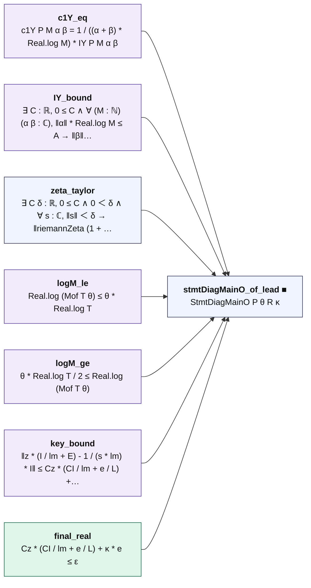

# `lean_stage3/Stage3/DiagMain.lean`

> **Read from the source text.** This file changed after the last `python3 utilities/lean_map.py --dump`, so the arrows on this page are names occurring in each proof and have not been confirmed by Lean.

# Stage3.DiagMain — block S12 of `lean_stage3/design/stencil.md`, the diagonal's main term, little-o (Young's Lemma 7): the reduction and the Möbius input. 2026-11-25.

8 theorems, 3 definitions, 334 lines. 

**Imports:** [`DiagMainMu`](../lean_stage3/DiagMainMu.md), [`DiagMainStmt`](../lean_stage3/DiagMainStmt.md)  
**Imported by:** [`Stage3`](../lean_stage3/Stage3.md)

## The picture



An arrow A → B reads "A is used in the proof of B". Green: counting, integers only. Violet: shape, analysis with no ζ. Blue: reads ζ. A name ending in ■ is an end: nothing else uses it. Red: contains `sorry`. Yellow: theorems in another file, counted; a dotted arrow crosses files. Definitions are not drawn; they are listed below the diagram.

## Definitions

<a name="DiagMain-IY"></a>
### `DiagMain.IY`

def · line 68

`I(α,β) = ∫₀¹ (P′(u) + α log M P(u))(P′(u) + β log M P(u)) du`, so `c₁ = I/((α+β) log M)`.

- **Is:** `` IY (P : Polynomial ℝ) (M : ℕ) (α β : ℂ) : ℂ := ∫ u in (0 : ℝ)..1, (((P.derivative.eval u : ℝ) : ℂ) + α * Real.log M * (P.eval u : ℝ)) * (((P.derivative.eval u : ℝ) : ℂ) + β * Real.log M * (P.eval u : ℝ)) ``
- **Used by 4:** [`DiagMain.IY_bound`](#DiagMain-IY_bound), [`DiagMain.StmtSdiagLead`](#DiagMain-StmtSdiagLead), [`DiagMain.c1Y_eq`](#DiagMain-c1Y_eq), [`DiagMain.stmtDiagMainO_of_lead`](#DiagMain-stmtDiagMainO_of_lead)

<a name="DiagMain-StmtSdiagLead"></a>
### `DiagMain.StmtSdiagLead`

def · line 234

OPEN, the leading term of `S`: `S(α,β,0) = I(α,β)/log M + o(1/L)` uniformly on `Regime κ T`. This is the whole arithmetic content of Young's Lemma 7; the `ζ` factor is `stmtDiagMainO_of_lead`.

- **Is:** `` StmtSdiagLead (P : Polynomial ℝ) (θ R κ : ℝ) : Prop := ∀ ε : ℝ, 0 < ε → ∃ T₀ : ℝ, ∀ T : ℝ, T₀ ≤ T → ∀ α β : ℂ, Regime κ T α β → ‖Sdiag (Mof T θ) (aY P T θ R) (sig0 T R) α β 0 - IY P (Mof T θ) α β / (Real.log (Mof T θ) : ℂ)‖ ≤ ε / Real.log T ``
- **Built from:** [`DiagMain.IY`](#DiagMain-IY), [`Diagonal.Sdiag`](../lean_stage3/Diagonal.md#Diagonal-Sdiag), [`TwistedMoment.Mof`](../lean_stage3/TwistedMoment.md#TwistedMoment-Mof), [`TwistedMoment.Regime`](../lean_stage3/TwistedMoment.md#TwistedMoment-Regime), [`TwistedMoment.aY`](../lean_stage3/TwistedMoment.md#TwistedMoment-aY), [`TwistedMoment.sig0`](../lean_stage3/TwistedMoment.md#TwistedMoment-sig0)
- **Used by 1:** [`DiagMain.stmtDiagMainO_of_lead`](#DiagMain-stmtDiagMainO_of_lead)

<a name="DiagMain-StmtMuSmooth"></a>
### `DiagMain.StmtMuSmooth`

def · line 306

OPEN, the smooth Möbius sum to `o(1/log M)` (the per-`d` step of the route at `d = 1`): for `P(0) = 0`, `Σ_{n ≤ x} μ(n) P(log(x/n)/log M) n^{−1−β} = βP(ℓ) + P′(ℓ)/log M + o(1/log M)`, `ℓ = log x/log M`, uniformly for `Y ≤ x ≤ M` and `‖β‖ log M ≤ κ`. Route: `n^{−β} = x^{−β} e^{β log(x/n)}`, partial summation of `F(u) = e^{βu} P(u/log M)` (`F(0) = 0`) against `psiMu_tendsto`; `F″ = O(1/log² M)` and `∫₁^x |ψ_μ − 1| ds/s = o(log x)`.

- **Is:** `` StmtMuSmooth (P : Polynomial ℝ) (κ : ℝ) : Prop := P.eval 0 = 0 → ∀ ε : ℝ, 0 < ε → ∃ Y N₀ : ℕ, ∀ M : ℕ, N₀ ≤ M → ∀ x : ℕ, Y ≤ x → x ≤ M → ∀ β : ℂ, ‖β‖ * Real.log M ≤ κ → ‖∑ n ∈ Finset.Ioc 0 x, ((μ n : ℝ) : ℂ) * ((P.eval (Real.log ((x : ℝ) / n) / Real.log M) : ℝ) : ℂ) * (n : ℂ) ^ (-(1 + β)) - (β * ((P.eval (Real.log x / Real.log M) : ℝ) : ℂ) + ((P.derivative.eval (Real.log x / Real.log M) : ℝ) : ℂ) / (Real.log M : ℂ))‖… ``
- **Used by 0:** nothing

## Theorems

<a name="DiagMain-c1Y_eq"></a>
### `DiagMain.c1Y_eq`

line 73 · arrows read from text

**Shape.** Uses real or complex analysis; nothing in it or beneath it reads ζ.

**Proves**

```lean
c1Y P M α β = 1 / ((α + β) * Real.log M) * IY P M α β
```

**Needs** (its hypotheses)

  - `` P : Polynomial ℝ ``
  - `` M : ℕ ``
  - `` α β : ℂ ``

**Fed by:** no theorem of this repo; it stands on Mathlib and the definitions below.

**Definitions its proof touches:** [`DiagMain.IY`](#DiagMain-IY), [`TwistedMoment.c1Y`](../lean_stage3/TwistedMoment.md#TwistedMoment-c1Y)

**Feeds** (1 that use it)

  - [`DiagMain.stmtDiagMainO_of_lead`](#DiagMain-stmtDiagMainO_of_lead) — `` StmtDiagMainO P θ R κ ``

<a name="DiagMain-IY_bound"></a>
### `DiagMain.IY_bound`

line 77 · arrows read from text

**Shape.** Uses real or complex analysis; nothing in it or beneath it reads ζ.

**Why.** `‖I(α,β)‖` is bounded once `‖α‖ log M, ‖β‖ log M ≤ A`.

**Proves**

```lean
∃ C : ℝ, 0 ≤ C ∧ ∀ (M : ℕ) (α β : ℂ), ‖α‖ * Real.log M ≤ A → ‖β‖ * Real.log M ≤ A → ‖IY P M α β‖ ≤ C
```

**Needs** (its hypotheses)

  - `` P : Polynomial ℝ ``
  - `` hA : 0 ≤ A ``

**Fed by:** no theorem of this repo; it stands on Mathlib and the definitions below.

**Definitions its proof touches:** [`DiagMain.IY`](#DiagMain-IY)

**Feeds** (1 that use it)

  - [`DiagMain.stmtDiagMainO_of_lead`](#DiagMain-stmtDiagMainO_of_lead) — `` StmtDiagMainO P θ R κ ``

<a name="DiagMain-zeta_taylor"></a>
### `DiagMain.zeta_taylor`

line 116 · arrows read from text

**Reads ζ.** It, or something it rests on, uses the zeta function, its zeros or the Riemann hypothesis.

**Why.** `ζ(1+s) − 1/s` is bounded near `s = 0` (`isBigO_riemannZeta_sub_one_div`).

**Proves**

```lean
∃ C δ : ℝ, 0 ≤ C ∧ 0 < δ ∧ ∀ s : ℂ, ‖s‖ < δ → ‖riemannZeta (1 + s) - 1 / s‖ ≤ C
```

**Fed by:** no theorem of this repo; it stands on Mathlib.

**Feeds** (1 that use it)

  - [`DiagMain.stmtDiagMainO_of_lead`](#DiagMain-stmtDiagMainO_of_lead) — `` StmtDiagMainO P θ R κ ``

<a name="DiagMain-logM_le"></a>
### `DiagMain.logM_le`

line 130 · arrows read from text

**Shape.** Uses real or complex analysis; nothing in it or beneath it reads ζ.

**Proves**

```lean
Real.log (Mof T θ) ≤ θ * Real.log T
```

**Needs** (its hypotheses)

  - `` hT : 1 ≤ T ``
  - `` hθ : 0 ≤ θ ``

**Fed by:** no theorem of this repo; it stands on Mathlib and the definitions below.

**Definitions its proof touches:** [`TwistedMoment.Mof`](../lean_stage3/TwistedMoment.md#TwistedMoment-Mof)

**Feeds** (1 that use it)

  - [`DiagMain.stmtDiagMainO_of_lead`](#DiagMain-stmtDiagMainO_of_lead) — `` StmtDiagMainO P θ R κ ``

<a name="DiagMain-logM_ge"></a>
### `DiagMain.logM_ge`

line 141 · arrows read from text

**Shape.** Uses real or complex analysis; nothing in it or beneath it reads ζ.

**Proves**

```lean
θ * Real.log T / 2 ≤ Real.log (Mof T θ)
```

**Needs** (its hypotheses)

  - `` hT : 1 < T ``
  - `` hθ : 0 < θ ``
  - `` hTθ : 4 * Real.log 2 / θ ≤ Real.log T ``

**Fed by:** no theorem of this repo; it stands on Mathlib and the definitions below.

**Definitions its proof touches:** [`TwistedMoment.Mof`](../lean_stage3/TwistedMoment.md#TwistedMoment-Mof)

**Feeds** (1 that use it)

  - [`DiagMain.stmtDiagMainO_of_lead`](#DiagMain-stmtDiagMainO_of_lead) — `` StmtDiagMainO P θ R κ ``

<a name="DiagMain-key_bound"></a>
### `DiagMain.key_bound`

line 168 · arrows read from text

**Shape.** Uses real or complex analysis; nothing in it or beneath it reads ζ.

**Why.** `ζ S − I/(s lm) = (ζ − 1/s)(I/lm + E) + E/s` with `S = I/lm + E`, bounded termwise.

**Proves**

```lean
‖z * (I / lm + E) - 1 / (s * lm) * I‖ ≤ Cz * (CI / lm + e / L) + κ * e
```

**Needs** (its hypotheses)

  - `` hlm : 0 < lm ``
  - `` hL : 0 < L ``
  - `` hκ : 0 < κ ``
  - `` hz : ‖z - 1 / s‖ ≤ Cz ``
  - `` hI : ‖I‖ ≤ CI ``
  - `` hE : ‖E‖ ≤ e / L ``
  - `` hsL : 1 / (κ * L) ≤ ‖s‖ ``

**Fed by:** no theorem of this repo; it stands on Mathlib.

**Feeds** (1 that use it)

  - [`DiagMain.stmtDiagMainO_of_lead`](#DiagMain-stmtDiagMainO_of_lead) — `` StmtDiagMainO P θ R κ ``

<a name="DiagMain-final_real"></a>
### `DiagMain.final_real`

line 203 · arrows read from text

**Counting.** Integers only: nothing in its statement or proof, or in anything it rests on, uses analysis or ζ.

**Why.** The real arithmetic closing the reduction: the three pieces are each `≤ ε/3`.

**Proves**

```lean
Cz * (CI / lm + e / L) + κ * e ≤ ε
```

**Needs** (its hypotheses)

  - `` hCz : 0 ≤ Cz ``
  - `` hCI : 0 ≤ CI ``
  - `` hθ : 0 < θ ``
  - `` hε : 0 < ε ``
  - `` hκ : 0 < κ ``
  - `` hL : 0 < L ``
  - `` hlm : θ * L / 2 ≤ lm ``
  - `` hL1 : 6 * Cz * CI / (θ * ε) ≤ L ``
  - `` hL2 : Cz ≤ L ``
  - `` he : e = ε / (3 * (κ + 1)) ``

**Fed by:** no theorem of this repo; it stands on Mathlib.

**Feeds** (1 that use it)

  - [`DiagMain.stmtDiagMainO_of_lead`](#DiagMain-stmtDiagMainO_of_lead) — `` StmtDiagMainO P θ R κ ``

<a name="DiagMain-stmtDiagMainO_of_lead"></a>
### `DiagMain.stmtDiagMainO_of_lead`

line 240 · arrows read from text

**Reads ζ.** It, or something it rests on, uses the zeta function, its zeros or the Riemann hypothesis.

**Why.** The Taylor step: `StmtSdiagLead → StmtDiagMainO`, for `θ > 0`, `κ > 0`.

**Proves**

```lean
StmtDiagMainO P θ R κ
```

**Needs** (its hypotheses)

  - `` P : Polynomial ℝ ``
  - `` hθ0 : 0 < θ ``
  - `` R : ℝ ``
  - `` hκ : 0 < κ ``
  - `` h : StmtSdiagLead P θ R κ ``

**Fed by** (7 theorems its proof uses)

  - [`DiagMain.IY_bound`](#DiagMain-IY_bound) — `` ∃ C : ℝ, 0 ≤ C ∧ ∀ (M : ℕ) (α β : ℂ), ‖α‖ * Real.log M ≤ A → ‖β‖ * Real.log M ≤ A → ‖IY P M α β‖ ≤ C ``
  - [`DiagMain.c1Y_eq`](#DiagMain-c1Y_eq) — `` c1Y P M α β = 1 / ((α + β) * Real.log M) * IY P M α β ``
  - [`DiagMain.final_real`](#DiagMain-final_real) — `` Cz * (CI / lm + e / L) + κ * e ≤ ε ``
  - [`DiagMain.key_bound`](#DiagMain-key_bound) — `` ‖z * (I / lm + E) - 1 / (s * lm) * I‖ ≤ Cz * (CI / lm + e / L) + κ * e ``
  - [`DiagMain.logM_ge`](#DiagMain-logM_ge) — `` θ * Real.log T / 2 ≤ Real.log (Mof T θ) ``
  - [`DiagMain.logM_le`](#DiagMain-logM_le) — `` Real.log (Mof T θ) ≤ θ * Real.log T ``
  - [`DiagMain.zeta_taylor`](#DiagMain-zeta_taylor) — `` ∃ C δ : ℝ, 0 ≤ C ∧ 0 < δ ∧ ∀ s : ℂ, ‖s‖ < δ → ‖riemannZeta (1 + s) - 1 / s‖ ≤ C ``

**Definitions its proof touches:** [`DiagMain.IY`](#DiagMain-IY), [`DiagMain.StmtSdiagLead`](#DiagMain-StmtSdiagLead), [`DiagMainStmt.StmtDiagMainO`](../lean_stage3/DiagMainStmt.md#DiagMainStmt-StmtDiagMainO), [`Diagonal.Sdiag`](../lean_stage3/Diagonal.md#Diagonal-Sdiag), [`TwistedMoment.Mof`](../lean_stage3/TwistedMoment.md#TwistedMoment-Mof), [`TwistedMoment.aY`](../lean_stage3/TwistedMoment.md#TwistedMoment-aY), [`TwistedMoment.sig0`](../lean_stage3/TwistedMoment.md#TwistedMoment-sig0)

**Feeds:** nothing. It is an end.

