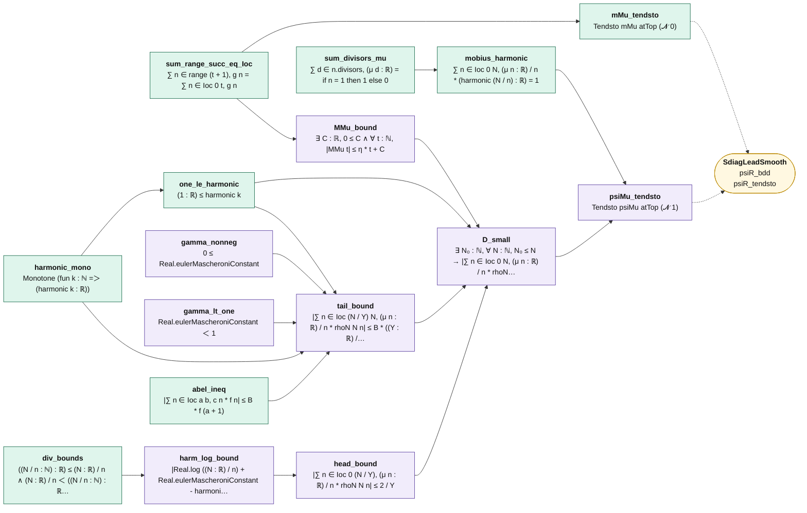

# `lean_stage3/Stage3/DiagMainMu.lean`

> **Read from the source text.** This file changed after the last `python3 utilities/lean_map.py --dump`, so the arrows on this page are names occurring in each proof and have not been confirmed by Lean.

# Stage3.DiagMainMu — the log-weighted Möbius sum, `Σ_{n ≤ N} μ(n)/n · log(N/n) → 1`

16 theorems, 4 definitions, 488 lines. 

**Imports:** [`DiagMainStmt`](../lean_stage3/DiagMainStmt.md)  
**Imported by:** [`Stage3`](../lean_stage3/Stage3.md), [`DiagMain`](../lean_stage3/DiagMain.md)

## The picture



An arrow A → B reads "A is used in the proof of B". Green: counting, integers only. Violet: shape, analysis with no ζ. Blue: reads ζ. A name ending in ■ is an end: nothing else uses it. Red: contains `sorry`. Yellow: theorems in another file, counted; a dotted arrow crosses files. Definitions are not drawn; they are listed below the diagram.

## Definitions

<a name="DiagMain-psiMu"></a>
### `DiagMain.psiMu`

def · line 41

`ψ_μ(N) = Σ_{n ≤ N} μ(n)/n · log(N/n)`.

- **Is:** `` psiMu (N : ℕ) : ℝ := ∑ n ∈ Ioc 0 N, (μ n : ℝ) / n * Real.log ((N : ℝ) / n) ``
- **Used by 4:** [`DiagMain.psiMu_tendsto`](#DiagMain-psiMu_tendsto), [`SdiagLead.psiR_bdd`](../lean_stage3/SdiagLeadSmooth.md#SdiagLead-psiR_bdd), [`SdiagLead.psiR_eq`](../lean_stage3/SdiagLeadSmooth.md#SdiagLead-psiR_eq), [`SdiagLead.psiR_tendsto`](../lean_stage3/SdiagLeadSmooth.md#SdiagLead-psiR_tendsto)

<a name="DiagMain-mMu"></a>
### `DiagMain.mMu`

def · line 44

`m(N) = Σ_{n ≤ N} μ(n)/n`.

- **Is:** `` mMu (N : ℕ) : ℝ := ∑ n ∈ Ioc 0 N, (μ n : ℝ) / n ``
- **Used by 5:** [`DiagMain.mMu_tendsto`](#DiagMain-mMu_tendsto), [`DiagMain.psiMu_tendsto`](#DiagMain-psiMu_tendsto), [`SdiagLead.psiR_bdd`](../lean_stage3/SdiagLeadSmooth.md#SdiagLead-psiR_bdd), [`SdiagLead.psiR_eq`](../lean_stage3/SdiagLeadSmooth.md#SdiagLead-psiR_eq), [`SdiagLead.psiR_tendsto`](../lean_stage3/SdiagLeadSmooth.md#SdiagLead-psiR_tendsto)

<a name="DiagMain-MMu"></a>
### `DiagMain.MMu`

def · line 47

`M(N) = Σ_{n ≤ N} μ(n)`.

- **Is:** `` MMu (N : ℕ) : ℝ := ∑ n ∈ Ioc 0 N, (μ n : ℝ) ``
- **Used by 2:** [`DiagMain.D_small`](#DiagMain-D_small), [`DiagMain.MMu_bound`](#DiagMain-MMu_bound)

<a name="DiagMain-rhoN"></a>
### `DiagMain.rhoN`

def · line 236

`ρ_N(n) = log(N/n) + γ − H(⌊N/n⌋)`, so `ψ_μ(N) = 1 − γ m(N) + Σ μ(n)/n ρ_N(n)`.

- **Is:** `` rhoN (N n : ℕ) : ℝ := Real.log ((N : ℝ) / n) + Real.eulerMascheroniConstant - harmonic (N / n) ``
- **Used by 4:** [`DiagMain.D_small`](#DiagMain-D_small), [`DiagMain.head_bound`](#DiagMain-head_bound), [`DiagMain.psiMu_tendsto`](#DiagMain-psiMu_tendsto), [`DiagMain.tail_bound`](#DiagMain-tail_bound)

## Theorems

<a name="DiagMain-sum_range_succ_eq_Ioc"></a>
### `DiagMain.sum_range_succ_eq_Ioc`

line 49 · arrows read from text

**Counting.** Integers only: nothing in its statement or proof, or in anything it rests on, uses analysis or ζ.

**Proves**

```lean
∑ n ∈ range (t + 1), g n = ∑ n ∈ Ioc 0 t, g n
```

**Needs** (its hypotheses)

  - `` g : ℕ → ℝ ``
  - `` hg : g 0 = 0 ``
  - `` t : ℕ ``

**Fed by:** no theorem of this repo; it stands on Mathlib.

**Feeds** (2 that use it)

  - [`DiagMain.MMu_bound`](#DiagMain-MMu_bound) — `` ∃ C : ℝ, 0 ≤ C ∧ ∀ t : ℕ, |MMu t| ≤ η * t + C ``
  - [`DiagMain.mMu_tendsto`](#DiagMain-mMu_tendsto) — `` Tendsto mMu atTop (𝓝 0) ``

<a name="DiagMain-MMu_bound"></a>
### `DiagMain.MMu_bound`

line 56 · arrows read from text

**Shape.** Uses real or complex analysis; nothing in it or beneath it reads ζ.

**Why.** `|M(t)| ≤ η t + C` for every `t`, from `mu_pnt`.

**Proves**

```lean
∃ C : ℝ, 0 ≤ C ∧ ∀ t : ℕ, |MMu t| ≤ η * t + C
```

**Needs** (its hypotheses)

  - `` hη : 0 < η ``

**Fed by** (1 theorem its proof uses)

  - [`DiagMain.sum_range_succ_eq_Ioc`](#DiagMain-sum_range_succ_eq_Ioc) — `` ∑ n ∈ range (t + 1), g n = ∑ n ∈ Ioc 0 t, g n ``

**Definitions its proof touches:** [`DiagMain.MMu`](#DiagMain-MMu)

**Feeds** (1 that use it)

  - [`DiagMain.D_small`](#DiagMain-D_small) — `` ∃ N₀ : ℕ, ∀ N : ℕ, N₀ ≤ N → |∑ n ∈ Ioc 0 N, (μ n : ℝ) / n * rhoN N n| ≤ ε ``

<a name="DiagMain-mMu_tendsto"></a>
### `DiagMain.mMu_tendsto`

line 80 · arrows read from text

**Counting.** Integers only: nothing in its statement or proof, or in anything it rests on, uses analysis or ζ.

**Why.** `m(N) → 0`, from `mu_pnt_alt`.

**Proves**

```lean
Tendsto mMu atTop (𝓝 0)
```

**Fed by** (1 theorem its proof uses)

  - [`DiagMain.sum_range_succ_eq_Ioc`](#DiagMain-sum_range_succ_eq_Ioc) — `` ∑ n ∈ range (t + 1), g n = ∑ n ∈ Ioc 0 t, g n ``

**Definitions its proof touches:** [`DiagMain.mMu`](#DiagMain-mMu)

**Feeds** (2 that use it)

  - [`SdiagLead.psiR_bdd`](../lean_stage3/SdiagLeadSmooth.md#SdiagLead-psiR_bdd) (SdiagLeadSmooth) — `` ∃ B : ℝ, 0 ≤ B ∧ ∀ s : ℝ, 1 ≤ s → |psiR s - 1| ≤ B ``
  - [`SdiagLead.psiR_tendsto`](../lean_stage3/SdiagLeadSmooth.md#SdiagLead-psiR_tendsto) (SdiagLeadSmooth) — `` ∃ s₀ : ℝ, 1 ≤ s₀ ∧ ∀ s : ℝ, s₀ ≤ s → |psiR s - 1| ≤ ε ``

<a name="DiagMain-sum_divisors_mu"></a>
### `DiagMain.sum_divisors_mu`

line 90 · arrows read from text

**Counting.** Integers only: nothing in its statement or proof, or in anything it rests on, uses analysis or ζ.

**Why.** `Σ_{d | n} μ(d) = [n = 1]`, over `ℝ`.

**Proves**

```lean
∑ d ∈ n.divisors, (μ d : ℝ) = if n = 1 then 1 else 0
```

**Needs** (its hypotheses)

  - `` n : ℕ ``

**Fed by:** no theorem of this repo; it stands on Mathlib.

**Feeds** (1 that use it)

  - [`DiagMain.mobius_harmonic`](#DiagMain-mobius_harmonic) — `` ∑ n ∈ Ioc 0 N, (μ n : ℝ) / n * (harmonic (N / n) : ℝ) = 1 ``

<a name="DiagMain-mobius_harmonic"></a>
### `DiagMain.mobius_harmonic`

line 98 · arrows read from text

**Counting.** Integers only: nothing in its statement or proof, or in anything it rests on, uses analysis or ζ.

**Why.** `Σ_{n ≤ N} μ(n)/n · H(⌊N/n⌋) = 1`, `N ≥ 1`.

**Proves**

```lean
∑ n ∈ Ioc 0 N, (μ n : ℝ) / n * (harmonic (N / n) : ℝ) = 1
```

**Needs** (its hypotheses)

  - `` hN : 1 ≤ N ``

**Fed by** (1 theorem its proof uses)

  - [`DiagMain.sum_divisors_mu`](#DiagMain-sum_divisors_mu) — `` ∑ d ∈ n.divisors, (μ d : ℝ) = if n = 1 then 1 else 0 ``

**Feeds** (1 that use it)

  - [`DiagMain.psiMu_tendsto`](#DiagMain-psiMu_tendsto) — `` Tendsto psiMu atTop (𝓝 1) ``

<a name="DiagMain-div_bounds"></a>
### `DiagMain.div_bounds`

line 138 · arrows read from text

**Counting.** Integers only: nothing in its statement or proof, or in anything it rests on, uses analysis or ζ.

**Why.** `⌊N/n⌋ ≤ N/n < ⌊N/n⌋ + 1` over `ℝ`, `n ≥ 1`.

**Proves**

```lean
((N / n : ℕ) : ℝ) ≤ (N : ℝ) / n ∧ (N : ℝ) / n < ((N / n : ℕ) : ℝ) + 1
```

**Needs** (its hypotheses)

  - `` hn : 0 < n ``

**Fed by:** no theorem of this repo; it stands on Mathlib.

**Feeds** (1 that use it)

  - [`DiagMain.harm_log_bound`](#DiagMain-harm_log_bound) — `` |Real.log ((N : ℝ) / n) + Real.eulerMascheroniConstant - harmonic (N / n)| ≤ 1 / ((N / n : ℕ) : ℝ) ``

<a name="DiagMain-harmonic_mono"></a>
### `DiagMain.harmonic_mono`

line 147 · arrows read from text

**Counting.** Integers only: nothing in its statement or proof, or in anything it rests on, uses analysis or ζ.

**Proves**

```lean
Monotone (fun k : ℕ => (harmonic k : ℝ))
```

**Fed by:** no theorem of this repo; it stands on Mathlib.

**Feeds** (2 that use it)

  - [`DiagMain.one_le_harmonic`](#DiagMain-one_le_harmonic) — `` (1 : ℝ) ≤ harmonic k ``
  - [`DiagMain.tail_bound`](#DiagMain-tail_bound) — `` |∑ n ∈ Ioc (N / Y) N, (μ n : ℝ) / n * rhoN N n| ≤ B * ((Y : ℝ) / N) * (Real.log Y + harmonic Y) ``

<a name="DiagMain-one_le_harmonic"></a>
### `DiagMain.one_le_harmonic`

line 153 · arrows read from text

**Counting.** Integers only: nothing in its statement or proof, or in anything it rests on, uses analysis or ζ.

**Proves**

```lean
(1 : ℝ) ≤ harmonic k
```

**Needs** (its hypotheses)

  - `` hk : 1 ≤ k ``

**Fed by** (1 theorem its proof uses)

  - [`DiagMain.harmonic_mono`](#DiagMain-harmonic_mono) — `` Monotone (fun k : ℕ => (harmonic k : ℝ)) ``

**Feeds** (2 that use it)

  - [`DiagMain.D_small`](#DiagMain-D_small) — `` ∃ N₀ : ℕ, ∀ N : ℕ, N₀ ≤ N → |∑ n ∈ Ioc 0 N, (μ n : ℝ) / n * rhoN N n| ≤ ε ``
  - [`DiagMain.tail_bound`](#DiagMain-tail_bound) — `` |∑ n ∈ Ioc (N / Y) N, (μ n : ℝ) / n * rhoN N n| ≤ B * ((Y : ℝ) / N) * (Real.log Y + harmonic Y) ``

<a name="DiagMain-gamma_nonneg"></a>
### `DiagMain.gamma_nonneg`

line 157 · arrows read from text

**Shape.** Uses real or complex analysis; nothing in it or beneath it reads ζ.

**Proves**

```lean
0 ≤ Real.eulerMascheroniConstant
```

**Fed by:** no theorem of this repo; it stands on Mathlib.

**Feeds** (1 that use it)

  - [`DiagMain.tail_bound`](#DiagMain-tail_bound) — `` |∑ n ∈ Ioc (N / Y) N, (μ n : ℝ) / n * rhoN N n| ≤ B * ((Y : ℝ) / N) * (Real.log Y + harmonic Y) ``

<a name="DiagMain-gamma_lt_one"></a>
### `DiagMain.gamma_lt_one`

line 160 · arrows read from text

**Shape.** Uses real or complex analysis; nothing in it or beneath it reads ζ.

**Proves**

```lean
Real.eulerMascheroniConstant < 1
```

**Fed by:** no theorem of this repo; it stands on Mathlib.

**Feeds** (1 that use it)

  - [`DiagMain.tail_bound`](#DiagMain-tail_bound) — `` |∑ n ∈ Ioc (N / Y) N, (μ n : ℝ) / n * rhoN N n| ≤ B * ((Y : ℝ) / N) * (Real.log Y + harmonic Y) ``

<a name="DiagMain-harm_log_bound"></a>
### `DiagMain.harm_log_bound`

line 164 · arrows read from text

**Shape.** Uses real or complex analysis; nothing in it or beneath it reads ζ.

**Why.** `|log(N/n) + γ − H(⌊N/n⌋)| ≤ 1/⌊N/n⌋` for `1 ≤ n ≤ N`.

**Proves**

```lean
|Real.log ((N : ℝ) / n) + Real.eulerMascheroniConstant - harmonic (N / n)| ≤ 1 / ((N / n : ℕ) : ℝ)
```

**Needs** (its hypotheses)

  - `` hn : 0 < n ``
  - `` hnN : n ≤ N ``

**Fed by** (1 theorem its proof uses)

  - [`DiagMain.div_bounds`](#DiagMain-div_bounds) — `` ((N / n : ℕ) : ℝ) ≤ (N : ℝ) / n ∧ (N : ℝ) / n < ((N / n : ℕ) : ℝ) + 1 ``

**Feeds** (1 that use it)

  - [`DiagMain.head_bound`](#DiagMain-head_bound) — `` |∑ n ∈ Ioc 0 (N / Y), (μ n : ℝ) / n * rhoN N n| ≤ 2 / Y ``

<a name="DiagMain-abel_ineq"></a>
### `DiagMain.abel_ineq`

line 190 · arrows read from text

**Counting.** Integers only: nothing in its statement or proof, or in anything it rests on, uses analysis or ζ.

**Why.** For `f` antitone and nonnegative on `(a, b]`, `|Σ_{a<n≤b} c_n f_n| ≤ B f_{a+1}`, where `B` bounds every partial sum `|Σ_{a<n≤t} c_n|`, `t ≤ b`.

**Proves**

```lean
|∑ n ∈ Ioc a b, c n * f n| ≤ B * f (a + 1)
```

**Needs** (its hypotheses)

  - `` c f : ℕ → ℝ ``
  - `` hab : a < b ``
  - `` hf : ∀ n, a < n → n < b → f (n + 1) ≤ f n ``
  - `` hf0 : 0 ≤ f b ``
  - `` hB : ∀ t, a < t → t ≤ b → |∑ n ∈ Ioc a t, c n| ≤ B ``

**Fed by:** no theorem of this repo; it stands on Mathlib.

**Feeds** (1 that use it)

  - [`DiagMain.tail_bound`](#DiagMain-tail_bound) — `` |∑ n ∈ Ioc (N / Y) N, (μ n : ℝ) / n * rhoN N n| ≤ B * ((Y : ℝ) / N) * (Real.log Y + harmonic Y) ``

<a name="DiagMain-head_bound"></a>
### `DiagMain.head_bound`

line 240 · arrows read from text

**Shape.** Uses real or complex analysis; nothing in it or beneath it reads ζ.

**Why.** The head `n ≤ N/Y`: `|ρ_N(n)| ≤ 1/⌊N/n⌋ ≤ 2n/N`, so the head is `≤ 2/Y`.

**Proves**

```lean
|∑ n ∈ Ioc 0 (N / Y), (μ n : ℝ) / n * rhoN N n| ≤ 2 / Y
```

**Needs** (its hypotheses)

  - `` hN : 1 ≤ N ``
  - `` hY : 1 ≤ Y ``

**Fed by** (1 theorem its proof uses)

  - [`DiagMain.harm_log_bound`](#DiagMain-harm_log_bound) — `` |Real.log ((N : ℝ) / n) + Real.eulerMascheroniConstant - harmonic (N / n)| ≤ 1 / ((N / n : ℕ) : ℝ) ``

**Definitions its proof touches:** [`DiagMain.rhoN`](#DiagMain-rhoN)

**Feeds** (1 that use it)

  - [`DiagMain.D_small`](#DiagMain-D_small) — `` ∃ N₀ : ℕ, ∀ N : ℕ, N₀ ≤ N → |∑ n ∈ Ioc 0 N, (μ n : ℝ) / n * rhoN N n| ≤ ε ``

<a name="DiagMain-tail_bound"></a>
### `DiagMain.tail_bound`

line 276 · arrows read from text

**Shape.** Uses real or complex analysis; nothing in it or beneath it reads ζ.

**Why.** Abel's inequality on the tail `N/Y < n ≤ N`, for `log(N/n)/n` and `(H(⌊N/n⌋) − γ)/n`.

**Proves**

```lean
|∑ n ∈ Ioc (N / Y) N, (μ n : ℝ) / n * rhoN N n| ≤ B * ((Y : ℝ) / N) * (Real.log Y + harmonic Y)
```

**Needs** (its hypotheses)

  - `` hN : 1 ≤ N ``
  - `` hY : 2 ≤ Y ``
  - `` hB : ∀ t, N / Y < t → t ≤ N → |∑ n ∈ Ioc (N / Y) t, (μ n : ℝ)| ≤ B ``

**Fed by** (5 theorems its proof uses)

  - [`DiagMain.abel_ineq`](#DiagMain-abel_ineq) — `` |∑ n ∈ Ioc a b, c n * f n| ≤ B * f (a + 1) ``
  - [`DiagMain.gamma_lt_one`](#DiagMain-gamma_lt_one) — `` Real.eulerMascheroniConstant < 1 ``
  - [`DiagMain.gamma_nonneg`](#DiagMain-gamma_nonneg) — `` 0 ≤ Real.eulerMascheroniConstant ``
  - [`DiagMain.harmonic_mono`](#DiagMain-harmonic_mono) — `` Monotone (fun k : ℕ => (harmonic k : ℝ)) ``
  - [`DiagMain.one_le_harmonic`](#DiagMain-one_le_harmonic) — `` (1 : ℝ) ≤ harmonic k ``

**Definitions its proof touches:** [`DiagMain.rhoN`](#DiagMain-rhoN)

**Feeds** (1 that use it)

  - [`DiagMain.D_small`](#DiagMain-D_small) — `` ∃ N₀ : ℕ, ∀ N : ℕ, N₀ ≤ N → |∑ n ∈ Ioc 0 N, (μ n : ℝ) / n * rhoN N n| ≤ ε ``

<a name="DiagMain-D_small"></a>
### `DiagMain.D_small`

line 380 · arrows read from text

**Shape.** Uses real or complex analysis; nothing in it or beneath it reads ζ.

**Why.** `Σ_{n ≤ N} μ(n)/n ρ_N(n) → 0`: the head is `≤ 2/Y`, the tail `≤ 4ηY(log Y + H(Y))`.

**Proves**

```lean
∃ N₀ : ℕ, ∀ N : ℕ, N₀ ≤ N → |∑ n ∈ Ioc 0 N, (μ n : ℝ) / n * rhoN N n| ≤ ε
```

**Needs** (its hypotheses)

  - `` hε : 0 < ε ``

**Fed by** (4 theorems its proof uses)

  - [`DiagMain.MMu_bound`](#DiagMain-MMu_bound) — `` ∃ C : ℝ, 0 ≤ C ∧ ∀ t : ℕ, |MMu t| ≤ η * t + C ``
  - [`DiagMain.head_bound`](#DiagMain-head_bound) — `` |∑ n ∈ Ioc 0 (N / Y), (μ n : ℝ) / n * rhoN N n| ≤ 2 / Y ``
  - [`DiagMain.one_le_harmonic`](#DiagMain-one_le_harmonic) — `` (1 : ℝ) ≤ harmonic k ``
  - [`DiagMain.tail_bound`](#DiagMain-tail_bound) — `` |∑ n ∈ Ioc (N / Y) N, (μ n : ℝ) / n * rhoN N n| ≤ B * ((Y : ℝ) / N) * (Real.log Y + harmonic Y) ``

**Definitions its proof touches:** [`DiagMain.MMu`](#DiagMain-MMu), [`DiagMain.rhoN`](#DiagMain-rhoN)

**Feeds** (1 that use it)

  - [`DiagMain.psiMu_tendsto`](#DiagMain-psiMu_tendsto) — `` Tendsto psiMu atTop (𝓝 1) ``

<a name="DiagMain-psiMu_tendsto"></a>
### `DiagMain.psiMu_tendsto`

line 444 · arrows read from text

**Shape.** Uses real or complex analysis; nothing in it or beneath it reads ζ.

**Why.** `ψ_μ(N) = Σ_{n ≤ N} μ(n)/n · log(N/n) → 1`, from `mu_pnt` and `mu_pnt_alt`: the identity `Σ μ(n)/n · H(⌊N/n⌋) = 1`, `H(k) = log k + γ + O(1/k)` on the head and Abel's inequality with `M(t) = o(t)` on the tail.

**Proves**

```lean
Tendsto psiMu atTop (𝓝 1)
```

**Fed by** (2 theorems its proof uses)

  - [`DiagMain.D_small`](#DiagMain-D_small) — `` ∃ N₀ : ℕ, ∀ N : ℕ, N₀ ≤ N → |∑ n ∈ Ioc 0 N, (μ n : ℝ) / n * rhoN N n| ≤ ε ``
  - [`DiagMain.mobius_harmonic`](#DiagMain-mobius_harmonic) — `` ∑ n ∈ Ioc 0 N, (μ n : ℝ) / n * (harmonic (N / n) : ℝ) = 1 ``

**Definitions its proof touches:** [`DiagMain.mMu`](#DiagMain-mMu), [`DiagMain.psiMu`](#DiagMain-psiMu), [`DiagMain.rhoN`](#DiagMain-rhoN)

**Feeds** (2 that use it)

  - [`SdiagLead.psiR_bdd`](../lean_stage3/SdiagLeadSmooth.md#SdiagLead-psiR_bdd) (SdiagLeadSmooth) — `` ∃ B : ℝ, 0 ≤ B ∧ ∀ s : ℝ, 1 ≤ s → |psiR s - 1| ≤ B ``
  - [`SdiagLead.psiR_tendsto`](../lean_stage3/SdiagLeadSmooth.md#SdiagLead-psiR_tendsto) (SdiagLeadSmooth) — `` ∃ s₀ : ℝ, 1 ≤ s₀ ∧ ∀ s : ℝ, s₀ ≤ s → |psiR s - 1| ≤ ε ``

