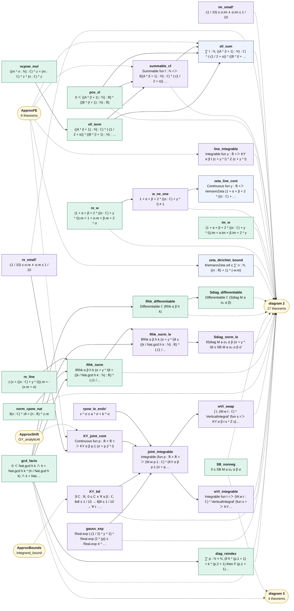
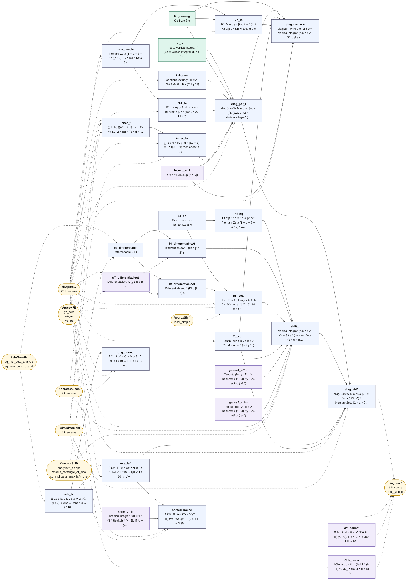
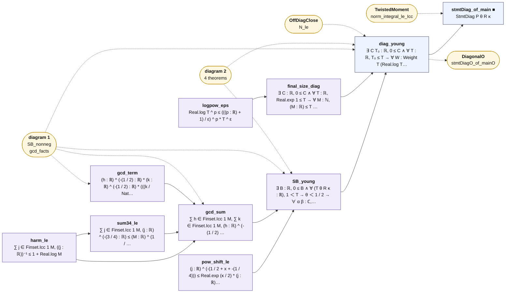

# `lean_stage3/Stage3/Diagonal.lean`

> **Read from the source text.** This file changed after the last `python3 utilities/lean_map.py --dump`, so the arrows on this page are names occurring in each proof and have not been confirmed by Lean.

# Diagonal — block S12 of `lean_stage3/design/stencil.md`, the diagonal. 2026-11-25.

70 theorems, 12 definitions, 1891 lines. 

**Imports:** [`OffDiagClose`](../lean_stage3/OffDiagClose.md), [`ZetaGrowth`](../lean_stage3/ZetaGrowth.md)  
**Imported by:** [`Stage3`](../lean_stage3/Stage3.md), [`DiagMainStmt`](../lean_stage3/DiagMainStmt.md)

## The picture

### Diagram 1 of 3: `gcd_facts` to `line_integrable`



### Diagram 2 of 3: `vi_sum` to `Chk_norm`



### Diagram 3 of 3: `pow_shift_le` to `stmtDiag_of_main`



An arrow A → B reads "A is used in the proof of B". Green: counting, integers only. Violet: shape, analysis with no ζ. Blue: reads ζ. A name ending in ■ is an end: nothing else uses it. Red: contains `sorry`. Yellow: theorems in another file, counted; a dotted arrow crosses files. Definitions are not drawn; they are listed below the diagram.

## Definitions

<a name="Diagonal-Chk"></a>
### `Diagonal.Chk`

def · line 83

- **Is:** `` Chk (a : ℕ → ℂ) (σ₀ : ℝ) (h k : ℕ) : ℂ := a h * (starRingEnd ℂ) (a k) * ((h : ℂ) ^ (-(σ₀ : ℂ)) * (k : ℂ) ^ (-(σ₀ : ℂ))) noncomputable ``
- **Used by 7:** [`Diagonal.Chk_norm`](#Diagonal-Chk_norm), [`Diagonal.SB`](#Diagonal-SB), [`Diagonal.Sdiag`](#Diagonal-Sdiag), [`Diagonal.Sdiag_differentiable`](#Diagonal-Sdiag_differentiable), [`Diagonal.Zhk`](#Diagonal-Zhk), [`Diagonal.Zhk_le`](#Diagonal-Zhk_le), [`Diagonal.inner_hk`](#Diagonal-inner_hk)

<a name="Diagonal-Rhk"></a>
### `Diagonal.Rhk`

def · line 88

- **Is:** `` Rhk (α β : ℂ) (h k : ℕ) (s : ℂ) : ℂ := ((k / Nat.gcd h k : ℕ) : ℂ) ^ (-(1 / 2 + α + s)) * ((h / Nat.gcd h k : ℕ) : ℂ) ^ (-(1 / 2 + β + s)) noncomputable ``
- **Used by 7:** [`Diagonal.Rhk_differentiable`](#Diagonal-Rhk_differentiable), [`Diagonal.Rhk_norm`](#Diagonal-Rhk_norm), [`Diagonal.Rhk_norm_le`](#Diagonal-Rhk_norm_le), [`Diagonal.Sdiag`](#Diagonal-Sdiag), [`Diagonal.Sdiag_differentiable`](#Diagonal-Sdiag_differentiable), [`Diagonal.Zhk`](#Diagonal-Zhk), [`Diagonal.inner_hk`](#Diagonal-inner_hk)

<a name="Diagonal-Sdiag"></a>
### `Diagonal.Sdiag`

def · line 95

- **Is:** `` Sdiag (M : ℕ) (a : ℕ → ℂ) (σ₀ : ℝ) (α β s : ℂ) : ℂ := ∑ h ∈ Finset.Icc 1 M, ∑ k ∈ Finset.Icc 1 M, Chk a σ₀ h k * Rhk α β h k s noncomputable ``
- **Built from:** [`Diagonal.Chk`](#Diagonal-Chk), [`Diagonal.Rhk`](#Diagonal-Rhk)
- **Used by 12:** [`DiagMainStmt.StmtDiagMainO`](../lean_stage3/DiagMainStmt.md#DiagMainStmt-StmtDiagMainO), [`Diagonal.Sdiag_differentiable`](#Diagonal-Sdiag_differentiable), [`Diagonal.Sdiag_norm_le`](#Diagonal-Sdiag_norm_le), [`Diagonal.StmtDiagMain`](#Diagonal-StmtDiagMain), [`Diagonal.Zd`](#Diagonal-Zd), [`Diagonal.diag_mellin`](#Diagonal-diag_mellin), [`Diagonal.diag_per_t`](#Diagonal-diag_per_t), [`Diagonal.diag_shift`](#Diagonal-diag_shift), [`Diagonal.diag_young`](#Diagonal-diag_young), [`Diagonal.shifted_bound`](#Diagonal-shifted_bound), [`Diagonal.stmtDiag_of_main`](#Diagonal-stmtDiag_of_main), [`DiagonalO.stmtDiagO_of_mainO`](../lean_stage3/DiagonalO.md#DiagonalO-stmtDiagO_of_mainO)

<a name="Diagonal-Zd"></a>
### `Diagonal.Zd`

def · line 100

- **Is:** `` Zd (M : ℕ) (a : ℕ → ℂ) (σ₀ : ℝ) (α β s : ℂ) : ℂ := riemannZeta (1 + α + β + 2 * s) * Sdiag M a σ₀ α β s noncomputable ``
- **Built from:** [`Diagonal.Sdiag`](#Diagonal-Sdiag)
- **Used by 6:** [`Diagonal.Zd_cont`](#Diagonal-Zd_cont), [`Diagonal.Zd_le`](#Diagonal-Zd_le), [`Diagonal.diag_mellin`](#Diagonal-diag_mellin), [`Diagonal.diag_per_t`](#Diagonal-diag_per_t), [`Diagonal.diag_shift`](#Diagonal-diag_shift), [`Diagonal.shifted_bound`](#Diagonal-shifted_bound)

<a name="Diagonal-Zhk"></a>
### `Diagonal.Zhk`

def · line 105

- **Is:** `` Zhk (a : ℕ → ℂ) (σ₀ : ℝ) (α β : ℂ) (h k : ℕ) (s : ℂ) : ℂ := riemannZeta (1 + α + β + 2 * s) * (Chk a σ₀ h k * Rhk α β h k s) noncomputable ``
- **Built from:** [`Diagonal.Chk`](#Diagonal-Chk), [`Diagonal.Rhk`](#Diagonal-Rhk)
- **Used by 4:** [`Diagonal.Zhk_cont`](#Diagonal-Zhk_cont), [`Diagonal.Zhk_le`](#Diagonal-Zhk_le), [`Diagonal.diag_per_t`](#Diagonal-diag_per_t), [`Diagonal.inner_hk`](#Diagonal-inner_hk)

<a name="Diagonal-Wg"></a>
### `Diagonal.Wg`

def · line 110

- **Is:** `` Wg {T L : ℝ} (W : Weight T L) (α β s : ℂ) : ℂ := ∫ t, (W.w t : ℂ) * gY α β t s noncomputable ``
- **Built from:** [`ApproxFE.gY`](../lean_stage3/ApproxFE.md#ApproxFE-gY), [`TwistedMoment.Weight`](../lean_stage3/TwistedMoment.md#TwistedMoment-Weight)
- **Used by 2:** [`Diagonal.diag_mellin`](#Diagonal-diag_mellin), [`Diagonal.wVI_swap`](#Diagonal-wVI_swap)

<a name="Diagonal-SB"></a>
### `Diagonal.SB`

def · line 114

- **Is:** `` SB (M : ℕ) (a : ℕ → ℂ) (σ₀ : ℝ) (α β : ℂ) (σ : ℝ) : ℝ := ∑ h ∈ Finset.Icc 1 M, ∑ k ∈ Finset.Icc 1 M, ‖Chk a σ₀ h k‖ * (((k / Nat.gcd h k : ℕ) : ℝ) ^ (-(1 / 2 + α.re + σ)) * ((h / Nat.gcd h k : ℕ) : ℝ) ^ (-(1 / 2 + β.re + σ))) ``
- **Built from:** [`Diagonal.Chk`](#Diagonal-Chk)
- **Used by 7:** [`Diagonal.SB_nonneg`](#Diagonal-SB_nonneg), [`Diagonal.SB_young`](#Diagonal-SB_young), [`Diagonal.Sdiag_norm_le`](#Diagonal-Sdiag_norm_le), [`Diagonal.Zd_le`](#Diagonal-Zd_le), [`Diagonal.diag_shift`](#Diagonal-diag_shift), [`Diagonal.diag_young`](#Diagonal-diag_young), [`Diagonal.shifted_bound`](#Diagonal-shifted_bound)

<a name="Diagonal-Kz"></a>
### `Diagonal.Kz`

def · line 594

- **Is:** `` Kz (α β : ℂ) (c : ℝ) : ℝ := ∑' n : ℕ, ((n : ℝ) + 1) ^ (-(1 + α.re + β.re + 2 * c)) ``
- **Used by 4:** [`Diagonal.Kz_nonneg`](#Diagonal-Kz_nonneg), [`Diagonal.Zd_le`](#Diagonal-Zd_le), [`Diagonal.Zhk_le`](#Diagonal-Zhk_le), [`Diagonal.zeta_line_le`](#Diagonal-zeta_line_le)

<a name="Diagonal-Ez"></a>
### `Diagonal.Ez`

def · line 847

- **Is:** `` Ez : ℂ → ℂ := dslope (fun w : ℂ => (w - 1) ^ 2 * riemannZeta w) 1 ``
- **Used by 6:** [`Diagonal.Ez_differentiable`](#Diagonal-Ez_differentiable), [`Diagonal.Ez_eq`](#Diagonal-Ez_eq), [`Diagonal.Hf`](#Diagonal-Hf), [`Diagonal.Hf_differentiableAt`](#Diagonal-Hf_differentiableAt), [`Diagonal.Kf`](#Diagonal-Kf), [`Diagonal.Kf_differentiableAt`](#Diagonal-Kf_differentiableAt)

<a name="Diagonal-Hf"></a>
### `Diagonal.Hf`

def · line 866

- **Is:** `` Hf (α β : ℂ) (t : ℝ) (Z : ℂ → ℂ) (s : ℂ) : ℂ := cexp (s ^ 2) * ((α + β - 2 * s) / (α + β) ^ 2) / s * gY α β t s * (Ez (1 + α + β + 2 * s) * Z s) ``
- **Built from:** [`ApproxFE.gY`](../lean_stage3/ApproxFE.md#ApproxFE-gY), [`Diagonal.Ez`](#Diagonal-Ez)
- **Used by 4:** [`Diagonal.Hf_differentiableAt`](#Diagonal-Hf_differentiableAt), [`Diagonal.Hf_eq`](#Diagonal-Hf_eq), [`Diagonal.Hf_local`](#Diagonal-Hf_local), [`Diagonal.shift_t`](#Diagonal-shift_t)

<a name="Diagonal-Kf"></a>
### `Diagonal.Kf`

def · line 893

- **Is:** `` Kf (α β : ℂ) (t : ℝ) (Z : ℂ → ℂ) (s : ℂ) : ℂ := cexp (s ^ 2) * ((α + β - 2 * s) / (α + β) ^ 2) * gY α β t s * (Ez (1 + α + β + 2 * s) * Z s) ``
- **Built from:** [`ApproxFE.gY`](../lean_stage3/ApproxFE.md#ApproxFE-gY), [`Diagonal.Ez`](#Diagonal-Ez)
- **Used by 2:** [`Diagonal.Hf_local`](#Diagonal-Hf_local), [`Diagonal.Kf_differentiableAt`](#Diagonal-Kf_differentiableAt)

<a name="Diagonal-StmtDiagMain"></a>
### `Diagonal.StmtDiagMain`

def · line 1730

- **Is:** `` StmtDiagMain (P : Polynomial ℝ) (θ R κ : ℝ) : Prop := ∃ C T₀ : ℝ, 0 ≤ C ∧ ∀ T : ℝ, T₀ ≤ T → ∀ α β : ℂ, Regime κ T α β → ‖riemannZeta (1 + α + β) * Sdiag (Mof T θ) (aY P T θ R) (sig0 T R) α β 0 - c1Y P (Mof T θ) α β‖ ≤ C / Real.log T ``
- **Built from:** [`Diagonal.Sdiag`](#Diagonal-Sdiag), [`TwistedMoment.Mof`](../lean_stage3/TwistedMoment.md#TwistedMoment-Mof), [`TwistedMoment.Regime`](../lean_stage3/TwistedMoment.md#TwistedMoment-Regime), [`TwistedMoment.aY`](../lean_stage3/TwistedMoment.md#TwistedMoment-aY), [`TwistedMoment.c1Y`](../lean_stage3/TwistedMoment.md#TwistedMoment-c1Y), [`TwistedMoment.sig0`](../lean_stage3/TwistedMoment.md#TwistedMoment-sig0)
- **Used by 1:** [`Diagonal.stmtDiag_of_main`](#Diagonal-stmtDiag_of_main)

## Theorems

<a name="Diagonal-gcd_facts"></a>
### `Diagonal.gcd_facts`

line 121 · arrows read from text

**Counting.** Integers only: nothing in its statement or proof, or in anything it rests on, uses analysis or ζ.

**Proves**

```lean
0 < Nat.gcd h k ∧ h = Nat.gcd h k * (h / Nat.gcd h k) ∧ k = Nat.gcd h k * (k / Nat.gcd h k) ∧ 1 ≤ h / Nat.gcd h k ∧ 1 ≤ k / Nat.gcd h k ∧ h / Nat.gcd h k ≤ h ∧ k / Nat.gcd h k ≤ k
```

**Needs** (its hypotheses)

  - `` hh : 1 ≤ h ``
  - `` hk : 1 ≤ k ``

**Fed by:** no theorem of this repo; it stands on Mathlib.

**Feeds** (8 that use it)

  - [`Diagonal.Rhk_differentiable`](#Diagonal-Rhk_differentiable) — `` Differentiable ℂ (Rhk α β h k) ``
  - [`Diagonal.Rhk_norm`](#Diagonal-Rhk_norm) — `` ‖Rhk α β h k (σ + y * I)‖ = ((k / Nat.gcd h k : ℕ) : ℝ) ^ (-(1 / 2 + α.re + σ)) * ((h / Nat.gcd h k : ℕ) : ℝ) ^ (-(1 / 2 + β.re + σ)) ``
  - [`Diagonal.Rhk_norm_le`](#Diagonal-Rhk_norm_le) — `` ‖Rhk α β h k (σ + y * I)‖ ≤ ((k / Nat.gcd h k : ℕ) : ℝ) ^ (-(1 / 2 + α.re + σ')) * ((h / Nat.gcd h k : ℕ) : ℝ) ^ (-(1 / 2 + β.re + σ')) ``
  - [`Diagonal.SB_young`](#Diagonal-SB_young) — `` ∃ B : ℝ, 0 ≤ B ∧ ∀ (T θ R κ : ℝ), 1 < T → θ < 1 / 2 → ∀ α β : ℂ, ‖α‖ ≤ κ / Real.log T → ‖β‖ ≤ κ / Real.log T → SB (Mof T θ) (aY P T θ R) (sig0 T R) α … ``
  - [`Diagonal.diag_reindex`](#Diagonal-diag_reindex) — `` ∑' p : ℕ × ℕ, (if h * (p.1 + 1) = k * (p.2 + 1) then F (p.1 + 1) (p.2 + 1) else 0) = ∑' l : ℕ, F (k / Nat.gcd h k * (l + 1)) (h / Nat.gcd h k * (l + 1… ``
  - [`Diagonal.gcd_sum`](#Diagonal-gcd_sum) — `` ∑ h ∈ Finset.Icc 1 M, ∑ k ∈ Finset.Icc 1 M, (h : ℝ) ^ (-(1 / 2) : ℝ) * (k : ℝ) ^ (-(1 / 2) : ℝ) * (((k / Nat.gcd h k : ℕ) : ℝ) ^ (-(1 / 4) : ℝ) * ((h … ``
  - [`Diagonal.gcd_term`](#Diagonal-gcd_term) — `` (h : ℝ) ^ (-(1 / 2) : ℝ) * (k : ℝ) ^ (-(1 / 2) : ℝ) * (((k / Nat.gcd h k : ℕ) : ℝ) ^ (-(1 / 4) : ℝ) * ((h / Nat.gcd h k : ℕ) : ℝ) ^ (-(1 / 4) : ℝ)) = … ``
  - [`Diagonal.inner_hk`](#Diagonal-inner_hk) — `` ∑' p : ℕ × ℕ, (if h * (p.1 + 1) = k * (p.2 + 1) then coefY a σ₀ α β h k (p.1 + 1) (p.2 + 1) * Jint W α β c h k (p.1 + 1) (p.2 + 1) else 0) = ∫ t, (W.w… ``

<a name="Diagonal-diag_reindex"></a>
### `Diagonal.diag_reindex`

line 133 · arrows read from text

**Counting.** Integers only: nothing in its statement or proof, or in anything it rests on, uses analysis or ζ.

**Why.** The constraint `hm = kn`. With `d = (h,k)`, `h = dh'`, `k = dk'`, `(h',k') = 1`, the solutions are exactly `m = k'ℓ`, `n = h'ℓ`, `ℓ ≥ 1`.

**Proves**

```lean
∑' p : ℕ × ℕ, (if h * (p.1 + 1) = k * (p.2 + 1) then F (p.1 + 1) (p.2 + 1) else 0) = ∑' l : ℕ, F (k / Nat.gcd h k * (l + 1)) (h / Nat.gcd h k * (l + 1))
```

**Needs** (its hypotheses)

  - `` hh : 1 ≤ h ``
  - `` hk : 1 ≤ k ``
  - `` F : ℕ → ℕ → ℂ ``

**Fed by** (1 theorem its proof uses)

  - [`Diagonal.gcd_facts`](#Diagonal-gcd_facts) — `` 0 < Nat.gcd h k ∧ h = Nat.gcd h k * (h / Nat.gcd h k) ∧ k = Nat.gcd h k * (k / Nat.gcd h k) ∧ 1 ≤ h / Nat.gcd h k ∧ 1 ≤ k / Nat.gcd h k ∧ h / Nat.gcd … ``

**Feeds** (1 that use it)

  - [`Diagonal.inner_hk`](#Diagonal-inner_hk) — `` ∑' p : ℕ × ℕ, (if h * (p.1 + 1) = k * (p.2 + 1) then coefY a σ₀ α β h k (p.1 + 1) (p.2 + 1) * Jint W α β c h k (p.1 + 1) (p.2 + 1) else 0) = ∫ t, (W.w… ``

<a name="Diagonal-ncpow_mul"></a>
### `Diagonal.ncpow_mul`

line 189 · arrows read from text

**Counting.** Integers only: nothing in its statement or proof, or in anything it rests on, uses analysis or ζ.

**Proves**

```lean
((m * n : ℕ) : ℂ) ^ z = (m : ℂ) ^ z * (n : ℂ) ^ z
```

**Needs** (its hypotheses)

  - `` m n : ℕ ``
  - `` z : ℂ ``

**Fed by:** no theorem of this repo; it stands on Mathlib.

**Feeds** (1 that use it)

  - [`Diagonal.ell_term`](#Diagonal-ell_term) — `` ((A * (l + 1) : ℕ) : ℂ) ^ (-(1 / 2 + α)) * ((B * (l + 1) : ℕ) : ℂ) ^ (-(1 / 2 + β)) * (K * ((((A * (l + 1) : ℕ) : ℝ) * ((B * (l + 1) : ℕ) : ℝ) : ℝ) : … ``

<a name="Diagonal-ell_term"></a>
### `Diagonal.ell_term`

line 194 · arrows read from text

**Counting.** Integers only: nothing in its statement or proof, or in anything it rests on, uses analysis or ζ.

**Why.** One term of the `ℓ`-sum: `(k'ℓ)^(−1/2−α) (h'ℓ)^(−1/2−β) K (k'h'ℓ²)^(−s) = K k'^(−1/2−α−s) h'^(−1/2−β−s) ℓ^(−(1+α+β+2s))`.

**Proves**

```lean
((A * (l + 1) : ℕ) : ℂ) ^ (-(1 / 2 + α)) * ((B * (l + 1) : ℕ) : ℂ) ^ (-(1 / 2 + β)) * (K * ((((A * (l + 1) : ℕ) : ℝ) * ((B * (l + 1) : ℕ) : ℝ) : ℝ) : ℂ) ^ (-s)) = K * ((A : ℂ) ^ (-(1 / 2 + α + s)) * (B : ℂ) ^ (-(1 / 2 + β + s))) * (1 / ((l : ℂ) + 1) ^ (1 + α + β + 2 * s))
```

**Needs** (its hypotheses)

  - `` hA : 1 ≤ A ``
  - `` hB : 1 ≤ B ``
  - `` l : ℕ ``
  - `` α β s K : ℂ ``

**Fed by** (1 theorem its proof uses)

  - [`Diagonal.ncpow_mul`](#Diagonal-ncpow_mul) — `` ((m * n : ℕ) : ℂ) ^ z = (m : ℂ) ^ z * (n : ℂ) ^ z ``

**Feeds** (2 that use it)

  - [`Diagonal.ell_sum`](#Diagonal-ell_sum) — `` ∑' l : ℕ, ((A * (l + 1) : ℕ) : ℂ) ^ (-(1 / 2 + α)) * ((B * (l + 1) : ℕ) : ℂ) ^ (-(1 / 2 + β)) * VY α β c (((A * (l + 1) : ℕ) : ℝ) * ((B * (l + 1) : ℕ)… ``
  - [`Diagonal.summable_cf`](#Diagonal-summable_cf) — `` Summable fun l : ℕ => ‖((A * (l + 1) : ℕ) : ℂ) ^ (-(1 / 2 + α)) * ((B * (l + 1) : ℕ) : ℂ) ^ (-(1 / 2 + β))‖ * (((A * (l + 1) : ℕ) : ℝ) * ((B * (l + 1)… ``

<a name="Diagonal-pos_xl"></a>
### `Diagonal.pos_xl`

line 216 · arrows read from text

**Counting.** Integers only: nothing in its statement or proof, or in anything it rests on, uses analysis or ζ.

**Proves**

```lean
0 < ((A * (l + 1) : ℕ) : ℝ) * ((B * (l + 1) : ℕ) : ℝ)
```

**Needs** (its hypotheses)

  - `` hA : 1 ≤ A ``
  - `` hB : 1 ≤ B ``
  - `` l : ℕ ``

**Fed by:** no theorem of this repo; it stands on Mathlib.

**Feeds** (3 that use it)

  - [`Diagonal.ell_sum`](#Diagonal-ell_sum) — `` ∑' l : ℕ, ((A * (l + 1) : ℕ) : ℂ) ^ (-(1 / 2 + α)) * ((B * (l + 1) : ℕ) : ℂ) ^ (-(1 / 2 + β)) * VY α β c (((A * (l + 1) : ℕ) : ℝ) * ((B * (l + 1) : ℕ)… ``
  - [`Diagonal.inner_t`](#Diagonal-inner_t) — `` ∑' l : ℕ, ((A * (l + 1) : ℕ) : ℂ) ^ (-(1 / 2 + α)) * ((B * (l + 1) : ℕ) : ℂ) ^ (-(1 / 2 + β)) * ∫ t, (W.w t : ℂ) * VY α β c (((A * (l + 1) : ℕ) : ℝ) *… ``
  - [`Diagonal.summable_cf`](#Diagonal-summable_cf) — `` Summable fun l : ℕ => ‖((A * (l + 1) : ℕ) : ℂ) ^ (-(1 / 2 + α)) * ((B * (l + 1) : ℕ) : ℂ) ^ (-(1 / 2 + β))‖ * (((A * (l + 1) : ℕ) : ℝ) * ((B * (l + 1)… ``

<a name="Diagonal-summable_cf"></a>
### `Diagonal.summable_cf`

line 223 · arrows read from text

**Shape.** Uses real or complex analysis; nothing in it or beneath it reads ζ.

**Why.** The `ℓ`-coefficients, weighted by `x_ℓ^(−c)`, are summable for `Re(α+β) + 2c > 0`.

**Proves**

```lean
Summable fun l : ℕ => ‖((A * (l + 1) : ℕ) : ℂ) ^ (-(1 / 2 + α)) * ((B * (l + 1) : ℕ) : ℂ) ^ (-(1 / 2 + β))‖ * (((A * (l + 1) : ℕ) : ℝ) * ((B * (l + 1) : ℕ) : ℝ)) ^ (-c)
```

**Needs** (its hypotheses)

  - `` hw : 0 < α.re + β.re + 2 * c ``
  - `` hA : 1 ≤ A ``
  - `` hB : 1 ≤ B ``

**Fed by** (3 theorems its proof uses)

  - [`ApproxFE.summable_zeta_norm`](../lean_stage3/ApproxFE.md#ApproxFE-summable_zeta_norm) (ApproxFE) — `` Summable fun n : ℕ => ‖1 / ((n : ℂ) + 1) ^ w‖ ``
  - [`Diagonal.ell_term`](#Diagonal-ell_term) — `` ((A * (l + 1) : ℕ) : ℂ) ^ (-(1 / 2 + α)) * ((B * (l + 1) : ℕ) : ℂ) ^ (-(1 / 2 + β)) * (K * ((((A * (l + 1) : ℕ) : ℝ) * ((B * (l + 1) : ℕ) : ℝ) : ℝ) : … ``
  - [`Diagonal.pos_xl`](#Diagonal-pos_xl) — `` 0 < ((A * (l + 1) : ℕ) : ℝ) * ((B * (l + 1) : ℕ) : ℝ) ``

**Feeds** (2 that use it)

  - [`Diagonal.ell_sum`](#Diagonal-ell_sum) — `` ∑' l : ℕ, ((A * (l + 1) : ℕ) : ℂ) ^ (-(1 / 2 + α)) * ((B * (l + 1) : ℕ) : ℂ) ^ (-(1 / 2 + β)) * VY α β c (((A * (l + 1) : ℕ) : ℝ) * ((B * (l + 1) : ℕ)… ``
  - [`Diagonal.inner_t`](#Diagonal-inner_t) — `` ∑' l : ℕ, ((A * (l + 1) : ℕ) : ℂ) ^ (-(1 / 2 + α)) * ((B * (l + 1) : ℕ) : ℂ) ^ (-(1 / 2 + β)) * ∫ t, (W.w t : ℂ) * VY α β c (((A * (l + 1) : ℕ) : ℝ) *… ``

<a name="Diagonal-ell_sum"></a>
### `Diagonal.ell_sum`

line 244 · arrows read from text

**Reads ζ.** It, or something it rests on, uses the zeta function, its zeros or the Riemann hypothesis.

**Why.** The `ℓ`-sum at fixed `t`: `Σ_ℓ (k'ℓ)^(−1/2−α)(h'ℓ)^(−1/2−β) V_c(k'h'ℓ², t) = (1/2πi)∫_(c) G(s)/s g(s,t) ζ(1+α+β+2s) k'^(−1/2−α−s) h'^(−1/2−β−s) ds`.

**Proves**

```lean
∑' l : ℕ, ((A * (l + 1) : ℕ) : ℂ) ^ (-(1 / 2 + α)) * ((B * (l + 1) : ℕ) : ℂ) ^ (-(1 / 2 + β)) * VY α β c (((A * (l + 1) : ℕ) : ℝ) * ((B * (l + 1) : ℕ) : ℝ)) t = VerticalIntegral' (fun s => KY α β t s * (riemannZeta (1 + α + β + 2 * s) * ((A : ℂ) ^ (-(1 / 2 + α + s)) * (B : ℂ) ^ (-(1 / 2 + β + s))))) c
```

**Needs** (its hypotheses)

  - `` hc : 0 < c ``
  - `` hu : 0 < 1 / 2 + α.re + c ``
  - `` hv : 0 < 1 / 2 + β.re + c ``
  - `` hw : 0 < α.re + β.re + 2 * c ``
  - `` hA : 1 ≤ A ``
  - `` hB : 1 ≤ B ``

**Fed by** (5 theorems its proof uses)

  - [`ApproxFE.KY_bound`](../lean_stage3/ApproxFE.md#ApproxFE-KY_bound) (ApproxFE) — `` ∃ C : ℝ, 0 ≤ C ∧ ∀ y : ℝ, ‖KY α β t (c + y * I)‖ ≤ C * Real.exp (-(1 / 2) * y ^ 2) ``
  - [`ApproxFE.KY_continuous_line`](../lean_stage3/ApproxFE.md#ApproxFE-KY_continuous_line) (ApproxFE) — `` Continuous fun y : ℝ => KY α β t (c + y * I) ``
  - [`Diagonal.ell_term`](#Diagonal-ell_term) — `` ((A * (l + 1) : ℕ) : ℂ) ^ (-(1 / 2 + α)) * ((B * (l + 1) : ℕ) : ℂ) ^ (-(1 / 2 + β)) * (K * ((((A * (l + 1) : ℕ) : ℝ) * ((B * (l + 1) : ℕ) : ℝ) : ℝ) : … ``
  - [`Diagonal.pos_xl`](#Diagonal-pos_xl) — `` 0 < ((A * (l + 1) : ℕ) : ℝ) * ((B * (l + 1) : ℕ) : ℝ) ``
  - [`Diagonal.summable_cf`](#Diagonal-summable_cf) — `` Summable fun l : ℕ => ‖((A * (l + 1) : ℕ) : ℂ) ^ (-(1 / 2 + α)) * ((B * (l + 1) : ℕ) : ℂ) ^ (-(1 / 2 + β))‖ * (((A * (l + 1) : ℕ) : ℝ) * ((B * (l + 1)… ``

**Definitions its proof touches:** [`ApproxFE.KY`](../lean_stage3/ApproxFE.md#ApproxFE-KY), [`ApproxFE.VY`](../lean_stage3/ApproxFE.md#ApproxFE-VY)

**Feeds** (1 that use it)

  - [`Diagonal.inner_t`](#Diagonal-inner_t) — `` ∑' l : ℕ, ((A * (l + 1) : ℕ) : ℂ) ^ (-(1 / 2 + α)) * ((B * (l + 1) : ℕ) : ℂ) ^ (-(1 / 2 + β)) * ∫ t, (W.w t : ℂ) * VY α β c (((A * (l + 1) : ℕ) : ℝ) *… ``

<a name="Diagonal-re_small-"></a>
### `Diagonal.re_small'`

line 303 · arrows read from text

**Shape.** Uses real or complex analysis; nothing in it or beneath it reads ζ.

**Proves**

```lean
-(1 / 10) ≤ α.re ∧ α.re ≤ 1 / 10
```

**Needs** (its hypotheses)

  - `` hα : ‖α‖ ≤ 1 / 10 ``

**Fed by:** no theorem of this repo; it stands on Mathlib.

**Feeds** (10 that use it)

  - [`Diagonal.Hf_local`](#Diagonal-Hf_local) — `` ∃ h : ℂ → ℂ, AnalyticAt ℂ h 0 ∧ ∀ᶠ s in 𝓝[≠] (0 : ℂ), Hf α β t Z s = h s + riemannZeta (1 + α + β) * Z 0 / (s - 0) ``
  - [`Diagonal.KY_joint_cont`](#Diagonal-KY_joint_cont) — `` Continuous fun p : ℝ × ℝ => KY α β p.1 (σ + p.2 * I) ``
  - [`Diagonal.diag_mellin`](#Diagonal-diag_mellin) — `` diagSum W M a σ₀ α β c = VerticalIntegral' (fun s => GY α β s / s * Wg W α β s * riemannZeta (1 + α + β + 2 * s) * Sdiag M a σ₀ α β s) c ``
  - [`Diagonal.diag_per_t`](#Diagonal-diag_per_t) — `` diagSum W M a σ₀ α β c = ∫ t, (W.w t : ℂ) * VerticalIntegral' (fun s => KY α β t s * Zd M a σ₀ α β s) c ``
  - [`Diagonal.diag_shift`](#Diagonal-diag_shift) — `` diagSum W M a σ₀ α β 1 = (what0 W : ℂ) * (riemannZeta (1 + α + β) * Sdiag M a σ₀ α β 0) + ∫ t, (W.w t : ℂ) * VerticalIntegral' (fun s => KY α β t s * … ``
  - [`Diagonal.gY_differentiableAt`](#Diagonal-gY_differentiableAt) — `` DifferentiableAt ℂ (gY α β t) s ``
  - [`Diagonal.inner_t`](#Diagonal-inner_t) — `` ∑' l : ℕ, ((A * (l + 1) : ℕ) : ℂ) ^ (-(1 / 2 + α)) * ((B * (l + 1) : ℕ) : ℂ) ^ (-(1 / 2 + β)) * ∫ t, (W.w t : ℂ) * VY α β c (((A * (l + 1) : ℕ) : ℝ) *… ``
  - [`Diagonal.orig_bound`](#Diagonal-orig_bound) — `` ∃ C : ℝ, 0 ≤ C ∧ ∀ α β : ℂ, ‖α‖ ≤ 1 / 10 → ‖β‖ ≤ 1 / 10 → ∀ t : ℝ, 1 ≤ t → ∀ (Z : ℂ → ℂ) (KZ : ℝ), ∀ σ y : ℝ, -(1 / 4) ≤ σ → σ ≤ 1 → 1 / 4 ≤ ‖(σ : ℂ) … ``
  - [`Diagonal.shift_t`](#Diagonal-shift_t) — `` VerticalIntegral' (fun s => KY α β t s * (riemannZeta (1 + α + β + 2 * s) * Z s)) 1 = riemannZeta (1 + α + β) * Z 0 + VerticalIntegral' (fun s => KY α… ``
  - [`Diagonal.zeta_left`](#Diagonal-zeta_left) — `` ∃ Cz : ℝ, 0 ≤ Cz ∧ ∀ α β : ℂ, ‖α‖ ≤ 1 / 10 → ‖β‖ ≤ 1 / 10 → ∀ y : ℝ, ‖riemannZeta (1 + α + β + 2 * (((-(1 / 4) : ℝ) : ℂ) + y * I))‖ ≤ Cz * Real.exp (2… ``

<a name="Diagonal-im_small-"></a>
### `Diagonal.im_small'`

line 306 · arrows read from text

**Shape.** Uses real or complex analysis; nothing in it or beneath it reads ζ.

**Proves**

```lean
-(1 / 10) ≤ α.im ∧ α.im ≤ 1 / 10
```

**Needs** (its hypotheses)

  - `` hα : ‖α‖ ≤ 1 / 10 ``

**Fed by:** no theorem of this repo; it stands on Mathlib.

**Feeds** (3 that use it)

  - [`Diagonal.orig_bound`](#Diagonal-orig_bound) — `` ∃ C : ℝ, 0 ≤ C ∧ ∀ α β : ℂ, ‖α‖ ≤ 1 / 10 → ‖β‖ ≤ 1 / 10 → ∀ t : ℝ, 1 ≤ t → ∀ (Z : ℂ → ℂ) (KZ : ℝ), ∀ σ y : ℝ, -(1 / 4) ≤ σ → σ ≤ 1 → 1 / 4 ≤ ‖(σ : ℂ) … ``
  - [`Diagonal.shift_t`](#Diagonal-shift_t) — `` VerticalIntegral' (fun s => KY α β t s * (riemannZeta (1 + α + β + 2 * s) * Z s)) 1 = riemannZeta (1 + α + β) * Z 0 + VerticalIntegral' (fun s => KY α… ``
  - [`Diagonal.zeta_left`](#Diagonal-zeta_left) — `` ∃ Cz : ℝ, 0 ≤ Cz ∧ ∀ α β : ℂ, ‖α‖ ≤ 1 / 10 → ‖β‖ ≤ 1 / 10 → ∀ y : ℝ, ‖riemannZeta (1 + α + β + 2 * (((-(1 / 4) : ℝ) : ℂ) + y * I))‖ ≤ Cz * Real.exp (2… ``

<a name="Diagonal-rpow_le_ends-"></a>
### `Diagonal.rpow_le_ends'`

line 310 · arrows read from text

**Shape.** Uses real or complex analysis; nothing in it or beneath it reads ζ.

**Why.** `x^σ ≤ a^σ + b^σ` for `0 < a ≤ x ≤ b`, any sign of `σ`.

**Proves**

```lean
x ^ σ ≤ a ^ σ + b ^ σ
```

**Needs** (its hypotheses)

  - `` ha : 0 < a ``
  - `` hax : a ≤ x ``
  - `` hxb : x ≤ b ``

**Fed by:** no theorem of this repo; it stands on Mathlib.

**Feeds** (1 that use it)

  - [`Diagonal.joint_integrable`](#Diagonal-joint_integrable) — `` Integrable (fun p : ℝ × ℝ => (W.w p.1 : ℂ) * (KY α β p.1 (σ + p.2 * I) * Z (σ + p.2 * I))) (volume.prod volume) ``

<a name="Diagonal-gauss_exp"></a>
### `Diagonal.gauss_exp`

line 319 · arrows read from text

**Shape.** Uses real or complex analysis; nothing in it or beneath it reads ζ.

**Why.** `e^(−y²/2) e^(2|y|) ≤ e⁴ e^(−y²/4)`.

**Proves**

```lean
Real.exp (-(1 / 2) * y ^ 2) * Real.exp (2 * |y|) ≤ Real.exp 4 * Real.exp (-(1 / 4) * y ^ 2)
```

**Needs** (its hypotheses)

  - `` y : ℝ ``

**Fed by:** no theorem of this repo; it stands on Mathlib.

**Feeds** (3 that use it)

  - [`Diagonal.joint_integrable`](#Diagonal-joint_integrable) — `` Integrable (fun p : ℝ × ℝ => (W.w p.1 : ℂ) * (KY α β p.1 (σ + p.2 * I) * Z (σ + p.2 * I))) (volume.prod volume) ``
  - [`Diagonal.orig_bound`](#Diagonal-orig_bound) — `` ∃ C : ℝ, 0 ≤ C ∧ ∀ α β : ℂ, ‖α‖ ≤ 1 / 10 → ‖β‖ ≤ 1 / 10 → ∀ t : ℝ, 1 ≤ t → ∀ (Z : ℂ → ℂ) (KZ : ℝ), ∀ σ y : ℝ, -(1 / 4) ≤ σ → σ ≤ 1 → 1 / 4 ≤ ‖(σ : ℂ) … ``
  - [`Diagonal.shifted_bound`](#Diagonal-shifted_bound) — `` ∃ K0 : ℝ, 0 ≤ K0 ∧ ∀ (T L : ℝ) (W : Weight T L), 4 ≤ T → ∀ (M : ℕ) (a : ℕ → ℂ) (σ₀ : ℝ) (α β : ℂ), ‖α‖ ≤ 1 / 10 → ‖β‖ ≤ 1 / 10 → ‖∫ t, (W.w t : ℂ) * V… ``

<a name="Diagonal-KY_bd"></a>
### `Diagonal.KY_bd`

line 326 · arrows read from text

**Shape.** Uses real or complex analysis; nothing in it or beneath it reads ζ.

**Why.** `‖K(σ+iy, t)‖ ≤ C N (t/2π)^σ e^(−y²/2)` on one line `σ ≠ 0`, `σ > −2/5`, `t ≥ 1`.

**Proves**

```lean
∃ C : ℝ, 0 ≤ C ∧ ∀ α β : ℂ, ‖α‖ ≤ 1 / 10 → ‖β‖ ≤ 1 / 10 → ∀ t : ℝ, 1 ≤ t → ∀ y : ℝ, ‖KY α β t (σ + y * I)‖ ≤ C * (1 + 1 / ‖α + β‖ ^ 2) * (t / (2 * Real.pi)) ^ σ * Real.exp (-(1 / 2) * y ^ 2)
```

**Needs** (its hypotheses)

  - `` hσ0 : -(2 / 5) < σ ``
  - `` hσ : σ ≠ 0 ``

**Fed by** (1 theorem its proof uses)

  - [`ApproxBounds.integrand_bound`](../lean_stage3/ApproxBounds.md#ApproxBounds-integrand_bound) (ApproxBounds) — `` ∃ C : ℝ, 0 ≤ C ∧ ∀ α β : ℂ, ‖α‖ ≤ 1 / 10 → ‖β‖ ≤ 1 / 10 → ∀ t : ℝ, 1 ≤ t → ∀ x : ℝ, 0 < x → ∀ σ y : ℝ, σ₀ ≤ σ → σ ≤ σ₁ → δ ≤ ‖(σ : ℂ) + y * I‖ → ‖KY α… ``

**Definitions its proof touches:** [`ApproxFE.KY`](../lean_stage3/ApproxFE.md#ApproxFE-KY)

**Feeds** (2 that use it)

  - [`Diagonal.joint_integrable`](#Diagonal-joint_integrable) — `` Integrable (fun p : ℝ × ℝ => (W.w p.1 : ℂ) * (KY α β p.1 (σ + p.2 * I) * Z (σ + p.2 * I))) (volume.prod volume) ``
  - [`Diagonal.shifted_bound`](#Diagonal-shifted_bound) — `` ∃ K0 : ℝ, 0 ≤ K0 ∧ ∀ (T L : ℝ) (W : Weight T L), 4 ≤ T → ∀ (M : ℕ) (a : ℕ → ℂ) (σ₀ : ℝ) (α β : ℂ), ‖α‖ ≤ 1 / 10 → ‖β‖ ≤ 1 / 10 → ‖∫ t, (W.w t : ℂ) * V… ``

<a name="Diagonal-KY_joint_cont"></a>
### `Diagonal.KY_joint_cont`

line 339 · arrows read from text

**Shape.** Uses real or complex analysis; nothing in it or beneath it reads ζ.

**Why.** `K(σ+iy, t)` is jointly continuous in `(t, y)`.

**Proves**

```lean
Continuous fun p : ℝ × ℝ => KY α β p.1 (σ + p.2 * I)
```

**Needs** (its hypotheses)

  - `` hα : ‖α‖ ≤ 1 / 10 ``
  - `` hβ : ‖β‖ ≤ 1 / 10 ``
  - `` hσ0 : -(2 / 5) < σ ``
  - `` hσ : σ ≠ 0 ``

**Fed by** (4 theorems its proof uses)

  - [`ApproxFE.uA_re`](../lean_stage3/ApproxFE.md#ApproxFE-uA_re) (ApproxFE) — `` (uA α t).re = 1 / 2 + α.re ``
  - [`ApproxFE.vB_re`](../lean_stage3/ApproxFE.md#ApproxFE-vB_re) (ApproxFE) — `` (vB β t).re = 1 / 2 + β.re ``
  - [`ApproxShift.GY_analyticAt`](../lean_stage3/ApproxShift.md#ApproxShift-GY_analyticAt) (ApproxShift) — `` AnalyticAt ℂ (GY α β) p ``
  - [`Diagonal.re_small'`](#Diagonal-re_small-) — `` -(1 / 10) ≤ α.re ∧ α.re ≤ 1 / 10 ``

**Definitions its proof touches:** [`ApproxFE.GY`](../lean_stage3/ApproxFE.md#ApproxFE-GY), [`ApproxFE.KY`](../lean_stage3/ApproxFE.md#ApproxFE-KY), [`ApproxFE.gY`](../lean_stage3/ApproxFE.md#ApproxFE-gY), [`ApproxFE.uA`](../lean_stage3/ApproxFE.md#ApproxFE-uA), [`ApproxFE.vB`](../lean_stage3/ApproxFE.md#ApproxFE-vB)

**Feeds** (1 that use it)

  - [`Diagonal.joint_integrable`](#Diagonal-joint_integrable) — `` Integrable (fun p : ℝ × ℝ => (W.w p.1 : ℂ) * (KY α β p.1 (σ + p.2 * I) * Z (σ + p.2 * I))) (volume.prod volume) ``

<a name="Diagonal-joint_integrable"></a>
### `Diagonal.joint_integrable`

line 377 · arrows read from text

**Shape.** Uses real or complex analysis; nothing in it or beneath it reads ζ.

**Why.** The joint integrand is integrable on `ℝ × ℝ`: `w(t) K(σ+iy,t) Z(σ+iy)`, for `Z` continuous on the line with `‖Z(σ+iy)‖ ≤ K e^(2|y|)`.

**Proves**

```lean
Integrable (fun p : ℝ × ℝ => (W.w p.1 : ℂ) * (KY α β p.1 (σ + p.2 * I) * Z (σ + p.2 * I))) (volume.prod volume)
```

**Needs** (its hypotheses)

  - `` W : Weight T L ``
  - `` hT : 4 ≤ T ``
  - `` hα : ‖α‖ ≤ 1 / 10 ``
  - `` hβ : ‖β‖ ≤ 1 / 10 ``
  - `` hσ0 : -(2 / 5) < σ ``
  - `` hσ : σ ≠ 0 ``
  - `` hZc : Continuous fun y : ℝ => Z (σ + y * I) ``
  - `` hZ : ∀ y : ℝ, ‖Z (σ + y * I)‖ ≤ K * Real.exp (2 * |y|) ``

**Fed by** (4 theorems its proof uses)

  - [`Diagonal.KY_bd`](#Diagonal-KY_bd) — `` ∃ C : ℝ, 0 ≤ C ∧ ∀ α β : ℂ, ‖α‖ ≤ 1 / 10 → ‖β‖ ≤ 1 / 10 → ∀ t : ℝ, 1 ≤ t → ∀ y : ℝ, ‖KY α β t (σ + y * I)‖ ≤ C * (1 + 1 / ‖α + β‖ ^ 2) * (t / (2 * Rea… ``
  - [`Diagonal.KY_joint_cont`](#Diagonal-KY_joint_cont) — `` Continuous fun p : ℝ × ℝ => KY α β p.1 (σ + p.2 * I) ``
  - [`Diagonal.gauss_exp`](#Diagonal-gauss_exp) — `` Real.exp (-(1 / 2) * y ^ 2) * Real.exp (2 * |y|) ≤ Real.exp 4 * Real.exp (-(1 / 4) * y ^ 2) ``
  - [`Diagonal.rpow_le_ends'`](#Diagonal-rpow_le_ends-) — `` x ^ σ ≤ a ^ σ + b ^ σ ``

**Definitions its proof touches:** [`ApproxFE.KY`](../lean_stage3/ApproxFE.md#ApproxFE-KY), [`TwistedMoment.Weight`](../lean_stage3/TwistedMoment.md#TwistedMoment-Weight)

**Feeds** (2 that use it)

  - [`Diagonal.wVI_integrable`](#Diagonal-wVI_integrable) — `` Integrable fun t => (W.w t : ℂ) * VerticalIntegral' (fun s => KY α β t s * Z s) σ ``
  - [`Diagonal.wVI_swap`](#Diagonal-wVI_swap) — `` ∫ t, (W.w t : ℂ) * VerticalIntegral' (fun s => KY α β t s * Z s) σ = VerticalIntegral' (fun s => GY α β s / s * Wg W α β s * Z s) σ ``

<a name="Diagonal-wVI_integrable"></a>
### `Diagonal.wVI_integrable`

line 437 · arrows read from text

**Shape.** Uses real or complex analysis; nothing in it or beneath it reads ζ.

**Why.** `w(t) (1/2πi)∫_(σ) K(s,t) Z(s) ds` is integrable in `t`.

**Proves**

```lean
Integrable fun t => (W.w t : ℂ) * VerticalIntegral' (fun s => KY α β t s * Z s) σ
```

**Needs** (its hypotheses)

  - `` W : Weight T L ``
  - `` hT : 4 ≤ T ``
  - `` hα : ‖α‖ ≤ 1 / 10 ``
  - `` hβ : ‖β‖ ≤ 1 / 10 ``
  - `` hσ0 : -(2 / 5) < σ ``
  - `` hσ : σ ≠ 0 ``
  - `` hZc : Continuous fun y : ℝ => Z (σ + y * I) ``
  - `` hZ : ∀ y : ℝ, ‖Z (σ + y * I)‖ ≤ K * Real.exp (2 * |y|) ``

**Fed by** (1 theorem its proof uses)

  - [`Diagonal.joint_integrable`](#Diagonal-joint_integrable) — `` Integrable (fun p : ℝ × ℝ => (W.w p.1 : ℂ) * (KY α β p.1 (σ + p.2 * I) * Z (σ + p.2 * I))) (volume.prod volume) ``

**Definitions its proof touches:** [`ApproxFE.KY`](../lean_stage3/ApproxFE.md#ApproxFE-KY), [`TwistedMoment.Weight`](../lean_stage3/TwistedMoment.md#TwistedMoment-Weight)

**Feeds** (2 that use it)

  - [`Diagonal.diag_per_t`](#Diagonal-diag_per_t) — `` diagSum W M a σ₀ α β c = ∫ t, (W.w t : ℂ) * VerticalIntegral' (fun s => KY α β t s * Zd M a σ₀ α β s) c ``
  - [`Diagonal.diag_shift`](#Diagonal-diag_shift) — `` diagSum W M a σ₀ α β 1 = (what0 W : ℂ) * (riemannZeta (1 + α + β) * Sdiag M a σ₀ α β 0) + ∫ t, (W.w t : ℂ) * VerticalIntegral' (fun s => KY α β t s * … ``

<a name="Diagonal-wVI_swap"></a>
### `Diagonal.wVI_swap`

line 450 · arrows read from text

**Shape.** Uses real or complex analysis; nothing in it or beneath it reads ζ.

**Why.** The Fubini swap: `∫ w(t) (1/2πi)∫_(σ) K(s,t) Z(s) ds dt = (1/2πi)∫_(σ) G(s)/s (∫ w(t) g(s,t) dt) Z(s) ds`.

**Proves**

```lean
∫ t, (W.w t : ℂ) * VerticalIntegral' (fun s => KY α β t s * Z s) σ = VerticalIntegral' (fun s => GY α β s / s * Wg W α β s * Z s) σ
```

**Needs** (its hypotheses)

  - `` W : Weight T L ``
  - `` hT : 4 ≤ T ``
  - `` hα : ‖α‖ ≤ 1 / 10 ``
  - `` hβ : ‖β‖ ≤ 1 / 10 ``
  - `` hσ0 : -(2 / 5) < σ ``
  - `` hσ : σ ≠ 0 ``
  - `` hZc : Continuous fun y : ℝ => Z (σ + y * I) ``
  - `` hZ : ∀ y : ℝ, ‖Z (σ + y * I)‖ ≤ K * Real.exp (2 * |y|) ``

**Fed by** (1 theorem its proof uses)

  - [`Diagonal.joint_integrable`](#Diagonal-joint_integrable) — `` Integrable (fun p : ℝ × ℝ => (W.w p.1 : ℂ) * (KY α β p.1 (σ + p.2 * I) * Z (σ + p.2 * I))) (volume.prod volume) ``

**Definitions its proof touches:** [`ApproxFE.GY`](../lean_stage3/ApproxFE.md#ApproxFE-GY), [`ApproxFE.KY`](../lean_stage3/ApproxFE.md#ApproxFE-KY), [`Diagonal.Wg`](#Diagonal-Wg), [`TwistedMoment.Weight`](../lean_stage3/TwistedMoment.md#TwistedMoment-Weight)

**Feeds** (1 that use it)

  - [`Diagonal.diag_mellin`](#Diagonal-diag_mellin) — `` diagSum W M a σ₀ α β c = VerticalIntegral' (fun s => GY α β s / s * Wg W α β s * riemannZeta (1 + α + β + 2 * s) * Sdiag M a σ₀ α β s) c ``

<a name="Diagonal-norm_cpow_nat"></a>
### `Diagonal.norm_cpow_nat`

line 481 · arrows read from text

**Counting.** Integers only: nothing in its statement or proof, or in anything it rests on, uses analysis or ζ.

**Proves**

```lean
‖(n : ℂ) ^ z‖ = (n : ℝ) ^ z.re
```

**Needs** (its hypotheses)

  - `` hn : 1 ≤ n ``
  - `` z : ℂ ``

**Fed by:** no theorem of this repo; it stands on Mathlib.

**Feeds** (2 that use it)

  - [`Diagonal.Chk_norm`](#Diagonal-Chk_norm) — `` ‖Chk a σ₀ h k‖ = (‖a h‖ * (h : ℝ) ^ (-σ₀)) * (‖a k‖ * (k : ℝ) ^ (-σ₀)) ``
  - [`Diagonal.Rhk_norm`](#Diagonal-Rhk_norm) — `` ‖Rhk α β h k (σ + y * I)‖ = ((k / Nat.gcd h k : ℕ) : ℝ) ^ (-(1 / 2 + α.re + σ)) * ((h / Nat.gcd h k : ℕ) : ℝ) ^ (-(1 / 2 + β.re + σ)) ``

<a name="Diagonal-re_line"></a>
### `Diagonal.re_line`

line 484 · arrows read from text

**Counting.** Integers only: nothing in its statement or proof, or in anything it rests on, uses analysis or ζ.

**Proves**

```lean
(-(x + ((σ : ℂ) + y * I))).re = -(x.re + σ)
```

**Needs** (its hypotheses)

  - `` x : ℂ ``
  - `` σ y : ℝ ``

**Fed by:** no theorem of this repo; it stands on Mathlib.

**Feeds** (1 that use it)

  - [`Diagonal.Rhk_norm`](#Diagonal-Rhk_norm) — `` ‖Rhk α β h k (σ + y * I)‖ = ((k / Nat.gcd h k : ℕ) : ℝ) ^ (-(1 / 2 + α.re + σ)) * ((h / Nat.gcd h k : ℕ) : ℝ) ^ (-(1 / 2 + β.re + σ)) ``

<a name="Diagonal-Rhk_norm"></a>
### `Diagonal.Rhk_norm`

line 487 · arrows read from text

**Counting.** Integers only: nothing in its statement or proof, or in anything it rests on, uses analysis or ζ.

**Proves**

```lean
‖Rhk α β h k (σ + y * I)‖ = ((k / Nat.gcd h k : ℕ) : ℝ) ^ (-(1 / 2 + α.re + σ)) * ((h / Nat.gcd h k : ℕ) : ℝ) ^ (-(1 / 2 + β.re + σ))
```

**Needs** (its hypotheses)

  - `` α β : ℂ ``
  - `` hh : 1 ≤ h ``
  - `` hk : 1 ≤ k ``
  - `` σ y : ℝ ``

**Fed by** (3 theorems its proof uses)

  - [`Diagonal.gcd_facts`](#Diagonal-gcd_facts) — `` 0 < Nat.gcd h k ∧ h = Nat.gcd h k * (h / Nat.gcd h k) ∧ k = Nat.gcd h k * (k / Nat.gcd h k) ∧ 1 ≤ h / Nat.gcd h k ∧ 1 ≤ k / Nat.gcd h k ∧ h / Nat.gcd … ``
  - [`Diagonal.norm_cpow_nat`](#Diagonal-norm_cpow_nat) — `` ‖(n : ℂ) ^ z‖ = (n : ℝ) ^ z.re ``
  - [`Diagonal.re_line`](#Diagonal-re_line) — `` (-(x + ((σ : ℂ) + y * I))).re = -(x.re + σ) ``

**Definitions its proof touches:** [`Diagonal.Rhk`](#Diagonal-Rhk)

**Feeds** (2 that use it)

  - [`Diagonal.Rhk_norm_le`](#Diagonal-Rhk_norm_le) — `` ‖Rhk α β h k (σ + y * I)‖ ≤ ((k / Nat.gcd h k : ℕ) : ℝ) ^ (-(1 / 2 + α.re + σ')) * ((h / Nat.gcd h k : ℕ) : ℝ) ^ (-(1 / 2 + β.re + σ')) ``
  - [`Diagonal.Zhk_le`](#Diagonal-Zhk_le) — `` ‖Zhk a σ₀ α β h k (c + y * I)‖ ≤ Kz α β c * (‖Chk a σ₀ h k‖ * (((k / Nat.gcd h k : ℕ) : ℝ) ^ (-(1 / 2 + α.re + c)) * ((h / Nat.gcd h k : ℕ) : ℝ) ^ (-(… ``

<a name="Diagonal-Rhk_norm_le"></a>
### `Diagonal.Rhk_norm_le`

line 496 · arrows read from text

**Shape.** Uses real or complex analysis; nothing in it or beneath it reads ζ.

**Why.** `‖Rhk(σ+iy)‖` decreases in `σ`.

**Proves**

```lean
‖Rhk α β h k (σ + y * I)‖ ≤ ((k / Nat.gcd h k : ℕ) : ℝ) ^ (-(1 / 2 + α.re + σ')) * ((h / Nat.gcd h k : ℕ) : ℝ) ^ (-(1 / 2 + β.re + σ'))
```

**Needs** (its hypotheses)

  - `` α β : ℂ ``
  - `` hh : 1 ≤ h ``
  - `` hk : 1 ≤ k ``
  - `` hσ : σ' ≤ σ ``
  - `` y : ℝ ``

**Fed by** (2 theorems its proof uses)

  - [`Diagonal.Rhk_norm`](#Diagonal-Rhk_norm) — `` ‖Rhk α β h k (σ + y * I)‖ = ((k / Nat.gcd h k : ℕ) : ℝ) ^ (-(1 / 2 + α.re + σ)) * ((h / Nat.gcd h k : ℕ) : ℝ) ^ (-(1 / 2 + β.re + σ)) ``
  - [`Diagonal.gcd_facts`](#Diagonal-gcd_facts) — `` 0 < Nat.gcd h k ∧ h = Nat.gcd h k * (h / Nat.gcd h k) ∧ k = Nat.gcd h k * (k / Nat.gcd h k) ∧ 1 ≤ h / Nat.gcd h k ∧ 1 ≤ k / Nat.gcd h k ∧ h / Nat.gcd … ``

**Definitions its proof touches:** [`Diagonal.Rhk`](#Diagonal-Rhk)

**Feeds** (1 that use it)

  - [`Diagonal.Sdiag_norm_le`](#Diagonal-Sdiag_norm_le) — `` ‖Sdiag M a σ₀ α β (σ + y * I)‖ ≤ SB M a σ₀ α β σ' ``

<a name="Diagonal-Sdiag_norm_le"></a>
### `Diagonal.Sdiag_norm_le`

line 507 · arrows read from text

**Shape.** Uses real or complex analysis; nothing in it or beneath it reads ζ.

**Proves**

```lean
‖Sdiag M a σ₀ α β (σ + y * I)‖ ≤ SB M a σ₀ α β σ'
```

**Needs** (its hypotheses)

  - `` M : ℕ ``
  - `` a : ℕ → ℂ ``
  - `` σ₀ : ℝ ``
  - `` α β : ℂ ``
  - `` hσ : σ' ≤ σ ``
  - `` y : ℝ ``

**Fed by** (1 theorem its proof uses)

  - [`Diagonal.Rhk_norm_le`](#Diagonal-Rhk_norm_le) — `` ‖Rhk α β h k (σ + y * I)‖ ≤ ((k / Nat.gcd h k : ℕ) : ℝ) ^ (-(1 / 2 + α.re + σ')) * ((h / Nat.gcd h k : ℕ) : ℝ) ^ (-(1 / 2 + β.re + σ')) ``

**Definitions its proof touches:** [`Diagonal.SB`](#Diagonal-SB), [`Diagonal.Sdiag`](#Diagonal-Sdiag)

**Feeds** (3 that use it)

  - [`Diagonal.Zd_le`](#Diagonal-Zd_le) — `` ‖Zd M a σ₀ α β (c + y * I)‖ ≤ Kz α β c * SB M a σ₀ α β c ``
  - [`Diagonal.diag_shift`](#Diagonal-diag_shift) — `` diagSum W M a σ₀ α β 1 = (what0 W : ℂ) * (riemannZeta (1 + α + β) * Sdiag M a σ₀ α β 0) + ∫ t, (W.w t : ℂ) * VerticalIntegral' (fun s => KY α β t s * … ``
  - [`Diagonal.shifted_bound`](#Diagonal-shifted_bound) — `` ∃ K0 : ℝ, 0 ≤ K0 ∧ ∀ (T L : ℝ) (W : Weight T L), 4 ≤ T → ∀ (M : ℕ) (a : ℕ → ℂ) (σ₀ : ℝ) (α β : ℂ), ‖α‖ ≤ 1 / 10 → ‖β‖ ≤ 1 / 10 → ‖∫ t, (W.w t : ℂ) * V… ``

<a name="Diagonal-SB_nonneg"></a>
### `Diagonal.SB_nonneg`

line 516 · arrows read from text

**Counting.** Integers only: nothing in its statement or proof, or in anything it rests on, uses analysis or ζ.

**Proves**

```lean
0 ≤ SB M a σ₀ α β σ
```

**Needs** (its hypotheses)

  - `` M : ℕ ``
  - `` a : ℕ → ℂ ``
  - `` σ₀ : ℝ ``
  - `` α β : ℂ ``
  - `` σ : ℝ ``

**Fed by:** no theorem of this repo; it stands on Mathlib and the definitions below.

**Definitions its proof touches:** [`Diagonal.SB`](#Diagonal-SB)

**Feeds** (3 that use it)

  - [`Diagonal.diag_mellin`](#Diagonal-diag_mellin) — `` diagSum W M a σ₀ α β c = VerticalIntegral' (fun s => GY α β s / s * Wg W α β s * riemannZeta (1 + α + β + 2 * s) * Sdiag M a σ₀ α β s) c ``
  - [`Diagonal.diag_young`](#Diagonal-diag_young) — `` ∃ C T₀ : ℝ, 0 ≤ C ∧ ∀ T : ℝ, T₀ ≤ T → ∀ W : Weight T (Real.log T), ∀ α β : ℂ, Regime κ T α β → ‖diagSum W (Mof T θ) (aY P T θ R) (sig0 T R) α β 1 - (w… ``
  - [`Diagonal.shifted_bound`](#Diagonal-shifted_bound) — `` ∃ K0 : ℝ, 0 ≤ K0 ∧ ∀ (T L : ℝ) (W : Weight T L), 4 ≤ T → ∀ (M : ℕ) (a : ℕ → ℂ) (σ₀ : ℝ) (α β : ℂ), ‖α‖ ≤ 1 / 10 → ‖β‖ ≤ 1 / 10 → ‖∫ t, (W.w t : ℂ) * V… ``

<a name="Diagonal-Rhk_differentiable"></a>
### `Diagonal.Rhk_differentiable`

line 520 · arrows read from text

**Counting.** Integers only: nothing in its statement or proof, or in anything it rests on, uses analysis or ζ.

**Proves**

```lean
Differentiable ℂ (Rhk α β h k)
```

**Needs** (its hypotheses)

  - `` α β : ℂ ``
  - `` hh : 1 ≤ h ``
  - `` hk : 1 ≤ k ``

**Fed by** (1 theorem its proof uses)

  - [`Diagonal.gcd_facts`](#Diagonal-gcd_facts) — `` 0 < Nat.gcd h k ∧ h = Nat.gcd h k * (h / Nat.gcd h k) ∧ k = Nat.gcd h k * (k / Nat.gcd h k) ∧ 1 ≤ h / Nat.gcd h k ∧ 1 ≤ k / Nat.gcd h k ∧ h / Nat.gcd … ``

**Definitions its proof touches:** [`Diagonal.Rhk`](#Diagonal-Rhk)

**Feeds** (2 that use it)

  - [`Diagonal.Sdiag_differentiable`](#Diagonal-Sdiag_differentiable) — `` Differentiable ℂ (Sdiag M a σ₀ α β) ``
  - [`Diagonal.Zhk_cont`](#Diagonal-Zhk_cont) — `` Continuous fun y : ℝ => Zhk a σ₀ α β h k (σ + y * I) ``

<a name="Diagonal-Sdiag_differentiable"></a>
### `Diagonal.Sdiag_differentiable`

line 531 · arrows read from text

**Counting.** Integers only: nothing in its statement or proof, or in anything it rests on, uses analysis or ζ.

**Proves**

```lean
Differentiable ℂ (Sdiag M a σ₀ α β)
```

**Needs** (its hypotheses)

  - `` M : ℕ ``
  - `` a : ℕ → ℂ ``
  - `` σ₀ : ℝ ``
  - `` α β : ℂ ``

**Fed by** (1 theorem its proof uses)

  - [`Diagonal.Rhk_differentiable`](#Diagonal-Rhk_differentiable) — `` Differentiable ℂ (Rhk α β h k) ``

**Definitions its proof touches:** [`Diagonal.Chk`](#Diagonal-Chk), [`Diagonal.Rhk`](#Diagonal-Rhk), [`Diagonal.Sdiag`](#Diagonal-Sdiag)

**Feeds** (2 that use it)

  - [`Diagonal.Zd_cont`](#Diagonal-Zd_cont) — `` Continuous fun y : ℝ => Zd M a σ₀ α β (σ + y * I) ``
  - [`Diagonal.diag_shift`](#Diagonal-diag_shift) — `` diagSum W M a σ₀ α β 1 = (what0 W : ℂ) * (riemannZeta (1 + α + β) * Sdiag M a σ₀ α β 0) + ∫ t, (W.w t : ℂ) * VerticalIntegral' (fun s => KY α β t s * … ``

<a name="Diagonal-zeta_dirichlet_bound"></a>
### `Diagonal.zeta_dirichlet_bound`

line 541 · arrows read from text

**Reads ζ.** It, or something it rests on, uses the zeta function, its zeros or the Riemann hypothesis.

**Why.** `‖ζ(w)‖ ≤ Σ (n+1)^(−Re w)` for `Re w > 1`.

**Proves**

```lean
‖riemannZeta w‖ ≤ ∑' n : ℕ, ((n : ℝ) + 1) ^ (-w.re)
```

**Needs** (its hypotheses)

  - `` hw : 1 < w.re ``

**Fed by** (2 theorems its proof uses)

  - [`ApproxFE.norm_succ_cpow`](../lean_stage3/ApproxFE.md#ApproxFE-norm_succ_cpow) (ApproxFE) — `` ‖((m : ℂ) + 1) ^ z‖ = ((m : ℝ) + 1) ^ z.re ``
  - [`ApproxFE.summable_zeta_norm`](../lean_stage3/ApproxFE.md#ApproxFE-summable_zeta_norm) (ApproxFE) — `` Summable fun n : ℕ => ‖1 / ((n : ℂ) + 1) ^ w‖ ``

**Feeds** (1 that use it)

  - [`Diagonal.zeta_line_le`](#Diagonal-zeta_line_le) — `` ‖riemannZeta (1 + α + β + 2 * ((c : ℂ) + y * I))‖ ≤ Kz α β c ``

<a name="Diagonal-re_w"></a>
### `Diagonal.re_w`

line 549 · arrows read from text

**Counting.** Integers only: nothing in its statement or proof, or in anything it rests on, uses analysis or ζ.

**Proves**

```lean
(1 + α + β + 2 * ((σ : ℂ) + y * I)).re = 1 + α.re + β.re + 2 * σ
```

**Needs** (its hypotheses)

  - `` α β : ℂ ``
  - `` σ y : ℝ ``

**Fed by:** no theorem of this repo; it stands on Mathlib.

**Feeds** (5 that use it)

  - [`Diagonal.orig_bound`](#Diagonal-orig_bound) — `` ∃ C : ℝ, 0 ≤ C ∧ ∀ α β : ℂ, ‖α‖ ≤ 1 / 10 → ‖β‖ ≤ 1 / 10 → ∀ t : ℝ, 1 ≤ t → ∀ (Z : ℂ → ℂ) (KZ : ℝ), ∀ σ y : ℝ, -(1 / 4) ≤ σ → σ ≤ 1 → 1 / 4 ≤ ‖(σ : ℂ) … ``
  - [`Diagonal.shift_t`](#Diagonal-shift_t) — `` VerticalIntegral' (fun s => KY α β t s * (riemannZeta (1 + α + β + 2 * s) * Z s)) 1 = riemannZeta (1 + α + β) * Z 0 + VerticalIntegral' (fun s => KY α… ``
  - [`Diagonal.w_ne_one`](#Diagonal-w_ne_one) — `` 1 + α + β + 2 * ((σ : ℂ) + y * I) ≠ 1 ``
  - [`Diagonal.zeta_left`](#Diagonal-zeta_left) — `` ∃ Cz : ℝ, 0 ≤ Cz ∧ ∀ α β : ℂ, ‖α‖ ≤ 1 / 10 → ‖β‖ ≤ 1 / 10 → ∀ y : ℝ, ‖riemannZeta (1 + α + β + 2 * (((-(1 / 4) : ℝ) : ℂ) + y * I))‖ ≤ Cz * Real.exp (2… ``
  - [`Diagonal.zeta_line_le`](#Diagonal-zeta_line_le) — `` ‖riemannZeta (1 + α + β + 2 * ((c : ℂ) + y * I))‖ ≤ Kz α β c ``

<a name="Diagonal-im_w"></a>
### `Diagonal.im_w`

line 553 · arrows read from text

**Counting.** Integers only: nothing in its statement or proof, or in anything it rests on, uses analysis or ζ.

**Proves**

```lean
(1 + α + β + 2 * ((σ : ℂ) + y * I)).im = α.im + β.im + 2 * y
```

**Needs** (its hypotheses)

  - `` α β : ℂ ``
  - `` σ y : ℝ ``

**Fed by:** no theorem of this repo; it stands on Mathlib.

**Feeds** (3 that use it)

  - [`Diagonal.orig_bound`](#Diagonal-orig_bound) — `` ∃ C : ℝ, 0 ≤ C ∧ ∀ α β : ℂ, ‖α‖ ≤ 1 / 10 → ‖β‖ ≤ 1 / 10 → ∀ t : ℝ, 1 ≤ t → ∀ (Z : ℂ → ℂ) (KZ : ℝ), ∀ σ y : ℝ, -(1 / 4) ≤ σ → σ ≤ 1 → 1 / 4 ≤ ‖(σ : ℂ) … ``
  - [`Diagonal.shift_t`](#Diagonal-shift_t) — `` VerticalIntegral' (fun s => KY α β t s * (riemannZeta (1 + α + β + 2 * s) * Z s)) 1 = riemannZeta (1 + α + β) * Z 0 + VerticalIntegral' (fun s => KY α… ``
  - [`Diagonal.zeta_left`](#Diagonal-zeta_left) — `` ∃ Cz : ℝ, 0 ≤ Cz ∧ ∀ α β : ℂ, ‖α‖ ≤ 1 / 10 → ‖β‖ ≤ 1 / 10 → ∀ y : ℝ, ‖riemannZeta (1 + α + β + 2 * (((-(1 / 4) : ℝ) : ℂ) + y * I))‖ ≤ Cz * Real.exp (2… ``

<a name="Diagonal-w_ne_one"></a>
### `Diagonal.w_ne_one`

line 557 · arrows read from text

**Shape.** Uses real or complex analysis; nothing in it or beneath it reads ζ.

**Proves**

```lean
1 + α + β + 2 * ((σ : ℂ) + y * I) ≠ 1
```

**Needs** (its hypotheses)

  - `` h : α.re + β.re + 2 * σ ≠ 0 ``

**Fed by** (1 theorem its proof uses)

  - [`Diagonal.re_w`](#Diagonal-re_w) — `` (1 + α + β + 2 * ((σ : ℂ) + y * I)).re = 1 + α.re + β.re + 2 * σ ``

**Feeds** (2 that use it)

  - [`Diagonal.shift_t`](#Diagonal-shift_t) — `` VerticalIntegral' (fun s => KY α β t s * (riemannZeta (1 + α + β + 2 * s) * Z s)) 1 = riemannZeta (1 + α + β) * Z 0 + VerticalIntegral' (fun s => KY α… ``
  - [`Diagonal.zeta_line_cont`](#Diagonal-zeta_line_cont) — `` Continuous fun y : ℝ => riemannZeta (1 + α + β + 2 * ((σ : ℂ) + y * I)) ``

<a name="Diagonal-zeta_line_cont"></a>
### `Diagonal.zeta_line_cont`

line 566 · arrows read from text

**Reads ζ.** It, or something it rests on, uses the zeta function, its zeros or the Riemann hypothesis.

**Why.** `ζ(1+α+β+2s)` is continuous on a line where its argument avoids `1`.

**Proves**

```lean
Continuous fun y : ℝ => riemannZeta (1 + α + β + 2 * ((σ : ℂ) + y * I))
```

**Needs** (its hypotheses)

  - `` h : α.re + β.re + 2 * σ ≠ 0 ``

**Fed by** (1 theorem its proof uses)

  - [`Diagonal.w_ne_one`](#Diagonal-w_ne_one) — `` 1 + α + β + 2 * ((σ : ℂ) + y * I) ≠ 1 ``

**Feeds** (2 that use it)

  - [`Diagonal.Zd_cont`](#Diagonal-Zd_cont) — `` Continuous fun y : ℝ => Zd M a σ₀ α β (σ + y * I) ``
  - [`Diagonal.Zhk_cont`](#Diagonal-Zhk_cont) — `` Continuous fun y : ℝ => Zhk a σ₀ α β h k (σ + y * I) ``

<a name="Diagonal-line_integrable"></a>
### `Diagonal.line_integrable`

line 572 · arrows read from text

**Shape.** Uses real or complex analysis; nothing in it or beneath it reads ζ.

**Proves**

```lean
Integrable fun y : ℝ => KY α β t (c + y * I) * Z (c + y * I)
```

**Needs** (its hypotheses)

  - `` hc : 0 < c ``
  - `` hu : 0 < 1 / 2 + α.re + c ``
  - `` hv : 0 < 1 / 2 + β.re + c ``
  - `` hZc : Continuous fun y : ℝ => Z (c + y * I) ``
  - `` hZ : ∀ y : ℝ, ‖Z (c + y * I)‖ ≤ K ``

**Fed by** (2 theorems its proof uses)

  - [`ApproxFE.KY_bound`](../lean_stage3/ApproxFE.md#ApproxFE-KY_bound) (ApproxFE) — `` ∃ C : ℝ, 0 ≤ C ∧ ∀ y : ℝ, ‖KY α β t (c + y * I)‖ ≤ C * Real.exp (-(1 / 2) * y ^ 2) ``
  - [`ApproxFE.KY_continuous_line`](../lean_stage3/ApproxFE.md#ApproxFE-KY_continuous_line) (ApproxFE) — `` Continuous fun y : ℝ => KY α β t (c + y * I) ``

**Definitions its proof touches:** [`ApproxFE.KY`](../lean_stage3/ApproxFE.md#ApproxFE-KY)

**Feeds** (1 that use it)

  - [`Diagonal.diag_per_t`](#Diagonal-diag_per_t) — `` diagSum W M a σ₀ α β c = ∫ t, (W.w t : ℂ) * VerticalIntegral' (fun s => KY α β t s * Zd M a σ₀ α β s) c ``

<a name="Diagonal-vi_sum"></a>
### `Diagonal.vi_sum`

line 586 · arrows read from text

**Counting.** Integers only: nothing in its statement or proof, or in anything it rests on, uses analysis or ζ.

**Proves**

```lean
∑ i ∈ s, VerticalIntegral' (f i) σ = VerticalIntegral' (fun z => ∑ i ∈ s, f i z) σ
```

**Needs** (its hypotheses)

  - `` s : Finset ι ``
  - `` f : ι → ℂ → ℂ ``
  - `` σ : ℝ ``
  - `` hf : ∀ i ∈ s, Integrable fun y : ℝ => f i (σ + y * I) ``

**Fed by:** no theorem of this repo; it stands on Mathlib.

**Feeds** (1 that use it)

  - [`Diagonal.diag_per_t`](#Diagonal-diag_per_t) — `` diagSum W M a σ₀ α β c = ∫ t, (W.w t : ℂ) * VerticalIntegral' (fun s => KY α β t s * Zd M a σ₀ α β s) c ``

<a name="Diagonal-zeta_line_le"></a>
### `Diagonal.zeta_line_le`

line 596 · arrows read from text

**Reads ζ.** It, or something it rests on, uses the zeta function, its zeros or the Riemann hypothesis.

**Proves**

```lean
‖riemannZeta (1 + α + β + 2 * ((c : ℂ) + y * I))‖ ≤ Kz α β c
```

**Needs** (its hypotheses)

  - `` hw : 0 < α.re + β.re + 2 * c ``
  - `` y : ℝ ``

**Fed by** (2 theorems its proof uses)

  - [`Diagonal.re_w`](#Diagonal-re_w) — `` (1 + α + β + 2 * ((σ : ℂ) + y * I)).re = 1 + α.re + β.re + 2 * σ ``
  - [`Diagonal.zeta_dirichlet_bound`](#Diagonal-zeta_dirichlet_bound) — `` ‖riemannZeta w‖ ≤ ∑' n : ℕ, ((n : ℝ) + 1) ^ (-w.re) ``

**Definitions its proof touches:** [`Diagonal.Kz`](#Diagonal-Kz)

**Feeds** (2 that use it)

  - [`Diagonal.Zd_le`](#Diagonal-Zd_le) — `` ‖Zd M a σ₀ α β (c + y * I)‖ ≤ Kz α β c * SB M a σ₀ α β c ``
  - [`Diagonal.Zhk_le`](#Diagonal-Zhk_le) — `` ‖Zhk a σ₀ α β h k (c + y * I)‖ ≤ Kz α β c * (‖Chk a σ₀ h k‖ * (((k / Nat.gcd h k : ℕ) : ℝ) ^ (-(1 / 2 + α.re + c)) * ((h / Nat.gcd h k : ℕ) : ℝ) ^ (-(… ``

<a name="Diagonal-Kz_nonneg"></a>
### `Diagonal.Kz_nonneg`

line 603 · arrows read from text

**Counting.** Integers only: nothing in its statement or proof, or in anything it rests on, uses analysis or ζ.

**Proves**

```lean
0 ≤ Kz α β c
```

**Needs** (its hypotheses)

  - `` α β : ℂ ``
  - `` c : ℝ ``

**Fed by:** no theorem of this repo; it stands on Mathlib and the definitions below.

**Definitions its proof touches:** [`Diagonal.Kz`](#Diagonal-Kz)

**Feeds** (3 that use it)

  - [`Diagonal.Zd_le`](#Diagonal-Zd_le) — `` ‖Zd M a σ₀ α β (c + y * I)‖ ≤ Kz α β c * SB M a σ₀ α β c ``
  - [`Diagonal.diag_mellin`](#Diagonal-diag_mellin) — `` diagSum W M a σ₀ α β c = VerticalIntegral' (fun s => GY α β s / s * Wg W α β s * riemannZeta (1 + α + β + 2 * s) * Sdiag M a σ₀ α β s) c ``
  - [`Diagonal.diag_per_t`](#Diagonal-diag_per_t) — `` diagSum W M a σ₀ α β c = ∫ t, (W.w t : ℂ) * VerticalIntegral' (fun s => KY α β t s * Zd M a σ₀ α β s) c ``

<a name="Diagonal-Zhk_cont"></a>
### `Diagonal.Zhk_cont`

line 606 · arrows read from text

**Reads ζ.** It, or something it rests on, uses the zeta function, its zeros or the Riemann hypothesis.

**Proves**

```lean
Continuous fun y : ℝ => Zhk a σ₀ α β h k (σ + y * I)
```

**Needs** (its hypotheses)

  - `` a : ℕ → ℂ ``
  - `` σ₀ : ℝ ``
  - `` hh : 1 ≤ h ``
  - `` hk : 1 ≤ k ``
  - `` hne : α.re + β.re + 2 * σ ≠ 0 ``

**Fed by** (2 theorems its proof uses)

  - [`Diagonal.Rhk_differentiable`](#Diagonal-Rhk_differentiable) — `` Differentiable ℂ (Rhk α β h k) ``
  - [`Diagonal.zeta_line_cont`](#Diagonal-zeta_line_cont) — `` Continuous fun y : ℝ => riemannZeta (1 + α + β + 2 * ((σ : ℂ) + y * I)) ``

**Definitions its proof touches:** [`Diagonal.Zhk`](#Diagonal-Zhk)

**Feeds** (1 that use it)

  - [`Diagonal.diag_per_t`](#Diagonal-diag_per_t) — `` diagSum W M a σ₀ α β c = ∫ t, (W.w t : ℂ) * VerticalIntegral' (fun s => KY α β t s * Zd M a σ₀ α β s) c ``

<a name="Diagonal-Zd_cont"></a>
### `Diagonal.Zd_cont`

line 612 · arrows read from text

**Reads ζ.** It, or something it rests on, uses the zeta function, its zeros or the Riemann hypothesis.

**Proves**

```lean
Continuous fun y : ℝ => Zd M a σ₀ α β (σ + y * I)
```

**Needs** (its hypotheses)

  - `` M : ℕ ``
  - `` a : ℕ → ℂ ``
  - `` σ₀ : ℝ ``
  - `` hne : α.re + β.re + 2 * σ ≠ 0 ``

**Fed by** (2 theorems its proof uses)

  - [`Diagonal.Sdiag_differentiable`](#Diagonal-Sdiag_differentiable) — `` Differentiable ℂ (Sdiag M a σ₀ α β) ``
  - [`Diagonal.zeta_line_cont`](#Diagonal-zeta_line_cont) — `` Continuous fun y : ℝ => riemannZeta (1 + α + β + 2 * ((σ : ℂ) + y * I)) ``

**Definitions its proof touches:** [`Diagonal.Zd`](#Diagonal-Zd)

**Feeds** (2 that use it)

  - [`Diagonal.diag_mellin`](#Diagonal-diag_mellin) — `` diagSum W M a σ₀ α β c = VerticalIntegral' (fun s => GY α β s / s * Wg W α β s * riemannZeta (1 + α + β + 2 * s) * Sdiag M a σ₀ α β s) c ``
  - [`Diagonal.diag_shift`](#Diagonal-diag_shift) — `` diagSum W M a σ₀ α β 1 = (what0 W : ℂ) * (riemannZeta (1 + α + β) * Sdiag M a σ₀ α β 0) + ∫ t, (W.w t : ℂ) * VerticalIntegral' (fun s => KY α β t s * … ``

<a name="Diagonal-Zhk_le"></a>
### `Diagonal.Zhk_le`

line 617 · arrows read from text

**Reads ζ.** It, or something it rests on, uses the zeta function, its zeros or the Riemann hypothesis.

**Proves**

```lean
‖Zhk a σ₀ α β h k (c + y * I)‖ ≤ Kz α β c * (‖Chk a σ₀ h k‖ * (((k / Nat.gcd h k : ℕ) : ℝ) ^ (-(1 / 2 + α.re + c)) * ((h / Nat.gcd h k : ℕ) : ℝ) ^ (-(1 / 2 + β.re + c))))
```

**Needs** (its hypotheses)

  - `` a : ℕ → ℂ ``
  - `` σ₀ : ℝ ``
  - `` hh : 1 ≤ h ``
  - `` hk : 1 ≤ k ``
  - `` hw : 0 < α.re + β.re + 2 * c ``
  - `` y : ℝ ``

**Fed by** (2 theorems its proof uses)

  - [`Diagonal.Rhk_norm`](#Diagonal-Rhk_norm) — `` ‖Rhk α β h k (σ + y * I)‖ = ((k / Nat.gcd h k : ℕ) : ℝ) ^ (-(1 / 2 + α.re + σ)) * ((h / Nat.gcd h k : ℕ) : ℝ) ^ (-(1 / 2 + β.re + σ)) ``
  - [`Diagonal.zeta_line_le`](#Diagonal-zeta_line_le) — `` ‖riemannZeta (1 + α + β + 2 * ((c : ℂ) + y * I))‖ ≤ Kz α β c ``

**Definitions its proof touches:** [`Diagonal.Chk`](#Diagonal-Chk), [`Diagonal.Kz`](#Diagonal-Kz), [`Diagonal.Zhk`](#Diagonal-Zhk)

**Feeds** (1 that use it)

  - [`Diagonal.diag_per_t`](#Diagonal-diag_per_t) — `` diagSum W M a σ₀ α β c = ∫ t, (W.w t : ℂ) * VerticalIntegral' (fun s => KY α β t s * Zd M a σ₀ α β s) c ``

<a name="Diagonal-Zd_le"></a>
### `Diagonal.Zd_le`

line 626 · arrows read from text

**Reads ζ.** It, or something it rests on, uses the zeta function, its zeros or the Riemann hypothesis.

**Proves**

```lean
‖Zd M a σ₀ α β (c + y * I)‖ ≤ Kz α β c * SB M a σ₀ α β c
```

**Needs** (its hypotheses)

  - `` M : ℕ ``
  - `` a : ℕ → ℂ ``
  - `` σ₀ : ℝ ``
  - `` hw : 0 < α.re + β.re + 2 * c ``
  - `` y : ℝ ``

**Fed by** (3 theorems its proof uses)

  - [`Diagonal.Kz_nonneg`](#Diagonal-Kz_nonneg) — `` 0 ≤ Kz α β c ``
  - [`Diagonal.Sdiag_norm_le`](#Diagonal-Sdiag_norm_le) — `` ‖Sdiag M a σ₀ α β (σ + y * I)‖ ≤ SB M a σ₀ α β σ' ``
  - [`Diagonal.zeta_line_le`](#Diagonal-zeta_line_le) — `` ‖riemannZeta (1 + α + β + 2 * ((c : ℂ) + y * I))‖ ≤ Kz α β c ``

**Definitions its proof touches:** [`Diagonal.Kz`](#Diagonal-Kz), [`Diagonal.SB`](#Diagonal-SB), [`Diagonal.Zd`](#Diagonal-Zd)

**Feeds** (1 that use it)

  - [`Diagonal.diag_mellin`](#Diagonal-diag_mellin) — `` diagSum W M a σ₀ α β c = VerticalIntegral' (fun s => GY α β s / s * Wg W α β s * riemannZeta (1 + α + β + 2 * s) * Sdiag M a σ₀ α β s) c ``

<a name="Diagonal-le_exp_mul"></a>
### `Diagonal.le_exp_mul`

line 633 · arrows read from text

**Shape.** Uses real or complex analysis; nothing in it or beneath it reads ζ.

**Proves**

```lean
K ≤ K * Real.exp (2 * |y|)
```

**Needs** (its hypotheses)

  - `` hK : 0 ≤ K ``
  - `` y : ℝ ``

**Fed by:** no theorem of this repo; it stands on Mathlib.

**Feeds** (2 that use it)

  - [`Diagonal.diag_mellin`](#Diagonal-diag_mellin) — `` diagSum W M a σ₀ α β c = VerticalIntegral' (fun s => GY α β s / s * Wg W α β s * riemannZeta (1 + α + β + 2 * s) * Sdiag M a σ₀ α β s) c ``
  - [`Diagonal.diag_per_t`](#Diagonal-diag_per_t) — `` diagSum W M a σ₀ α β c = ∫ t, (W.w t : ℂ) * VerticalIntegral' (fun s => KY α β t s * Zd M a σ₀ α β s) c ``

<a name="Diagonal-inner_t"></a>
### `Diagonal.inner_t`

line 641 · arrows read from text

**Reads ζ.** It, or something it rests on, uses the zeta function, its zeros or the Riemann hypothesis.

**Why.** The `ℓ`-sum, integrated against `w`: `Σ_ℓ c_ℓ ∫ w(t) V_c(x_ℓ, t) dt = ∫ w(t) (1/2πi)∫_(c) G(s)/s g(s,t) ζ(1+α+β+2s) k'^(…) h'^(…) ds dt`.

**Proves**

```lean
∑' l : ℕ, ((A * (l + 1) : ℕ) : ℂ) ^ (-(1 / 2 + α)) * ((B * (l + 1) : ℕ) : ℂ) ^ (-(1 / 2 + β)) * ∫ t, (W.w t : ℂ) * VY α β c (((A * (l + 1) : ℕ) : ℝ) * ((B * (l + 1) : ℕ) : ℝ)) t = ∫ t, (W.w t : ℂ) * VerticalIntegral' (fun s => KY α β t s * (riemannZeta (1 + α + β + 2 * s) * ((A : ℂ) ^ (-(1 / 2 + α + s)) * (B : ℂ) ^ (-(1 / 2 + β + s))))) c
```

**Needs** (its hypotheses)

  - `` W : Weight T L ``
  - `` hT : 4 ≤ T ``
  - `` hα : ‖α‖ ≤ 1 / 10 ``
  - `` hβ : ‖β‖ ≤ 1 / 10 ``
  - `` hc : 1 / 10 < c ``
  - `` hA : 1 ≤ A ``
  - `` hB : 1 ≤ B ``

**Fed by** (8 theorems its proof uses)

  - [`ApproxBounds.VY_line_bound`](../lean_stage3/ApproxBounds.md#ApproxBounds-VY_line_bound) (ApproxBounds) — `` ∃ C : ℝ, 0 ≤ C ∧ ∀ α β : ℂ, ‖α‖ ≤ 1 / 10 → ‖β‖ ≤ 1 / 10 → ∀ t : ℝ, 1 ≤ t → ∀ x : ℝ, 0 < x → ‖VY α β σ x t‖ ≤ C * (1 + 1 / ‖α + β‖ ^ 2) * ((t / (2 * Re… ``
  - [`Diagonal.ell_sum`](#Diagonal-ell_sum) — `` ∑' l : ℕ, ((A * (l + 1) : ℕ) : ℂ) ^ (-(1 / 2 + α)) * ((B * (l + 1) : ℕ) : ℂ) ^ (-(1 / 2 + β)) * VY α β c (((A * (l + 1) : ℕ) : ℝ) * ((B * (l + 1) : ℕ)… ``
  - [`Diagonal.pos_xl`](#Diagonal-pos_xl) — `` 0 < ((A * (l + 1) : ℕ) : ℝ) * ((B * (l + 1) : ℕ) : ℝ) ``
  - [`Diagonal.re_small'`](#Diagonal-re_small-) — `` -(1 / 10) ≤ α.re ∧ α.re ≤ 1 / 10 ``
  - [`Diagonal.summable_cf`](#Diagonal-summable_cf) — `` Summable fun l : ℕ => ‖((A * (l + 1) : ℕ) : ℂ) ^ (-(1 / 2 + α)) * ((B * (l + 1) : ℕ) : ℂ) ^ (-(1 / 2 + β))‖ * (((A * (l + 1) : ℕ) : ℝ) * ((B * (l + 1)… ``
  - [`TwistedMoment.continuous_VY`](../lean_stage3/TwistedMoment.md#TwistedMoment-continuous_VY) (TwistedMoment) — `` Continuous fun t => VY α β c x t ``
  - [`TwistedMoment.integrable_of_Icc`](../lean_stage3/TwistedMoment.md#TwistedMoment-integrable_of_Icc) (TwistedMoment) — `` Integrable f ``
  - [`TwistedMoment.norm_integral_le_Icc`](../lean_stage3/TwistedMoment.md#TwistedMoment-norm_integral_le_Icc) (TwistedMoment) — `` ‖∫ t, f t‖ ≤ K * (b - a) ``

**Definitions its proof touches:** [`ApproxFE.KY`](../lean_stage3/ApproxFE.md#ApproxFE-KY), [`ApproxFE.VY`](../lean_stage3/ApproxFE.md#ApproxFE-VY), [`TwistedMoment.Weight`](../lean_stage3/TwistedMoment.md#TwistedMoment-Weight)

**Feeds** (1 that use it)

  - [`Diagonal.inner_hk`](#Diagonal-inner_hk) — `` ∑' p : ℕ × ℕ, (if h * (p.1 + 1) = k * (p.2 + 1) then coefY a σ₀ α β h k (p.1 + 1) (p.2 + 1) * Jint W α β c h k (p.1 + 1) (p.2 + 1) else 0) = ∫ t, (W.w… ``

<a name="Diagonal-inner_hk"></a>
### `Diagonal.inner_hk`

line 719 · arrows read from text

**Reads ζ.** It, or something it rests on, uses the zeta function, its zeros or the Riemann hypothesis.

**Why.** One `(h, k)` of the diagonal in the per-`t` Mellin form.

**Proves**

```lean
∑' p : ℕ × ℕ, (if h * (p.1 + 1) = k * (p.2 + 1) then coefY a σ₀ α β h k (p.1 + 1) (p.2 + 1) * Jint W α β c h k (p.1 + 1) (p.2 + 1) else 0) = ∫ t, (W.w t : ℂ) * VerticalIntegral' (fun s => KY α β t s * Zhk a σ₀ α β h k s) c
```

**Needs** (its hypotheses)

  - `` W : Weight T L ``
  - `` hT : 4 ≤ T ``
  - `` a : ℕ → ℂ ``
  - `` σ₀ : ℝ ``
  - `` hα : ‖α‖ ≤ 1 / 10 ``
  - `` hβ : ‖β‖ ≤ 1 / 10 ``
  - `` hc : 1 / 10 < c ``
  - `` hh : 1 ≤ h ``
  - `` hk : 1 ≤ k ``

**Fed by** (4 theorems its proof uses)

  - [`Diagonal.diag_reindex`](#Diagonal-diag_reindex) — `` ∑' p : ℕ × ℕ, (if h * (p.1 + 1) = k * (p.2 + 1) then F (p.1 + 1) (p.2 + 1) else 0) = ∑' l : ℕ, F (k / Nat.gcd h k * (l + 1)) (h / Nat.gcd h k * (l + 1… ``
  - [`Diagonal.gcd_facts`](#Diagonal-gcd_facts) — `` 0 < Nat.gcd h k ∧ h = Nat.gcd h k * (h / Nat.gcd h k) ∧ k = Nat.gcd h k * (k / Nat.gcd h k) ∧ 1 ≤ h / Nat.gcd h k ∧ 1 ≤ k / Nat.gcd h k ∧ h / Nat.gcd … ``
  - [`Diagonal.inner_t`](#Diagonal-inner_t) — `` ∑' l : ℕ, ((A * (l + 1) : ℕ) : ℂ) ^ (-(1 / 2 + α)) * ((B * (l + 1) : ℕ) : ℂ) ^ (-(1 / 2 + β)) * ∫ t, (W.w t : ℂ) * VY α β c (((A * (l + 1) : ℕ) : ℝ) *… ``
  - [`TwistedMoment.Jint_diag`](../lean_stage3/TwistedMoment.md#TwistedMoment-Jint_diag) (TwistedMoment) — `` Jint W α β c h k m n = ∫ t, (W.w t : ℂ) * VY α β c ((m : ℝ) * n) t ``

**Definitions its proof touches:** [`ApproxFE.KY`](../lean_stage3/ApproxFE.md#ApproxFE-KY), [`ApproxFE.VY`](../lean_stage3/ApproxFE.md#ApproxFE-VY), [`Diagonal.Chk`](#Diagonal-Chk), [`Diagonal.Rhk`](#Diagonal-Rhk), [`Diagonal.Zhk`](#Diagonal-Zhk), [`TwistedMoment.Jint`](../lean_stage3/TwistedMoment.md#TwistedMoment-Jint), [`TwistedMoment.Weight`](../lean_stage3/TwistedMoment.md#TwistedMoment-Weight), [`TwistedMoment.coefY`](../lean_stage3/TwistedMoment.md#TwistedMoment-coefY)

**Feeds** (1 that use it)

  - [`Diagonal.diag_per_t`](#Diagonal-diag_per_t) — `` diagSum W M a σ₀ α β c = ∫ t, (W.w t : ℂ) * VerticalIntegral' (fun s => KY α β t s * Zd M a σ₀ α β s) c ``

<a name="Diagonal-diag_per_t"></a>
### `Diagonal.diag_per_t`

line 764 · arrows read from text

**Reads ζ.** It, or something it rests on, uses the zeta function, its zeros or the Riemann hypothesis.

**Why.** (a), per `t`: the diagonal is `∫ w(t) (1/2πi)∫_(c) G(s)/s g(s,t) ζ(1+α+β+2s) S(α,β,s) ds dt`, for `c > 1/10`, `T ≥ 4`, `‖α‖, ‖β‖ ≤ 1/10`, any coefficients `a_h`.

**Proves**

```lean
diagSum W M a σ₀ α β c = ∫ t, (W.w t : ℂ) * VerticalIntegral' (fun s => KY α β t s * Zd M a σ₀ α β s) c
```

**Needs** (its hypotheses)

  - `` W : Weight T L ``
  - `` hT : 4 ≤ T ``
  - `` M : ℕ ``
  - `` a : ℕ → ℂ ``
  - `` σ₀ : ℝ ``
  - `` hα : ‖α‖ ≤ 1 / 10 ``
  - `` hβ : ‖β‖ ≤ 1 / 10 ``
  - `` hc : 1 / 10 < c ``

**Fed by** (9 theorems its proof uses)

  - [`Diagonal.Kz_nonneg`](#Diagonal-Kz_nonneg) — `` 0 ≤ Kz α β c ``
  - [`Diagonal.Zhk_cont`](#Diagonal-Zhk_cont) — `` Continuous fun y : ℝ => Zhk a σ₀ α β h k (σ + y * I) ``
  - [`Diagonal.Zhk_le`](#Diagonal-Zhk_le) — `` ‖Zhk a σ₀ α β h k (c + y * I)‖ ≤ Kz α β c * (‖Chk a σ₀ h k‖ * (((k / Nat.gcd h k : ℕ) : ℝ) ^ (-(1 / 2 + α.re + c)) * ((h / Nat.gcd h k : ℕ) : ℝ) ^ (-(… ``
  - [`Diagonal.inner_hk`](#Diagonal-inner_hk) — `` ∑' p : ℕ × ℕ, (if h * (p.1 + 1) = k * (p.2 + 1) then coefY a σ₀ α β h k (p.1 + 1) (p.2 + 1) * Jint W α β c h k (p.1 + 1) (p.2 + 1) else 0) = ∫ t, (W.w… ``
  - [`Diagonal.le_exp_mul`](#Diagonal-le_exp_mul) — `` K ≤ K * Real.exp (2 * |y|) ``
  - [`Diagonal.line_integrable`](#Diagonal-line_integrable) — `` Integrable fun y : ℝ => KY α β t (c + y * I) * Z (c + y * I) ``
  - [`Diagonal.re_small'`](#Diagonal-re_small-) — `` -(1 / 10) ≤ α.re ∧ α.re ≤ 1 / 10 ``
  - [`Diagonal.vi_sum`](#Diagonal-vi_sum) — `` ∑ i ∈ s, VerticalIntegral' (f i) σ = VerticalIntegral' (fun z => ∑ i ∈ s, f i z) σ ``
  - [`Diagonal.wVI_integrable`](#Diagonal-wVI_integrable) — `` Integrable fun t => (W.w t : ℂ) * VerticalIntegral' (fun s => KY α β t s * Z s) σ ``

**Definitions its proof touches:** [`ApproxFE.KY`](../lean_stage3/ApproxFE.md#ApproxFE-KY), [`Diagonal.Sdiag`](#Diagonal-Sdiag), [`Diagonal.Zd`](#Diagonal-Zd), [`Diagonal.Zhk`](#Diagonal-Zhk), [`TwistedMoment.Weight`](../lean_stage3/TwistedMoment.md#TwistedMoment-Weight), [`TwistedMoment.diagSum`](../lean_stage3/TwistedMoment.md#TwistedMoment-diagSum)

**Feeds** (2 that use it)

  - [`Diagonal.diag_mellin`](#Diagonal-diag_mellin) — `` diagSum W M a σ₀ α β c = VerticalIntegral' (fun s => GY α β s / s * Wg W α β s * riemannZeta (1 + α + β + 2 * s) * Sdiag M a σ₀ α β s) c ``
  - [`Diagonal.diag_shift`](#Diagonal-diag_shift) — `` diagSum W M a σ₀ α β 1 = (what0 W : ℂ) * (riemannZeta (1 + α + β) * Sdiag M a σ₀ α β 0) + ∫ t, (W.w t : ℂ) * VerticalIntegral' (fun s => KY α β t s * … ``

<a name="Diagonal-diag_mellin"></a>
### `Diagonal.diag_mellin`

line 806 · arrows read from text

**Reads ζ.** It, or something it rests on, uses the zeta function, its zeros or the Riemann hypothesis.

**Why.** (a), Young's Mellin form of the diagonal: for `c > 1/10`, `T ≥ 4`, `‖α‖, ‖β‖ ≤ 1/10`, `diagSum = (1/2πi) ∫_(c) G(s)/s · (∫ w(t) g(s,t) dt) · ζ(1+α+β+2s) · S(α,β,s) ds`.

**Proves**

```lean
diagSum W M a σ₀ α β c = VerticalIntegral' (fun s => GY α β s / s * Wg W α β s * riemannZeta (1 + α + β + 2 * s) * Sdiag M a σ₀ α β s) c
```

**Needs** (its hypotheses)

  - `` W : Weight T L ``
  - `` hT : 4 ≤ T ``
  - `` M : ℕ ``
  - `` a : ℕ → ℂ ``
  - `` σ₀ : ℝ ``
  - `` hα : ‖α‖ ≤ 1 / 10 ``
  - `` hβ : ‖β‖ ≤ 1 / 10 ``
  - `` hc : 1 / 10 < c ``

**Fed by** (8 theorems its proof uses)

  - [`Diagonal.Kz_nonneg`](#Diagonal-Kz_nonneg) — `` 0 ≤ Kz α β c ``
  - [`Diagonal.SB_nonneg`](#Diagonal-SB_nonneg) — `` 0 ≤ SB M a σ₀ α β σ ``
  - [`Diagonal.Zd_cont`](#Diagonal-Zd_cont) — `` Continuous fun y : ℝ => Zd M a σ₀ α β (σ + y * I) ``
  - [`Diagonal.Zd_le`](#Diagonal-Zd_le) — `` ‖Zd M a σ₀ α β (c + y * I)‖ ≤ Kz α β c * SB M a σ₀ α β c ``
  - [`Diagonal.diag_per_t`](#Diagonal-diag_per_t) — `` diagSum W M a σ₀ α β c = ∫ t, (W.w t : ℂ) * VerticalIntegral' (fun s => KY α β t s * Zd M a σ₀ α β s) c ``
  - [`Diagonal.le_exp_mul`](#Diagonal-le_exp_mul) — `` K ≤ K * Real.exp (2 * |y|) ``
  - [`Diagonal.re_small'`](#Diagonal-re_small-) — `` -(1 / 10) ≤ α.re ∧ α.re ≤ 1 / 10 ``
  - [`Diagonal.wVI_swap`](#Diagonal-wVI_swap) — `` ∫ t, (W.w t : ℂ) * VerticalIntegral' (fun s => KY α β t s * Z s) σ = VerticalIntegral' (fun s => GY α β s / s * Wg W α β s * Z s) σ ``

**Definitions its proof touches:** [`ApproxFE.GY`](../lean_stage3/ApproxFE.md#ApproxFE-GY), [`Diagonal.Sdiag`](#Diagonal-Sdiag), [`Diagonal.Wg`](#Diagonal-Wg), [`Diagonal.Zd`](#Diagonal-Zd), [`TwistedMoment.Weight`](../lean_stage3/TwistedMoment.md#TwistedMoment-Weight), [`TwistedMoment.diagSum`](../lean_stage3/TwistedMoment.md#TwistedMoment-diagSum)

**Feeds:** nothing. It is an end.

<a name="Diagonal-zeta_bd"></a>
### `Diagonal.zeta_bd`

line 825 · arrows read from text

**Reads ζ.** It, or something it rests on, uses the zeta function, its zeros or the Riemann hypothesis.

**Why.** `ζ` on the band `−1/2 ≤ Re w ≤ 4`, `‖w − 1‖ ≥ 3/10`: `‖ζ(w)‖ ≤ C e^(|Im w|)` (from `ZetaGrowth.sq_zeta_band_bound`).

**Proves**

```lean
∃ Cz : ℝ, 0 ≤ Cz ∧ ∀ w : ℂ, -(1 / 2) ≤ w.re → w.re ≤ 4 → 3 / 10 ≤ ‖w - 1‖ → ‖riemannZeta w‖ ≤ Cz * Real.exp |w.im|
```

**Fed by** (1 theorem its proof uses)

  - [`ZetaGrowth.sq_zeta_band_bound`](../lean_stage3/ZetaGrowth.md#ZetaGrowth-sq_zeta_band_bound) (ZetaGrowth) — `` ∃ C : ℝ, 0 < C ∧ ∀ s : ℂ, -1/2 ≤ s.re → s.re ≤ 4 → ‖(s - 1)^2 * riemannZeta s‖ ≤ C * (2 + |s.im|) ^ 4 ``

**Feeds** (2 that use it)

  - [`Diagonal.orig_bound`](#Diagonal-orig_bound) — `` ∃ C : ℝ, 0 ≤ C ∧ ∀ α β : ℂ, ‖α‖ ≤ 1 / 10 → ‖β‖ ≤ 1 / 10 → ∀ t : ℝ, 1 ≤ t → ∀ (Z : ℂ → ℂ) (KZ : ℝ), ∀ σ y : ℝ, -(1 / 4) ≤ σ → σ ≤ 1 → 1 / 4 ≤ ‖(σ : ℂ) … ``
  - [`Diagonal.zeta_left`](#Diagonal-zeta_left) — `` ∃ Cz : ℝ, 0 ≤ Cz ∧ ∀ α β : ℂ, ‖α‖ ≤ 1 / 10 → ‖β‖ ≤ 1 / 10 → ∀ y : ℝ, ‖riemannZeta (1 + α + β + 2 * (((-(1 / 4) : ℝ) : ℂ) + y * I))‖ ≤ Cz * Real.exp (2… ``

<a name="Diagonal-Ez_eq"></a>
### `Diagonal.Ez_eq`

line 849 · arrows read from text

**Reads ζ.** It, or something it rests on, uses the zeta function, its zeros or the Riemann hypothesis.

**Proves**

```lean
Ez w = (w - 1) * riemannZeta w
```

**Needs** (its hypotheses)

  - `` hw : w ≠ 1 ``

**Fed by:** no theorem of this repo; it stands on Mathlib and the definitions below.

**Definitions its proof touches:** [`Diagonal.Ez`](#Diagonal-Ez)

**Feeds** (2 that use it)

  - [`Diagonal.Hf_eq`](#Diagonal-Hf_eq) — `` Hf α β t Z s = KY α β t s * (riemannZeta (1 + α + β + 2 * s) * Z s) ``
  - [`Diagonal.Hf_local`](#Diagonal-Hf_local) — `` ∃ h : ℂ → ℂ, AnalyticAt ℂ h 0 ∧ ∀ᶠ s in 𝓝[≠] (0 : ℂ), Hf α β t Z s = h s + riemannZeta (1 + α + β) * Z 0 / (s - 0) ``

<a name="Diagonal-Ez_differentiable"></a>
### `Diagonal.Ez_differentiable`

line 856 · arrows read from text

**Reads ζ.** It, or something it rests on, uses the zeta function, its zeros or the Riemann hypothesis.

**Proves**

```lean
Differentiable ℂ Ez
```

**Fed by** (3 theorems its proof uses)

  - [`ContourShift.analyticAt_dslope`](../lean_stage3/ContourShift.md#ContourShift-analyticAt_dslope) (ContourShift) — `` AnalyticAt ℂ (dslope f p) p ``
  - [`ContourShift.sq_mul_zeta_analyticAt_one`](../lean_stage3/ContourShift.md#ContourShift-sq_mul_zeta_analyticAt_one) (ContourShift) — `` AnalyticAt ℂ (fun s ↦ (s - 1)^2 * riemannZeta s) 1 ``
  - [`ZetaGrowth.sq_mul_zeta_analytic`](../lean_stage3/ZetaGrowth.md#ZetaGrowth-sq_mul_zeta_analytic) (ZetaGrowth) — `` AnalyticAt ℂ (fun z : ℂ ↦ (z - 1)^2 * riemannZeta z) s ``

**Definitions its proof touches:** [`Diagonal.Ez`](#Diagonal-Ez)

**Feeds** (2 that use it)

  - [`Diagonal.Hf_differentiableAt`](#Diagonal-Hf_differentiableAt) — `` DifferentiableAt ℂ (Hf α β t Z) s ``
  - [`Diagonal.Kf_differentiableAt`](#Diagonal-Kf_differentiableAt) — `` DifferentiableAt ℂ (Kf α β t Z) s ``

<a name="Diagonal-Hf_eq"></a>
### `Diagonal.Hf_eq`

line 870 · arrows read from text

**Reads ζ.** It, or something it rests on, uses the zeta function, its zeros or the Riemann hypothesis.

**Proves**

```lean
Hf α β t Z s = KY α β t s * (riemannZeta (1 + α + β + 2 * s) * Z s)
```

**Needs** (its hypotheses)

  - `` α β : ℂ ``
  - `` t : ℝ ``
  - `` Z : ℂ → ℂ ``
  - `` hw : 1 + α + β + 2 * s ≠ 1 ``

**Fed by** (1 theorem its proof uses)

  - [`Diagonal.Ez_eq`](#Diagonal-Ez_eq) — `` Ez w = (w - 1) * riemannZeta w ``

**Definitions its proof touches:** [`ApproxFE.GY`](../lean_stage3/ApproxFE.md#ApproxFE-GY), [`ApproxFE.KY`](../lean_stage3/ApproxFE.md#ApproxFE-KY), [`Diagonal.Hf`](#Diagonal-Hf)

**Feeds** (1 that use it)

  - [`Diagonal.shift_t`](#Diagonal-shift_t) — `` VerticalIntegral' (fun s => KY α β t s * (riemannZeta (1 + α + β + 2 * s) * Z s)) 1 = riemannZeta (1 + α + β) * Z 0 + VerticalIntegral' (fun s => KY α… ``

<a name="Diagonal-gY_differentiableAt"></a>
### `Diagonal.gY_differentiableAt`

line 876 · arrows read from text

**Shape.** Uses real or complex analysis; nothing in it or beneath it reads ζ.

**Proves**

```lean
DifferentiableAt ℂ (gY α β t) s
```

**Needs** (its hypotheses)

  - `` hα : ‖α‖ ≤ 1 / 10 ``
  - `` hβ : ‖β‖ ≤ 1 / 10 ``
  - `` t : ℝ ``
  - `` hs : -(2 / 5) < s.re ``

**Fed by** (3 theorems its proof uses)

  - [`ApproxFE.uA_re`](../lean_stage3/ApproxFE.md#ApproxFE-uA_re) (ApproxFE) — `` (uA α t).re = 1 / 2 + α.re ``
  - [`ApproxFE.vB_re`](../lean_stage3/ApproxFE.md#ApproxFE-vB_re) (ApproxFE) — `` (vB β t).re = 1 / 2 + β.re ``
  - [`Diagonal.re_small'`](#Diagonal-re_small-) — `` -(1 / 10) ≤ α.re ∧ α.re ≤ 1 / 10 ``

**Definitions its proof touches:** [`ApproxFE.gY`](../lean_stage3/ApproxFE.md#ApproxFE-gY), [`ApproxFE.uA`](../lean_stage3/ApproxFE.md#ApproxFE-uA), [`ApproxFE.vB`](../lean_stage3/ApproxFE.md#ApproxFE-vB)

**Feeds** (2 that use it)

  - [`Diagonal.Hf_differentiableAt`](#Diagonal-Hf_differentiableAt) — `` DifferentiableAt ℂ (Hf α β t Z) s ``
  - [`Diagonal.Kf_differentiableAt`](#Diagonal-Kf_differentiableAt) — `` DifferentiableAt ℂ (Kf α β t Z) s ``

<a name="Diagonal-Kf_differentiableAt"></a>
### `Diagonal.Kf_differentiableAt`

line 896 · arrows read from text

**Reads ζ.** It, or something it rests on, uses the zeta function, its zeros or the Riemann hypothesis.

**Proves**

```lean
DifferentiableAt ℂ (Kf α β t Z) s
```

**Needs** (its hypotheses)

  - `` hα : ‖α‖ ≤ 1 / 10 ``
  - `` hβ : ‖β‖ ≤ 1 / 10 ``
  - `` t : ℝ ``
  - `` hZd : Differentiable ℂ Z ``
  - `` hs : -(2 / 5) < s.re ``

**Fed by** (2 theorems its proof uses)

  - [`Diagonal.Ez_differentiable`](#Diagonal-Ez_differentiable) — `` Differentiable ℂ Ez ``
  - [`Diagonal.gY_differentiableAt`](#Diagonal-gY_differentiableAt) — `` DifferentiableAt ℂ (gY α β t) s ``

**Definitions its proof touches:** [`Diagonal.Ez`](#Diagonal-Ez), [`Diagonal.Kf`](#Diagonal-Kf)

**Feeds** (1 that use it)

  - [`Diagonal.Hf_local`](#Diagonal-Hf_local) — `` ∃ h : ℂ → ℂ, AnalyticAt ℂ h 0 ∧ ∀ᶠ s in 𝓝[≠] (0 : ℂ), Hf α β t Z s = h s + riemannZeta (1 + α + β) * Z 0 / (s - 0) ``

<a name="Diagonal-Hf_differentiableAt"></a>
### `Diagonal.Hf_differentiableAt`

line 906 · arrows read from text

**Reads ζ.** It, or something it rests on, uses the zeta function, its zeros or the Riemann hypothesis.

**Proves**

```lean
DifferentiableAt ℂ (Hf α β t Z) s
```

**Needs** (its hypotheses)

  - `` hα : ‖α‖ ≤ 1 / 10 ``
  - `` hβ : ‖β‖ ≤ 1 / 10 ``
  - `` t : ℝ ``
  - `` hZd : Differentiable ℂ Z ``
  - `` hs : -(2 / 5) < s.re ``
  - `` hs0 : s ≠ 0 ``

**Fed by** (2 theorems its proof uses)

  - [`Diagonal.Ez_differentiable`](#Diagonal-Ez_differentiable) — `` Differentiable ℂ Ez ``
  - [`Diagonal.gY_differentiableAt`](#Diagonal-gY_differentiableAt) — `` DifferentiableAt ℂ (gY α β t) s ``

**Definitions its proof touches:** [`Diagonal.Ez`](#Diagonal-Ez), [`Diagonal.Hf`](#Diagonal-Hf)

**Feeds** (1 that use it)

  - [`Diagonal.shift_t`](#Diagonal-shift_t) — `` VerticalIntegral' (fun s => KY α β t s * (riemannZeta (1 + α + β + 2 * s) * Z s)) 1 = riemannZeta (1 + α + β) * Z 0 + VerticalIntegral' (fun s => KY α… ``

<a name="Diagonal-Hf_local"></a>
### `Diagonal.Hf_local`

line 918 · arrows read from text

**Reads ζ.** It, or something it rests on, uses the zeta function, its zeros or the Riemann hypothesis.

**Why.** The residue at `s = 0`: `ζ(1+α+β) Z(0)` (`G(0) = g(0,t) = 1`).

**Proves**

```lean
∃ h : ℂ → ℂ, AnalyticAt ℂ h 0 ∧ ∀ᶠ s in 𝓝[≠] (0 : ℂ), Hf α β t Z s = h s + riemannZeta (1 + α + β) * Z 0 / (s - 0)
```

**Needs** (its hypotheses)

  - `` hα : ‖α‖ ≤ 1 / 10 ``
  - `` hβ : ‖β‖ ≤ 1 / 10 ``
  - `` hαβ : α + β ≠ 0 ``
  - `` t : ℝ ``
  - `` hZd : Differentiable ℂ Z ``

**Fed by** (7 theorems its proof uses)

  - [`ApproxFE.gY_zero`](../lean_stage3/ApproxFE.md#ApproxFE-gY_zero) (ApproxFE) — `` gY α β t 0 = 1 ``
  - [`ApproxFE.uA_re`](../lean_stage3/ApproxFE.md#ApproxFE-uA_re) (ApproxFE) — `` (uA α t).re = 1 / 2 + α.re ``
  - [`ApproxFE.vB_re`](../lean_stage3/ApproxFE.md#ApproxFE-vB_re) (ApproxFE) — `` (vB β t).re = 1 / 2 + β.re ``
  - [`ApproxShift.local_simple`](../lean_stage3/ApproxShift.md#ApproxShift-local_simple) (ApproxShift) — `` ∃ h : ℂ → ℂ, AnalyticAt ℂ h p ∧ ∀ᶠ s in 𝓝[≠] p, f s = h s + A / (s - p) ``
  - [`Diagonal.Ez_eq`](#Diagonal-Ez_eq) — `` Ez w = (w - 1) * riemannZeta w ``
  - [`Diagonal.Kf_differentiableAt`](#Diagonal-Kf_differentiableAt) — `` DifferentiableAt ℂ (Kf α β t Z) s ``
  - [`Diagonal.re_small'`](#Diagonal-re_small-) — `` -(1 / 10) ≤ α.re ∧ α.re ≤ 1 / 10 ``

**Definitions its proof touches:** [`ApproxFE.uA`](../lean_stage3/ApproxFE.md#ApproxFE-uA), [`ApproxFE.vB`](../lean_stage3/ApproxFE.md#ApproxFE-vB), [`Diagonal.Hf`](#Diagonal-Hf), [`Diagonal.Kf`](#Diagonal-Kf)

**Feeds** (1 that use it)

  - [`Diagonal.shift_t`](#Diagonal-shift_t) — `` VerticalIntegral' (fun s => KY α β t s * (riemannZeta (1 + α + β + 2 * s) * Z s)) 1 = riemannZeta (1 + α + β) * Z 0 + VerticalIntegral' (fun s => KY α… ``

<a name="Diagonal-orig_bound"></a>
### `Diagonal.orig_bound`

line 951 · arrows read from text

**Reads ζ.** It, or something it rests on, uses the zeta function, its zeros or the Riemann hypothesis.

**Why.** The original integrand on the strip `−1/4 ≤ Re s ≤ 1`, away from `s = 0` and `w = 1`: `‖K(s,t) ζ(1+α+β+2s) Z(s)‖ ≤ C N (t/2π)^σ K_Z e^(−y²/4)`.

**Proves**

```lean
∃ C : ℝ, 0 ≤ C ∧ ∀ α β : ℂ, ‖α‖ ≤ 1 / 10 → ‖β‖ ≤ 1 / 10 → ∀ t : ℝ, 1 ≤ t → ∀ (Z : ℂ → ℂ) (KZ : ℝ), ∀ σ y : ℝ, -(1 / 4) ≤ σ → σ ≤ 1 → 1 / 4 ≤ ‖(σ : ℂ) + y * I‖ → 3 / 10 ≤ ‖1 + α + β + 2 * ((σ : ℂ) + y * I) - 1‖ → ‖Z (σ + y * I)‖ ≤ KZ → ‖KY α β t (σ + y * I) * (riemannZeta (1 + α + β + 2 * ((σ : ℂ) + y * I)) * Z (σ + y * I))‖ ≤ C * (1 + 1 / ‖α + β‖ ^ 2) * (t / (2 * Real.pi)) ^ σ * KZ * Real.exp (-(1 / 4) * y ^ 2)
```

**Fed by** (7 theorems its proof uses)

  - [`ApproxBounds.integrand_bound`](../lean_stage3/ApproxBounds.md#ApproxBounds-integrand_bound) (ApproxBounds) — `` ∃ C : ℝ, 0 ≤ C ∧ ∀ α β : ℂ, ‖α‖ ≤ 1 / 10 → ‖β‖ ≤ 1 / 10 → ∀ t : ℝ, 1 ≤ t → ∀ x : ℝ, 0 < x → ∀ σ y : ℝ, σ₀ ≤ σ → σ ≤ σ₁ → δ ≤ ‖(σ : ℂ) + y * I‖ → ‖KY α… ``
  - [`Diagonal.gauss_exp`](#Diagonal-gauss_exp) — `` Real.exp (-(1 / 2) * y ^ 2) * Real.exp (2 * |y|) ≤ Real.exp 4 * Real.exp (-(1 / 4) * y ^ 2) ``
  - [`Diagonal.im_small'`](#Diagonal-im_small-) — `` -(1 / 10) ≤ α.im ∧ α.im ≤ 1 / 10 ``
  - [`Diagonal.im_w`](#Diagonal-im_w) — `` (1 + α + β + 2 * ((σ : ℂ) + y * I)).im = α.im + β.im + 2 * y ``
  - [`Diagonal.re_small'`](#Diagonal-re_small-) — `` -(1 / 10) ≤ α.re ∧ α.re ≤ 1 / 10 ``
  - [`Diagonal.re_w`](#Diagonal-re_w) — `` (1 + α + β + 2 * ((σ : ℂ) + y * I)).re = 1 + α.re + β.re + 2 * σ ``
  - [`Diagonal.zeta_bd`](#Diagonal-zeta_bd) — `` ∃ Cz : ℝ, 0 ≤ Cz ∧ ∀ w : ℂ, -(1 / 2) ≤ w.re → w.re ≤ 4 → 3 / 10 ≤ ‖w - 1‖ → ‖riemannZeta w‖ ≤ Cz * Real.exp |w.im| ``

**Definitions its proof touches:** [`ApproxFE.KY`](../lean_stage3/ApproxFE.md#ApproxFE-KY)

**Feeds** (1 that use it)

  - [`Diagonal.shift_t`](#Diagonal-shift_t) — `` VerticalIntegral' (fun s => KY α β t s * (riemannZeta (1 + α + β + 2 * s) * Z s)) 1 = riemannZeta (1 + α + β) * Z 0 + VerticalIntegral' (fun s => KY α… ``

<a name="Diagonal-gauss4_atTop"></a>
### `Diagonal.gauss4_atTop`

line 1003 · arrows read from text

**Shape.** Uses real or complex analysis; nothing in it or beneath it reads ζ.

**Why.** `e^(−y²/4) → 0` as `y → ±∞`.

**Proves**

```lean
Tendsto (fun y : ℝ => Real.exp (-(1 / 4) * y ^ 2)) atTop (𝓝 0)
```

**Fed by:** no theorem of this repo; it stands on Mathlib.

**Feeds** (1 that use it)

  - [`Diagonal.shift_t`](#Diagonal-shift_t) — `` VerticalIntegral' (fun s => KY α β t s * (riemannZeta (1 + α + β + 2 * s) * Z s)) 1 = riemannZeta (1 + α + β) * Z 0 + VerticalIntegral' (fun s => KY α… ``

<a name="Diagonal-gauss4_atBot"></a>
### `Diagonal.gauss4_atBot`

line 1007 · arrows read from text

**Shape.** Uses real or complex analysis; nothing in it or beneath it reads ζ.

**Proves**

```lean
Tendsto (fun y : ℝ => Real.exp (-(1 / 4) * y ^ 2)) atBot (𝓝 0)
```

**Fed by:** no theorem of this repo; it stands on Mathlib.

**Feeds** (1 that use it)

  - [`Diagonal.shift_t`](#Diagonal-shift_t) — `` VerticalIntegral' (fun s => KY α β t s * (riemannZeta (1 + α + β + 2 * s) * Z s)) 1 = riemannZeta (1 + α + β) * Z 0 + VerticalIntegral' (fun s => KY α… ``

<a name="Diagonal-shift_t"></a>
### `Diagonal.shift_t`

line 1014 · arrows read from text

**Reads ζ.** It, or something it rests on, uses the zeta function, its zeros or the Riemann hypothesis.

**Why.** (b), per `t`: the shift. For `t ≥ 1`, `α + β ≠ 0`, `Z` entire and bounded on the strip `−1/4 ≤ Re s ≤ 1`: `(1/2πi)∫_(1) K(s,t) ζ(1+α+β+2s) Z(s) ds = ζ(1+α+β) Z(0) + (1/2πi)∫_(−1/4) K(s,t) ζ(1+α+β+2s) Z(s) ds`. The pole of `ζ(1+α+β+2s)` at `s = −(α+β)/2` is cancelled by the zero of `p(s)` (`Hf`), so only `s = 0` contributes.

**Proves**

```lean
VerticalIntegral' (fun s => KY α β t s * (riemannZeta (1 + α + β + 2 * s) * Z s)) 1 = riemannZeta (1 + α + β) * Z 0 + VerticalIntegral' (fun s => KY α β t s * (riemannZeta (1 + α + β + 2 * s) * Z s)) (-(1 / 4))
```

**Needs** (its hypotheses)

  - `` hα : ‖α‖ ≤ 1 / 10 ``
  - `` hβ : ‖β‖ ≤ 1 / 10 ``
  - `` hαβ : α + β ≠ 0 ``
  - `` ht : 1 ≤ t ``
  - `` hZd : Differentiable ℂ Z ``
  - `` hZb : ∀ σ y : ℝ, -(1 / 4) ≤ σ → σ ≤ 1 → ‖Z (σ + y * I)‖ ≤ KZ ``

**Fed by** (14 theorems its proof uses)

  - [`ApproxBounds.rect_tendsto_ab`](../lean_stage3/ApproxBounds.md#ApproxBounds-rect_tendsto_ab) (ApproxBounds) — `` Tendsto (fun T : ℝ => RectangleIntegral f (↑a - I * T) (↑b + I * T)) atTop (𝓝 (VerticalIntegral f b - VerticalIntegral f a)) ``
  - [`ApproxBounds.rpow_le_ends`](../lean_stage3/ApproxBounds.md#ApproxBounds-rpow_le_ends) (ApproxBounds) — `` b ^ σ ≤ b ^ σ₀ + b ^ σ₁ ``
  - [`ContourShift.residue_rectangle_of_local`](../lean_stage3/ContourShift.md#ContourShift-residue_rectangle_of_local) (ContourShift) — `` RectangleIntegral' f z w = ∑ p ∈ P, A p ``
  - [`Diagonal.Hf_differentiableAt`](#Diagonal-Hf_differentiableAt) — `` DifferentiableAt ℂ (Hf α β t Z) s ``
  - [`Diagonal.Hf_eq`](#Diagonal-Hf_eq) — `` Hf α β t Z s = KY α β t s * (riemannZeta (1 + α + β + 2 * s) * Z s) ``
  - [`Diagonal.Hf_local`](#Diagonal-Hf_local) — `` ∃ h : ℂ → ℂ, AnalyticAt ℂ h 0 ∧ ∀ᶠ s in 𝓝[≠] (0 : ℂ), Hf α β t Z s = h s + riemannZeta (1 + α + β) * Z 0 / (s - 0) ``
  - [`Diagonal.gauss4_atBot`](#Diagonal-gauss4_atBot) — `` Tendsto (fun y : ℝ => Real.exp (-(1 / 4) * y ^ 2)) atBot (𝓝 0) ``
  - [`Diagonal.gauss4_atTop`](#Diagonal-gauss4_atTop) — `` Tendsto (fun y : ℝ => Real.exp (-(1 / 4) * y ^ 2)) atTop (𝓝 0) ``
  - [`Diagonal.im_small'`](#Diagonal-im_small-) — `` -(1 / 10) ≤ α.im ∧ α.im ≤ 1 / 10 ``
  - [`Diagonal.im_w`](#Diagonal-im_w) — `` (1 + α + β + 2 * ((σ : ℂ) + y * I)).im = α.im + β.im + 2 * y ``
  - [`Diagonal.orig_bound`](#Diagonal-orig_bound) — `` ∃ C : ℝ, 0 ≤ C ∧ ∀ α β : ℂ, ‖α‖ ≤ 1 / 10 → ‖β‖ ≤ 1 / 10 → ∀ t : ℝ, 1 ≤ t → ∀ (Z : ℂ → ℂ) (KZ : ℝ), ∀ σ y : ℝ, -(1 / 4) ≤ σ → σ ≤ 1 → 1 / 4 ≤ ‖(σ : ℂ) … ``
  - [`Diagonal.re_small'`](#Diagonal-re_small-) — `` -(1 / 10) ≤ α.re ∧ α.re ≤ 1 / 10 ``
  - [`Diagonal.re_w`](#Diagonal-re_w) — `` (1 + α + β + 2 * ((σ : ℂ) + y * I)).re = 1 + α.re + β.re + 2 * σ ``
  - [`Diagonal.w_ne_one`](#Diagonal-w_ne_one) — `` 1 + α + β + 2 * ((σ : ℂ) + y * I) ≠ 1 ``

**Definitions its proof touches:** [`ApproxFE.KY`](../lean_stage3/ApproxFE.md#ApproxFE-KY), [`Diagonal.Hf`](#Diagonal-Hf)

**Feeds** (1 that use it)

  - [`Diagonal.diag_shift`](#Diagonal-diag_shift) — `` diagSum W M a σ₀ α β 1 = (what0 W : ℂ) * (riemannZeta (1 + α + β) * Sdiag M a σ₀ α β 0) + ∫ t, (W.w t : ℂ) * VerticalIntegral' (fun s => KY α β t s * … ``

<a name="Diagonal-zeta_left"></a>
### `Diagonal.zeta_left`

line 1209 · arrows read from text

**Reads ζ.** It, or something it rests on, uses the zeta function, its zeros or the Riemann hypothesis.

**Why.** `ζ(1+α+β+2s)` on the left line `Re s = −1/4`: `‖ζ‖ ≤ C e^(2|y|)`.

**Proves**

```lean
∃ Cz : ℝ, 0 ≤ Cz ∧ ∀ α β : ℂ, ‖α‖ ≤ 1 / 10 → ‖β‖ ≤ 1 / 10 → ∀ y : ℝ, ‖riemannZeta (1 + α + β + 2 * (((-(1 / 4) : ℝ) : ℂ) + y * I))‖ ≤ Cz * Real.exp (2 * |y|)
```

**Fed by** (5 theorems its proof uses)

  - [`Diagonal.im_small'`](#Diagonal-im_small-) — `` -(1 / 10) ≤ α.im ∧ α.im ≤ 1 / 10 ``
  - [`Diagonal.im_w`](#Diagonal-im_w) — `` (1 + α + β + 2 * ((σ : ℂ) + y * I)).im = α.im + β.im + 2 * y ``
  - [`Diagonal.re_small'`](#Diagonal-re_small-) — `` -(1 / 10) ≤ α.re ∧ α.re ≤ 1 / 10 ``
  - [`Diagonal.re_w`](#Diagonal-re_w) — `` (1 + α + β + 2 * ((σ : ℂ) + y * I)).re = 1 + α.re + β.re + 2 * σ ``
  - [`Diagonal.zeta_bd`](#Diagonal-zeta_bd) — `` ∃ Cz : ℝ, 0 ≤ Cz ∧ ∀ w : ℂ, -(1 / 2) ≤ w.re → w.re ≤ 4 → 3 / 10 ≤ ‖w - 1‖ → ‖riemannZeta w‖ ≤ Cz * Real.exp |w.im| ``

**Feeds** (2 that use it)

  - [`Diagonal.diag_shift`](#Diagonal-diag_shift) — `` diagSum W M a σ₀ α β 1 = (what0 W : ℂ) * (riemannZeta (1 + α + β) * Sdiag M a σ₀ α β 0) + ∫ t, (W.w t : ℂ) * VerticalIntegral' (fun s => KY α β t s * … ``
  - [`Diagonal.shifted_bound`](#Diagonal-shifted_bound) — `` ∃ K0 : ℝ, 0 ≤ K0 ∧ ∀ (T L : ℝ) (W : Weight T L), 4 ≤ T → ∀ (M : ℕ) (a : ℕ → ℂ) (σ₀ : ℝ) (α β : ℂ), ‖α‖ ≤ 1 / 10 → ‖β‖ ≤ 1 / 10 → ‖∫ t, (W.w t : ℂ) * V… ``

<a name="Diagonal-norm_VI_le"></a>
### `Diagonal.norm_VI_le`

line 1235 · arrows read from text

**Shape.** Uses real or complex analysis; nothing in it or beneath it reads ζ.

**Proves**

```lean
‖VerticalIntegral' f σ‖ ≤ 1 / (2 * Real.pi) * ∫ y : ℝ, ‖f (σ + y * I)‖
```

**Needs** (its hypotheses)

  - `` f : ℂ → ℂ ``
  - `` σ : ℝ ``

**Fed by:** no theorem of this repo; it stands on Mathlib.

**Feeds** (1 that use it)

  - [`Diagonal.shifted_bound`](#Diagonal-shifted_bound) — `` ∃ K0 : ℝ, 0 ≤ K0 ∧ ∀ (T L : ℝ) (W : Weight T L), 4 ≤ T → ∀ (M : ℕ) (a : ℕ → ℂ) (σ₀ : ℝ) (α β : ℂ), ‖α‖ ≤ 1 / 10 → ‖β‖ ≤ 1 / 10 → ‖∫ t, (W.w t : ℂ) * V… ``

<a name="Diagonal-diag_shift"></a>
### `Diagonal.diag_shift`

line 1248 · arrows read from text

**Reads ζ.** It, or something it rests on, uses the zeta function, its zeros or the Riemann hypothesis.

**Why.** (b), integrated: the main term and the shifted integral. For `T ≥ 4`, `‖α‖, ‖β‖ ≤ 1/10`, `α + β ≠ 0`, any coefficients: `diagSum = ŵ(0) ζ(1+α+β) S(α,β,0) + ∫ w(t) (1/2πi)∫_(−1/4) G(s)/s g(s,t) ζ(1+α+β+2s) S(α,β,s) ds dt`.

**Proves**

```lean
diagSum W M a σ₀ α β 1 = (what0 W : ℂ) * (riemannZeta (1 + α + β) * Sdiag M a σ₀ α β 0) + ∫ t, (W.w t : ℂ) * VerticalIntegral' (fun s => KY α β t s * Zd M a σ₀ α β s) (-(1 / 4))
```

**Needs** (its hypotheses)

  - `` W : Weight T L ``
  - `` hT : 4 ≤ T ``
  - `` M : ℕ ``
  - `` a : ℕ → ℂ ``
  - `` σ₀ : ℝ ``
  - `` hα : ‖α‖ ≤ 1 / 10 ``
  - `` hβ : ‖β‖ ≤ 1 / 10 ``
  - `` hαβ : α + β ≠ 0 ``

**Fed by** (9 theorems its proof uses)

  - [`Diagonal.Sdiag_differentiable`](#Diagonal-Sdiag_differentiable) — `` Differentiable ℂ (Sdiag M a σ₀ α β) ``
  - [`Diagonal.Sdiag_norm_le`](#Diagonal-Sdiag_norm_le) — `` ‖Sdiag M a σ₀ α β (σ + y * I)‖ ≤ SB M a σ₀ α β σ' ``
  - [`Diagonal.Zd_cont`](#Diagonal-Zd_cont) — `` Continuous fun y : ℝ => Zd M a σ₀ α β (σ + y * I) ``
  - [`Diagonal.diag_per_t`](#Diagonal-diag_per_t) — `` diagSum W M a σ₀ α β c = ∫ t, (W.w t : ℂ) * VerticalIntegral' (fun s => KY α β t s * Zd M a σ₀ α β s) c ``
  - [`Diagonal.re_small'`](#Diagonal-re_small-) — `` -(1 / 10) ≤ α.re ∧ α.re ≤ 1 / 10 ``
  - [`Diagonal.shift_t`](#Diagonal-shift_t) — `` VerticalIntegral' (fun s => KY α β t s * (riemannZeta (1 + α + β + 2 * s) * Z s)) 1 = riemannZeta (1 + α + β) * Z 0 + VerticalIntegral' (fun s => KY α… ``
  - [`Diagonal.wVI_integrable`](#Diagonal-wVI_integrable) — `` Integrable fun t => (W.w t : ℂ) * VerticalIntegral' (fun s => KY α β t s * Z s) σ ``
  - [`Diagonal.zeta_left`](#Diagonal-zeta_left) — `` ∃ Cz : ℝ, 0 ≤ Cz ∧ ∀ α β : ℂ, ‖α‖ ≤ 1 / 10 → ‖β‖ ≤ 1 / 10 → ∀ y : ℝ, ‖riemannZeta (1 + α + β + 2 * (((-(1 / 4) : ℝ) : ℂ) + y * I))‖ ≤ Cz * Real.exp (2… ``
  - [`TwistedMoment.integrable_of_Icc`](../lean_stage3/TwistedMoment.md#TwistedMoment-integrable_of_Icc) (TwistedMoment) — `` Integrable f ``

**Definitions its proof touches:** [`ApproxFE.KY`](../lean_stage3/ApproxFE.md#ApproxFE-KY), [`Diagonal.SB`](#Diagonal-SB), [`Diagonal.Sdiag`](#Diagonal-Sdiag), [`Diagonal.Zd`](#Diagonal-Zd), [`TwistedMoment.Weight`](../lean_stage3/TwistedMoment.md#TwistedMoment-Weight), [`TwistedMoment.diagSum`](../lean_stage3/TwistedMoment.md#TwistedMoment-diagSum), [`TwistedMoment.what0`](../lean_stage3/TwistedMoment.md#TwistedMoment-what0)

**Feeds** (1 that use it)

  - [`Diagonal.diag_young`](#Diagonal-diag_young) — `` ∃ C T₀ : ℝ, 0 ≤ C ∧ ∀ T : ℝ, T₀ ≤ T → ∀ W : Weight T (Real.log T), ∀ α β : ℂ, Regime κ T α β → ‖diagSum W (Mof T θ) (aY P T θ R) (sig0 T R) α β 1 - (w… ``

<a name="Diagonal-shifted_bound"></a>
### `Diagonal.shifted_bound`

line 1291 · arrows read from text

**Reads ζ.** It, or something it rests on, uses the zeta function, its zeros or the Riemann hypothesis.

**Why.** (b), the size of the shifted integral: `‖∫ w (1/2πi)∫_(−1/4) …‖ ≤ K₀ N T (T/8π)^(−1/4) SB(−1/4)`, `K₀` absolute.

**Proves**

```lean
∃ K0 : ℝ, 0 ≤ K0 ∧ ∀ (T L : ℝ) (W : Weight T L), 4 ≤ T → ∀ (M : ℕ) (a : ℕ → ℂ) (σ₀ : ℝ) (α β : ℂ), ‖α‖ ≤ 1 / 10 → ‖β‖ ≤ 1 / 10 → ‖∫ t, (W.w t : ℂ) * VerticalIntegral' (fun s => KY α β t s * Zd M a σ₀ α β s) (-(1 / 4))‖ ≤ K0 * (1 + 1 / ‖α + β‖ ^ 2) * T * (T / (8 * Real.pi)) ^ (-(1 / 4) : ℝ) * SB M a σ₀ α β (-(1 / 4))
```

**Fed by** (7 theorems its proof uses)

  - [`Diagonal.KY_bd`](#Diagonal-KY_bd) — `` ∃ C : ℝ, 0 ≤ C ∧ ∀ α β : ℂ, ‖α‖ ≤ 1 / 10 → ‖β‖ ≤ 1 / 10 → ∀ t : ℝ, 1 ≤ t → ∀ y : ℝ, ‖KY α β t (σ + y * I)‖ ≤ C * (1 + 1 / ‖α + β‖ ^ 2) * (t / (2 * Rea… ``
  - [`Diagonal.SB_nonneg`](#Diagonal-SB_nonneg) — `` 0 ≤ SB M a σ₀ α β σ ``
  - [`Diagonal.Sdiag_norm_le`](#Diagonal-Sdiag_norm_le) — `` ‖Sdiag M a σ₀ α β (σ + y * I)‖ ≤ SB M a σ₀ α β σ' ``
  - [`Diagonal.gauss_exp`](#Diagonal-gauss_exp) — `` Real.exp (-(1 / 2) * y ^ 2) * Real.exp (2 * |y|) ≤ Real.exp 4 * Real.exp (-(1 / 4) * y ^ 2) ``
  - [`Diagonal.norm_VI_le`](#Diagonal-norm_VI_le) — `` ‖VerticalIntegral' f σ‖ ≤ 1 / (2 * Real.pi) * ∫ y : ℝ, ‖f (σ + y * I)‖ ``
  - [`Diagonal.zeta_left`](#Diagonal-zeta_left) — `` ∃ Cz : ℝ, 0 ≤ Cz ∧ ∀ α β : ℂ, ‖α‖ ≤ 1 / 10 → ‖β‖ ≤ 1 / 10 → ∀ y : ℝ, ‖riemannZeta (1 + α + β + 2 * (((-(1 / 4) : ℝ) : ℂ) + y * I))‖ ≤ Cz * Real.exp (2… ``
  - [`TwistedMoment.norm_integral_le_Icc`](../lean_stage3/TwistedMoment.md#TwistedMoment-norm_integral_le_Icc) (TwistedMoment) — `` ‖∫ t, f t‖ ≤ K * (b - a) ``

**Definitions its proof touches:** [`ApproxFE.KY`](../lean_stage3/ApproxFE.md#ApproxFE-KY), [`Diagonal.SB`](#Diagonal-SB), [`Diagonal.Sdiag`](#Diagonal-Sdiag), [`Diagonal.Zd`](#Diagonal-Zd), [`TwistedMoment.Weight`](../lean_stage3/TwistedMoment.md#TwistedMoment-Weight)

**Feeds** (1 that use it)

  - [`Diagonal.diag_young`](#Diagonal-diag_young) — `` ∃ C T₀ : ℝ, 0 ≤ C ∧ ∀ T : ℝ, T₀ ≤ T → ∀ W : Weight T (Real.log T), ∀ α β : ℂ, Regime κ T α β → ‖diagSum W (Mof T θ) (aY P T θ R) (sig0 T R) α β 1 - (w… ``

<a name="Diagonal-aY_bound-"></a>
### `Diagonal.aY_bound'`

line 1369 · arrows read from text

**Shape.** Uses real or complex analysis; nothing in it or beneath it reads ζ.

**Why.** Young's coefficients with the `h^(−1/2)` kept: `‖a_h‖ h^(−σ₀) ≤ B h^(−1/2)`, `B = sup_{[0,1]} |P|`.

**Proves**

```lean
∃ B : ℝ, 0 ≤ B ∧ ∀ (T θ R : ℝ) (h : ℕ), 1 ≤ h → h ≤ Mof T θ → ‖aY P T θ R h‖ * (h : ℝ) ^ (-sig0 T R) ≤ B * (h : ℝ) ^ (-(1 / 2) : ℝ)
```

**Needs** (its hypotheses)

  - `` P : Polynomial ℝ ``

**Fed by:** no theorem of this repo; it stands on Mathlib and the definitions below.

**Definitions its proof touches:** [`TwistedMoment.Mof`](../lean_stage3/TwistedMoment.md#TwistedMoment-Mof), [`TwistedMoment.aY`](../lean_stage3/TwistedMoment.md#TwistedMoment-aY), [`TwistedMoment.sig0`](../lean_stage3/TwistedMoment.md#TwistedMoment-sig0)

**Feeds** (1 that use it)

  - [`Diagonal.SB_young`](#Diagonal-SB_young) — `` ∃ B : ℝ, 0 ≤ B ∧ ∀ (T θ R κ : ℝ), 1 < T → θ < 1 / 2 → ∀ α β : ℂ, ‖α‖ ≤ κ / Real.log T → ‖β‖ ≤ κ / Real.log T → SB (Mof T θ) (aY P T θ R) (sig0 T R) α … ``

<a name="Diagonal-Chk_norm"></a>
### `Diagonal.Chk_norm`

line 1413 · arrows read from text

**Shape.** Uses real or complex analysis; nothing in it or beneath it reads ζ.

**Proves**

```lean
‖Chk a σ₀ h k‖ = (‖a h‖ * (h : ℝ) ^ (-σ₀)) * (‖a k‖ * (k : ℝ) ^ (-σ₀))
```

**Needs** (its hypotheses)

  - `` a : ℕ → ℂ ``
  - `` σ₀ : ℝ ``
  - `` hh : 1 ≤ h ``
  - `` hk : 1 ≤ k ``

**Fed by** (1 theorem its proof uses)

  - [`Diagonal.norm_cpow_nat`](#Diagonal-norm_cpow_nat) — `` ‖(n : ℂ) ^ z‖ = (n : ℝ) ^ z.re ``

**Definitions its proof touches:** [`Diagonal.Chk`](#Diagonal-Chk)

**Feeds** (1 that use it)

  - [`Diagonal.SB_young`](#Diagonal-SB_young) — `` ∃ B : ℝ, 0 ≤ B ∧ ∀ (T θ R κ : ℝ), 1 < T → θ < 1 / 2 → ∀ α β : ℂ, ‖α‖ ≤ κ / Real.log T → ‖β‖ ≤ κ / Real.log T → SB (Mof T θ) (aY P T θ R) (sig0 T R) α … ``

<a name="Diagonal-pow_shift_le"></a>
### `Diagonal.pow_shift_le`

line 1421 · arrows read from text

**Shape.** Uses real or complex analysis; nothing in it or beneath it reads ζ.

**Why.** `j^(−(1/2+x−1/4)) ≤ e^(κ/2) j^(−1/4)` for `1 ≤ j ≤ M ≤ T^θ`, `θ < 1/2`, `|x| ≤ κ/log T`.

**Proves**

```lean
(j : ℝ) ^ (-(1 / 2 + x + -(1 / 4))) ≤ Real.exp (κ / 2) * (j : ℝ) ^ (-(1 / 4) : ℝ)
```

**Needs** (its hypotheses)

  - `` hT : 1 < T ``
  - `` hθ : θ < 1 / 2 ``
  - `` hj : 1 ≤ j ``
  - `` hjM : j ≤ M ``
  - `` hM : (M : ℝ) ≤ T ^ θ ``
  - `` hx : |x| ≤ κ / Real.log T ``

**Fed by:** no theorem of this repo; it stands on Mathlib.

**Feeds** (1 that use it)

  - [`Diagonal.SB_young`](#Diagonal-SB_young) — `` ∃ B : ℝ, 0 ≤ B ∧ ∀ (T θ R κ : ℝ), 1 < T → θ < 1 / 2 → ∀ α β : ℂ, ‖α‖ ≤ κ / Real.log T → ‖β‖ ≤ κ / Real.log T → SB (Mof T θ) (aY P T θ R) (sig0 T R) α … ``

<a name="Diagonal-harm_le"></a>
### `Diagonal.harm_le`

line 1453 · arrows read from text

**Shape.** Uses real or complex analysis; nothing in it or beneath it reads ζ.

**Proves**

```lean
∑ j ∈ Finset.Icc 1 M, ((j : ℝ))⁻¹ ≤ 1 + Real.log M
```

**Needs** (its hypotheses)

  - `` M : ℕ ``

**Fed by:** no theorem of this repo; it stands on Mathlib.

**Feeds** (2 that use it)

  - [`Diagonal.gcd_sum`](#Diagonal-gcd_sum) — `` ∑ h ∈ Finset.Icc 1 M, ∑ k ∈ Finset.Icc 1 M, (h : ℝ) ^ (-(1 / 2) : ℝ) * (k : ℝ) ^ (-(1 / 2) : ℝ) * (((k / Nat.gcd h k : ℕ) : ℝ) ^ (-(1 / 4) : ℝ) * ((h … ``
  - [`Diagonal.sum34_le`](#Diagonal-sum34_le) — `` ∑ j ∈ Finset.Icc 1 M, (j : ℝ) ^ (-(3 / 4) : ℝ) ≤ (M : ℝ) ^ (1 / 4 : ℝ) * (1 + Real.log M) ``

<a name="Diagonal-sum34_le"></a>
### `Diagonal.sum34_le`

line 1459 · arrows read from text

**Shape.** Uses real or complex analysis; nothing in it or beneath it reads ζ.

**Proves**

```lean
∑ j ∈ Finset.Icc 1 M, (j : ℝ) ^ (-(3 / 4) : ℝ) ≤ (M : ℝ) ^ (1 / 4 : ℝ) * (1 + Real.log M)
```

**Needs** (its hypotheses)

  - `` M : ℕ ``

**Fed by** (1 theorem its proof uses)

  - [`Diagonal.harm_le`](#Diagonal-harm_le) — `` ∑ j ∈ Finset.Icc 1 M, ((j : ℝ))⁻¹ ≤ 1 + Real.log M ``

**Feeds** (1 that use it)

  - [`Diagonal.gcd_sum`](#Diagonal-gcd_sum) — `` ∑ h ∈ Finset.Icc 1 M, ∑ k ∈ Finset.Icc 1 M, (h : ℝ) ^ (-(1 / 2) : ℝ) * (k : ℝ) ^ (-(1 / 2) : ℝ) * (((k / Nat.gcd h k : ℕ) : ℝ) ^ (-(1 / 4) : ℝ) * ((h … ``

<a name="Diagonal-gcd_term"></a>
### `Diagonal.gcd_term`

line 1478 · arrows read from text

**Shape.** Uses real or complex analysis; nothing in it or beneath it reads ζ.

**Why.** One term through `d = (h,k)`: `h^(−1/2) k^(−1/2) k'^(−1/4) h'^(−1/4) = d^(−1) h'^(−3/4) k'^(−3/4)`.

**Proves**

```lean
(h : ℝ) ^ (-(1 / 2) : ℝ) * (k : ℝ) ^ (-(1 / 2) : ℝ) * (((k / Nat.gcd h k : ℕ) : ℝ) ^ (-(1 / 4) : ℝ) * ((h / Nat.gcd h k : ℕ) : ℝ) ^ (-(1 / 4) : ℝ)) = ((Nat.gcd h k : ℕ) : ℝ)⁻¹ * (((h / Nat.gcd h k : ℕ) : ℝ) ^ (-(3 / 4) : ℝ) * ((k / Nat.gcd h k : ℕ) : ℝ) ^ (-(3 / 4) : ℝ))
```

**Needs** (its hypotheses)

  - `` hh : 1 ≤ h ``
  - `` hk : 1 ≤ k ``

**Fed by** (1 theorem its proof uses)

  - [`Diagonal.gcd_facts`](#Diagonal-gcd_facts) — `` 0 < Nat.gcd h k ∧ h = Nat.gcd h k * (h / Nat.gcd h k) ∧ k = Nat.gcd h k * (k / Nat.gcd h k) ∧ 1 ≤ h / Nat.gcd h k ∧ 1 ≤ k / Nat.gcd h k ∧ h / Nat.gcd … ``

**Feeds** (1 that use it)

  - [`Diagonal.gcd_sum`](#Diagonal-gcd_sum) — `` ∑ h ∈ Finset.Icc 1 M, ∑ k ∈ Finset.Icc 1 M, (h : ℝ) ^ (-(1 / 2) : ℝ) * (k : ℝ) ^ (-(1 / 2) : ℝ) * (((k / Nat.gcd h k : ℕ) : ℝ) ^ (-(1 / 4) : ℝ) * ((h … ``

<a name="Diagonal-gcd_sum"></a>
### `Diagonal.gcd_sum`

line 1509 · arrows read from text

**Shape.** Uses real or complex analysis; nothing in it or beneath it reads ζ.

**Why.** The gcd sum: `Σ_{h,k ≤ M} h^(−1/2) k^(−1/2) k'^(−1/4) h'^(−1/4) ≤ M^(1/2) (1 + log M)³`, from `(h,k) ↦ (d, h', k')` injective.

**Proves**

```lean
∑ h ∈ Finset.Icc 1 M, ∑ k ∈ Finset.Icc 1 M, (h : ℝ) ^ (-(1 / 2) : ℝ) * (k : ℝ) ^ (-(1 / 2) : ℝ) * (((k / Nat.gcd h k : ℕ) : ℝ) ^ (-(1 / 4) : ℝ) * ((h / Nat.gcd h k : ℕ) : ℝ) ^ (-(1 / 4) : ℝ)) ≤ (M : ℝ) ^ (1 / 2 : ℝ) * (1 + Real.log M) ^ 3
```

**Needs** (its hypotheses)

  - `` M : ℕ ``

**Fed by** (4 theorems its proof uses)

  - [`Diagonal.gcd_facts`](#Diagonal-gcd_facts) — `` 0 < Nat.gcd h k ∧ h = Nat.gcd h k * (h / Nat.gcd h k) ∧ k = Nat.gcd h k * (k / Nat.gcd h k) ∧ 1 ≤ h / Nat.gcd h k ∧ 1 ≤ k / Nat.gcd h k ∧ h / Nat.gcd … ``
  - [`Diagonal.gcd_term`](#Diagonal-gcd_term) — `` (h : ℝ) ^ (-(1 / 2) : ℝ) * (k : ℝ) ^ (-(1 / 2) : ℝ) * (((k / Nat.gcd h k : ℕ) : ℝ) ^ (-(1 / 4) : ℝ) * ((h / Nat.gcd h k : ℕ) : ℝ) ^ (-(1 / 4) : ℝ)) = … ``
  - [`Diagonal.harm_le`](#Diagonal-harm_le) — `` ∑ j ∈ Finset.Icc 1 M, ((j : ℝ))⁻¹ ≤ 1 + Real.log M ``
  - [`Diagonal.sum34_le`](#Diagonal-sum34_le) — `` ∑ j ∈ Finset.Icc 1 M, (j : ℝ) ^ (-(3 / 4) : ℝ) ≤ (M : ℝ) ^ (1 / 4 : ℝ) * (1 + Real.log M) ``

**Feeds** (1 that use it)

  - [`Diagonal.SB_young`](#Diagonal-SB_young) — `` ∃ B : ℝ, 0 ≤ B ∧ ∀ (T θ R κ : ℝ), 1 < T → θ < 1 / 2 → ∀ α β : ℂ, ‖α‖ ≤ κ / Real.log T → ‖β‖ ≤ κ / Real.log T → SB (Mof T θ) (aY P T θ R) (sig0 T R) α … ``

<a name="Diagonal-SB_young"></a>
### `Diagonal.SB_young`

line 1582 · arrows read from text

**Shape.** Uses real or complex analysis; nothing in it or beneath it reads ζ.

**Why.** `S` on `Re s = −1/4` for Young's mollifier: `SB(−1/4) ≤ B² e^κ M^(1/2) (1 + log M)³` for `‖α‖, ‖β‖ ≤ κ/log T`, `θ < 1/2`, `M = ⌊T^θ⌋`.

**Proves**

```lean
∃ B : ℝ, 0 ≤ B ∧ ∀ (T θ R κ : ℝ), 1 < T → θ < 1 / 2 → ∀ α β : ℂ, ‖α‖ ≤ κ / Real.log T → ‖β‖ ≤ κ / Real.log T → SB (Mof T θ) (aY P T θ R) (sig0 T R) α β (-(1 / 4)) ≤ B ^ 2 * Real.exp κ * (((Mof T θ : ℕ) : ℝ) ^ (1 / 2 : ℝ) * (1 + Real.log ((Mof T θ : ℕ) : ℝ)) ^ 3)
```

**Needs** (its hypotheses)

  - `` P : Polynomial ℝ ``

**Fed by** (5 theorems its proof uses)

  - [`Diagonal.Chk_norm`](#Diagonal-Chk_norm) — `` ‖Chk a σ₀ h k‖ = (‖a h‖ * (h : ℝ) ^ (-σ₀)) * (‖a k‖ * (k : ℝ) ^ (-σ₀)) ``
  - [`Diagonal.aY_bound'`](#Diagonal-aY_bound-) — `` ∃ B : ℝ, 0 ≤ B ∧ ∀ (T θ R : ℝ) (h : ℕ), 1 ≤ h → h ≤ Mof T θ → ‖aY P T θ R h‖ * (h : ℝ) ^ (-sig0 T R) ≤ B * (h : ℝ) ^ (-(1 / 2) : ℝ) ``
  - [`Diagonal.gcd_facts`](#Diagonal-gcd_facts) — `` 0 < Nat.gcd h k ∧ h = Nat.gcd h k * (h / Nat.gcd h k) ∧ k = Nat.gcd h k * (k / Nat.gcd h k) ∧ 1 ≤ h / Nat.gcd h k ∧ 1 ≤ k / Nat.gcd h k ∧ h / Nat.gcd … ``
  - [`Diagonal.gcd_sum`](#Diagonal-gcd_sum) — `` ∑ h ∈ Finset.Icc 1 M, ∑ k ∈ Finset.Icc 1 M, (h : ℝ) ^ (-(1 / 2) : ℝ) * (k : ℝ) ^ (-(1 / 2) : ℝ) * (((k / Nat.gcd h k : ℕ) : ℝ) ^ (-(1 / 4) : ℝ) * ((h … ``
  - [`Diagonal.pow_shift_le`](#Diagonal-pow_shift_le) — `` (j : ℝ) ^ (-(1 / 2 + x + -(1 / 4))) ≤ Real.exp (κ / 2) * (j : ℝ) ^ (-(1 / 4) : ℝ) ``

**Definitions its proof touches:** [`Diagonal.SB`](#Diagonal-SB), [`TwistedMoment.Mof`](../lean_stage3/TwistedMoment.md#TwistedMoment-Mof), [`TwistedMoment.aY`](../lean_stage3/TwistedMoment.md#TwistedMoment-aY), [`TwistedMoment.sig0`](../lean_stage3/TwistedMoment.md#TwistedMoment-sig0)

**Feeds** (1 that use it)

  - [`Diagonal.diag_young`](#Diagonal-diag_young) — `` ∃ C T₀ : ℝ, 0 ≤ C ∧ ∀ T : ℝ, T₀ ≤ T → ∀ W : Weight T (Real.log T), ∀ α β : ℂ, Regime κ T α β → ‖diagSum W (Mof T θ) (aY P T θ R) (sig0 T R) α β 1 - (w… ``

<a name="Diagonal-logpow_eps"></a>
### `Diagonal.logpow_eps`

line 1631 · arrows read from text

**Shape.** Uses real or complex analysis; nothing in it or beneath it reads ζ.

**Why.** `(log T)^p ≤ ((p+1)/ε)^p T^ε` for `T ≥ 1`, `ε > 0`.

**Proves**

```lean
Real.log T ^ p ≤ (((p : ℝ) + 1) / ε) ^ p * T ^ ε
```

**Needs** (its hypotheses)

  - `` p : ℕ ``
  - `` hε : 0 < ε ``
  - `` hT : 1 ≤ T ``

**Fed by:** no theorem of this repo; it stands on Mathlib.

**Feeds** (1 that use it)

  - [`Diagonal.final_size_diag`](#Diagonal-final_size_diag) — `` ∃ C : ℝ, 0 ≤ C ∧ ∀ T : ℝ, Real.exp 1 ≤ T → ∀ M : ℕ, (M : ℝ) ≤ T ^ θ → (1 + κ ^ 2 * Real.log T ^ 2) * T * (T / (8 * Real.pi)) ^ (-(1 / 4) : ℝ) * ((M : … ``

<a name="Diagonal-final_size_diag"></a>
### `Diagonal.final_size_diag`

line 1651 · arrows read from text

**Shape.** Uses real or complex analysis; nothing in it or beneath it reads ζ.

**Why.** The size of the shifted term: for `θ < 1/2` there is `C` with `(1 + κ²L²) T (T/8π)^(−1/4) M^(1/2) (1 + log M)³ ≤ C T/L` for `T ≥ e`, `M ≤ T^θ`.

**Proves**

```lean
∃ C : ℝ, 0 ≤ C ∧ ∀ T : ℝ, Real.exp 1 ≤ T → ∀ M : ℕ, (M : ℝ) ≤ T ^ θ → (1 + κ ^ 2 * Real.log T ^ 2) * T * (T / (8 * Real.pi)) ^ (-(1 / 4) : ℝ) * ((M : ℝ) ^ (1 / 2 : ℝ) * (1 + Real.log M) ^ 3) ≤ C * (T / Real.log T)
```

**Needs** (its hypotheses)

  - `` hθ : θ < 1 / 2 ``
  - `` κ : ℝ ``

**Fed by** (1 theorem its proof uses)

  - [`Diagonal.logpow_eps`](#Diagonal-logpow_eps) — `` Real.log T ^ p ≤ (((p : ℝ) + 1) / ε) ^ p * T ^ ε ``

**Feeds** (1 that use it)

  - [`Diagonal.diag_young`](#Diagonal-diag_young) — `` ∃ C T₀ : ℝ, 0 ≤ C ∧ ∀ T : ℝ, T₀ ≤ T → ∀ W : Weight T (Real.log T), ∀ α β : ℂ, Regime κ T α β → ‖diagSum W (Mof T θ) (aY P T θ R) (sig0 T R) α β 1 - (w… ``

<a name="Diagonal-diag_young"></a>
### `Diagonal.diag_young`

line 1737 · arrows read from text

**Reads ζ.** It, or something it rests on, uses the zeta function, its zeros or the Riemann hypothesis.

**Why.** (a) + (b) for Young's mollifier, unconditional: for `θ < 1/2`, `κ > 0`, `diagSum = ŵ(0) ζ(1+α+β) S(α,β,0) + O(T/L)` on Lemma 6's range, every `Weight T (log T)`.

**Proves**

```lean
∃ C T₀ : ℝ, 0 ≤ C ∧ ∀ T : ℝ, T₀ ≤ T → ∀ W : Weight T (Real.log T), ∀ α β : ℂ, Regime κ T α β → ‖diagSum W (Mof T θ) (aY P T θ R) (sig0 T R) α β 1 - (what0 W : ℂ) * (riemannZeta (1 + α + β) * Sdiag (Mof T θ) (aY P T θ R) (sig0 T R) α β 0)‖ ≤ C * (T / Real.log T)
```

**Needs** (its hypotheses)

  - `` P : Polynomial ℝ ``
  - `` hθ : θ < 1 / 2 ``
  - `` R : ℝ ``
  - `` hκ : 0 < κ ``

**Fed by** (6 theorems its proof uses)

  - [`Diagonal.SB_nonneg`](#Diagonal-SB_nonneg) — `` 0 ≤ SB M a σ₀ α β σ ``
  - [`Diagonal.SB_young`](#Diagonal-SB_young) — `` ∃ B : ℝ, 0 ≤ B ∧ ∀ (T θ R κ : ℝ), 1 < T → θ < 1 / 2 → ∀ α β : ℂ, ‖α‖ ≤ κ / Real.log T → ‖β‖ ≤ κ / Real.log T → SB (Mof T θ) (aY P T θ R) (sig0 T R) α … ``
  - [`Diagonal.diag_shift`](#Diagonal-diag_shift) — `` diagSum W M a σ₀ α β 1 = (what0 W : ℂ) * (riemannZeta (1 + α + β) * Sdiag M a σ₀ α β 0) + ∫ t, (W.w t : ℂ) * VerticalIntegral' (fun s => KY α β t s * … ``
  - [`Diagonal.final_size_diag`](#Diagonal-final_size_diag) — `` ∃ C : ℝ, 0 ≤ C ∧ ∀ T : ℝ, Real.exp 1 ≤ T → ∀ M : ℕ, (M : ℝ) ≤ T ^ θ → (1 + κ ^ 2 * Real.log T ^ 2) * T * (T / (8 * Real.pi)) ^ (-(1 / 4) : ℝ) * ((M : … ``
  - [`Diagonal.shifted_bound`](#Diagonal-shifted_bound) — `` ∃ K0 : ℝ, 0 ≤ K0 ∧ ∀ (T L : ℝ) (W : Weight T L), 4 ≤ T → ∀ (M : ℕ) (a : ℕ → ℂ) (σ₀ : ℝ) (α β : ℂ), ‖α‖ ≤ 1 / 10 → ‖β‖ ≤ 1 / 10 → ‖∫ t, (W.w t : ℂ) * V… ``
  - [`OffDiagClose.N_le`](../lean_stage3/OffDiagClose.md#OffDiagClose-N_le) (OffDiagClose) — `` 1 + 1 / ‖α + β‖ ^ 2 ≤ 1 + κ ^ 2 * Real.log T ^ 2 ``

**Definitions its proof touches:** [`Diagonal.SB`](#Diagonal-SB), [`Diagonal.Sdiag`](#Diagonal-Sdiag), [`TwistedMoment.Mof`](../lean_stage3/TwistedMoment.md#TwistedMoment-Mof), [`TwistedMoment.Regime`](../lean_stage3/TwistedMoment.md#TwistedMoment-Regime), [`TwistedMoment.Weight`](../lean_stage3/TwistedMoment.md#TwistedMoment-Weight), [`TwistedMoment.aY`](../lean_stage3/TwistedMoment.md#TwistedMoment-aY), [`TwistedMoment.diagSum`](../lean_stage3/TwistedMoment.md#TwistedMoment-diagSum), [`TwistedMoment.sig0`](../lean_stage3/TwistedMoment.md#TwistedMoment-sig0), [`TwistedMoment.what0`](../lean_stage3/TwistedMoment.md#TwistedMoment-what0)

**Feeds** (2 that use it)

  - [`Diagonal.stmtDiag_of_main`](#Diagonal-stmtDiag_of_main) — `` StmtDiag P θ R κ ``
  - [`DiagonalO.stmtDiagO_of_mainO`](../lean_stage3/DiagonalO.md#DiagonalO-stmtDiagO_of_mainO) (DiagonalO) — `` StmtDiagO P θ R κ ``

<a name="Diagonal-stmtDiag_of_main"></a>
### `Diagonal.stmtDiag_of_main`

line 1779 · arrows read from text

**Reads ζ.** It, or something it rests on, uses the zeta function, its zeros or the Riemann hypothesis.

**Why.** `StmtDiag` from (c): `diag_young` and `StmtDiagMain` give Young's Lemma 6 for the diagonal, `diagSum = c₁(α,β) ŵ(0) + O(T/L)`, for every `θ < 1/2`, `κ > 0`.

**Proves**

```lean
StmtDiag P θ R κ
```

**Needs** (its hypotheses)

  - `` P : Polynomial ℝ ``
  - `` hθ : θ < 1 / 2 ``
  - `` R : ℝ ``
  - `` hκ : 0 < κ ``
  - `` hmain : StmtDiagMain P θ R κ ``

**Fed by** (2 theorems its proof uses)

  - [`Diagonal.diag_young`](#Diagonal-diag_young) — `` ∃ C T₀ : ℝ, 0 ≤ C ∧ ∀ T : ℝ, T₀ ≤ T → ∀ W : Weight T (Real.log T), ∀ α β : ℂ, Regime κ T α β → ‖diagSum W (Mof T θ) (aY P T θ R) (sig0 T R) α β 1 - (w… ``
  - [`TwistedMoment.norm_integral_le_Icc`](../lean_stage3/TwistedMoment.md#TwistedMoment-norm_integral_le_Icc) (TwistedMoment) — `` ‖∫ t, f t‖ ≤ K * (b - a) ``

**Definitions its proof touches:** [`Diagonal.Sdiag`](#Diagonal-Sdiag), [`Diagonal.StmtDiagMain`](#Diagonal-StmtDiagMain), [`TwistedMoment.Mof`](../lean_stage3/TwistedMoment.md#TwistedMoment-Mof), [`TwistedMoment.StmtDiag`](../lean_stage3/TwistedMoment.md#TwistedMoment-StmtDiag), [`TwistedMoment.aY`](../lean_stage3/TwistedMoment.md#TwistedMoment-aY), [`TwistedMoment.c1Y`](../lean_stage3/TwistedMoment.md#TwistedMoment-c1Y), [`TwistedMoment.diagSum`](../lean_stage3/TwistedMoment.md#TwistedMoment-diagSum), [`TwistedMoment.errY`](../lean_stage3/TwistedMoment.md#TwistedMoment-errY), [`TwistedMoment.sig0`](../lean_stage3/TwistedMoment.md#TwistedMoment-sig0), [`TwistedMoment.what0`](../lean_stage3/TwistedMoment.md#TwistedMoment-what0)

**Feeds:** nothing. It is an end.

