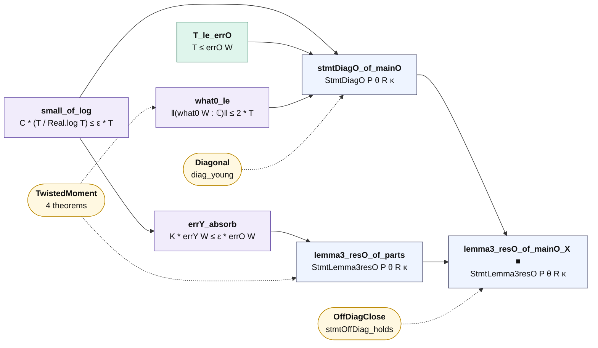

# `lean_stage3/Stage3/DiagonalO.lean`

> **Read from the source text.** This file changed after the last `python3 utilities/lean_map.py --dump`, so the arrows on this page are names occurring in each proof and have not been confirmed by Lean.

# DiagonalO — block S12 of `lean_stage3/design/stencil.md`, the diagonal and Lemma 3 with the main term carried as o(1). 2026-11-25.

7 theorems, 2 definitions, 261 lines. 

**Imports:** [`DiagMainStmt`](../lean_stage3/DiagMainStmt.md)  
**Imported by:** [`Stage3`](../lean_stage3/Stage3.md), [`SwapX`](../lean_stage3/SwapX.md)

## The picture



An arrow A → B reads "A is used in the proof of B". Green: counting, integers only. Violet: shape, analysis with no ζ. Blue: reads ζ. A name ending in ■ is an end: nothing else uses it. Red: contains `sorry`. Yellow: theorems in another file, counted; a dotted arrow crosses files. Definitions are not drawn; they are listed below the diagram.

## Definitions

<a name="DiagonalO-StmtDiagO"></a>
### `DiagonalO.StmtDiagO`

def · line 98

- **Is:** `` StmtDiagO (P : Polynomial ℝ) (θ R κ : ℝ) : Prop := ∀ ε : ℝ, 0 < ε → ∃ T₀ : ℝ, ∀ T : ℝ, T₀ ≤ T → ∀ W : Weight T (Real.log T), ∀ α β : ℂ, Regime κ T α β → ‖diagSum W (Mof T θ) (aY P T θ R) (sig0 T R) α β 1 - c1Y P (Mof T θ) α β * (what0 W : ℂ)‖ ≤ ε * errO W ``
- **Built from:** [`DiagMainStmt.errO`](../lean_stage3/DiagMainStmt.md#DiagMainStmt-errO), [`TwistedMoment.Mof`](../lean_stage3/TwistedMoment.md#TwistedMoment-Mof), [`TwistedMoment.Regime`](../lean_stage3/TwistedMoment.md#TwistedMoment-Regime), [`TwistedMoment.Weight`](../lean_stage3/TwistedMoment.md#TwistedMoment-Weight), [`TwistedMoment.aY`](../lean_stage3/TwistedMoment.md#TwistedMoment-aY), [`TwistedMoment.c1Y`](../lean_stage3/TwistedMoment.md#TwistedMoment-c1Y), [`TwistedMoment.diagSum`](../lean_stage3/TwistedMoment.md#TwistedMoment-diagSum), [`TwistedMoment.sig0`](../lean_stage3/TwistedMoment.md#TwistedMoment-sig0), [`TwistedMoment.what0`](../lean_stage3/TwistedMoment.md#TwistedMoment-what0)
- **Used by 2:** [`DiagonalO.lemma3_resO_of_parts`](#DiagonalO-lemma3_resO_of_parts), [`DiagonalO.stmtDiagO_of_mainO`](#DiagonalO-stmtDiagO_of_mainO)

<a name="DiagonalO-StmtLemma3resO"></a>
### `DiagonalO.StmtLemma3resO`

def · line 140

- **Is:** `` StmtLemma3resO (P : Polynomial ℝ) (θ R κ : ℝ) : Prop := ∀ Cs : ℕ → ℝ, ∀ ε : ℝ, 0 < ε → ∃ T₀ : ℝ, ∀ T : ℝ, T₀ ≤ T → ∀ W : WeightAll T (Real.log T), (∀ j, W.Cj j ≤ Cs j) → ∀ α β : ℂ, Regime κ T α β → ‖Imom W.toWeight (Mof T θ) (aY P T θ R) (sig0 T R) α β - cY P (Mof T θ) T α β * (what0 W.toWeight : ℂ)‖ ≤ ε * errO W.toWeight + ‖Ires W.toWeight (Mof T θ) (aY P T θ R) (sig0 T R) α β‖ ``
- **Built from:** [`DiagMainStmt.errO`](../lean_stage3/DiagMainStmt.md#DiagMainStmt-errO), [`OffDiagClose.WeightAll`](../lean_stage3/OffDiagClose.md#OffDiagClose-WeightAll), [`TwistedMoment.Imom`](../lean_stage3/TwistedMoment.md#TwistedMoment-Imom), [`TwistedMoment.Ires`](../lean_stage3/TwistedMoment.md#TwistedMoment-Ires), [`TwistedMoment.Mof`](../lean_stage3/TwistedMoment.md#TwistedMoment-Mof), [`TwistedMoment.Regime`](../lean_stage3/TwistedMoment.md#TwistedMoment-Regime), [`TwistedMoment.aY`](../lean_stage3/TwistedMoment.md#TwistedMoment-aY), [`TwistedMoment.cY`](../lean_stage3/TwistedMoment.md#TwistedMoment-cY), [`TwistedMoment.sig0`](../lean_stage3/TwistedMoment.md#TwistedMoment-sig0), [`TwistedMoment.what0`](../lean_stage3/TwistedMoment.md#TwistedMoment-what0)
- **Used by 3:** [`DiagonalO.lemma3_resO_of_mainO_X`](#DiagonalO-lemma3_resO_of_mainO_X), [`DiagonalO.lemma3_resO_of_parts`](#DiagonalO-lemma3_resO_of_parts), [`Lemma3.lemma3_resO_holds`](../lean_stage3/Lemma3.md#Lemma3-lemma3_resO_holds)

## Theorems

<a name="DiagonalO-small_of_log"></a>
### `DiagonalO.small_of_log`

line 50 · arrows read from text

**Shape.** Uses real or complex analysis; nothing in it or beneath it reads ζ.

**Why.** `C·(T/log T) ≤ ε·T` once `log T ≥ C/ε`.

**Proves**

```lean
C * (T / Real.log T) ≤ ε * T
```

**Needs** (its hypotheses)

  - `` hε : 0 < ε ``
  - `` hT : 1 < T ``
  - `` hTe : Real.exp (C / ε) ≤ T ``

**Fed by:** no theorem of this repo; it stands on Mathlib.

**Feeds** (2 that use it)

  - [`DiagonalO.errY_absorb`](#DiagonalO-errY_absorb) — `` K * errY W ≤ ε * errO W ``
  - [`DiagonalO.stmtDiagO_of_mainO`](#DiagonalO-stmtDiagO_of_mainO) — `` StmtDiagO P θ R κ ``

<a name="DiagonalO-errY_absorb"></a>
### `DiagonalO.errY_absorb`

line 65 · arrows read from text

**Shape.** Uses real or complex analysis; nothing in it or beneath it reads ζ.

**Why.** `K·errY W ≤ ε·errO W` once `log T ≥ K/ε`.

**Proves**

```lean
K * errY W ≤ ε * errO W
```

**Needs** (its hypotheses)

  - `` W : Weight T (Real.log T) ``
  - `` hε : 0 < ε ``
  - `` hT : 1 < T ``
  - `` hTe : Real.exp (K / ε) ≤ T ``

**Fed by** (1 theorem its proof uses)

  - [`DiagonalO.small_of_log`](#DiagonalO-small_of_log) — `` C * (T / Real.log T) ≤ ε * T ``

**Definitions its proof touches:** [`DiagMainStmt.errO`](../lean_stage3/DiagMainStmt.md#DiagMainStmt-errO), [`TwistedMoment.Weight`](../lean_stage3/TwistedMoment.md#TwistedMoment-Weight), [`TwistedMoment.errY`](../lean_stage3/TwistedMoment.md#TwistedMoment-errY)

**Feeds** (1 that use it)

  - [`DiagonalO.lemma3_resO_of_parts`](#DiagonalO-lemma3_resO_of_parts) — `` StmtLemma3resO P θ R κ ``

<a name="DiagonalO-T_le_errO"></a>
### `DiagonalO.T_le_errO`

line 79 · arrows read from text

**Counting.** Integers only: nothing in its statement or proof, or in anything it rests on, uses analysis or ζ.

**Why.** `T ≤ errO W` for `T ≥ 0`.

**Proves**

```lean
T ≤ errO W
```

**Needs** (its hypotheses)

  - `` W : Weight T L ``
  - `` hT : 0 ≤ T ``

**Fed by:** no theorem of this repo; it stands on Mathlib and the definitions below.

**Definitions its proof touches:** [`DiagMainStmt.errO`](../lean_stage3/DiagMainStmt.md#DiagMainStmt-errO), [`TwistedMoment.Weight`](../lean_stage3/TwistedMoment.md#TwistedMoment-Weight)

**Feeds** (1 that use it)

  - [`DiagonalO.stmtDiagO_of_mainO`](#DiagonalO-stmtDiagO_of_mainO) — `` StmtDiagO P θ R κ ``

<a name="DiagonalO-what0_le"></a>
### `DiagonalO.what0_le`

line 86 · arrows read from text

**Shape.** Uses real or complex analysis; nothing in it or beneath it reads ζ.

**Why.** `‖ŵ(0)‖ ≤ 2T`, from the support `[T/4, 2T]` and `0 ≤ w ≤ 1`.

**Proves**

```lean
‖(what0 W : ℂ)‖ ≤ 2 * T
```

**Needs** (its hypotheses)

  - `` W : Weight T L ``
  - `` hT : 0 < T ``

**Fed by** (1 theorem its proof uses)

  - [`TwistedMoment.norm_integral_le_Icc`](../lean_stage3/TwistedMoment.md#TwistedMoment-norm_integral_le_Icc) (TwistedMoment) — `` ‖∫ t, f t‖ ≤ K * (b - a) ``

**Definitions its proof touches:** [`TwistedMoment.Weight`](../lean_stage3/TwistedMoment.md#TwistedMoment-Weight), [`TwistedMoment.what0`](../lean_stage3/TwistedMoment.md#TwistedMoment-what0)

**Feeds** (1 that use it)

  - [`DiagonalO.stmtDiagO_of_mainO`](#DiagonalO-stmtDiagO_of_mainO) — `` StmtDiagO P θ R κ ``

<a name="DiagonalO-stmtDiagO_of_mainO"></a>
### `DiagonalO.stmtDiagO_of_mainO`

line 105 · arrows read from text

**Reads ζ.** It, or something it rests on, uses the zeta function, its zeros or the Riemann hypothesis.

**Why.** `StmtDiagO` from the main term, `o(1)`: `diag_young` and `StmtDiagMainO`.

**Proves**

```lean
StmtDiagO P θ R κ
```

**Needs** (its hypotheses)

  - `` P : Polynomial ℝ ``
  - `` hθ : θ < 1 / 2 ``
  - `` R : ℝ ``
  - `` hκ : 0 < κ ``
  - `` hmain : StmtDiagMainO P θ R κ ``

**Fed by** (4 theorems its proof uses)

  - [`Diagonal.diag_young`](../lean_stage3/Diagonal.md#Diagonal-diag_young) (Diagonal) — `` ∃ C T₀ : ℝ, 0 ≤ C ∧ ∀ T : ℝ, T₀ ≤ T → ∀ W : Weight T (Real.log T), ∀ α β : ℂ, Regime κ T α β → ‖diagSum W (Mof T θ) (aY P T θ R) (sig0 T R) α β 1 - (w… ``
  - [`DiagonalO.T_le_errO`](#DiagonalO-T_le_errO) — `` T ≤ errO W ``
  - [`DiagonalO.small_of_log`](#DiagonalO-small_of_log) — `` C * (T / Real.log T) ≤ ε * T ``
  - [`DiagonalO.what0_le`](#DiagonalO-what0_le) — `` ‖(what0 W : ℂ)‖ ≤ 2 * T ``

**Definitions its proof touches:** [`DiagMainStmt.StmtDiagMainO`](../lean_stage3/DiagMainStmt.md#DiagMainStmt-StmtDiagMainO), [`DiagMainStmt.errO`](../lean_stage3/DiagMainStmt.md#DiagMainStmt-errO), [`Diagonal.Sdiag`](../lean_stage3/Diagonal.md#Diagonal-Sdiag), [`DiagonalO.StmtDiagO`](#DiagonalO-StmtDiagO), [`TwistedMoment.Mof`](../lean_stage3/TwistedMoment.md#TwistedMoment-Mof), [`TwistedMoment.aY`](../lean_stage3/TwistedMoment.md#TwistedMoment-aY), [`TwistedMoment.c1Y`](../lean_stage3/TwistedMoment.md#TwistedMoment-c1Y), [`TwistedMoment.diagSum`](../lean_stage3/TwistedMoment.md#TwistedMoment-diagSum), [`TwistedMoment.sig0`](../lean_stage3/TwistedMoment.md#TwistedMoment-sig0), [`TwistedMoment.what0`](../lean_stage3/TwistedMoment.md#TwistedMoment-what0)

**Feeds** (1 that use it)

  - [`DiagonalO.lemma3_resO_of_mainO_X`](#DiagonalO-lemma3_resO_of_mainO_X) — `` StmtLemma3resO P θ R κ ``

<a name="DiagonalO-lemma3_resO_of_parts"></a>
### `DiagonalO.lemma3_resO_of_parts`

line 149 · arrows read from text

**Reads ζ.** It, or something it rests on, uses the zeta function, its zeros or the Riemann hypothesis.

**Why.** The assembly, `o(T)`: the diagonal with `o(T)`, the off-diagonal as proved (over `WeightAll`) and the X-term give Lemma 3 up to `I_res` with `o(T)`.

**Proves**

```lean
StmtLemma3resO P θ R κ
```

**Needs** (its hypotheses)

  - `` hκ : 0 < κ ``
  - `` hD : StmtDiagO P θ R κ ``
  - `` hO : StmtOffDiagAll P θ R κ ``
  - `` hX : StmtX P θ R κ ``

**Fed by** (4 theorems its proof uses)

  - [`DiagonalO.errY_absorb`](#DiagonalO-errY_absorb) — `` K * errY W ≤ ε * errO W ``
  - [`TwistedMoment.I1_diag_off`](../lean_stage3/TwistedMoment.md#TwistedMoment-I1_diag_off) (TwistedMoment) — `` I1 W M a σ₀ α β c = diagSum W M a σ₀ α β c + offSum W M a σ₀ α β c ``
  - [`TwistedMoment.I_split`](../lean_stage3/TwistedMoment.md#TwistedMoment-I_split) (TwistedMoment) — `` Imom W M a σ₀ α β = I1 W M a σ₀ α β c + IX W M a σ₀ α β c - Ires W M a σ₀ α β ``
  - [`TwistedMoment.norm_Tpow_le`](../lean_stage3/TwistedMoment.md#TwistedMoment-norm_Tpow_le) (TwistedMoment) — `` ‖(T : ℂ) ^ (-(α + β))‖ ≤ Real.exp (2 * κ) ``

**Definitions its proof touches:** [`DiagMainStmt.errO`](../lean_stage3/DiagMainStmt.md#DiagMainStmt-errO), [`DiagonalO.StmtDiagO`](#DiagonalO-StmtDiagO), [`DiagonalO.StmtLemma3resO`](#DiagonalO-StmtLemma3resO), [`OffDiagClose.StmtOffDiagAll`](../lean_stage3/OffDiagClose.md#OffDiagClose-StmtOffDiagAll), [`TwistedMoment.I1`](../lean_stage3/TwistedMoment.md#TwistedMoment-I1), [`TwistedMoment.IX`](../lean_stage3/TwistedMoment.md#TwistedMoment-IX), [`TwistedMoment.Imom`](../lean_stage3/TwistedMoment.md#TwistedMoment-Imom), [`TwistedMoment.Ires`](../lean_stage3/TwistedMoment.md#TwistedMoment-Ires), [`TwistedMoment.Mof`](../lean_stage3/TwistedMoment.md#TwistedMoment-Mof), [`TwistedMoment.StmtX`](../lean_stage3/TwistedMoment.md#TwistedMoment-StmtX), [`TwistedMoment.aY`](../lean_stage3/TwistedMoment.md#TwistedMoment-aY), [`TwistedMoment.c1Y`](../lean_stage3/TwistedMoment.md#TwistedMoment-c1Y), [`TwistedMoment.cY`](../lean_stage3/TwistedMoment.md#TwistedMoment-cY), [`TwistedMoment.diagSum`](../lean_stage3/TwistedMoment.md#TwistedMoment-diagSum), [`TwistedMoment.errY`](../lean_stage3/TwistedMoment.md#TwistedMoment-errY), [`TwistedMoment.offSum`](../lean_stage3/TwistedMoment.md#TwistedMoment-offSum), [`TwistedMoment.sig0`](../lean_stage3/TwistedMoment.md#TwistedMoment-sig0), [`TwistedMoment.what0`](../lean_stage3/TwistedMoment.md#TwistedMoment-what0)

**Feeds** (1 that use it)

  - [`DiagonalO.lemma3_resO_of_mainO_X`](#DiagonalO-lemma3_resO_of_mainO_X) — `` StmtLemma3resO P θ R κ ``

<a name="DiagonalO-lemma3_resO_of_mainO_X"></a>
### `DiagonalO.lemma3_resO_of_mainO_X`

line 225 · arrows read from text

**Reads ζ.** It, or something it rests on, uses the zeta function, its zeros or the Riemann hypothesis.

**Why.** Lemma 3 up to `I_res`, `o(T)`, from the main term and the X-term: the diagonal by `stmtDiagO_of_mainO`, the off-diagonal by `stmtOffDiag_holds`, for `θ < 1/2`, `κ > 0`.

**Proves**

```lean
StmtLemma3resO P θ R κ
```

**Needs** (its hypotheses)

  - `` P : Polynomial ℝ ``
  - `` hθ : θ < 1 / 2 ``
  - `` R : ℝ ``
  - `` hκ : 0 < κ ``
  - `` hmain : StmtDiagMainO P θ R κ ``
  - `` hX : StmtX P θ R κ ``

**Fed by** (3 theorems its proof uses)

  - [`DiagonalO.lemma3_resO_of_parts`](#DiagonalO-lemma3_resO_of_parts) — `` StmtLemma3resO P θ R κ ``
  - [`DiagonalO.stmtDiagO_of_mainO`](#DiagonalO-stmtDiagO_of_mainO) — `` StmtDiagO P θ R κ ``
  - [`OffDiagClose.stmtOffDiag_holds`](../lean_stage3/OffDiagClose.md#OffDiagClose-stmtOffDiag_holds) (OffDiagClose) — `` StmtOffDiagAll P θ R κ ``

**Definitions its proof touches:** [`DiagMainStmt.StmtDiagMainO`](../lean_stage3/DiagMainStmt.md#DiagMainStmt-StmtDiagMainO), [`DiagonalO.StmtLemma3resO`](#DiagonalO-StmtLemma3resO), [`TwistedMoment.StmtX`](../lean_stage3/TwistedMoment.md#TwistedMoment-StmtX)

**Feeds:** nothing. It is an end.

