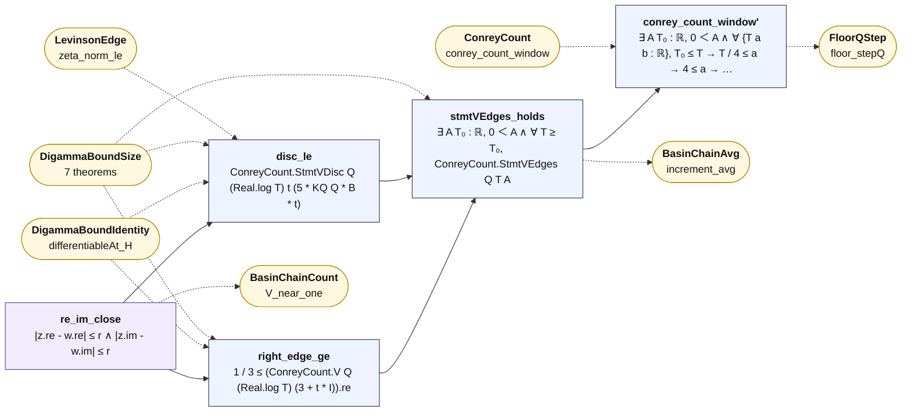

# `lean_stage3/Stage3/DigammaBound.lean`

> **Read from the source text.** This file changed after the last `python3 utilities/lean_map.py --dump`, so the arrows on this page are names occurring in each proof and have not been confirmed by Lean.

DigammaBound — block S13 of `lean_stage3/design/stencil.md`, B4 step 2, the size of `V` and the count with no size hypothesis. 2026-11-25.

5 theorems, 0 definitions, 220 lines. 

**Imports:** [`DigammaBoundSize`](../lean_stage3/DigammaBoundSize.md)  
**Imported by:** [`Stage3`](../lean_stage3/Stage3.md), [`BasinChainCount`](../lean_stage3/BasinChainCount.md), [`FloorQGamma`](../lean_stage3/FloorQGamma.md), [`FloorQStep`](../lean_stage3/FloorQStep.md)

## The picture



An arrow A → B reads "A is used in the proof of B". Green: counting, integers only. Violet: shape, analysis with no ζ. Blue: reads ζ. A name ending in ■ is an end: nothing else uses it. Red: contains `sorry`. Yellow: theorems in another file, counted; a dotted arrow crosses files. Definitions are not drawn; they are listed below the diagram.

## Theorems

<a name="DigammaBound-re_im_close"></a>
### `DigammaBound.re_im_close`

line 50 · arrows read from text

**Shape.** Uses real or complex analysis; nothing in it or beneath it reads ζ.

**Why.** Points of a closed disc about `w`: real and imaginary parts within the radius.

**Proves**

```lean
|z.re - w.re| ≤ r ∧ |z.im - w.im| ≤ r
```

**Needs** (its hypotheses)

  - `` h : ‖z - w‖ ≤ r ``

**Fed by:** no theorem of this repo; it stands on Mathlib.

**Feeds** (3 that use it)

  - [`BasinChain.V_near_one`](../lean_stage3/BasinChainCount.md#BasinChain-V_near_one) (BasinChainCount) — `` ‖V Q (Real.log T) (3 + t * I) - 1‖ ≤ Real.pi ^ 2 / 6 - 1 + 1 / 100 ``
  - [`DigammaBound.disc_le`](#DigammaBound-disc_le) — `` ConreyCount.StmtVDisc Q (Real.log T) t (5 * KQ Q * B * t) ``
  - [`DigammaBound.right_edge_ge`](#DigammaBound-right_edge_ge) — `` 1 / 3 ≤ (ConreyCount.V Q (Real.log T) (3 + t * I)).re ``

<a name="DigammaBound-right_edge_ge"></a>
### `DigammaBound.right_edge_ge`

line 61 · arrows read from text

**Reads ζ.** It, or something it rests on, uses the zeta function, its zeros or the Riemann hypothesis.

**Why.** The right edge.

**Proves**

```lean
1 / 3 ≤ (ConreyCount.V Q (Real.log T) (3 + t * I)).re
```

**Needs** (its hypotheses)

  - `` Q : ℝ[X] ``
  - `` hQ0 : Q.eval 0 = 1 ``
  - `` hB : 0 < B ``
  - `` hBr : ∀ T : ℝ, 16 ≤ T → ∀ z w : ℂ, 1 / 4 ≤ z.re → z.re ≤ 7 → 1 / 4 ≤ w.re → w.re ≤ 7 → T / 8 ≤ z.im → z.im ≤ 3 * T → T / 8 ≤ w.im → w.im ≤ 3 * T → |z.im - w.im| ≤ 1 → ‖Gammaℝ z‖ / ‖Gammaℝ w‖ * Real.exp (-(Real.log T / 2) * (z.re - w.re)) ≤ B ``
  - `` hT : 200 ≤ T ``
  - `` hL : 8 + 400 * KQ Q * B ≤ Real.log T ``
  - `` ht : t ∈ Icc (T / 4) (2 * T) ``

**Fed by** (7 theorems its proof uses)

  - [`DigammaBound.re_im_close`](#DigammaBound-re_im_close) — `` |z.re - w.re| ≤ r ∧ |z.im - w.im| ≤ r ``
  - [`DigammaBound.differentiableAt_H`](../lean_stage3/DigammaBoundIdentity.md#DigammaBound-differentiableAt_H) (DigammaBoundIdentity) — `` DifferentiableAt ℂ (H L w) z ``
  - [`DigammaBound.KQ_nonneg`](../lean_stage3/DigammaBoundSize.md#DigammaBound-KQ_nonneg) (DigammaBoundSize) — `` 0 ≤ KQ Q ``
  - [`DigammaBound.V_sub_le`](../lean_stage3/DigammaBoundSize.md#DigammaBound-V_sub_le) (DigammaBoundSize) — `` ‖ConreyCount.V Q L w - (Q.coeff 0 : ℂ) * riemannZeta w‖ ≤ KQ Q * M / (L * R) ``
  - [`DigammaBound.norm_H`](../lean_stage3/DigammaBoundSize.md#DigammaBound-norm_H) (DigammaBoundSize) — `` ‖H L w z‖ = ‖riemannZeta z‖ * (‖Gammaℝ z‖ / ‖Gammaℝ w‖ * Real.exp (-(L / 2) * (z.re - w.re))) ``
  - [`DigammaBound.re_zeta_three_ge`](../lean_stage3/DigammaBoundSize.md#DigammaBound-re_zeta_three_ge) (DigammaBoundSize) — `` 2 - Real.pi ^ 2 / 6 ≤ (riemannZeta (3 + t * I)).re ``
  - [`DigammaBound.zeta_norm_le_two`](../lean_stage3/DigammaBoundSize.md#DigammaBound-zeta_norm_le_two) (DigammaBoundSize) — `` ‖riemannZeta z‖ ≤ Real.pi ^ 2 / 6 ``

**Definitions its proof touches:** [`ConreyCount.V`](../lean_stage3/ConreyCountLine.md#ConreyCount-V), [`DigammaBound.H`](../lean_stage3/DigammaBoundIdentity.md#DigammaBound-H), [`DigammaBound.KQ`](../lean_stage3/DigammaBoundSize.md#DigammaBound-KQ)

**Feeds** (1 that use it)

  - [`DigammaBound.stmtVEdges_holds`](#DigammaBound-stmtVEdges_holds) — `` ∃ A T₀ : ℝ, 0 < A ∧ ∀ T ≥ T₀, ConreyCount.StmtVEdges Q T A ``

<a name="DigammaBound-disc_le"></a>
### `DigammaBound.disc_le`

line 115 · arrows read from text

**Reads ζ.** It, or something it rests on, uses the zeta function, its zeros or the Riemann hypothesis.

**Why.** The discs.

**Proves**

```lean
ConreyCount.StmtVDisc Q (Real.log T) t (5 * KQ Q * B * t)
```

**Needs** (its hypotheses)

  - `` Q : ℝ[X] ``
  - `` hB : 0 < B ``
  - `` hBr : ∀ T : ℝ, 16 ≤ T → ∀ z w : ℂ, 1 / 4 ≤ z.re → z.re ≤ 7 → 1 / 4 ≤ w.re → w.re ≤ 7 → T / 8 ≤ z.im → z.im ≤ 3 * T → T / 8 ≤ w.im → w.im ≤ 3 * T → |z.im - w.im| ≤ 1 → ‖Gammaℝ z‖ / ‖Gammaℝ w‖ * Real.exp (-(Real.log T / 2) * (z.re - w.re)) ≤ B ``
  - `` hT : 200 ≤ T ``
  - `` hL : 8 ≤ Real.log T ``
  - `` ht : t ∈ Icc (T / 4) (2 * T) ``

**Fed by** (5 theorems its proof uses)

  - [`DigammaBound.re_im_close`](#DigammaBound-re_im_close) — `` |z.re - w.re| ≤ r ∧ |z.im - w.im| ≤ r ``
  - [`DigammaBound.differentiableAt_H`](../lean_stage3/DigammaBoundIdentity.md#DigammaBound-differentiableAt_H) (DigammaBoundIdentity) — `` DifferentiableAt ℂ (H L w) z ``
  - [`DigammaBound.V_norm_le`](../lean_stage3/DigammaBoundSize.md#DigammaBound-V_norm_le) (DigammaBoundSize) — `` ‖ConreyCount.V Q L w‖ ≤ KQ Q * M ``
  - [`DigammaBound.norm_H`](../lean_stage3/DigammaBoundSize.md#DigammaBound-norm_H) (DigammaBoundSize) — `` ‖H L w z‖ = ‖riemannZeta z‖ * (‖Gammaℝ z‖ / ‖Gammaℝ w‖ * Real.exp (-(L / 2) * (z.re - w.re))) ``
  - [`LevinsonEdge.zeta_norm_le`](../lean_stage3/LevinsonEdge.md#LevinsonEdge-zeta_norm_le) (LevinsonEdge) — `` ‖riemannZeta u‖ ≤ 2 + 4 * ‖u‖ ``

**Definitions its proof touches:** [`ConreyCount.StmtVDisc`](../lean_stage3/ConreyCountEdge.md#ConreyCount-StmtVDisc), [`ConreyCount.V`](../lean_stage3/ConreyCountLine.md#ConreyCount-V), [`DigammaBound.H`](../lean_stage3/DigammaBoundIdentity.md#DigammaBound-H), [`DigammaBound.KQ`](../lean_stage3/DigammaBoundSize.md#DigammaBound-KQ)

**Feeds** (1 that use it)

  - [`DigammaBound.stmtVEdges_holds`](#DigammaBound-stmtVEdges_holds) — `` ∃ A T₀ : ℝ, 0 < A ∧ ∀ T ≥ T₀, ConreyCount.StmtVEdges Q T A ``

<a name="DigammaBound-stmtVEdges_holds"></a>
### `DigammaBound.stmtVEdges_holds`

line 164 · arrows read from text

**Reads ζ.** It, or something it rests on, uses the zeta function, its zeros or the Riemann hypothesis.

**Why.** `StmtVEdges` holds. For every real `Q` with `Q(0) = 1` there are `A > 0` and `T₀` with `StmtVEdges Q T A` for every `T ≥ T₀`.

**Proves**

```lean
∃ A T₀ : ℝ, 0 < A ∧ ∀ T ≥ T₀, ConreyCount.StmtVEdges Q T A
```

**Needs** (its hypotheses)

  - `` Q : ℝ[X] ``
  - `` hQ0 : Q.eval 0 = 1 ``

**Fed by** (4 theorems its proof uses)

  - [`DigammaBound.disc_le`](#DigammaBound-disc_le) — `` ConreyCount.StmtVDisc Q (Real.log T) t (5 * KQ Q * B * t) ``
  - [`DigammaBound.right_edge_ge`](#DigammaBound-right_edge_ge) — `` 1 / 3 ≤ (ConreyCount.V Q (Real.log T) (3 + t * I)).re ``
  - [`DigammaBound.KQ_nonneg`](../lean_stage3/DigammaBoundSize.md#DigammaBound-KQ_nonneg) (DigammaBoundSize) — `` 0 ≤ KQ Q ``
  - [`DigammaBound.gamma_ratio`](../lean_stage3/DigammaBoundSize.md#DigammaBound-gamma_ratio) (DigammaBoundSize) — `` ∃ B : ℝ, 0 < B ∧ ∀ T : ℝ, 16 ≤ T → ∀ z w : ℂ, 1 / 4 ≤ z.re → z.re ≤ 7 → 1 / 4 ≤ w.re → w.re ≤ 7 → T / 8 ≤ z.im → z.im ≤ 3 * T → T / 8 ≤ w.im → w.im ≤ … ``

**Definitions its proof touches:** [`ConreyCount.StmtVEdges`](../lean_stage3/ConreyCountEdge.md#ConreyCount-StmtVEdges), [`DigammaBound.KQ`](../lean_stage3/DigammaBoundSize.md#DigammaBound-KQ)

**Feeds** (2 that use it)

  - [`BasinChain.increment_avg`](../lean_stage3/BasinChainAvg.md#BasinChain-increment_avg) (BasinChainAvg) — `` ∃ A T₁ : ℝ, 0 < A ∧ 200 ≤ T₁ ∧ ∀ T : ℝ, T₁ ≤ T → ((Defect.defect T : ℝ) - (Defect.defect (3 * T / 4) : ℝ)) ≤ 4 * ((2 * ((3 / 2 + 113 / 4) / Real.pi) +… ``
  - [`DigammaBound.conrey_count_window'`](#DigammaBound-conrey_count_window-) — `` ∃ A T₀ : ℝ, 0 < A ∧ ∀ {T a b : ℝ}, T₀ ≤ T → T / 4 ≤ a → 4 ≤ a → a < b → b ≤ 2 * T → (∀ x ∈ Icc (1/2 : ℝ) 3, ConreyCount.V Q (Real.log T) (↑x + ↑a * I)… ``

<a name="DigammaBound-conrey_count_window-"></a>
### `DigammaBound.conrey_count_window'`

line 184 · arrows read from text

**Reads ζ.** It, or something it rests on, uses the zeta function, its zeros or the Riemann hypothesis.

**Why.** The count on a window inside `[T/4, 2T]`, with no size hypothesis. For a real `Q` with `Q′(x) = Q′(1 − x)`, `Q(1/2) ≠ 0` and `Q(0) = 1` there are `A > 0` and `T₀` such that for every `T ≥ T₀`, `T/4 ≤ a`, `4 ≤ a < b ≤ 2T`, and the avoidance hypotheses: `lineCount b − lineCount a ≥ (N b − N a) − 2·countRight V − (72 log b + 42 log(3A) + 154)`.

**Proves**

```lean
∃ A T₀ : ℝ, 0 < A ∧ ∀ {T a b : ℝ}, T₀ ≤ T → T / 4 ≤ a → 4 ≤ a → a < b → b ≤ 2 * T → (∀ x ∈ Icc (1/2 : ℝ) 3, ConreyCount.V Q (Real.log T) (↑x + ↑a * I) ≠ 0) → (∀ x ∈ Icc (1/2 : ℝ) 3, ConreyCount.V Q (Real.log T) (↑x + ↑b * I) ≠ 0) → riemannZeta (1/2 + a * I) ≠ 0 → (riemannZeta.N b - riemannZeta.N a) - 2 * Littlewood.countRight (ConreyCount.V Q (Real.log T)) ((1/2 : ℂ) + a * I) ((3 : ℂ) + b * I) (1/2) - (72 * Real.log b + 42 * Real.log (3 * A) + 154) ≤ (lineCount b : ℝ) - (lineCount a : ℝ)
```

**Needs** (its hypotheses)

  - `` hQ : ∀ x : ℝ, Q.derivative.eval x = Q.derivative.eval (1 - x) ``
  - `` hQh : Q.eval (1/2) ≠ 0 ``
  - `` hQ0 : Q.eval 0 = 1 ``

**Fed by** (2 theorems its proof uses)

  - [`ConreyCount.conrey_count_window`](../lean_stage3/ConreyCount.md#ConreyCount-conrey_count_window) (ConreyCount) — `` (riemannZeta.N b - riemannZeta.N a) - 2 * Littlewood.countRight (V Q (Real.log T)) ((1/2 : ℂ) + a * I) ((3 : ℂ) + b * I) (1/2) - (72 * Real.log b + 42… ``
  - [`DigammaBound.stmtVEdges_holds`](#DigammaBound-stmtVEdges_holds) — `` ∃ A T₀ : ℝ, 0 < A ∧ ∀ T ≥ T₀, ConreyCount.StmtVEdges Q T A ``

**Definitions its proof touches:** [`ConreyCount.V`](../lean_stage3/ConreyCountLine.md#ConreyCount-V), [`LineCount.lineCount`](../lean_stage3/LineCount.md#LineCount-lineCount), [`Littlewood.countRight`](../lean_stage3/Littlewood.md#Littlewood-countRight)

**Feeds** (1 that use it)

  - [`FloorQ.floor_stepQ`](../lean_stage3/FloorQStep.md#FloorQ-floor_stepQ) (FloorQStep) — `` ∀ ε : ℝ, 0 < ε → ∃ T₀ : ℝ, ∀ T : ℝ, T₀ ≤ T → (riemannZeta.N T - riemannZeta.N (T / 2)) - Real.log (max 1 ((MeanQ.DopQ Q (Real.log T) (cY P (Mof T θ) T… ``

