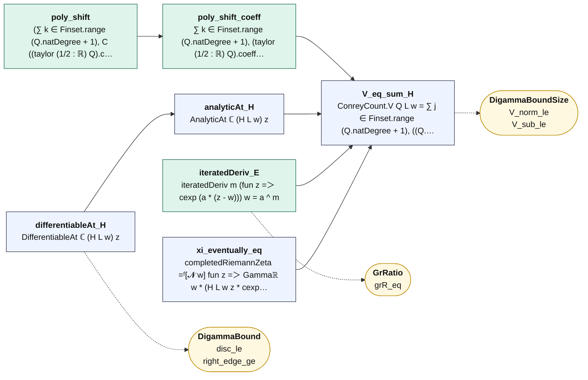

# `lean_stage3/Stage3/DigammaBoundIdentity.lean`

> **Read from the source text.** This file changed after the last `python3 utilities/lean_map.py --dump`, so the arrows on this page are names occurring in each proof and have not been confirmed by Lean.

DigammaBoundIdentity — block S13 of `lean_stage3/design/stencil.md`, B4 step 2, the shift identity for `V`. 2026-11-25.

7 theorems, 1 definition, 195 lines. 

**Imports:** [`ConreyCount`](../lean_stage3/ConreyCount.md)  
**Imported by:** [`DigammaBoundSize`](../lean_stage3/DigammaBoundSize.md)

## The picture



An arrow A → B reads "A is used in the proof of B". Green: counting, integers only. Violet: shape, analysis with no ζ. Blue: reads ζ. A name ending in ■ is an end: nothing else uses it. Red: contains `sorry`. Yellow: theorems in another file, counted; a dotted arrow crosses files. Definitions are not drawn; they are listed below the diagram.

## Definitions

<a name="DigammaBound-H"></a>
### `DigammaBound.H`

def · line 36

`H_w(z) = ζ(z) · Gammaℝ(z)/Gammaℝ(w) · e^{−(L/2)(z − w)}`.

- **Is:** `` H (L : ℝ) (w z : ℂ) : ℂ := riemannZeta z * Gammaℝ z / Gammaℝ w * cexp (-((L / 2 : ℝ) : ℂ) * (z - w)) ``
- **Used by 11:** [`DigammaBound.disc_le`](../lean_stage3/DigammaBound.md#DigammaBound-disc_le), [`DigammaBound.right_edge_ge`](../lean_stage3/DigammaBound.md#DigammaBound-right_edge_ge), [`DigammaBound.V_eq_sum_H`](#DigammaBound-V_eq_sum_H), [`DigammaBound.analyticAt_H`](#DigammaBound-analyticAt_H), [`DigammaBound.differentiableAt_H`](#DigammaBound-differentiableAt_H), [`DigammaBound.xi_eventually_eq`](#DigammaBound-xi_eventually_eq), [`DigammaBound.H_self`](../lean_stage3/DigammaBoundSize.md#DigammaBound-H_self), [`DigammaBound.V_norm_le`](../lean_stage3/DigammaBoundSize.md#DigammaBound-V_norm_le), [`DigammaBound.V_sub_le`](../lean_stage3/DigammaBoundSize.md#DigammaBound-V_sub_le), [`DigammaBound.norm_H`](../lean_stage3/DigammaBoundSize.md#DigammaBound-norm_H), [`DigammaBound.term_le`](../lean_stage3/DigammaBoundSize.md#DigammaBound-term_le)

## Theorems

<a name="DigammaBound-poly_shift"></a>
### `DigammaBound.poly_shift`

line 41 · arrows read from text

**Counting.** Integers only: nothing in its statement or proof, or in anything it rests on, uses analysis or ζ.

**Why.** The shift of the polynomial. With `b_k` the Taylor coefficients of `Q` at `1/2`: `Σ_k b_k (−1/L)^k (X + L/2)^k = Σ_j Q_j (−1/L)^j X^j`.

**Proves**

```lean
(∑ k ∈ Finset.range (Q.natDegree + 1), C ((taylor (1/2 : ℝ) Q).coeff k * (-1 / L) ^ k) * (X + C (L / 2)) ^ k) = ∑ j ∈ Finset.range (Q.natDegree + 1), C (Q.coeff j * (-1 / L) ^ j) * X ^ j
```

**Needs** (its hypotheses)

  - `` Q : ℝ[X] ``
  - `` hL : L ≠ 0 ``

**Fed by:** no theorem of this repo; it stands on Mathlib.

**Feeds** (1 that use it)

  - [`DigammaBound.poly_shift_coeff`](#DigammaBound-poly_shift_coeff) — `` ∑ k ∈ Finset.range (Q.natDegree + 1), (taylor (1/2 : ℝ) Q).coeff k * (-1 / L) ^ k * ((X + C (L / 2)) ^ k).coeff i = Q.coeff i * (-1 / L) ^ i ``

<a name="DigammaBound-poly_shift_coeff"></a>
### `DigammaBound.poly_shift_coeff`

line 67 · arrows read from text

**Counting.** Integers only: nothing in its statement or proof, or in anything it rests on, uses analysis or ζ.

**Why.** The coefficients of the shifted polynomial.

**Proves**

```lean
∑ k ∈ Finset.range (Q.natDegree + 1), (taylor (1/2 : ℝ) Q).coeff k * (-1 / L) ^ k * ((X + C (L / 2)) ^ k).coeff i = Q.coeff i * (-1 / L) ^ i
```

**Needs** (its hypotheses)

  - `` Q : ℝ[X] ``
  - `` hL : L ≠ 0 ``
  - `` hi : i ∈ Finset.range (Q.natDegree + 1) ``

**Fed by** (1 theorem its proof uses)

  - [`DigammaBound.poly_shift`](#DigammaBound-poly_shift) — `` (∑ k ∈ Finset.range (Q.natDegree + 1), C ((taylor (1/2 : ℝ) Q).coeff k * (-1 / L) ^ k) * (X + C (L / 2)) ^ k) = ∑ j ∈ Finset.range (Q.natDegree + 1), … ``

**Feeds** (1 that use it)

  - [`DigammaBound.V_eq_sum_H`](#DigammaBound-V_eq_sum_H) — `` ConreyCount.V Q L w = ∑ j ∈ Finset.range (Q.natDegree + 1), ((Q.coeff j * (-1 / L) ^ j : ℝ) : ℂ) * iteratedDeriv j (H L w) w ``

<a name="DigammaBound-differentiableAt_H"></a>
### `DigammaBound.differentiableAt_H`

line 78 · arrows read from text

**Reads ζ.** It, or something it rests on, uses the zeta function, its zeros or the Riemann hypothesis.

**Why.** `H_w` is differentiable on `Re > 0` off `1`.

**Proves**

```lean
DifferentiableAt ℂ (H L w) z
```

**Needs** (its hypotheses)

  - `` L : ℝ ``
  - `` w : ℂ ``
  - `` hz : 0 < z.re ``
  - `` hz1 : z ≠ 1 ``

**Fed by:** no theorem of this repo; it stands on Mathlib and the definitions below.

**Definitions its proof touches:** [`DigammaBound.H`](#DigammaBound-H)

**Feeds** (3 that use it)

  - [`DigammaBound.disc_le`](../lean_stage3/DigammaBound.md#DigammaBound-disc_le) (DigammaBound) — `` ConreyCount.StmtVDisc Q (Real.log T) t (5 * KQ Q * B * t) ``
  - [`DigammaBound.right_edge_ge`](../lean_stage3/DigammaBound.md#DigammaBound-right_edge_ge) (DigammaBound) — `` 1 / 3 ≤ (ConreyCount.V Q (Real.log T) (3 + t * I)).re ``
  - [`DigammaBound.analyticAt_H`](#DigammaBound-analyticAt_H) — `` AnalyticAt ℂ (H L w) z ``

<a name="DigammaBound-analyticAt_H"></a>
### `DigammaBound.analyticAt_H`

line 87 · arrows read from text

**Reads ζ.** It, or something it rests on, uses the zeta function, its zeros or the Riemann hypothesis.

**Why.** `H_w` is analytic on `Re > 0` off `1`.

**Proves**

```lean
AnalyticAt ℂ (H L w) z
```

**Needs** (its hypotheses)

  - `` L : ℝ ``
  - `` w : ℂ ``
  - `` hz : 0 < z.re ``
  - `` hz1 : z ≠ 1 ``

**Fed by** (1 theorem its proof uses)

  - [`DigammaBound.differentiableAt_H`](#DigammaBound-differentiableAt_H) — `` DifferentiableAt ℂ (H L w) z ``

**Definitions its proof touches:** [`DigammaBound.H`](#DigammaBound-H)

**Feeds** (1 that use it)

  - [`DigammaBound.V_eq_sum_H`](#DigammaBound-V_eq_sum_H) — `` ConreyCount.V Q L w = ∑ j ∈ Finset.range (Q.natDegree + 1), ((Q.coeff j * (-1 / L) ^ j : ℝ) : ℂ) * iteratedDeriv j (H L w) w ``

<a name="DigammaBound-iteratedDeriv_E"></a>
### `DigammaBound.iteratedDeriv_E`

line 97 · arrows read from text

**Counting.** Integers only: nothing in its statement or proof, or in anything it rests on, uses analysis or ζ.

**Why.** The iterated derivatives of `e^{a(z − w)}` at `w`.

**Proves**

```lean
iteratedDeriv m (fun z => cexp (a * (z - w))) w = a ^ m
```

**Needs** (its hypotheses)

  - `` a w : ℂ ``
  - `` m : ℕ ``

**Fed by:** no theorem of this repo; it stands on Mathlib.

**Feeds** (2 that use it)

  - [`DigammaBound.V_eq_sum_H`](#DigammaBound-V_eq_sum_H) — `` ConreyCount.V Q L w = ∑ j ∈ Finset.range (Q.natDegree + 1), ((Q.coeff j * (-1 / L) ^ j : ℝ) : ℂ) * iteratedDeriv j (H L w) w ``
  - [`GrRatio.grR_eq`](../lean_stage3/GrRatio.md#GrRatio-grR_eq) (GrRatio) — `` MeanQ.grR i w = ∑ j ∈ Finset.range (i + 1), (i.choose j : ℂ) * iteratedDeriv j (hw L w) w * (((L / 2 : ℝ) : ℂ)) ^ (i - j) ``

<a name="DigammaBound-xi_eventually_eq"></a>
### `DigammaBound.xi_eventually_eq`

line 105 · arrows read from text

**Reads ζ.** It, or something it rests on, uses the zeta function, its zeros or the Riemann hypothesis.

**Why.** Near `w`, `Λ = Gammaℝ(w) · H_w · e^{(L/2)(z − w)}`.

**Proves**

```lean
completedRiemannZeta =ᶠ[𝓝 w] fun z => Gammaℝ w * (H L w z * cexp (((L / 2 : ℝ) : ℂ) * (z - w)))
```

**Needs** (its hypotheses)

  - `` L : ℝ ``
  - `` hw : 0 < w.re ``

**Fed by:** no theorem of this repo; it stands on Mathlib and the definitions below.

**Definitions its proof touches:** [`DigammaBound.H`](#DigammaBound-H)

**Feeds** (1 that use it)

  - [`DigammaBound.V_eq_sum_H`](#DigammaBound-V_eq_sum_H) — `` ConreyCount.V Q L w = ∑ j ∈ Finset.range (Q.natDegree + 1), ((Q.coeff j * (-1 / L) ^ j : ℝ) : ℂ) * iteratedDeriv j (H L w) w ``

<a name="DigammaBound-V_eq_sum_H"></a>
### `DigammaBound.V_eq_sum_H`

line 127 · arrows read from text

**Reads ζ.** It, or something it rests on, uses the zeta function, its zeros or the Riemann hypothesis.

**Why.** The shift identity. For `L ≠ 0`, `0 < Re w`, `w ≠ 1`: `V Q L w = Σ_j Q_j (−1/L)^j H_w^{(j)}(w)`.

**Proves**

```lean
ConreyCount.V Q L w = ∑ j ∈ Finset.range (Q.natDegree + 1), ((Q.coeff j * (-1 / L) ^ j : ℝ) : ℂ) * iteratedDeriv j (H L w) w
```

**Needs** (its hypotheses)

  - `` Q : ℝ[X] ``
  - `` hL : L ≠ 0 ``
  - `` hw : 0 < w.re ``
  - `` hw1 : w ≠ 1 ``

**Fed by** (4 theorems its proof uses)

  - [`DigammaBound.analyticAt_H`](#DigammaBound-analyticAt_H) — `` AnalyticAt ℂ (H L w) z ``
  - [`DigammaBound.iteratedDeriv_E`](#DigammaBound-iteratedDeriv_E) — `` iteratedDeriv m (fun z => cexp (a * (z - w))) w = a ^ m ``
  - [`DigammaBound.poly_shift_coeff`](#DigammaBound-poly_shift_coeff) — `` ∑ k ∈ Finset.range (Q.natDegree + 1), (taylor (1/2 : ℝ) Q).coeff k * (-1 / L) ^ k * ((X + C (L / 2)) ^ k).coeff i = Q.coeff i * (-1 / L) ^ i ``
  - [`DigammaBound.xi_eventually_eq`](#DigammaBound-xi_eventually_eq) — `` completedRiemannZeta =ᶠ[𝓝 w] fun z => Gammaℝ w * (H L w z * cexp (((L / 2 : ℝ) : ℂ) * (z - w))) ``

**Definitions its proof touches:** [`ConreyCount.V`](../lean_stage3/ConreyCountLine.md#ConreyCount-V), [`DigammaBound.H`](#DigammaBound-H), [`OperatorQ.W`](../lean_stage3/OperatorQ.md#OperatorQ-W)

**Feeds** (2 that use it)

  - [`DigammaBound.V_norm_le`](../lean_stage3/DigammaBoundSize.md#DigammaBound-V_norm_le) (DigammaBoundSize) — `` ‖ConreyCount.V Q L w‖ ≤ KQ Q * M ``
  - [`DigammaBound.V_sub_le`](../lean_stage3/DigammaBoundSize.md#DigammaBound-V_sub_le) (DigammaBoundSize) — `` ‖ConreyCount.V Q L w - (Q.coeff 0 : ℂ) * riemannZeta w‖ ≤ KQ Q * M / (L * R) ``

