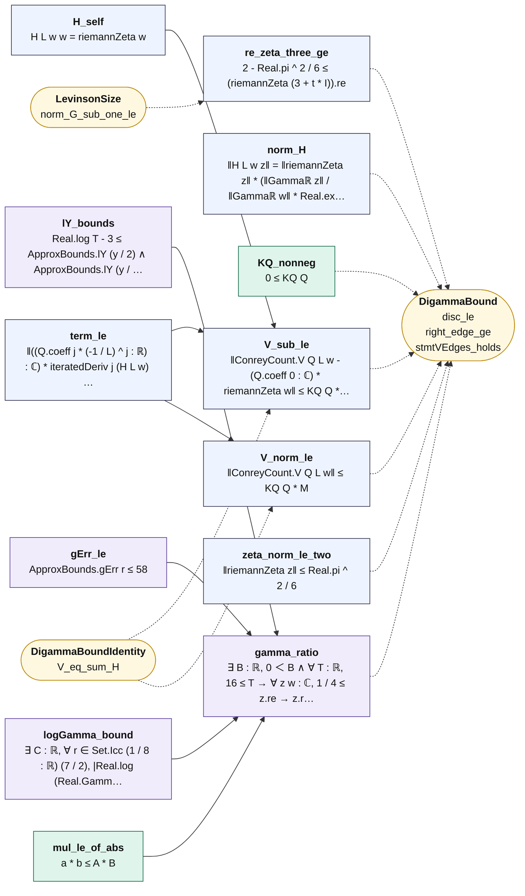

# `lean_stage3/Stage3/DigammaBoundSize.lean`

> **Read from the source text.** This file changed after the last `python3 utilities/lean_map.py --dump`, so the arrows on this page are names occurring in each proof and have not been confirmed by Lean.

DigammaBoundSize — block S13 of `lean_stage3/design/stencil.md`, B4 step 2, the sizes of `H_w` and of `V`. 2026-11-25.

13 theorems, 1 definition, 319 lines. 

**Imports:** [`ApproxBounds`](../lean_stage3/ApproxBounds.md), [`DigammaBoundIdentity`](../lean_stage3/DigammaBoundIdentity.md)  
**Imported by:** [`DigammaBound`](../lean_stage3/DigammaBound.md)

## The picture



An arrow A → B reads "A is used in the proof of B". Green: counting, integers only. Violet: shape, analysis with no ζ. Blue: reads ζ. A name ending in ■ is an end: nothing else uses it. Red: contains `sorry`. Yellow: theorems in another file, counted; a dotted arrow crosses files. Definitions are not drawn; they are listed below the diagram.

## Definitions

<a name="DigammaBound-KQ"></a>
### `DigammaBound.KQ`

def · line 205

`K_Q = Σ_j |Q_j| j!`.

- **Is:** `` KQ (Q : ℝ[X]) : ℝ := ∑ j ∈ Finset.range (Q.natDegree + 1), |Q.coeff j| * (j.factorial : ℝ) ``
- **Used by 6:** [`DigammaBound.disc_le`](../lean_stage3/DigammaBound.md#DigammaBound-disc_le), [`DigammaBound.right_edge_ge`](../lean_stage3/DigammaBound.md#DigammaBound-right_edge_ge), [`DigammaBound.stmtVEdges_holds`](../lean_stage3/DigammaBound.md#DigammaBound-stmtVEdges_holds), [`DigammaBound.KQ_nonneg`](#DigammaBound-KQ_nonneg), [`DigammaBound.V_norm_le`](#DigammaBound-V_norm_le), [`DigammaBound.V_sub_le`](#DigammaBound-V_sub_le)

## Theorems

<a name="DigammaBound-lY_bounds"></a>
### `DigammaBound.lY_bounds`

line 51 · arrows read from text

**Shape.** Uses real or complex analysis; nothing in it or beneath it reads ζ.

**Why.** `lY(y/2) = log T + O(1)` on `[T/8, 3T]`.

**Proves**

```lean
Real.log T - 3 ≤ ApproxBounds.lY (y / 2) ∧ ApproxBounds.lY (y / 2) ≤ Real.log T + 1
```

**Needs** (its hypotheses)

  - `` hT : 16 ≤ T ``
  - `` h1 : T / 8 ≤ y ``
  - `` h2 : y ≤ 3 * T ``

**Fed by:** no theorem of this repo; it stands on Mathlib and the definitions below.

**Definitions its proof touches:** [`ApproxBounds.lY`](../lean_stage3/ApproxBounds.md#ApproxBounds-lY)

**Feeds** (1 that use it)

  - [`DigammaBound.gamma_ratio`](#DigammaBound-gamma_ratio) — `` ∃ B : ℝ, 0 < B ∧ ∀ T : ℝ, 16 ≤ T → ∀ z w : ℂ, 1 / 4 ≤ z.re → z.re ≤ 7 → 1 / 4 ≤ w.re → w.re ≤ 7 → T / 8 ≤ z.im → z.im ≤ 3 * T → T / 8 ≤ w.im → w.im ≤ … ``

<a name="DigammaBound-gErr_le"></a>
### `DigammaBound.gErr_le`

line 75 · arrows read from text

**Shape.** Uses real or complex analysis; nothing in it or beneath it reads ζ.

**Why.** The Stirling error is bounded on `[1/8, 7/2]`.

**Proves**

```lean
ApproxBounds.gErr r ≤ 58
```

**Needs** (its hypotheses)

  - `` h1 : 1 / 8 ≤ r ``
  - `` h2 : r ≤ 7 / 2 ``

**Fed by:** no theorem of this repo; it stands on Mathlib and the definitions below.

**Definitions its proof touches:** [`ApproxBounds.gErr`](../lean_stage3/ApproxBounds.md#ApproxBounds-gErr)

**Feeds** (1 that use it)

  - [`DigammaBound.gamma_ratio`](#DigammaBound-gamma_ratio) — `` ∃ B : ℝ, 0 < B ∧ ∀ T : ℝ, 16 ≤ T → ∀ z w : ℂ, 1 / 4 ≤ z.re → z.re ≤ 7 → 1 / 4 ≤ w.re → w.re ≤ 7 → T / 8 ≤ z.im → z.im ≤ 3 * T → T / 8 ≤ w.im → w.im ≤ … ``

<a name="DigammaBound-logGamma_bound"></a>
### `DigammaBound.logGamma_bound`

line 97 · arrows read from text

**Shape.** Uses real or complex analysis; nothing in it or beneath it reads ζ.

**Why.** `log Γ` is bounded on `[1/8, 7/2]`.

**Proves**

```lean
∃ C : ℝ, ∀ r ∈ Set.Icc (1 / 8 : ℝ) (7 / 2), |Real.log (Real.Gamma r)| ≤ C
```

**Fed by:** no theorem of this repo; it stands on Mathlib.

**Feeds** (1 that use it)

  - [`DigammaBound.gamma_ratio`](#DigammaBound-gamma_ratio) — `` ∃ B : ℝ, 0 < B ∧ ∀ T : ℝ, 16 ≤ T → ∀ z w : ℂ, 1 / 4 ≤ z.re → z.re ≤ 7 → 1 / 4 ≤ w.re → w.re ≤ 7 → T / 8 ≤ z.im → z.im ≤ 3 * T → T / 8 ≤ w.im → w.im ≤ … ``

<a name="DigammaBound-mul_le_of_abs"></a>
### `DigammaBound.mul_le_of_abs`

line 110 · arrows read from text

**Counting.** Integers only: nothing in its statement or proof, or in anything it rests on, uses analysis or ζ.

**Why.** A product of two bounded reals.

**Proves**

```lean
a * b ≤ A * B
```

**Needs** (its hypotheses)

  - `` ha : |a| ≤ A ``
  - `` hb : |b| ≤ B ``

**Fed by:** no theorem of this repo; it stands on Mathlib.

**Feeds** (1 that use it)

  - [`DigammaBound.gamma_ratio`](#DigammaBound-gamma_ratio) — `` ∃ B : ℝ, 0 < B ∧ ∀ T : ℝ, 16 ≤ T → ∀ z w : ℂ, 1 / 4 ≤ z.re → z.re ≤ 7 → 1 / 4 ≤ w.re → w.re ≤ 7 → T / 8 ≤ z.im → z.im ≤ 3 * T → T / 8 ≤ w.im → w.im ≤ … ``

<a name="DigammaBound-gamma_ratio"></a>
### `DigammaBound.gamma_ratio`

line 117 · arrows read from text

**Shape.** Uses real or complex analysis; nothing in it or beneath it reads ζ.

**Why.** The ratio of `Gammaℝ` at nearby heights, with the shift taken out.

**Proves**

```lean
∃ B : ℝ, 0 < B ∧ ∀ T : ℝ, 16 ≤ T → ∀ z w : ℂ, 1 / 4 ≤ z.re → z.re ≤ 7 → 1 / 4 ≤ w.re → w.re ≤ 7 → T / 8 ≤ z.im → z.im ≤ 3 * T → T / 8 ≤ w.im → w.im ≤ 3 * T → |z.im - w.im| ≤ 1 → ‖Gammaℝ z‖ / ‖Gammaℝ w‖ * Real.exp (-(Real.log T / 2) * (z.re - w.re)) ≤ B
```

**Fed by** (4 theorems its proof uses)

  - [`DigammaBound.gErr_le`](#DigammaBound-gErr_le) — `` ApproxBounds.gErr r ≤ 58 ``
  - [`DigammaBound.lY_bounds`](#DigammaBound-lY_bounds) — `` Real.log T - 3 ≤ ApproxBounds.lY (y / 2) ∧ ApproxBounds.lY (y / 2) ≤ Real.log T + 1 ``
  - [`DigammaBound.logGamma_bound`](#DigammaBound-logGamma_bound) — `` ∃ C : ℝ, ∀ r ∈ Set.Icc (1 / 8 : ℝ) (7 / 2), |Real.log (Real.Gamma r)| ≤ C ``
  - [`DigammaBound.mul_le_of_abs`](#DigammaBound-mul_le_of_abs) — `` a * b ≤ A * B ``

**Definitions its proof touches:** [`ApproxBounds.gModel`](../lean_stage3/ApproxBounds.md#ApproxBounds-gModel), [`ApproxBounds.gRModel`](../lean_stage3/ApproxBounds.md#ApproxBounds-gRModel), [`ApproxBounds.lY`](../lean_stage3/ApproxBounds.md#ApproxBounds-lY)

**Feeds** (1 that use it)

  - [`DigammaBound.stmtVEdges_holds`](../lean_stage3/DigammaBound.md#DigammaBound-stmtVEdges_holds) (DigammaBound) — `` ∃ A T₀ : ℝ, 0 < A ∧ ∀ T ≥ T₀, ConreyCount.StmtVEdges Q T A ``

<a name="DigammaBound-norm_H"></a>
### `DigammaBound.norm_H`

line 189 · arrows read from text

**Reads ζ.** It, or something it rests on, uses the zeta function, its zeros or the Riemann hypothesis.

**Why.** The norm of `H_w`.

**Proves**

```lean
‖H L w z‖ = ‖riemannZeta z‖ * (‖Gammaℝ z‖ / ‖Gammaℝ w‖ * Real.exp (-(L / 2) * (z.re - w.re)))
```

**Needs** (its hypotheses)

  - `` L : ℝ ``
  - `` w z : ℂ ``

**Fed by:** no theorem of this repo; it stands on Mathlib and the definitions below.

**Definitions its proof touches:** [`DigammaBound.H`](../lean_stage3/DigammaBoundIdentity.md#DigammaBound-H)

**Feeds** (2 that use it)

  - [`DigammaBound.disc_le`](../lean_stage3/DigammaBound.md#DigammaBound-disc_le) (DigammaBound) — `` ConreyCount.StmtVDisc Q (Real.log T) t (5 * KQ Q * B * t) ``
  - [`DigammaBound.right_edge_ge`](../lean_stage3/DigammaBound.md#DigammaBound-right_edge_ge) (DigammaBound) — `` 1 / 3 ≤ (ConreyCount.V Q (Real.log T) (3 + t * I)).re ``

<a name="DigammaBound-H_self"></a>
### `DigammaBound.H_self`

line 198 · arrows read from text

**Reads ζ.** It, or something it rests on, uses the zeta function, its zeros or the Riemann hypothesis.

**Why.** `H_w(w) = ζ(w)`.

**Proves**

```lean
H L w w = riemannZeta w
```

**Needs** (its hypotheses)

  - `` L : ℝ ``
  - `` hw : 0 < w.re ``

**Fed by:** no theorem of this repo; it stands on Mathlib and the definitions below.

**Definitions its proof touches:** [`DigammaBound.H`](../lean_stage3/DigammaBoundIdentity.md#DigammaBound-H)

**Feeds** (1 that use it)

  - [`DigammaBound.V_sub_le`](#DigammaBound-V_sub_le) — `` ‖ConreyCount.V Q L w - (Q.coeff 0 : ℂ) * riemannZeta w‖ ≤ KQ Q * M / (L * R) ``

<a name="DigammaBound-KQ_nonneg"></a>
### `DigammaBound.KQ_nonneg`

line 207 · arrows read from text

**Counting.** Integers only: nothing in its statement or proof, or in anything it rests on, uses analysis or ζ.

**Proves**

```lean
0 ≤ KQ Q
```

**Needs** (its hypotheses)

  - `` Q : ℝ[X] ``

**Fed by:** no theorem of this repo; it stands on Mathlib and the definitions below.

**Definitions its proof touches:** [`DigammaBound.KQ`](#DigammaBound-KQ)

**Feeds** (2 that use it)

  - [`DigammaBound.right_edge_ge`](../lean_stage3/DigammaBound.md#DigammaBound-right_edge_ge) (DigammaBound) — `` 1 / 3 ≤ (ConreyCount.V Q (Real.log T) (3 + t * I)).re ``
  - [`DigammaBound.stmtVEdges_holds`](../lean_stage3/DigammaBound.md#DigammaBound-stmtVEdges_holds) (DigammaBound) — `` ∃ A T₀ : ℝ, 0 < A ∧ ∀ T ≥ T₀, ConreyCount.StmtVEdges Q T A ``

<a name="DigammaBound-term_le"></a>
### `DigammaBound.term_le`

line 211 · arrows read from text

**Reads ζ.** It, or something it rests on, uses the zeta function, its zeros or the Riemann hypothesis.

**Why.** One term, by Cauchy's estimate.

**Proves**

```lean
‖((Q.coeff j * (-1 / L) ^ j : ℝ) : ℂ) * iteratedDeriv j (H L w) w‖ ≤ |Q.coeff j| * (j.factorial : ℝ) * M / (L * R) ^ j
```

**Needs** (its hypotheses)

  - `` Q : ℝ[X] ``
  - `` hL : 0 < L ``
  - `` hR : 0 < R ``
  - `` hd : DifferentiableOn ℂ (H L w) (closedBall w R) ``
  - `` hM : ∀ z ∈ sphere w R, ‖H L w z‖ ≤ M ``
  - `` j : ℕ ``

**Fed by:** no theorem of this repo; it stands on Mathlib and the definitions below.

**Definitions its proof touches:** [`DigammaBound.H`](../lean_stage3/DigammaBoundIdentity.md#DigammaBound-H)

**Feeds** (2 that use it)

  - [`DigammaBound.V_norm_le`](#DigammaBound-V_norm_le) — `` ‖ConreyCount.V Q L w‖ ≤ KQ Q * M ``
  - [`DigammaBound.V_sub_le`](#DigammaBound-V_sub_le) — `` ‖ConreyCount.V Q L w - (Q.coeff 0 : ℂ) * riemannZeta w‖ ≤ KQ Q * M / (L * R) ``

<a name="DigammaBound-V_norm_le"></a>
### `DigammaBound.V_norm_le`

line 229 · arrows read from text

**Reads ζ.** It, or something it rests on, uses the zeta function, its zeros or the Riemann hypothesis.

**Why.** The size of `V` from the size of `H_w` on a circle.

**Proves**

```lean
‖ConreyCount.V Q L w‖ ≤ KQ Q * M
```

**Needs** (its hypotheses)

  - `` Q : ℝ[X] ``
  - `` hL : 0 < L ``
  - `` hR : 0 < R ``
  - `` hLR : 1 ≤ L * R ``
  - `` hM0 : 0 ≤ M ``
  - `` hw : 0 < w.re ``
  - `` hw1 : w ≠ 1 ``
  - `` hd : DifferentiableOn ℂ (H L w) (closedBall w R) ``
  - `` hM : ∀ z ∈ sphere w R, ‖H L w z‖ ≤ M ``

**Fed by** (2 theorems its proof uses)

  - [`DigammaBound.V_eq_sum_H`](../lean_stage3/DigammaBoundIdentity.md#DigammaBound-V_eq_sum_H) (DigammaBoundIdentity) — `` ConreyCount.V Q L w = ∑ j ∈ Finset.range (Q.natDegree + 1), ((Q.coeff j * (-1 / L) ^ j : ℝ) : ℂ) * iteratedDeriv j (H L w) w ``
  - [`DigammaBound.term_le`](#DigammaBound-term_le) — `` ‖((Q.coeff j * (-1 / L) ^ j : ℝ) : ℂ) * iteratedDeriv j (H L w) w‖ ≤ |Q.coeff j| * (j.factorial : ℝ) * M / (L * R) ^ j ``

**Definitions its proof touches:** [`ConreyCount.V`](../lean_stage3/ConreyCountLine.md#ConreyCount-V), [`DigammaBound.H`](../lean_stage3/DigammaBoundIdentity.md#DigammaBound-H), [`DigammaBound.KQ`](#DigammaBound-KQ)

**Feeds** (1 that use it)

  - [`DigammaBound.disc_le`](../lean_stage3/DigammaBound.md#DigammaBound-disc_le) (DigammaBound) — `` ConreyCount.StmtVDisc Q (Real.log T) t (5 * KQ Q * B * t) ``

<a name="DigammaBound-V_sub_le"></a>
### `DigammaBound.V_sub_le`

line 242 · arrows read from text

**Reads ζ.** It, or something it rests on, uses the zeta function, its zeros or the Riemann hypothesis.

**Why.** `V` near `Q(0) ζ`, from the size of `H_w` on a circle.

**Proves**

```lean
‖ConreyCount.V Q L w - (Q.coeff 0 : ℂ) * riemannZeta w‖ ≤ KQ Q * M / (L * R)
```

**Needs** (its hypotheses)

  - `` Q : ℝ[X] ``
  - `` hL : 0 < L ``
  - `` hR : 0 < R ``
  - `` hLR : 1 ≤ L * R ``
  - `` hM0 : 0 ≤ M ``
  - `` hw : 0 < w.re ``
  - `` hw1 : w ≠ 1 ``
  - `` hd : DifferentiableOn ℂ (H L w) (closedBall w R) ``
  - `` hM : ∀ z ∈ sphere w R, ‖H L w z‖ ≤ M ``

**Fed by** (3 theorems its proof uses)

  - [`DigammaBound.V_eq_sum_H`](../lean_stage3/DigammaBoundIdentity.md#DigammaBound-V_eq_sum_H) (DigammaBoundIdentity) — `` ConreyCount.V Q L w = ∑ j ∈ Finset.range (Q.natDegree + 1), ((Q.coeff j * (-1 / L) ^ j : ℝ) : ℂ) * iteratedDeriv j (H L w) w ``
  - [`DigammaBound.H_self`](#DigammaBound-H_self) — `` H L w w = riemannZeta w ``
  - [`DigammaBound.term_le`](#DigammaBound-term_le) — `` ‖((Q.coeff j * (-1 / L) ^ j : ℝ) : ℂ) * iteratedDeriv j (H L w) w‖ ≤ |Q.coeff j| * (j.factorial : ℝ) * M / (L * R) ^ j ``

**Definitions its proof touches:** [`ConreyCount.V`](../lean_stage3/ConreyCountLine.md#ConreyCount-V), [`DigammaBound.H`](../lean_stage3/DigammaBoundIdentity.md#DigammaBound-H), [`DigammaBound.KQ`](#DigammaBound-KQ)

**Feeds** (1 that use it)

  - [`DigammaBound.right_edge_ge`](../lean_stage3/DigammaBound.md#DigammaBound-right_edge_ge) (DigammaBound) — `` 1 / 3 ≤ (ConreyCount.V Q (Real.log T) (3 + t * I)).re ``

<a name="DigammaBound-zeta_norm_le_two"></a>
### `DigammaBound.zeta_norm_le_two`

line 273 · arrows read from text

**Reads ζ.** It, or something it rests on, uses the zeta function, its zeros or the Riemann hypothesis.

**Why.** `‖ζ z‖ ≤ π²/6` on `Re z ≥ 2`.

**Proves**

```lean
‖riemannZeta z‖ ≤ Real.pi ^ 2 / 6
```

**Needs** (its hypotheses)

  - `` hz : 2 ≤ z.re ``

**Fed by:** no theorem of this repo; it stands on Mathlib.

**Feeds** (1 that use it)

  - [`DigammaBound.right_edge_ge`](../lean_stage3/DigammaBound.md#DigammaBound-right_edge_ge) (DigammaBound) — `` 1 / 3 ≤ (ConreyCount.V Q (Real.log T) (3 + t * I)).re ``

<a name="DigammaBound-re_zeta_three_ge"></a>
### `DigammaBound.re_zeta_three_ge`

line 291 · arrows read from text

**Reads ζ.** It, or something it rests on, uses the zeta function, its zeros or the Riemann hypothesis.

**Why.** `Re ζ(3 + t i) ≥ 2 − π²/6`.

**Proves**

```lean
2 - Real.pi ^ 2 / 6 ≤ (riemannZeta (3 + t * I)).re
```

**Needs** (its hypotheses)

  - `` t : ℝ ``

**Fed by** (1 theorem its proof uses)

  - [`LevinsonSize.norm_G_sub_one_le`](../lean_stage3/LevinsonSize.md#LevinsonSize-norm_G_sub_one_le) (LevinsonSize) — `` ‖riemannZeta s + c * deriv riemannZeta s - 1‖ ≤ Real.pi ^ 2 / 6 - 1 ``

**Feeds** (1 that use it)

  - [`DigammaBound.right_edge_ge`](../lean_stage3/DigammaBound.md#DigammaBound-right_edge_ge) (DigammaBound) — `` 1 / 3 ≤ (ConreyCount.V Q (Real.log T) (3 + t * I)).re ``

