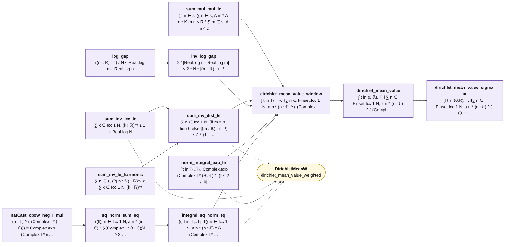

# `lean_stage3/Stage3/DirichletMean.lean`

DirichletMean — block C1 of `lean_stage3/design/carlson.md`. 2026-11-23. An elementary mean value theorem for a finite Dirichlet sum. For `S(t) = Σ_{n ≤ N} a_n n^{-it}` the integral of `|S|²` over a window of length `L` is at most `(L + 8N(1 + log N))·Σ |a_n|²`. The square expands into a double sum; the diagonal gives `L·Σ|a_n|²`. Off the diagonal each integral of `e^{itθ}` is at most `2/|θ|`, the gap `|log m − log n|` is at least `|m − n|/N`, and the harmonic sum bounds each row by `4N(1 + log N)`. A real part `σ`…

13 theorems, 0 definitions, 350 lines. Arrows are Lean's own record of what each proof uses.

**Imports:** nothing in this tree  
**Imported by:** [`Stage3`](../lean_stage3/Stage3.md), [`DirichletMeanW`](../lean_stage3/DirichletMeanW.md)

## The picture



An arrow A → B reads "A is used in the proof of B". Green: counting, integers only. Violet: shape, analysis with no ζ. Blue: reads ζ. A name ending in ■ is an end: nothing else uses it. Red: contains `sorry`. Yellow: theorems in another file, counted; a dotted arrow crosses files. Definitions are not drawn; they are listed below the diagram.

## Theorems

<a name="DirichletMean-natCast_cpow_neg_I_mul"></a>
### `DirichletMean.natCast_cpow_neg_I_mul`

line 39

**Shape.** Uses real or complex analysis; nothing in it or beneath it reads ζ.

**Why.** For `n ≥ 1`, the power `n^{-it}` is the exponential `exp(i·(−log n)·t)`.

**Proves**

```lean
(n : ℂ) ^ (-(Complex.I * (t : ℂ))) = Complex.exp (Complex.I * ((-Real.log n : ℝ) : ℂ) * t)
```

**Needs** (its hypotheses)

  - `` hn : 1 ≤ n ``
  - `` t : ℝ ``

**Fed by:** no theorem of this repo; it stands on Mathlib.

**Feeds** (1 that use it)

  - [`DirichletMean.sq_norm_sum_eq`](#DirichletMean-sq_norm_sum_eq) — `` ((‖∑ n ∈ Icc 1 N, a n * (n : ℂ) ^ (-(Complex.I * (t : ℂ)))‖ ^ 2 : ℝ) : ℂ) = ∑ m ∈ Icc 1 N, ∑ n ∈ Icc 1 N, a m * (starRingEnd ℂ) (a n) * Complex.exp (C… ``

<a name="DirichletMean-sq_norm_sum_eq"></a>
### `DirichletMean.sq_norm_sum_eq`

line 50

**Shape.** Uses real or complex analysis; nothing in it or beneath it reads ζ.

**Why.** The squared norm of a finite Dirichlet sum at height `t` is the double sum of `a_m · conj a_n · e^{it(log n − log m)}`.

**Proves**

```lean
((‖∑ n ∈ Icc 1 N, a n * (n : ℂ) ^ (-(Complex.I * (t : ℂ)))‖ ^ 2 : ℝ) : ℂ) = ∑ m ∈ Icc 1 N, ∑ n ∈ Icc 1 N, a m * (starRingEnd ℂ) (a n) * Complex.exp (Complex.I * ((Real.log n - Real.log m : ℝ) : ℂ) * t)
```

**Needs** (its hypotheses)

  - `` N : ℕ ``
  - `` a : ℕ → ℂ ``
  - `` t : ℝ ``

**Fed by** (1 theorem its proof uses)

  - [`DirichletMean.natCast_cpow_neg_I_mul`](#DirichletMean-natCast_cpow_neg_I_mul) — `` (n : ℂ) ^ (-(Complex.I * (t : ℂ))) = Complex.exp (Complex.I * ((-Real.log n : ℝ) : ℂ) * t) ``

**Feeds** (1 that use it)

  - [`DirichletMean.integral_sq_norm_eq`](#DirichletMean-integral_sq_norm_eq) — `` ((∫ t in T₁..T₂, ‖∑ n ∈ Icc 1 N, a n * (n : ℂ) ^ (-(Complex.I * (t : ℂ)))‖ ^ 2 : ℝ) : ℂ) = ∑ m ∈ Icc 1 N, ∑ n ∈ Icc 1 N, a m * (starRingEnd ℂ) (a n) *… ``

<a name="DirichletMean-integral_sq_norm_eq"></a>
### `DirichletMean.integral_sq_norm_eq`

line 73

**Shape.** Uses real or complex analysis; nothing in it or beneath it reads ζ.

**Why.** The integral of the squared norm over `[T₁, T₂]` is the double sum of `a_m · conj a_n` times the integral of `e^{it(log n − log m)}`.

**Proves**

```lean
((∫ t in T₁..T₂, ‖∑ n ∈ Icc 1 N, a n * (n : ℂ) ^ (-(Complex.I * (t : ℂ)))‖ ^ 2 : ℝ) : ℂ) = ∑ m ∈ Icc 1 N, ∑ n ∈ Icc 1 N, a m * (starRingEnd ℂ) (a n) * ∫ t in T₁..T₂, Complex.exp (Complex.I * ((Real.log n - Real.log m : ℝ) : ℂ) * t)
```

**Needs** (its hypotheses)

  - `` N : ℕ ``
  - `` a : ℕ → ℂ ``
  - `` T₁ T₂ : ℝ ``

**Fed by** (1 theorem its proof uses)

  - [`DirichletMean.sq_norm_sum_eq`](#DirichletMean-sq_norm_sum_eq) — `` ((‖∑ n ∈ Icc 1 N, a n * (n : ℂ) ^ (-(Complex.I * (t : ℂ)))‖ ^ 2 : ℝ) : ℂ) = ∑ m ∈ Icc 1 N, ∑ n ∈ Icc 1 N, a m * (starRingEnd ℂ) (a n) * Complex.exp (C… ``

**Feeds** (2 that use it)

  - [`DirichletMean.dirichlet_mean_value_window`](#DirichletMean-dirichlet_mean_value_window) — `` ∫ t in T₁..T₂, ‖∑ n ∈ Finset.Icc 1 N, a n * (n : ℂ) ^ (-(Complex.I * (t : ℂ)))‖ ^ 2 ≤ (T₂ - T₁ + 8 * N * (1 + Real.log N)) * ∑ n ∈ Finset.Icc 1 N, ‖a … ``
  - [`DirichletMeanW.dirichlet_mean_value_weighted`](../lean_stage3/DirichletMeanW.md#DirichletMeanW-dirichlet_mean_value_weighted) (DirichletMeanW) — `` ∫ t in T₁..T₂, ‖∑ n ∈ Finset.Icc 1 N, a n * (n : ℂ) ^ (-(Complex.I * (t : ℂ)))‖ ^ 2 ≤ ∑ n ∈ Finset.Icc 1 N, ‖a n‖ ^ 2 * ((T₂ - T₁) + 6 * n * (1 + Real… ``

<a name="DirichletMean-norm_integral_exp_le"></a>
### `DirichletMean.norm_integral_exp_le`

line 89

**Shape.** Uses real or complex analysis; nothing in it or beneath it reads ζ.

**Why.** For a nonzero real frequency `θ`, the integral of `e^{iθt}` over any window has norm at most `2/|θ|`.

**Proves**

```lean
‖∫ t in T₁..T₂, Complex.exp (Complex.I * (θ : ℂ) * t)‖ ≤ 2 / |θ|
```

**Needs** (its hypotheses)

  - `` hθ : θ ≠ 0 ``
  - `` T₁ T₂ : ℝ ``

**Fed by:** no theorem of this repo; it stands on Mathlib.

**Feeds** (2 that use it)

  - [`DirichletMean.dirichlet_mean_value_window`](#DirichletMean-dirichlet_mean_value_window) — `` ∫ t in T₁..T₂, ‖∑ n ∈ Finset.Icc 1 N, a n * (n : ℂ) ^ (-(Complex.I * (t : ℂ)))‖ ^ 2 ≤ (T₂ - T₁ + 8 * N * (1 + Real.log N)) * ∑ n ∈ Finset.Icc 1 N, ‖a … ``
  - [`DirichletMeanW.dirichlet_mean_value_weighted`](../lean_stage3/DirichletMeanW.md#DirichletMeanW-dirichlet_mean_value_weighted) (DirichletMeanW) — `` ∫ t in T₁..T₂, ‖∑ n ∈ Finset.Icc 1 N, a n * (n : ℂ) ^ (-(Complex.I * (t : ℂ)))‖ ^ 2 ≤ ∑ n ∈ Finset.Icc 1 N, ‖a n‖ ^ 2 * ((T₂ - T₁) + 6 * n * (1 + Real… ``

<a name="DirichletMean-log_gap"></a>
### `DirichletMean.log_gap`

line 106

**Shape.** Uses real or complex analysis; nothing in it or beneath it reads ζ.

**Why.** For `1 ≤ n < m ≤ N`, the gap between the logarithms is at least `(m − n)/N`.

**Proves**

```lean
((m : ℝ) - n) / N ≤ Real.log m - Real.log n
```

**Needs** (its hypotheses)

  - `` hn : 1 ≤ n ``
  - `` hnm : n < m ``
  - `` hm : m ≤ N ``

**Fed by:** no theorem of this repo; it stands on Mathlib.

**Feeds** (1 that use it)

  - [`DirichletMean.inv_log_gap`](#DirichletMean-inv_log_gap) — `` 2 / |Real.log n - Real.log m| ≤ 2 * N * |(m : ℝ) - n|⁻¹ ``

<a name="DirichletMean-inv_log_gap"></a>
### `DirichletMean.inv_log_gap`

line 120

**Shape.** Uses real or complex analysis; nothing in it or beneath it reads ζ.

**Why.** For distinct `m, n` in `[1, N]`, `2/|log n − log m|` is at most `2N/|m − n|`.

**Proves**

```lean
2 / |Real.log n - Real.log m| ≤ 2 * N * |(m : ℝ) - n|⁻¹
```

**Needs** (its hypotheses)

  - `` hm : m ∈ Icc 1 N ``
  - `` hn : n ∈ Icc 1 N ``
  - `` hne : m ≠ n ``

**Fed by** (1 theorem its proof uses)

  - [`DirichletMean.log_gap`](#DirichletMean-log_gap) — `` ((m : ℝ) - n) / N ≤ Real.log m - Real.log n ``

**Feeds** (1 that use it)

  - [`DirichletMean.dirichlet_mean_value_window`](#DirichletMean-dirichlet_mean_value_window) — `` ∫ t in T₁..T₂, ‖∑ n ∈ Finset.Icc 1 N, a n * (n : ℂ) ^ (-(Complex.I * (t : ℂ)))‖ ^ 2 ≤ (T₂ - T₁ + 8 * N * (1 + Real.log N)) * ∑ n ∈ Finset.Icc 1 N, ‖a … ``

<a name="DirichletMean-sum_inv_le_harmonic"></a>
### `DirichletMean.sum_inv_le_harmonic`

line 149

**Shape.** Uses real or complex analysis; nothing in it or beneath it reads ζ.

**Why.** A sum of `1/g(n)` over a set on which `g` is injective with values in `[1, N]` is at most the harmonic sum up to `N`.

**Proves**

```lean
∑ n ∈ s, ((g n : ℕ) : ℝ)⁻¹ ≤ ∑ k ∈ Icc 1 N, (k : ℝ)⁻¹
```

**Needs** (its hypotheses)

  - `` s : Finset ℕ ``
  - `` g : ℕ → ℕ ``
  - `` hg : Set.InjOn g s ``
  - `` hmap : ∀ n ∈ s, g n ∈ Icc 1 N ``

**Fed by:** no theorem of this repo; it stands on Mathlib.

**Feeds** (1 that use it)

  - [`DirichletMean.sum_inv_dist_le`](#DirichletMean-sum_inv_dist_le) — `` ∑ n ∈ Icc 1 N, (if m = n then 0 else |(m : ℝ) - n|⁻¹) ≤ 2 * (1 + Real.log N) ``

<a name="DirichletMean-sum_inv_Icc_le"></a>
### `DirichletMean.sum_inv_Icc_le`

line 159

**Shape.** Uses real or complex analysis; nothing in it or beneath it reads ζ.

**Why.** The harmonic sum `Σ_{k=1}^{N} 1/k` is at most `1 + log N`.

**Proves**

```lean
∑ k ∈ Icc 1 N, (k : ℝ)⁻¹ ≤ 1 + Real.log N
```

**Needs** (its hypotheses)

  - `` N : ℕ ``

**Fed by:** no theorem of this repo; it stands on Mathlib.

**Feeds** (2 that use it)

  - [`DirichletMean.sum_inv_dist_le`](#DirichletMean-sum_inv_dist_le) — `` ∑ n ∈ Icc 1 N, (if m = n then 0 else |(m : ℝ) - n|⁻¹) ≤ 2 * (1 + Real.log N) ``
  - [`DirichletMeanW.dirichlet_mean_value_weighted`](../lean_stage3/DirichletMeanW.md#DirichletMeanW-dirichlet_mean_value_weighted) (DirichletMeanW) — `` ∫ t in T₁..T₂, ‖∑ n ∈ Finset.Icc 1 N, a n * (n : ℂ) ^ (-(Complex.I * (t : ℂ)))‖ ^ 2 ≤ ∑ n ∈ Finset.Icc 1 N, ‖a n‖ ^ 2 * ((T₂ - T₁) + 6 * n * (1 + Real… ``

<a name="DirichletMean-sum_inv_dist_le"></a>
### `DirichletMean.sum_inv_dist_le`

line 166

**Shape.** Uses real or complex analysis; nothing in it or beneath it reads ζ.

**Why.** For `m` in `[1, N]`, the sum of `1/|m − n|` over the other `n` in `[1, N]` is at most `2(1 + log N)`.

**Proves**

```lean
∑ n ∈ Icc 1 N, (if m = n then 0 else |(m : ℝ) - n|⁻¹) ≤ 2 * (1 + Real.log N)
```

**Needs** (its hypotheses)

  - `` hm : m ∈ Icc 1 N ``

**Fed by** (2 theorems its proof uses)

  - [`DirichletMean.sum_inv_Icc_le`](#DirichletMean-sum_inv_Icc_le) — `` ∑ k ∈ Icc 1 N, (k : ℝ)⁻¹ ≤ 1 + Real.log N ``
  - [`DirichletMean.sum_inv_le_harmonic`](#DirichletMean-sum_inv_le_harmonic) — `` ∑ n ∈ s, ((g n : ℕ) : ℝ)⁻¹ ≤ ∑ k ∈ Icc 1 N, (k : ℝ)⁻¹ ``

**Feeds** (2 that use it)

  - [`DirichletMean.dirichlet_mean_value_window`](#DirichletMean-dirichlet_mean_value_window) — `` ∫ t in T₁..T₂, ‖∑ n ∈ Finset.Icc 1 N, a n * (n : ℂ) ^ (-(Complex.I * (t : ℂ)))‖ ^ 2 ≤ (T₂ - T₁ + 8 * N * (1 + Real.log N)) * ∑ n ∈ Finset.Icc 1 N, ‖a … ``
  - [`DirichletMeanW.dirichlet_mean_value_weighted`](../lean_stage3/DirichletMeanW.md#DirichletMeanW-dirichlet_mean_value_weighted) (DirichletMeanW) — `` ∫ t in T₁..T₂, ‖∑ n ∈ Finset.Icc 1 N, a n * (n : ℂ) ^ (-(Complex.I * (t : ℂ)))‖ ^ 2 ≤ ∑ n ∈ Finset.Icc 1 N, ‖a n‖ ^ 2 * ((T₂ - T₁) + 6 * n * (1 + Real… ``

<a name="DirichletMean-sum_mul_mul_le"></a>
### `DirichletMean.sum_mul_mul_le`

line 206

**Shape.** Uses real or complex analysis; nothing in it or beneath it reads ζ.

**Why.** For a symmetric nonnegative kernel `K` whose rows sum to at most `R`, the quadratic form `Σ_m Σ_n A_m A_n K_{mn}` is at most `R · Σ A_m²`.

**Proves**

```lean
∑ m ∈ s, ∑ n ∈ s, A m * A n * K m n ≤ R * ∑ m ∈ s, A m ^ 2
```

**Needs** (its hypotheses)

  - `` s : Finset ℕ ``
  - `` A : ℕ → ℝ ``
  - `` K : ℕ → ℕ → ℝ ``
  - `` R : ℝ ``
  - `` hK0 : ∀ m ∈ s, ∀ n ∈ s, 0 ≤ K m n ``
  - `` hsym : ∀ m n, K m n = K n m ``
  - `` hrow : ∀ m ∈ s, ∑ n ∈ s, K m n ≤ R ``

**Fed by:** no theorem of this repo; it stands on Mathlib.

**Feeds** (1 that use it)

  - [`DirichletMean.dirichlet_mean_value_window`](#DirichletMean-dirichlet_mean_value_window) — `` ∫ t in T₁..T₂, ‖∑ n ∈ Finset.Icc 1 N, a n * (n : ℂ) ^ (-(Complex.I * (t : ℂ)))‖ ^ 2 ≤ (T₂ - T₁ + 8 * N * (1 + Real.log N)) * ∑ n ∈ Finset.Icc 1 N, ‖a … ``

<a name="DirichletMean-dirichlet_mean_value_window"></a>
### `DirichletMean.dirichlet_mean_value_window`

line 231

**Shape.** Uses real or complex analysis; nothing in it or beneath it reads ζ.

**Why.** On a window `[T₁, T₂]`, the mean square of a finite Dirichlet sum `Σ_{n ≤ N} a_n n^{-it}` is at most `(T₂ − T₁ + 8N(1 + log N))·Σ |a_n|²`.

**Proves**

```lean
∫ t in T₁..T₂, ‖∑ n ∈ Finset.Icc 1 N, a n * (n : ℂ) ^ (-(Complex.I * (t : ℂ)))‖ ^ 2 ≤ (T₂ - T₁ + 8 * N * (1 + Real.log N)) * ∑ n ∈ Finset.Icc 1 N, ‖a n‖ ^ 2
```

**Needs** (its hypotheses)

  - `` N : ℕ ``
  - `` a : ℕ → ℂ ``
  - `` h : T₁ ≤ T₂ ``

**Fed by** (5 theorems its proof uses)

  - [`DirichletMean.integral_sq_norm_eq`](#DirichletMean-integral_sq_norm_eq) — `` ((∫ t in T₁..T₂, ‖∑ n ∈ Icc 1 N, a n * (n : ℂ) ^ (-(Complex.I * (t : ℂ)))‖ ^ 2 : ℝ) : ℂ) = ∑ m ∈ Icc 1 N, ∑ n ∈ Icc 1 N, a m * (starRingEnd ℂ) (a n) *… ``
  - [`DirichletMean.inv_log_gap`](#DirichletMean-inv_log_gap) — `` 2 / |Real.log n - Real.log m| ≤ 2 * N * |(m : ℝ) - n|⁻¹ ``
  - [`DirichletMean.norm_integral_exp_le`](#DirichletMean-norm_integral_exp_le) — `` ‖∫ t in T₁..T₂, Complex.exp (Complex.I * (θ : ℂ) * t)‖ ≤ 2 / |θ| ``
  - [`DirichletMean.sum_inv_dist_le`](#DirichletMean-sum_inv_dist_le) — `` ∑ n ∈ Icc 1 N, (if m = n then 0 else |(m : ℝ) - n|⁻¹) ≤ 2 * (1 + Real.log N) ``
  - [`DirichletMean.sum_mul_mul_le`](#DirichletMean-sum_mul_mul_le) — `` ∑ m ∈ s, ∑ n ∈ s, A m * A n * K m n ≤ R * ∑ m ∈ s, A m ^ 2 ``

**Feeds** (1 that use it)

  - [`DirichletMean.dirichlet_mean_value`](#DirichletMean-dirichlet_mean_value) — `` ∫ t in (0:ℝ)..T, ‖∑ n ∈ Finset.Icc 1 N, a n * (n : ℂ) ^ (-(Complex.I * (t : ℂ)))‖ ^ 2 ≤ (T + 8 * N * (1 + Real.log N)) * ∑ n ∈ Finset.Icc 1 N, ‖a n‖ ^… ``

<a name="DirichletMean-dirichlet_mean_value"></a>
### `DirichletMean.dirichlet_mean_value`

line 301

**Shape.** Uses real or complex analysis; nothing in it or beneath it reads ζ.

**Why.** On `[0, T]`, the mean square of a finite Dirichlet sum `Σ_{n ≤ N} a_n n^{-it}` is at most `(T + 8N(1 + log N))·Σ |a_n|²`.

**Proves**

```lean
∫ t in (0:ℝ)..T, ‖∑ n ∈ Finset.Icc 1 N, a n * (n : ℂ) ^ (-(Complex.I * (t : ℂ)))‖ ^ 2 ≤ (T + 8 * N * (1 + Real.log N)) * ∑ n ∈ Finset.Icc 1 N, ‖a n‖ ^ 2
```

**Needs** (its hypotheses)

  - `` N : ℕ ``
  - `` a : ℕ → ℂ ``
  - `` hT : 0 ≤ T ``

**Fed by** (1 theorem its proof uses)

  - [`DirichletMean.dirichlet_mean_value_window`](#DirichletMean-dirichlet_mean_value_window) — `` ∫ t in T₁..T₂, ‖∑ n ∈ Finset.Icc 1 N, a n * (n : ℂ) ^ (-(Complex.I * (t : ℂ)))‖ ^ 2 ≤ (T₂ - T₁ + 8 * N * (1 + Real.log N)) * ∑ n ∈ Finset.Icc 1 N, ‖a … ``

**Feeds** (1 that use it)

  - [`DirichletMean.dirichlet_mean_value_sigma`](#DirichletMean-dirichlet_mean_value_sigma) — `` ∫ t in (0:ℝ)..T, ‖∑ n ∈ Finset.Icc 1 N, a n * (n : ℂ) ^ (-((σ : ℂ) + Complex.I * (t : ℂ)))‖ ^ 2 ≤ (T + 8 * N * (1 + Real.log N)) * ∑ n ∈ Finset.Icc 1 … ``

<a name="DirichletMean-dirichlet_mean_value_sigma"></a>
### `DirichletMean.dirichlet_mean_value_sigma`

line 309

**Shape.** Uses real or complex analysis; nothing in it or beneath it reads ζ.

**Why.** With a real part `σ`, the mean square on `[0, T]` of `Σ_{n ≤ N} a_n n^{-(σ+it)}` is at most `(T + 8N(1 + log N))·Σ |a_n|²·n^{-2σ}`.

**Proves**

```lean
∫ t in (0:ℝ)..T, ‖∑ n ∈ Finset.Icc 1 N, a n * (n : ℂ) ^ (-((σ : ℂ) + Complex.I * (t : ℂ)))‖ ^ 2 ≤ (T + 8 * N * (1 + Real.log N)) * ∑ n ∈ Finset.Icc 1 N, ‖a n‖ ^ 2 * (n : ℝ) ^ (-2 * σ)
```

**Needs** (its hypotheses)

  - `` N : ℕ ``
  - `` a : ℕ → ℂ ``
  - `` σ : ℝ ``
  - `` hT : 0 ≤ T ``

**Fed by** (1 theorem its proof uses)

  - [`DirichletMean.dirichlet_mean_value`](#DirichletMean-dirichlet_mean_value) — `` ∫ t in (0:ℝ)..T, ‖∑ n ∈ Finset.Icc 1 N, a n * (n : ℂ) ^ (-(Complex.I * (t : ℂ)))‖ ^ 2 ≤ (T + 8 * N * (1 + Real.log N)) * ∑ n ∈ Finset.Icc 1 N, ‖a n‖ ^… ``

**Feeds:** nothing. It is an end.

