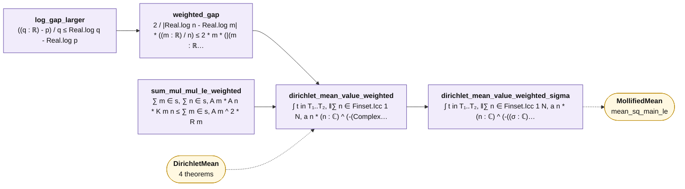

# `lean_stage3/Stage3/DirichletMeanW.lean`

DirichletMeanW — block C1b of `lean_stage3/design/carlson.md`. 2026-11-23. A weighted mean value theorem for a finite Dirichlet sum. It replaces the uniform length `N` of block C1 by each term's own index: for `S(t) = Σ_{n ≤ N} a_n n^{-it}` the integral of `|S|²` over a window of length `L` is at most `Σ |a_n|²·(L + 6n(1 + log N))`. The square expands into a double sum as in `DirichletMean`. Off the diagonal the kernel is at most `2/|log m − log n|`. A weighted Schur test with weights `1/n` charges row `m` the cost…

5 theorems, 0 definitions, 259 lines. Arrows are Lean's own record of what each proof uses.

**Imports:** [`DirichletMean`](../lean_stage3/DirichletMean.md)  
**Imported by:** [`Stage3`](../lean_stage3/Stage3.md), [`MollifiedMean`](../lean_stage3/MollifiedMean.md)

## The picture



An arrow A → B reads "A is used in the proof of B". Green: counting, integers only. Violet: shape, analysis with no ζ. Blue: reads ζ. A name ending in ■ is an end: nothing else uses it. Red: contains `sorry`. Yellow: theorems in another file, counted; a dotted arrow crosses files. Definitions are not drawn; they are listed below the diagram.

## Theorems

<a name="DirichletMeanW-log_gap_larger"></a>
### `DirichletMeanW.log_gap_larger`

line 33

**Shape.** Uses real or complex analysis; nothing in it or beneath it reads ζ.

**Why.** For `1 ≤ p < q`, the gap between the logarithms is at least `(q − p)/q`, with the larger index in the denominator.

**Proves**

```lean
((q : ℝ) - p) / q ≤ Real.log q - Real.log p
```

**Needs** (its hypotheses)

  - `` hp : 1 ≤ p ``
  - `` hpq : p < q ``

**Fed by:** no theorem of this repo; it stands on Mathlib.

**Feeds** (1 that use it)

  - [`DirichletMeanW.weighted_gap`](#DirichletMeanW-weighted_gap) — `` 2 / |Real.log n - Real.log m| * ((m : ℝ) / n) ≤ 2 * m * (|(m : ℝ) - n|⁻¹ + (n : ℝ)⁻¹) ``

<a name="DirichletMeanW-weighted_gap"></a>
### `DirichletMeanW.weighted_gap`

line 45

**Shape.** Uses real or complex analysis; nothing in it or beneath it reads ζ.

**Why.** For distinct `m, n ≥ 1`, the off-diagonal kernel bound `2/|log n − log m|` times the weight ratio `m/n` is at most `2m(1/|m − n| + 1/n)`.

**Proves**

```lean
2 / |Real.log n - Real.log m| * ((m : ℝ) / n) ≤ 2 * m * (|(m : ℝ) - n|⁻¹ + (n : ℝ)⁻¹)
```

**Needs** (its hypotheses)

  - `` hm : 1 ≤ m ``
  - `` hn : 1 ≤ n ``
  - `` hne : m ≠ n ``

**Fed by** (1 theorem its proof uses)

  - [`DirichletMeanW.log_gap_larger`](#DirichletMeanW-log_gap_larger) — `` ((q : ℝ) - p) / q ≤ Real.log q - Real.log p ``

**Feeds** (1 that use it)

  - [`DirichletMeanW.dirichlet_mean_value_weighted`](#DirichletMeanW-dirichlet_mean_value_weighted) — `` ∫ t in T₁..T₂, ‖∑ n ∈ Finset.Icc 1 N, a n * (n : ℂ) ^ (-(Complex.I * (t : ℂ)))‖ ^ 2 ≤ ∑ n ∈ Finset.Icc 1 N, ‖a n‖ ^ 2 * ((T₂ - T₁) + 6 * n * (1 + Real… ``

<a name="DirichletMeanW-sum_mul_mul_le_weighted"></a>
### `DirichletMeanW.sum_mul_mul_le_weighted`

line 94

**Shape.** Uses real or complex analysis; nothing in it or beneath it reads ζ.

**Why.** Weighted Schur test: for a symmetric nonnegative kernel `K` and positive weights `w`, the quadratic form `Σ_m Σ_n A_m A_n K_{mn}` is at most `Σ_m A_m²·R_m` whenever each weighted row `Σ_n K_{mn}·(w_m/w_n)` is at most `R_m`.

**Proves**

```lean
∑ m ∈ s, ∑ n ∈ s, A m * A n * K m n ≤ ∑ m ∈ s, A m ^ 2 * R m
```

**Needs** (its hypotheses)

  - `` s : Finset ℕ ``
  - `` A w : ℕ → ℝ ``
  - `` K : ℕ → ℕ → ℝ ``
  - `` R : ℕ → ℝ ``
  - `` hw : ∀ m ∈ s, 0 < w m ``
  - `` hK0 : ∀ m ∈ s, ∀ n ∈ s, 0 ≤ K m n ``
  - `` hsym : ∀ m n, K m n = K n m ``
  - `` hrow : ∀ m ∈ s, ∑ n ∈ s, K m n * (w m / w n) ≤ R m ``

**Fed by:** no theorem of this repo; it stands on Mathlib.

**Feeds** (1 that use it)

  - [`DirichletMeanW.dirichlet_mean_value_weighted`](#DirichletMeanW-dirichlet_mean_value_weighted) — `` ∫ t in T₁..T₂, ‖∑ n ∈ Finset.Icc 1 N, a n * (n : ℂ) ^ (-(Complex.I * (t : ℂ)))‖ ^ 2 ≤ ∑ n ∈ Finset.Icc 1 N, ‖a n‖ ^ 2 * ((T₂ - T₁) + 6 * n * (1 + Real… ``

<a name="DirichletMeanW-dirichlet_mean_value_weighted"></a>
### `DirichletMeanW.dirichlet_mean_value_weighted`

line 136

**Shape.** Uses real or complex analysis; nothing in it or beneath it reads ζ.

**Why.** On a window `[T₁, T₂]`, the mean square of a finite Dirichlet sum `Σ_{n ≤ N} a_n n^{-it}` is at most `Σ |a_n|²·(T₂ − T₁ + 6n(1 + log N))`, each term charged its own index `n`.

**Proves**

```lean
∫ t in T₁..T₂, ‖∑ n ∈ Finset.Icc 1 N, a n * (n : ℂ) ^ (-(Complex.I * (t : ℂ)))‖ ^ 2 ≤ ∑ n ∈ Finset.Icc 1 N, ‖a n‖ ^ 2 * ((T₂ - T₁) + 6 * n * (1 + Real.log N))
```

**Needs** (its hypotheses)

  - `` N : ℕ ``
  - `` a : ℕ → ℂ ``
  - `` h : T₁ ≤ T₂ ``

**Fed by** (6 theorems its proof uses)

  - [`DirichletMean.integral_sq_norm_eq`](../lean_stage3/DirichletMean.md#DirichletMean-integral_sq_norm_eq) (DirichletMean) — `` ((∫ t in T₁..T₂, ‖∑ n ∈ Icc 1 N, a n * (n : ℂ) ^ (-(Complex.I * (t : ℂ)))‖ ^ 2 : ℝ) : ℂ) = ∑ m ∈ Icc 1 N, ∑ n ∈ Icc 1 N, a m * (starRingEnd ℂ) (a n) *… ``
  - [`DirichletMean.norm_integral_exp_le`](../lean_stage3/DirichletMean.md#DirichletMean-norm_integral_exp_le) (DirichletMean) — `` ‖∫ t in T₁..T₂, Complex.exp (Complex.I * (θ : ℂ) * t)‖ ≤ 2 / |θ| ``
  - [`DirichletMean.sum_inv_Icc_le`](../lean_stage3/DirichletMean.md#DirichletMean-sum_inv_Icc_le) (DirichletMean) — `` ∑ k ∈ Icc 1 N, (k : ℝ)⁻¹ ≤ 1 + Real.log N ``
  - [`DirichletMean.sum_inv_dist_le`](../lean_stage3/DirichletMean.md#DirichletMean-sum_inv_dist_le) (DirichletMean) — `` ∑ n ∈ Icc 1 N, (if m = n then 0 else |(m : ℝ) - n|⁻¹) ≤ 2 * (1 + Real.log N) ``
  - [`DirichletMeanW.sum_mul_mul_le_weighted`](#DirichletMeanW-sum_mul_mul_le_weighted) — `` ∑ m ∈ s, ∑ n ∈ s, A m * A n * K m n ≤ ∑ m ∈ s, A m ^ 2 * R m ``
  - [`DirichletMeanW.weighted_gap`](#DirichletMeanW-weighted_gap) — `` 2 / |Real.log n - Real.log m| * ((m : ℝ) / n) ≤ 2 * m * (|(m : ℝ) - n|⁻¹ + (n : ℝ)⁻¹) ``

**Feeds** (1 that use it)

  - [`DirichletMeanW.dirichlet_mean_value_weighted_sigma`](#DirichletMeanW-dirichlet_mean_value_weighted_sigma) — `` ∫ t in T₁..T₂, ‖∑ n ∈ Finset.Icc 1 N, a n * (n : ℂ) ^ (-((σ : ℂ) + Complex.I * (t : ℂ)))‖ ^ 2 ≤ ∑ n ∈ Finset.Icc 1 N, ‖a n‖ ^ 2 * (n : ℝ) ^ (-2 * σ) *… ``

<a name="DirichletMeanW-dirichlet_mean_value_weighted_sigma"></a>
### `DirichletMeanW.dirichlet_mean_value_weighted_sigma`

line 222

**Shape.** Uses real or complex analysis; nothing in it or beneath it reads ζ.

**Why.** With a real part `σ`, the mean square on `[T₁, T₂]` of `Σ_{n ≤ N} a_n n^{-(σ+it)}` is at most `Σ |a_n|²·n^{-2σ}·(T₂ − T₁ + 6n(1 + log N))`, each term charged its own index `n`.

**Proves**

```lean
∫ t in T₁..T₂, ‖∑ n ∈ Finset.Icc 1 N, a n * (n : ℂ) ^ (-((σ : ℂ) + Complex.I * (t : ℂ)))‖ ^ 2 ≤ ∑ n ∈ Finset.Icc 1 N, ‖a n‖ ^ 2 * (n : ℝ) ^ (-2 * σ) * ((T₂ - T₁) + 6 * n * (1 + Real.log N))
```

**Needs** (its hypotheses)

  - `` N : ℕ ``
  - `` a : ℕ → ℂ ``
  - `` σ : ℝ ``
  - `` h : T₁ ≤ T₂ ``

**Fed by** (1 theorem its proof uses)

  - [`DirichletMeanW.dirichlet_mean_value_weighted`](#DirichletMeanW-dirichlet_mean_value_weighted) — `` ∫ t in T₁..T₂, ‖∑ n ∈ Finset.Icc 1 N, a n * (n : ℂ) ^ (-(Complex.I * (t : ℂ)))‖ ^ 2 ≤ ∑ n ∈ Finset.Icc 1 N, ‖a n‖ ^ 2 * ((T₂ - T₁) + 6 * n * (1 + Real… ``

**Feeds** (1 that use it)

  - [`MollifiedMean.mean_sq_main_le`](../lean_stage3/MollifiedMean.md#MollifiedMean-mean_sq_main_le) (MollifiedMean) — `` ∫ t in (1:ℝ)..T, ‖∑ n ∈ Icc 1 (N * X), (b X N n : ℂ) * (n : ℂ) ^ (-((u : ℂ) + Complex.I * (t : ℂ)))‖ ^ 2 ≤ T * (2 / (1 - (2:ℝ) ^ (1 - 2 * u))) * (X:ℝ)… ``

